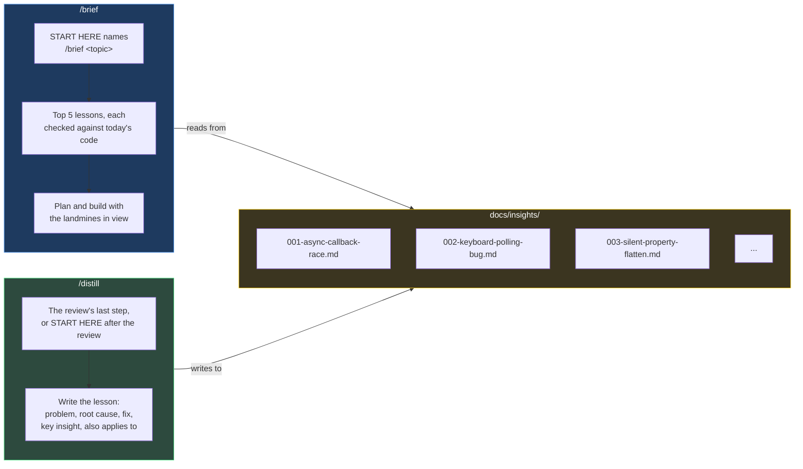
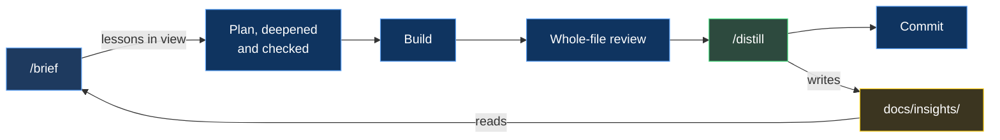

# Distill & Brief

**Status: active.** Two skills, and no hook around them (why, below).

### How We Stopped Losing What We Learned

---

> **The pitch:** Every engineering session produces hard-won knowledge. By the next session, it's gone.
>
> Two skills close the loop: `/brief` reads the lessons that bear on the work before it starts, and `/distill` writes the new lesson when it's done. What makes them run is plain: the next step is named, by name, where the next session starts.

---

## The Problem

AI coding agents have amnesia. Each session starts from zero.

When you spend 45 minutes discovering that an async callback silently drops valid data because of a stale request ID, that knowledge lives in the conversation. When the session ends, it evaporates. The next session hits the exact same wall.

```
Session 1: Debug for 45 min  -->  Find root cause  -->  Fix it  -->  Session ends
Session 2: Debug for 45 min  -->  Find root cause  -->  "...wait, didn't we do this before?"
```

A standing rule ("check past fixes before work") doesn't hold: humans forget to ask, and agents let it slide under task pressure.

---

## The Solution

Two directions. Two skills. One shared store of lessons.



### When each one runs

- **`/brief`:** at the start of every sizable job, before the plan, and at the start of each build unit's session. It greps the lessons' frontmatter for one topic (steered by a corpus card capped under 4 KB), reads the top 5 in full, and checks each against today's code.
- **`/distill`:** as the deep review's last step for a job done in one session. For a job that spans sessions, each close queues the session's lessons in the TODO's DISTILL CANDIDATES list, and `/distill` writes them once, after the job's whole-file review.
- **Either one, any time:** "brief me on X", "distill this".

What makes them run is the TODO's START HERE line: every session's close writes the job's next step there by name (`/brief <topic>`, the whole-file review, `/distill`), and the next session starts there. The rule lives in [squeaky-clean](../squeaky-clean/SKILL.md) step 1 and [playbook/principles.md](../../../playbook/principles.md).

---

## Why This Approach

| Approach | Verdict | Why |
|----------|---------|-----|
| **A standing rule** ("check insights before work", in memory or a TODO's standing list) | Rejected | It fades. A B9 TODO line asked for `/brief` before every unit from June on; main sessions ran it 0 times from 09-17 to 10-18. |
| **Blocking hooks keyed on skill names** (hold the build skill until `/brief`; block the stop until `/distill`) | Rejected (Briggsy, 2026-10-31) | Builds don't go through a build skill, so the brief gate held nothing. The distill gate armed when a review skill loaded and fired at Claude's next turn end, minutes before a long review was done: 6 times in 6 review sessions checked from 10-20 to 10-31, 5 of them waved off. |
| **The plugin's lesson tools** (compound-engineering's `ce-compound` and learnings researcher) | Rejected | They write and read their own `solutions/` folder in their own format, so `/brief` would never see those lessons. |
| **Claude Code's own memory** | Rejected | By design it skips what can be derived from the code and debugging fixes, which is exactly what these lessons hold, and it lives on one laptop, outside this repo. |
| **Name the next step where the next session starts** | Selected | From 10-20 to 10-31, every step a START HERE line named ran. `/brief`, left unnamed through most of one job's build, ran in about 4 of its 13 build sessions. Plus skills that run their own next step: the deep review ends by running `/distill`. |

### The skills

- **`/distill`** uses dynamic context injection to list the existing insight filenames and compute the next number before the agent writes; its quality bar greps the corpus's `title:` / `tags:` lines to prevent duplicates, and extends an existing insight when one already covers the pattern.
- **`/brief`** injects a size-capped corpus card (counts, frontmatter coverage, tag vocabulary; never an insight body), then greps the frontmatter for ONE topic and reads at most the top 5 insights in full, on demand, in any session. A lesson the code has outgrown gets corrected in place before the brief ends.

---

## What an Insight Doc Looks Like

Lean and focused: as short as it can be while it still carries the problem, the cause and the lesson. When a later case teaches more about the same trap, it goes into the existing doc as a dated `## Extended (YYYY-MM-DD): ...` section instead of a near-copy.

```markdown
---
title: Seeker frozen — async pathfinding callback invalidation
date: 2026-03-31
phase: 5a
modules: [game/ai/seeker-fsm, game/engine]
tags: [async, pathfinding, race-condition, FSM]
---

## Problem
Seeker AI stops moving after 2-3 path requests. Visually frozen in place.

## Root Cause
Async pathfinding callback fires after FSM state transition.
New state's path request overwrites `latestRequestId`, but the old
callback still references the stale ID. Guard check silently drops
the valid path.

## Fix
Added `pendingPath: boolean` to SeekerAIInternalState. Set on request,
cleared on callback or clearPath(). All 4 FSM states guard on it.

## Key Insight
Any async callback that touches shared state needs a generation counter
AND a pending flag. The counter alone creates a silent-drop window.

## Also Applies To
Any future async system (sound loading, network requests) that uses
request-ID-based supersession.
```

---

## The Bigger Picture



Brief. Plan. Build. Review. Distill. Commit. Repeat. The knowledge base grows (275 lessons across nine insight folders as of 2026-10-31: the-back-nine 148, burned 72, family-feud 38, ai-journey-stats 8, the playbook 5, three skills 1 each, the repo root 1). Rediscovery drops. The whole flow, step by step: [the playbook](../../../playbook/README.md#the-plays-in-order).

---

## Appendix: Engineering the Skills

We ran both `/distill` and `/brief` through Anthropic's [Skill Creator](https://github.com/anthropics/skills), the meta-skill that turns skill development from vibes into engineering.

### A/B Eval Results

Both skills were optimized through the Skill Creator's description optimizer: 5 iterations each, 20 queries, 3 runs per query, 0.4 holdout split.

**`/distill`**: 3 test cases, 6 parallel subagents (with-skill + baseline for each):

| Metric | /distill | No Skill | Delta |
|--------|---------|----------|-------|
| **Pass Rate** | 100% (18/18) | 33% (6/18) | **+67%** |
| **Avg Tokens** | 26.6K | 28.4K | -1.8K |
| **Avg Lines** | 49 | 101 | -52 |

**`/brief`**: 3 test cases, 6 parallel subagents:

| Metric | /brief | No Skill | Delta |
|--------|--------|----------|-------|
| **Avg Tokens** | 43.2K | 36.2K | +7K |
| **Avg Lines** | 83 | 83 | 0 |
| **Avg Words** | 857 | 792 | +65 |

`/brief` shows minimal quality delta because it's a **read skill**: it surfaces existing insight docs, and without the skill Claude still finds and reads `docs/insights/`. Its value is that it runs, at the right moment, and stays cheap (a brief takes under a minute). `/distill` shows the large delta because it's a **write skill**: the template enforces structure that Claude doesn't produce on its own.

The skills don't make Claude smarter; they make Claude **consistent**. `/distill` proves this with half the length and perfect structure every time. `/brief` proves a different thing: the real value of a read skill is that it runs when the work starts, which is why the next step gets named where the next session starts.

### What the Baseline Gets Wrong

Without the skill, Claude produces good documentation but with:
- Inconsistent structure (5-7 sections with varying names vs exactly 5 every time)
- No YAML frontmatter (2 of 3 baselines skipped it entirely)
- 2x the line count (88-115 lines vs 47-53)
- No sequential file numbering
- Key Insights that restate the fix instead of generalizing

### Windows Bug: `select.select()` on Pipes

While running the Skill Creator's description optimizer, we hit `WinError 10038`: every trigger test returned 0%. Root cause: `run_eval.py` uses Python's `select.select()` to read subprocess pipes. On Windows, `select.select()` only works with sockets, not pipes. Every query silently failed.

**The fix:** Replace `select.select()` with a threading-based reader: a background thread does blocking reads from the pipe and puts lines into a `queue.Queue`. The main loop pulls from the queue with a timeout. Same behavior, cross-platform.

```python
# Before (Unix-only):
ready, _, _ = select.select([process.stdout], [], [], 1.0)

# After (cross-platform):
line_queue: queue.Queue[str | None] = queue.Queue()
def _reader():
    for raw_line in process.stdout:
        line_queue.put(raw_line.decode("utf-8", errors="replace"))
    line_queue.put(None)  # sentinel
threading.Thread(target=_reader, daemon=True).start()
```

Anthropic merged this same fix on March 13, 2026 in `claude-plugins-official`. The `anthropic-agent-skills` plugin hadn't picked it up when we applied it locally.
