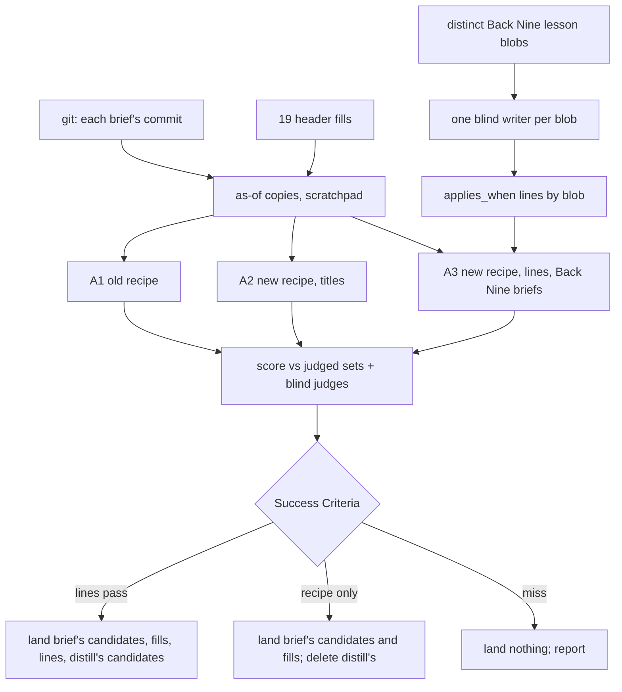

# Brief Recall Fix - Plan

## Goal Capsule

- **Objective:** before a job starts, the session sees the past lessons that bear on it. On the Back Nine, where brief now finds about 2 in 5 of them, it finds clearly more, without burying them in noise, as measured against the old brief on the same 17 jobs.
- **Means:** a one-line `applies_when` header in each lesson that brief reads by meaning, plus a recipe that scores every match and reads more for big jobs (KTD1-KTD4), proven on frozen copies before anything lands (KTD7).
- **Authority:** the Product Contract's R-IDs win on behavior; KTDs win on mechanism within them; units carry only local detail. Briggsy owns what and why; the pilot owns how.
- **Stop conditions:** stop and report, landing nothing, when the re-score misses the bar in Success Criteria; when the line writers cannot be kept blind to the benchmark (R10); or when a Back Nine gate fails on the landing and the cause is not a one-line fix.
- **Execution profile:** direct commits on `main` in the one shared checkout, each staged by path (`git commit -- <paths>`, never `-a`); no pull request. The work spans sessions; each close names the next unit in the playbook TODO's START HERE.
- **Who finishes:** the pilot, across the next sessions; Briggsy gets the measured numbers and the verdict in plain words.

---

## Product Contract

### Summary

Every lesson gets a one-line "applies when" header that /distill writes and /brief reads by meaning. Brief scores every lesson its search finds, reads up to 10 for a big job, and matches words only at their start. The Back Nine's 148 lessons get their lines, and 19 unlabeled lessons get headers. Both changes are tested against the old brief on the saved 17-job benchmark, on frozen copies, before any of it goes live. Burned and Feud get their lines only after the Back Nine result lands the lines.

### Problem Frame

Brief exists so a session doesn't walk into a trap a past session already paid for. On 2026-10-31 a blind benchmark (`projects/skills/distill-and-brief/brief/results/recall-benchmark-2026-10-31.json`) scored the 17 briefs run from 10-19 to 10-31. On the small how-we-work folders brief found all 19 lessons that mattered. On the Back Nine's 148 lessons it found 87 of 222, and 11 of those 87 counted only because the job's plan already cited them. Across all projects, 73 of the 140 misses show the work then ran into that exact trap, mostly caught later by a review, at the cost of rework.

The misses have five causes: 37 lessons were found and then dropped before scoring (the recipe's "more than 25, tighten" step), 41 shared no word with how the job was described, 25 had no tags or no header, 21 were cut by the read-5 limit, and 5 were crowded out by a word matching inside another word ("fica" inside "verification"). The search works by shared words, while a job is described by its feature and a lesson by how something broke.

### Requirements

**The lesson header**
- R1. A lesson can carry one `applies_when` line naming the situations it applies to, in terms of what the work touches or does, so a job described by its feature can match a lesson described by its failure.
- R2. /distill writes the line for every new lesson and revises it when it extends an existing lesson.

**What brief does**
- R3. Brief scores every lesson its header search matches; none is dropped before scoring.
- R4. Brief also judges every lesson's `applies_when` line, or its title where the lesson has none, by meaning against the job, so a lesson sharing no word with the job can still be found.
- R5. Brief reads up to 10 lessons in full for a big job and 5 otherwise, and names the next ones by title.
- R6. A search word matches only at the start of a word: "seed" still finds "dev-seeds", and "fica" no longer finds "verification".
- R7. Brief's output stays compact: at most 10 landmines for a big job and 5 otherwise, and at most 10 also-relevant lines.
- R8. Brief never loses lessons silently to a tool's output limit; when it cannot see the whole list, it says so.

**The backfill**
- R9. The Back Nine's 148 lessons get `applies_when` lines; its 10 lessons with empty tags (008 062 063 064 065 069 072 091 097 098) get tags; Feud's 9 headerless lessons (017 025 026 027 028 031 032 033 034) get a header.
- R10. Whoever writes a line sees only that lesson's text: never the benchmark, its topics or its judged lessons.

**Proof**
- R11. The old and new recipes run on the benchmark's 17 jobs against frozen as-of copies of each job's lessons, scored against the judged lessons, with lessons named outside the judged sets judged blind, and each result stamped with a hash of the recipe bytes that produced it.
- R12. The bar for landing is set in this plan before any run (Success Criteria); a miss lands nothing and is reported.
- R13. No doc claims better recall until the re-score lands; then the docs state the measured numbers and that they are in-sample.

**Rollout**
- R14. Burned's 72 and Feud's 38 lessons get `applies_when` lines only after the Back Nine re-score lands the lines.

### Key Decisions

- **The index lives inside each lesson, as one header line.** A separate index file is a second copy of every lesson and drifts (the Back Nine's insight 122). (session-settled: user-approved — chosen over a separate index file of lessons: "another asset to be out of sync") Governs R1, R2.
- **Prove it on the Back Nine and the saved benchmark before backfilling everything.** (session-settled: user-approved — chosen over backfilling all 275 lessons first: if the number doesn't move, the idea is dropped at the cost of an afternoon) Governs R11, R12, R14.
- **Brief's search changes: score every match, read more for big jobs, match words properly, label the unlabeled lessons.** (session-settled: user-approved — chosen over leaving brief as it is: it finds about 2 in 5 of the Back Nine lessons that matter) Governs R3, R5, R6, R9.

### Success Criteria

Measured on the Back Nine's judged pairs (the benchmark's 222 judged relevant, plus every outside name a KTD9 judge holds relevant), recall is the share of judged lessons a brief names, as a landmine or an also-relevant line. Plan credit counts for no arm. Precision is the share of all named lessons that a judge (original or KTD9) holds relevant. Arms are defined in KTD6; each runs twice. Every comparison sets the candidate arm's worse run against the other arm's better run, for recall and precision alike.
- **The precision condition:** the candidate arm's precision is no more than 10 points below the old arm's (A1).
- **The small-corpus guard:** on each of the 6 briefs scored outside the Back Nine (B08 to B12 and B16), no judged lesson that both old runs (A1) named is missed by both titles-only runs (A2). A lesson only one old run named is run noise, not a loss. This job writes no lines for small folders (R14 puts Feud's off), so they keep the titles-only state after any landing, and the guard reads A2's runs for both landing outcomes.
- **Land the new recipe, the 19 header fills and the Back Nine's `applies_when` lines** when the full arm (A3) beats the titles-only arm by at least 5 points of recall and the old arm by at least 10, both arms meet the precision condition, and the small-corpus guard holds. This holds whether or not the titles-only arm cleared its 10-point recall bar: both arms run the same recipe bytes, so the Back Nine gets what A3 measured, and every folder without lines (Feud and Burned until R14, the how-we-work folders for good) gets what A2 measured, which the precision condition and the guard check.
- **Land the new recipe and the 19 header fills, without `applies_when`,** when the titles-only arm beats the old arm by at least 10 points under the precision condition and the small-corpus guard, and the full arm misses the bar above.
- **Land nothing** when neither holds. Report the numbers.
- Reported alongside, not gating: recall at an equal budget (each arm's first 10 names in its own ranking order, landmines then also-relevant lines; 10 is the old recipe's whole output), strong-lesson recall, recall on the 69 Back Nine pairs the benchmark marks as traps the work then hit, and how often a tool result was saved to a file instead of shown (KTD6).

### Scope Boundaries

- Not a separate index file (Key Decisions).
- Not a tag-vocabulary cleanup: the Back Nine has 880 distinct tags, 740 used once; the meaning pass covers what they miss.
- Not a search across projects' lessons: no measured case of it costing us.
- No hook or gate: brief runs because START HERE names it (playbook insight 009).
- Brief's code-check and correction step (its step 5) is unchanged.
- The Back Nine's 140 KB `docs/insights/README.md` index is untouched; its gate (`verify:doc-stats`) checks only links and section headings.
- Considered and not built: a run-to-run variance study beyond two runs per arm. Two runs and margins of 10 and 5 points are the guard; more runs would be warranted if the two runs of one arm differ by more than the margin.
- Considered and not built: a card line listing the lessons that lack `applies_when`. No recipe step reads it, the card's field-count line already gives the count, and on Burned and Feud it would print every lesson's number until R14. A step that needs the list would change this.

#### Deferred to Follow-Up Work

- `applies_when` for Burned and Feud (R14), after a Back Nine verdict that lands the lines, with an `applies_when` row in Burned's `docs/insights/README.md` frontmatter conventions table.
- A forward check: blind-judge the next five real briefs after landing, the same way, so a number measured on the misses that shaped the fix is checked on jobs it never saw.

---

## Planning Contract

### Key Technical Decisions

- KTD1. **`applies_when` is a one-line YAML flow list, under CE's field name.** Shape: `applies_when: [changing what feeds the gross-up solver, adding a tax rule's input]`. CE 3.34.0 uses the same name for its packs as a block list, which brief's one-line header grep cannot see; a flow list keeps CE's meaning (a list of conditions) and our one-line field convention (`modules: [...]`, `tags: [...]`), and `corpus.mjs` already parses any `key: value` line. Each line holds 2 to 4 situations, at most 160 characters, phrased as what the work touches or does; never the lesson's conclusion, a lesson number, a session name or a date.
- KTD2. **Brief reads every line through a paged listing from `corpus.mjs`, not through Grep.** A Grep of all 148 Back Nine titles is about 49 KB with paths, Grep stops at 250 lines unless told otherwise, and Claude Code shows a 2 KB preview of any output past about 30,000 characters. A titles-only listing without paths is already 25,492 characters. So `corpus.mjs --list` prints one line per lesson (number, then `applies_when` or the title where there is none), cuts each line to 200 characters, and pages at 20,000 characters, naming the page count on every page. The scoring print goes the same way. The five header fields of all 148 Back Nine lessons come to 149,565 characters through Grep with relative paths, about 1,000 a lesson and more once a lesson carries `applies_when` or a path is absolute, so a Grep print of more than about 25 to 30 candidates falls to the preview; the old recipe's "more than 25, tighten" step kept it under, and R3 removes that step. So `corpus.mjs --headers <NNN,NNN,...>` prints each named lesson's number and its `title`, `date`, `phase`, `modules`, `tags` and `applies_when` lines without a path, paged the same way. The default card is unchanged and stays under its 3,800-byte `CAP`; its field-count line already shows how many lessons carry `applies_when`.
- KTD3. **The new recipe's flow.** Keywords; header greps with start-of-word patterns and `head_limit: 0`; a meaning pass over every listing page; the union of both is the candidate set; `corpus.mjs --headers` prints every candidate's header, every page of it is read (KTD2), and each candidate is scored from it, where a match by meaning on a lesson's listing line scores like a tag hit, +3 per concept, whether the line shows its `applies_when` or its title; then the existing read, code check and output steps with R5 and R7's limits. A word starts after a non-letter or at a camelCase hump, so "overlay" finds `src/engine/taxOverlay.ts`: 89 of the Back Nine's 148 `modules:` lines are camelCase, and a plain `\b` finds none of the 21 lessons whose modules name an overlay. The pattern is case-sensitive outside the keyword and the Grep runs without `-i`, for example `^modules:.*(?:[^A-Za-z](?i:overlay)|[a-z]Overlay)`; on today's folder that shape finds all 21 overlays, the same 12 "seed" lessons as the old substring match, and none of the 4 titles where "fica" sits inside "verification". The meaning pass is what reaches the 41 no-shared-word misses; scoring every candidate reaches the 37 dropped ones.
- KTD4. **"Big job" is decided from the topic by a rule, not by feel.** Big when the topic names two or more modules, files or areas, or a job that spans sessions; small otherwise; big when unsure. The harness records which label each run took, so recall bought by reading more is visible.
- KTD5. **Line writers see one lesson version at a time, by git blob.** Of the 222 judged pairs, 70 involve a lesson changed after its brief, 63 by a later `## Extended` section, and 22 of those describe the very work that missed them (017, extended 10-31). A line written from today's text would carry the answer into the as-of copies. So a line is written once per distinct Back Nine blob that any as-of copy or `HEAD` holds (197 today); each writer is one Opus helper given only that one blob's text inline in its prompt and told not to search the repo, where the benchmark file is greppable. The landing uses lines written by the same prompt for the Back Nine's blobs at the landing commit's parent (U7).
- KTD6. **Three arms, two runs each, on the same frozen copies.** A1: the old recipe (`git show` of `brief/SKILL.md` and `brief/corpus.mjs` at this plan's commit). A2: the new recipe on copies where every lesson shows its title. A3: the new recipe on copies carrying the KTD5 lines, run only on the 11 briefs scored on the Back Nine, because this job writes no lines for small folders (R14) and so they keep A2's state after any landing. The 19 header fills (R9) go into every arm's copies, so the arms differ only in recipe and lines. A1 against A2 measures the recipe; A2 against A3 measures `applies_when`. Every run is one Opus helper per brief that never invokes the Skill tool, runs the arm's `corpus.mjs` on its copy by absolute path, follows the arm's recipe to the point where it has chosen what to read, and returns its picks through a schema: the lessons chosen to read and the next ones named, each list in the brief's score order and capped at that arm's own output limits (A1: 5 and 5; A2 and A3: R7's), which the scorer counts as the brief's landmines and also-relevant lines. Every helper prompt, in every arm, says that a tool result saved to a file instead of shown in full is read from that file in full before going on, since the copies' absolute paths push A1's Grep header print past the preview limit where a real session's relative paths fit; the results record each time it happened. That is 90 brief runs (34 for A1, 34 for A2, 22 for A3) plus the line writers and the blind judges, far over the session's 10-agent guideline, because Briggsy asked for the 17-job test re-run and variance needs two runs.
- KTD7. **Nothing goes live until the verdict; then the measured bytes land unchanged.** `~/.claude/skills/brief` and `distill` are junctions into this folder, so a saved edit is live in every session at once. The candidates are built as `brief/SKILL.next.md`, `brief/corpus.next.mjs`, `distill/SKILL.next.md` and `distill/applies-when.md`, which nothing loads, and the as-of copies live in the session scratchpad. On a pass, the candidates the verdict lands go live byte for byte (the Back Nine's insight 148: measure on a frozen copy, land what was measured), and the rest are deleted. On a miss, all four are deleted, and the results stay as evidence.
- KTD8. **The as-of copies are built from git at each brief's commit.** Seven of the 17 topics searched folders since moved, renamed or deleted (hooks lessons moved to the playbook on 10-22; playbook 001, 004, 006 and 007 deleted on 10-29; Feud 034 renamed), and 30 Back Nine lessons changed since 10-19. Each copy is `<scratch>/<briefId>/docs/insights/` holding the lessons under their original filenames at the commit before the brief, plus the README index where one existed. A topic whose judged lessons sit in a folder outside its copy is scored on the copy's lessons only, and the builder logs what it left out. B01, which searched four folders, is scored on its Back Nine copy.
- KTD9. **Names outside the judged sets are judged blind, the way the originals were.** The original briefs named 85 lessons outside the judged sets, so reading up to 10 could win by naming more. The benchmark's judges read every lesson that existed at each brief and listed the ones that bear on the work, so every outside name is one they passed over; a judge asked about one lesson at a time answers a looser question, and each lesson it adds lowers the old arm's recall. So per brief, one blind Opus judge gets the original judges' rules and inputs (the topic, the commits the work made, and every lesson as git held it at the brief's commit: KTD8's copy before any fill or line is spliced in), all read from the file U6 recovers them into, is never told which lessons any arm named, and lists the lessons that bear on the work; an outside name it lists joins that brief's judged set for every arm.

### High-Level Technical Design

### System-Wide Impact

- **Every session at once.** The swap in U7 changes brief and distill for every session on the laptop the moment the files are saved (KTD7), including a session mid-job. Brief's output enters each session's context, which is why R7 caps it.
- **The Back Nine's gates.** Every push touching `projects/the-back-nine/**` runs `verify-the-back-nine.yml`. `scripts/verify-doc-stats.ts` checks the insights index links and the four required headings, never frontmatter, and its tests run on the real folder, so a frontmatter-only change passes. `.claude/workflows/council.js` greps `^(tags|title):.*calm-but-wrong`, anchored, so it is unaffected.
- **Other readers of lesson files.** `projects/hooks/check-config-liveness.mjs` reads a skill's `name:` (keep `name: brief` and `name: distill`). `tools/project-metrics/src/classifier.ts` counts lines under `docs/insights/`, so the backfill moves the stats site's numbers at its next local refresh; there is no gate. No YAML library parses lessons anywhere. CE's own lesson finder, if ever pointed at these folders, reads a flow list as a list (KTD1).

### Assumptions

Inferred during planning, not confirmed by Briggsy:
- The bar's margins (10 points for the recipe, 5 for the lines) and two runs per arm.
- The `applies_when` shape and its 160-character cap (KTD1), and the listing's 200-character lines and 20,000-character pages (KTD2).
- The big-job rule (KTD4).
- Feud's 9 headers land with the Back Nine work; Feud's `applies_when` lines wait (R14).
- The run's token use, roughly 20 million helper tokens by the benchmark's own measure (each helper's peak context, about 47,000 before it reads anything), fits his usage limits: about 10 million for U5's 197 writers and 14 spot-checkers, about 6 million for the 90 brief runs, and about 2.5 million for the KTD9 judges. The build checks the status bar's 5-hour and weekly meters before U5's writers, before each arm and before the judges, and runs one round per arm first when they are high.

### Risks

| Risk | Mitigation |
|---|---|
| The fix was designed from the same 140 misses it is scored on, so the gain is in-sample. | Recipe and bar are fixed before any run; R13's in-sample label; the forward check in Deferred. |
| Opus judges and Opus briefs share blind spots. | Disclosed with the numbers; precision is checked, not only recall. |
| A copy given by absolute path makes Grep print longer lines than a real run, so the harness hits the preview limit sooner, and A1, which still prints headers through Grep, hits it first. | KTD2's listing and header print carry no paths; every helper in every arm reads a tool result saved to a file in full (KTD6), and the results record each time. |
| A Back Nine session is live in the same checkout, and every Back Nine push runs its full CI. | The landing is one commit staged by path, after a message to the live Back Nine session; CI read by full sha. |
| Line quality varies by writer. | KTD1's bar in the writer prompt; a second blind helper checks each batch's 15 lines against it before the run, and a batch with more than 2 failures is redone (U5). |

---

## Implementation Units

### U1. The line writer's prompt and /distill's template

- **Goal:** one wording of KTD1's bar, used by /distill and by the backfill writers.
- **Requirements:** R1, R2, R10.
- **Dependencies:** none.
- **Files:** `projects/skills/distill-and-brief/distill/SKILL.next.md` (the candidate template), `projects/skills/distill-and-brief/distill/applies-when.md` (the bar, read by both).
- **Approach:**
  1. Write the bar per KTD1, with three good and three bad examples drawn from lessons outside the benchmark's judged sets.
  2. The candidate template adds `applies_when` to the frontmatter block and to the extend rule: an `## Extended` section revises the line when the new case adds a situation.
- **Patterns to follow:** the current `distill/SKILL.md` frontmatter block and its dollar-digit comment.
- **Test scenarios:**
  - The bar's examples contain no lesson number, session name or date.
  - `grep -n '\$[0-9]'` finds nothing in `SKILL.next.md`.
- **Verification:** a fresh reader can apply the bar to one lesson without asking anything.

### U2. corpus.next.mjs: the listing and the header print

- **Goal:** brief can see every lesson's situations, and every candidate's header, within the tool-output limits.
- **Requirements:** R3, R4, R8.
- **Dependencies:** none.
- **Files:** `projects/skills/distill-and-brief/brief/corpus.next.mjs`, `projects/skills/distill-and-brief/brief/corpus.test.mjs`.
- **Approach:** KTD2. The default card is unchanged; `--list [dir] [--page N]` prints the listing; `--headers [dir] <NNN,NNN,...> [--page N]` prints the named lessons' headers; an unknown or empty folder keeps today's fallback lines.
- **Patterns to follow:** `corpus.mjs`'s `CAP` budgeting and its BOM and CRLF handling.
- **Test scenarios:**
  - `--list` prints the line for a lesson with `applies_when` and the title for one without.
  - `--headers` with all 148 Back Nine numbers pages under 20,000 characters a page, every lesson on exactly one page, and no path printed.
  - `--headers` prints a lesson's `applies_when` line when it has one.
  - A 300-character `applies_when` is cut to 200 characters with a marker.
  - A folder whose listing passes 20,000 characters splits into pages, each naming "page N of M", and `--page` past the last page says so.
  - A CRLF lesson and a lesson with a BOM list the same as LF ones.
  - The Back Nine's real folder: the default card stays under 3,800 bytes.
- **Verification:** `node --test` passes on the new tests.

### U3. SKILL.next.md: the new recipe

- **Goal:** the recipe KTD3 and KTD4 describe, as a file nothing loads yet.
- **Requirements:** R3, R4, R5, R6, R7, R8.
- **Dependencies:** U2.
- **Files:** `projects/skills/distill-and-brief/brief/SKILL.next.md`.
- **Approach:** start from today's `SKILL.md`. Keep the frontmatter `name: brief` (`projects/hooks/check-config-liveness.mjs` reads it), the topic section, the output format block, and step 5's code check and correction rules. Replace the Procedure's opening search line (today's "case-insensitive"; KTD3's pattern needs Grep without `-i`) and steps 1 to 4 per KTD3, and change the Output section's closing cap line to R7's limits; the `!` line calls `corpus.mjs` (the file it will become); every Grep sets `head_limit: 0`.
- **Test scenarios:**
  - `grep -n '\$[0-9]'` finds nothing.
  - The recipe's text nowhere asks for a case-insensitive Grep, and its output cap matches R7.
  - Read cold against a 5-lesson folder, the recipe has no step that needs the listing to page.
  - The recipe's start-of-word pattern finds "overlay" in `src/engine/taxOverlay.ts` and "seed" in both the tag `dev-seeds` and `src/ui/devSeeds.ts`, and "fica" does not find "verification".
- **Verification:** the U6 dry run (one brief, one arm) finishes and returns a schema-valid pick list.

### U4. The header fills

- **Goal:** the 19 unlabeled lessons get headers, as data all three arms and the landing use.
- **Requirements:** R9.
- **Dependencies:** none.
- **Files:** `projects/skills/distill-and-brief/brief/results/header-fills-2026-10-31.json`.
- **Approach:** tags for the Back Nine's 10, and title, date, modules and tags for Feud's 9 (Feud 025's bare `date:`, `modules:` and `status:` body lines move into its header). Written from each lesson's text, blind per R10.
- **Test scenarios:**
  - Every fill parses as frontmatter that `corpus.mjs` reads.
  - No fill changes a `## Problem`, `## Root Cause`, `## Fix` or `## Key Insight` heading.
- **Verification:** applying the fills to a scratch copy and running `corpus.mjs` reports no empty tags and no missing frontmatter for these 19.

### U5. The applies_when lines, by blob

- **Goal:** a line for every distinct Back Nine lesson version the copies and `HEAD` hold, written blind.
- **Requirements:** R1, R9, R10.
- **Dependencies:** U1.
- **Files:** `projects/skills/distill-and-brief/brief/results/applies-when-lines-2026-10-31.json`.
- **Approach:** KTD5. List the Back Nine's blobs with `git ls-tree` at each Back Nine brief's commit and at `HEAD` (197 today); one Opus writer per blob, with only that blob's text inline (R10), grouped about 15 writers to a batch; a second blind helper spot-checks each batch's 15 lines against U1's bar, and the batch is redone when more than 2 fail.
- **Test scenarios:**
  - Every Back Nine blob in any copy and in `HEAD` has exactly one line.
  - Every line meets KTD1 (length, 2-4 situations, no number, session name or date).
  - No writer prompt contains a benchmark topic, a judged lesson list, the benchmark's path or a second lesson's text.
- **Verification:** the coverage check passes and the spot-check record is saved with the lines.

### U6. The re-score harness

- **Goal:** the verdict, per KTD6, KTD8 and KTD9.
- **Requirements:** R11, R12.
- **Dependencies:** U2, U3, U4, U5.
- **Files:** `projects/skills/distill-and-brief/brief/bench/build-copies.mjs`, `projects/skills/distill-and-brief/brief/bench/score.mjs`, `projects/skills/distill-and-brief/brief/bench/rescore.workflow.js`, `projects/skills/distill-and-brief/brief/bench/bench.test.mjs`, `projects/skills/distill-and-brief/brief/results/judge-inputs-2026-10-31.json`, `projects/skills/distill-and-brief/brief/results/recall-rescore-2026-10-31.json`.
- **Approach:**
  1. Recover the original judges' inputs into `judge-inputs-2026-10-31.json`, since the benchmark file holds neither: the `JUDGE_RULES` from the benchmark workflow's record (`wf_eb9c6c39-cab.json` under the playbook session's `workflows/` folder in `~/.claude/projects/`), and each brief's `commitsAfter` list from the `briefs-blind.json` content its judges read (that session's `subagents/workflows/wf_eb9c6c39-cab/` transcripts). Each brief's commit is `git rev-list -1 --before=<ts> HEAD`, as the benchmark computed it.
  2. Build the copies (KTD8), then splice the fills and, for A3, the lines.
  3. A dry run: one brief, one arm, one run, checked by hand.
  4. The full run, then the blind judges, then the score against Success Criteria. A brief run or judge that returns nothing is missing, never an empty pick list or an empty judgment (the Back Nine's insight 019): the harness resumes the workflow, which re-runs only the dead helpers, and writes no verdict while any run or judge is missing.
  5. The results file records each arm's recipe hash (`SKILL` plus `corpus` bytes), per-brief picks, the big-job label, every metric and every tool result that was saved to a file instead of shown.
- **Patterns to follow:** the benchmark's own method (its `what` field) and the judge rules recovered in step 1; the Back Nine's insights 019 and 148.
- **Test scenarios:**
  - The copy builder reproduces a lesson's bytes as git held them at the brief's commit, including a lesson deleted since.
  - A lesson added after a brief is absent from that brief's copy.
  - The scorer gives no arm credit for a plan citation, counts a blind-judged relevant name for every arm, and counts an arm's names only up to its own output limits (KTD6).
  - Scoring a recorded run twice gives the same numbers and hash.
  - A missing run or judge makes the scorer refuse to score, rather than count it as naming or holding nothing.
  - No brief-run helper's transcript holds a Skill tool call or a path into the live `projects/*/docs/insights/` folders.
  - The old arm's bytes are `git show` of the commit that lands this plan, and the results file records that sha.
- **Verification:** the results file exists, its hashes match the candidates' bytes, and its verdict line names one Success Criteria outcome.

### U7. The verdict lands

- **Goal:** the winning bytes go live, or nothing does.
- **Requirements:** R12, R13, R14.
- **Dependencies:** U6.
- **Files:** `projects/skills/distill-and-brief/brief/SKILL.md`, `projects/skills/distill-and-brief/brief/corpus.mjs`, `projects/skills/distill-and-brief/distill/SKILL.md`, the Back Nine's and Feud's `docs/insights/NNN-*.md`, `projects/skills/distill-and-brief/README.md`, `projects/skills/distill-and-brief/brief/README.md`, `projects/skills/distill-and-brief/distill/README.md`, `playbook/README.md`, `playbook/TODO.md`.
- **Approach:**
  1. On either kind of pass: brief's two candidates replace the live files byte for byte (KTD7), `corpus.test.mjs` is pointed at `corpus.mjs`, and the fills land.
  2. On a lines pass: list the Back Nine's lesson blobs at the landing commit's parent and write a line, with U5's prompt and blind per R10, for every blob U5 did not cover; then /distill's candidate replaces its live file, `distill/applies-when.md` stays, and the lines land in the Back Nine's lessons, each only in a file whose blob is the one it was written from, inserted after `tags:`, each file keeping its own line ending, in one commit staged by path, after a message to the live Back Nine session.
  3. On a recipe-only pass: distill's two candidates are deleted.
  4. The docs state the measured numbers and that they are in-sample (R13).
  5. On a miss: all four candidates are deleted, `corpus.test.mjs` with them, and the TODO records the numbers.
- **Test scenarios:**
  - The landed `SKILL.md` and `corpus.mjs` hash to the A2 or A3 hash in the results file.
  - The fills apply before the lines, so each of the Back Nine's 10 empty-tag lessons carries its filled `tags:` line when its `applies_when` line is inserted after it, and no Feud lesson gains an `applies_when` line (R14).
  - Every Back Nine lesson in the landing commit carries exactly one `applies_when` line, written from its own pre-landing blob.
  - Applying the lines twice changes nothing the second time: a lesson whose header already has `applies_when` is skipped.
  - Each touched lesson's diff is confined to its frontmatter block: one added `applies_when` line, plus the fill where U4 has one, except Feud 025, whose diff also removes the bare `date:`, `modules:` and `status:` body lines U4 moves into its header.
  - Every touched lesson keeps its line ending (checked with node, not Git Bash's `grep $'\r'`).
  - The Back Nine's `verify:doc-stats` and its insights tests pass on the landed tree.
- **Verification:** the Back Nine's CI is green on the landing commit, read by full sha; one real brief in a fresh session shows the listing and reads its candidates' headers through `--headers`.

---

## Verification Contract

| Gate | Command or check | Applies to |
|---|---|---|
| corpus tests | `node --test "projects/skills/distill-and-brief/brief/**/*.test.mjs"` (quoted, so Node expands the glob; a bare folder argument fails on Node 24) | U2, U6, U7 |
| no dollar-digit | `grep -n '\$[0-9]'` on every `SKILL*.md` touched | U1, U3, U7 |
| Back Nine lessons | `pnpm --dir projects/the-back-nine verify:doc-stats` and `pnpm --dir projects/the-back-nine test` | U7 |
| Back Nine CI | `verify-the-back-nine.yml` green on the landing commit, `gh run list --commit <full sha>` | U7 |
| line endings | node byte check per touched lesson | U7 |
| recipe hash | the landed bytes hash to the measured arm | U7 |
| the flow | the whole-file review (ultramode) of this folder's changes, then `/distill` | after U7 |

## Definition of Done

- The results file is committed with its verdict and recipe hashes.
- The verdict's outcome is applied: the measured bytes are live, or nothing is and the candidates are gone.
- No `SKILL.next.md`, `corpus.next.mjs`, unlanded `applies-when.md` or abandoned harness code remains in the folder after U7.
- The docs say only what the results file shows.
- The playbook TODO's START HERE names what follows: the whole-file review and `/distill`, then, on either pass, the forward check, and on a lines pass, the Burned and Feud backfill.

## Sources

- Benchmark: `projects/skills/distill-and-brief/brief/results/recall-benchmark-2026-10-31.json` (workflow `wf_eb9c6c39-cab`).
- `projects/skills/distill-and-brief/brief/corpus.mjs` (frontmatter parse, `CAP`, `idList`); `projects/skills/distill-and-brief/brief/SKILL.md` steps 2-4.
- `projects/the-back-nine/scripts/verify-doc-stats.ts` (checks index links and four headings, never frontmatter); `.github/workflows/verify-the-back-nine.yml`.
- CE 3.34.0's `applies_when` (its packs guide and `learnings-researcher.md`).
- The Back Nine's insights 122 (a second copy rots) and 148 (measure on a frozen copy, land what was measured); the playbook's insights 003 (a verdict holds for the bytes that produced it), 008 (write "expected" until the evidence lands) and 009 (a step runs when START HERE names it).
