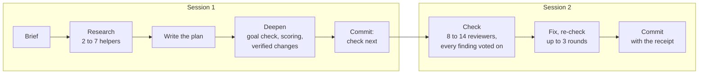

# ultramode-plan

**Status: on trial. Typed only.** Installed at `~/.claude/skills/ultramode-plan` (a junction to this folder), and Claude never picks it on its own. The playbook's plan step is still the compound-engineering plugin's `ce-plan`. The trial below decides whether this skill replaces `ce-plan` or is shelved.

## What it does

You type one line: where the plan should go, and what to plan. Asking you nothing, over two sessions, Claude:

1. **Briefs.** Recalls the project's lessons that bear on the job (the `brief` skill).
2. **Researches.** Helpers read the repo, the lessons and, when the repo cannot answer, outside sources. Each writes its findings to a file and returns a short summary.
3. **Writes the plan** at the path you named, in the plugin's plan shape.
4. **Deepens it.** One helper asks whether the plan's goal is the one you asked for. Another scores every section, and the weakest sections get more research. Each proposed change is voted on by separate helpers before it touches the plan.
5. **Commits the plan** with a short receipt, and gives you the line to start the second session.
6. **Checks it, in that second session.** A panel of skeptical reviewers, each with its own ground, reads the whole plan. Every finding is voted on by helpers told to disprove it. What survives is fixed in the plan, and the fixes are checked again (up to three rounds).
7. **Commits the checked plan**, that one file, with the full receipt.



## How to run it

Start a fresh session in the project and type:

```
/ultramode-plan <plan path> [brief <path>] <what to plan>
```

For example: `/ultramode-plan projects/my-app/docs/plans/export-plan.md Plan the export feature.`

- The plan path is a `.md` file inside the project's own `docs/plans/` folder.
- `brief <path>` is optional: a brief already written. Without it the run writes one first.
- When the first session commits the plan, type the same line in a fresh session. The skill reads the plan's last receipt and runs the check.
- A session that dies, or reaches the session's context limit, is started again by the same line in a new session. Nothing resumes it: the skill starts that session's half over.

## Why two sessions

The first real run (2026-11-11, the Back Nine's Act 5 workbench plan) did research, the plan, two deepens and the first check round in one session. That took the main session's window from 5% to 50%, its no-new-fan-outs line, so the second check round never ran. The check now starts in a fresh session.

Three more fixes came out of that run:

- **Each launch's inputs are baked into a copy of the script** (`lib/inputs.mjs`). Claude no longer types them into the Workflow call, and the completion notice no longer prints them back. Before, each launch's inputs were about 18 KB and four launches cost about 5% of the window. A Workflow script cannot read a file, which is why the inputs travel inside the script.
- **A digest of each result** (`lib/digest.mjs`). The first check round's result file was 486 KB. Its digest is 43 KB: the summary and every finding Claude acts on, each field cut to 300 characters.
- **Fixes go in through one tool** (`node lib/fold.mjs apply`). Claude writes the fixes as exact before-and-after text pairs, and the tool applies all of them or none. It refuses a pair whose old text is missing or appears twice, and refuses the whole fold if it would drop a numbered requirement, unit or decision. It also writes the list of changed lines that the next check round reviews. Building that list by hand, for 47 fixes, is what stopped the first run's second round.

## What comes back

Two commits of the plan, each with a receipt in its message. The second:

```
planned, deepened and checked
CE: 3.38.0 4adfcf4; seats without their CE file: none
research: 3 of 3 helpers; outside research: none
deepen: deepen; risk: none; 4 amendments folded, 1 left out
check: round 1 9 seats, 6 confirmed, 6 folded; round 2 3 seats, 0 confirmed
coverage holes: none
left out after a trace: A3 (the plan already covers it)
```

(That receipt is an example of the form, not a real run. The first session's receipt has no check line, and its first line reads `planned and deepened; check next`.) A reviewer that never answered is named as a coverage hole, never counted as "found nothing". A top-severity finding still open after the third round is named in the first line.

## The reviewers

The plugin's own reviewer files seed most seats, found through the plugin registry at each run, so a plugin update needs no change here. A seat whose file is missing runs on a built-in description of its job, and the receipt says so.

| Seat | Runs | What it hunts |
|---|---|---|
| coherence | always | sections that contradict each other, a term used two ways |
| feasibility | always | whether each unit can be built as written in this repo |
| scope-guardian | always | work nobody asked for, required work quietly dropped |
| adversarial | always (four of them on a high-risk plan) | the plan's load-bearing claims, broken by concrete failure scenarios |
| product, security, design | when the plan touches that ground | the product position; secrets and trust boundaries; user-facing flows |
| premise | always | whether the problem is real and the goal is the one asked for |
| reach | when the plan has code | every claim that something is only, never, every, unchanged |
| blast-radius | always | docs, registers and comments that still say what the plan changes |
| test-vacuity | when the plan has code | planned tests that would pass on wrong code |

The last four are ours: the plugin has no seat for them.

## What a run costs

Every helper runs on Opus at the `xhigh` effort level. A run starts:

- 1 helper for the contract brief (the project's rules, handed to every other helper), once in each session;
- 2 to 7 research helpers;
- 2 deepen helpers, up to 8 more for the weakest sections, and 2 or 3 voters per proposed change;
- 8 to 11 reviewers in check round 1 (11 to 14 on a high-risk plan; 2 fewer when the plan has no code), and 1 to 3 voters per finding;
- in rounds 2 and 3, only the reviewers whose ground a fix touched, and the coherence reviewer.

**The first real run, measured (2026-11-11, the Back Nine's Act 5 workbench plan, a Deep plan of 22 units and 731 lines, commit `952f5f04`).** It ran in one session, before the split, and stopped after check round 1 was folded.

| Stage | Helpers | Helper tokens |
|---|---|---|
| Contract brief | 1 | 0.2M |
| Research | 5 | 1.5M |
| Deepen, run 1 (stopped on a goal finding) | 5 | 0.6M |
| Deepen, run 2 | 96 | 10.7M |
| Check, round 1 | 141 | 15.7M |
| **Total** | **248** | **28.8M** |

The weekly usage meter went from 4% to 14% with every other session idle, about 10 points.

## What is inside

- `SKILL.md`: the page Claude follows.
- `workflows/`: the three scripts (research, deepen, check), generated from `src/` and `lib/` by `lib/make-scripts.mjs`. A test fails when they are stale.
- `lib/inputs.mjs`: builds each launch's inputs from one facts file and bakes them into a copy of the script.
- `lib/digest.mjs`: prints a result's summary and the findings Claude acts on, or chosen entries whole.
- `lib/fold.mjs`: `apply` makes a fold's fixes all at once and writes the next round's changes; its check refuses a fold that drops a numbered requirement, unit or decision.
- `lib/resolve-ce.mjs`: finds the plugin's files.
- `lib/run-record.mjs`, `lib/flow.mjs` and `bench/`: built for runs that survive across sessions and for a blind head-to-head against `ce-plan`. Both were cut on 2026-11-11; the code stays, tested and unused, apart from the few functions `inputs.mjs` and `fold.mjs` call.
- `docs/plans/lean-plan-step-plan.md`: the plan this skill is being finished under. `docs/plans/hybrid-plan-step-plan.md` is the record of how the parts above were built.

Tests: `node --test "projects/skills/ultramode-plan/**/*.test.mjs"` from the repo's root. CI runs them on every push that touches this folder.

## The trial

1. One real run on a real, sizable job. What breaks is fixed.
2. One code review of this page's skill file and the tools it runs that the real run changed: `lib/inputs.mjs`, `lib/fold.mjs` and `lib/digest.mjs`.
3. On the next sizable job, `ce-plan` plans the same job. Three skeptical readers get both plans with the labels removed and say which they would build from. Briggsy reads both, and his read decides. If this skill's plan is not clearly better, the skill is shelved and `ce-plan` stays.

Result so far: step 1 ran on 2026-11-11 and stopped one stage short (see "Why two sessions"). The plan is committed with a receipt that says its check is incomplete, and its check runs as the skill's second session. What broke is fixed: the two-session split and the three tools above. Steps 2 and 3 have not run.
