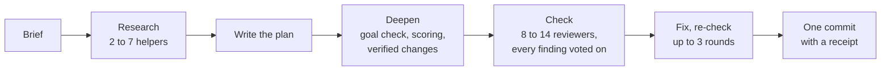

# ultramode-plan

**Status: on trial. Typed only.** Installed at `~/.claude/skills/ultramode-plan` (a junction to this folder), and Claude never picks it on its own. The playbook's plan step is still the compound-engineering plugin's `ce-plan`. This skill has not yet planned a real job; the trial below decides whether it replaces `ce-plan` or is shelved.

## What it does

You type one line: where the plan should go, and what to plan. In one session, asking you nothing, Claude:

1. **Briefs.** Recalls the project's lessons that bear on the job (the `brief` skill).
2. **Researches.** Helpers read the repo, the lessons and, when the repo cannot answer, outside sources. Each writes its findings to a file and returns a short summary.
3. **Writes the plan** at the path you named, in the plugin's plan shape.
4. **Deepens it.** One helper asks whether the plan's goal is the one you asked for. Another scores every section, and the weakest sections get more research. Each proposed change is voted on by separate helpers before it touches the plan.
5. **Checks it.** A panel of skeptical reviewers, each with its own ground, reads the whole plan. Every finding is voted on by helpers told to disprove it. What survives is fixed in the plan, and the fixes are checked again (up to three rounds).
6. **Commits the plan**, that one file, with a short receipt of what ran.



## How to run it

Start a fresh session in the project and type:

```
/ultramode-plan <plan path> [brief <path>] <what to plan>
```

For example: `/ultramode-plan projects/my-app/docs/plans/export-plan.md Plan the export feature.`

- The plan path is a `.md` file that does not exist yet, inside the project's own `docs/plans/` folder.
- `brief <path>` is optional: a brief already written. Without it the run writes one first.
- A run that dies, or reaches the session's context limit, is started again in a new session. Nothing resumes it: with the plan already written, the new run begins at the deepen.

## What comes back

One commit holding the plan, and a receipt in the commit message:

```
planned, deepened and checked
CE: 3.38.0 4adfcf4; seats without their CE file: none
research: 3 of 3 helpers; outside research: none
deepen: deepen; 4 amendments folded, 1 left out
check: round 1 9 seats, 6 confirmed, 6 folded; round 2 3 seats, 0 confirmed
coverage holes: none
left out after a trace: A3 (the plan already covers it)
```

(That receipt is an example of the form, not a real run.) A reviewer that never answered is named as a coverage hole, never counted as "found nothing". A top-severity finding still open after the third round is named in the first line.

## The reviewers

The plugin's own reviewer files seed most seats, found through the plugin registry at each run, so a plugin update needs no change here. A seat whose file is missing runs on a built-in description of its job, and the receipt says so.

| Seat | Runs | What it hunts |
|---|---|---|
| coherence | always | sections that contradict each other, a term used two ways |
| feasibility | always | whether each unit can be built as written in this repo |
| scope-guardian | always | work nobody asked for, required work quietly dropped |
| adversarial | always (four of them on a high-risk plan) | the plan's load-bearing claims, broken by concrete failure scenarios |
| product, security, design | when the plan touches that ground | the product position; secrets and trust boundaries; user-facing flows |
| premise | always | whether the problem is real and the goal is the one asked for |
| reach | when the plan has code | every claim that something is only, never, every, unchanged |
| blast-radius | always | docs, registers and comments that still say what the plan changes |
| test-vacuity | when the plan has code | planned tests that would pass on wrong code |

The last four are ours: the plugin has no seat for them.

## What a run costs

Every helper runs on Opus at the `xhigh` effort level. A run starts:

- 1 helper for the contract brief (the project's rules, handed to every other helper);
- 2 to 7 research helpers;
- 2 deepen helpers, up to 8 more for the weakest sections, and 2 or 3 voters per proposed change;
- 8 to 11 reviewers in check round 1 (11 to 14 on a high-risk plan; 2 fewer when the plan has no code), and 1 to 3 voters per finding;
- in rounds 2 and 3, only the reviewers whose ground a fix touched.

No real run has been measured yet. The first one will put its helper count and its share of the weekly usage meter here.

## What is inside

- `SKILL.md`: the page Claude follows.
- `workflows/`: the three scripts (research, deepen, check), generated from `src/` and `lib/` by `lib/make-scripts.mjs`. A test fails when they are stale.
- `lib/inputs.mjs`: builds each script's inputs from one facts file.
- `lib/fold.mjs`: checks that a fix dropped no numbered requirement, unit or decision.
- `lib/resolve-ce.mjs`: finds the plugin's files.
- `lib/run-record.mjs`, `lib/flow.mjs` and `bench/`: built for runs that survive across sessions and for a blind head-to-head against `ce-plan`. Both were cut on 2026-11-11; the code stays, tested and unused, apart from the few functions `inputs.mjs` calls.
- `docs/plans/lean-plan-step-plan.md`: the plan this skill is being finished under. `docs/plans/hybrid-plan-step-plan.md` is the record of how the parts above were built.

Tests: `node --test "projects/skills/ultramode-plan/**/*.test.mjs"` from the repo's root. CI runs them on every push that touches this folder.

## The trial

1. One real run on a real, sizable job. What breaks is fixed.
2. One code review of this page's skill file and `lib/inputs.mjs`.
3. On the next sizable job, `ce-plan` plans the same job. Three skeptical readers get both plans with the labels removed and say which they would build from. Briggsy reads both, and his read decides. If this skill's plan is not clearly better, the skill is shelved and `ce-plan` stays.

Result: not yet run.
