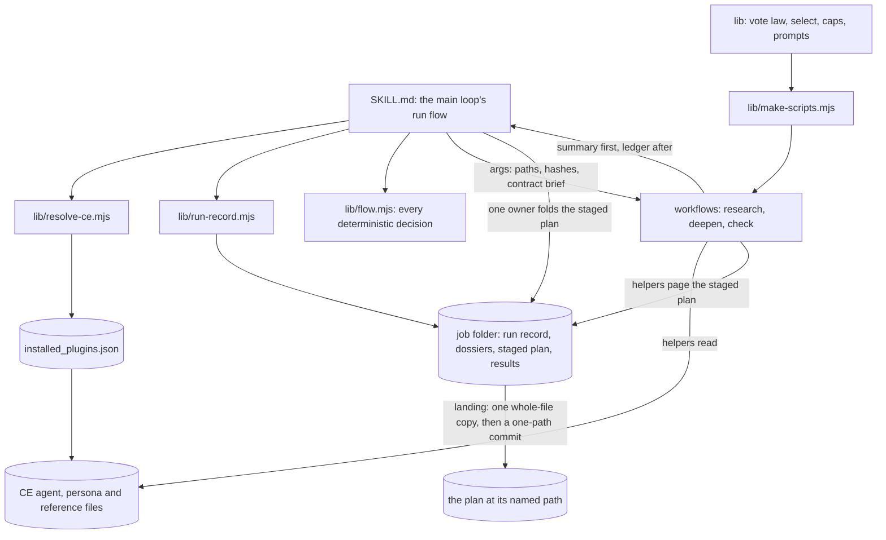
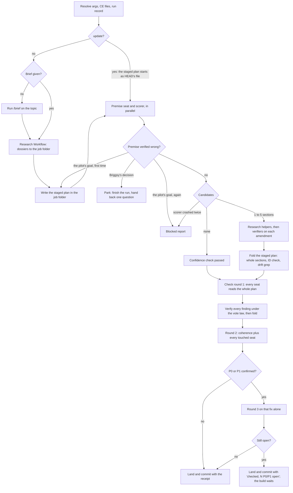
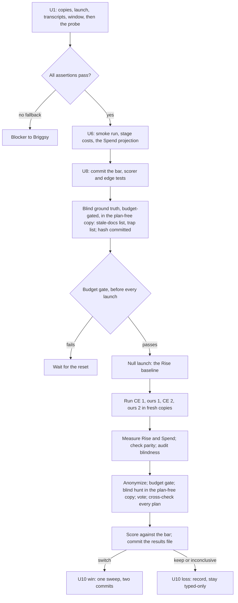

# Hybrid Plan Step - Plan

## Goal Capsule

- **Objective:** Sizable jobs start their builds from plans that were researched, deepened where weakest and checked whole by Opus reviewers, with no question to Briggsy, and the plan step in daily use is the one a blind head-to-head showed matches ce-plan's verified defects in a real plan at no more than 10% more cost, or beats them (KTD17). If the new step cannot show that, ce-plan stays the plan step.
- **Means:** `ultramode-plan`, a skill that runs the compound-engineering (CE) plugin's planning method through our own Workflows (KTD1).
- **Authority:** Briggsy's rulings, then this plan's Requirements, then its KTDs, then the units. A unit overrides neither.
- **Stop conditions:**
  - The probe (U1) finds a step the head-to-head needs that cannot be automated: report the blocker to Briggsy in plain words and pause the head-to-head; the build continues.
  - The budget gate (KTD18) fails: wait for the weekly reset.
  - The bar (KTD17) says keep: take U10's loss branch; nothing switches.
  - A blindness breach recurs on a pair's re-run (KTD21): stop the head-to-head until the leak in the harness is traced and fixed.
- **Execution profile:** path-scoped commits on `main`, about one per unit, no branches or PRs. The build spans at least two sessions. The head-to-head runs after the weekly reset on 2026-11-04 09:00 unless a measured run shows it fits sooner.
- **Who finishes:** playbook sessions. Each close names the next unit in `playbook/TODO.md` START HERE.

---

## Product Contract

### Summary

Build `ultramode-plan` beside `ultramode-code-review`: research, a native plan at the named path, a deepen that scores every section and researches the weakest, and a check that gives every reviewer the whole plan, always runs an adversary, adds four seats aimed at the defects no earlier check caught, and verifies every finding under ultramode's vote law. It stays typed-only until a blind head-to-head against stock ce-plan on the Back Nine's build 2 clears a bar written before any run. A win switches the playbook's plan step; a loss leaves ce-plan in place.

### Problem Frame

Briggsy likes CE's planning method (plan, deepen the weak parts, review) but not how CE forces the execution, and asked for "a marriage between the two" (2026-10-31). The evidence (workflow `wf_ba4cc5b6-8f8`) found:

- **Who ran the checks didn't matter; what they read did.** The material catches came from Opus reviewers reading the whole plan against source, whether CE or our own Workflows started them. CE ran end to end in only 2 of 8 plan checks since 10-01.
- **CE's defaults cut against our rules.** CE 3.34.0 puts its coherence reviewer on the cheapest model, sends reviewers section slices, runs its one whole-document reader only in the cross-model mode our config turns off, and switches its premise challenge off whenever a plan has an origin such as a brief. Every ce-plan run today needs five extra clauses (README step 2) to undo these defaults, and a CE update can move any of them; one update broke every ultramode lens on 07-09 (`f6433a3e`).
- **No check, CE or ours, caught what actually hurt later.** A wrong premise sank a whole program (the our-setup flight plan, flushed 10-29). A false claim that only test plants reach a code path (the pay check's KTD22) became the schema-v4 job. Docs elsewhere kept stating what a plan changed (two schema-v4 reviews still found 8 and 9 stale lines). A planted zeroing survived 567 green tests.

A market check (playbook-2, recorded in `playbook/TODO.md`) found nothing native or in Spec Kit, BMAD, Superpowers or Kiro that scores a plan's sections, researches the weakest and runs a skeptical panel without a human reviewing the plan.

### Requirements

**The method**
- R1. A run keeps CE's method: research before writing, a plan written at a named path inside the project's own `docs/plans/`, a deepen that scores every section and researches the weakest under KTD5's selection rule, and a check by skeptical reviewers.
- R2. CE's agent and persona files are read fresh on every run, never copied or pinned. A missing file drops its seat to an inline role, named in the run's coverage line with the CE commit.
- R3. Every helper runs on Opus at xhigh effort, set on each call.
- R4. Every check reviewer reads the whole plan, at least one adversary always runs, and no finding changes the plan before verifiers vote on it under the abstention-aware vote law.
- R5. The check hunts the four classes that slipped past every earlier check: a wrong premise, a false claim about what reaches a code path, stale docs elsewhere that still state what the plan changes, and tests that would pass on wrong code.

**The execution**
- R6. Claude decides how each step runs and the run asks Briggsy nothing, with one exception: a verified finding that a decision Briggsy himself made is wrong, or a fork his project's own decision rule sends to him (KTD11), parks the plan with one paste-ready question.
- R7. README step 2's five asks become defaults nobody has to remember: the named path, Opus everywhere, the whole plan to every reviewer, no scope question, and a stop after the check with no build handoff and no branch.
- R8. A run that dies, or reaches the window line mid-plan, leaves a state the next session can pick up: a run record, and a plan file that is either before or after a whole fold, never half of one.
- R9. The plan's commit message carries the run's receipt, and this is its one home: what ran ("planned, deepened and checked", "planned, confidence check passed, checked", with "updated" for "planned" on an `update` run (KTD3), "checked, N P0/P1 open" under KTD9, or "check incomplete: no adversary"); any park ("parked: <question>", KTD11); every CE commit with the stages it served; the coverage line (R5's four classes, each with its seat's verified findings, its recorded "nothing found", or "skipped: <reason>" for a seat KTD6 skips on a plan with no code; every coverage hole; every seat that ran without its CE file; every stray file the run deleted, KTD23); a project move during the run (KTD23); and the run record's path. The plan body carries none of it.

**The proof**
- R10. `ultramode-plan` becomes the default plan step only after a blind head-to-head against stock ce-plan on the Back Nine's build 2 clears a bar committed before any run; otherwise ce-plan stays.
- R11. The head-to-head proves its blindness, its environment parity and its window measure from transcripts after the runs, never from prompts.
- R12. No head-to-head launch may take the weekly usage meter past 90%.
- R13. On a win, every doc that names ce-plan as the plan step changes in one pass, as two path-scoped commits in the same turn: one in this repo and one in the memory folder's own repository. On a loss or an inconclusive result, the result is recorded and ce-plan's docs stay.

### Key Decisions

- **Own the orchestration; mine CE's method and prompt files.** (session-settled: user-directed — chosen over keeping ce-plan run whole as the default: he loves CE's method but not how it forces the execution.) Governs R1, R6, R7.
- **Only Claude models do the work.** (session-settled: user-directed — chosen over cross-vendor review: "I don't want to introduce codex", 2026-10-19.) Governs R3.
- **Never pin or freeze CE or any version.** (session-settled: user-directed — chosen over a frozen copy of CE's files: "We want updates", 2026-10-27.) Governs R2.
- **Every spawned helper names its model and effort.** (session-settled: user-directed — chosen over inheriting the session's settings: an omitted level inherits whatever the session runs at, and a high-effort review run missed a bug both xhigh runs caught, 2026-10-31.) Governs R3.

### Success Criteria

- The head-to-head's verdict exists, under the committed bar, with its blindness audit passing.
- The commit receipt of a plan made by `ultramode-plan` cites, for each of the four target classes, the seat's verified findings, its recorded "nothing found", or its logged skip on a plan with no code, never silence (R9).
- On a win, a fresh session asked to plan a sizable job runs `ultramode-plan` without being told to.

### Scope Boundaries

- **Not building:** a build step, a review step, or any change to `brief`, `distill` or `squeaky-clean`. The build stays native; the review stays `ultramode-code-review`.
- **Not touching** the Back Nine's own build-2 plan. That project's session makes it on ce-plan, and the head-to-head re-plans build 2 only in scratch copies.
- **Considered and not built:**
  - A lock file against two sessions planning one path at once. It has never happened; KTD23 lands by one path-scoped commit after KTD3's path checks, which would see a clobber. A clobbered plan would change the call.
  - Re-running the reach and blast-radius seats when the project moves under a running plan. HEAD moved twice during b9-6's plan run, but only through playbook commits, and the receipt names any move (KTD23). A plan citing code that changed mid-run would change the call.
  - A parity test for ultramode-code-review's inline copy of the vote law. No drift has happened yet; the follow-up below removes the copy instead.
  - Hooks that force the flow. They were retired on 10-31; a START HERE line runs the step (playbook insight 009).
  - A launch-time check that each Workflow script still equals the generator's output. CI's freshness test covers committed scripts, and each launch records the script's sha256 (KTD10). A recorded hash that matches no commit would change the call.
  - A read-only helper type enforced by the platform (a custom `agentType` with no write tools). It is untested, a missing agent type crashed every lens at launch on 07-09 (`f6433a3e`), and KTD23's sweep handles strays. A stray the sweep misses would change the call.
  - Salvaging a dead session's partial Workflow journal instead of re-running its stage. A Workflow resumes only in the session that launched it; re-runs measured as too costly would change the call.
  - Isolating seats from other sessions' uncommitted edits in the shared tree. Nothing has gone wrong from it; a finding traced to another session's edit would change the call.
  - Emptying CE's shared temp scratch root before each arm. Other live sessions' ce-plan runs use the same root, so clearing it could destroy their work; KTD21 allows each arm only its own folders. A CE arm found reading a sibling folder would change the call.
  - A delete guard that refuses a copy holding a link. The harness makes no links (KTD16), and no delete through a link has happened here. A copy found holding one would change the call.
  - A dry CE-arm launch before the measured arms. U7's dry launch proves the harness, and KTD16's canned replies and re-run absorb a stopped CE arm. A CE arm that stops in U9 would change the call.
  - A `stop-after <stage>` argument. U6's smoke run forces the real window stop through the window skill's test hook instead; a daily need to stop at a chosen stage would change the call.
  - A check after each commit that it touched one path. A commit scoped to one path cannot carry another, and U6's smoke run proves it. A commit found carrying another session's file would change the call.
  - A guard against applying one ledger id twice. A fold re-runs only from the stage's before hash, on a fresh working file (KTD9, KTD10), so no restart path reaches a second application. A landed plan carrying one finding twice would change the call.
  - Re-hashing CE's files before each Workflow launch. An update installs a new version folder and leaves the old one on disk for about 14 days, and a restart resolves fresh (KTD2). A recorded CE file found changed in place would change the call.
  - A plan normalizer built before the runs. Both arms write CE's unified plan contract, and no bench here has met a format tell; KTD19 writes one against the tell a judge names. A named tell that a ready normalizer would have cleared would change the call.

#### Deferred to Follow-Up Work

- Move `ultramode-code-review` onto this skill's tested vote-law module, so the law has one home.
- Held-out replays: the check step alone on a past plan at its pre-check commit, scored against its known answer, on a target whose miss seeded no seat's charter. The pay-check spec is not one: its false reach claim (its KTD22) seeded the reach seat. None runs in this job, since no unit builds the check-only entry, the second freeze or the scoring a replay needs.
- CE auto-update's install half (`playbook/TODO.md` START HERE item 2) stays its own item.

---

## Planning Contract

### Key Technical Decisions

**The skill**

- KTD1. **Three saved Workflow scripts, generated from tested modules.** Research, deepen and check are committed `.workflow.js` files driven by `args`. A generator inlines the pure `lib/*.mjs` logic (vote law, section selection, schema caps, prompt builders) into each script, and a test fails when a committed script differs from a fresh generation. Workflow scripts cannot read files, so the main loop resolves every path and hash and passes them in `args`; the modules it runs as commands (`resolve-ce`, `run-record`, `fold`, `flow`) are never inlined. Every command-line module checks that it is the script node was asked to run by comparing real paths, because the brief bench's commands ran as silent no-ops through the `~/.claude/skills` junction until `ee67c08a`. The precedent, `projects/skills/distill-and-brief/brief/bench/make-rescore.mjs`, fills one data slot, throws when the slot is missing and fills it with a replacement function; its output is never committed, so inlining code and the freshness test are new here. Rejected: ultramode-code-review's template that the coordinator adapts by hand each run, because a verdict holds only for the bytes that produced it (playbook insight 003), and hand-adapted code has no tests. Rejected: a bake-off between the two shapes, because the evidence (repo-research.md §0) settles it without building both.
- KTD2. **CE files come from the registry, resolved once per session's run.** `lib/resolve-ce.mjs` reads `~/.claude/plugins/installed_plugins.json`, takes the `compound-engineering@every-marketplace` entry with `scope: "user"`, and returns its `installPath`, `gitCommitSha`, and the sha256 of every agent, persona and reference file the run will use, or `missing` for each absent one. It never globs the plugin cache, which still holds 3.14.3 beside 3.34.0. A missing file drops its seat to an inline role and the coverage line names it; the run never stops for CE's absence.
  - The run resolves CE at its start and again at every restart (KTD10); within one session's run it keeps that resolution, so each stage runs wholly on one. The receipt (R9) names every CE commit with the stages it served.
  - Why: CE auto-updates, and an update leaves the old version's folder on disk, marked orphaned, for about 14 days (3.14.3's `.orphaned_at` was written at the same instant as 3.34.0's registry entry). Without this, a run could mix versions without a trace, or a restart days later could read a superseded CE. One run's snapshot is not a pin: the next run resolves fresh. (Inherits the never-pin Key Decision.)
- KTD3. **The plan's shape and path.** The plan follows CE's unified plan contract, read fresh from `skills/ce-plan/references/plan-sections.md`, unless the project's `CLAUDE.md` names its own plan convention. The path is a required argument inside a project's `docs/plans/` tree; the skill creates `docs/plans/` under the project root when missing and refuses the monorepo root. The named path is checked at the run's start and again at landing (KTD23): it must be absent, or, when the arguments say `update`, equal to HEAD's committed file. A path with uncommitted changes refuses even under `update`, and a path that changed between start and landing stops the landing, naming both states; a resumed run keeps the state its start recorded. Under `update` the staged plan starts as a copy of HEAD's committed file, research and the write step are skipped, and the run starts at the deepen. When the plans folder has an index file, the plan's docs unit lists it.
- KTD4. **Research before writing.** A research Workflow seeded from CE's `research.md` mapping runs the repo-research and learnings prompts (learnings searched in the project's `docs/insights/` and in the memory folder Claude Code keys to the plan's git root, never a fixed path, since this repo has no `docs/solutions/`), spec-flow for Standard and Deep plans, and the external researchers only on `research.md`'s Stage 1-3 rules. The main loop makes that external-research call, because only it holds the request and the brief, and records it with its reason in the run record. Each helper writes a dossier into the run's job folder and returns a gist; the main loop reads a dossier only when its gist can change a decision. The brief is an argument; with none, the skill runs `/brief <topic>` first.
- KTD5. **The deepen.**
  1. A premise seat and a scorer run in parallel on the written plan. The scorer reads CE's `deepening-workflow.md` 5.3.3 and `final-review.md` 5.3.1-5.3.2 fresh, adds our four labeled checklists (Goal Capsule and Problem Frame, Assumptions, Verification Contract, Definition of Done, which CE never scores), scores every section by meaning rather than heading text, and returns each score with its triggers and the rules it applied, plus the plan's depth and risk profile from `final-review.md`. The run record keeps that profile, and the check takes its high-risk flag from it (KTD6), even on a "confidence check passed" run. The premise seat's findings go to verifiers under KTD8 as soon as both return, and a confirmed one ends the deepen there: the script returns it with its votes and the scores before any research helper starts, and the main loop routes it under KTD11. After a park, the deepen relaunches with args that skip the premise seat and carry the recorded scores.
  2. `lib/select.mjs` picks the sections deterministically: 2 points or more makes a candidate; up to 5 deepen; exactly 1 deepens 1; none means "confidence check passed"; a lightweight high-risk plan caps at 2; ties go to the higher score, then CE's critical sections, then document order. On a plan that already carries a `deepened:` date, a section not yet strengthened wins over a comparable one that was (CE's rule). A crashed scorer gets one re-run, then the run stops as blocked; it never reads as "passed".
  3. 1 to 3 research helpers per selected section, at most 8 in all, each seeded from the CE agent file that CE's section-to-agent mapping names.
  4. Every proposed amendment goes to severity-scaled verifiers voting under KTD8: P1 when it changes a decision or a unit, P2 otherwise. Conflicting amendments follow CE's evidence order (repo and origin beat generic advice), with the leftover tradeoff recorded.
- KTD6. **The check roster.**
  - **CE personas, whole plan each:** coherence, feasibility, scope-guardian and adversarial always (CE gates the adversary; we never do). Coherence owns cross-section seams. Product, security and design lenses join on CE's own selection signals, read fresh from `persona-selection.md` (41 lines) by the main loop, which wrote the plan; each pick and its reason go in the run record. Rejected: `whole-doc-reviewer`. Its charter justifies it by a second model's blind spots and by the focused lenses each reading only their own slice; R3 removes the first reason and KTD7 the second, and the charter calls duplicated focused work noise.
  - **Our four seats:**
    - *Premise.* For a guard, gate or safety mechanism: the incident it answers (a commit, a transcript, a measured case). For a feature: an instance of the population it serves that exists in today's code. Also: is the plan's goal the one asked for. CE's origin-keyed suppression of the premise challenge never applies.
    - *Reach.* Every "only", "never", "every", "no caller", "unreachable" or "unchanged for" claim, checked by enumerating callers, writers and the gate that enforces it, with absolute-path greps.
    - *Blast radius.* For every decision the plan changes or supersedes, every sentence in the project's live docs, register and code comments that still states the old truth, by tense, found by grepping the key words separately.
    - *Test vacuity.* For every planned test: the wrong implementation it fails on, a non-default value on both sides, an input that breaks exactly one rule, and a presence check beside every absence check.
  - Every seat gets a roster and ownership table listing exactly the seats running in this run, and a line saying its class is never a false positive, overriding CE's catalog entry for "pre-existing issues". Plans with no code skip reach and vacuity with a logged reason, never a silent "clean".
  - A high-risk plan (CE's seven risk signals, from the scorer's recorded profile, KTD5) replaces the single adversary with a panel, each on its own angle: sequencing and dependencies, a settled decision that cannot work, hidden work, verification gaps.
  - Settlement annotations stay visible to every seat. A finding against a settled decision stands at full severity when it shows the decision cannot reach its outcome; preferring the alternative is not a finding (CE's `subagent-template.md` rule).
- KTD7. **Whole plan, read in pages.** Every whole-plan reader (seats, scorer, judges) pages through the file and returns an inventory: its last line read, quoted, and the sections it covered. The main loop passes the plan's last line with text, and that line's number, in `args`, so a script can compare without reading the file and a guessed number cannot pass. A reader whose inventory stops short is re-run once inside its own script, with a prompt naming the sections it missed (a resume would replay its cached short read). After a second short read, a check seat or a judge abstains for what it missed, named as a coverage hole with those sections, and a scorer stops the run as blocked, like a crashed scorer. Measured: one plain Read of the 153 KB pay-check spec returns lines 1-269 of its 1,059.
- KTD8. **The vote law, tested.** `lib/vote-law.mjs` carries ultramode's `classify`, `tally` and `refuterCount` with tests (3 refuters on P0 and P1, 2 on P2, 1 on P3; an abstention is never a vote; `real`, `material` and `new` are tallied separately; splits and short quorums go to hand-verify).
  - This entry owns the three words for a finding and for a deepen amendment alike: `real` means the gap exists and its evidence holds in source, `material` means it changes what gets built or how it is verified, and `new` means the plan does not already say or address it. A bench mode drops `new`, for KTD19's judges, and tallies severity too: every verifier returns a corrected severity, a confirmed defect is P0 or P1 for KTD17's D only when a majority of its real-voters put it there, and a tie on that line is counted both ways, like a hand-verify split.
  - Verifiers also judge the proposed change (`fix_is_correct`, `better_fix`), because 27 of 100 proposed resolutions in one past check would have broken something; KTD9 says what the fold does with that verdict.
  - An abstention is resumed before it counts. After every Workflow, before any bucket is read, the main loop resumes the run in the same session with its recorded script and args while any helper is null, at most twice; the journal replays finished helpers from cache and re-runs only the dead (the port source's rule; a server-side burst once nulled a whole verify phase, memory `feedback-verify-fix-workflow-design`). Only nulls that survive both resumes become coverage holes or hand-verify items, each named with its resume count.
- KTD9. **The fold and the exit.**
  - One owner folds: the main loop copies the staged plan in the job folder (KTD10) to a working file beside it, edits whole sections of the working file, runs `fold.mjs` on it (every R, U and KTD ID that existed still exists, and a grep for each amendment's old value class, not just the one known instance), records the working file's hash as the stage's target and the stage's applied ids in the ledger, then replaces the staged plan with it by one rename, so a crash at any step leaves the staged plan at its before hash or its target. The fold never applies a proposed fix that a majority of its verifiers judged wrong; it applies their better fix, or hand-verifies the finding when they disagree. Rejected: a whole-file Write per fold, because each one puts the whole plan into the main loop's output at every fold (the template plan is 153,353 bytes, and the largest single Write in this repo's transcripts is 95,562 characters, so one Write of a Deep plan is unmeasured), and CE's own deepen edits in place. Rejected: a fold helper, because judging what a verified finding means for the plan stays with the lead. A fold whose main-loop cost, measured in U6, would by itself carry a Deep plan's run past the 60% window line reopens this rejection before the bar is committed (U8); this plan's own deepen was folded through one helper to save its window, with every finding checked against source, and its seams were caught by the whole-plan check.
  - Round 2 re-runs coherence plus every seat whose claim class a fix touched; deletions count as changes; a P0 or P1 found anywhere is admitted. The deepen has no round 2: check round 1 re-reads every deepened section.
  - A P0 or P1 confirmed in round 2 gets a narrow round 3 on that fix alone, with round 2's seat rule (coherence plus every seat whose claim class the fix touched) applied to that one fix. If it still stands, the plan lands with the receipt "checked, N P0/P1 open" (R9), the handed-back START HERE line names them (KTD23), and the build waits. This is the run's only exit with an open P0 or P1.
  - An adversary still absent after KTD8's resumes means the run cannot read "checked": its receipt says "check incomplete: no adversary" (R4, R9).
- KTD10. **The run record, the job folder and the window.**
  - **Where.** The job folder is an argument. By default it follows from the plan path alone: a folder named for the project and the plan's file name, inside the Claude Code projects folder of the plan's git root (the one that holds that root's memory folder), so any session given the same plan path finds it. It holds one subfolder per run, named by its start time. The skill looks there on every invocation, before KTD3's path checks, and resumes the newest run whose stage is neither landed nor blocked; otherwise it starts a new run beside the closed ones and never rewrites a closed record, whose path a landed receipt cites. Why: job folders today sit under whichever folder the starting session ran in (the Back Nine keeps 20 under its own), and a crashed session never writes START HERE.
  - **What.** `ultramode-plan-run.json` holds the base commit and project subtree hash; the brief's sha256; the contract brief (KTD22); the named path's state at the start (KTD3); each CE resolution and the stages it served (KTD2); the risk profile and lens picks with their reasons (KTD5, KTD6); each stage's before and target hashes of the staged plan; the stage reached; a fold ledger of each stage's applied ids, written with the stage's target hash just before its fold lands and rewritten if the fold re-runs; and every session id that worked on the run. At every Workflow launch, and again at its completion, it records the run id, the session id, the script path and sha256, the CLI version, the exact args, the relayed user text (KTD22), the saved-result path and the transcript folder.
  - **The staged plan.** The plan is written and folded in the job folder and reaches its named path only at landing (KTD23), so R8's "before or after a whole fold" holds at every moment and the record says which.
  - **Restart.** A stage whose Workflow finished is folded from its saved result and never re-run. A stage whose Workflow never finished re-runs from its start with the recorded args, since a Workflow resumes only in the session that launched it. A leftover working file from a fold that never landed is deleted first. A staged plan matching the stage's before hash re-runs the fold; one matching its target hash marks the fold done and moves on; one matching neither stops the run, naming both. A restart resolves CE again (KTD2).
  - **Re-entry.** A later session resumes by reading SKILL.md by path, with the record's path as its argument, because a typed-only skill cannot be loaded through the Skill tool (KTD14). Resuming a recorded run is not picking the skill, and the handed-back line never asks Briggsy to type a command.
  - **Window.** `/window` runs before every Workflow launch and after every fold, and the run follows the window skill's own tiers, read from the line `window.mjs` prints, never from a threshold of its own: a returned Workflow's fold always completes; at the no-new-fan-out line (50% today) a new Workflow launches only when that stage's measured main-loop cost keeps the run under the wrap line (60% today), and a stage with no measurement does not launch; at the wrap line, or when a launch is held, the run stops at that boundary, lands nothing, and hands back the next stage (KTD23). The costs live in `lib/stage-costs.json`, committed after U6's smoke run so the runtime bytes an arm copies carry them (KTD16): each stage's measured main-loop cost with the staged plan's size at that stage. A stage that reads or edits the staged plan (the write, every fold) has its cost scaled by the current staged plan's size over the smoke plan's, so a Deep plan is not judged by a small plan's cost. A line headed "Context (TEST" counts as a reading here, since U6's forced stop relies on it, and the record marks it as a test reading. Why: Briggsy's window law sets 50% as the line for new fan-outs and 60% as the wrap, and an earlier stop splits a run into segments whose Rise the head-to-head sums (KTD17).
- KTD11. **No-ask contract.** CE's pipeline-mode rules, restated in SKILL.md rather than read live: a blocked state is a report, never a question; inferred bets go to `### Assumptions`; P0 and P1 are fixed, or the run exits through KTD9's open receipt.
  - A verified finding against a decision carrying Briggsy's own words or ratification parks: the run finishes its other work, lands with the receipt "parked: <question>" (R9), and hands back one paste-ready question for START HERE (KTD23), batching every park into that one question.
  - A fork at the pilot's level is the pilot's call, and a project's own decision tool (the Back Nine's `/council`) may settle it. The run never writes that tool's log: the row goes into the run record and the final report (KTD23). A verdict the tool's own rules send to Briggsy (the Back Nine council's: under 7/10, or `action: "surface"`) parks like a decision of his, batched into the run's one question (R6).
  - A verified premise finding against the pilot's own goal sends the plan back to the write step once; a second such finding stops the run as blocked, so write and premise cannot loop.
  - Before each Workflow launch the main loop applies any typed message from Briggsy that bears on the run (a ruling, a skip, a stop) to the plan or the args, so the task text and the relayed message agree (KTD22).
- KTD12. **Returns stay small.** Each Workflow returns a summary object first (counts, coverage holes, the confirmed and hand-verify ids) and the full ledger after it; the main loop reads the ledger from the saved result selectively. Past runs returned up to 215,000 characters into the main loop.
- KTD13. **Every helper on Opus at xhigh, and the scale stated.** No seat in this skill is pure fetch-and-carry: research helpers propose plan changes, and the rest judge. SKILL.md states each Workflow's agent count (about 4 research helpers; 2 plus up to 8 in the deepen, plus verifiers; 8 to 11 check seats, up to 14 when a high-risk panel replaces the single adversary, plus verifiers; and one contract-brief helper per run, KTD22) because sessions carry a default "keep workflows under 10 agents" guideline. It also states each Workflow's expected spend in KTD20's weighted measure, and each seat's confirmed findings, from U6's smoke run, so a later roster change rests on data. (Inherits the effort Key Decision.)
- KTD14. **Typed-only until the verdict.** SKILL.md carries `disable-model-invocation: true` and an "on trial" description, so neither Claude nor the CE arm's pilot picks it on a plan request; plugin skills cannot be hidden, so ce-plan cannot be fenced off the other way. The junction into `~/.claude/skills/` is made after the tests pass. Build 2 is never a development or smoke target.
- KTD22. **What every helper is given.**
  - **The project's laws.** Once per run, before the run's first Workflow (the research Workflow, or the deepen under `update`), one Opus xhigh Agent-tool helper finds the target project's root from the plan path, reads its `CLAUDE.md` files and `docs/insights/`, and returns only a contract brief of 10 to 20 lines: the invariants, the deliberate values not to flag, and the landmines (the port source's step; `workflow-template.md` calls skipping it "the #1 cause of noisy reviews"). The main loop records the brief verbatim in the run record and passes it in every Workflow's args, and every helper gets it with the absolute paths of the project's `CLAUDE.md` files to read first. A helper does the reading, not the main loop, because the main loop's window is gated in the head-to-head (Rise, KTD17) and the Back Nine's insights alone are 153 files and 802,805 bytes (measured); the port source's coordinator is not gated. Why: a helper gets the user `CLAUDE.md` and `MEMORY.md`, and the project's `CLAUDE.md` only when its session started inside the project. Measured: a playbook-started session's 13 helpers got exactly the first two, while a Back Nine-started helper also got the project's 17,899-byte `CLAUDE.md`. Playbook-started runs are the daily case.
  - **The lens rule.** A CE file supplies the lens only: what to look for and how to calibrate. Its instructions about tools, models, command-line tools, sub-agents, scratch folders or file writes do not apply; the prompt's own tool rules are the complete list. Why: the ported precedence block settles output, scope, confidence and ownership but not tools, and CE files the run reads already direct a WebFetch fallback (`best-practices-researcher.md:60`); one CE update broke every ultramode lens (`f6433a3e`), and CE now auto-updates.
  - **The relay.** Workflow helpers receive the turn's triggering user message verbatim, under a header saying it wins over the task text, so no prompt line can tell them to disregard it. The main loop squares the two before each launch (KTD11), and the run record keeps each Workflow's relayed text as part of its inputs.
- KTD23. **The run's write set and its landing.**
  - The run writes only its job folder (the staged plan, dossiers, record and results), the plan file at landing, and one commit of that path alone. Planning never edits other docs: blast-radius hits become lines in the plan's docs unit.
  - **Landing.** KTD3's path checks run again. The run compares the recorded project subtree hash with HEAD's; if they differ, the receipt says "project moved during the run", with the count of changed files and the ones the plan cites. The staged plan reaches its named path by one whole-file copy, and the commit is path-scoped to the plan file and carries R9's receipt. A stop at a boundary lands nothing, so no session's close finds a half-checked plan in the tree to commit without a receipt.
  - **Handed back, never written.** A park's question, open P0 and P1 findings, a blocked run's reason, a window stop's next stage, and a moved file the plan cites go into the run record and the final report as one paste-ready START HERE line, and into the receipt when the run lands. The invoking session's close (squeaky step 1) carries that line into the TODO that session owns, since another session may hold that TODO's uncommitted edits and a headless run owns none. A council verdict's log row (KTD11) goes the same way: into the run record and the final report, for that close to append to the project's log.
  - **Stray files.** Before each Workflow the run lists the project subtree's untracked and ignored files; after it, the new ones the run's own helper transcripts wrote are deleted and named in the coverage line, and every other new file is left alone. Why: review helpers told to write nothing have left probe files that broke a project's lint (memory `feedback-review-workflow-agents-leave-scratch-files`; playbook insight 011).

**The head-to-head**

- KTD15. **The incumbent is stock ce-plan, in the same harness.** Both arms run README step 2's form of their skill, from the same neutral request and inputs, with no extra Workflows and no `/council`, and with one harness setting both share: every helper runs on Opus at xhigh, set on each call (README step 2 names no effort, and the user `CLAUDE.md` both arms load sends file readers and scouts to high, which KTD16's parity check voids); each settles build 2's open calls itself and records them as assumptions. The real b9-6 plan is judged by the same panel as a reference and never enters the bar. Rejected: judging only against b9-6's plan, because that run was warm (164,228 tokens in the window at the ce-plan call), wrote its own seven-seat research Workflow and ran a council, so it mixes the skill with the pilot and the environment.
- KTD16. **Each arm is a top-level headless session in its own frozen copy.** Workflow helpers have neither the Agent nor the Workflow tool (measured), so an arm cannot run inside one.
  - **Copies:** one fetch-only clone of the start commit (`a3cd0b16`, Back Nine subtree `a3678a83`) per arm run, sparse to the Back Nine and the repo's `.compound-engineering/` (whose `cross_model_review_mode: off` the CE arm must see), with no remote and no alternates, so nothing later can be fetched or pushed; plus one plan-free copy for the judges. Paths are of equal length and never used before: a path whose Claude Code session folder already exists refuses. Copies hold no links, so arms run no repo code; an arm that wants a measurement records it as an assumption (b9-6's research helpers ran none). After scoring, only the copies the freeze manifest names are deleted.
  - **State folders:** each arm run gets one beside its copy, never inside it, named in the manifest and kept as evidence. It holds the arm's inputs and our arm's job folder. CE's scratch cannot be sent there: ce-plan writes under a fixed root in the user's temp folder, and overriding `TEMP` did not move Git Bash's `/tmp` (measured). So after each arm the harness moves the CE scratch folders that arm's own transcript created into its state folder, and KTD21 allows only those.
  - **Our arm's bytes:** the skill's runtime files (SKILL.md, `lib/`, `workflows/`; never `bench/`, `results/` or `docs/`) are copied, with their sha256, into the arm's copy as a project skill under a name the user-level junction cannot shadow, since a personal skill beats a project skill of the same name. SKILL.md finds its scripts relative to its own folder. `run-arm` refuses to launch while those files or the bar's files differ from HEAD, so each arm runs HEAD's bytes and every hash names a commit.
  - **Launch,** from the bench session's main loop, never from a helper: `MSYS_NO_PATHCONV=1`; the daily sessions' model string (`opus[1m]`); xhigh effort; every inherited variable whose name starts with `CLAUDE` stripped, then `CLAUDE_CODE_SUBAGENT_MODEL=opus` set (the parent passes on its session id, messaging socket and token, bridge session and "attended" flag, measured); a pinned `--session-id`; permission mode `auto` for both arms; the state folder as an extra working directory; and one deny set, identical for both arms, on writes to the live repo, the plugin cache, `~/.claude/skills` and the user's settings and `CLAUDE.md` files, on reads and writes under the live repo's session folders in `~/.claude/projects`, on reads of the live Back Nine tree, on the cross-session tools, and on the MCP servers that reach the user's accounts and browsers (the research servers stay, the same for both arms). Every path rule is written in each spelling its folders' 8.3 short names allow, and each live session folder also by its own short name, since a rule matches a path in either case and with either slash but never resolves a short name (measured in U1: a Write through `AI-LEA~1` walked past every long-form rule). Why: the user settings allow `Bash(*)`, `Read` and `Write` (every path), native Windows has no sandbox, and only a deny rule stops an action before it happens in every mode. Rejected: `bypassPermissions` (no check at all), `dontAsk` (it can deny the Workflow tool to our arm alone) and `plan` (it cannot write the plan).
  - **Window rule:** `bench/request.md` gives both arms the window skill's tiers in the same words KTD10 follows: from the no-new-fan-out line, no new fan-out that cannot finish under the wrap line; at the wrap line, stop at the next stage boundary and continue in a fresh session. A window stop is a segment of the same run, not a stop: `run-arm` launches the next segment with the same settings and copy and the run's own continuation note, up to 3 segments, and records each.
  - **Runs:** 2 per arm, interleaved (CE, ours, CE, ours) and one after another. The CE commit, the CLI version and the skill-bytes hash are recorded at each segment's start and end, the first two read from the arm's own transcript (the CLI version every row carries, the CE install path its skill loads or its resolver output name) rather than from the registry or the installed binary, since an update another session starts mid-segment never reaches a running arm. Every arm and helper row must read Opus and xhigh after the run; any change or mismatch voids that pair, which re-runs.
  - An arm that stops on a question gets the canned reply "Decide it yourself and record it as an assumption" at most twice, then one re-run; a second failure scores as "no plan" (KTD17). A park counts as the plan as written plus its question, and the verdict reports it beside the result, since the CE arm settles the same call itself.
- KTD17. **The bar, committed before any arm runs.** "Matches or beats" is two levels, both judged on verified defects first.
  - D(run) = the run's verified material P0 and P1 residual defects, counting a material omission from the trap list (KTD19) as a defect. A "no plan" run is a valid run whose D ranks worse than every scored run's, in every sum and every comparison. Rise and Spend are KTD20's two gated measures, each summed over a run's segments.
  - Always required: 2 valid runs per arm; at least one run of either arm with D ≥ 1 (0 against 0 is inconclusive); no verified P0 in both our runs while both CE runs avoided it; 10 × our summed Rise ≤ 11 × CE's summed Rise.
  - **Beats:** our worse D < CE's better D. Switch. Spend is reported, not gated: clearly better quality outranks price, and KTD18 still bounds each launch.
  - **Matches:** our summed D ≤ CE's summed D, our worse D ≤ CE's worse D, and 10 × our summed Spend ≤ 11 × CE's summed Spend. Switch.
  - Every other outcome keeps ce-plan, a tie at higher cost included. The verdict must hold with every hand-verify split, every severity tie (KTD8) and every verified defect a run's park question names counted both ways (KTD19): a park neither earns nor costs a defect by rule.
  - Rejected: our worse run against CE's better run as the matching test. Under a toy model where each run's D is equally likely to be 0, 1 or 2, a method exactly as good as ce-plan passes it 30.9% of the time, against 58.0% for the matching test above; insight 013 names that byte-identical candidate as an edge every gate must face. Its strict form (our worse D below CE's better D) stays as the beats test, where the candidate must show it is better (insight 010's recall bar).
  - **The odds, stated before any run.** Under the same toy model (two runs per arm, 0 against 0 inconclusive), a method one defect worse per run than ce-plan switches 16.0% of the time with the matches path open and 1.2% with only beats open; an equal one 58.0% and 8.6%; one defect better 91.4% and 32.1%. `bench/bar.md` carries this table, and the verdict names the column its summed Spend put it in, so a reader sees how much two runs per arm can tell.
  - **Is the matches path open?** Our roster starts helpers ce-plan never does (verifiers on every amendment and finding, three to nine extra seats), so its Spend can pass CE's by more than 10% whatever the quality, which leaves beats as the only way to switch. Before U8 commits the bar, the pilot projects the ratio from U6's measured per-stage Spend and the measured cost of past ce-plan runs (the head-to-head dossier: b9-6's 16 helpers came to about 20.6M at price weights, an upper bound for stock ce-plan, since that run added its own Workflow and a council). When the projection is above 11/10, `bar.md` says before any arm runs that only beats can switch, with that column's odds; trimming the roster to reopen matches is a plan change made before the bar commits, never after.
  - Integer comparisons only; tests sit at each edge (insight 013).
- KTD18. **The budget gate.** Before each head-to-head launch (every arm segment, and the ground-truth and judge Workflows), `budget.mjs` estimates its Spend (KTD20), converts it to meter points by the calibration from U6's smoke run and then from each finished launch's measured meter move, and passes only if `seven_day` in `~/.claude/statusline-meters.json` plus the estimate stays at or under 90%. A null or missing `seven_day`, or a reading older than 15 minutes, refuses. `run-arm` makes one child launch per call and exits, writing the arm's next step (the next segment, a canned reply, the re-run, or done) into its state folder, and the bench session's main loop calls it again on each completion notice. Why: the meters file is rewritten only by an interactive session's status-line refresh, which headless children never draw, so a reading taken right after a main-loop turn is fresh, while one taken by a long-running launcher mid-wait can be stale and refuse. The four arms wait for the 2026-11-04 09:00 reset unless one measured arm's real meter move, times the runs left, fits sooner. No launch between 02:00 and 08:00, none whose expected wall-clock time would reach 02:00 (the longest run measured so far: U6's smoke run, then each finished arm), and none while a reboot is pending. Why: this laptop sleeps and restarts for updates in that window, and Workflows launched at 23:07 on 10-11 stalled for about 16 hours (memory `reference-background-workflows-freeze-overnight`). A run whose transcript shows a gap of more than one hour between rows, or that ended with no final turn, is void under KTD16 and never counts toward "no plan".
- KTD19. **Judging, blind and on one ledger.**
  - Before any arm runs, a blind panel builds the ground truth from the request, the brief and the plan-free copy: a stale-docs list (`git grep` at the start commit for every sentence build 2 makes false, judged once) and a trap list of what a correct plan must handle. The stale-docs list enters the trap list as one trap: a plan whose docs unit misses any sentence on it has omitted that trap, one defect under KTD17 however many it misses, and each arm's per-sentence recall is reported, never gated. The ground truth stays outside every path an arm can reach until scoring; its sha256 is committed before the first arm and its full text after the runs.
  - After the runs, plans are anonymized (repo-relative paths, run ids, session names and research paths scrubbed, one frontmatter field set), and a fixed hunter panel, written fresh for the bench rather than reusing the skill's seat prompts, hunts each plan against the plan-free copy. Every claimed defect goes through the vote law in its bench mode, `new` dropped (KTD8). Then one blind Opus xhigh helper groups the verified claims that name the same root cause (the same decision, sentence or missing step) and writes each group's members and its reason to the ledger, since several hunters often catch one defect (one schema-v4 bug came through 3 to 4 reviewers in each xhigh run); D counts groups, never claims, and each group carries its one voted severity. Every group is then checked against every other plan. Each group carries its class, and the verdict reports each arm's defects by class, R5's four among them.
  - The hand-verify pile goes to 3 more blind refuters; a split that remains is counted both ways, and the verdict must hold either way. Each judge ends by guessing which plan came from which arm, and the results report every guess. A judge naming a tell holds the verdict until a re-judge on plans normalized against that tell, by a normalizer written then; a tell that no normalizing can remove (one arm's content) is reported beside the verdict with the guess accuracy, and the verdict stands.
  - The ground-truth panel and the judges run as Workflows in a headless session launched through U1's `launch.mjs` with the plan-free copy as its working folder, from generated scripts copied with their sha256 into that session's state folder and run from there by `scriptPath`, as KTD16 copies our arm's bytes. Its helpers then receive neither the live repo's memory index, which build 2's own sessions keep writing and no transcript read would show, nor a relayed message that names an arm, since Workflow helpers receive the turn's triggering user message verbatim (KTD22). Each launch passes KTD18's gate.
- KTD20. **Two cost measures, read the same way for both arms.** `bench/window.mjs` reads every transcript of a run: the main loop, every Workflow helper and every Agent-tool subagent (CE's reviewers land outside the `workflows/` folder), across every segment, with rows de-duplicated by `message.id`. A run with no transcript, or a Workflow with no helper files, fails rather than measuring as zero.
  - **Rise (gated):** each segment's main-loop peak of input plus cache creation plus cache read (the `/window` formula), minus the first-turn context of one null launch (the same launch settings, a one-line prompt, no skill), summed over segments. Each skill's own body counts as its cost.
  - **Spend (gated on a match):** every row of every transcript, each token kind weighted by its published price ratio (5-minute and 1-hour cache writes apart), the ratios fixed in `bench/bar.md`.
  - **Reported, never gated:** the absolute peak, the sum of helper peaks, output tokens, the cumulative and cache-read totals, the meter's move per launch, and wall-clock time.
  - Why: the absolute peak carries a shared fresh baseline (b9-6's first turn stood at 80,347) that dilutes a 10% margin, and a split run caps it. The main-loop figure alone credits whichever arm moves its reading into helpers (b9-6's main loop read 104,496 characters of CE method files itself). b9-6's 16 helpers summed 3,256,161 in peaks but about 20.6M at price weights, 6.3 times more, so a peak sum ranks the arms by helper shape. The meter is an integer percent shared with every live session. A workflow's saved `totalTokens` is never compared with anything else, since it sums final contexts.
- KTD21. **Blindness proven by an allowlist audit.** `bench/audit.mjs`, adapted from `distill-and-brief/brief/bench/audit-transcripts.mjs` but walking each session's whole transcript tree through U1's walker, checks every arm and judge transcript after the runs.
  - An arm may touch its own copy (our arm's frozen skill included), its own state folder (inputs, job folder, and the CE scratch folders its own transcript created), the CE install path, the plugin registry, the window skill's folder, its own session folder, memory included, and its own scratchpad (under the user's temp folder, keyed to the copy's path and its session id), each in long or 8.3 short form.
  - A judge may touch the plan-free copy, its session's state folder (the copied scripts, the anonymized plans and the ground-truth inputs), its own session folder and its own scratchpad.
  - Everything else is a breach, including any live repo path (the live skill folder and its junction, `bench/` and `results/` among them), the Back Nine's job folders, another arm's state or scratch folder, a Grep or Glob whose path, or for a pathless or relative call its transcript row's recorded `cwd`, falls outside the allowlist, and a Skill or Workflow call naming the other arm's skill or `council`. Git needs no rule of its own: U1's freeze test proves a copy holds no commit past the start, and a git command naming a live path is already a breach. An audit over no transcripts fails.
  - A confirmed breach voids that run's pair, which re-runs, as a parity failure does (KTD16); a breach that recurs on the re-run stops the head-to-head until the leak in the harness is traced and fixed.
- KTD24. **The results file holds the raw evidence, and a CI test re-scores it.** `results/h2h-<date>.json` is stored data, so its contents are fixed now:
  - per run: the arm, its order, its session ids, valid or void with the reason, the canned replies sent, the CE commit, CLI version and skill-bytes hash at each segment's start and end, the bar commit it launched under, the sha256 of its raw and anonymized plans, and its anonymization letter;
  - per transcript: its sha256, row count and KTD20 measures, each with the `message.id` of its peak row;
  - the ground-truth lists' hashes, and the whole judging ledger: every claimed defect with its plan letter, severity, class and cite, every verifier's and refuter's vote with abstentions and corrected severity, every root-cause group with its members and reason, and every cross-check.
  - The raw and anonymized plans are committed beside it as frozen bench exhibits. Transcripts stay machine-local, since they carry the user `CLAUDE.md` and the account email and the repo is public; the results file keeps their hashes and measures.
  - Every file the bench commits (this results file, the exhibits, the probe's results and fixtures, the smoke run's results and fixture) passes one check before it is written: it holds no value of any launching-environment variable whose name contains `KEY`, `TOKEN`, `SECRET` or `PASS`, and not the account's email address. Why: this laptop's sessions carry live API keys in their environment (OpenAI and Context7, names checked 2026-11-01), KTD16 strips only `CLAUDE`-prefixed variables, and the repo is public.
  - A committed test, run in CI, re-derives each finding's outcome through `vote-law.mjs`, each run's D from the stored groups, the both-ways splits and the verdict, using the scorer's bytes at the recorded bar commit; checks each skill-bytes hash against git's bytes at its commit; and refuses a missing or doubled run, judge or vote. A later scorer change is a new verdict in its own commit, never an edit to the old one.
  - Why: a re-score that only adds up stored D values passes whatever they are, and once the copies are deleted a missing field cannot be added back. The brief bench's committed re-score (`rescore.test.mjs`) is the precedent.

### High-Level Technical Design

How the pieces fit:



One run, with its gates:



Every Workflow launch and completion, and every stage boundary, writes the run record. `/window` runs before every launch and after every fold; a returned Workflow's fold always completes, the no-new-fan-out line holds back a launch that cannot finish under the wrap line, and at the wrap line the run stops there, lands nothing and hands back the next stage (KTD10, KTD23).

The head-to-head, in order:



### Output Structure

```text
projects/skills/ultramode-plan/
  SKILL.md
  README.md
  lib/             vote-law, select, caps, fold, flow, prompts, resolve-ce, run-record, make-scripts, workflow-stub, stage-costs.json (+ tests and fixtures)
  src/             research, deepen and check script sources
  workflows/       the generated research, deepen and check scripts
  bench/           freeze, launch, transcripts, window, secrets, run-arm, budget, parity, audit, anonymize, score (+ tests)
  bench/probe/     the headless probe and its fixtures
  bench/src/       ground-truth and judge sources; their generated scripts sit in bench/
  bench/bar.md     the pre-registered bar
  bench/request.md the neutral request both arms get
  results/         probe, smoke and head-to-head results, and the head-to-head's plan exhibits
  docs/plans/      this plan
.github/workflows/verify-ultramode-plan.yml
```

### Assumptions

These are bets made without Briggsy confirming them; each is cheap to change before its unit starts.

- The skill is named `ultramode-plan`, so it reads as the plan-side twin of the review he already knows.
- Research before writing is part of CE's method to keep, so the head-to-head compares methods and not "research against no research".
- The premise seat runs before the deepen as well as in the check, so a deepen is never spent on a wrong premise.
- KTD17's two levels (match ce-plan at no more than 10% more cost, or beat it) are the right strictness for a default switch.
- The stale-docs list counts as one trap, any miss being one defect (KTD19): bounded, so the blast-radius class has a say without deciding the verdict alone.
- Build 2 alone decides the switch.
- The arms wait for the 2026-11-04 reset.
- Neither arm needs to run repo code to plan build 2, so copies carry no `node_modules` link (b9-6's research helpers ran none).

### Risks & Dependencies

| Risk | Treatment |
|---|---|
| A headless session exits before an async Workflow finishes, so our arm cannot run unattended | U1 probes it first; a resume loop is the fallback; with none, a blocker to Briggsy |
| CE or the CLI updates mid-run or between arm runs, and never-pin means a change can only be detected | KTD2 for a plan run (one resolution per session's run, resolve again at a restart, every commit in the receipt); KTD16 for the bench (records and voids the pair; each void costs a re-run under KTD18) |
| The check costs far more helper tokens than ce-plan | KTD17 gates the Spend when quality only matches; U6's smoke run gives the real figure before the arms |
| A plan run stops midway (the window line, a crash) | KTD10: any session finds the record from the plan path, a finished Workflow is folded from its saved result, and folds land whole in the staged plan (KTD9) |
| A seat judges without the target project's laws | KTD22's contract brief; U6's smoke run, started outside the target project, checks that a seat cites one of its rules |
| A CE update adds an instruction helpers would follow | KTD22's lens rule; U1's decoy denials and KTD21's audit |
| An arm or helper reads or writes outside its copy | KTD16's mode and deny set before the fact for tool calls a deny rule can see; a write by a script an arm runs is not one, and only KTD21's audit catches it, after the fact |
| An arm's run-time state falls outside the allowlist or is deleted with its copy | KTD16's state folders, allowlisted and kept |
| An unchecked plan, or another session's file, lands in a commit on shared main | KTD23: the plan stays staged until landing, KTD3's checks run at both ends, and the commit carries one path |
| The results file cannot re-derive its verdict, or the bar moves after the runs | KTD24 |
| Our check's seats pre-clean exactly the classes the judges hunt | KTD19's hunters are written fresh for the bench; the bias is named in the results |
| The switch's doc sweep spans two repositories | R13: two path-scoped commits in one pass; U10's grep covers both |
| The weekly meter cannot hold four arms plus judges this week (83% on 2026-11-01, about 21 to 22 points estimated) | KTD18 |
| The probe (U1) and the smoke run (U6) spend the shared weekly meter outside KTD18's gate | The launching session reads `seven_day` first (memory `reference-usage-meters-file`) and keeps the same 90% line |
| Bench helpers launched from the live repo receive its memory index, which build 2's own sessions keep writing | KTD19: the ground truth and the judges run in a headless session in the plan-free copy |
| A committed bench file publishes a secret from the launching environment | KTD24's check before every committed write; U1 records variable names, never values |

### Sources

- Research dossiers for this plan (machine-local): `~/.claude/projects/C--Users-brigg-ai-learning-journey-playbook/ultramode-plan-job/research/` (repo-research, learnings, framework-docs, best-practices, ce-method-trace, prior-workflows, head-to-head, spec-flow).
- The evidence for the hybrid call: workflow `wf_ba4cc5b6-8f8`; its judge's case against is recorded there.
- CE 3.34.0 files, relative to the resolved `installPath`: `skills/ce-plan/references/deepening-workflow.md`, `final-review.md`, `plan-sections.md`, `research.md`; `skills/ce-doc-review/references/dispatch.md`, `persona-selection.md`, `subagent-template.md`, `personas/`.
- The port source: `projects/skills/ultramode-code-review/SKILL.md` and `references/workflow-template.md` (vote law, schema caps, persona precedence block, contract brief).
- Bench precedent: `projects/skills/distill-and-brief/brief/bench/` and `docs/plans/brief-recall-fix-plan.md`; its whole-file review's fixes (`ee67c08a`); playbook insights 003, 010, 011, 012 and 013.
- The four target classes: memory `feedback-claude-failure-modes` #8 (premise); Back Nine insights 042, 037 and 143 (reach), 018 (blast radius), 025 and 029 (test vacuity).
- Prior hand-built deepens and checks: fourteen runs from `wf_8aa83d3d-e56` to `wf_b8d031c6-6e2`, summarized in the prior-workflows dossier.

---

## Implementation Units

| U-ID | Title | Key files | Depends on |
|---|---|---|---|
| U1 | Bench foundations and the headless probe | `bench/freeze.mjs`, `launch.mjs`, `shortpath.mjs`, `transcripts.mjs`, `window.mjs`, `secrets.mjs`, `bench/probe/` | none |
| U2 | Tested core logic and CI | `lib/vote-law.mjs`, `lib/select.mjs`, `lib/caps.mjs`, `lib/fold.mjs`, `lib/flow.mjs` | none |
| U3 | CE resolver and run record | `lib/resolve-ce.mjs`, `lib/run-record.mjs` | none |
| U4 | Prompt builders and seat charters | `lib/prompts.mjs` | U2, U3 |
| U5 | Workflow scripts, generator and stub | `src/`, `workflows/`, `lib/make-scripts.mjs`, `lib/workflow-stub.mjs` | U2, U3, U4 |
| U6 | SKILL.md, install and smoke run | `SKILL.md`, `README.md` | U1, U5 |
| U7 | Head-to-head harness | `bench/run-arm.mjs`, `budget.mjs`, `parity.mjs`, `audit.mjs`, `anonymize.mjs`, `request.md` | U1 |
| U8 | The bar | `bench/bar.md`, `bench/score.mjs` | U2; U6 for `bar.md` |
| U11 | The judging | `bench/src/`, the judge and ground-truth workflows | U2, U5, U7 |
| U9 | Run the head-to-head | `results/` | U6, U7, U8, U11 |
| U10 | Switch, or record the loss | playbook docs, memory, `SKILL.md` | U9 |

### U1. Bench foundations and the headless probe

- **Goal:** build the pieces every launch reuses, then measure on today's CLI every platform behavior the harness and the skill rely on, before anything else is built on them.
- **Requirements:** R3, R4, R8, R11.
- **Dependencies:** none.
- **Files:** `projects/skills/ultramode-plan/bench/freeze.mjs`, `bench/launch.mjs`, `bench/shortpath.mjs`, `bench/transcripts.mjs`, `bench/window.mjs`, `bench/secrets.mjs`, `bench/probe/probe.mjs`, their `*.test.mjs`, `bench/probe/fixture/` (a project-scope probe skill and transcript fixtures), `results/probe-<date>.json`.
- **Approach:**
  1. `freeze.mjs` makes a copy of a given start commit, sparse to given paths (KTD16's values for the bench, another project's for U6's smoke run), with a manifest holding each copy's subtree hash, and deletes only what the manifest names. `secrets.mjs` is KTD24's check, called before every committed write. `launch.mjs` is a pure builder of a child's arguments and environment per KTD16, used by the probe, U6's smoke run and U7's `run-arm`. `transcripts.mjs` walks one session's whole transcript tree (the main loop, Workflow helpers under `subagents/workflows/`, Agent-tool subagents under `subagents/`) and de-duplicates rows by `message.id`. `window.mjs` implements KTD20 on that walker.
  2. Launch one `claude -p` through `launch.mjs` from the bench session's main loop, cwd in a copy, invoking the probe skill. It carries `disable-model-invocation: true`, as the real skill will, and starts a one-helper Workflow, one Agent-tool helper and one nested Skill-tool call.
  3. Assert, each with its evidence:
     - the typed slash command expands, and the session stays alive until the Workflow's notification and a final turn;
     - a transcript exists at the pinned session id;
     - the main loop's and every helper's rows read Opus and xhigh, and the result's context window equals the daily sessions';
     - no inherited `CLAUDE` variable survives except those KTD16 sets, and the names of the child's environment variables, never their values, are recorded once;
     - `permission_denials` is empty, while one decoy write into each deny-set root is denied, and the same refusals hold through the live repo's and the session folder's 8.3 short names;
     - the child is offered no MCP server outside the research set, from the main loop or a helper, while a claude.ai connector is (the control), and a call to an account server's tool finds it removed;
     - a Workflow helper's write into the state folder and an Agent-tool helper's write into the user's temp folder succeed, and where CE's scratch root and the session's own scratchpad resolve under these settings;
     - what a helper receives as the relayed message when its Workflow launches from a task-notification turn;
     - `resumeFromRunId` from a different session fails;
     - which skill runs when a personal and a project skill share a name, and that a project-scope copy runs its own scripts;
     - the child starts no Remote Control session.
  4. Assert the paging rule (KTD7): a Workflow helper paging through the pay-check spec as of the start commit, copied from git into the probe's copy and never read at its live path, reports 1,059 as its last line with text and quotes that line.
  5. A failure with a fallback (for example a `--resume` loop after the notification) is adopted in U7; a failure with none goes to Briggsy as a blocker.
- **Execution note:** the probe is the first thing built; KTD7 and KTD16 change shape if it fails.
- **Patterns to follow:** `projects/skills/distill-and-brief/brief/bench/build-copies.mjs` (copies and 8.3 paths) and `audit-transcripts.mjs` (transcript reads and result files).
- **Test scenarios:**
  - Freeze: a copy cannot resolve any commit after the start, and has no remote and no alternates file; every copy path has the same length; the copy's Back Nine subtree hash equals `a3678a83`; a second project freezes at another commit with its own sparse paths; a path whose session folder already exists refuses, and so does one whose session-folder name would pass 200 characters (Claude Code cuts it and adds a hash); a delete touches only manifest paths.
  - Secrets: a file holding the value of a fixture environment's `OPENAI_API_KEY`-style variable, or of a secret-named line in a fixture repo-root `.env`, or the fixture account's email address, is refused before it is written, naming the variable but not the value; a clean file passes; a variable whose name matches none of the four words is not checked.
  - Launch: the built environment holds no inherited `CLAUDE`-prefixed variable except `CLAUDE_CODE_SUBAGENT_MODEL`; `MSYS_NO_PATHCONV` is set; the model string, permission mode, extra working directory and deny set are identical for both arms; with a fixture short-name lookup, every path rule appears in each mix of long and short components and each live session folder by its short name; a launch given no short-name lookup refuses.
  - Transcripts: a Workflow helper and an Agent-tool subagent are both found; a session with no transcript fails with "no transcript" and never reads as empty, and the probe still writes its results file with every check failed; the MCP servers a session was offered are read from every transcript's tool lists, a helper's included.
  - Window: rows sharing a `message.id` count once; a two-segment Rise against a null-launch baseline, and a Spend with both cache-write kinds, each match a hand computation.
  - Probe fixtures, in the measured field names (`perTurnEffort`, `message.id`, with duplicate rows): rows reading `xhigh` and Opus pass, and one reading `high` fails, naming the row; a session that ended before the Workflow notification fails the completion assertion; a paging report of 269, or of 1,059 without the line's text, fails, and 1,059 with it passes.
- **Verification:** tests green; `results/probe-<date>.json` lists every assertion with pass or fail and its evidence, and START HERE records any blocker.

### U2. Tested core logic and CI

- **Goal:** the logic every Workflow and every main-loop decision depends on lives in plain modules with tests, run in CI.
- **Requirements:** R1, R4, R6, R9.
- **Dependencies:** none.
- **Files:** `projects/skills/ultramode-plan/lib/vote-law.mjs`, `lib/select.mjs`, `lib/caps.mjs`, `lib/fold.mjs`, `lib/flow.mjs`, their `*.test.mjs`, `.github/workflows/verify-ultramode-plan.yml`.
- **Approach:**
  - `vote-law.mjs` per KTD8, ported from `ultramode-code-review/references/workflow-template.md`, with its bench mode.
  - `select.mjs` per KTD5 step 2.
  - `caps.mjs`: one CAP table feeding every schema's `maxItems` and `maxLength` and every size-law line, the required field first (Back Nine insight 084); caps about 25% above the prompt budgets, since tight caps caused retry storms in past runs.
  - `fold.mjs`: the ID-set check and the old-value-class grep list for KTD9, run by the main loop as a command.
  - `flow.mjs`: every main-loop decision with a deterministic answer, run as a command, so SKILL.md keeps only the wiring: the next step for each stage outcome (blocked, passed, deepen, park, back to write, a second send-back, round 3, open exit, window stop), the round-2 seat list from the touched claim classes, the window gate (KTD10), the receipt string (R9) and KTD3's path checks.
  - Every command-line module uses KTD1's real-path entry check.
  - The CI job mirrors `.github/workflows/verify-brief.yml`: full history, a quoted glob, Node 24, no install step, and a path filter covering the skill folder and its own file. No test reads `~/.claude` or starts `claude`; tests run on fixtures, and a test skipped for a missing environment counts as a failure.
- **Patterns to follow:** `projects/skills/distill-and-brief/brief/bench/score.mjs` and `rescore.test.mjs`.
- **Test scenarios:**
  - Vote law: no cast votes gives hand-verify; a tie on `real` gives hand-verify; a majority "not real" with quorum gives rejected; the same with 1 of 3 votes cast gives hand-verify; a P3's lone refuter calling it not real gives rejected; a P2 with 1 of 2 votes cast gives hand-verify; of 3 real-voters, 1 calling it material gives hand-verify and 2 calling it material carries on; every affirmer immaterial gives advisory; real and material with 1 of 3 calling it new gives hand-verify, and with 2 of 3 gives confirmed; real and material with every affirmer calling it not new gives advisory, and confirmed in the bench mode; in the bench mode, 2 of 3 real-voters putting a claimed P1 at P2 drops it below D's line, and a 1-1 split on that line is flagged both-ways.
  - Refuter counts: P0 and P1 get 3, P2 gets 2, P3 gets 1.
  - Select: no section at 2 points gives "confidence check passed"; one candidate deepens one; seven candidates deepen the top five; a tie at the fifth slot goes to CE's critical section, then document order; a lightweight high-risk plan caps at two; on a plan with a `deepened:` date, a section not yet strengthened beats a comparable one that was; a null score list gives "blocked", never "passed".
  - Caps: the maximal legal finder payload stays under the size budget the size-law line states.
  - Fold: an unchanged ID set passes; a renumbered U-ID fails naming it; a deleted R or KTD fails naming it; an added U passes; the grep list holds every amendment's old value class.
  - Flow: each stage outcome maps to its next step; a second premise send-back blocks; round 2 lists coherence plus exactly the touched seats, a deletion counting as a touch; the window gate, fed `window.mjs` lines as fixtures, launches below the no-new-fan-out tier, holds a launch at that tier with no measured stage cost, launches there when the measured cost, scaled for a Deep-plan fixture, stays under the wrap line, stops at the wrap tier, never holds a pending fold, and reads a "Context (TEST" line as a reading; a held launch maps to a window stop; round 3 lists coherence plus exactly the seats its one fix touched; each receipt form in R9 comes out word for word, the "updated" forms and "skipped: <reason>" included; under `update` the first stage is the deepen; KTD3 refuses the monorepo root, an existing file without `update`, and a path with uncommitted changes.
  - Entry check: each command run through a linked folder with no arguments prints its usage and exits non-zero, never a silent no-op.
  - Planted mutants: a flipped comparison and a dropped abstention filter in `vote-law.mjs`, and a flipped comparison in `select.mjs`, each fail at least one test.
- **Verification:** `node --test` over the skill's test files exits 0 locally, and the CI job is green on the commit.

### U3. CE resolver and run record

- **Goal:** every run knows exactly which CE files it used, and any later session can find a run from its plan path and finish it.
- **Requirements:** R2, R8, R9.
- **Dependencies:** none.
- **Files:** `projects/skills/ultramode-plan/lib/resolve-ce.mjs`, `lib/run-record.mjs`, their `*.test.mjs`, fixtures under `lib/fixtures/`.
- **Approach:** `resolve-ce.mjs` per KTD2: it prints one JSON object the main loop pastes into `args`. `run-record.mjs` per KTD10 and KTD23, with commands for the start, each Workflow launch and completion, each stage boundary, landing, restart and the stray-file sweep.
- **Test scenarios:**
  - Resolver: a registry fixture pointing at 3.34.0 while a 3.14.3 folder also exists reads the 3.34.0 files and never touches the 3.14.3 folder; no CE entry brings every seat back inline with the resolution "CE absent"; of two entries with different scopes, the user-scope entry wins; a missing persona or agent file is listed as `missing` while the others carry their sha256; a restart after the registry fixture moves to a new version uses the new install path, and the record shows both versions with the stages each served.
  - Location: one plan path gives the same default job folder from two different working folders; an unfinished run there is resumed, while a landed or a blocked one makes a new run beside it and stays unchanged; a run record's path alone finds its run.
  - Launch write: the run id, session id, script sha256, args, relayed text, saved-result path and transcript folder are all recorded.
  - Restart: a finished Workflow with a readable saved result goes to its fold and nothing launches; a missing saved result re-runs the stage and says why; a staged plan matching the before hash re-runs the fold; one matching the target hash advances with no second fold; one matching neither refuses, naming both; a leftover working file is deleted and the fold re-runs from the before hash; a crash after the target hash is recorded but before the rename re-runs the fold and rewrites that stage's ledger entry; every session id is listed.
  - Landing: a named path that changed since the start stops, naming both states; a moved base produces the receipt line, and an unmoved one produces none.
  - Strays: a new file that a fixture helper transcript wrote is listed as the run's; a new file no transcript wrote is listed as foreign and kept.
- **Verification:** tests green; the resolver run on this laptop prints CE's real `installPath` and `gitCommitSha`.

### U4. Prompt builders and seat charters

- **Goal:** every helper prompt is built by tested code from one home, so the charters cannot drift between copies.
- **Requirements:** R3, R4, R5, R6.
- **Dependencies:** U2, U3.
- **Files:** `projects/skills/ultramode-plan/lib/prompts.mjs`, `lib/prompts.test.mjs`.
- **Approach:**
  - Builders for the contract-brief helper, the research helpers, the scorer, the deepen helpers and verifiers, each check seat, each check verifier, and the re-run of a short reader naming the sections it missed.
  - Every prompt carries: never WebFetch (gemini-grounding or `curl --max-time 15` instead); never ask the user; read-only except the one named dossier file; absolute paths, and a `path` on every Grep and Glob; the paging and inventory rule (KTD7); the size-law line from `caps.mjs`; and the contract brief with the project's `CLAUDE.md` paths (KTD22).
  - Persona seats carry ultramode's precedence block, rewritten for plans: our schema wins over the persona's output format, the plan is read whole rather than sliced, ownership is limited to seats actually running, and KTD22's lens rule applies. They also carry the overrides for `dispatch.md`'s model tiers and slices.
  - Our four seats' charters live here, as KTD6 states them.
  - Any `{slot}` left unfilled throws.
- **Test scenarios:**
  - With one conditional lens unselected and reach skipped, every seat's roster and ownership table lists exactly the running seats and names neither skipped seat as an owner.
  - The premise prompt carries all four parts of its charter: the incident, the population, the asked-for goal, and the origin-keyed suppression never applying.
  - Every check seat's prompt carries the never-a-false-positive line and the settlement-visibility rule; every persona seat's prompt carries the lens rule.
  - A seat whose persona came back `missing` in U3's resolver fixture output gets its inline role and no persona path.
  - A template with an unfilled `{slot}`, the contract brief included, throws, naming the slot.
  - Every builder's output contains the WebFetch ban, the never-ask line, the paging rule, the contract brief and the `CLAUDE.md` paths.
- **Verification:** tests green.

### U5. Workflow scripts, generator and stub

- **Goal:** the research, deepen and check Workflows exist as committed, generated scripts, tested against a stub that behaves like the runtime.
- **Requirements:** R1, R3, R4, R5, R7.
- **Dependencies:** U2, U3, U4.
- **Files:** `projects/skills/ultramode-plan/src/research.src.js`, `src/deepen.src.js`, `src/check.src.js`, `lib/make-scripts.mjs`, `lib/workflow-stub.mjs`, `workflows/research.workflow.js`, `workflows/deepen.workflow.js`, `workflows/check.workflow.js`, `lib/make-scripts.test.mjs`, `lib/workflow-stub.test.mjs`, `lib/workflows.test.mjs`.
- **Approach:**
  - The generator inlines the pure `lib/` modules (KTD1) into each source in `src/` and `bench/src/` at a marked slot, through a replacement function, and writes the generated scripts.
  - Research follows KTD4; the deepen follows KTD5 (the premise seat and the scorer in parallel, then the research helpers, then the verifiers); the check follows KTD6, KTD7 and KTD8, taking its high-risk flag and lens picks from `args`.
  - Every `agent()` call names `model: 'opus'` and `effort: 'xhigh'`. A crashed helper is an abstention and appears in the coverage holes. Each script returns its summary first (KTD12).
  - The check's round 2 and round 3 are the check script re-run with args naming the seats `flow.mjs` lists and the changed sentences. Each script re-runs its own short readers inside the run (KTD7), and the deepen returns early on a confirmed premise finding (KTD5).
  - A `dry` argument runs one helper per phase.
- **Execution note:** `workflow-stub.mjs` strips `meta` and runs a script body with the runtime's globals, following the documented runtime: `parallel` never rejects, and a throwing thunk becomes null; a throwing `pipeline` stage nulls its item and skips its later stages; `agent()` returns null on a terminal error and throws on a schema whose root is not an object or whose required fields are not all properties; `Date.now()`, `Math.random()` and an argless `new Date()` throw; `args` arrive verbatim, sometimes as a JSON string. It records every `agent()` call's options and checks every schema for `maxItems`, `maxLength` and the required field first (Back Nine insight 084). U6's smoke run supplies its anchor to the real runtime.
- **Patterns to follow:** `make-rescore.mjs` for the slot check and the replacement function only (KTD1); `projects/the-back-nine/.claude/workflows/council.js` for an args-driven saved script (the JSON-string fallback at `:263-267`, a precondition before any spawn, a required seat retried once then refused) and `caddie-ab.js` (abstentions named, never dropped).
- **Test scenarios:**
  - Freshness: regenerating from the current sources reproduces the committed scripts byte for byte; a hand edit to a committed script fails; a source in `src/` or `bench/src/` with no committed output fails; a `lib/` edit without a regeneration fails, on a mutated temp copy; generating from a checkout at another path gives identical bytes.
  - Inlining: module text holding `$&`, `$'` and `$$` comes through byte for byte; a module that imports a `node:` built-in throws, naming it; two modules declaring one top-level name fail, naming both; each script has one `export` (its `meta`), no `import`, a `meta` that evaluates with no free names, and no `Date.now()`, `Math.random()` or argless `new Date()`; U2's vote-law and selection cases pass against the copy inlined into each script.
  - Stub: a throwing thunk, a throwing pipeline stage and a `Date.now()` call each behave as documented.
  - Every `agent()` call in every generated script carries `model: 'opus'` and `effort: 'xhigh'`, read both from the source and from the stub's recorded options.
  - Args: stringified args run like object args; missing required args throw before any `agent()` call; identical args give identical `agent()` calls in identical order, which a resume's cache needs; `dry` runs one helper per phase.
  - Deepen, stubbed: a scorer returning null twice ends "blocked"; a scorer whose inventory stops short is re-run once with the missed sections named, and a second short read ends "blocked"; a confirmed premise finding returns with the scores and dispatches no research helper, and args that skip the premise seat with recorded scores start at selection; scores with one candidate dispatch helpers for that section only; a P1 amendment gets 3 verifiers and a P2 gets 2.
  - Check, stubbed: a seat returning null shows as a coverage hole, never as "no findings"; a P0 finding gets 3 verifiers; a finding whose verifiers split 1 of 3 on `material` lands in hand-verify; the returned object's first key is the summary; a plan flagged "no code" skips reach and vacuity with a logged reason; a recorded `high-risk: true` dispatches the adversary panel and `false` a single adversary; an absent adversary is named in the summary; a seat whose quoted last line falls short of the one in `args` is re-run once with the missed sections named, and a second short read becomes a coverage hole naming them; named-seat args dispatch exactly the named seats.
- **Verification:** tests green, and each generated script loads in the Workflow tool through a `dry` run before U6.

### U6. SKILL.md, install and smoke run

- **Goal:** the skill runs end to end from one typed command, survives a crash and a window stop across sessions, and its real cost is known.
- **Requirements:** R1, R6, R7, R8, R9.
- **Dependencies:** U1, U5.
- **Files:** `projects/skills/ultramode-plan/SKILL.md`, `projects/skills/ultramode-plan/README.md`, `results/smoke-<date>.json`, a scrubbed fixture of the smoke run's Workflow journals and saved results under `lib/fixtures/`; the junction `~/.claude/skills/ultramode-plan`.
- **Approach:**
  - SKILL.md states the run flow in the HTD's second diagram and calls `flow.mjs` for every decision it can make: the arguments (plan path required, with brief, job folder and `update` optional; or, for re-entry, a run record's path alone, from which the rest is read, KTD10); the path checks (KTD3); the record, restart and re-entry (KTD10); what helpers get (KTD22); the window rule (KTD10); the no-ask contract (KTD11) and the exit (KTD9); the write set and landing (KTD23); the receipt (R9); the scale (KTD13); and the final report, which names the next step (the build's first unit, then the whole-file review, then `/distill`). It finds its scripts relative to its own folder (KTD16).
  - Frontmatter per KTD14.
  - README.md is the plain-words page: what it does, the seat table, how to run it, cost, and where the results live.
  - Make the junction with PowerShell after the tests pass (memory `project_skills_next_steps`).
  - Smoke run: one plan over four headless sessions, on a small, non-Back-Nine request that touches code in a project with its own `CLAUDE.md`, in a copy from U1's `freeze.mjs`, launched through `launch.mjs` with the copy's root, not the target project, as the working folder:
    1. the first session is killed while the research Workflow runs;
    2. the second, with a new session id and the same arguments, finds the record from the plan path, re-runs research from its start, and is killed as soon as the record shows research's completion, before its result is used;
    3. the third, with the window skill's `WINDOW_TEST_TOKENS` hook set past the wrap line, writes the staged plan from the saved research result without relaunching research, then takes the window stop at the next launch;
    4. the fourth re-enters by reading SKILL.md by path with the run record's path (KTD10's route) and finishes the run.
  - The smoke run's journals and saved results, scrubbed, become the fixture U5's stub replays, and its measured per-stage main-loop costs become `lib/stage-costs.json` (KTD10).
- **Test expectation:** SKILL.md and README.md are prose; their decisions are tested in `flow.mjs` (U2), and the smoke run is the end-to-end test.
- **Verification:**
  - The smoke run ends with a plan committed in its copy by a commit that touched that path alone (an untracked file and a staged file planted elsewhere stay out); a receipt naming what ran, the CE commit and the run record's path; a record written at every launch and boundary and listing all four session ids; research launched by the first two sessions only, with the third's record showing the staged plan written from the saved result; a coverage line in the receipt naming each of the four classes with its findings or its recorded "nothing found", and no unexplained hole; and at least one seat citing a rule from the target project's `CLAUDE.md`.
  - Fed the fixture's results with the same args, each generated script reproduces its saved result.
  - Its Rise and Spend (KTD20), each fold's main-loop cost, and each seat's confirmed findings are recorded in `results/smoke-<date>.json`.
  - A fresh session does not pick the skill on an ordinary "plan X" request.

### U7. Head-to-head harness

- **Goal:** two arms can run the same job under equal, contained and recorded conditions, with cost, parity and blindness measured from transcripts.
- **Requirements:** R10, R11, R12.
- **Dependencies:** U1.
- **Files:** `projects/skills/ultramode-plan/bench/run-arm.mjs`, `bench/budget.mjs`, `bench/parity.mjs`, `bench/audit.mjs`, `bench/anonymize.mjs`, `bench/request.md`, their `*.test.mjs`.
- **Approach:**
  - `run-arm.mjs` launches an arm per KTD16 through U1's `launch.mjs`, in a copy from U1's `freeze.mjs`. It makes the arm's state folder and copies the inputs into it: the request, a copy of build 2's brief with its sha256, and the durable records START HERE names. It never points an arm at the Back Nine's live job folder, which now holds b9-6's research dossiers. It copies our arm's skill bytes (KTD16), runs the budget gate before its one launch per call (KTD18), records the CE commit, CLI version and skill-bytes hash at each segment's start and end, writes the arm's next step (a window-stop segment, a canned reply, the re-run, or done) into the state folder for the next call, and after the arm moves the CE scratch folders its transcript created into its state folder.
  - `budget.mjs` per KTD18; `parity.mjs` reads model and effort from every arm and helper row (KTD16), and the MCP servers each arm was offered (U1's `mcpServersOffered`): the same for both arms and none outside `launch.mjs`'s research set, since a connector added between runs would reach one arm only; `run-arm` passes `shortpath.mjs`'s `shortOf` to `buildLaunch`, which refuses a launch without one; and since the deny set names each live session folder by its 8.3 name from a listing of `~/.claude/projects` taken at each launch, a session folder made or removed between two arms' launches changes those rules, so the run records each arm's deny set and parity compares them without the listed-folder rules (or `run-arm` builds the set once per head-to-head and hands every arm the same one); `audit.mjs` per KTD21 and `anonymize.mjs` per KTD19, both on U1's transcript walker.
  - `request.md` is one neutral request used by both arms, fixing the plan's path, the output contract, the job folder inside the state folder, the window rule and the no-repo-code rule (KTD16), the "no extra Workflows, no `/council`" rule, and every helper on Opus at xhigh, set on each call (KTD15).
- **Patterns to follow:** `projects/skills/distill-and-brief/brief/bench/build-copies.mjs`, `audit-transcripts.mjs`, and `make-rescore.mjs` (its `arms` freeze of each arm's bytes).
- **Test scenarios:**
  - Budget: meter plus estimate at exactly 90 launches, and at 91 refuses; a null or missing `seven_day` refuses; a reading older than 15 minutes refuses; a launch between 02:00 and 08:00 refuses, and so does one at 00:30 when the longest measured run is two hours; a pending reboot refuses; a judge Workflow's estimate goes through the same gate as an arm's.
  - Parity: a fixture arm whose one helper row reads `high` voids the pair; so does one whose rows show a gap of more than an hour, or that ended with no final turn, or that was offered an MCP server the other arm was not or one outside the research set, and none counts toward "no plan".
  - Audit: a breach inside the main transcript and one inside a nested Workflow helper are both found; a read of the live repo, of the live skill folder's `results/` or `bench/`, of the Back Nine's job folder, or of another arm's state or scratch folder, a pathless Grep whose row's `cwd` lies outside the allowlist, and a Skill or Workflow call naming `council` or the other arm's skill are each a breach; a pathless Glob whose row's `cwd` is the arm's copy passes, and so does `git log --all` run in the copy; reads and writes of the arm's own copy, state folder, own CE scratch folder, own scratchpad, the CE install path and its own session folder pass, including through the copy's 8.3 short form; an arm with no transcript, or a Workflow with no helper files, fails; a confirmed breach voids the pair, and a second on its re-run stops the bench.
  - Anonymize: run ids, session names, absolute paths and research paths are scrubbed and the one frontmatter field is set; nothing else in the plan changes.
  - Run-arm: a skill or bar file that differs from HEAD refuses the launch; a void pair is recorded with its reason; a third canned reply is never sent; one call never starts a second child; a window stop records the next segment as the arm's next step, and a fourth segment is never recorded.
- **Verification:** tests green; one dry launch of the U1 probe skill through `run-arm` measures, passes parity and audits clean.

### U8. The bar

- **Goal:** the verdict rule exists, tested and committed, before any arm runs.
- **Requirements:** R10.
- **Dependencies:** U2; U6 for `bar.md`'s Spend projection (KTD17).
- **Files:** `projects/skills/ultramode-plan/bench/bar.md`, `bench/score.mjs`, `bench/score.test.mjs`.
- **Approach:** `bar.md` states KTD17 in plain words, with its odds table, KTD20's price ratios and KTD24's results-file contents, and, when KTD17's Spend projection is above 11/10, that only beats can switch; `score.mjs` implements KTD17 with integer arithmetic, deriving each finding's outcome through `vote-law.mjs`'s bench mode and each run's D from those outcomes.
- **Execution note:** commit `score.mjs` and its tests as soon as they are ready after U2, and `bar.md` once U6's smoke run gives KTD17's Spend projection, both before the first arm launches. Every run records the bar commit it launched under (KTD24), which proves the bar came first.
- **Test scenarios:**
  - Our worse D one below CE's better D, with the Rise inside its margin: beats, switch.
  - Our worse D equal to CE's better D: not beats; with equal sums, equal worse runs and both costs inside their margins: matches, switch.
  - One more defect in our sum, or our worse D above CE's worse D: keep.
  - On a match, 10 × our summed Spend exactly equal to 11 × CE's: switch; one token more: keep. The same two edges for the Rise, on beats and on matches.
  - All four runs at D = 0: inconclusive, keep.
  - One of our runs voided, leaving one valid run: keep.
  - A P0 in both our runs that both CE runs avoided: keep, even with lower D.
  - A hand-verify split counted both ways that flips the verdict: inconclusive, keep.
  - A "no plan" run ranks worse than every scored run in both sums and both worse-run comparisons.
  - One trap-list omission alone moves a run's D from 0 to 1; a plan missing three sentences of the stale-docs list gains one defect, not three.
  - Three verified claims in one root-cause group move D by exactly one; a claimed P1 voted down to P2 leaves D unchanged; a severity tie, and a defect a park question names, that flip the verdict when counted the other way: inconclusive, keep.
  - A void run is excluded from scoring, and its pair's re-run is not a doubled run.
  - An absent run, a doubled run, a run marked valid whose start and end CE commit, CLI version or skill-bytes hash differ, or a void run with no reason makes the scorer refuse.
  - Planted mutants (a sum swapped for a worse run, `<` for `≤`, better and worse swapped, the abstention filter dropped) each fail at least one test.
- **Verification:** tests green; the bar commit precedes every run's start in the results file.

### U11. The judging

- **Goal:** the ground-truth and judge Workflows exist, generated and tested, before any arm runs.
- **Requirements:** R10, R11.
- **Dependencies:** U2, U5, U7.
- **Files:** `projects/skills/ultramode-plan/bench/src/ground-truth.src.js`, `bench/src/judge.src.js`, the generated `bench/ground-truth.workflow.js` and `bench/judge.workflow.js`, their `*.test.mjs`.
- **Approach:** the ground-truth and judge Workflows follow KTD19 and are generated by U5's generator, whose freshness test lists `bench/src/`. They inline the vote law in its bench mode (KTD8). They run in a headless session in the plan-free copy, launched through U1's `launch.mjs`, with that session's state folder holding copies of the generated scripts (with their sha256), the inputs and the anonymized plans (KTD19, KTD21).
- **Test scenarios** (stubbed with U5's stub):
  - A hand-verify split goes to exactly 3 more refuters; a split that survives is scored both ways.
  - Verified claims sharing a root cause land in one group with its members and reason; each group, not each claim, is checked against every other plan and carries its class and its one voted severity.
  - A judge whose inventory stops short is re-run once with the missed sections named, and abstains for that plan on a second short read.
  - A judge naming a tell sets the hold flag; every judge's arm guess is in the returned ledger.
  - The returned object's first key is the summary.
- **Verification:** tests green, and each judge script loads through a `dry` run.

### U9. Run the head-to-head

- **Goal:** a verdict under the committed bar, with its evidence committed.
- **Requirements:** R10, R11, R12.
- **Dependencies:** U6, U7, U8, U11.
- **Files:** `projects/skills/ultramode-plan/results/h2h-<date>.json`, the plan exhibits beside it, the committed re-score test, the README's results section.
- **Approach:**
  1. Build the ground truth (KTD19) before any arm, behind the budget gate, and commit its sha256.
  2. Launch the null launch for KTD20's baseline, then the four arms (KTD16), each through one `run-arm` call from the bench session's main loop, behind the budget gate (KTD18).
  3. Measure, check parity, audit and anonymize.
  4. Judge, behind the budget gate, with the b9-6 plan as a reference row once it is committed, then score.
  5. Write the results file (KTD24) and the verdict in plain words, every number in the sentence that uses it, including each arm's verified defects by class, any park, every judge's arm guess and the column of KTD17's odds its summed Spend put it in; commit the ground truth's full text and the plan exhibits; then delete the copies the manifest names.
- **Test expectation:** the committed re-score test (KTD24), run in CI.
- **Verification:** the re-score test passes in CI; the audit and parity checks exit 0 over every arm and judge transcript; the verdict names the CE commit and CLI version both arms ran.

### U10. Switch, or record the loss

- **Goal:** the playbook's plan step matches the verdict, everywhere it is stated.
- **Requirements:** R13.
- **Dependencies:** U9.
- **Files (on a win):** `playbook/README.md` (step 2 and the plays list), a new `playbook/how-to/plan.md`, `playbook/TODO.md`, a dated note on `playbook/docs/insights/009-*.md`, the memory files that name ce-plan as the plan step (in the memory folder's own repository, which has no remote), `projects/skills/ultramode-plan/SKILL.md` (drop `disable-model-invocation`, write the full trigger description). **On a loss or an inconclusive result:** `projects/skills/ultramode-plan/README.md` and `playbook/TODO.md`.
- **Approach:**
  - Win: build the doc list at switch time by grepping for ce-plan across `playbook/`, `projects/skills/`, the project `CLAUDE.md` files and the memory folder, never from a list written today. Edit every hit by tense, and land them in one pass as R13's two commits: this repo's first, its message naming the memory files the second changes, then the memory repository's, naming each file. In-flight jobs keep the plan tool they started with.
  - Loss or inconclusive: the skill stays typed-only, its README states the measured result and date, and a retry needs a new held-out target, never build 2 again. Since the verdict tells against the direction Briggsy chose (the Key Decision "Own the orchestration"), the close hands him one paste-ready START HERE question in R6's park form: the verdict with its numbers in the sentence, what an inconclusive result does and does not show, and one recommended next step first. ce-plan stays the plan step until he answers.
- **Test expectation:** none -- docs and frontmatter only.
- **Verification:** on a win, a grep over the repo and the memory folder finds no live sentence naming ce-plan as the default plan step, both commits exist, and a fresh headless session launched through `launch.mjs` with the live `playbook/` folder as its working folder, where daily sessions start, so it loads the memory index and docs the sweep rewrote, given an ordinary request to plan a sizable job that names no skill, with writes denied and stopped once its first Skill call is in its transcript, invokes `ultramode-plan` and not ce-plan; on a loss, the TODO and the skill's README state the verdict and where its evidence lives, and the TODO holds the question.

---

## Verification Contract

| Gate | How it passes |
|---|---|
| Skill tests | `node --test "projects/skills/ultramode-plan/**/*.test.mjs"` exits 0 |
| CI | `verify-ultramode-plan.yml` green on each pushed commit, read by full sha (`gh run list --commit <full sha>`) |
| Generated scripts | Regenerating reproduces `workflows/` and `bench/*.workflow.js` byte for byte (U5's freshness test lists `src/` and `bench/src/`) |
| Probe | `results/probe-<date>.json` shows every U1 assertion, each pass or fail with evidence |
| Smoke | `results/smoke-<date>.json` shows one run across four sessions (killed during research, killed after it, window-stopped, finished by re-entry from SKILL.md's path) with its receipt, its run record and a coverage line naming all four classes |
| Bar first | Every run in the results file names the bar commit it launched under, and `git log` puts that commit before the run's start |
| Verdict | The committed re-score test reproduces the verdict in CI; the audit and parity checks exit 0 over every arm and judge transcript |

There is no typecheck: the skill is plain `.mjs`.

## Definition of Done

- U1 to U11 are done, or the head-to-head is paused on a blocker recorded in START HERE with what would unblock it.
- Every test and the CI job are green; the generated scripts are fresh.
- The verdict is committed with its evidence, and the playbook's plan step matches it.
- The whole-file review has run over everything built since this plan (`ultramode-code-review`, with an adversary and every finding verified), and its confirmed findings are fixed.
- `/distill` has run on the job's distill candidates.
- No code from abandoned attempts stays in the tree, and the scratch copies are deleted; the committed probe and smoke fixtures stay, and the arms' state folders are kept as evidence.
