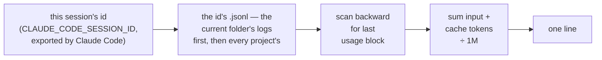

# /window

A one-line context-window check, built for the phone. Ask how full the window is, get a single line back — never the wall-of-text `/context` table you can't scroll on a phone.

## What You Type

Either form fires it:

- **`/window`** — the explicit command.
- **Plain words** — "how's the window?", "how much context left?", "are we running low?" (model-invocation is on, so natural phrasing triggers it too).

## What You Get Back

One line. Nothing else:

```
Context: 114,599 / 1M = 11.5% — plenty of room
```

The tail is a tiered read against the standing window law — a 40% warn line, a 50% no-new-fan-outs line, and the 60% wrap line (the point where it's time to wrap up and start a fresh terminal):

| Usage | Read |
|---|---|
| under 40% | `plenty of room` |
| 40–50% | `past the 40% warn line — steer toward a clean milestone; N% to the 60% wrap line` |
| 50–60% | `past 50% — no new fan-outs; N% to the 60% wrap line` |
| 60%+ | `past the 60% wrap line — wrap up and start a fresh terminal` |

`core.mjs` is the **single source** of the three numbers — the `WARN` / `NO_FANOUT` / `WRAP` constants at its top — and of the line's wording. Both `window.mjs` and the watcher hook below import it, so the two can never disagree. Change the law there, then update this table. The tier is judged on the percentage as printed (rounded to 0.1), so the number and the words never disagree: 39.96% prints as `40.0%` and reads as past the warn line.

To see every tier without a session that big, set `WINDOW_TEST_TOKENS` to a token count — it skips the transcript read and runs the same formatting path (anything but a non-negative integer fails loudly, exit 1). A test line is always labeled `Context (TEST — …)`, so a variable left set in a `settings.json` env block or a shell profile can never pass a made-up number off as a live read; a live read starts with a bare `Context:`.

```bash
WINDOW_TEST_TOKENS=550000 node ~/.claude/skills/window/window.mjs
# Context (TEST — WINDOW_TEST_TOKENS is set, not a live read): 550,000 / 1M = 55.0% — past 50% — no new fan-outs; 5.0% to the 60% wrap line
```

## Why Not Just `/context`

`/context` dumps a ~300-line category table the instant it fires. On a phone, that's a seemingly endless scroll of table content to thumb past, and a summary-after-the-fact doesn't un-dump it. `/window` is the inversion: the parser runs on the PC, and **only the one line reaches the phone**.

The one thing `/window` can't do is the per-category breakdown — it's a total. If you actually want to know *what's* eating the window, that's the single case where `/context` earns its dump; type it yourself.

## How It Works Under the Hood

The skill's `!` exec runs `window.mjs`, which finds the current session's log by its session id with zero configuration — so it works in **any** project, not just this one.



The last assistant message's `usage` is what the API saw on input for the current turn — i.e. the live context size. It matches `/context` within ~2 points (the drift is a few messages of conversation between the two reads).

**Which log — by id, never "the newest".** The first version read the most-recently-modified log in the project's folder, and that races: two sessions in one project each write their own log, so the newest file is whichever wrote last. On 2026-10-16 a three-day session at ~55% ran beside a fresh one at ~9%, their logs written nine seconds apart — either could have been read for the other, and the full one told "plenty of room" off its neighbor's number. Claude Code exports `CLAUDE_CODE_SESSION_ID` to the shell (the same id its hooks receive; the log is `<id>.jsonl`), and `SKILL.md` also passes the skill-substituted `${CLAUDE_SESSION_ID}` as an argument:

| What the script gets | What it prints |
|---|---|
| one valid id, or two that agree | the live line, `Context: …` |
| two valid ids that disagree | `Context: two session ids disagree (…)` — exit 1, never a guessed pick |
| an id whose log doesn't exist yet | `Context: no transcript for this session (…) yet.` |
| no id at all (run by hand, outside Claude Code) | the newest log in the current folder, labeled `Context (GUESS — …)` |

A non-UUID argument — the shell expanding an unfilled `${CLAUDE_SESSION_ID}` to an empty string — is ignored.

**After a compaction — no number, never the old one.** A compaction writes a `compact_boundary` entry into the log, and the newest `usage` behind it is the PRE-compaction size. A turn's own usage lands in the log only after its first tool call returns, so `/window` run as the first step after a compaction used to print that stale figure. On 2026-10-20 the harness compacted a session while it sat idle (485,045 tokens down to a 45,821-token summary, ~55 min after the last turn ended); the next turn's `/window` read 48.3% while the live context was ~12.3%. The scan now stops at a boundary it meets before any usage and prints `Context: compacted 17 h ago (485,045 → a 45,821-token summary) — no live read since; ask again after one more step.` It reports no estimate on purpose: the boundary's post-compaction count is the summary alone, and the re-sent system prompt, tools and memory sit outside it.

**Two open checks, both needing a fresh session:** whether the env id follows a `/clear` (a new session in the same process), and whether the harness fills `${CLAUDE_SESSION_ID}` inside the `!` line at all. Skill content is cached when a session starts, so neither can be probed from the session that edited it. If the env id goes stale after `/clear` and the argument arrives filled, the disagreement line catches it. If the argument never arrives filled, a stale env id after `/clear` would read the pre-clear log — the one silent case left.

## The Watcher: Lines Announce Themselves

`/window` only helps when someone runs it, and that is where the law kept failing. The 2026-11-08 audit found the numbers held up on Opus 5.5. The checking did not: Opus 5.5 is never told how full its own window is, and Claude ran past the lines unchecked at least three times (to 78.5%, from 8% to 80% "unnoticed", and a fan-out launched before the check). The deepest sessions had nobody watching.

So `context-watch.mjs` runs as a hook on two events in `~/.claude/settings.json`, both with the command `node ~/.claude/skills/window/context-watch.mjs`:

- **`PostToolBatch`**, after every batch of tool calls, before the next request goes out.
- **`UserPromptSubmit`**, when you send a message. This one catches a line crossed by a reply that used no tools, which fires no batch.

Each time, it estimates how full the **next** request will be. The first time that is past a line, it puts `/window`'s own line in front of Claude (context that rides with that very request) and on screen (the hook's `systemMessage`):

| The next request crosses | What happens |
|---|---|
| 40%, 50%, 60% | the line, once per session per line |
| 70%, 80%, 90% | the line again (it reads `past the 60% wrap line`), because the unnoticed overruns ran to 78–84% |
| several lines in one step | one announcement, for the highest line reached |
| a compaction | the watch resets: no number right after it, then each line announces again as the session climbs back |

- **Why the next request, not the last one.** The newest `usage` in the transcript is the input of the reply that just finished, and that reply has already run its tools. Judged on it alone, a crossing would surface only after the crossing step's tools ran, a fan-out included: the 2026-11-09 review found a real session launching two agents at 50.0% while that reading still said 49.7%. So the watcher adds what the next request will carry on top: the reply's own output, plus the batch's tool results (from the hook's input) or the message being sent. Text counts 3 characters a token, an image 1,600 and a PDF 3,000 a page (pages counted from the file, never its base64 bytes). Every estimate also carries 5,000 tokens of slack for what rides along unseen (system reminders, attachments, prompts queued mid-turn), plus 17,000 on a Skill call, whose result is only "Launching skill: X" while the skill's body arrives separately. Those two numbers come from the second review's replay of 426 real sessions: without them the real next request beat the estimate in 99% of batches, and 37 of 210 crossings would have gone out unannounced; with them, none. The bias is deliberately early: early by a point beats late by a step. Its line is labeled `Context (next request, estimated)`, so it never passes for a live read.
- **Transcript lag.** Claude Code writes the transcript a beat behind, so on a batch the reply that made it may not be on disk yet. The watcher knows that reply by its `tool_use` ids and waits up to 300 ms for it. Past that, it reads what is there, and the estimate runs low by one step.
- **Announced means delivered.** Claude Code logs each delivered hook context as an `attachment` row of type `hook_additional_context`. A batch that ends the turn, an Esc or a timeout can drop the context, so the watcher counts a line as announced only when that receipt is in the transcript. A line without one is said again on the next event. Two headless probes on 2026-11-09 saw both events deliver and log their receipts: a `PostToolBatch` announcement at a stand-in 41%, then a `UserPromptSubmit` one at 51% on the resumed session, each quoted back word for word, after which the next batch stayed silent.
- **Where it keeps its place:** `context-watch.json` (`{"line": 50, "offset": …}`) in the session's own folder beside its transcript (`<project>/<session id>/`): the highest receipted line since the last compaction, and how far into the transcript it has read, so each run reads only what was added since. A line without a valid offset behind it is not trusted: the state is rebuilt from the receipts. Nothing but a compaction lowers the line: when the review replayed 419 real sessions, a reading never fell back below an announced line without one. A transcript shorter than the offset (rewritten) is read again from the start.
- **Never in the way:** any fault (bad input, missing transcript, unreadable state) exits 0 with no output. Events inside subagents and teammates (`agent_id` set; their input still names the main transcript) are skipped, because the law governs the main window only.
- **Testing a line live:** `WINDOW_TEST_TOKENS` works here too. It stands in for the reading, adds nothing ahead, and its line carries the `TEST` label.
- **Reading the transcript fast:** `core.mjs`'s `readLatest` reads from the end of the file in 1 MB chunks, so a 30 MB transcript costs about 2 ms, not a full load, and a line longer than many chunks is joined once. On 2026-11-09 it returned the same reading as the old whole-file scan on every transcript on disk, plus tiny-chunk runs that split lines and characters at every boundary. A whole hook run, node start-up included, takes about 40–70 ms; the first run in a long session also reads the whole transcript once for receipts (about 100 ms on a 29 MB one).

## Installation

`SKILL.md`, `window.mjs`, `core.mjs` and `context-watch.mjs` in this directory are the source of truth, junction-linked to `~/.claude/skills/window/` so Claude Code picks them up automatically — edits here go live with no sync step. The watcher also needs its two entries in `~/.claude/settings.json` (`hooks.PostToolBatch` and `hooks.UserPromptSubmit`); the session-start config-liveness check flags them if the script path stops resolving.

**Tests:** `node --test "projects/skills/window/**/*.test.mjs"` (the law, the backward read at every chunk size, `window.mjs`'s live path, and every watcher case above), run in CI by `verify-window.yml`, which fails a run that finds no test.

> **Windows install gotcha:** `ln -s` via git-bash **silently copies** instead of linking unless the shell is elevated (MSYS default — and it returns success, so you won't notice the stale copy). True symlinks need Developer Mode/admin. The no-elevation answer is a directory **junction**: `New-Item -ItemType Junction -Path <link> -Target <source>` in PowerShell. It points at the same folder, so edits propagate; it just shows as a plain `d` directory in `ls` rather than an `l` symlink.
