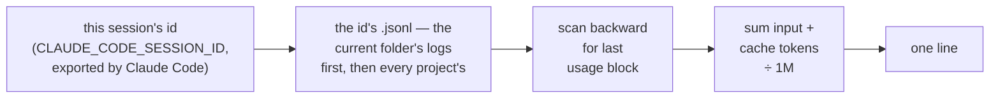

# /window

A one-line context-window check, built for the phone. Ask how full the window is, get a single line back — never the wall-of-text `/context` table you can't scroll on a phone.

## What You Type

Either form fires it:

- **`/window`** — the explicit command.
- **Plain words** — "how's the window?", "how much context left?", "are we running low?" (model-invocation is on, so natural phrasing triggers it too).

## What You Get Back

One line. Nothing else:

```
Context: 114,599 / 1M = 11.5% — plenty of room
```

The tail is a tiered read against the standing window law — a 40% warn line, a 50% no-new-fan-outs line, and the 60% wrap line (the point where it's time to wrap up and start a fresh terminal):

| Usage | Read |
|---|---|
| under 40% | `plenty of room` |
| 40–50% | `past the 40% warn line — steer toward a clean milestone; N% to the 60% wrap line` |
| 50–60% | `past 50% — no new fan-outs; N% to the 60% wrap line` |
| 60%+ | `past the 60% wrap line — wrap up and start a fresh terminal` |

`window.mjs` is the **single source** of the three numbers — the `WARN` / `NO_FANOUT` / `WRAP` constants at its top. Change the law there, then update this table. The tier is judged on the percentage as printed (rounded to 0.1), so the number and the words never disagree: 39.96% prints as `40.0%` and reads as past the warn line.

To see every tier without a session that big, set `WINDOW_TEST_TOKENS` to a token count — it skips the transcript read and runs the same formatting path (anything but a non-negative integer fails loudly, exit 1). A test line is always labeled `Context (TEST — …)`, so a variable left set in a `settings.json` env block or a shell profile can never pass a made-up number off as a live read; a live read starts with a bare `Context:`.

```bash
WINDOW_TEST_TOKENS=550000 node ~/.claude/skills/window/window.mjs
# Context (TEST — WINDOW_TEST_TOKENS is set, not a live read): 550,000 / 1M = 55.0% — past 50% — no new fan-outs; 5.0% to the 60% wrap line
```

## Why Not Just `/context`

`/context` dumps a ~300-line category table the instant it fires. On a phone, that's a seemingly endless scroll of table content to thumb past, and a summary-after-the-fact doesn't un-dump it. `/window` is the inversion: the parser runs on the PC, and **only the one line reaches the phone**.

The one thing `/window` can't do is the per-category breakdown — it's a total. If you actually want to know *what's* eating the window, that's the single case where `/context` earns its dump; type it yourself.

## How It Works Under the Hood

The skill's `!` exec runs `window.mjs`, which finds the current session's log by its session id with zero configuration — so it works in **any** project, not just this one.



The last assistant message's `usage` is what the API saw on input for the current turn — i.e. the live context size. It matches `/context` within ~2 points (the drift is a few messages of conversation between the two reads).

**Which log — by id, never "the newest".** The first version read the most-recently-modified log in the project's folder, and that races: two sessions in one project each write their own log, so the newest file is whichever wrote last. On 2026-10-16 a three-day session at ~55% ran beside a fresh one at ~9%, their logs written nine seconds apart — either could have been read for the other, and the full one told "plenty of room" off its neighbor's number. Claude Code exports `CLAUDE_CODE_SESSION_ID` to the shell (the same id its hooks receive; the log is `<id>.jsonl`), and `SKILL.md` also passes the skill-substituted `${CLAUDE_SESSION_ID}` as an argument:

| What the script gets | What it prints |
|---|---|
| one valid id, or two that agree | the live line, `Context: …` |
| two valid ids that disagree | `Context: two session ids disagree (…)` — exit 1, never a guessed pick |
| an id whose log doesn't exist yet | `Context: no transcript for this session (…) yet.` |
| no id at all (run by hand, outside Claude Code) | the newest log in the current folder, labeled `Context (GUESS — …)` |

A non-UUID argument — the shell expanding an unfilled `${CLAUDE_SESSION_ID}` to an empty string — is ignored.

**Two open checks, both needing a fresh session:** whether the env id follows a `/clear` (a new session in the same process), and whether the harness fills `${CLAUDE_SESSION_ID}` inside the `!` line at all. Skill content is cached when a session starts, so neither can be probed from the session that edited it. If the env id goes stale after `/clear` and the argument arrives filled, the disagreement line catches it. If the argument never arrives filled, a stale env id after `/clear` would read the pre-clear log — the one silent case left.

## Installation

`SKILL.md` + `window.mjs` in this directory are the source of truth, junction-linked to `~/.claude/skills/window/` so Claude Code picks it up automatically — edits here go live with no sync step.

> **Windows install gotcha:** `ln -s` via git-bash **silently copies** instead of linking unless the shell is elevated (MSYS default — and it returns success, so you won't notice the stale copy). True symlinks need Developer Mode/admin. The no-elevation answer is a directory **junction**: `New-Item -ItemType Junction -Path <link> -Target <source>` in PowerShell. It points at the same folder, so edits propagate; it just shows as a plain `d` directory in `ls` rather than an `l` symlink.
