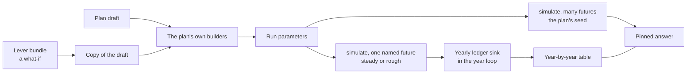

# Act 5 — The Workbench - Plan

This plan turns the scoping brief, [5-workbench.md](5-workbench.md), into buildable units. The brief holds Briggsy's rulings in his own words; where this plan and the brief disagree on what he asked for, the brief wins. Build status lives in the roadmap's You-Are-Here table, never here.

> ⚑ **Widened 2026-11-22** by [rightcapital-map.md](rightcapital-map.md): the mandate is now RightCapital's whole feature set and flow. These units stay the build pieces for the map rows that name them, and are built in his order of the map's gaps. Re-check each unit against the map before building it, because it was written for a room beside B9, not for the workspace the map recommends.

> ⚑ **Amended 2026-11-23 for gap 2** (b9-3, the pilot's calls; Briggsy delegated them that day: "You're smarter than me, you make the call"). Changed in place, each with its own dated note: the Goal Capsule's means and stop conditions, the Summary, R1, R2, R17, R32, F1, AE4, the deferred list, OQ6 (decided), the Assumptions, Sequencing (replaced by the map's order), the Risks, KTD10 to KTD13, KTD15, KTD16, KTD18, KTD31, the Unit Index, U9, U10, U14, U15, U16, U17 and U21 (their files), U20, U23, and a new unit, U25 (the workspace home). KTD30 is unchanged. Round 3's open findings (`f32f8ea2`'s message): only c3-adv-hidden-work-4 touches gap 2, and it is folded into U15. The receipt's open P1 (c3-adv-hidden-work-2) and the rest belong to gap 3 (U12, U13), U22 and U23, and are settled in this plan when those open.

> ⚑ **Amended 2026-11-26 for gap 3** (b9-9, the pilot's calls, from a read of the plan against the code at `bfa73a25a` and against the primaries). Changed in place, each with its own dated note: the receipt (now 0 P0/P1 open), R32, F5, AE6, the Risks, Sequencing's gap 3 item, KTD16's last paragraph, KTD17, KTD20, KTD22 to KTD25, the Unit Index rows for U10, U12, U13 and U17, U24's verification, the inherited-IRA sentences in U7 and U8, U10, U11, U12, U13, U17, the Verification Contract and the Documentation Notes. How it was checked: an adversarial review of the amendment the same day found 2 P0, 5 P1, 5 P2 and 10 P3, and a second review of those fixes found one more P1 (a death-year amount untaken past its waiver) and five P3; every finding is folded into the text, each with its dated note. Its two P0s: the HSA's run-out check and the last source now count inherited money after the year's paced withdrawal (KTD22, U12), and the withdrawal reaches the state tax through a channel of its own (KTD23, U12). The workplace-plan question asks where the money sat at the owner's death, never where it came from (KTD17, U13). KTD22 now keeps the inherited balances inside the engine's authoritative total (the HSA's live shape) and outside `AccountBuckets` and the withdrawal order. That closes the receipt's open P1 (c3-adv-hidden-work-2) and seven of the other nine round-3 findings that belong to gap 3: c3-feasibility-1 and -2, c3-adv-settled-1, c3-reach-2 and -3, and c3-adv-hidden-work-1 and -3. The last two close in the units: c3-adv-verification-2 in U12's last-source test, and c3-coherence-2 in U13's question list. Act 6 replaced the facts page, the year table, the rail and the front room these units named, so each unit now names the Act 6 screen it fills.

**This repo is public.** The household's real holdings, balances and family facts are never written in this plan, its tests, its fixtures or its commits. Every example below is made up.

**Code is cited by file and symbol, without line numbers, on purpose.** Another build is moving the same files, and `verify:doc-stats` gates every line-numbered citation in `docs/`.

## Goal Capsule

- **Objective.** Briggsy can sit in the advisor's chair behind the calm answer: see every year of one future (what comes in, what goes out, tax, what is pulled from each source, what is left), change any fact or pull any lever on a copy of his plan, keep and compare the what-ifs he names, and trust that each figure is the engine's own.
- **Means.** One workspace on the same engine and the same saved plan, the home after setup (R1), built from three mechanics: a facts page, a lever rail, and a year-by-year table fed by a new opt-in engine output (KTD1, KTD5, KTD10). (Amended 2026-11-23, b9-3, the pilot's call: was "one second room", before Briggsy's 2026-11-22 flow ruling made the workspace the home.)
- **Authority.** `docs/architecture.md` wins on an invariant. `docs/product.md` wins on the why and the what. The scoping brief wins on what Briggsy ruled. The design law (`.claude/skills/back-nine-design/SKILL.md`) wins on how a surface looks and reads. This plan wins on order and mechanism inside those.
- **Stop conditions.** Stop a unit and report when: a measurement this plan calls for comes back against the decision that rests on it; an older-build proof fails (owed from the first schema step after his first real save, KTD16; amended 2026-11-23); a rule this plan cites from a primary source reads differently at that source; or the cardinal rule is at stake and no listed decision covers the case.
- **Execution profile.** Slices, each usable by itself, committed to `main` in order. No branch and no pull request. Phase 1 changes no saved shape. Every unit runs the project's own flow: `/brief`, the unit's build, a whole-file review with an adversary and every finding verified, then `/distill`.
- **Who finishes.** The Back Nine's sessions build it. Briggsy reads each new surface cold before it is called done.

## Product Contract

### Summary

Act 5 adds a workbench that becomes the home after setup, with the calm answer at its head (R1; amended 2026-11-23, was "behind the calm answer"). It has one facts page, one rail of levers that run on a copy of the plan, and one year-by-year table. It also closes three gaps the table would otherwise expose: there is no bank account kind, no inherited-IRA kind, and no way to type positions. Version 1 adds repeating spending lines and a second Roth conversion mode that converts up to a chosen line.

### Problem Frame

The Back Nine answers one question calmly and then recommends one strategy. It does not let Briggsy see the years behind the answer or try a change without touching the plan. Two levers have a what-if today (withdrawal order and Roth conversion); the rest have none. The engine decides what to pull from each source in every year of every future and hands none of it out. He asked for the advisor's view of his own household, and nothing else.

### Key Decisions

Each is Briggsy's, from the scoping conversation of 2026-11-09 (see origin: `docs/plans/5-workbench.md`).

- **A workbench for one household, the adviser's full version.** "what I think I really need is a RightCapital clone. Not for sale, not for sharing. Just for casa da Briggsy." and "we need the full blown FA version, not the stripped down one they let end users play around with." Governs R1 to R32.
- **No back office and no side planners.** "no backoffice client bullshit. no student loan, 529, etc." Governs Scope Boundaries.
- **Typed entry, no linkage.** "I can enter bank balances, IRA/brokerage securities (cusip, qty, cost basis) and no direct linkage (I wouldn't use it on RC either)." Governs R23, R28.
- **What he likes most.** "the quick what-if scenarios"; "the yearly spends (with the ability to add shit like a new car every 5 years)"; "the amount you need to pull from each source"; that it knows MAGI for ACA and IRMAA, RMDs and bracket-filling Roth conversions; and "the flow". Governs R4, R6, R12, R16 to R19, R30, R31.
- **The how is the pilot's.** "if we can replicate the simplicity of their flow, you dictate how we get there, I'm ATC baby."
- **Same repo, same engine, same saved plan.** He agreed ("totally agree") that this is the product's next act and not a second project.
- **Original work only.** Same jobs, our own code, screens and words. Nothing is copied from RightCapital.
- **The workbench is next after the surplus build, with the yield build inside it.** Briggsy, 2026-11-11, choosing it over building the workbench without the interest-and-dividends work, and over finishing his D7 order first. Governs R12, R31 and U23. (session-settled: user-directed — chosen over a workbench without the yield build: the income each line reads and the room under it are what he named.)
- **The app's login security is not to be over-built.** Briggsy, 2026-11-11, on where his real plan should live: "I really think we are waaaaay over thinking the security aspect of this. We're not keeping my account numbers or passwords to said accounts in this thing. Over complicating. I already have a half dozen calculators with the same info in it. We're creating a solution looking for a problem." And, when the pilot stretched that: "I said we are overthinking the login security of our app." His real plan lives on a finished build served at its own address on his laptop (U24). This says nothing about security review of the code or of this plan, which stays as it is.
- **Single companies count as the whole market.** Settled 2026-11-09 on his answer: no risk number of their own, a plain line saying how much rides on them, and a what-if where they fall by half or to zero. Governs R17, R29.
- **No positions file import.** Cut 2026-11-09: positions are typed. Governs R28.

### Requirements

**The room**

- R1. After setup, the workbench is the home: a workspace whose analysis page carries the calm answer and the recommendation as its headline, so the calm answer stays the first thing a reader sees. Its other pages are the year-by-year table and the facts page; the tax, Social Security, health and stress pages come with their own gaps of the map. (Amended 2026-11-23, b9-3, the pilot's call, writing in Briggsy's 2026-11-22 flow ruling, `docs/product.md`'s flag. The 2026-11-11 text made the workbench a second room reached on purpose from the front room; U6 built that door, and it serves until U25 makes the workspace the landing.)
- R2. The workspace loads on demand, behind an error boundary with a retry. Setup stays the profile entry: a household lands in the workspace once its first answer has resolved, and a failed load still leaves the calm answer readable. Back never drops an open editor or an unkept what-if without asking. A read-only tab can look, and cannot keep or save. (Amended 2026-11-23, b9-3, the pilot's call: the door, its Back to the front room and its rule of opening only on a resolved answer belonged to the room beside the answer; U25 replaces them.)
- R3. Every string goes through the copy catalog and copyGuard. Color is never the only signal. Figures use tabular numerals. Nothing in this act adds a network call.

**The year-by-year table**

- R4. The table shows one future, one row per calendar year: income by source, spending, income tax, what is pulled from each source, required withdrawals, conversions, and what is left in each source at the end of the year.
- R5. Every figure in the table comes out of the engine's own year loop, in the run the table shows. Nothing is worked out again in the UI.
- R6. A "source" is a ledger the engine keeps: taxable, Roth, HSA, pre-tax for each person, and each inherited IRA. Each source names the entered accounts inside it.
- R7. The default future is a steady market, with lifespans at the middle of the engine's own survival tables: the first death in its middle year and the last in the couple's middle year. The table's heading says both in plain words, and never calls the future typical, average or expected.
- R8. One tap shows the same table in a rough market. That market is the same for the plan and for every what-if.
- R9. The many-futures answer stays pinned beside the table and comes from the many-futures run. The table never stands alone as the answer.
- R10. A row's flows are that calendar year's, and its balances are that year's end. A plan opened in a later year than it was built says which year row one is.
- R11. A fact reads exactly. A projected figure reads rounded with "~". Every figure reads one money grain. A room under a line and a convert-to-a-line amount print rounded down, in the actionable dialect (`formatActionableDollar`), never to nearest; the income printed against a line, and a year's overage past one, round up.
- R12. Each year shows the income each line reads and the room left under it: the ACA cliff, each IRMAA step, and the top of the tax bracket. Each room names the income it reads and the year its bill lands. A room is a gap in that income, never an amount to add: added income can raise it by more than itself (Social Security's taxable share), and U19's convert-to-a-line gives the amount to act on. U23 builds the yearly yield it needs (KTD32).
- R13. A year with build 2's left-over credit to taxable shows the credit and adds up. A year the columns cannot add up says why in words: income above spending that the tool does not keep (a retired year's surplus; a working year's left-over that the household's answer to the left-over question does not credit; any part above the credit's cap; any year after a death), a required withdrawal larger than the year's need, and the year the money runs out.

**The facts page**

- R14. One page lists everything the household told the tool, and any line can be edited there.
- R15. A value is a fact when it is already settled and a lever when the choice is still open. Each value has one door.

**What-ifs**

- R16. A what-if is a named copy of the plan's levers, run on a copy. Nothing reaches the plan without an explicit Apply, and nothing reaches the vault without an explicit Save.
- R17. The rail carries RightCapital's action items as levers: the year the working members stop, together; spending (any budget line added, replaced or removed, or the one-figure total for a household with no itemized budget); each working owner's yearly deposits, account by account; the household's stock, bond and cash mix; the Roth conversion plan; withdrawal order; the Social Security claim age of a person who has not claimed; and the ACA subsidy regime. An inherited IRA's pace (gap 3) and a fall in single-company positions (gap 11, still a what-if by Briggsy's 2026-11-09 ruling) join with the schema steps their own gaps take. (Amended 2026-11-23, b9-3, the pilot's call: the list is the map's action items; deposits and the mix are added; the pace and the fall leave version 6; a stop year for each person and an income-start lever were weighed and left out.)
- R18. A lever commits on blur or Enter, and the table redraws once. No figure ticks or counts while a control moves.
- R19. A what-if's difference from the plan is read on the same futures.
- R20. A sentence says a lever helps or costs only where that was measured for this household.
- R21. A what-if can be named, kept in the vault, reopened, renamed, deleted and set beside another. A kept what-if that points at an account or a line that is gone says so, and never re-targets itself.
- R22. A what-if never starts a solve. The saved recommendation appears on the rail as a what-if that cannot be edited.

**Accounts and holdings**

- R23. A bank account is its own account kind.
- R24. An inherited traditional IRA is its own account kind. The run takes the withdrawals the law forces, never converts it, never counts it toward a person's own required withdrawals, and never rolls it to a spouse as their own. Its withdrawals are income in the year they are taken, for every reader of that year's income.
- R25. Intake asks an inherited IRA's facts and never guesses one. A case version 1 does not model is refused in plain words.
- R26. Inside the window the law leaves open, the pace of an inherited IRA's withdrawals is the household's choice, bounded each year by the law's minimum and the balance, with everything out by the law's last year.
- R27. A household with no bank account and no inherited IRA gets the same answer, byte for byte, as before this act, until U23 lands. After it, a run whose taxable ledger stays at zero in every year of every path does; U23's yield moves every other answer on purpose.
- R28. Positions can be typed for an account: a label, a mix, a dollar value, and optionally a quantity, a cost basis and a CUSIP or ticker. The account's balance stays the authority, and any gap between it and the positions is shown in words.
- R29. The facts page says, in dollars and as a share of the household's money, how much rides on single companies, and that the plan treats it like the whole market.

**Spending and conversions**

- R30. A spending line can repeat every N years.
- R31. A Roth conversion can be set to convert up to a chosen line each year in a window. The ACA and IRMAA lines land once U23 has (KTD32).

**The saved plan**

- R32. Version 6 carries gap 2's saved shapes only: a stable id on each entered account and budget line, the kept what-ifs list, and the saved recommendation's Roth conversion plan (KTD16, U9). Each later gap's new saved shape takes its own schema step when that gap first adds the shape (amended 2026-11-26, b9-9: was "when that gap opens"; gap 3's step lands at U13's first commit, KTD16). Every step is judged from the older copy's side under `docs/architecture.md` §7.3 and names its literal successor. (Amended 2026-11-23, b9-3, the pilot's call: one step for every new shape in the act made sense only while Phase 2 came before the rail; before his first real save a later step costs a relabel.)

### Key Flows

- F1. **Land in the workspace.** Setup ends (or a saved plan reopens), the workspace loads on its analysis page with the calm answer and the recommendation as its headline and the many-futures answer pinned, and the year-by-year table shows the plan's steady future one page over. Covers R1, R2, R7, R9. (Amended 2026-11-23, b9-3, the pilot's call: was a deliberate door from the front room, which U6 built and U25 replaces.)
- F2. **Edit a fact.** Facts page, edit a line, the plan's draft updates, the table and the pinned answer redraw, the plan shows unsaved changes, Save. Covers R14, R15.
- F3. **Pull a lever.** Rail, commit a lever, the table redraws once, the pinned answer follows, then: pull another, keep it, apply it to the plan, or drop it. Covers R16 to R20.
- F4. **Keep and compare.** Name a what-if, keep it, reopen it later, set it beside another, apply one, Save. Covers R21.
- F5. **Enter an inherited IRA.** Profile → Net Worth, Add, Inherited IRA; answer its questions in the account drawer; see its forced withdrawals on Cash Flows → Accounts and try its pace in the Action Items tray. Covers R24 to R26. (Amended 2026-11-26, b9-9, the pilot's call: was the accounts step, the table and the rail, which Act 6 replaced.)

### Acceptance Examples

- AE1. Covers R6. Two Roth IRAs are entered. The table shows one Roth source naming both accounts, and never splits a year's Roth withdrawal between them.
- AE2. Covers R10. A plan built in one year and opened the next shows row one labeled with the build year, and the heading says so.
- AE3. Covers R13. In a year where pensions and Social Security exceed spending, the row says the tool does not save the extra, instead of showing columns that do not add up.
- AE4. Covers R19. For a working household, the what-if and the plan's base are both read at one tier (`DATE_SEARCH_PATHS.provisional`, or `.final` if U14's measurement takes it), on the plan's own spending track, and the difference is read between those two readings (amended 2026-11-23: was "the date search's first tier", which is not a term in the code).
- AE5. Covers R24. A made-up heir born 1968 inherits a traditional IRA from an owner born 1945 who died in 2023. With $100,000 in it on December 31, 2025, the 2026 minimum is $100,000 / 28.6 = $3,496.50, and whatever is left comes out in 2033.
- AE6. Covers R26. A pace of "only what the law requires" on that account leaves the largest withdrawal in the last year, and Cash Flows → Accounts shows that year's income jump. (Amended 2026-11-26, b9-9: was "the table", which Act 6 replaced.)
- AE7. Covers R27. Every shipped seed, run before and after U12, returns identical bytes on every field.
- AE8. Covers R21. A kept what-if moves a spending line. The line is later deleted from the plan. Reopened, the what-if says the line is gone.

### Scope Boundaries

Out of this act, by the scoping brief:

- The adviser back office: many clients, a client portal, compliance, billing.
- Student loans, 529s, business planning, insurance needs, estate flowcharts.
- Bank linkage and price feeds. Product R36 stands: every number is typed.
- A positions file import.
- A search over Social Security claim ages. Claim age is a lever. (Superseded 2026-11-23 by the mandate's map: the claim comparison is gap 7, on this act's what-if runner; the search for the best age stays its own build.)
- Different investments in different accounts, and more asset classes.
- A library of stress tests. One rough-market view is in. (Superseded 2026-11-23 by the mandate's map: stress tests are gap 8.)
- Tracking past spending.

Deferred by this plan, each filed in the register by U1 before the unit that leaves it out ships:

- A ledger for each entered account inside the engine (KTD6).
- Federal and state income tax as two columns (KTD8).
- Inherited-IRA cases outside version 1's one case (KTD17).
- The solver searching an inherited IRA's pace or a convert-to-a-line plan (KTD21, KTD28).
- A per-year custom pace for an inherited IRA (KTD21).
- A long-life view of the table (KTD4).
- Income streams named one by one in the table (U3).
- A "cannot be compared" state on the rail: no version-1 lever can produce it, so KTD11 guards it inside.
- Freed deposits counted as saved: a deposits what-if counts money no longer deposited as spent, which reads low and never rosy (KTD16). Its D7 build is filed before U14 ships (added 2026-11-23, b9-3, the pilot's call; filed with U14 as the register's Tier 1 *A deposits what-if counts the money no longer deposited as spent…*).

### Outstanding Questions

- OQ2. **Blocks U10's bank kind.** Where bank cash belongs is the same call as the open item in build 2's queue ("savings" means three things), which is headed for a council. That ruling can move KTD26's fold, not only the labels. U10's first commit, which adds no kind, and U13 go ahead; the bank kind lands after the ruling.
- OQ3. **Deferred.** If RightCapital access returns: its year-by-year figures for one plain scenario of his household, lined up against ours as leads. A difference is a question to chase in both tools, never a verdict.
- OQ6. **Decided 2026-11-23 (b9-3, the pilot's call; Briggsy delegated it that day: "You're smarter than me, you make the call").** A working household's what-if shows no date. It reads the odds at one stop year (KTD12), as the front-room sheets do, and the dates are searched again only after Apply. Two reasons. The worker holds one date-search cancel number (`latestEpoch` in `src/engine/engineProtocol.ts`), so a what-if's date search would cancel the store's own search or be cancelled by it. And RightCapital's proposed plan recomputes the odds, not a date. The rail's words for a working household say which stop year the odds read (U15). The way not taken: a date search per what-if at `DATE_SEARCH_PATHS.provisional`, a search on every commit.

### Sources

- Origin: [5-workbench.md](5-workbench.md).
- Register entries this act builds or touches, by title: *An inherited IRA has no account kind…*; *The taxable account's yield never reaches a year's tax base…*; *Money the household says is in cash is grown and swung like bonds*; *The detail-door era — nowhere to see how a number was reached*.
- Decision record: [portfolio-holdings.md](../decisions/portfolio-holdings.md).
- Lessons that shape units are cited where they land, as `insight NNN` (`docs/insights/`).

## Planning Contract

### What the research settled

Read in the code on 2026-11-11. Each item changes something the scoping brief leaned on.

- **The fixed-market replay cannot carry the table.** `backtestWindow` in `src/engine/historical.ts` runs the bare spending spine: no tax, no healthcare, no required withdrawals, no working-year pay. This answers the brief's design call 1 check with a no. The whole machinery runs only inside `simulate`'s per-future loop (`src/engine/simulate.ts`).
- **The one whole-machinery seam is closed to product code.** `simulate`'s `_injectedDraws` option is marked for the validation harness, and a consumer pin in `src/engine/validation/__tests__/blockBootstrap.test.ts` fails if product code names it.
- **A steady market has one honest meaning in this engine.** A return is drawn as `exp(mu + sigma * z) - 1` (`src/engine/rng.ts`). At z = 0 that is each year's middle return, with the drag of volatility already in it: about 3.5% a year for stocks and 0.8% for bonds after inflation on the shipped market (`src/engine/reference/methodology.ts`). The arithmetic averages, 5% and 1%, would compound to roughly a third more after 30 years at 60% stocks.
- **The engine keeps ledgers by tax treatment, not by account.** Entered accounts fold into taxable, Roth, HSA and per-person pre-tax (`KIND_TO_BUCKET` and `buildOverlay` in `src/intake/intakeMap.ts`). Two Roth IRAs are one balance inside a run.
- **A working household has no saved stop year.** The date is the product's answer, the codec refuses a stop age on a working person (`checkPersonV3` in `src/shared/scenarioCodec.ts`), and the answer is two dates, not one count.
- **Today's what-if seam varies one compiled control.** `TwoArmControl` has three kinds, and `buildArmParams` (`src/engine/roth.ts`) edits compiled parameters. A spending line, a claim age and an inherited IRA's pace are changes to the draft, before compile, and a stop year is a candidate offset that `buildCandidateParams` applies.
- **Today's preview runner allows one run at a time, on one worker.** `runControlPreview` (`src/store/controlPreview.ts`) keeps one latest-wins ticket. Every run shares one engine worker, in order, and a running call cannot be stopped. The store resets that worker only when an edit that changes the answer lands during a pending solve (`src/store/memoryModel.ts`).
- **Most of this act's new saved fields force a schema step** under `docs/architecture.md` §7.3: new account kinds (an older copy refuses them), positions and a line's repeat (an older copy drops or misreads them), a second conversion mode (an older copy refuses it). The holdings record's "no bump" line predates that rule.
- **The year loop already computes what the table needs and drops it:** each ledger's draw, required withdrawals, conversions, tax paid, the income each line reads, and year-end balances (`src/engine/taxOverlay.ts`).

### Key Technical Decisions

**The one future**

- KTD1. **The table's run is `simulate` itself, through a new product option for one named future.** The option carries a market score for each year and asset and a lifespan score for each person, and runs one future through the same per-future assembly as every other run. `_injectedDraws` stays harness-only and its consumer pin stays as it is. Rejected: a second function that assembles the year's streams (it forks at the producer's first early return, insight 081), and a zero-volatility copy of the parameters (it needs the middle return re-derived in a second place and cannot carry the rough view).
- KTD2. **Steady means z = 0 in every year.** The engine's own transform turns that into the middle return, so no return is typed anywhere. The fixture is compounded by hand from the market constants, never by the engine's formula.
- KTD3. **The rough market is one fixed sequence that no lever can change.** It is the worst 30-year start in the committed Shiller real-return series, the series `src/engine/validation/blockBootstrap.ts` already reads, then steady after year 30. Worst means the lowest sustainable rate: the highest flat real withdrawal a 30-year window survives, at a fixed 50% stocks, in history's own frame, with ties to the earlier year. `backtestWindow` only says survive or fail, and every window survives at 4%, so the rate is found, not read. The pick is pinned by a test and is never re-ranked in a plan's market. The scores fed to the run are the window's returns standardized against the series' own averages and swings, as `shillerJointZSeries` already does, so the run keeps history's order of good and bad years at the plan's own market level. History's raw returns in that window average above the plan's steady return, and feeding them unscaled would make the rough view richer than the steady one. A market with a correlation other than zero is refused by name, as `blockBootstrap.ts` refuses it. Rejected: the future at a stated rank among the plan's own (the pick would move with every lever, so two what-ifs would be compared in two different markets, and the table would wait on the many-futures run).
- KTD4. **Lifespans in the one future come from the engine's own survival tables.** The first death falls at that person's own middle year, through `sampleDeathYearOffset` (`src/engine/longevity.ts`). The survivor runs to the year `coupleSurvivalToYear` crosses one half, the couple's middle last year, so the table does not end while one of them is more likely alive than not. The survivor is the person whose own middle year is later, with a tie going to the first person, and a one-person plan keeps that person's own middle year. The heading names both ages. Survivor years then appear in the table with their own filing status and lines. Rejected: nobody dies (the table would run past age 100 and never show a survivor year).

**The yearly ledger**

- KTD5. **A third opt-in sink in the tax overlay's year loop records the table's rows.** It sits where the healthcare readout is pushed, records only when asked, and leaves every other output byte-identical. It is indexed by simulation year `t`, with calendar year `startCalendarYear + t`, the clock the health sheet's dated lines use (insight 134). It exists only on runs with the tax overlay on. It is the engine's one per-year producer: the register's *The detail-door era…* build reads or extends it and never adds a second, and which future that build's front-room view shows stays that entry's own call.
- KTD6. **The table's grain is the engine's ledgers.** Columns are taxable, Roth, HSA, pre-tax per person, and each inherited IRA. A ledger for each entered account is not built in this act. Splitting a ledger's draw across its accounts in the UI would invent a decision the engine never made (insights 024 and 132).
- KTD7. **The income shown for IRMAA is the figure the bill reads.** The sink records the same recorded figure the overlay bills from, not the component the healthcare readout pushes today (insight 143).
- KTD8. **Income tax is one column in version 1, and working years come from the loop.** The overlay solves federal and state tax as one number. In a working year the loop's tax is the part the portfolio funds; tax on pay rides inside the working-year shortfall. The sink records the loop's own composition of those lines, and a test pins every working year of the table's run, year 0 included, to the lines the loop composed for that year (the `checkComposed` probe, the composition the money picture in `src/engine/workingYearLedger.ts` reads), so one year never has two producers (insight 080).
- KTD9. **For a working household the table shows the committed answer's own run.** One base builder in `src/intake/intakeMap.ts`, beside `buildControlPreviewParams`, makes the table's parameters. All retired: `buildSpineParams`. Working: `buildCandidateParams` (`src/engine/dateSearch.ts`), the one owner of date-dependent construction, at the offset of the date answer's band, with the sink recording the pass that band's track names: full spending or the essentials floor. A table on the floor track says in its heading that it shows essentials-only spending. When neither track has a date, the base is the candidate at the top of the date window on the full pass, the one the money picture already runs on, and the heading says no date was found in the window. When a track has a date and the band is missing, the table is withheld and says so. The builder never reads the result screen's lifestyle-only offset. The pinned answer is the store's own, from the date run. On the date route the table is requested on each committed date answer for the current draft, never on the edit itself. Until then the prior table stays, marked as updating.

**What-ifs**

- KTD10. **A what-if is a bundle of lever values applied to a copy of the draft, then compiled by the plan's own builders**: `buildControlPreviewParams` for the many-futures run and `buildTableBase` for the one-future rows (`src/intake/intakeMap.ts`), never a second composer around `buildCandidateParams` (insight 081). One function applies a bundle. The stop year is the one lever that is not a draft field: its arm passes an offset to `buildCandidateParams` and writes nothing to the draft. The mix lever writes the chosen split as every account's hand mix on the copy, so `householdStockWeight` over `resolveBlend` stays the one producer of the household mix; never a `stockWeight` override after compile. The what-if carries the plan's own left-over credit, never one re-judged on the copy (U14). The plan itself is the comparison's base. Rejected: extending `TwoArmControl` (most levers are not compiled controls). (Amended 2026-11-23, b9-3, the pilot's call: the builders named, the mix arm and the left-over rule added.)
- KTD11. **Two runs share futures only when their path count, horizon and number of people match.** No version-1 lever changes any of the three (deposits and the mix included: `horizonFor` reads ages only), so this is an inside check: the request builder refuses a breach by name before any request, and the slot shows its calm error, never a difference. (Amended 2026-11-23: with the plan's base on its own lane, the two runs' parameters meet in the request builder, not inside one lane.)
- KTD12. **A what-if's many-futures reading is one run, never a search.** For a retired household it is the headline run on the what-if's copy, and the plan's side is the store's own headline, with no run. For a working household it is the candidate run at the what-if's stop year (the base's own offset unless the bundle holds a stop year: the band's offset, or the window top when no date was found), at `DATE_SEARCH_PATHS.provisional`, beside the plan's own candidate run at the base offset and the same tier, asked once per committed final answer, so the difference is read on the same futures. If U14's timing measurement takes the final tier (`DATE_SEARCH_PATHS.final`), the plan's side is read off the committed answer's own curve at the base offset, with no run. The plan's pinned answer stays the date run's own, and the rail never pairs a what-if with it: at the provisional tier, a working household's plan column on the rail shows the plan's base reading at that tier, labeled apart from the pinned answer, so both paired cells read one statistic at one tier. U16's compare does the same. Both readings use the plan's own spending track, KTD9's pass, so a difference is never read across two spending levels; the track picks which reading is read (`floorReading` or the headline, and `ledgerTrack: 'floor'` for rows), never what is run. Every run's seed is the live draft's (U14). The dates are searched again only after Apply (OQ6, decided). No what-if starts a solve. (Amended 2026-11-23, b9-3, the pilot's call: the plan's base runs once per answer, never again per lever commit; "first tier" is now the code's own name.)
- KTD13. **The workbench has its own run lanes, on the one engine worker.** One lane for each of the plan's two table views, one for the plan's many-futures base (a working household only, asked once per committed final answer, KTD12), and lanes for each what-if on screen. A lever never changes the plan's base, so a lever commit never runs it again. The plan's pinned answer is the store's own and needs no lane. A lane calls only `engine.run`, never the date search or the solve. Lanes share the worker in order. A lane keeps one call in flight and holds only its newest request until that call settles, so rapid commits collapse to the last one. A lane never resets the worker and never moves the store's epoch. When a call is rejected because the store reset the worker, the lane re-sends its newest request; when the worker has died, the lane shows its calm error and does not re-send. `runControlPreview` is left to the front-room sheets. (Amended 2026-11-23, b9-3, the pilot's call: was "a what-if's lane also runs the plan's first-tier base beside it", one extra run per commit on a worker whose running call cannot be stopped, insight 113.) (As built 2026-11-23: U14's timing took the final tier, so the plan's base has no lane; each what-if slot holds three lanes, its many-futures run and its two named futures. U14's As built note.)
- KTD14. **The rail's difference is always against the plan, and its label says so.** The front-room withdrawal-order sheet keeps its own base in this act.
- KTD15. **Facts and levers.** Levers are choices still open: the year the working members stop, together; spending, on any budget line or on the one-figure total; a working owner's yearly deposits; the household's mix; the Roth plan; withdrawal order; a claim age not yet reached; the ACA subsidy regime. An inherited IRA's pace joins with gap 3. Everything else is a fact. A claim age already in effect, a retired person's stop year and the employer's match are facts, and a retired owner's deposits compile to nothing, so no deposits lever is offered on a retired owner's accounts. Each account's entered mix stays a fact behind the accounts door; the mix lever is the household's one mix, the value-weighted blend the run reads, so a mix what-if can be kept and compared but never applied (U15). The stop-year lever is the household's one stop year: every person still working stops then, and a retired person is unmoved. A kept what-if stores it as a calendar year; each run turns it into the date search's offset (the calendar year less `startCalendarYear`) and refuses one outside the date window. A stop year for each person is the register's *Two working spouses always stop work in the same year…*, and is not built here: that build loosens the codec's refusal of a stop age on a working person, so it takes its own schema step, and its lever's shape rides that step. (Amended 2026-11-23, b9-3, the pilot's call: spending widened to any line and the total; deposits and the mix added; the pace moved to gap 3; a per-person stop year refuted, as designing an unopened build.)

**The saved shape**

- KTD16. **Version 6 carries gap 2's saved shapes only** (amended 2026-11-23, b9-3, the pilot's call). It holds:
  - a stable id on each entered account and each budget line;
  - the kept what-ifs list, each with a stable id, a name and its bundle;
  - the saved recommendation's Roth conversion plan (an explicit none when the crown converts nothing), minted from the committed solve so the rail can run the recommendation (R22).

  The lever vocabulary is decided in this amendment, not as U9's first task. A bundle holds at most one lever per kind and target:
  - **Stop year:** one household calendar year (KTD15).
  - **Spending:** one lever per target line, by line id, that adds, replaces or removes a whole line. Lines keep `BudgetLineItem`'s own shape, with years counted from the stop exactly as the plan's lines are (KTD18). A household with no itemized budget gets a one-figure total instead. A line lever re-reconciles the copy's spending total through the plan's own budget writer (`commitBudgetPatch`, insight 058).
  - **Deposits:** per account, by id, the yearly deposit. The employer match and the employer HSA dollar are optional overrides, and an absent override means the plan's own fact, so a kept what-if never freezes an employer figure the household later edits. There is no left-over field: money no longer deposited counts as spent, which reads low and never rosy, and "freed deposits saved" is a D7 build (Scope Boundaries). Raising a deposit needs nothing, because `workingYearCredit` already caps the credit at the year-0 print.
  - **Mix:** one household stock, bond and cash split. Its codec arm states its own rule (each a finite percentage of at least 0, the three summing to 100); the codec's account-mix check today asks only for a positive sum.
  - **Roth plan:** the kind carries `RothConversionPlan` itself, or an explicit none, so U19's line mode is one change for the plan and for kept what-ifs.
  - **Withdrawal order:** the policy, plus the custom order when the policy is custom.
  - **Claim age:** one lever per person who has not claimed.
  - **ACA subsidy regime:** on or off.

  The codec refuses a duplicate kept-what-if id and a duplicate target inside one bundle. All additions are optional, so the step from 5 to 6 is a literal relabel that writes no default, and the version floor goes to 6 in the next commit (insight 151). There is no archive old-copy proof and no archive-minted version-5 fixtures: no real save exists and nothing is deployed, so no older copy holds a plan (the version-5 bump minted none either). **The condition:** if U24's home is promoted on version 5 and a real save lands there before version 6 reaches it, the version-5 fixtures and the archive proof are owed again. The free window to change version 6's shape closes at his first real save, so U16, which first exercises Keep and the saved list, finishes before any U24 promotion that could carry one.

  Every later gap's new saved shape takes its own step, judged under §7.3: the inherited-IRA kind, its facts and the pace lever (gap 3: one step, 6 to 7, in U13's first commit; amended 2026-11-26, b9-9, was "opened by U10's first commit", a commit that adds no kind), a line's repeat (gap 4), the Roth line mode (gap 6), the bank kind and positions with the single-company fall's lever (gap 11), and any field U23's council or OQ2's ruling names. The first step after his first real save owes the archive proof (insight 150) against the home's build. The 2026-11-11 text put every new shape in the act into one version-6 step after build 2's close, because Phase 2 came before the rail and a second step looked costly. Neither holds before his first real save.
- KTD17. **Version 1 models one inherited-IRA case:** an individual heir who is not the owner's spouse and not an eligible designated beneficiary, of an owner who died in 2020 or later, holding a traditional inherited IRA. Every other case (an inherited Roth, a spouse who kept it as inherited, an eligible beneficiary, a trust or estate, a death before 2020, an inherited workplace plan, meaning money still in the owner's job's plan at the death) is refused in words at intake, with its build filed. An inherited traditional IRA is run with no after-tax basis from the owner: the page says so, which reads the tax high and never low, and its build is filed under the register's after-tax-basis entry. Version 1 serves only this case; a household outside it is refused, never run on a nearby rule. (Amended 2026-11-26, b9-9, the pilot's call, from the primaries.) The refusals also cover cases an heir would otherwise answer as this one:
  - **A successor beneficiary:** the heir inherited it from someone who had inherited it. The schedule runs from the first death (26 CFR 1.401(a)(9)-5(d)(1)(i), -5(e)(2)); fed the second death as the owner's, the run would read a later end year and a fresh divisor, which is rosy.
  - **Money still in the owner's workplace plan at the owner's death,** moved to the heir's inherited IRA after it. The plan's method carries over (1.408-8(d)(2)(i), (d)(3)), and a plan's required beginning date can run to retirement (-2(b)(1)(ii)); a governmental plan's ten-year rule starts with 2022 deaths (-1(b)(2)(i)). What decides is where the money sat when the owner died, never where it came from: money the owner rolled from a job's plan into their own IRA while alive was the owner's IRA at the death, whose required beginning date goes by age alone (1.408-8(b)(1)(i), the 5-percent-owner rule of -2(b)(3)), and it is served. (Amended 2026-11-26, b9-9, the amendment's review: the question asks where the money sat at the death, U13.)
  - **An eligible beneficiary judged as of the owner's death,** never today (IRC 401(a)(9)(E)(ii); -4(e)(1)): disabled or chronically ill then, not more than ten years younger, or the owner's child under 21 then (-4(e)(3)).
  - **A custodian's figure that does not match the heir's own divisor:** the custodian used another life, a co-beneficiary's or the owner's (-5(f)(1)(i), -8(a)(1)(ii)), KTD25's cross-check.
  - **A yearly minimum due from 2025 that was not taken** (Notice 2024-35 waived the 2024 excise, and the final rules apply from 2025, 1.408-8(j); the excise is 54.4974-1(a)), and **a death-year amount still owed whose figure the household cannot give, or still untaken after December 31 of the year after the death** (KTD25). The run books neither the make-up nor the excise, so either would read rosy.

  How to judge the direction of a case left out (and so whether refusing it is required): by what the law allows, never by the tax total under one fixed pace. A model missing a constraint can show paths the law forbids, which is rosy; a model with an extra constraint is gloomy at worst.
- KTD18. **Kept what-ifs are an optional list on the plan record,** each with a stable id, a name and its bundle. Their spending lines keep `BudgetLineItem`'s own shape, years counted from the stop exactly as the plan's lines are, so a kept line moves with the date answer as every plan line does, and Apply writes it unchanged. The one calendar value is the stop-year lever's, turned into an offset as the calendar year less `startCalendarYear`. They point at accounts and lines by id. Any stamp inside them goes through `scenarioIdentity` (insight 073). Rejected: a fourth record type in the vault (it touches the key wrap, the write order and the backup file). Rejected 2026-11-23 (b9-3, the pilot's call): lines stored in calendar years, as the 2026-11-11 text had them. A kept spending what-if on a working household was then refused every time the date answer moved a year later, and under a stop-year lever its calendar line stayed put while every plan line moved; it also needed a line translator and an anchor helper, both now dropped. A per-line choice of calendar years or years from the stop, if ever wanted, is a `BudgetLineItem` feature for gap 4.
- KTD19. **Keep writes through the plan's one save path, and only on a clean draft.** The test is the plan's existing unsaved mark, the whole-draft compare, so an applied lever or a front-room sheet edit blocks Keep the same as a fact edit. With anything unsaved the page says to save first. With no vault, Keep goes through the Save ceremony.

**Accounts**

- KTD20. **Every place that chooses by account kind becomes an exhaustive `Record<AccountKind, …>` before a kind is added** (insight 147). (Amended 2026-11-26, b9-9, the pilot's call: the 2026-11-11 list named `src/intake/AccountEntry.tsx`, which Act 6 deleted, and predates every Act 6 home below.) The known homes, by whether a new kind compiles through them silently:
  - **Silent today, and wrong for a new kind:** `familyOf` in `src/intake/intakeMap.ts` (a ternary that files an unnamed kind in the IRA family, so it would share its owner's IRA deposit ceiling; `sampleKind` beside it picks by family, not by kind, and is safe); `treatmentOf` in `src/ui/screens/profile/profileView.ts` (an if-chain that ends on "Pre-tax"); `treatmentLegend` in `src/ui/screens/profile/blueprintView.ts` (a `find(…)!` keyed on `treatmentOf`'s printed label, which throws at runtime on a label it lacks: key it on an exhaustive treatment id); `limitLines`, `depositLimit` and `savingsView` in `profileView.ts` (brokerage-or-not literals); `railOffers`' deposits loop in `src/ui/workbench/railChrome.ts` and `ARMS.deposits` in `src/intake/whatIf.ts` (each offers or applies a deposit on any kind, so each gets a refusal arm keyed by kind); `buildAccount` in `src/intake/accountForm.ts` (accepts a deposit on any kind); `investedKinds` in `src/ui/screens/dashboard/snapshotView.ts`, Balance Sheet's grouping in `balanceSheetView.ts`, `bucketAccounts` and `taxAllocationView` in `src/ui/screens/investment/investmentView.ts`, and `sums` and `balanceRows` in `src/ui/reentryChrome.ts` (four fixed buckets).
  - **Silent, and offering every kind on purpose:** `KIND_ITEMS` in `src/ui/screens/profile/drawers/AccountDrawer.tsx` and Blueprint's Add menu (`blueprintView.ts`, built from `ACCOUNT_KINDS`). They are shaped per kind, never trusted.
  - **A hand list guarded by a test:** `accountAddItems` (`profileView.ts`) lists its kinds by hand (`['401k', '403b', 'traditional-ira']` and the rest), and `profileView.test.ts` pins the kinds it offers to `ACCOUNT_KINDS`, so a new kind turns that test red rather than compiling through. It feeds both Net Worth's Add menu and Savings' "Add saving", so it splits per page, and the test is reshaped to pin each page's own list: Net Worth and the stepper's Net Worth step can offer a kind that Savings and the stepper's Savings step must not. (Amended 2026-11-26, b9-9, the amendment's review: it sat under "offering every kind on purpose".)
  - **Already exhaustive:** `KIND_TO_BUCKET` (`src/intake/intakeMap.ts`), `KIND_LABELS` (`src/intake/accountKinds.ts`), `KIND_TO_CATCHUP` (`src/intake/sanity.ts`), and the codec's vocabulary. `KIND_TO_CATCHUP`'s `null` means *uncapped* (`contributionCeilingFor` returns null, and `buildAccount`'s ceiling check skips), so its shape gains a separate "takes no deposits" value; a kind that takes none never maps to `null`.
  - **Safe equality checks** (a new kind is simply excluded): the brokerage-only basis sums (`intakeMap.ts`, `accountForm.ts`, `AccountDrawer.tsx`), the HSA checks and `isEmployerPlanKind`. `resolveBlend` reads no account kind today; the bank kind adds its arm (KTD26).
  - **A test that moves:** the contributions grid in `src/engine/__tests__/pricingWitness.test.ts` loops over `ACCOUNT_KINDS`, so a new kind adds keys and moves the family's digest. It is frozen to the seven kinds' literals, and a new kind's "takes no deposits" is probed on its own.
- KTD21. **An inherited IRA's pace is one of three rules:** only what the law requires, even amounts over the years left, or even amounts ending in a chosen earlier year. "Even amounts" takes the balance divided by the years left, this year counted, through the law's last year or the chosen one, so that year takes everything left. The default is "only what the law requires", because it needs no choice from the household. The loop clamps every year to at least the law's minimum and at most the balance, and U12's loop applies all three rules. A year the general ledgers cannot fund draws above the pace (KTD22). The solver does not search the pace in version 1, and the recommendation says it holds the pace fixed, from U13 on.
- KTD22. **An inherited IRA is its own ledger in the engine, inside the authoritative total and outside the general withdrawal order,** on the one shared market draw. (Amended 2026-11-26, b9-9, the pilot's call: the 2026-11-11 text kept the ledgers "beside `AccountBuckets`, never inside it" without saying whether they sat inside the overlay's authoritative total, and moved an excess to taxable "as a required withdrawal's excess does today". Today's excess is a move inside the portfolio whose plus and minus cancel in the bucket sum, so a ledger kept outside the total had nothing to debit: round 3's open P1, c3-adv-hidden-work-2. Kept outside, the ledgers would also need a second growth factor, a loop that runs past `stepYear`'s run-out, and intake taking them out of `portfolio`.) Each entered inherited account is one ledger, and ledgers are never pooled, which 26 CFR 1.408-8(e) allows, so two accounts from one owner never merge.
  - **Inside the total.** The inherited balances count in the overlay's `state` (which `stepYear` advances), in `initialPortfolio` (intake's `portfolio` sum in `buildParams` stays kind-blind), in the R19 sum gate in `validateParams` (the buckets plus the inherited balances equal `initialPortfolio`), and in `totalBefore` and `afterWithdrawal` in the year loop (`src/engine/taxOverlay.ts`). So they grow by the loop's one `scale`, with no second line of arithmetic for the growth factor; `stepYear` reports a run-out only when the general and inherited money is all gone, which needs no loop past a general run-out; and the band fan (its year-0 point is `initialPortfolio`), `terminalValuesReal` and the zero-horizon terminal pick the balances up through `state` and `initialPortfolio`, with nothing added beside them. This is the HSA's live shape: it sits in `totalAcrossBuckets`, `state` and `initialPortfolio`, and is kept out of `generalDrawableTotal` and the withdrawal allocation.
  - **One helper owns the sum.** The HSA reaches those totals free, inside `AccountBuckets` and `totalAcrossBuckets`; the inherited ledgers do not, so each site would otherwise be a hand edit, which the R19 gate's own comment in `simulate.ts` forbids ("never re-derived inline ... (single-source)"). One presence-keyed helper beside `totalAcrossBuckets` in `src/engine/sequencing.ts` (for example `portfolioTotal(buckets, inherited?)`) is the authoritative sum at the state's opening, `totalBefore`, the R19 gate and the sink's row totals; with no ledger it returns `totalAcrossBuckets(buckets)` itself, never `+ 0`. Three comments that would turn false are rewritten in the same commit (insight 087): `totalAcrossBuckets`' "the authoritative figure `stepYear` advances" (`sequencing.ts`), the gate's "the buckets (ALL FOUR ...) must sum to initialPortfolio", and "`overlay.buckets` (sum === initialPortfolio, validated) IS the" total (both `simulate.ts`). (Added 2026-11-26, b9-9, the amendment's review.)
  - **Outside the general order.** The ledgers are not in `AccountBuckets`, `GeneralBucketKey` or the allocation (`alloc`), so `sequencing.ts`, the custom-order codec and `BucketWithdrawals` are unchanged, and every exclusion the law forces is structural: the conversion clamp, `perPersonRmd`, the first-death rollover, the solver's `pretaxAvailableAtStart` and the early-withdrawal flag `earlyPretaxDraw` never see inherited money (U12 tests each). The household's stock weight includes the inherited accounts' mixes, since they ride the one draw (`householdStockWeight`, unchanged).
  - **Every addition is structurally absent when no inherited ledger rides:** `totalBefore`, `afterWithdrawal`, the state's opening value, the R19 gate, `stepYear`'s outflow, `nonSSordinary`, the state-tax channel (U12), the HSA's general-run-out check, `fundingNet`, `ordinaryAtFill` and the rails take the inherited term only when a ledger is present, never a call that returns 0 (`docs/architecture.md` §7.1's state-tax rule), so AE7 holds.
  - **At every year end** the buckets plus the inherited ledgers equal the state's total to float dust (relative 1e-9, as `taxOverlay.test.ts`'s ΣfinalBuckets arm pins the buckets against `terminalReal`), the way the buckets track `state` today (§7.1, no parallel ledger drifts); the two are different float lineages, so never an exact `toBe`. Each inherited ledger is exact against its own column. The knife-edge branch (the ledger lineage reads 0 or less while the state stays positive) rebuilds the inherited ledgers as it rebuilds the buckets.
  - **The year's withdrawal** counts toward that year's spending need first. The part spent leaves the portfolio as part of `stepYear`'s outflow; any part beyond the need moves from the inherited ledger to taxable at full basis, as `ledgerRmdToTaxable` enters today, and that move stays inside the total, so its plus and minus cancel.
  - **The year's last source.** When the general ledgers cannot fund the need, the year's funding solve draws the rest from the inherited ledgers above their pace, grossed up as ordinary income that every reader of that year's income sees. In a short year with two ledgers, the extra is drawn in proportion to what each ledger holds after this year's paced withdrawal, never more than that. The HSA's general-run-out check counts as drawable for spending what each inherited ledger holds after this year's paced withdrawal, since they are the year's last source: the check becomes `grossWithdrawal > generalDrawableTotal(drawPool) + Σ(the ledger's opening balance this year − this year's paced withdrawal)`. The paced cash has already lowered `fundingNet`, so `grossWithdrawal` leaves it out; counting the whole balance would leave a gap exactly the size of the paced cash where the check stays quiet, the tail cannot fund the shortfall, and the year-end rescale covers it from every ledger, the HSA included (the M5 laundering bug the check exists to stop). (Amended 2026-11-26, b9-9, the amendment's review: was "in proportion to their balances" and "counts the inherited balances".)
  - **The heir dies inside the window:** the answer to intake's question decides. Left to the other member, the ledger keeps its schedule and its last year under the survivor's filing status. Left to someone else, it leaves the run in the heir's death year: its balance leaves the total as an outflow keyed on the ledger's presence, never counted as spending, never anyone's income after it, and never in the bequest or the terminal.
  - **Terminals.** The run carries an inherited terminal per path in `taxAware` (through `simulate`, `model.ts`, `engineProtocol` and `engineWire`); `afterTaxBequestPerPath` counts it at the heir bracket, as it counts pre-tax money, and `decisionSurfaceIdentical` compares it.
  - **The sink's row totals.** The sink's row gains the inherited ledgers and two engine-owned totals that count them, the year's start and its end (from the one helper above). Every UI reader of a start or end total moves onto them, and a reader of the year's withdrawals adds each ledger's spent part (U12): a total of the four buckets alone would show a faster pace leaving *more* money, as the pace moves money from the uncounted ledger into the counted taxable one.
  - **One producer** beside `src/engine/rmd.ts` gives each year's divisor and the last year (U12).
  - **Pricing.** No pricing-ledger row is owed in U12 or U13: no saved plan can hold an inherited IRA before U13, and every existing plan stays byte-identical. That holds only once the pricing witness's contributions grid is frozen to the seven kinds (KTD20), since it loops over `ACCOUNT_KINDS` and a new kind would move its digest. The family is minted with the first change that reprices a saved ledger.
- KTD23. **The rules are bound to the primaries, not summarized here.** 26 CFR 1.401(a)(9)-5(d) and (e) (the yearly minimum and the ten-year end), -4(e) (who is eligible), -2(b)(2) (the applicable age), -9(b) (the Single Life Table), 1.408-8 (IRAs; no pooling with the heir's own), 54.4974-1(g)(3) (the year-of-death make-up), and IRS Publication 590-B (2025). This plan's deltas: the unit reads each at the source before use. Three rules the build needs that the list above does not name (amended 2026-11-26, b9-9, the pilot's call, each read at the primary by two readers unless marked):
  - **The waivers move nothing.** Notices 2022-53, 2023-54 and 2024-35 waived the excise on the 2021 to 2024 minimums for deaths in 2020 to 2023 after the required beginning date. They neither restart the subtract-one count (-5(d)(3)(iii) counts "each calendar year that has elapsed", not withdrawals) nor move the ten-year end (T.D. 10001, 89 FR 58897, footnote 11: it does not "permit taxpayers to extend the 10-year deadline"). Yearly minimums were first enforced for 2025 (Notice 2024-35 waived the 2024 excise; the final rules apply from 2025, 1.408-8(j), which is only their applicability date). A producer that started the heir's count in 2025 would read the divisor too large, which is rosy.
  - **The greater-of rule, asserted.** -5(d)(1)(ii) takes the greater of the heir's and the owner's remaining life expectancy. In version 1's case the heir's always wins: a non-eligible heir is more than ten years younger and the Single Life Table never rises with age. The producer asserts it, so a later build for an eligible beneficiary cannot inherit the assumption silently.
  - **Pennsylvania** (read by one reader). The PA Department of Revenue's PIT Guide (Gross Compensation) says "Payments paid to the estate or designated beneficiary of a participant by reason of the participant's death are not included as taxable compensation". That sentence sits under the guide's eligible-retirement-plan heading; the re-read cites the same guide's IRA passages, which say it of an IRA directly: a traditional IRA's payments are taxable "except - ... Payments paid to the estate or designated beneficiary of the participant by reason of the participant's death", and "a distribution from an IRA after retirement, death, ... is not included" (amended 2026-11-26, b9-9, the amendment's review). The engine already pins its Pennsylvania figures to that guide (`paQualifiedAge`, `paRetirementIncome` in `src/engine/constants/stateTax.ts`). So an inherited withdrawal is $0 Pennsylvania tax at any heir age, cited to the guide and re-read at build, and the 59½ gate (`paQualifiedAge`, the taxed-below-it arm) never applies to it: applied, it would tax an under-59½ heir, which is gloomy and false. If the re-read does not bear this out, a Pennsylvania household holding an inherited IRA is refused by name in `validateParams`, never priced through an `Unsourced` read in the middle of a path (that throw is caught as `infeasible`, which is not a named refusal). The 2026-11-11 text kept this an `Unsourced` sentinel until a Pennsylvania primary was read. The state tax never reads `nonSSordinary`: `stateIncomeTax` (`src/engine/stateTax.ts`) prices only the named channels its caller passes, so the inherited withdrawal reaches it through a channel of its own with its own per-state treatment (U12): North Carolina taxes it as ordinary income, as it taxes `pretaxDistribution`; Pennsylvania leaves it out at any age; Florida is the structural 0. Riding `ongoingTaxable` instead would put it in Pennsylvania's flat base at any age, which is gloomy and false (added 2026-11-26, b9-9, the amendment's review).
- KTD24. **The applicable-age table gains its 70½ band in its one home** (`src/engine/constants/tax.ts`), with a birth-half input that the band choice reads for 1949 births and the 70½ band reads for the year 70½ is reached. (Amended 2026-11-26, b9-9, the pilot's call: was "a birth-half input only that band reads". The regulation draws the line by date, "born before July 1, 1949, the applicable age is age 70 1/2" (-2(b)(2)(ii)), so the half decides the band for every 1949 birth. A band keyed by birth year alone misbuilds either way: through 1948, a first-half 1949 owner reads 72, which is rosy; through 1949, a second-half 1949 owner reads 70½, which is gloomy. Inside the band, an owner born in the second half of a year reaches 70½ the next year, so the half also moves a 1948 owner's required beginning date across a first-quarter 2020 death.) The band's type gains a date boundary, since `RmdAgeBand` (`src/engine/constants/types.ts`) is keyed by birth year only. A dead owner's required beginning date needs it; a living member's result must not move, and U11 measures that on every seed (insight 143). Rejected: a second, dead-owner table (two producers of one rule).
- KTD25. **This year's minimum on an inherited IRA is asked, not computed.** Intake asks the custodian's figure for this year and how much has come out. If the household cannot give it, intake asks last December 31's balance, and the computed figure is labeled as computed. Each asked figure is stored with the calendar year it belongs to, and the ledger opens at that year's row (the year less `startCalendarYear`): a row before it carries no inherited balance and books, as income with no balance, the withdrawal the custodian reports for that year, which intake asks. So a plan opened a year after it was built never computes a minimum for a year already past, and every reader of that year's income, the IRMAA bill two years on included, still sees it. When the owner died the year before the asked year, intake also asks how much of the owner's own death-year minimum is still untaken, the custodian's figure. It is income in the asked year beside that year's own minimum, with no penalty, under 54.4974-1(g)(3). When the owner died in the asked year, that untaken amount is the asked year's one figure and is never added twice. (Amended 2026-11-26, b9-9, the pilot's call, from the primaries:)
  - **The death-year amount is asked only when the owner died on or after the required beginning date.** Before it, there is no death-year minimum (Pub 590-B (2025): "there is no required minimum distribution in the year of the owner's death"), so the question is never put.
  - **When the household cannot give the untaken death-year figure, the account is refused** (KTD17). The law's own fallback (the owner's December 31 balance over the Uniform Lifetime divisor, less what the owner took, split by balance across several IRAs: -5(c)(1), 1.408-8(e)(4)) is not built in version 1.
  - **The cross-check** (only where a yearly minimum exists: a death on or after the required beginning date). When the household gives the custodian's figure, intake also asks last December 31's balance, and the balance divided by the figure is checked against the heir's computed divisor. A mismatch beyond rounding means the custodian used another life (a co-beneficiary's, or the owner's when there was no designated beneficiary) and is refused in words. When only the balance is known, the figure is computed and labelled as computed, and intake asks whether the account was shared with another beneficiary and not split into separate accounts by December 31 of the year after the death; yes is refused.
  - **A missed minimum.** When the owner died on or after the required beginning date and at least one of the heir's yearly minimums fell due from 2025 through the year before the asked year (so never for a death in the year before the asked year, whose first yearly minimum is the asked year's own, -5(d)(3)(iii)), intake asks whether each of those was taken; no is refused (KTD17). When the owner died on or after the required beginning date two or more years before the asked year, intake also asks whether the owner's own death-year amount, if one was due, was fully taken by December 31 of the year after the death (the end of 54.4974-1(g)(3)(iii)'s automatic waiver); no is refused (KTD17). For a death in the asked year or the year before, the death-year amount is the question above, never this one. (Amended 2026-11-26, b9-9: repairs the amendment's own narrowing of this question, which had left a death-year amount untaken past its waiver neither asked nor refused, rosy.) (Amended 2026-11-26, b9-9, the amendment's review: was "after the required beginning date and the asked year is after 2025", which asked about minimums that never fell due.)
  - **Dates.** A beneficiary's minimum is due by December 31 of its own year, with no April 1 grace (-5(a)(3)). For a 2020 or 2021 death, the current table at the heir's age in the year after the death, less one a year, is right for every year from 2022 on (-9(f)(2)).
- KTD26. **A bank account is its own kind that folds into the taxable ledger, at 100% cash and with its whole balance as basis.** The mix is fixed by the kind, through its arm in `resolveBlend`, and is never asked. Its balance joins the taxable ledger's pooled basis, so beside a brokerage account it lowers the share of each withdrawal that is gain. It takes no contribution rules. Its cash rides the engine's cash-into-bonds fold, so it grows and swings like bonds and lowers the household's one stock share. That is the register's *Money the household says is in cash is grown and swung like bonds*, whose council governs bank cash like any cash.

**Spending, conversions, holdings**

- KTD27. **A repeat is a count of years on a budget line, read by one "is this line on in year k" helper.** The compile loop, the year-0 total, the validator, the codec, the expired-line clock, the working-year quote and the editor all read that helper. Every writer of the spending total re-reconciles at its own call site (insight 058). `isRampedBudget` reads the helper too, and a repeating line counts as ramped, so the budget's anchor note covers repeats.
- KTD28. **A convert-to-a-line amount is sized inside the year loop, by a root-find over the settled year,** the way `solveAcaFundedGross` wraps the funding solve in `src/engine/taxOverlay.ts`. It is segmented at each cliff and judged in that year's own frame (insights 013 and 139). The lines are a closed list: a bracket top, an IRMAA step, the ACA cliff. A line the year's rules do not have is not offered. Rejected: sizing it from income known before the spending draw (the draw can then push income over the line, which reads rosy near the ACA cliff). The solver's grid is unchanged in version 1.
- KTD29. **Positions follow the ratified holdings shape, plus a quantity, a per-position cost basis, a CUSIP or ticker label, and a single-company mark.** A position matched to the fund table has its mix read live from the table in `resolveBlend`, and `blendTableReadForRun` mirrors that branch in the same edit, so a re-dated table row still fires the blend clock. A position classified by hand has its mix saved. A positioned account's mix is derived live from its positions in `resolveBlend`, and the account's own saved mix is never read for it. Per-position basis is summed and reconciled only for a brokerage account. In a tax-deferred account it is shown and never used. [portfolio-holdings.md](../decisions/portfolio-holdings.md) gets a dated addition for each, and its "no bump" line is corrected.
- KTD30. **The single-company fall is a cut to today's balance of the account that holds the marked positions,** by half or all of their value, as a what-if. A fall in a later year would need a draw of its own, which the one-shared-draw rule forbids.
- KTD31. **The workspace is a phase of the intake app, the one a household lands in after setup, and its code lives in `src/ui/workbench/` behind one memoized lazy import** whose failure clears the slot (insight 053). The answer and the recommendation the result phase shows today become its analysis page's headline (U25). `App`'s own state machine is the router before unlock; a workspace there would unmount the intake app and with it the draft's save state, the unsaved mark and the leave guard. The workspace has its own error boundary inside the intake app. Its retry builds a fresh lazy import and leaves the intake app mounted; only if that retry fails too does it offer a page reload, behind the leave guard, and the calm answer stays readable throughout (R2). (Amended 2026-11-23, b9-3, the pilot's call, writing in Briggsy's 2026-11-22 flow ruling: the 2026-11-11 text made the room a phase beside the result phase, reached by a door; U6 built that door, and it serves until U25.)

**The yield gap**

- KTD32. **The missing yearly interest and dividends are built inside this act, by U23.** The engine counts no yearly yield from taxable money (register: *The taxable account's yield never reaches a year's tax base…*), so a year's income, its tax and its room under a line read too low for a household holding taxable or bank money, by an amount nobody has measured. D7 (`docs/product.md`, ruled 2026-10-21) makes that gap a build, and Briggsy pulled the build into this act on 2026-11-11. Until U23 lands:
  - U22 does not start.
  - U19 offers the bracket-top line only. Its ACA-cliff and IRMAA-step lines are added when U23 lands, because a conversion sized to a cliff on an income that reads low can cross the cliff in real life.
  - U7's table carries one stopgap line for a run whose taxable ledger holds money in any year, entered or built by the run. The line names the tool as the one leaving yearly interest and dividends out of a year's income and tax, and says real life taxes them each year. It covers only the years the engine prices no yield: retired years, and working years with no investment income entered. Its words are Briggsy's to rule and ship flagged. U23's own commit removes it.

### High-Level Technical Design

One draft, one set of builders, one engine. A what-if differs from the plan only in the bundle applied before compile. The table reads only the sink; the pinned answer reads only the many-futures run.

### Assumptions

Bets this plan made where the brief left room. Each is the pilot's, and each can be overturned without redoing the engine work under it.

- "Pulled from each source" is met at the grain of the engine's ledgers (KTD6).
- The one future uses the couple's middle lifespans (KTD4).
- The rough market is the worst historical 30-year start (KTD3). U4 measures it on every seed before any word names it.
- A what-if holding a stop year can be kept and compared but not applied, because the plan's stop year is the product's answer. When it also moves other levers, Apply is withheld for those too: applying part of it would put in a mix nobody compared (U15).
- A working household's what-if reads odds at a stop year, as today's sheets do, and shows no date, since dates are searched only after Apply (KTD12; OQ6, decided 2026-11-23).
- One stop year moves every working member (KTD15).
- No real plan had been saved as of 2026-11-20 (Briggsy that day: none before New Year), and nothing is deployed. Version 6's slim step leans on both (KTD16). U9 checks before it lands. (Amended 2026-11-23: was "as of 2026-11-09".)

### Sequencing

Amended 2026-11-23 (b9-3, the pilot's call): the map's ruled order (Briggsy, 2026-11-22) replaces this plan's four phases as the build order. The phase headings under Implementation Units stay as the units' groupings only. The old order put Phase 2, the saved shape and the accounts, before the rail, because a truthful table outranked more levers; Briggsy's order puts the what-ifs (gap 2) before the inherited IRA (gap 3).

1. **Gap 1, the table (U2 to U8):** built; statuses in the roadmap's mandate table.
2. **Gap 2, the workspace with kept what-ifs:** commit 0 (the 2026-11-23 amendment of this plan, docs only), U9 (slim version 6), the version floor raised to 6 in the next commit (insight 151), U14, U15, U16, then U25 (the workspace home). Then gap 2's whole-file review, with an adversary and every finding verified, then `/distill`.
3. **Gap 3, the inherited IRA:** commit 0 (the 2026-11-26 amendment of this plan, docs only) and the per-seed identity tool rebuilt (the Verification Contract); then U10's first commit (the kind-keyed homes) and U11, in either order; U12 in two slices (the money flow whole: the ledger inside the total with its one total helper, producer, exclusions, validation, terminals, the cash clamp, the last-source tail with the HSA check, the income seam's federal and state arms with Pennsylvania, and the must-not-read arms; then the solver's anchor, the bracket-fill rails, the savings-tax line, the reach walk, the sink's columns and row totals, and the UI readers); U13 in two slices (the schema step, version 6 to 7, with the model, codec, intake, drawer and stopgaps; then the screens); then U17 (the pace lever). Then gap 3's whole-file review, with an adversary and every finding verified, then `/distill`. Round 3's gap-3 findings are settled in this plan (the 2026-11-26 flag). (Amended 2026-11-26, b9-9, the pilot's call: was "U10's first commit, then U11 to U13 and U17, on the schema step its new account kind forces", with the findings left open. Round 2's review moved the cash, the last source and the income seam into U12's first slice, so no commit holds an engine where inherited money leaves untaxed.)
4. **Later gaps, in the map's order:** U18 (gap 4); U19 and U22 (gap 6); U20, U21 and U10's bank kind (gap 11). Each takes its own schema step where it adds a saved shape (KTD16).
5. **U24, his real plan's home.** Its first step can land any time. Its second step (the door and the first promotion for real use) waits on build 2's close and lands before his first real save, which is not before 2027-01-01 (Briggsy, 2026-11-20). U16 finishes before any promotion that could carry a real save (KTD16).
6. **The yield build (U23) runs beside the gaps and lands before gap 6,** because U22 depends on it and KTD32 holds U19's ACA and IRMAA lines until it lands. A saved field its council names takes its own schema step. OQ2's council (where bank cash belongs) is asked before U10's bank kind.

Build 2's close (its U12, its whole-file review and its `/distill`) gates only U24's second step. Build 2's remaining U12 is docs plus one code comment, and touches no codec, model or saved shape; gap 1 already shipped past the 2026-11-11 line that held the whole act for that close. One clash stays: build 2's whole-file review never runs in a parallel session with U9's codec commit, because a fix it finds in the version-5 codec or model lands in the same two files. Run them one after the other, in either order; with no real save anywhere, a codec fix after version 6 folds into version 6's codec.

### Risks

- **His first real save** (not before 2027-01-01, Briggsy 2026-11-20). U24 gives that save its home first: no real save is made on the dev address, the home is ready for one once build 2's closed commit is promoted there, and a save made before then moves by a backup taken on dev and restored at the home. After it, every schema step is a one-way step and owes the old-copy proof and fixtures minted from the home build's own code (insight 150). Version 6 skips them only while no real save exists (KTD16's condition), so U16 finishes before any promotion that could carry one. (Amended 2026-11-23, b9-3, the pilot's call.)
- **The steady table and the front room's band can disagree about what is left in a given year.** They are different runs. U4 measures the gap on the seeds, and the table's heading names its figure as one future.
- **A working household's what-if may take seconds.** The candidate run's cost is unmeasured. U14 measures it before the rail's copy promises anything about speed.
- **One lever, two bases.** The rail compares withdrawal order against the plan, and the front-room sheet compares against an even split. KTD14 labels the rail's base; the sheet is unchanged.
- **U23 is the act's least-known unit.** Its size hangs on a measurement and a council that have not run, and it re-opens an earlier working-year tax ruling. A saved field its shape needs takes its own schema step (KTD16; amended 2026-11-23).
- **A source read once:** Pennsylvania's treatment of a beneficiary's withdrawal was read once, at the PA Department of Revenue's PIT Guide; 61 Pa. Code § 101.6 has no death clause, and 72 P.S. § 7303 was not read. U12 re-reads it before use (KTD23). The half-year rule for reaching 70½ is settled: read by two readers at Pub 590-A (2019) ("6 calendar months after the 70th anniversary of your birth"), and stated in regulation text at 26 CFR 1.401(a)(9)-6(g)(1)(iv) (the defined-benefit actuarial-increase rule, with the same June 30 / July 1 example), agreeing with -2(b)(2)(ii)'s July 1, 1949 line; U11 cites -6(g)(1)(iv) beside -2(b)(2). (Amended 2026-11-26, b9-9: both were unread at the 2026-11-11 text; the amendment's review found the regulation text, which the amendment's first draft had said did not exist.)
- **A wide table on a laptop.** The widest source set decides the fit, not one screenshot (insight 123). U7 tests the fit at 1440×731, 1280×800 and a phone.

## Implementation Units

### Unit Index

| Unit | Title | Key files | Depends on |
|---|---|---|---|
| U24 | His real plan's home | `scripts/serve-dist-with-headers.ts`, `scripts/`, `src/ui/unlockCopy.ts` | its first step: none, lands first; the door and the first real promotion: build 2 closed |
| U1 | The act enters the canonical docs | `docs/product.md`, `docs/roadmap.md`, `docs/backlog.md` | none |
| U2 | One named future through `simulate` | `src/engine/simulate.ts`, `src/shared/model.ts` | none |
| U3 | The yearly ledger sink | `src/engine/taxOverlay.ts`, `src/engine/simulate.ts` | U2 |
| U4 | The rough sequence and two measurements | `src/engine/reference/`, `docs/decisions/` | U2, U3 |
| U5 | The workbench's run lanes | `src/store/`, `src/engine/engineProtocol.ts` | U3 |
| U6 | The room and its door | `src/ui/App.tsx`, `src/ui/workbench/` | U5 |
| U7 | The year-by-year table | `src/ui/workbench/`, `src/ui/copy.ts` | U4, U6 |
| U8 | The facts page | `src/ui/workbench/`, `src/intake/` | U6 |
| U9 | Schema version 6 (gap 2's shapes only) | `src/shared/model.ts`, `src/shared/scenarioCodec.ts` | commit 0 (the 2026-11-23 amendment) |
| U10 | Kind-keyed homes, and the bank account | `src/intake/intakeMap.ts`, `src/intake/accountForm.ts`, `src/ui/screens/profile/` | its first commit: commit 0 (the 2026-11-26 amendment) and the rebuilt per-seed identity tool; it is gap 3's first code commit with U11; the bank kind: its own schema step (gap 11) and OQ2 |
| U11 | The 70½ band and the Single Life Table | `src/engine/constants/` | the rebuilt per-seed identity tool |
| U12 | The inherited-IRA ledger | `src/engine/taxOverlay.ts`, `src/engine/inheritedRmd.ts` (new) | U3, U9, U11; the rebuilt per-seed identity tool |
| U13 | Inherited-IRA entry | `src/shared/model.ts`, `src/shared/scenarioCodec.ts`, `src/intake/`, `src/ui/screens/` | U10's first commit, U12 |
| U14 | The what-if runner | `src/intake/whatIf.ts`, `src/ui/workbench/whatIfRun.ts` | U5, U7, U9; commit 0; OQ6 (decided 2026-11-23) |
| U15 | The lever rail | `src/ui/workbench/` | U7, U9, U14 |
| U16 | Kept what-ifs | `src/ui/workbench/`, `src/store/` | U9, U15 |
| U25 | The workspace home | `src/ui/IntakeApp.tsx`, `src/ui/workbench/` | U15, U16 |
| U17 | The inherited-IRA pace lever | `src/ui/workbench/railChrome.ts`, `src/ui/screens/retirement/`, `src/intake/whatIf.ts` | U13 (its lever kind rides U13's schema step), U15 |
| U18 | Repeating spending lines | `src/budget/`, `src/intake/BudgetLineItem.tsx` | gap 4's schema step (after U9) |
| U19 | Convert up to a line | `src/engine/taxOverlay.ts`, `src/intake/RothLever.tsx` | U15; gap 6's schema step (after U9); U23 for two lines |
| U20 | Positions and the single-company line | `src/intake/AccountEntry.tsx`, `src/ui/workbench/` | U8; gap 11's schema step (after U9) |
| U21 | The single-company fall | `src/ui/workbench/` | U15, U20; its lever kind on U20's schema step |
| U22 | Lines and room | `src/ui/workbench/` | U7, U13, U23 |
| U23 | The yearly yield | `src/engine/taxOverlay.ts`, `src/intake/` | U3; lands before gap 6 (U22, KTD32) |

Every unit's tests live in the module's sibling `__tests__/` folder. Build 2's close gates only U24's second step (Sequencing). (Rows for U9, U10, U12, U14 and U17 to U23 amended 2026-11-23, b9-3, the pilot's call, and U25 added: U9 no longer waits on build 2's close, U10's first commit or U23's council; U14 waits on U9; each later gap takes its own schema step, KTD16.) (Rows for U10, U12, U13 and U17 amended 2026-11-26, b9-9, the pilot's call: gap 3's schema step moves from U12 to U13's first commit, since U12 changes only `OverlayParams` and the saved scenario is governed by `CURRENT_SCHEMA_VERSION`; U12's row now matches its body (U9 was missing); and the files are the Act 6 homes, `src/intake/AccountEntry.tsx` and the rail having been deleted.)

### Phase 1: the table

#### U24. His real plan's home

- **Goal.** His real plan lives on a finished build at its own fixed address on his laptop, where no dev link exists and nothing in the working tree can touch it, before his first real save.
- **Requirements.** None of R1 to R32; it carries Briggsy's ruling on where his real plan lives (Key Decisions).
- **Dependencies.** Its first step: none, and it does not wait on build 2's close. Its second step (the door, the docs and the first promotion for real use): build 2 closed.
- **Files.** First step: `scripts/serve-dist-with-headers.ts` (a port argument), a promote script in `scripts/`, `package.json`. Second step: `src/ui/unlockCopy.ts`, `src/ui/copy.ts`, the unlock, recovery and restore faces, `src/main.tsx`, `docs/architecture.md`, `docs/backlog.md`, `docs/landmines.md`, `CLAUDE.md`, `e2e/`.
- **Approach.** The home is a folder outside the repo, under his user folder, holding the `git archive` tree of a reviewed commit with that commit's `dist/` built inside it. Kept in the archive's layout, the archived serving script finds the home as its own root and serves the home's `dist/` with the home's `vercel.json`, with no code change. A start at logon runs that copy with plain `node` (Node 24 strips the types), so nothing in the working tree, its `pnpm` or its `tsx` is read, and it brings the home back after a reboot without Briggsy running anything; there is no watchdog. The serving script gains one argument, a port: given one, it serves that port with the CSP on and no control port; given none, the harness keeps 4180 and 4181. The home's port is bound to 127.0.0.1, chosen once, here, and never changed: the vault's IndexedDB belongs to its origin, so a move would strand his plan. It is none of 4173, 4180, 4181, 4190, 4192, 4195, 5173 and 5174, and clear of the ports `pnpm preview` and `pnpm dev` move up to when theirs are taken. Claude promotes a build as a named step after a unit or a phase passes its review, never from a dev build, and only forward: never to a build whose `CURRENT_SCHEMA_VERSION` is below the home's. Builds promoted before build 2 closes hold only test plans. The second step lands the register's door on the "saved by a newer version" face, by that entry's own prescription, before the first deployment for real use. It also marks the dev tab's title as a test copy behind the dev gate, settles `docs/architecture.md`'s self-hosting caveat in one line (a static server on 127.0.0.1 holds no data, and the Same-Origin Policy guards the vault), records the port in `docs/landmines.md`, names the home as the deployment for real use in the register entries that say none exists, and gives `CLAUDE.md` the home's commands. Then build 2's closed, reviewed commit is promoted, the home is ready for his first real save, and Claude gives him only the home's address for it. No real save is made on the dev address; one made there before the home is ready moves by a backup taken on dev and restored at the home.
- **Test scenarios.**
  - The promoted home opens, saves and reopens a plan, and a `?vault=` link there plants nothing.
  - Given a port, the script serves that one port with the CSP header and opens no control port; given none, it serves 4180 and 4181 as before.
  - The newer-version face's door applies a waiting update only through `readyToApplyUpdate`, and otherwise reloads the page.
- **Verification.** The logon start, run on demand, brings the home up, and its trigger reads as at logon. `pnpm verify:csp` still serves `dist/` on its own ports. Briggsy's cold read of the door's words on all three faces; no Caddie walk (amended 2026-11-26, b9-9: his 2026-11-22 rulings, as the Verification Contract now says).

#### U1. The act enters the canonical docs

- **Goal.** The docs the scoping brief lists as owed say that Act 5 exists and what it re-opens.
- **Requirements.** R1.
- **Dependencies.** None.
- **Files.** `docs/product.md`, `docs/roadmap.md`, `docs/README.md`, `docs/backlog.md`, `docs/glossary.md`, `docs/decisions/README.md`, `CLAUDE.md`, `README.md`, `TODO.md`, `.claude/skills/back-nine-design/SKILL.md`.
- **Approach.** Add a dated flag in `product.md` on the scope lines this act re-opens ("not a dashboard" stays true of the front room; holdings entry; the lever set). The roadmap's four acts become five, with an Act 5 block in the You-Are-Here table listing U1 to U24. The design law's tone paragraph scopes "never a dashboard" to the front room. Read the register for entries this act absorbs before filing anything new, then file each deferred item under Scope Boundaries with its negative findings. Correct the yield entry's prescription, which still says a disclosure waits on a discussion D7 closed. Every place that says "four acts" names the fifth: `CLAUDE.md`'s map and its plans list (which gains the two Act 5 files), the repo `README.md`'s act table and its roadmap line, `docs/README.md`'s roadmap and plans rows, `docs/decisions/README.md`'s "four-act shape", and the glossary. `product.md`'s D3 keeps its four phases as locked text and gains a dated flag adding Act 5 after them (ruled 2026-11-09). Note on the detail-door entry what KTD5 rules. Set `TODO.md`'s ranking from his ruling: the workbench next after build 2, the yield build inside it.
- **Test scenarios.** `pnpm verify:doc-stats` passes with the register's new count.
- **Verification.** Each doc the scoping brief's "Owed to the canonical docs" list names carries its change.

#### U2. One named future through `simulate`

- **Goal.** `simulate` can run one future whose market and lifespans are named by the caller, through the whole shipped machinery.
- **Requirements.** R5, R7, R8.
- **Dependencies.** None.
- **Files.** `src/engine/simulate.ts`, `src/shared/model.ts`, `src/engine/longevity.ts` (read), `docs/architecture.md`.
- **Approach.** KTD1, KTD2, KTD4. The option is validated like any new input: finiteness first, then lengths against the horizon and the people. A wrong length fails loudly. With the option absent, every run is byte-identical. `docs/architecture.md` §5 gains the option's contract.
- **Test scenarios.**
  - A steady future's yearly balances on a no-tax, no-spending fixture equal a hand-compounded path from the market constants.
  - Passing the scores that `buildDraws` would have drawn for one future returns that future's own bytes from an ordinary run.
  - A score list one year short is refused with a named reason, and so are a non-finite score and a lifespan score outside 0 to 1.
  - The first death falls in that person's own middle year, and the last row is the couple's middle last year by `coupleSurvivalToYear`.
  - Two people whose own middle years tie still get a survivor phase, and the first person is the survivor, as KTD4 and `src/engine/longevity.ts` rule.
  - When the second-listed person's own middle year is the earlier one, that person dies first and the first person lives to the couple's middle last year.
  - A one-person plan ends at that person's own middle year.
  - The consumer pin on `_injectedDraws` still passes unchanged.
- **Verification.** Every existing engine test passes untouched; the golden cases are not perturbed.

#### U3. The yearly ledger sink

- **Goal.** A run can hand out one row per year with everything the table shows.
- **Requirements.** R4, R5, R6, R10, R13.
- **Dependencies.** U2.
- **Files.** `src/engine/taxOverlay.ts`, `src/engine/simulate.ts`, `src/shared/model.ts`, `src/engine/engineProtocol.ts`, `src/engine/engineWire.ts`, `docs/architecture.md`.
- **Approach.** KTD5 to KTD8. Each row carries, per ledger: the start balance, the draw, the required withdrawal, the conversion in or out, contributions, and the end balance. Per year it carries: pay and other income for each person, gross and taxable, and Social Security as the household's one paid figure, all from `simulate`'s own cash assembly for the year (the engine sums income streams before the loop, so the table cannot name them one by one); spending, the HSA's spend, income tax paid, premiums, build 2's left-over credit to taxable (the loop's own `creditThisYear`, recorded after the run-out forfeit, never through the test probe), the three incomes the lines read, the filing status, who is alive, whether the first-death rollover has happened, and four flags: income above spending that the tool does not keep, as R13 splits it; a required withdrawal moved to taxable, whose excess the row carries as a transfer out of that pre-tax ledger and into taxable; the money ran out; and a draw from a pre-tax ledger whose owner's whole age that year is 59 or less (60 is the first age left unflagged), which the run charges no early-withdrawal penalty. The result crosses to the main thread by structured clone, as the healthcare readout does. The sink is allowed only on a one-future run in this act. It records the pass the caller names: full spending or the essentials floor.
- **Test scenarios.**
  - Asking for the sink leaves every other field of the result byte-identical, on a fixture where every ledger is non-zero and distinct.
  - A presence arm: the same fixture with one ledger's balance changed moves that ledger's rows.
  - Each ledger's last-row end balance equals the run's own per-ledger terminal for that future, compared ledger by ledger and never as a sum (insight 093). The run has one pre-tax terminal today, so a one-future run also returns each person's final pre-tax balance, observe-only.
  - On a hand-derived fixture of two people with distinct pre-tax balances, one past the required-withdrawal age, both alive to the end: each person's pre-tax column matches row by row, a swap of the two turns the test red, every row's end equals the next row's start, and in a year where one person's required withdrawal is above the need, taxable's inflow equals that excess.
  - Each row's flows reconcile: start balance, plus growth, minus draws, plus transfers, equals end balance, within the money grain, except in the run-out year: a moved required withdrawal reconciles as its transfer, and the other flags move no ledger money. A year with build 2's credit is not excused: the credit is a transfer into taxable and the row reconciles, pinned on a seed whose household answered that it saves its left-over, with a year above the credit's cap.
  - In each working year of the table's run, year 0 included, the sink's pay, Social Security and portfolio-funded shortfall equal the lines the loop composed for that year (the `checkComposed` probe), the composition the money picture reads.
  - The IRMAA income in a row equals the figure the overlay billed from, on a fixture with a working-year override.
  - A future that runs out of money ends its funded rows at that year and sets the flag.
  - In a couple aged 59 and 60 where only one holds pre-tax money in each arm, the 59-year-old's draw sets the 59½ flag and the 60-year-old's does not.
  - One table-driven test sets each flag on its own case and leaves it unset on a twin: a retired surplus, a working year whose left-over is not credited, a credit year above the cap, a year after a death, and a required withdrawal above the year's need.
  - On a fixture where the full pass runs out of money and the floor pass does not, the floor rows are pinned to the run's own floor outputs: each year's total equals the band fan run on the floor track, the run-out flag matches the floor's depletion, and each row's spending is the floor spend.
- **Verification.** A mutation pass on the sink's writes: each planted wrong field turns a test red.
- **As built (2026-11-22, b9-6 and b9-7, two slices).** The income the bracket top reads is not recorded here: U22 records it beside its room from the map's own reader, so the row carries the ACA and IRMAA incomes only. The run-out year records its own row with the flag set. The required withdrawal moved to taxable is its amount on the row (above 0 is the flag). The mutation pass ran on slice 1 (one planted fault); slice 2 ran none, under the test cadence ruled the same day (planted faults only for a new kind of check), and leans on independent producers instead: the pay check's probe, the billed IRMAA figure, the health readout and hand-derived figures.

#### U4. The rough sequence and two measurements

- **Goal.** The rough view has a sourced, fixed sequence, and two open directions are measured before any copy leans on them.
- **Requirements.** R7, R8, R20.
- **Dependencies.** U2, U3.
- **Files.** `src/engine/reference/` (a new module for the sequence), `src/engine/historical.ts` (read), `src/engine/validation/blockBootstrap.ts` (read), `docs/decisions/` (a new record, `workbench-one-future.md`; a dated note in `market-model.md`; the index row in `docs/decisions/README.md`).
- **Approach.** KTD3. The start year is computed, pinned by a test and never typed; 1966 is expected. The decision record lists the pick at 40%, 50%, 60% and 100% stocks, in history's frame and in the plan's market, and says where the two disagree. Measure, on every shipped seed, on the run the table would show (a dated working seed: `buildCandidateParams` at its band's offset, on its band's track's pass; an all-retired seed: its spine; a seed with no date or no band: the window-top full pass, where (a) has no middle line and reads n/a): (a) the steady future's year-by-year total against the band's middle line; (b) how the rough future ranks among the plan's many futures, on that same run and track. The decision record holds both tables and the sequence's definition. `market-model.md` gains a dated note under §1 that one standardized historical window now runs on a product path as a named future, never as the draw, which stays independent year to year; the window is one US survivor history, so its §4 caveat applies.
- **Test scenarios.**
  - The sequence's start year equals the start with the lowest sustainable rate, found by an independent closed form over the series' yearly growth and never by a second run of the backtest.
  - A market with a correlation of 0.3 is refused by name.
  - On every seed, at that seed's own stock share and at 2%, 3% and 4% yearly draws on the spine, the rough path's lowest and last balances sit below the steady path's.
  - The sequence has one score per year up to the longest horizon the product allows, and reads steady after year 30.
  - The same sequence is returned for any household: it takes no household input.
- **Verification.** The decision record states each measured direction with its numbers. If the rough path ends above the steady path on any seed, or ranks better than the plan's middle future, stop and report: KTD3 does not hold for that shape.

#### U5. The workbench's run lanes

- **Goal.** Several workbench runs can be in flight without one silencing another or dying on a fact edit.
- **Requirements.** R9, R18.
- **Dependencies.** U3.
- **Files.** `src/store/` (a new module beside `controlPreview.ts`), `src/store/memoryModel.ts` (read only), `src/engine/engineProtocol.ts`.
- **Approach.** KTD13. A lane's result is total: it resolves to a value, "superseded", or a calm error, and never rejects. No lane has a write path to the vault.
- **Test scenarios.**
  - Two lanes each deliver their own result when fired together.
  - Within one lane, a second request supersedes the first, and only the second renders.
  - An edit that changes the answer during a pending solve resets the worker; each lane re-sends its newest request and delivers its result.
  - A dead worker gives each lane its calm error and no re-send.
  - On the main-thread fallback, lanes run one at a time and each still delivers.
  - No lane call resets the worker or moves the store's epoch (a spy on both).
  - Ten commits in quick succession on one lane start at most two runs; the second carries the tenth commit's value, and only the tenth's result renders.
  - With one request in flight and a second and third queued, the third renders and the second never starts.
- **Verification.** `runControlPreview`'s own tests pass unchanged.

#### U6. The room and its door

- **Goal.** A reader can enter the workbench from the front room and come back.
- **Requirements.** R1, R2, R3.
- **Dependencies.** U5.
- **Files.** `src/ui/IntakeApp.tsx`, `src/ui/workbench/` (new), `src/ui/ErrorBoundary.tsx` (read), `src/ui/unloadGuard.ts`, `src/ui/devSeeds.ts`, `src/ui/copy.ts`, `e2e/`, `CLAUDE.md` (its `verify:csp` command row and its CSP-boundary bullet), and `docs/roadmap.md`'s validation-gates "CSP enforcement" row. `src/ui/App.tsx` is unchanged.
- **Approach.** KTD31. Entering the room pushes one history entry, and a popstate handler returns to the result phase. The app has no history handling today, and the leave guard listens only for a page unload. A Back press cannot be cancelled, so with an open editor or an unkept what-if the guard pushes the entry again and asks in the app first. The room shows the plan's unsaved mark and its Save control from the one save machine, and the save and backup phases return to the room when entered from it. No plan data rides in the history entry or the address. The door follows the rule the save control uses for an unresolved answer. A read-only tab gets the room with Keep, Apply and Save withheld. Load `back-nine-design`, `frontend-design:frontend-design` and `emil-design-eng` before any surface work, in the project's precedence.
- **Test scenarios.**
  - The front room's first paint is unchanged. (The entry bundle's byte budget, `pnpm verify:bundle`, was deleted by Briggsy's 2026-11-22 ruling.)
  - A failed chunk load shows the room's own retry; the retry loads the room with no page reload, the session still open and the draft unchanged.
  - A real Back press with an editor open asks first and loses nothing.
  - Save from the room returns to the room.
  - Back from the room lands on the front room with the answer still shown.
  - The door is absent while the answer is unresolved.
  - In a read-only tab the room renders and no control that writes is present.
- **Verification.** `pnpm verify:csp` gains an arm on the served build that enters the room and fails on any CSP violation and on any request outside the build's own chunks and workers; a planted inline style and a planted fetch each turn it red. U7 extends it to the steady and rough views, and U15 to one what-if.
- **As built (2026-11-23, b9-9).** The room is `src/ui/workbench/WorkbenchRoom.tsx` (lazy) behind `RoomSlot.tsx` (eager, its own boundary); the save control is `src/ui/SaveSlot.tsx`, now shared by the answer and the room, and it imports no stylesheet (`result.css` stays Result's, so the cascade the fit gate reads is unmoved). The door is the last quiet door (`data-door="workbench"`; the Caddie door walk skips it, since it opens a page). The history is one bare `{ b9: 'room' }` entry, and a room entry left under the answer (a reload in the room keeps its history state) is turned plain before the next push, so it never swallows the first Back. A Forward press onto the entry re-enters the room only where the door would open and no entry is held; otherwise the Forward is undone. The door itself asks on the answer first when an entry is held there (a budget sheet's typed lines survive its Cancel and unmount with the answer): U6's review, b9-9, which also filed the same unmount for Keep, backup and the re-walk (the register, Tier 2). The Back-with-an-open-entry ask reads `unsavedBuffersHeld()` and is pinned by a test that raises a hold; nothing in the room holds one until U8's editors. The room holds no table yet: U7 puts it under the heading. `src/ui/devSeeds.ts` and `src/ui/unloadGuard.ts` were not touched; the room opens from any seed's answer.

#### U7. The year-by-year table

- **Goal.** The room shows the plan's one future, year by year, with the answer pinned beside it.
- **Requirements.** R4 to R11, R13.
- **Dependencies.** U4, U6.
- **Files.** `src/ui/workbench/` (a pure chrome module and its component), `src/intake/intakeMap.ts`, `src/ui/copy.ts`, `src/engine/moneyGrain.ts` (read), `e2e/`, and `docs/roadmap.md`'s validation-gates "CSP enforcement" and "Vertical fit + chart text" rows.
- **Approach.** KTD9's base builder is built here. Each source's accounts come from one function in `src/intake/intakeMap.ts` that `buildOverlay`'s ledger sums also call. The grouping is made at compile and returned with that run's result; the composer never groups accounts and never reads them from the live draft. An account is named by its owner and its kind, since accounts have no name. After a first death the survivor's pre-tax source also names the accounts rolled in, keyed to the sink's rollover field. A pure composer turns the sink's rows into the table's cells, and the component only renders them. Year 0's entered facts read exactly; every other figure reads "~" on the shared money grain. The heading names the market view and the lifespans in words drafted for Briggsy's cold read. The pinned answer's box is reserved before its run lands, so nothing below it moves (insight 035). The table has three named states. First load: a reserved frame with status words. Updating: the prior rows stay, marked in words and with a cue that is not color, with `aria-busy` set. Error: one calm sentence, the rows withheld, and a door to the front room, with no retry (KTD13). The steady and rough views are two runs of U2's option. Two stopgap lines sit under the heading while their builds are open: KTD32's line on yield, and a line saying the table does not yet know bank accounts or inherited IRAs, which U10 and U13 remove. (Amended 2026-11-26, b9-9: since Act 6 that line is two copy keys, `workbenchKindsMissing` and `mapsKindsMissing`, read on Cash Flows and Maps; U13 rewords both to name bank accounts only, and the bank kind (gap 11) removes them.) Two known omissions that move a printed figure get lines too, never a UI re-derivation: the shipped surtax line (`recDiscNiit`, verbatim) under the heading, and on each row the sink flags for a pre-tax draw under 59½ a line that the run charges no early-withdrawal penalty, in words Briggsy rules and shipped flagged.
- **Test scenarios.**
  - Each column's cell equals its own named field of the sink's row, on a row whose every field holds a distinct non-zero value; a mutant that swaps two columns, and one that swaps the two people, each turn it red. A test also fails if the composer computes a dollar figure the row does not carry.
  - A flagged year renders its sentence and no misleading zero.
  - AE1: two Roth IRAs with different owners and distinct balances show one Roth source naming both and one withdrawal a year; each person's traditional IRA has its own pre-tax source; each source's year-0 start equals its named accounts' sum.
  - After `buildOverlay` calls the shared grouping, every seed is byte-identical.
  - A survivor-year row's pre-tax source names both people's accounts.
  - The base builder, one test per arm: a lifestyle date; a floor-only date (the floor offset, the floor pass and the essentials heading); no date; a date with the band missing (the table is withheld); an all-retired household.
  - A plan aged one year labels row one with its build year.
  - A run whose taxable ledger holds money in some year shows the yield line, including one whose taxable money comes only from required-withdrawal excess; a run whose taxable ledger stays at zero does not.
  - A working household with investment income entered shows no yield line on its working years.
  - Each of the three table states renders its words; an edit during a pending date search never shows new facts at the old date's offset.
  - A working household whose search crowned no date shows the window-top year's table, and the heading says no date was found.
  - The heading never contains "typical", "average", "expected" or "median" (a copyGuard rule).
  - The table fits without sideways page scroll at 1440×731 and 1280×800 with the widest Phase 1 source set (two people's pre-tax, Roth, taxable, HSA), with no inner scroller hiding a column at the laptop sizes (the `sidewaysReport` walk), and reads on a phone.
  - The pinned answer landing after the table moves no tap target (a real-browser coordinate walk).
- **Verification.** `pnpm verify:fit` gains the room's arms, and `pnpm verify:csp`'s room arm shows the steady and rough views (U6). A Caddie walk and Briggsy's cold read of the table.
- **Slices (2026-11-23, b9-9).** Slice 1, built (`022f6246`): `accountSources` and `buildTableBase` in `src/intake/intakeMap.ts`, `buildOverlay` summing from the grouping, every seed byte-identical. Slice 2 builds a pure composer from the sink's rows to cells; the table component with its three states (first load, updating, error); the steady and rough views; the pinned answer's reserved box; the stopgap lines; the heading's words, bound by `docs/decisions/workbench-one-future.md` §5. The run: `buildTableBase(draft, outcome)` (`src/intake/intakeMap.ts`), then `{ ...base.params, paths: 1 }` with `namedFuture` set to `steadyFuture(params)` or `roughFuture(params).future`, `ledgerRows: true` and `ledgerTrack: 'floor'` when `base.track` is the floor, sent through `engineRunLane()` (`src/store/runLanes.ts:181`). On the date route, request it on each committed date answer (`snapshot.answer.kind === 'date'`, its `draft` the current one), never on the edit. `roughFuture` refuses a correlation ≠ 0: show that as the lane's calm error. The table goes under the heading in `src/ui/workbench/WorkbenchRoom.tsx`. Slice 3 then adds the fit arms (1440×731, 1280×800, the phone, the widest source set) and extends the `verify:csp` room arm to both views. Then U7's whole-file review.
  Slice 2, built (2026-11-23, b9-10): `tableRun.ts` (the requests, from the FINAL committed answer's own draft; both views run up front, one path each), `yearTableChrome.ts` (the composer), `YearTable.tsx`, `PinnedAnswer.tsx`, and the room's wiring; `buildTableBase` now returns the offset it built at (`stopOffsetYears`), so the heading names the stop year from the builder's own number. Three calls the plan left open, made here: a box holds up to three lines, each one field (one figure per column cannot fit the widest household on a laptop: about thirty figures a year); per-ledger contributions show in each savings column ("Put in"), the household's pre-tax deposit, required withdrawal and conversion in one "Pre-tax moves" column (the row keeps those three per household, never per person); a sentence repeated word for word in consecutive years is said once with its run's last year. The pinned answer reuses the hero's own composers (`heroLead`, `floorLineText`).
  Slice 3's prescription (b9-10): (1) plant the widest Phase 1 source set as a dev seed in `src/ui/devSeeds.ts` (a working couple: a 401(k) each, a Roth IRA, a brokerage, an HSA; both paid, one with other income; stopping before 65 so the marketplace plan, Medicare and Medicare extras all print; balances to seven digits inside his design ceiling; 20-character names), pinned in `src/ui/__tests__/devSeeds.test.ts` the house way. No shipped seed holds that set: from measured column widths it is about 1,065 px at its narrowest against 1,209 px available at 1280 (figures at `--text-xs`), and the figures stay at `--text-xs` at every width (a larger tier would be a second width seam, which `scripts/__tests__/breakpoint-mirrors.test.ts` refuses). (2) The fit arms, on `playwright.fit.config.ts`: enter through `[data-door="workbench"]` after `SETTLED_RESULT`, wait for `.wb-table`; at 1440×731 and 1280×800, for both views, `scrollWidth <= clientWidth` on the page AND on `.wb-table-wrap` (no inner scroller hiding a column); at a phone, no page sideways scroll; the coordinate walk: the "Rough market" segment's rect is the same before and after the table lands. (3) Extend `e2e/csp.spec.ts`'s room arm: wait for `.wb-table`, press "Rough market", wait for its heading words, the same no-violation and same-origin checks. Measured at slice 2 on `?seed=date`: at 1440×731 the first year's row starts at about 671 px.
  Slice 3, built (2026-11-23, b9-1): the seed `?seed=tablewidest` (`src/ui/devSeeds.ts`; every column prints, fourteen beside the year, balances at seven digits, two 20-character names, $19,000 a month; its date crowns about 6 years out, 2032, so work stops at 62 and 60), pinned in `src/ui/__tests__/devSeeds.test.ts`; four arms in `e2e/vertical-fit.spec.ts` (1440×731 and 1280×800, each view: no sideways scroll on the page or inside the frame, every column present; the phone: no page sideways scroll; the "Rough market" switch unmoved from its first frame through the rows landing); and `e2e/csp.spec.ts`'s room arm through both views. The arms' first run found three defects in slice 2's table, each fixed: the year column's names sat on one unbreakable line (261 px wide, so 1280 scrolled sideways by 47 px and the phone's held year column took most of its frame), now breakable between people; headers broke mid-word under squeeze (`overflow-wrap: anywhere`), now between words only, paid for by a 12 px gutter left of each box in place of 8 px each side; and the caption scrolled with the table and was cut on the phone, now a paragraph above the frame. The table's narrowest is 1,143 px against 1,224 at 1280 (1,209 beside a classic scrollbar).
  U7's whole-file review (2026-11-23, b9-1; `wf_2117e8fd-2b7`, four lenses each answered by an adversary: 23 findings, 2 refuted) and its fixes: the pay check's tax line is "Income tax" and its footnote says what it holds by the run's own state reading (`workingYearStateTaxReading`, the money picture's); the "not kept" sentences follow the left-over answer's shown state and name the cap that binds; the floor track's heading speaks only of the years after work, and a working year's spending prints exactly in year 0 on either track; an unpriced state carries the hero's state-tax line; the no-ledger words are true for a Social Security household; the yield line reads the investment income the run itself prices; a footnote says "Required" is paid through what is taken out; each figure carries its line's name for a screen reader; on the phone a row's sentences and the rough divider hold to the frame's edge and read whole; and the tests the plan's scenarios named but lacked (the rough rows, the floor pass and heading, the no-date heading, an edit during a pending search, the headers). Filed, not fixed (the register, Tier 2): the table spills past the page between the seam and its own width (FLOOR, and his window at a 20 px font), a trade against the header that pins under the answer. Carried into U8: the pinned-answer-landing walk (nothing in the room can refigure the pin until U8's editors), and the updating and refiguring words through the room's announcer. Left as is: year 0's pay-check lines can read $1 off the money picture's (the table floors each line; the picture rounds by largest remainder).
  Its landmines (b9-9's brief): (1) one money grain: print `~` figures through it, with R11's directions (`formatActionableDollar` rounds down; insight 146). (2) The row's clock: calendar year is `startCalendarYear + t`, flows are that year's, balances that year's end; never the health readout's `yearsFromNow` (insight 134). (3) The composer reads the sink's flags and alive bits, and names accounts from `base.sources`, the grouping captured with the run; it never re-groups from the live draft or computes a dollar figure the row lacks (insights 132, 081). (4) Judge the fit on the widest source set, never one seed's frame (insight 123). (5) Reserve the pinned answer's box from real hidden content (insights 035, 065).

#### U8. The facts page

- **Carried in from U7's review (2026-11-23, b9-1).** (1) The pinned-answer-landing walk (U7's test scenario, unreachable until an edit can refigure the pin): an edit in the room must HOLD its run (insight 155: the engine-handle hold of `src/ui/preview/RefiguringPreview.tsx`, or the in-page `Worker.prototype.postMessage` hold of the switch walk in `e2e/vertical-fit.spec.ts`), then a frame recorder proves the pinned box's reserve moves no tap target. (2) The room's updating and refiguring words go through the room's announcer (`useSaveAnnouncer`'s pattern in `WorkbenchRoom.tsx`), and `aria-busy` comes off the loading div (`YearTable.tsx`'s `wb-state--loading`).
- **Goal.** Everything the household told the tool is on one page, and any line can be edited there.
- **Requirements.** R14, R15.
- **Dependencies.** U6.
- **Files.** `src/ui/workbench/`, `src/intake/` (the existing editors, reused), `src/intake/unsavedBuffer.ts`, `src/ui/unloadGuard.ts`.
- **Approach.** KTD15. The page lists the draft by group (people, income, accounts, spending, healthcare, choices) and opens the existing editor for a line, so each edit goes through that editor's own write path and its reconciliation. An open editor holds the leave-page guard (insight 112). Until U15, a lever line opens its existing editor through that editor's own write path (the Roth sheet, the withdrawal-order sheet, the budget line, the claim age), the stop year shows the date answer with no editor, and an inherited IRA's pace shows its default rule. U15 swaps each to a rail link, and U17 does the same for the pace. (Amended 2026-11-26, b9-9: Act 6 deleted the facts page. An inherited IRA's pace is `elsewhere('tray', …)` in `src/ui/workbench/factRegistry.ts`, as the withdrawal order is, and its value shows on a Settings row with a tray door, U17.)
- **Test scenarios.**
  - Every field of the saved plan appears on the page; a test walks the plan's field list, nested fields included, and fails on one the page omits. From U9 the walk also reads a non-fact list (ids, stamps, kept what-ifs) and a not-yet-shown list naming the unit that shows each field.
  - Editing out-of-pocket medical under a governing budget leaves the spending total reconciled.
  - An edit redraws the table and the pinned answer and marks the plan unsaved.
  - A real Back press with an open editor asks first.
  - Before U15, each lever line opens its own editor; after it, each links to the rail and opens no editor, the subsidy regime included.
- **Verification.** A Caddie walk and Briggsy's cold read of the page.
- **As built (2026-11-23, b9-2).**
  - **The room.** The room has two pages under one pinned answer: "The year-by-year table" and "Your facts" (`WorkbenchRoom.tsx`; a real tab pattern inside the sticky seat; the market switch is the table's alone). Switching pages brings the new page's top under the seat.
  - **The facts page.** It is grouped by the walk's own steps (`factsChrome.ts`, `FactsPage.tsx`). Every value reads exactly, from the producer the engine reads: the left-over answer through its shown state, Medicare extras through `medicareExtrasView`, contributions only for a working owner (`isWorkingOwner`), an account's mix by `blendSourceOf`, a governed total with its ramp note (`governedSpendNotes`, shared with the spend step and the panel), and budget windows in calendar years from the engine's anchor. A missing required fact reads "Not answered yet"; only the out-of-pocket figure can read "Left blank".
  - **Editing a group.** Each group's door opens that step's body in a sheet (`StepSheet.tsx`) on the walk's own `useStepApi`, extracted from `IntakeFlow` with its behavior unchanged.
    - Done is the walk's Continue check, after the focused field is committed.
    - A dismiss whose step the Continue check would refuse restores the draft from open (never a refused value in the answer).
    - Any edit while open ends in the route-aware recompute.
    - While an account, income or budget entry is open in the body, Done and dismiss wait.
  - **The levers.** The lever lines open the existing sheets. Result's hosting of the five sheets, their writes, the preview runner and their notes is now one module both rooms use (`src/ui/editorSheets.tsx`). A Medicare-extras answer the walk no longer asks (no one 64 or older) opens the panel at a new landing seat. The stop year and the goal show with no door. The stop year is held from the last delivered table run and marked in words while being worked out again.
  - **The field walk.** `factRegistry.ts`, compile-enforced over the draft and its nested person, health, account and income-stream keys.
  - **Carried in.** The room's updating, refiguring and landed-answer words go through its one live region. `aria-busy` is off the loading div. The landing walk holds the run and compares every frame with a baseline taken before the door opens.
  - **Defects the walk found, fixed.** The pinned box grew 16 px when a dated lead became the no-date one, so it now reserves every form the next answer can take, aged forms included.
  - **The review.** Three lenses, each answered by an adversary: 35 findings, 1 refuted, 28 fixes. The roadmap's U8 row lists them.
  - **Not done.** The Caddie walk was skipped under Briggsy's 2026-11-22 ruling (polish the UI later; no extra Caddie read). His cold read of the page's words is owed.
  - **Filed.** The register, Tier 2: the pinned box resizes on the phone when a work edit flips the route.

### Phase 2: the saved shape and the accounts

#### U9. Schema version 6

*(Amended 2026-11-23, b9-3, the pilot's call: slim version 6, gap 2's shapes only, KTD16. The 2026-11-11 unit carried every new shape in the act, the archive old-copy proof and archive-minted fixtures, and builder refusals for the fields whose units had not landed; those fields now arrive with their own gaps' steps.)*

- **Goal.** The saved plan can hold gap 2's new shapes: ids on accounts and budget lines, the kept what-ifs list, and the saved recommendation's Roth conversion plan.
- **Requirements.** R32.
- **Dependencies.** Commit 0 (the 2026-11-23 amendment), which decides the vocabulary. Nothing else: build 2's remaining U12 is docs plus a comment and touches no codec, model or saved shape; gap 2 adds no account kind, so U10's first commit moves to gap 3's step; and KTD16 already let version 6 land without U23's council. Build 2's whole-file review never runs in a parallel session with this unit's codec commit (Sequencing).
- **Files.** `src/shared/model.ts`, `src/shared/scenarioCodec.ts`, `src/ui/draftFromScenario.ts`, `src/ui/scenarioFromDraft.ts`, `src/intake/AccountEntry.tsx`, `src/intake/BudgetBuilder.tsx` (the budget's Add lives there, not in `BudgetLineItem.tsx`; corrected at U9's build), `src/shared/stableIds.ts` (new), `src/ui/devSeeds.ts`, `src/store/savedRecommendationMint.ts`, `src/ui/workbench/` (the facts page walk's non-fact list), `docs/architecture.md` (§7.3), `docs/product.md` (product R39's version sentence); in the next commit, `src/shared/__tests__/schemaVersionFloor.test.ts`.
- **Approach.** KTD16, KTD18.
  - **The bundle types are written once, here,** in `src/shared/model.ts`, from KTD16's vocabulary, with the codec's arm for each kind. The kinds form a closed union with a mapped-type table, so a missing kind fails to compile (insight 147). U14 writes the apply arms against these types.
  - **Ids.** An id is minted only where a draft enters and one is missing: in `draftFromScenario`, before anything compares the draft for unsaved changes, and in each editor's Add. That open-time mint is deterministic, so two opens of one plan agree. Add mints a random id, never one that a live account or line holds or that any kept what-if names. Every editor carries an account's or a line's id through an edit; today the account editor rebuilds the account from its form and would drop it. Nothing mints per encode or in the store, and the codec's step stays a relabel that mints nothing. The dev seeds carry literal ids.
  - **The saved recommendation.** Its action gains its Roth conversion plan, minted from the committed solve, with an explicit none when the crown converts nothing.
  - **The facts page's walk.** Ids, stamps and kept what-ifs join its non-fact list.
  - **The step.** Judge each field under §7.3 and write the judgment beside it. The step from 5 to 6 is a literal relabel (never a jump to the current version), and the version floor goes to 6 in the commit after the bump (insight 151). No archive old-copy proof and no archive-minted version-5 fixtures, under KTD16's condition.
  - **Fixtures.** A version-5 plan used by a test is made up. No fixture is ever based on a real plan, not even its shape: which kinds a household holds is itself a household fact. Any check of a real plan runs on Briggsy's own device and commits nothing.
- **Test scenarios.**
  - A version-5 plan opens under version 6 with the same answer, byte for byte.
  - A version-5 plan taken through the real path (unlock, `draftFromScenario`, `scenarioFromDraft`, save) and read raw holds label 6, an id on every account and budget line, and no other new key.
  - A version-5 plan opened through the intake app's own chain reads as saved: no unsaved mark, the leave guard down, and two encodes equal.
  - Two opens of one plan mint the same ids.
  - Editing an account's balance keeps its id, and Add mints one.
  - Ids stay unique after a delete followed by an Add, and on two lines with identical facts; the codec refuses a duplicate id.
  - Every lever kind round-trips inside a kept what-if, and an unknown kind is refused. The codec refuses a duplicate kept-what-if id, a duplicate target inside one bundle, and a mix whose three figures do not sum to 100.
  - Minted from a solve whose winner, runner-up and baseline carry three different conversion plans, the record holds the winner's; a crown that converts nothing mints the explicit none; both round-trip.
  - Two saves a day apart of an untouched plan with kept what-ifs compare equal through `scenarioIdentity`.
- **Verification.** The older-reader test in `docs/architecture.md` §7.3 is written out for each field in the unit's commit message.

#### U10. Kind-keyed homes, and the bank account

- **Goal.** A bank account can be entered, and no place in the code decides a kind by omission.
- **Requirements.** R23, R27.
- **Dependencies.** Its first commit: commit 0 (the 2026-11-26 amendment) and the rebuilt per-seed identity tool; it is gap 3's first code commit with U11, before that gap's schema step adds the inherited-IRA kind (insight 147). The bank kind: its own schema step in gap 11, and OQ2. (Amended 2026-11-23, b9-3, the pilot's call: was "U9", when version 6 was to carry the bank kind.)
- **Files.** First commit: `src/intake/intakeMap.ts`, `src/intake/sanity.ts`, `src/intake/accountForm.ts`, `src/intake/whatIf.ts`, `src/ui/screens/profile/profileView.ts`, `src/ui/screens/profile/blueprintView.ts`, `src/ui/screens/profile/drawers/AccountDrawer.tsx`, `src/ui/screens/dashboard/snapshotView.ts`, `src/ui/screens/dashboard/balanceSheetView.ts`, `src/ui/screens/investment/investmentView.ts`, `src/ui/workbench/railChrome.ts`, `src/ui/reentryChrome.ts`, `src/engine/__tests__/pricingWitness.test.ts`, and the scan test. The bank kind adds `src/shared/model.ts`, `src/shared/scenarioCodec.ts` and `src/ui/copy.ts`. (Amended 2026-11-26, b9-9, the pilot's call: the 2026-11-11 list named `src/intake/AccountEntry.tsx`, `src/intake/HealthcareSheet.tsx` and `src/intake/SequencingControl.tsx`, which Act 6 deleted, and none of the Act 6 homes.)
- **Approach.** KTD20, KTD26. Convert the homes first, in a commit that changes no behavior: every home KTD20 lists, the "takes no deposits" value in `KIND_TO_CATCHUP`'s shape (no kind uses it until U13), and the pricing witness's contributions grid frozen to the seven kinds' literals. About 25 production lines compare a kind today; Act 6 at least doubled them, so the commit's scope grows to match. The bank kind follows OQ2's ruling. Before the kind ships, measure on a made-up seed holding a bank account how far its balance moves the household's stock share and the answer, and add bank money to the cash entry's reach in the register. The re-entry read-back and the tray's withdrawal-order row (`trayView.ts`; the withdrawal-order sheet was deleted by Act 6) both call the taxable ledger "Brokerage"; their copy keys are reworded to cover bank money, to match OQ2's ruling. A bank account's interest is part of the yield gap, so KTD32's stopgap line counts bank money.
- **Test scenarios.**
  - After the conversion and before the new kind, every seed's result is byte-identical on every field (the Verification Contract's BEFORE), and a planted mis-mapped kind turns the check red.
  - A household whose only taxable money is a bank account realizes no gain on a withdrawal; beside a brokerage account, the bank balance joins the pooled basis.
  - A bank account gives the same bytes as a brokerage account at 100% cash with basis equal to its balance.
  - A household whose only taxable money is a bank account reads correctly on the re-entry read-back and the tray's withdrawal-order row. (Amended 2026-11-26, b9-9: was "the withdrawal-order sheet", which Act 6 deleted.)
  - A bank account is refused by every contribution-limit check.
  - Adding a made-up eighth kind to the type fails to compile in every home (a type-level test). Blueprint's legend, keyed by treatment id, cannot be reached with a label it lacks.
  - The pricing witness's digest is unchanged by the frozen grid.
- **Verification.** A committed scan test, keyed on the type checker's `AccountKind` and not on a variable's name, fails on any code outside tests that compares a kind to a member, tests membership in a Set or list of members, switches on a kind with a default, or picks between kind literals in a conditional. An allowed line carries its reason. A planted guard turns the test red.
- **The scan landed first (2026-11-27, b9-1, the pilot's call), before the conversion:** `src/shared/__tests__/accountKindHomes.test.ts` (one TypeScript program over `src`, about 4 seconds). Its allowed list holds every finding today: 13 distinct `safe:` entries (KTD20's brokerage-basis and HSA checks, and `sampleKind`) and 7 `U10: convert` entries (`familyOf`, `treatmentOf`, `limitLines`, `savingsView`), matched as a multiset both ways, so a new kind comparison reds from now on and a converted site reds until its entry goes. A planted file proves each of the four shapes reds and a bucket vocabulary sharing the literal `'hsa'` stays quiet; a comparison planted in `whatIf.ts` turned it red. U10's first commit converts the `U10: convert` entries and deletes them, and converts the homes KTD20 lists that no scan can see because they choose by tax bucket or label (`investedKinds`, Balance Sheet's grouping, `bucketAccounts` and `taxAllocationView`, `reentryChrome`'s `sums` and `balanceRows`, `treatmentLegend`, `accountAddItems`' split, and the deposit loops in `ARMS.deposits`, `railOffers` and `buildAccount`), then freezes the pricing witness's grid.
- **The first commit landed (2026-11-27, b9-2), no output changed:**
  - The scan's `U10: convert` entries are gone (its allowed list holds `safe:` checks only).
  - The bucket vocabulary is one exported tuple, `KIND_BUCKETS` (`src/intake/intakeMap.ts`), the way `ACCOUNT_KINDS` is the kinds'. `AccountSources`, `investedKinds` (and through it Balance Sheet's grouping), the Investment pages' `TAX_BUCKETS`, the re-entry read-back's sums and rows and the rail's `PUT_IN` key on it.
  - `familyOf` reads `KIND_TO_CATCHUP` through `depositCeilingOf` instead of copying it.
  - `KIND_TO_CATCHUP` gains `'takes-no-deposits'`, read by `takesDeposits` and by `contributionCeilingFor`, which returns 0 for it.
  - Blueprint's legend order is its table's own order.
  - The pricing witness prices the seven kinds' literals (`PRICED_KINDS`).
  - The scan test's last arm is the type-level test. It builds the program with an eighth kind, a fifth grouping and a fifth treatment added, and each of 14 homes must fail to compile inside its own declaration, while the tree compiles clean there. A hand-typed union planted in one home reds it.
  - Two calls were the pilot's. Savings (its cards and its Add menu) holds only a kind that takes deposits, and Net Worth holds every kind. A kind that takes no deposits is refused on each deposit path by its kind, in its own words: `accountTakesNoDeposits` on the drawer and the contribution rule, and `workbenchRailRefusedTakesNoDeposits` for a kept what-if. It is never refused by a $0 ceiling's "at this age" sentence.
  - **U13 owes:**
    - Tests for those arms with the real kind: `buildAccount`'s `no-deposits`, the rule, `ARMS.deposits`' `deposits-kind-takes-none`, `railOffers` skipping it, `limitLines`, and Savings leaving it out.
    - The inherited grouping value added to `KIND_BUCKETS`, which turns each bucket home red until it is decided.

#### U11. The 70½ band and the Single Life Table

- **Goal.** The two law tables the inherited IRA needs exist once, sourced.
- **Requirements.** R24.
- **Dependencies.** The rebuilt per-seed identity tool (the Verification Contract; amended 2026-11-26, b9-9).
- **Files.** `src/engine/constants/tax.ts`, `src/engine/constants/types.ts`, a new `src/engine/constants/singleLifeTable.data.ts` beside `jointLifeLastSurvivor.data.ts`, `src/engine/rmd.ts`, `src/engine/constants/__tests__/constants.shape.test.ts`, `src/engine/confidence.ts` (the rider below), `docs/backlog.md`, and every place that still describes the old bands: `docs/architecture.md`, `docs/glossary.md`, `docs/research/engine-validation-and-tax.md`, and the band comments in `src/store/staleness.ts` and `src/engine/taxOverlay.ts`.
- **Approach.** KTD23, KTD24. (Amended 2026-11-26, b9-9, the pilot's calls: the type, the reader, the table's home and pin, the 1959 conflict, the two register lines and the rider are new; the half-year rule has been read, at a publication and in regulation text, Risks.)
  - **The band.** `RmdAgeBand` gains a date boundary (born before 1949-07-01 → 70½), cited to -2(b)(2)(ii) with the half-year rule's -6(g)(1)(iv) beside it (Risks). `rmdStartAgeForBirthYear` (`src/engine/rmd.ts`) and every living caller stay untouched in code, but the untouched reader walks the same band list and returns the first band whose `bornThrough` covers the birth year, so a living member born in the 70½ band reads 70.5, in `conversionWindowFor` (`src/engine/solver/solveAnchor.ts`) as everywhere else. Every living result stays byte-identical all the same, because in any plan year from 2026 such a member is 77 or older, past both 70½ and 72: each `age < start` test reads the same, and `conversionWindowFor`'s `Math.max(1, …)` floors the runway either way. That condition is load-bearing (a member below 72 who read 70.5 would reach the Uniform Lifetime lookup below its first row, which throws), so after the band lands U11's byte-identity sweep runs every seed and the engine's unit tests run every fixture. (Amended 2026-11-26, b9-9, the amendment's review: was "a 70.5 is never fed into `conversionWindowFor`'s runway arithmetic", which the untouched reader contradicts.) A sibling reader in `rmd.ts`, `requiredBeginningYear(birthYear, bornFirstHalf?)`, returns the calendar year of the required beginning date (April 1 of the year after the applicable age is reached); it needs the half only where KTD24 says.
  - **The table.** Its type in `types.ts`, `sourced(...)` in `tax.ts`, listed in `taxConstants` so the shape test walks it. It ships pinned (`directionalUntilPinned: false` with a primary-read citation the tripwire accepts): `consumedConstantEntries` (`src/engine/validation/consumedConstants.ts`) counts every `tax.*` entry as consumed by every tax-on run, so a directional table would withhold every household's token. It is built by insight 009's method: the eCFR XML of -9(b) keyed by age (fetched with `--compressed`), diffed against Pub 590-B (2025) Table I extracted with `pdftotext -raw`, never `-layout`; two independent readers each got 121 of 121 cells with no mismatch. The last key is labelled "120+" as the source prints it, and an older age clamps to it. A golden re-asserts the anchors, the 121-key count, finiteness, and that the values never rise with age.
  - **The 1959 conflict.** The tripwire's `EXEMPT` row for `tax.rmdStartAge` covers two defects: the missing 70½ band and the 1959 row, whose 73 rests only on the 2024 proposed rule. The register's ⚑ NEGATIVE forbids re-citing the entry to clear the tripwire while 1959 rests on that rule. So U11 re-cites the entry to the eCFR read and disclaims the 1959 row's proposed-rule source in the same citation (the disclaimer matches `DISCLAIMS_PRIMARY`, so the entry still trips and "every exemption is live" stays green), narrows the `EXEMPT` reason to the 1959 row alone (keeping its `unverified — pending register entry` prefix, which the test reads), and narrows the register entry to the 1959 row, whose (a) or (b) stays the pilot's open pick. Gap 3 never reaches 1959: a 1959 owner's required beginning date is April 1, 2033 or later.
  - **Two register lines are wrong** and are corrected: the 70½ entry's "the first band changes no result today" (false for a dead owner: deaths from the first quarter of 2020 to the first quarter of 2022 read as before the required beginning date, which is rosy), and the inherited-IRA entry's D7 line "which the birth year and the year of death settle" (the birth half and a death before April 1 also decide).
  - **Rider.** `STATE_OPTIMISM_RANK` (`src/engine/confidence.ts`) has no reader; it is deleted in this, gap 3's first engine commit.
- **Test scenarios.**
  - The table returns the IRS's own printed figures: 29.8 at 57, 31.6 at 55, 14.1 at 76.
  - The table's flat and irregular tail (ages 105 to 119, then "120+") matches the source exactly.
  - An owner born in March 1949 has a required beginning date of April 1, 2020; one born in September 1949, April 1, 2022.
  - An owner born in September 1948 has a required beginning date of April 1, 2020; one born in March 1948, April 1, 2019 (the half inside the 70½ band; added 2026-11-26).
  - Every shipped seed's result is byte-identical on every field after the band is added (the Verification Contract's BEFORE).
- **Verification.** Each figure carries its citation in the constants' own shape; the shape test's "unverified" exemption for `tax.rmdStartAge` is narrowed to the 1959 row (amended 2026-11-26, b9-9: was "removed", which the register's ⚑ NEGATIVE forbids while 1959 rests on the proposed rule).
- **As built (2026-11-27, b9-1).** The band's date boundary is `bornThroughFirstHalf: true` on `RmdAgeBand` (the band ends at June 30 of `bornThrough`'s year). `requiredBeginningYear` throws when it needs a birth half and has none. Three things the text above did not name: (1) the table needed a reader to join the tax registry (the consumed-constants test names any unwitnessed entry), so `rmd.ts` gained `singleLifeExpectancy(age)` (the source's rows, every age past "120+" clamped to it, a negative or fractional age refused), the lookup U12's producer calls; (2) `taxOverlay.test.ts` pinned the 72 band on a 1948 birth at 71 in calendar 2019, a year no plan reaches, which now reads 70½ and throws below the Uniform Lifetime Table's first row: its witness moved to a 1950 birth, beside a pin that a pre-July-1949 member meets the band only at 77 or older; (3) the tax content pin (`vintageStamps.test.ts`) was re-pinned with no vintage bump, since no priced figure moves. The required beginning date's IRA rule was read at 1.408-8(b)(1)(i). The band comments in `src/engine/taxOverlay.ts` name no band ages, so they needed no change.

#### U12. The inherited-IRA ledger

- **Goal.** The engine runs an inherited IRA by its own rules.
- **Requirements.** R24, R26, R27.
- **Dependencies.** U3, U9, U11, and the rebuilt per-seed identity tool (the Verification Contract).
- **Files.** `src/engine/taxOverlay.ts`, a new `src/engine/inheritedRmd.ts` (the producer, beside `src/engine/rmd.ts`), `src/engine/simulate.ts`, `src/shared/model.ts` (`OverlayParams`, `LedgerLoopRow`, `TaxAwareDistribution`; no saved shape), `src/engine/magiLandscape.ts`, `src/engine/workingYearLedger.ts`, `src/engine/dateSearch.ts` (the reach walk), `src/engine/engineProtocol.ts`, `src/engine/engineWire.ts`, `src/engine/solver/objectiveHeadline.ts`, `src/engine/validation/rankingStability.ts`, `src/engine/solver/solveAnchor.ts`, `src/engine/solver/candidates.ts`, `src/engine/solver/solverCodeVersion.ts`, `src/engine/stateTax.ts` (the new channel), `src/engine/constants/stateTax.ts` (its per-state treatment), `src/engine/sequencing.ts` (KTD22's total helper), `src/engine/decumulation.ts` and `src/engine/earningsTest.ts` (read), the UI readers of a start or end total (below), `docs/architecture.md`. (Amended 2026-11-26, b9-9; `src/engine/stateTax.ts` and the helper added by the amendment's review.)
- **Approach.** KTD21 to KTD25. (Amended 2026-11-26, b9-9, the pilot's calls: the ledger sits inside the authoritative total (KTD22); the income seam, the cash clamp, the last-source tail, the readers that must never see the withdrawal, the keying, the row totals and the two slices are new. The 2026-11-11 text said the band fan and the run-out test count the ledgers; they now do so through `state`. Round 2's review, the same day: the cut between the slices moved so slice 1 carries the whole money flow (its first cut left inherited money leaving the run untaxed in slice 1's commit), the state-tax channel, the post-pace last source and the row totals are new.) Every reader of the year's income is enumerated before slice 1 and checked after each slice. Two slices, each its own commit.
  - **Slice 1: the money flow, whole.**
    - **One ledger per entered inherited account, inside the total** (KTD22): in the overlay's `state`, `initialPortfolio`, the R19 sum gate, `totalBefore` and `afterWithdrawal`, each through KTD22's one total helper; outside `AccountBuckets` and `alloc`, so the conversion clamp, `perPersonRmd`, the first-death rollover, `pretaxAvailableAtStart` and `earlyPretaxDraw` exclude it by construction, each with a test.
    - **The producer** (`src/engine/inheritedRmd.ts`) reads `singleLifeTable` and `requiredBeginningYear` (U11) and returns, for each year, the divisor and whether the year is the last. The translation from calendar year to simulation year happens once, in the producer. The loop divides the ledger's own prior year-end balance by the year's divisor, as `rmdForYear` reads its prior year-end pre-tax balance. The ledger opens at the asked figure's year (KTD25), and that year uses the asked figure less what has come out; an earlier plan row books the custodian's withdrawal for its year as income with no balance. A divisor at or below 1 takes the whole balance, and that arm comes before any division: the stepped-down divisor reaches 0 or below in year nine for an heir aged 86 or older in the year after the death (7.6 less 8), and in the last year for one aged 84 or older (8.7 less 9). (Amended 2026-11-26, b9-9, the amendment's review: was "86 or older", true only through year nine.) The greater-of rule is asserted (KTD23).
    - **The producer landed ahead of the slice (2026-11-27, b9-2, the pilot's call)**, as its own commit: `src/engine/inheritedRmd.ts`. The slice is one commit so that no commit leaves inherited money untaxed. A producer with no reader moves no money, the way U11's tables landed first.
      - What it exposes: `inheritedSchedule` (index t is `startCalendarYear + t`, the one translation), `inheritedYear` (no minimum, a minimum with its divisor on the table's tenths, the last year, or closed), `inheritedLastYear`, `diedBeforeRequiredBeginningDate` and `inheritedMinimum` (from the year-top balance). Its input, `InheritedAccountOwner`, is the dead owner's birth year, death year, birth half and before-April-1 answer, plus the heir's birth year. The slice's `OverlayParams` ledger carries those fields.
      - Its tests type every divisor from Pub 590-B's printed table: AE5, the before-the-date ten-year schedule, the last year as a crossing, the 84 and 86 divisor arms, the 2021 death asked in 2026, the waived years and the greater-of firing. A mutation pass killed 7 of 7.
      - One finding for the slice and for U13: `requiredBeginningYear` throws without a birth half for every owner in the 70½ band. The producer tries both halves and asks only where the half moves the answer, so an owner born in 1947 or earlier needs no half. That throws exactly on U13's follow-up grid, and the grid's cells are the producer's tests.
      - The pace (KTD21) is still the loop's: its kind belongs in `@shared/model` with the ledger.
    - **Slice 1 landed (2026-11-27, b9-3), one commit.** `OverlayParams.inheritedIras` (`InheritedLedgerParams`, `InheritedPace` and `INHERITED_LEFT_TO` in `src/shared/model.ts`); the producer gained `inheritedRows` (the asked year's row and each row's booked income, translated there once) and `inheritedPacedWithdrawal` (KTD21's three rules); KTD22's helper is `portfolioTotal` (`src/engine/sequencing.ts`); the year's draws split through one helper, `inheritedSplit` (`src/engine/taxOverlay.ts`), which the gross-up's passes and the settled draw both read. Tests: `src/engine/__tests__/inheritedLedger.test.ts`, 33 arms, every figure hand-derived; a mutation pass killed 17 of 17 (two survivors on the first run, a ten-year-end asked year and a ledger that never grew, each closed by its own arm). Four of the pilot's calls, each settled against the code:
      - **The paced cash is the gross's first source** (the RMD pattern), not a cut to `fundingNet`: the gross stays the year's need plus tax, drawn paced cash first, then the general allocation, then the last source; paced cash beyond the gross moves to taxable. The economics are the text's above; the difference is that no negative net can exist, so neither solver needs the clamp outside the fixed point, and `taxPaidThisYear`'s identity is unchanged. The HSA's run-out check reads, in that frame, `gross > generalDrawableTotal + Σ(the ledger's balance at the top)`, which is the text's formula with the paced cash put back on both sides.
      - **The aged-plan frame** (KTD25's "a row before it carries no inherited balance"). The ledger holds its entered balance from row 0, the same as every account on an aged plan, so KTD22's `initialPortfolio` and R19 sum hold as written. A row before the asked year computes no minimum and books the custodian's reported withdrawal as income only (tax, MAGI, the IRMAA history), with no cash: that money is already in today's balances or spent. Read literally, the balance would enter the total mid-plan from nowhere and break the sum gate. What has already come out in the asked year is booked the same way (it is that year's taxable income: D7, use it), and "even amounts" counts it in the year's share.
      - **Pennsylvania re-read (2026-11-27), borne out:** the PIT Guide's Gross Compensation chapter on pa.gov excludes "Payments paid to the estate or designated beneficiary of a participant by reason of the participant's death" under "Distributions to Beneficiaries and Rollovers", and its Traditional IRA list excepts the same payments. So `paInheritedDistribution` is `exempt` (cited there), and no Pennsylvania household is refused. The new profile field moves `StateTaxVintageV3` (the stamp serializes the whole profile), so a vault saved before this commit reads "state tax moved" once on unlock. No real save exists.
      - **Readers that must never see it:** the early-withdrawal flag is tested (an heir under 59½). The earnings test and W's payroll tax read wages that `simulate` builds before the overlay runs (`WorkingYearCheckTerms` has no field the ledger could reach), and the engine computes no investment-income surtax, so there is no path to test; each is structural. An empty `inheritedIras` list is refused (one OFF shape).
      - Slice 2 owned: `LedgerLoopRow`'s `inherited` entries and the two row totals, the rails' `CommittedYearIncome` field, `savingsTaxLine`, the reach walk, the solver's anchor and `SOLVER_CODE_VERSION` 13, the UI total readers, `docs/architecture.md`'s reconciliation formulas and the per-row reconciliation pin (all landed: the slice 2 note below).
    - **The pace.** The loop applies the plan's pace rule (KTD21), clamped each year to at least the minimum and at most the balance, at the year's top beside `rmd` and `perRmd`.
    - **The keying.** The ledger keys on its own presence, never on `rmdEnabled`: a minimum the law forces is not a switch. `validateParams` refuses an inherited ledger on a run with `taxEnabled` false.
    - **Validation.** Every new input gets its `validateParams` arm, finiteness first: each balance finite and at least 0; the asked year inside the horizon; divisors finite (a divisor at or below 1 takes the whole balance, the producer's arm, never a refusal: the old rule, refusing a divisor at or below 0, would refuse every heir aged 84 or older; amended 2026-11-26, b9-9, the amendment's review, was "finite and above 0"); the last year at or after the asked year; the pace kind in its union; a chosen year at or before the last year; the heir's index inside `people`; the left-to answer in its union; the booked earlier withdrawals finite and at least 0; and the sum gate (the buckets plus the inherited balances equal `initialPortfolio`).
    - **Terminals and the wire.** `TaxAwareDistribution` gains the inherited terminal; `simulate` initializes and collects it and checks it at the per-path finiteness seam (no `Infinity` or `NaN` persisted); `engineProtocol` and `engineWire` carry an optional, presence-keyed `Float64Array`; `afterTaxBequestPerPath` counts it at the heir bracket; `decisionSurfaceIdentical` compares it.
    - **The income seam, federal.** The inherited withdrawal is its own additive term, never folded into `rmd`: `pretaxDistribution = Math.max(alloc.pretax, rmd)` in `solveGrossWithdrawal` and `Math.max(f, c.rmd)` in `ordinaryAtFill` would count a pre-tax spending draw as meeting it. It reaches `nonSSordinary` in `solveGrossWithdrawal` (which also feeds `workingYearFederalCharge` and the `MagiComponents` the ACA and IRMAA read) through a new field on `GrossUpContext`, built by the loop.
    - **The income seam, state.** The state tax never reads `nonSSordinary`: `stateIncomeTax` (`src/engine/stateTax.ts`) sums only the named channels on `StateTaxYearContext`. So the withdrawal gets a new optional channel there, passed by `solveGrossWithdrawal`'s `stateIncomeTax` call and by `workingYearStateCharge`'s channels, absent when no ledger rides, with its own per-state treatment on the state's profile (`src/engine/constants/stateTax.ts`): North Carolina taxes it as ordinary income, as it taxes `pretaxDistribution`; Pennsylvania leaves it out at any age (KTD23); Florida is the structural 0. It never rides `ongoingTaxable`, which is in Pennsylvania's flat base at any age. (Added 2026-11-26, b9-9, the amendment's review: wired only as the federal seam, North Carolina would have priced the withdrawal at $0.)
    - **Cash.** The inherited cash depends on the path, so it cannot be netted in `simulate`'s cash assembly: it lowers `fundingNet` inside the loop. When it is above the year's need plus tax, the general gross is 0 and the excess is clamped outside the fixed point; a negative net is never fed to `solveGrossWithdrawal` or `solveAcaFundedGross`. The excess moves to taxable at full basis, inside the total (KTD22).
    - **The last source** is a tail in `solveGrossWithdrawal`'s pass loop: the part of the gross the general allocation cannot fund is drawn from the inherited ledgers in proportion to what each holds after its paced withdrawal, never more than that, and added to `nonSSordinary` and to the state channel. The HSA's general-run-out check counts the same post-pace balances as drawable (KTD22: `grossWithdrawal > generalDrawableTotal(drawPool) + Σ(the ledger's opening balance this year − this year's paced withdrawal)`), keyed on a ledger's presence.
    - **Readers that must never see it** (the law), one test each: the early-withdrawal flag `earlyPretaxDraw` (no 10% tax on a beneficiary's withdrawal, IRC 72(t)(2)(A)(ii)); the Social Security earnings test (`src/engine/earningsTest.ts`: earnings are wages and net self-employment earnings, 20 CFR 404.429(a)); W's payroll tax; the investment-income surtax's base (IRC 1411(c)(5) excludes an IRA's distributions). The withdrawal does raise the MAGI that surtax's threshold reads, so the shipped omission line (`recDiscNiit`, "isn't counted here, and it could apply") stays as it is and never says the surtax cannot bite. And Pennsylvania's 59½ gate.
    - **Pennsylvania** (KTD23): the inherited withdrawal costs $0 Pennsylvania tax at any heir age through its own channel's treatment and bypasses `paQualifiedAge`'s gate, cited to the PIT Guide's IRA passages after their re-read; otherwise `validateParams` refuses a Pennsylvania household holding an inherited IRA by name.
  - **Slice 2: the solver, the rails, the sink and the screens' readers.**
    - **The rails and the anchor.** The withdrawal reaches `ordinaryAtFill` and each rail's committed-income guard in `magiLandscape.ts` through a new field on `CommittedYearIncome`, built by the loop, by `committedIncomeForYear` (`solveAnchor.ts`) and in `solver/candidates.ts`. No saved recommendation can hold an inherited IRA before U13, so slice 1's commit moves no stored answer.
    - **Every reader of the year's income** (enumerated before slice 1): income tax and the priced state's tax, Social Security's taxable share, the ACA income, the IRMAA income two years on and the dollars the portfolio funds, all through slice 1's seam; then in this slice the committed-income frame the bracket-fill rails read, the money picture's savings-tax line (`savingsTaxLine` in `workingYearLedger.ts` gains an `inheritedLands` arm reading year 0's asked figure and any untaken death-year amount), the working-year reach walk (`workingYearTaxReachOfRun` gains an inherited channel; it matters only on a run without W, since a run with W returns early), and the solver's anchor (insight 143). The solver's anchor takes year 0's asked figure and the steady path's figures after it, and `SOLVER_CODE_VERSION` goes from 12 to 13.
    - **The sink.** `LedgerLoopRow` gains an optional `inherited` array, one entry per account (start, required, taken, above required, moved to taxable, end, and whether the year is the last), spread only when ledgers exist so `LedgerBalances` keeps its four keys, plus two engine-owned totals that count the inherited ledgers, the year's start and its end (KTD22's one helper). Every UI reader of a start or end total moves onto them: `endTotal` and `startTotal` in `src/ui/screens/retirement/analysisRuns.ts` read the row's end and start totals (Comparisons reads `endTotal`), and `withdrawn` there adds each inherited entry's taken less its moved-to-taxable, since it is a flow and Retirement Details charts `withdrawn(r) / startTotal(r)`: a start that counts the ledgers over a withdrawal that leaves their spent part out would read the rate low (amended 2026-11-26, b9-9, the amendment's review: `withdrawn` was listed as a year-end total); Cash Flows → Accounts' Total (`cashFlowsView.ts`), the paired form's `end-total` (`railChrome.ts`), the inline year-end sum and the stacks in `src/ui/screens/tax/taxRunsView.ts`, and Snapshot's first-year withdrawal rate (`snapshotView.ts`), which counts the inherited ledgers in both parts of its fraction or says in words that it leaves them out (U13). `docs/architecture.md`'s reconciliation formulas gain the inherited line.
    - **After the slice,** the what-if is re-timed on a quiet machine (`e2e/held/whatif-timing.spec.ts`): a final-tier median clearly over 2 seconds flips U14's branch to a plan-base lane (KTD13).
      - **Re-timed 2026-11-27 (b9-5): the final tier holds, and there is no plan-base lane.** Production builds in the installed Chrome 158 (new headless) on his Lenovo, unpinned, one session, with the other sessions idle (one editor tsserver held about one core of 16). The runs alternated: HEAD (`ea7a85a`, slice 2 landed), then the base (`0b64fd4d`, the last commit before gap 3's first engine change, in a `git archive` copy), then HEAD again. 16,000-path warm medians: `dip` 2,119, then 2,074 on the base, then 2,046 ms; `datemixed` 1,329, then 1,328, then 1,338 ms. The final sweeps read 29.0, 28.2 and 28.2 s, and 19.6, 19.1 and 19.1 s. HEAD's two runs sit on either side of the base, so gap 3's engine work (U11, U10, the producer and both slices) moved the per-run cost by nothing above run-to-run noise. `dip` sits 2 to 6% over the 2 s line, where it sat on 11-23 (2,056 ms), which is not clearly over. A run with an inherited ledger was not timed, since no seed holds one before U13; its cost rides U13's own seed.
    - **Slice 2 landed (2026-11-27, b9-4), one commit.** Tests: `src/engine/__tests__/inheritedLedgerReaders.test.ts` (the sink row by row, the row totals against the state, the bracket-fill fill, the anchor's every window year, each figure hand-derived), the savings-tax arm (`workingYearLedger.test.ts`), the reach arm (`dateSearch.test.ts`), the paired end-total arm (`railChrome.test.ts`) and `src/ui/__tests__/inheritedRowTotals.test.ts` (the analysis readers, Snapshot's rate, and a scan that no UI module totals a row's four buckets by hand). The pilot's calls, each settled against the code:
      - **The two row totals are engine helpers over the row, not stored fields:** `ledgerRowStartTotal` and `ledgerRowEndTotal` (`src/engine/sequencing.ts`, KTD22's `portfolioTotal` over the four buckets and each entry). Stored on every row they would change every run's row shape and move the identity tool's table arm on every key; stored only beside a ledger, every reader would need a fallback sum, a second home. The helpers are one home and keep a run without a ledger byte for byte.
      - **The committed income is what the year books plus what its pace takes** (`InheritedYearDraw.booked + paced`); the last-source draw is the gross's and never committed. The anchor's walk (`taxOverlay.inheritedCommittedIncome`, through `simulate.inheritedCommittedIncomeSteady`) runs the loop's own `inheritedYearTerms` and `advanceInheritedLedgers` with everyone alive, no top-up, and the steady path's one factor (`simulate.steadyGrowthFactor`: the engine's transform of a zero score at the run's stock weight), so the anchor and the loop cannot compute a year's terms differently. The savings-tax line reads the same walk's row 0, which counts the pace too (an "even amounts" pace lands income in year 0 with no asked figure).
      - **Each entry carries `booked` and `leftTheRun` beside the plan's list:** a row's inherited income is `booked + taken`, and an exit is neither taken nor moved, so without them the entry would not reconcile or would hide taxed income. `required` is the floor the pace reads (never above the year-top balance); the moved part is split across ledgers in proportion to each one's paced amount.
      - **Tax Strategies' withdrawal stacks are U13's:** their top moves with the inherited source U13 adds (its pattern and hue), so the axis never stands above bars it does not draw; only the year-end total moved here. Retirement Details and Snapshot count each ledger's spent part over a start that counts the ledgers (`analysisRuns.withdrawn`), so Snapshot's rate needs no words.
      - **The reach walk's channel is any row up to the ledger's ten-year end that it has not left**, even a row that books and paces nothing: the top-up is the gross's, never known there (the over-read side).
- **Test scenarios.**
  - AE5's figures, derived by hand from the regulation, match the producer's.
  - Owner died before the required beginning date: no minimum in years one to nine, everything out in the tenth.
  - The last year is tested as a crossing: the year before, the year itself, and the year after, on a future where the balance is non-zero (insight 014).
  - A withdrawal above the minimum earns no credit the next year.
  - A stepped-down divisor at or below 1 takes the whole balance and never divides by a number at or below zero, on an heir aged 84 or older in the year after the death (8.7 less 8 is 0.7 in year nine; at 82 the divisor first reaches 1 or less only in year ten, the last year anyway), run through `simulate` and never refused by `validateParams`. (Amended 2026-11-26.)
  - Owner died in 2021 after the required beginning date, asked in 2026: the divisor is the Single Life figure at the heir's 2022 age less 4, and the last year is 2031, whatever was taken in the waived years (KTD23). (Added 2026-11-26.)
  - The greater-of assertion holds on every fixture and fires on a hand-built heir figure below the owner's. No fixture runs an heir older than the owner: that heir is an eligible beneficiary, which version 1 refuses (KTD17). (Added 2026-11-26.)
  - A conversion never draws from the ledger, on a fixture where the ordinary pre-tax ledger is empty.
  - The heir's own required withdrawal is unchanged by the ledger's presence.
  - The heir dies in year four with the account left to the other member: the ledger keeps its schedule and its last year, under the survivor's filing status, and is not rolled over.
  - The heir dies in year four with the account left to someone else: the ledger leaves the run that year and is nobody's income after it; its balance leaves the total as an outflow that is not spending, and the bequest and the terminal leave it out.
  - Two accounts from one owner are two ledgers with two schedules.
  - On a hand-derived fixture whose yearly minimum is low, "even amounts" takes the balance divided by the years left each year, which differs from the minimum; "ending in a chosen year" empties the account that year, with the year before non-zero and nothing after.
  - An inherited balance left at the last death adds that balance times one minus the heir bracket to the after-tax bequest, and `decisionSurfaceIdentical` refuses a run whose inherited terminal moved.
  - General money runs dry in year 5 with an inherited balance left: the ledger funds the later years above its pace, taxed as income, the path runs out only when both are empty, and the band's points include the inherited balance. Two more arms (added 2026-11-26, round 3's c3-adv-verification-2): with a live HSA, the HSA's general-run-out check does not fire while inherited money can fund the year; and the top-up's withdrawal reaches the IRMAA bill two years on and the ACA income of its own year. The firing direction too (added 2026-11-26, the amendment's review): a live HSA, with general money plus the inherited ledgers' post-pace balances $1 short of the year's gross: the path runs out that year and the HSA is forfeited, never drawn; and with two ledgers, one in its last year, the top-up never draws that one below 0.
  - A year whose inherited withdrawal is above the need: the excess enters taxable at full basis, the row reconciles, and the move leaves the year-end total unchanged (round 3's P1, c3-adv-hidden-work-2). (Added 2026-11-26.)
  - At every year end the buckets plus the inherited ledgers equal the state's total to float dust (relative 1e-9, as `taxOverlay.test.ts`'s ΣfinalBuckets arm), across a fixture holding a pre-tax ledger per person, an HSA and two inherited ledgers; the knife-edge branch rebuilds the inherited ledgers too. Slice 1 pins it at the run's end (the final buckets plus the inherited terminal against `terminalReal`); slice 2 pins every row once the sink carries the ledgers. (Added 2026-11-26; the tolerance and the split by slice from the amendment's review.)
  - The R19 gate refuses a run whose buckets plus inherited balances differ from `initialPortfolio`, and passes one where they match; the band's year-0 point and a zero-horizon terminal include the inherited balance. (Added 2026-11-26.)
  - Each UI reader of a start or end total reads the engine's row totals: on a pace what-if that moves money from an inherited ledger to taxable, the year-end total does not rise; and Retirement Details' withdrawal rate counts each ledger's spent part over a start that counts the ledgers. (Added 2026-11-26.)
  - Each must-not-read reader (the early-withdrawal flag on an heir under 59½, the earnings test, W's payroll tax, the surtax's base) is unchanged by the withdrawal's presence. (Added 2026-11-26.)
  - A run with `taxEnabled` false and an inherited ledger is refused by name. (Added 2026-11-26.)
  - Under the bracket-fill policy, the fill leaves room for the inherited withdrawal and never counts it as fill; the solver's anchor sees it in every window year.
  - Each inherited ledger's column is pinned row by row against a hand-derived fixture, and its final balance against the run's own.
  - The owner died the year before the asked year with part of the death-year minimum untaken: that amount is income in the asked year's row beside that year's own minimum.
  - On a plan opened one year after it was built, the asked figure lands in its own calendar year's row, the row before it books the custodian's withdrawal for that year as income with no balance, row 2's IRMAA bill reads it, and both death-year branches key on the asked year.
  - The withdrawal appears in each enumerated income reader: the IRMAA bill two years later, the savings-tax line on a working seed whose pay covers spending with no other trigger (the untaken death-year amount counted), and the reach walk on a hand-built run without W. A mutant that drops any one reader's arm turns it red.
  - AE7: with no inherited IRA, every seed is byte-identical.
  - A Pennsylvania household's inherited withdrawal costs $0 Pennsylvania tax for an heir aged 50 and for one aged 65, while the same household's own pre-tax draw at 50 is still taxed and the same household's federal tax includes the withdrawal (so the arm cannot pass with the withdrawal missing from the run); if the PIT Guide's re-read does not bear KTD23 out, the household is refused by name in `validateParams`. (Amended 2026-11-26, b9-9: was a refusal until a sentinel is sourced; the federal clause from the amendment's review.)
  - A North Carolina household's state tax rises by the year's rate times the inherited withdrawal, above the deflated standard deduction; a Florida household's is 0. (Added 2026-11-26, b9-9, the amendment's review.)
- **Verification.** A mutation pass on the producer and on each exclusion.

#### U13. Inherited-IRA entry

- **Goal.** A household can enter an inherited IRA on Profile → Net Worth and see it on every screen that shows accounts, with its own columns on Cash Flows → Accounts. (Amended 2026-11-26, b9-9: was "on the facts page and in the table", both deleted by Act 6.)
- **Requirements.** R24, R25.
- **Dependencies.** U10's first commit, U12.
- **Files.** Slice 1: `src/shared/model.ts`, `src/shared/scenarioCodec.ts`, `src/intake/intakeMap.ts`, `src/intake/accountForm.ts`, `src/intake/accountKinds.ts`, `src/intake/sanity.ts`, `src/ui/screens/profile/` (`profileView.ts`, `blueprintView.ts`, `drawers/AccountDrawer.tsx`, `drawers/accountFields.ts`), `src/ui/workbench/factRegistry.ts`, `src/ui/reentryChrome.ts`, `src/ui/devSeeds.ts`, `src/ui/copy.ts`, `docs/architecture.md` (§7.3); in the next commit, `src/shared/__tests__/schemaVersionFloor.test.ts`. Slice 2: `src/ui/screens/retirement/` (`cashFlowsView.ts`, `mapsView.ts`, `retirementDetailsView.ts`), `src/ui/screens/dashboard/` (`snapshotView.ts`, `balanceSheetView.ts`), `src/ui/screens/investment/investmentView.ts`, `src/ui/screens/tax/` (`strategiesView.ts`, `summaryView.ts`, `taxRunsView.ts`), `src/ui/recommendationView.ts`, `src/viz/` (the pattern, the hue and `RC_PAIRS` in `palette.ts`), `e2e/rc-screens.spec.ts`. (Amended 2026-11-26, b9-9: the 2026-11-11 list named `src/intake/AccountEntry.tsx`, deleted by Act 6, and no unit owned the schema step.)
- **Approach.** KTD17, KTD25. (Amended 2026-11-26, b9-9, the pilot's calls: the schema step, the question list, the intake mapping, the drawer, the fact registry, the stopgaps and the Act 6 screens. The 2026-11-11 text asked "one follow-up" and left out KTD25's asked figures, round 3's c3-coherence-2.) Two slices.
  - **Slice 1, first commit: the schema step, version 6 to 7, labels only.** One step carries all three new saved shapes, since a version-6 copy refuses the new kind and the new lever kind as damaged (`needVocab` over `ACCOUNT_KINDS` and `WHAT_IF_LEVER_KINDS` in `scenarioCodec.ts`) and its account editor rebuilds an account from its form, dropping nested facts (§7.3 rules (a) to (c)):
    - the kind in `ACCOUNT_KINDS`;
    - an `inherited` sub-object on `EnteredAccount`, present exactly when the kind is (the codec checks both directions, as it checks a custom withdrawal order against its order). It holds the owner's birth year and death year, the birth half and the before-April-1 answer only where the rule asks them, the asked figures with their calendar years (KTD25: the custodian's figure and what has come out, or last December 31's balance with the figure marked computed), the custodian's withdrawal for each earlier calendar year, the untaken death-year amount where it is asked, who gets the account if the heir dies first (required for a couple), and the plan's pace. The pace is required, and intake writes the default ("only what the law requires") at Add: no older plan can hold the sub-object, so requiring it costs nothing now, and loosening it later would itself take a step;
    - the pace lever kind in `WHAT_IF_LEVER_KINDS`, its `LEVER_ARMS` arm aimed at the account by id, and `versionSevenFieldIn` (a sibling of `versionSixFieldIn`) refusing a plan labelled 3 to 6 that carries any of the three as a writer bug. Every new vocabulary the codec checks joins the test's `RECORDED_VOCABULARIES` and `LIVE_VOCABULARIES`.

    The step is a literal relabel (6 to 7, never a jump to the current version), and the version floor goes to 7 in the next commit (insight 151). No archive old-copy proof is owed while no real save exists (KTD16's condition; re-checked on the day the step lands: U24's home is not built and `scripts/` has no promote script). If a real save lands on version 6 first, insight 150 runs both ways against the last version-6 commit. The early-withdrawal-charge spec's KTD11 also claims the next version; whichever plan lands second takes the next free one.
  - **The schema step landed (2026-11-27, b9-5), and the compiler reordered the slices.** One commit: version 7 (the kind, the `inherited` facts as `InheritedIraV7`, the `inherited-pace` lever with its apply arm), the 6 → 7 step and `versionSevenFieldIn`, the codec's shape arms, intake's mapping (one ledger per account through `accountSources`' `inherited` list and `buildOverlay`), and the rules in `src/intake/inheritedIra.ts`, which `missingRequiredFacts` reads. The pilot's calls, each settled against the code:
    - **The screens come before the entry.** `KIND_BUCKETS` gained `inherited` (KTD20's one vocabulary), so every page keyed on it failed to compile in this commit, not in slice 2: Snapshot's invested card (and Balance Sheet through it), Tax Allocation and Blueprint's legend. Each takes a typed hold (`grep -rn "U13 HOLD" src`: `TAX_BUCKETS` and `INVESTED_KINDS` as `Exclude<KindBucket, 'inherited'>`, Blueprint's `TREATMENTS` and its Add menu). The look cannot be a reuse: `cross` already means money ran out and `vlines` other income, both on Retirement Details beside the inherited part, so the inherited IRA needs a new pattern and a hue measured into `RC_PAIRS`. Order from here: slice 2's screens with the two-inherited seed, lifting the holds; then slice 1's drawer, which opens the kind to a household. The read-back (slice 1's) has its row now.
    - **The saved shape.** The asked figure is `InheritedAskedFigureV7`, four kinds: `not-asked` (no yearly minimum, or the ten-year end), `custodian` (with last December 31's balance, the cross-check), `computed` (from that balance) and `death-year` (a death in the asked year on or after the date). One field the list above lacks: `heirMoreThanTenYearsYounger`, stored `true` only, where the two birth years are exactly ten apart, so the rules can re-judge the case after a Family edit. The refusal-only answers are never saved: a saved account is a served one.
    - **The codec judges shapes, the rules judge the law.** The codec (a leaf) cannot import the producer, so whether each optional answer is present where the rule asks it, a pre-2020 death and the cross-check live in `inheritedFactsProblems`, which re-judges the stored facts against the live draft (the heir's birth year and the people count can move after entry) and names each problem `absent` or `unrepresentable` (insight 109).
    - **One home for the date questions.** `inheritedOwnerAsks` (`src/engine/inheritedRmd.ts`) says which of the birth half and "before April 1" the rule reads; `diedBeforeRequiredBeginningDate` now reads it (every branch traced against the old one), and intake's questions will.
    - **The rules' numbers.** The cross-check accepts a custodian's figure within half a percent of the heir's own, and never less than a dollar (`CUSTODIAN_FIGURE_TOLERANCE`): a divisor one year off moves the figure by more than that on every divisor below 200, and its refusal words name both causes (another person's life, or the heir's birth year a year off). Earlier withdrawals are asked from the later of the plan's first year and the death year.
    - **The pace lever's apply arm** writes the pace onto the account's facts, refusing a gone account, a non-inherited one and a chosen year outside the asked year to the law's last (`pace-not-inherited`, `pace-year-outside`); `KIND_COLUMNS` pairs income tax and the end total until U17 widens it. The fact registry marks `account.inherited` `pending` (a new disposition) until the drawer makes it the nested record.
  - **Slice 2's screens landed (2026-11-27, b9-6), before the drawer.** Every `U13 HOLD` is lifted, on the made-up seed `?seed=inherited` (`buckets`' couple with an HSA and two inherited IRAs of Alex's: one from a 1938 owner who died in 2023, a yearly minimum through 2033, the pace "only what the law requires"; one from a 1950 owner who died in 2021, no yearly minimum, empty by 2031, even amounts). The pilot's calls, each settled against the code:
    - **The look.** RightCapital draws no inherited part, and each of its spare hues merges with taxable blue under protanopia (orchid 0.068, purple 0.052, indigo 0.074; salmon with Roth at 0.026), so the kind takes B9's own slot 13, `RC_HUES.umber` `#863806` (oklch 0.44 0.12 46, 8.13:1 on white), which clears every hue it sits beside by 0.149 or more with normal vision and under all three simulations (eight `floor` rows in `RC_PAIRS`). It always wears the zigzag (`b9-zigzag`, `patterns.ts`), never solid; `--color-umber` (`theme.css`) draws Blueprint's tile edge and legend dash.
    - **One name.** `enteredAccountName` (`src/ui/workbench/tableRun.ts`, keyed by an exhaustive `ACCOUNT_NAMING`) names an inherited IRA "Alex's IRA inherited in 2023" wherever an entered account is named (Net Worth's cards, Tax Allocation's list, Cash Flows' columns through `TableMeta.inherited`), so two of one heir's read apart and each says when its ten-year clock started.
    - **Where a kind few hold shows.** Snapshot's invested card and Balance Sheet print the inherited row only where the household holds one (`INVESTED_SHOWN`, exhaustive); Retirement Details' part and Tax Strategies' stack draw only where a year holds it (`whenDrawn`, `STACK_SHOWN`); Tax Allocation already drew only held parts; Blueprint's legend lists all five. Blueprint's Income, Savings, Expenses Add menu is Savings', so it offers only kinds that take deposits (`takesDeposits`): a permanent rule, not a hold.
    - **Cash Flows.** Ending balance: one column per inherited IRA. Withdrawals: each one's withdrawal (`taken`) and what the custodian reported before the entered balance (`booked`, "already out"). Required withdrawals: a group per account (Required, Taken out, Already out, Moved to taxable). The Summary's Planned distribution shows each one's withdrawal at the top, its "already out" and "moved to taxable" in the drill. Year notes name the law's last year, a year's move to taxable and a year the balance leaves the plan (`inheritedYearNotes`, `yearTableChrome.ts`, off the sink's `last`, `movedToTaxable` and `leftTheRun`); two footnotes explain Required and Already out where those columns show.
    - **Maps, against the plan's words.** The plan said the excess moved to taxable gets a words line, as `mapsRmdOff` does, off the map. That works for pre-tax because `draw.pretax` leaves out `rmdToTaxable`; the inherited sink's `taken` includes `movedToTaxable`, so a one-field leaf can only be the whole withdrawal. So the withdrawal comes in under Planned distribution and the moved part goes out under Planned saving, each one field under its Summary column's id, with a sentence (`mapsInheritedMoved`); `booked` is said in words, only its tax on the map. Every year of the seed balances (the over-every-seed balance test).
    - **Retirement Details and Tax Strategies** read the inherited part as what the ledgers paid toward the year (each `taken` less its `movedToTaxable`, `analysisRuns.withdrawn`'s reading), as pre-tax's draw leaves out a required withdrawal moved to taxable; `rdRateNote` now says any withdrawal moved to taxable is left out. The held-pace line is `DISCLOSURE_BUILDERS`' `inherited-pace` ("We assume each inherited IRA keeps the withdrawal pace set for it, and hold that steady while we compare."), gated by `spineInheritedHeld` (the spine overlay's own `inheritedIras`, insight 081), passed by Tax Strategies and its Summary tab; Snapshot's Recommendations card carries no disclosures.
    - **Stopgaps.** `workbenchKindsMissing` and `mapsKindsMissing` now name bank accounts only (moved here from slice 1: these screens now carry inherited IRAs). `profileInheritedIraStopgap` stays until the drawer lands, and on the seed it still prints beside the inherited bar on Balance Sheet and Net Worth, true for every real household until then.
    - **The fit arms and the eye (2026-11-27, b9-7), so slice 2 is whole.** `e2e/rc-screens.spec.ts`'s U13 block runs Cash Flows → Accounts' Ending balance, Withdrawals and Required withdrawals on `?seed=inherited` at 1440×731, 1280×800, a 20 px browser default and the phone: each account's columns named by it (on Required withdrawals its name spans exactly its own columns), no sideways page scroll, the table in its own frame with Year and Age held, the header rows in the first frame, and wherever the frame scrolls each account's name whole beside the held columns. The held look instrument's "the inherited IRA" block (`e2e/held/rc-look.spec.ts`) shot Cash Flows, Maps and Retirement Details at both sizes; the eye found three defects every check passed, each fixed: on the phone a group's name scrolled under the held Year and Age ("A inherited in 2021" over three unnamed figures: the kit's `DataTable` now holds each group's name just right of the leads, wrapped to the room they leave; planted red once); the phone's income-sources legend paged ("1/2", "From Roth" cut in half), because the inherited IRAs' longer name widened every aligned column until one fit (`incomeSourcesOptions.ts` lets a narrow chart's legend flow; a phone arm in the RC17 block requires all seven names and no pager; planted red once); and on Required withdrawals the household's own pair sat under no name beside the named inherited groups, so a blank "Required withdrawal" read as nothing required while the law required ~$8,755 from the inherited IRA (the pair now sits under "Pre-tax" wherever an inherited group stands beside it). Not seen: Tax Strategies' withdrawal stacks with the inherited source, because on this seed both goals come back held (the converting-winner shape guard), so they never draw.
  - **The questions.** Intake asks: traditional or Roth, refusing a Roth in words; whose it is; whether the owner was the heir's spouse; where the money sat at the owner's death ("When the owner died, was the money in their own IRA, or still in their job's plan?"), refusing the second: money the owner rolled from a job's plan into their own IRA while alive was in their own IRA and is served (KTD17), so the question never asks where the money came from, which an honest heir of a rolled-over IRA would answer with the job's plan and be refused (amended 2026-11-26, b9-9, the amendment's review: was "whether the money sat in the owner's own IRA or came from the owner's job's plan"); whether the owner had inherited it themselves, refusing a successor beneficiary; the owner's birth year and death year; eligible-beneficiary status as of the owner's death (disabled or chronically ill then; the exact birthdays when the two birth years are exactly ten apart; the owner's child under 21 then), refusing an eligible beneficiary; for a death two or more years before the asked year, whether the owner's death-year amount was taken (KTD25); and each follow-up the answers leave open. Follow-ups stack, up to three or four for one owner: the birth half for an owner born in 1948 or 1949, and whether the death fell before April 1 of the required-beginning year, where the birth and death years leave either open (the grid in the test list). It asks KTD25's asked figures with their calendar years, the custodian's withdrawal for each earlier year in the plan, the cross-check's December 31 balance or its shared-account question, and the missed-minimum question where KTD25 asks them. It asks how much of the owner's own death-year minimum is still untaken only when the death was this year or last and on or after the required beginning date (KTD25); a household that cannot give that figure is refused. It asks a couple who gets the account if the heir dies first: the other member, or someone else. An account split between the two is refused in words, with its build filed. It never asks whether the owner was taking withdrawals. No answer has a default. The question words ship flagged for Briggsy's later read (his 2026-11-22 rulings: no extra Caddie read, the words ship).
  - **Intake.** `KIND_TO_BUCKET` gives the kind its own grouping value, never `'pretax'`: mapped to pre-tax it would open the Roth row through `draftPretaxTotal` on a household whose only pre-tax money is inherited, which R24 forbids. `familyOf` returns null for it, so it joins no deposit ceiling, and `KIND_TO_CATCHUP` maps it to "takes no deposits" (U10). `accountSources` gives one source per inherited account, never pooled; `buildOverlay` emits the inherited ledgers, absent when the household holds none; `buildParams`' `portfolio` sum stays as it is (KTD22). `missingRequiredFacts` gains the inherited facts as absent, and the refusals KTD17 and KTD23 name.
  - **The account form and drawer.** `buildAccount` (`src/intake/accountForm.ts`) rebuilds an account from its form, so it carries the `inherited` sub-object through an edit and refuses basis and deposits on the kind. The drawer gets the kind's own field set (the owner, balance and mix fields, which `missingRequiredFacts` needs since it refuses an account whose `resolveBlend` is null, plus the questions above; never a deposit, match or HSA-employer field), the kind locked on an inherited account and kept out of an ordinary account's kind select, and every refusal shown on its field through `FieldErrors`.
  - **The fact registry.** `src/ui/workbench/factRegistry.ts` gains an `INHERITED_FACTS` sibling record with its nested arm, by the registry's own gate-scope rule; the pace is `elsewhere('tray', …)`. The made-up FULL draft gains an inherited IRA holding every field, so the walk checks them.
  - **The stopgaps go in slice 1's commits** (D7: a note lives only while its build is open). `profileInheritedIraStopgap` (`copy.ts`) is deleted with its pins; it is drawn by `netWorthView`'s notes on Net Worth, the stepper's Net Worth step, Blueprint's Net Worth tab and Balance Sheet, whose split of the notes by position is checked. `workbenchKindsMissing` and `mapsKindsMissing` are reworded to name bank accounts only (gap 11 still owns them). The stale comment in `investmentView.ts` that calls an inherited IRA pre-tax and the doc comments on Net Worth's notes go too.
  - **The Add menus and the rows.** Net Worth's Add menu (and the stepper's Net Worth step) offers "Inherited IRA" as its own entry; Savings' Add menu and the stepper's Savings step do not (U10's per-page split). Rows name the kind in words, and two inherited IRAs of one owner are told apart by the dead owner's death year in the account's name. The re-entry read-back gains an inherited-IRA row. A made-up dev seed holds two inherited IRAs, listed in the identity tool as new.
  - **Slice 2: the screens.** Each lands as its RightCapital screen:
    - Cash Flows → Accounts: per inherited account an end-balance column, a "taken out" column, and a "required" column beside it, with the last year named in words (a word column or a year note, never colour); the moved-to-taxable excess as its own column; the Total from U12's end-of-year row total;
    - Cash Flows' Summary: the Distribution group's drill gains each account's withdrawal;
    - Maps: a leaf per account with the same id as its Summary column, and its line in the balance identity, so nothing falls to "Not explained by the year's figures"; the excess moved to taxable gets a words line, as `mapsRmdOff` does;
    - Snapshot's invested card and Balance Sheet: a fifth row, "Inherited IRA", so their totals keep agreeing with Net Worth's and Tax Allocation's; Snapshot's first-year withdrawal rate says in words whether it counts the inherited ledgers;
    - Investment → Tax Allocation: a fifth part, "Inherited IRA", against clone fidelity, because every other B9 page keeps it out of Pre-tax and two pages printing different Pre-tax figures for one year is calm-but-wrong. It takes a sixth pattern (never `hatch`, which Pre-tax wears), a hue slot, its `Swatch` arm and `RC_PAIRS` rows beside every hue it sits next to, used the same way on every page it appears;
    - Blueprint's legend, keyed by treatment id (U10);
    - Retirement Details' `INCOME_PARTS`: an inherited-withdrawal part, in the same look;
    - Tax Strategies: the comparison's withdrawal stacks gain the inherited source, and the held-pace line is a new `DISCLOSURE_BUILDERS` entry in `src/ui/recommendationView.ts` (forced by its `Record`), shown on Tax Strategies' disclosures and its Summary tab's footnotes (`summaryView.ts`), on the claim's own head noun (insight 140), from the first plan that holds one. Snapshot's Recommendations card carries it only if that card starts carrying disclosures.
    - The fit arms: `e2e/rc-screens.spec.ts`'s Cash Flows arms, on the two-inherited seed, by Act 6 §4.0's per-screen rules, and only the arms that read the moved slots.
- **Test scenarios.**
  - Each refused case (a Roth, a spouse, money still in the owner's job's plan at the death, a successor beneficiary, an eligible beneficiary as of the death, a pre-2020 death, a split account, a custodian's figure that misses the computed divisor, a missed minimum, an unknown death-year amount, a death-year amount untaken past its waiver) shows its plain-words refusal and writes no account.
  - A follow-up appears only for the answers that need it, on this grid (owner born, died: follow-ups): 1948, 2020: the half, and for a second-half birth, before April 1; 1949, 2020: the half, and for a first-half birth, before April 1; 1949, 2021: the half only; 1949, 2022: the half, and for a second-half birth, before April 1; 1950, 2023: before April 1; a 1951 to 1958 birth Y dying in Y+74: before April 1. An owner born in 1947 or earlier needs no follow-up. Eligible-beneficiary status is always asked. (Amended 2026-11-26, b9-9.)
  - Saving with any required answer blank is refused.
  - An account the owner had rolled from a job's plan into their own IRA while alive, answered "in their own IRA", is served; only "still in their job's plan" is refused. (Added 2026-11-26, b9-9.)
  - The schema step's pins: the literal-successor pin reads `[3, 4, 5, 6]`; an absolute pin at 7; a writer-bug arm per disk label 3 to 6, refused by the version clause alone (insight 152); the frozen maximal version-4 fixture gains a "later kinds" exclusion and is never re-minted; `WITH_V6`'s every-lever-kind check holds a pace lever. In the next commit, `FLOOR = 7`. (Added 2026-11-26.)
  - Editing an inherited account's balance in the drawer keeps every inherited fact; the drawer offers no deposit field on the kind. (Added 2026-11-26.)
  - A household whose only pre-tax money is inherited gets no Roth row and no "Pre-tax first" order. (Added 2026-11-26.)
  - Net Worth's, Snapshot's, Balance Sheet's and Tax Allocation's totals agree to the dollar on the two-inherited seed, and Tax Allocation's parts sum to its total. (Added 2026-11-26.)
  - A household holding an inherited IRA sees the recommendation's held-pace line on Tax Strategies. (Amended 2026-11-26: was "in the front room", deleted by Act 6.)
  - Cash Flows → Accounts shows each account's own columns, with the year's required amount beside what was taken, and the last year named. (Amended 2026-11-26: was "the table".)
  - Cash Flows → Accounts fits by Act 6 §4.0's rules at 1440×731, 1280×800 and a raised font, and reads on a phone, on the made-up seed holding two inherited IRAs with their own columns. (Amended 2026-11-26.)
- **Verification.** The words ship flagged for Briggsy's later cold read of the questions; no extra Caddie read (his 2026-11-22 rulings). (Amended 2026-11-26, b9-9: was "A Caddie walk and Briggsy's cold read".)

### Phase 3: the rail

#### U14. The what-if runner

*(Amended 2026-11-23, b9-3, the pilot's call, from gap 2's re-check against the code gap 1 built: the files, the plan's base on its own lane, the spending track as a read, the seed, the one-key rule, the left-over rule, KTD18's translator dropped, and a right-sized timing measurement.)*

- **Goal.** A bundle of lever values can be run beside the plan, on the same futures, without touching the plan.
- **Requirements.** R16, R19, R22.
- **Dependencies.** U5 and U7 (built); U9 (the bundle types, the codec, and the ids a line or account lever aims by: after a facts-page delete, a lever aimed by position would land on the wrong line); commit 0 (the vocabulary); OQ6 (decided 2026-11-23).
- **Files.** `src/shared/model.ts` (the bundle types, written once by U9; read here); a new `src/intake/whatIf.ts` (`applyBundle` and the lever writers); a new `src/ui/workbench/whatIfRun.ts` (the request builder), sharing `tableRunFor`'s core in `src/ui/workbench/tableRun.ts`; `src/ui/editorSheets.tsx` (its inline writers move to `whatIf.ts`); `src/intake/intakeMap.ts` (one build path that takes the carried left-over figure from the plan); `src/engine/dateSearch.ts` (read). `src/store/runLanes.ts` is reused unchanged: ESLint bars the store from importing intake, and the runner needs `buildTableBase`, `buildControlPreviewParams` and `commitBudgetPatch`.
- **Approach.** KTD10 to KTD13.
  - **Apply.** `applyBundle(draft, bundle)` has one arm per kind in a mapped-type table, so a missing kind fails to compile (insight 147), and returns the copy or a refusal by name.
    - Stop year: writes nothing to the draft. One function turns the calendar year into the offset (the calendar year less `startCalendarYear`) and refuses, before any run, an offset below 0 or above `DATE_OFFSET_WINDOW_TOP` and any stop year on an all-retired household. With no stop lever, the offset is the base's own (`buildTableBase`'s `stopOffsetYears`).
    - Spending: adds, replaces or removes a whole line by id, in `BudgetLineItem`'s shape, or sets the one-figure total on a draft with no budget, and re-reconciles the copy's total through `commitBudgetPatch` (insight 058).
    - Deposits: replaces the yearly deposit on the copy of the account with that id, and the employer match or employer HSA dollar only where the lever holds an override.
    - Mix: writes the household split as every account's hand mix (`manualBlend`) on the copy and clears each account's ticker, since `blendSourceOf` reads a ticker first (the dev seeds carry tickers).
    - Roth plan: sets or strips `rothConversion` with the kind's `RothConversionPlan`.
    - Withdrawal order: the policy and custom-order pair.
    - Claim age: refused when the person has already claimed (KTD15).
    - Regime: the one-key write.
    - A lever whose line or account is gone is refused by name and never re-targets (R21).
  - **One set of writers.** The writers the front-room sheets hold inline (`src/ui/editorSheets.tsx`) move into `src/intake/whatIf.ts`, and the sheets, `applyBundle` and U15's Apply all call them, so Apply writes what was compared.
  - **The runs.** The request builder builds only on a final committed answer and only from `answer.draft`, never the live draft (insight 159). It shares `tableRunFor`'s core, so the plan's rows and the what-if's rows come from one piece of code.
    - One-future rows: the plan's are the table lanes' own, with no new run. The what-if's are two lanes (steady and rough) at the what-if's offset; the track is always the plan's.
    - Many futures, all retired: the plan reads the store's own `answer.result.headline`, with no run. The what-if runs `buildControlPreviewParams` on its copy.
    - Many futures, working: the plan's base gets its own lane, asked once per committed final answer (`buildControlPreviewParams` on the answer's draft at the base offset). The what-if runs at its own offset on every commit.
    - KTD11's check sits in the builder: the plan's and the what-if's many-futures parameters must match on `paths`, `maxHorizonYears` and `people.length`, on the same seed, or the builder refuses by name before any request.
  - **The spending track is a read.** Every many-futures run with a budget computes both passes, so the track only picks the reading: `floorReading` against the headline for odds, and `ledgerTrack: 'floor'` for rows. A what-if that drops the budget on a floor-track plan is refused by name, because `simulate` has no floor pass without the budget construct.
  - **The seed comes from the live draft.** Every run's seed is the live draft's, which never changes once minted, never `answer.draft.seed`: a household's first answer carries none, because `recompute` captures the draft before `ensureSeed` mints the seed, and every dev seed hides that. A missing seed gives a calm refusal.
  - **The one-key rule.** Every what-if slot state carries a key: the answer key plus the bundle key (`canonicalIdentityToken` over the bundle), or the refusal's key. A result renders only on its key. Refusals, the empty bundle and "back to the plan" all move the key. Nothing skips a request because the bundle looks the same as what is shown (insight 159). Lanes call only `engine.run`, never the date search, the solve or the store's epoch setters, and let `EngineResetError` through so the lane re-sends (insights 094 and 113). Each slot's lanes are made once, never per render. A plan cell pairs with a what-if cell only when both carry the same answer key.
  - **The left-over rule.** The what-if carries the plan's own left-over credit (`carriedWorkingYearLeftOver` on the plan's committed draft), never one re-judged on the copy. A spending lever moves the working-year quote on the copy alone, so a re-judged confirmed W reads stale there and drops the credit, which would mix the spending effect with a phantom loss. One build path takes the carried figure from the plan (a parameter on `buildDateInput`, or a sibling of it), so `buildControlPreviewParams` stays the one entry. It is never rosy: `workingYearCredit` caps the credit at the what-if run's own year-0 print and that year's cash.
  - **No write path.** The builder reads `answer.draft` and the seed and returns requests.
  - **The timing measurement,** before U15 writes any word about waiting. Two seeds, `dip` (`dateDipSeed`) and `datemixed` (`dateMixedSeed`, floor-dated); the base offset; both tiers (`DATE_SEARCH_PATHS.provisional`, 2,000 paths, and `DATE_SEARCH_PATHS.final`, 16,000); five warm runs and a cold one each; and the wait behind the store's own final sweep. One session, on the production build in real Chrome (never Playwright's headless shell), the laptop unpinned. It decides the tier. If the final-tier run is quick enough (about 2 seconds or less at the median on his laptop), what-ifs run at the final tier on the plan's seed and read the plan's own odds off the committed curve, which removes the plan-base lane and U15's two-readings label. Weigh that such a run can't be cancelled and sits in front of the store's own runs on every lever commit (insight 113). Otherwise KTD12's 2,000-path pair stands.
- **Test scenarios.**
  - An empty bundle returns the plan's own bytes for both readings.
  - On the `dip` seed, each lever kind applied alone, beside the plan's run at one tier, moves only its own fields, compared field by field: the stop year moves `buildCandidateParams`' fields for every working member; a spending line moves the budget and the spending total; the one-figure total moves only the total, on a draft with no budget; deposits move only the accumulation streams and the employer HSA by person; the mix moves only `stockWeight`; the Roth amount moves only the conversions; withdrawal order moves only the policy; one person's claim age moves only theirs; the regime moves only its flag. One more arm runs a retired household through its spine.
  - Two hand-built parameter sets that differ in path count, horizon or people are refused by name before any request, and no difference shows.
  - On the floor-dated seed, both many-futures readings come from `floorReading` and both row runs carry `ledgerTrack: 'floor'`; a what-if that drops the budget there is refused by name.
  - A working household's what-if and the plan's base run at the same tier and share futures.
  - On a draft with no seed until its first run, the what-if's runs carry the live draft's seed.
  - On a made-up seed with a confirmed W and a "saved" left-over answer, a spending what-if on a first-year line carries the plan's left-over figure, compared field by field; a planted re-judgment on the copy turns it red.
  - A refusal, the empty bundle and "back to the plan" each drop a late result from an earlier key; a lever pulled and put back while its run is in flight renders the put-back run, never the pulled one.
  - Running a what-if writes nothing to the draft or the vault (a spy on both).
  - No bundle starts a solve or a date search.
  - A spending-line lever moves with the plan's own lines when the date answer moves and under a stop-year lever.
  - With offsets taken from `DATE_OFFSET_WINDOW_TOP`: 0 and the top run; -1 and the top plus 1 are refused by name before any run (the engine itself accepts the top plus 1, so the window check is the guard); a stop-year lever on an all-retired household is refused; a stop year equal to the plan's base offset returns the bytes of the plan's own candidate run.
  - The mix arm on a seed whose accounts carry tickers clears them on the copy and leaves the plan's accounts untouched.
  - A lever whose line or account is gone is refused by name.
- **Verification.** The measured times are recorded in `docs/landmines.md`, with the date, the build's sha and the seed names.
- **As built (2026-11-23, b9-3's U14 builder).**
  - **The timing, and the branch it picked.** Measured 2026-11-23 on the production build of `0c2e8fe3` in the installed Chrome 158 (new headless), on his Lenovo (Intel Core Ultra 9 386H, 16 logical cores), unpinned, one session, by the held instrument `e2e/held/whatif-timing.spec.ts` (harness `whatIfTimingHarness.ts`, on `solve-timing.config.ts`). The machine was not idle: other sessions ran beside it (CPU 1–34% before the run). A what-if run is `runEngine` over `buildCandidateParams(buildDateInput(draft), base offset, paths)`, timed in a Blob worker.

    | Seed (base offset, track) | 2,000 paths: cold / warm median (worst) | 16,000 paths: cold / warm median (worst) | The store's final sweep | Behind that sweep, 2,000 / 16,000 (posted at ⅕, ½, ⅘) |
    |---|---|---|---|---|
    | `dip` (5, full) | 402 ms / 258 ms (269) | 2,165 ms / 2,056 ms (2,096) | 28.1 s | 1.9 / 1.7 / 1.2 s · 3.6 / 3.0 / 2.5 s |
    | `datemixed` (7, floor) | 290 ms / 161 ms (205) | 1,408 ms / 1,275 ms (1,343) | 19.0 s | 0.5 / 1.7 / 0.3 s · 1.7 / 1.5 / 2.3 s |

    Both 16,000-path medians are about 2 s or less (`dip`'s 2.06 s is 3% over the line), so the rule took the **final tier**: a working household's what-if runs at `DATE_SEARCH_PATHS.final` on the plan's seed and the plan's odds are read off the committed answer's curve at the base offset. There is no plan-base lane, and U15's two-readings label goes (U15's own test list already names that branch). Insight 113 was weighed: the uncancellable run (about 2 s) sits in front of the store's own runs only for a working household, whose store runs are the date sweeps (19 to 28 s at the final tier), and it waits about 1.5 s longer behind a sweep than a 2,000-path run would. An all-retired household's what-if is the spine run (2,000 paths, the store's own tier), so the tier question never reaches it.
  - **The builders.** At the final tier the what-if's many-futures run IS its table base's compile: `buildTableBase` with a new optional `whatIf` (the stop-year lever's offset, and the plan's left-over credit), the candidate the committed curve ran at that offset. Its one named future is the rows, through `tableRequestsOn`, the core `tableRunFor` now shares. `buildControlPreviewParams` is unchanged and not used by U14: it builds at the provisional tier, which this branch does not run. The left-over carry is a private sibling of `buildDateInput` (`dateInputFor`); `buildDateInput` and the store's injected builder are unchanged.
  - **The readings.** Working: the plan's reading is the committed curve's entry at the base offset (the band's track: `outcome.floor` on the floor track, `outcome.lifestyle` otherwise); the what-if's is the same producer, `offsetReading` (exported from `src/engine/dateSearch.ts`, which `decideTrack` now maps every curve entry through), over its run's survival on the plan's track (`distribution.floor` on the floor track). So the spending track picks the floor curve, not `floorReading`, at this tier. All retired: the store's own headline against the copy's headline.
  - **KTD11's check** compares the plan's table-base parameters with the what-if's on paths, horizon and people, and the live seed with the seed the committed answer ran on (`outcome.seed` or `result.seed`).
  - **Deviations from the text, each a tightening.** A bundle that removes every budget line is refused (`budget-dropped`) on every plan, not only the floor track: `commitBudgetPatch`'s empty list is the builder's back-to-one-number escape, which keeps the old total, so on the full track the what-if would read as if nothing were removed. The deposits arm also refuses a retired owner's account (KTD15) and an employer override the account's kind cannot carry (the builder would ignore it). The claim-age arm also refuses a lever age already past (a claim cannot start in a year gone by). A live bundle with two levers on one target is refused, as the codec refuses a kept one.

#### U15. The lever rail

- **Goal.** Every version-1 lever that needs no new engine work can be pulled on the rail.
- **Requirements.** R16 to R20, R22.
- **Dependencies.** U7, U9 (the saved recommendation's conversion plan), U14.
- **Files.** `src/ui/workbench/`, `src/ui/copy.ts`, `src/intake/RothLever.tsx` and `src/intake/SequencingControl.tsx` (their field logic, reused), `e2e/`, and `docs/roadmap.md`'s validation-gates "CSP enforcement" row.
- **Approach.** KTD14, KTD15. The rail carries: the stop year, spending (lines and the one-figure total), each working owner's deposits, the household mix, the Roth plan's amount mode, withdrawal order, claim age, and the subsidy regime (amended 2026-11-23: deposits, the mix and the total added). A control commits on blur or Enter. A commit followed at once by a button press reads the store, not a stale render (insights 036 and 149). The what-if sits beside the plan in one form: the plan's and the what-if's readings side by side (a working household's plan reading is its base at the measured tier, KTD12), and a fixed set of columns paired cell by cell in each year's row, never two full tables and never a switch that hides one. Each lever kind pairs its own columns plus income tax and the year's end total; a bundle pairs the union of its kinds' sets, and U16's compare pairs the same set across its three. There is no column chooser in version 1, so nothing about columns is saved. On a phone each year is one block: the year, then each paired column as the plan's figure over the what-if's, each figure carrying its run's name as visible text beside it, with the two readings above the list. On a laptop the runs' names sit in real table headers that each cell is tied to, and no cell gets a label that would replace its figure for a screen reader. U16's three-way form names its runs the same way. Each pulled lever carries a "back to the plan" control that drops that one lever from the bundle. The what-if's table has the same three states as U7's. The rail's difference lines speak the two readings' counts and nothing else. The recommendation's row is the saved record's own action (its policy, its order and its Roth conversion plan, KTD16), run only while the store reads the record as current; otherwise, and for a record saved before version 6, the row says so in words and runs nothing. The stop-year control offers only valid years, and no stop-year lever is offered once everyone has retired (KTD15). For two earners the stop-year lever's words say both stop that year; they ship flagged for Briggsy's read. Apply copies the bundle into the draft through the same writers the facts page uses, and the existing rule marks the saved recommendation stale. Apply is withheld on any bundle holding a stop year or a mix; the words say why, and that taking those out lets the rest apply as compared, with the one exception below that its own words name. Added 2026-11-23 (b9-3, the pilot's calls, from gap 2's re-check):
  - **What the odds read.** For a working household the rail's odds words say which stop year the odds read: the band's, or the lever's. On the no-date route that is the window's top, and the words say so, as the table's heading already does (OQ6).
  - **Deposits.** The rail checks the copy with the family-wide draft rule (`validateDraft` in `src/intake/sanity.ts`) and refuses any ceiling error, never a per-account pre-check: `familyScaleAt` scales an owner's combined deposits across a family's accounts (two IRAs share one ceiling; the HSA counts the employer's dollar), so two accounts can each pass alone and still be trimmed together, and the rail would show a figure the run never uses (insight 081). Where the household's own deposit drops below what was entered on an account that carries an employer dollar, the rail asks for the employer's figure at the new deposit, blank until answered (D7); raising a deposit keeps the entered figure. The rail says in words that money no longer deposited counts as spent (the deferred list's D7 build); the words ship flagged. The facts page's deposit figure gets the same rail link the Roth plan gets, never a second editor (R15).
  - **The mix.** Apply is withheld for the mix, with words saying why: each account's real mix is set on the facts page, and the run reads their value-weighted blend. Writing one split into every account would put on the facts page a mix the household does not hold.
  - **Apply after a spending what-if on a plan with a confirmed W.** Apply moves the working-year quote, so the plan's own W turns stale and its next answer carries no left-over credit until W is confirmed again. That answer differs from what the rail compared. Apply's words say so: the working-year cost stays as entered, and must be confirmed again to keep the left-over credit. The words ship flagged. Deposits are unaffected: after Apply the plan reads its left over as saved and moved, carries the stored figure, and the engine caps it the same way.
  - **Apply's writers re-run their checks** (insight 158). Each writer re-runs the check its home surface relied on: the spending writer re-reconciles the total, the deposits writer runs the family-wide ceiling rule, and the claim-age writer refuses a claim already in effect.
  - **The yield stopgap on the paired form** (round 3's c3-adv-hidden-work-4, from `f32f8ea2`'s message). KTD32's stopgap line says whose run it reads: it shows under each run whose taxable ledger holds money, named for that run, never as one unlabeled line over both.
- **Test scenarios.**
  - Dragging or typing in a control changes no figure until commit; commit redraws the table once.
  - Apply then Save changes the vault; closing the what-if without Apply changes nothing.
  - Apply marks a saved recommendation stale and starts no solve.
  - The recommendation's row on the rail has no editable control.
  - The recommendation's row runs the record's own policy, order and conversion plan, on a record whose policy, order and plan each differ from the draft's levers; a stale record, or one saved before version 6, shows words and runs nothing.
  - For a working household at the provisional tier, the plan's paired count comes from the plan's base run, never from the pinned date-run answer, and its label names how the two readings differ (fewer futures, and the pinned answer's careful low-side reading); the label's words ship flagged for Briggsy's cold read on a seed where the two counts differ. If U14's measurement takes the final tier, the plan's count is the committed curve's own reading at the base offset and the label goes.
  - Apply is withheld on a stop-only bundle, on a mixed bundle holding a stop year, and on any bundle holding a mix, each with its reason.
  - For a working household the odds words name the stop year they read; on a plan with no date in the window they name the window's top.
  - Two accounts of one owner, each under the limit alone and over it together, are refused on the rail as intake refuses them.
  - Lowering the own deposit on an account with an employer dollar asks for the employer's figure; raising it does not.
  - On a seed with a confirmed W, Apply of a spending what-if leaves the plan's left-over state waiting on W (`leftOverShownState` reads `waiting-on-w`), and the words say W must be confirmed again; never a silent re-confirm.
  - On a seed where one run's taxable ledger holds money and the other's does not, the yield stopgap line shows under that run's name only.
  - The stop-year control offers only years in the date window, and an all-retired household gets no stop-year lever.
  - The rail keeps focus and open state when the pinned answer lands (insight 047).
  - From hand-built readings: equal counts give the even line; pending and error give no difference; a plan at 6 beside a what-if at 8, and a plan at 8 beside a what-if at 6, each speak every count under its own run's label.
  - On the floor track, a spending lever that touches only a line the floor pass never reads says so and never shows the even line.
  - The paired form fits at 1440×731, 1280×800 and a raised font with the widest source set, and no inner scroller hides a paired column; the phone form reads, each figure with its run's name beside it.
  - A ban on lean words ("helps you", "costs you", "better", "worse", "safer") passes over every rail string that carries no measured reading, with samples it must catch; the levers' own words, such as "stop a year later", pass.
- **Verification.** A Caddie walk and Briggsy's cold read of the rail. `pnpm verify:csp`'s room arm runs one what-if (U6).
- **As built (2026-11-24, b9-3's U15 builder).**
  - **Where it lives.** A third page of the room, "What if" (`src/ui/workbench/WhatIfPage.tsx`), until U25 makes it the analysis page. The room holds the one what-if (`useWhatIf`: the slot, made once, and the bundle), so a what-if survives a page switch; the market switch serves the table and this page alike. The composer is `railChrome.ts`; the controls are `RailLevers.tsx`, one quiet disclosure per lever with a "Changed" word and its own "Back to the plan", drawn unseen and `inert` while the lever is unpulled so a commit moves nothing below it (insight 035).
  - **The paired form, at a laptop,** is one table whose year is a group of two rows (the plan's over the what-if's, each a real row header every cell is tied to), not two columns per pair: the two figures of a pair stand digit under digit, the table is half as wide, and its header pins under the answer. Past nine paired columns its frame scrolls sideways instead (`PAIR_FIT_COLUMNS`). A paired column neither run fills in any year is left out, as the year table leaves out an empty column.
  - **The year's end total** is not a field of the sink's row: the paired form reads the engine's own `totalAcrossBuckets` over the row's year-end balances, the one figure that is not a single field (named in the composer's header).
  - **Apply** sits above the readings, so a reading landing never moves it, and reads the bundle as just committed and the store's draft at the press (insights 036, 149: a figure committed by the press's own blur is the one checked; a stale what-if is never written). The rendered answer is the one it checks against: a store commit re-renders before the next input task.
  - **The facts page.** The withdrawal order, the Roth plan and the subsidy regime open no editor there; each links to its lever ("Try a change"). The budget keeps its sheet beside its link (the rail edits a line's amount and kind, adds and takes out lines; the sheet also edits a line's years and category). The spending, Social Security and accounts sections link from their head row, beside their door: links added as rows made the first column taller and moved the Spending section between columns after an edit (U8's landing walk caught it).
  - **Not built here:** a Back press over an unkept what-if asks nothing yet. The room's leave ask says finished changes stay in the plan, which is false for a what-if, so its own words and the hold are U16's (its test list), with Keep.

#### U16. Kept what-ifs

- **Goal.** A what-if can be named, kept, reopened, compared, renamed and deleted.
- **Requirements.** R21.
- **Dependencies.** U9, U15.
- **Files.** `src/ui/workbench/`, `src/store/`, `src/ui/scenarioFromDraft.ts`, `src/ui/draftFromScenario.ts`.
- **Approach.** KTD18, KTD19. Compare sets two kept what-ifs and the plan side by side, each on its own lane. A kept stop year is a calendar year and reads as one in any year; a kept line reads as the plan's lines do, in years from the stop. A kept what-if whose lever no longer applies (the household now all retired, a person who has since claimed, or a line or account that is gone) says so in words, keeps the plan's rows and runs nothing. Editing a reopened kept what-if makes it unkept until Keep, which replaces the kept one, and Back asks first. U16 finishes before any U24 promotion that could carry a real save, because the free window to change version 6's shape closes at his first real save (KTD16). (Amended 2026-11-23, b9-3, the pilot's call: KTD18's translator is dropped, and the pace leaves version 6.)
- **Test scenarios.**
  - AE8.
  - Editing the balance of an account a kept what-if points at, then saving and reopening, leaves the what-if pointing at it.
  - Keep with unsaved facts is not offered, and the page says why. The same holds after applying one what-if and trying to keep another, and after an edit on a front-room sheet; in each case the vault is unchanged.
  - AE8 again with a twist: delete the targeted line and the targeted account, add a new one of each, save and reopen; the what-if still says gone.
  - The three-way compare fits at the same sizes as U15's.
  - Keep with no vault opens the Save ceremony and keeps the what-if when it completes.
  - A kept what-if survives a save and a reopen with the same bytes.
  - A kept stop-year what-if on a household that has since fully retired says so and runs nothing.
  - A reopened kept bundle holding a stop year withholds Apply with its reason, and dropping its stop year through "back to the plan" lets Apply run.
  - A kept spending line reopened after the date answer moved moves with the plan's own lines, the same years from the stop.
  - A read-only tab lists kept what-ifs and can open them, and cannot keep, rename or delete.
  - A real Back press with an unkept what-if open asks first.
- **Verification.** A plan holding kept what-ifs survives a save and a reopen through the real path with the same bytes. No older copy is tested: none holds a plan before his first real save (KTD16's condition). (Amended 2026-11-23: was the version-5 archive build's behavior, which U9 no longer proves.)

#### U25. The workspace home

*(Added 2026-11-23, b9-3, the pilot's call, writing in Briggsy's 2026-11-22 flow ruling, `docs/product.md`'s flag.)*

- **Goal.** After setup the household lands in the workspace, and the calm answer and the recommendation are its analysis page's headline.
- **Requirements.** R1, R2, R9; F1.
- **Dependencies.** U15 (the analysis page must exist before the home opens on it) and U16.
- **Files.** `src/ui/IntakeApp.tsx`, `src/ui/Result.tsx`, `src/ui/workbench/`, `src/ui/copy.ts`, `e2e/` (the arms that bind the answer surface), and `docs/roadmap.md`'s validation-gates rows those arms sit under.
- **Approach.** KTD31. Every path that ends on today's answer page ends on the workspace's analysis page instead. Its headline is the calm answer and the recommendation, in the words and order they have today: nothing B9 computes is lost. The workspace's pages sit under the one pinned answer: the analysis page (the headline, then U15's rail and U16's kept what-ifs), the year-by-year table and the facts page. Only the home and the analysis page are in this unit; the tax, Social Security, health and stress pages come with their own gaps. U6's door and its history entry go, and Back and the leave guard are decided again for a home: an open editor or an unkept what-if still asks first. A failed load of the workspace, after its retry, still leaves the calm answer readable. It lands last in gap 2 because it is the only gap 2 unit that moves the front door and the answer surface the fit gates bind (`verify:fit`'s result arms), so finished work moves once, and if it slips, the what-ifs still work behind today's door. Open it with `/brief`; it needs no plan of its own unless the fit arms show the answer cannot keep its one frame under the page tabs. Load `back-nine-design`, `frontend-design:frontend-design` and `emil-design-eng` before any surface work, in the project's precedence.
- **Test scenarios.**
  - Setup's end lands on the analysis page, its headline the same words as today's answer page, on a working seed and an all-retired seed.
  - Every path that reached the answer page before (setup's end, a reopened saved plan) reaches the analysis page.
  - The fit arms that bind the answer surface pass on the analysis page at 1440×731, 1280×800 and the phone.
  - A failed workspace load, after its retry, leaves the answer readable.
  - A real Back press with an open editor or an unkept what-if asks first.
- **Verification.** `pnpm verify:csp`'s room arm enters through the new landing. Briggsy's cold read of the home.

#### U17. The inherited-IRA pace lever

- **Goal.** The pace of an inherited IRA's withdrawals is a lever.
- **Requirements.** R17, R26.
- **Dependencies.** U13 (its lever kind rides U13's schema step), U15 (built; Act 6 · RC4 replaced its rail with the Action Items tray).
- **Files.** `src/ui/workbench/railChrome.ts`, `src/ui/screens/retirement/trayView.ts`, `src/ui/screens/retirement/ActionItemsTray.tsx`, `src/ui/screens/settings/settingsView.ts`, `src/intake/whatIf.ts` (the pace kind's apply arm; amended 2026-11-23, was `src/store/`, which ESLint bars from importing intake), `src/ui/copy.ts`. (Amended 2026-11-26, b9-9: was `src/ui/workbench/`, which held the rail.)
- **Approach.** KTD21. The Action Items tray offers the three pace rules. The recommendation's held-pace line landed in U13. (Amended 2026-11-26, b9-9, the pilot's calls: was "The rail offers the three pace rules"; the homes below are new.)
  - **Forced by the compiler** once the lever kind exists: `LEVER_ARMS` (the codec), `ARMS` and `TARGET` in `whatIf.ts`, and `KIND_COLUMNS` in `railChrome.ts`.
  - **Silent, fixed by hand:** `leverTarget` (`railChrome.ts`) ends on `default: return l.kind`, so it gains a `pace:${accountId}` arm, as deposits has, or two inherited accounts' levers would collide; `withoutHidden` (`trayView.ts`) is checked the same way; `PAIRED_COLUMNS` (`railChrome.ts`) is a closed list, and widens to ids per account (a template-literal arm) for each ledger's taken and required columns; `end-total` reads U12's end-of-year row total.
  - **The row.** A `strategies` group row, "Inherited IRA pace", with one indented row per account named in words, as Social Security's claim rows are. Its control picks one of the three rules; "ending in a chosen year" adds a year field limited to the plan's years through the law's last year and refuses a later year in words before any run. No row says a faster pace is better or worse (R20).
  - **Apply** writes the pace through `whatIf.ts`'s writer; nothing withholds it.
  - **Outside the tray** the pace's value shows on a Settings row per inherited account with a tray door (`settingsView.ts`, as the withdrawal order's row has), never as a drawer field (R15).
- **Test scenarios.**
  - AE6.
  - "Even amounts" on an account with a yearly minimum never falls below the minimum in any year.
  - "Ending in a chosen year" refuses a year past the law's last year.
  - Each rule other than the plan's own, picked in the tray, changes only that account's pace field in the what-if's inputs, compared field by field as U14's arms are, and the what-if's inherited column on Cash Flows' paired form differs from the plan's.
  - Two inherited accounts' pace levers hold two targets: pulling one leaves the other's untouched. (Added 2026-11-26.)
- **Verification.** The words ship flagged for Briggsy's later cold read of the lever (his 2026-11-22 rulings). (Amended 2026-11-26, b9-9.)

### Phase 4: the rest of version 1

#### U18. Repeating spending lines

- **Goal.** A spending line can repeat every N years.
- **Requirements.** R30.
- **Dependencies.** U9.
- **Files.** `src/budget/budgetModel.ts`, `src/budget/budgetToSpending.ts`, `src/intake/BudgetLineItem.tsx`, `src/shared/scenarioCodec.ts`, `src/store/staleness.ts`, `src/intake/workingYearQuote.ts`, `src/ui/copy.ts` (the anchor note).
- **Approach.** KTD27. Move every window reader onto the one helper in a commit that changes no behavior, then add the repeat. The editor shows a repeat's years as calendar years once the stop year is known.
- **Test scenarios.**
  - After the move and before the repeat, every seed is byte-identical.
  - A made-up $40,000 line every 5 years from year 3 compiles to that amount in years 3, 8, 13 and so on, and nothing between, against a hand-written list.
  - A repeat that lands in year 0 moves the spending total, and every writer leaves it reconciled.
  - A repeat with an end year stops at it.
  - A repeat from year 0 shows the budget's anchor note.
  - A repeat of zero or a non-whole number is refused.
- **Verification.** The engine's own budget reconciliation check never fires on any seed with a repeat added.

#### U19. Convert up to a line

- **Goal.** A Roth conversion can fill to a chosen line each year in a window.
- **Requirements.** R31.
- **Dependencies.** U9, U15. The ACA-cliff and IRMAA-step lines also wait on U23 (KTD32).
- **Files.** `src/engine/taxOverlay.ts`, `src/engine/magiLandscape.ts`, `src/shared/model.ts`, `src/engine/simulate.ts`, `src/engine/roth.ts`, `src/engine/workingYearLedger.ts`, `src/engine/dateSearch.ts`, `src/engine/solver/`, `src/intake/intakeMap.ts`, `src/intake/RothLever.tsx`, `src/ui/workbench/`, `src/engine/pricingVersion.ts`.
- **Approach.** KTD28. Reuse the map's existing headroom readers. The amount is clamped by the convertible balance, which excludes inherited ledgers. A line-mode amount exists only inside the year loop, so every reader of the compiled `overlay.conversions` vector (the money picture's `conversionLands`, the reach walk's conversion channel) is enumerated and fed it, as U12 does for its readers. A line-mode plan with the mode absent is byte-identical to today. The line is a conversion control, so it is stripped everywhere conversions are stripped today: the solver's candidate apply, the two-arm builder and the solve dispatch. The solver's candidate identity and its same-plan check read it too. `SOLVER_CODE_VERSION` is bumped if a scored run can carry it. The rail's Roth lever offers both modes through the one Roth kind. The sink's row carries each year's conversion mode, and a line-mode conversion prints rounded down through `formatActionableDollar` (R11); an amount-mode one keeps the "~" rule.
- **Test scenarios.**
  - On an independently derived fixture, the year's settled income lands at the line, within the money grain, after the spending draw.
  - The fixture's income varies across years; a constant-income fixture is not enough (insight 139).
  - At each cliff the root-find lands under the line and never on the far side.
  - A year whose income is already over the line converts nothing.
  - A line-mode conversion in year 0 turns the money picture's savings-tax line on, as an amount-mode one does.
  - A true line-mode conversion of $43,600 prints $43,000, and a mutant that rounds to nearest turns the test red.
  - Before U23 lands, the bracket top is the only line offered.
  - Under a regime with no ACA cliff, that line is not offered.
  - The IRMAA line is judged against that year's own schedule, and the bill lands two years later.
  - Amount-mode plans are byte-identical before and after.
  - Every solver grid arm, the no-conversion arm and the front room's "without" arm run free of the line, and the household's baseline arm carries it.
  - A line-mode what-if moves only the Roth plan, and an amount-mode what-if applied to a line-mode plan replaces the mode.
- **Verification.** A mutation pass on the root-find's bounds and segments.

#### U20. Positions and the single-company line

- **Goal.** Positions can be typed, and the facts page says how much rides on single companies.
- **Requirements.** R28, R29.
- **Dependencies.** U8, U9.
- **Files.** `src/intake/AccountEntry.tsx`, `src/shared/model.ts`, `src/shared/scenarioCodec.ts`, `src/engine/reference/tickerBlend.ts` (read), `src/ui/workbench/`, `docs/decisions/portfolio-holdings.md`.
- **Approach.** KTD29. Its commit takes the schema step positions need, which also carries the single-company fall's lever kind for U21 (KTD16; amended 2026-11-23, was "lifts U9's refusal of positions"). A position whose label matches the fund table gets its mix from the table. Any other is classified once by hand and can be marked a single company. The gap between the positions and the balance is a sentence, never absorbed. The line the holdings record owes when tickers turn on, that a target-date fund's mix is held as of the table's date, ships flagged for Briggsy's read.
- **Test scenarios.**
  - `resolveBlend`'s mix for a positioned account equals its positions' value-weighted mix, and editing a position moves it.
  - Positions summing to less or more than the balance show the gap in dollars, and the balance is unchanged.
  - Per-position basis in a brokerage account reconciles against the account's basis, with any gap shown; in an IRA it is shown and no engine basis moves.
  - A quantity is shown and multiplies nothing.
  - The single-company line's dollars and share equal the marked positions' own values over the household's total.
  - An account edited after positions are entered keeps them.
  - Re-dating the fund table on a seed with table-matched positions moves the mix and fires the blend clock.
- **Verification.** Briggsy's cold read of the positions editor and the line.

#### U21. The single-company fall

- **Goal.** The rail can show the plan with single-company positions fallen by half or to zero.
- **Requirements.** R17.
- **Dependencies.** U15, U20.
- **Files.** `src/ui/workbench/`, `src/intake/whatIf.ts` (the fall kind's apply arm; amended 2026-11-23, was `src/store/`, which ESLint bars from importing intake).
- **Approach.** KTD30. The lever is absent when no position is marked.
- **Test scenarios.**
  - The what-if's start balance for the holding account is lower by exactly half, or all, of the marked value.
  - A cut that leaves a taxable account's basis above its value realizes no negative gain.
  - The plan's own positions and balance are unchanged after the what-if closes.
- **Verification.** The what-if shares futures with the plan (U14's check passes).

#### U22. Lines and room

- **Goal.** Each year shows the income each line reads and the room under it.
- **Requirements.** R12.
- **Dependencies.** U7, U13 and U23 (KTD32).
- **Files.** `src/ui/workbench/`, `src/engine/taxOverlay.ts` (the sink's fields), `src/engine/magiLandscape.ts` (read), `src/ui/copy.ts`.
- **Approach.** Do not start until U23 has landed (KTD32). The room for each line is recorded in the year loop from the map's own readers, in that year's frame, and the table prints it. The income the bracket top reads lands on the sink's row here too (U3 left it to this unit, 2026-11-22). There is no single "nearest line" figure. A room prints rounded down and the income against its line rounds up (R11). A room is the line minus that line's recorded income, exact as a gap in that income, and its words never offer it as an amount to add or convert (R12).
- **Test scenarios.**
  - Each room equals the line minus the recorded income for that line in that year, on a fixture whose income varies by year.
  - On a fixture in Social Security's taxable band, the room's words name it as a gap in that line's income, and no cell or sentence offers it as an amount to add.
  - The IRMAA room names the year its bill lands.
  - Under a regime with no ACA cliff the ACA room is absent, not zero.
  - A year over a line shows how far over, in words.
  - A true room of $43,600 never prints above $43,600, and a year over a line prints its overage at or above the true figure.
- **Verification.** Briggsy's cold read. No stopgap line about yield is left on the table.

#### U23. The yearly yield

- **Goal.** The engine counts the interest and dividends taxable money pays each year, in every reader of that year's income.
- **Requirements.** R12, R31.
- **Dependencies.** U3. It lands before gap 6, because U22 depends on it and KTD32 holds U19's ACA and IRMAA lines until it lands. A saved field its council names takes its own schema step (KTD16). (Amended 2026-11-23, b9-3, the pilot's call: was "its council is asked to rule before U9".)
- **Files.** `src/engine/taxOverlay.ts`, `src/engine/simulate.ts`, `src/shared/model.ts`, `src/engine/pricingVersion.ts`, `src/engine/solver/solverCodeVersion.ts`, `src/intake/`, `src/ui/copy.ts`, `docs/backlog.md`, `docs/architecture.md`.
- **Approach.** KTD32. Follow the register entry's own prescription, in its order. First measure the omitted yield's income on every shipped seed priced for the ACA before 65 and every seed priced for IRMAA; that needs a sourced yield split, never a typed default. Then a council rules the model's shape; the entry's lean is a yield share of the taxable balance, taxed each year by its kind, with basis credited for what is reinvested, on the one shared market draw. Under D7 the household's own yield is used if it is entered and asked for if it is not. The council also rules what yield taxable money carries when the run builds it and no taxable account was entered, since D7 then has no account to ask about. Then build. The build re-opens the working-year floor's three-reading rule, as that entry's council recorded. It moves saved plans' answers, so it appends a pricing-ledger row and bumps `SOLVER_CODE_VERSION`. Its commit removes U7's yield stopgap line and closes the register entry.
- **Test scenarios.**
  - A hand-derived fixture: one taxable account, a stated yield, three years; each year's ordinary income, tax and end basis match the hand figures.
  - The yield appears in every reader of the year's income: income tax, Social Security's taxable share, the ACA income, the IRMAA income two years on, the committed-income frame (insight 143), the money picture's savings-tax line, and the reach walk if the council makes yield one of its channels.
  - Basis is credited for reinvested yield, so a later sale's gain is not taxed twice.
  - A run whose taxable ledger stays at zero in every year of every path is byte-identical before and after; on a fixture where required-withdrawal excess builds taxable money with no taxable account entered, the yield moves the answer and every figure stays finite.
  - A working year with investment income entered is not charged for that income twice.
  - A household just under the ACA cliff without yield lands over it with yield, on a fixture built to straddle the line.
- **Verification.** The measurement's table is in the register entry before the council sits. A mutation pass on the yield arithmetic.

## Verification Contract

Run from `projects/the-back-nine`:

- `pnpm typecheck`, `pnpm lint` and `pnpm test` pass on every unit's commit.
- `pnpm build`: the room is a lazy chunk. (`pnpm verify:bundle` and its byte budget were deleted by Briggsy's 2026-11-22 ruling.)
- `pnpm verify:csp`: no new network call and no new worker script, proven by its room arm (U6).
- `pnpm verify:fit`: the room's arms at 1440×731, 1280×800 and a phone.
- `pnpm verify:doc-stats`: after every docs change, this plan included.
- Every engine unit (U2, U3, U11, U12, U19, U23) proves byte-identity on every shipped seed with its feature absent, and runs a mutation pass on its new arithmetic. A byte-identity claim across a commit takes its BEFORE from a `git archive` of the HEAD before that commit (insight 148) and compares every field of every seed's result, both date tiers' crowns included (AE7's bar), never the headline answer. (Amended 2026-11-26, b9-9, the pilot's call:) The old sweep and its per-key compare died with the old laptop, so a per-seed identity tool is rebuilt before gap 3's first engine or `intakeMap` commit, under `scripts/engine-sweep/` (never `src/`), behind one package script: it records every dev seed and aged plant through the app's own calls (the inputs, the spine run, both date tiers, the crowned candidate's full run, the money picture and the ledger rows), each digested; freezes the base from a `git archive` of a named sha; and compares key by key, failing on a key that moved or vanished and listing a new one. It is done when two runs of one tree agree byte for byte and a planted $1 moves exactly one key. Gap 3's engine and `intakeMap` commits (U10's first commit and U13 included) each carry its result line in their message, and it runs alone, never beside the suite or a fit run.
- New arithmetic gets a fixture derived by an independent path before it ships: the steady path, the inherited-IRA minimum, the repeat's compile, the convert-to-a-line landing.
- Every new surface gets Briggsy's cold read. The oracle judges correctness; his read judges tone. (Amended 2026-11-26, b9-9: the Caddie walk is dropped under his 2026-11-22 rulings as U8's As-built applied them to its page: no extra Caddie read, and the words ship flagged for his later read.)
- Each phase ends with a whole-file review, with an adversary and every finding verified, then `/distill`.

## Definition of Done

- Every requirement R1 to R32 is met. The act is not done until the bank kind ships (R23, his own ask), unless Briggsy rules it out in his own words. The facts page's not-yet-shown list is empty.
- Every unit's test scenarios exist and pass, and each verification line is met.
- The roadmap's You-Are-Here table carries each unit's status.
- Every deferred item is a register entry with its negative findings.
- No real household fact is in the repo: every field of every fixture, seed, doc and commit message is made up, the shape included.
- Code from an approach that was tried and dropped is removed, not left in the tree.
- Briggsy has read each new surface cold.

## Documentation Notes

- `docs/architecture.md` gains: the one-named-future option (§5), the yearly ledger sink's observe-only contract (§5), the inherited ledger as a ledger inside the authoritative total and outside the general order, with its row in §5's OFF table and its line in §7.1's no-drift rule (KTD22; amended 2026-11-26, b9-9), version 6 and version 7 (§7.3), and the self-hosting caveat settled for his real plan's home (U24).
- `docs/decisions/portfolio-holdings.md` gains the dated additions in KTD29. Its undated lines that say positions cost no schema step are corrected, its dated council lines get a dated note beneath them and are not rewritten, and `docs/decisions/README.md`'s matching line is corrected.
- `docs/decisions/workbench-one-future.md` is new (U4), with its row in `docs/decisions/README.md`, and `market-model.md` gains a dated note that one standardized historical window runs on a product path as a named future (U4).
- U20's commit changes the status words that still call positions deferred or additive within version 3: `docs/roadmap.md`'s holdings row, the headers of `src/intake/AccountEntry.tsx` and `src/intake/AllocationEntry.tsx`, and `src/shared/model.ts`'s comment that reserves a field for an old "U8". Each new pointer reads "Act 5 · U20", since a bare unit number collides with the roadmap's own unit numbers.
- The scoping brief stays as the record of what Briggsy ruled. Its design calls are settled here: 1 by KTD1 to KTD4 and KTD9; 2 by R18; 3 by KTD5 to KTD8; 4 by KTD31; 5 by KTD10, KTD16, KTD18 and KTD19; 6 by KTD29; 7 by KTD30; 8 by R11; 9 by KTD17 and KTD20 to KTD25.
