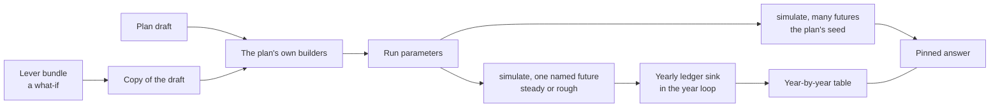

# Act 5 — The Workbench - Plan

This plan turns the scoping brief, [5-workbench.md](5-workbench.md), into buildable units. The brief holds Briggsy's rulings in his own words; where this plan and the brief disagree on what he asked for, the brief wins. Build status lives in the roadmap's You-Are-Here table, never here.

**This repo is public.** The household's real holdings, balances and family facts are never written in this plan, its tests, its fixtures or its commits. Every example below is made up.

**Code is cited by file and symbol, without line numbers, on purpose.** Another build is moving the same files, and `verify:doc-stats` gates every line-numbered citation in `docs/`.

## Goal Capsule

- **Objective.** Briggsy can sit in the advisor's chair behind the calm answer: see every year of one future (what comes in, what goes out, tax, what is pulled from each source, what is left), change any fact or pull any lever on a copy of his plan, keep and compare the what-ifs he names, and trust that each figure is the engine's own.
- **Means.** One second room on the same engine and the same saved plan, built from three mechanics: a facts page, a lever rail, and a year-by-year table fed by a new opt-in engine output (KTD1, KTD5, KTD10).
- **Authority.** `docs/architecture.md` wins on an invariant. `docs/product.md` wins on the why and the what. The scoping brief wins on what Briggsy ruled. The design law (`.claude/skills/back-nine-design/SKILL.md`) wins on how a surface looks and reads. This plan wins on order and mechanism inside those.
- **Stop conditions.** Stop a unit and report when: a measurement this plan calls for comes back against the decision that rests on it; an older-build proof fails (U9); a rule this plan cites from a primary source reads differently at that source; or the cardinal rule is at stake and no listed decision covers the case.
- **Execution profile.** Slices, each usable by itself, committed to `main` in order. No branch and no pull request. Phase 1 changes no saved shape. Every unit runs the project's own flow: `/brief`, the unit's build, a whole-file review with an adversary and every finding verified, then `/distill`.
- **Who finishes.** The Back Nine's sessions build it. Briggsy reads each new surface cold before it is called done.

## Product Contract

### Summary

Act 5 adds a workbench behind the calm answer. It has one facts page, one rail of levers that run on a copy of the plan, and one year-by-year table. It also closes three gaps the table would otherwise expose: there is no bank account kind, no inherited-IRA kind, and no way to type positions. Version 1 adds repeating spending lines and a second Roth conversion mode that converts up to a chosen line.

### Problem Frame

The Back Nine answers one question calmly and then recommends one strategy. It does not let Briggsy see the years behind the answer or try a change without touching the plan. Two levers have a what-if today (withdrawal order and Roth conversion); the rest have none. The engine decides what to pull from each source in every year of every future and hands none of it out. He asked for the advisor's view of his own household, and nothing else.

### Key Decisions

Each is Briggsy's, from the scoping conversation of 2026-11-09 (see origin: `docs/plans/5-workbench.md`).

- **A workbench for one household, the adviser's full version.** "what I think I really need is a RightCapital clone. Not for sale, not for sharing. Just for casa da Briggsy." and "we need the full blown FA version, not the stripped down one they let end users play around with." Governs R1 to R32.
- **No back office and no side planners.** "no backoffice client bullshit. no student loan, 529, etc." Governs Scope Boundaries.
- **Typed entry, no linkage.** "I can enter bank balances, IRA/brokerage securities (cusip, qty, cost basis) and no direct linkage (I wouldn't use it on RC either)." Governs R23, R28.
- **What he likes most.** "the quick what-if scenarios"; "the yearly spends (with the ability to add shit like a new car every 5 years)"; "the amount you need to pull from each source"; that it knows MAGI for ACA and IRMAA, RMDs and bracket-filling Roth conversions; and "the flow". Governs R4, R6, R12, R16 to R19, R30, R31.
- **The how is the pilot's.** "if we can replicate the simplicity of their flow, you dictate how we get there, I'm ATC baby."
- **Same repo, same engine, same saved plan.** He agreed ("totally agree") that this is the product's next act and not a second project.
- **Original work only.** Same jobs, our own code, screens and words. Nothing is copied from RightCapital.
- **The workbench is next after the surplus build, with the yield build inside it.** Briggsy, 2026-11-11, choosing it over building the workbench without the interest-and-dividends work, and over finishing his D7 order first. Governs R12, R31 and U23. (session-settled: user-directed — chosen over a workbench without the yield build: the income each line reads and the room under it are what he named.)
- **The app's login security is not to be over-built.** Briggsy, 2026-11-11, on where his real plan should live: "I really think we are waaaaay over thinking the security aspect of this. We're not keeping my account numbers or passwords to said accounts in this thing. Over complicating. I already have a half dozen calculators with the same info in it. We're creating a solution looking for a problem." And, when the pilot stretched that: "I said we are overthinking the login security of our app." His real plan lives on a finished build served at its own address on his laptop (U24). This says nothing about security review of the code or of this plan, which stays as it is.
- **Single companies count as the whole market.** Settled 2026-11-09 on his answer: no risk number of their own, a plain line saying how much rides on them, and a what-if where they fall by half or to zero. Governs R17, R29.
- **No positions file import.** Cut 2026-11-09: positions are typed. Governs R28.

### Requirements

**The room**

- R1. The workbench is a second room, reached on purpose from the front room. The calm answer stays the first thing a reader sees.
- R2. The room loads on demand, behind an error boundary with a retry. Back returns to the front room. The door is withheld until the answer has resolved. A read-only tab can look, and cannot keep or save.
- R3. Every string goes through the copy catalog and copyGuard. Color is never the only signal. Figures use tabular numerals. Nothing in this act adds a network call.

**The year-by-year table**

- R4. The table shows one future, one row per calendar year: income by source, spending, income tax, what is pulled from each source, required withdrawals, conversions, and what is left in each source at the end of the year.
- R5. Every figure in the table comes out of the engine's own year loop, in the run the table shows. Nothing is worked out again in the UI.
- R6. A "source" is a ledger the engine keeps: taxable, Roth, HSA, pre-tax for each person, and each inherited IRA. Each source names the entered accounts inside it.
- R7. The default future is a steady market, with lifespans at the middle of the engine's own survival tables: the first death in its middle year and the last in the couple's middle year. The table's heading says both in plain words, and never calls the future typical, average or expected.
- R8. One tap shows the same table in a rough market. That market is the same for the plan and for every what-if.
- R9. The many-futures answer stays pinned beside the table and comes from the many-futures run. The table never stands alone as the answer.
- R10. A row's flows are that calendar year's, and its balances are that year's end. A plan opened in a later year than it was built says which year row one is.
- R11. A fact reads exactly. A projected figure reads rounded with "~". Every figure reads one money grain. A room under a line and a convert-to-a-line amount print rounded down, in the actionable dialect (`formatActionableDollar`), never to nearest; the income printed against a line, and a year's overage past one, round up.
- R12. Each year shows the income each line reads and the room left under it: the ACA cliff, each IRMAA step, and the top of the tax bracket. Each room names the income it reads and the year its bill lands. A room is a gap in that income, never an amount to add: added income can raise it by more than itself (Social Security's taxable share), and U19's convert-to-a-line gives the amount to act on. U23 builds the yearly yield it needs (KTD32).
- R13. A year with build 2's left-over credit to taxable shows the credit and adds up. A year the columns cannot add up says why in words: income above spending that the tool does not keep (a retired year's surplus; a working year's left-over that the household's answer to the left-over question does not credit; any part above the credit's cap; any year after a death), a required withdrawal larger than the year's need, and the year the money runs out.

**The facts page**

- R14. One page lists everything the household told the tool, and any line can be edited there.
- R15. A value is a fact when it is already settled and a lever when the choice is still open. Each value has one door.

**What-ifs**

- R16. A what-if is a named copy of the plan's levers, run on a copy. Nothing reaches the plan without an explicit Apply, and nothing reaches the vault without an explicit Save.
- R17. The rail carries these levers: the year the working members stop, together, spending lines, the Roth conversion plan, withdrawal order, the Social Security claim age of a person who has not claimed, an inherited IRA's pace, a fall in single-company positions, and the ACA subsidy regime.
- R18. A lever commits on blur or Enter, and the table redraws once. No figure ticks or counts while a control moves.
- R19. A what-if's difference from the plan is read on the same futures.
- R20. A sentence says a lever helps or costs only where that was measured for this household.
- R21. A what-if can be named, kept in the vault, reopened, renamed, deleted and set beside another. A kept what-if that points at an account or a line that is gone says so, and never re-targets itself.
- R22. A what-if never starts a solve. The saved recommendation appears on the rail as a what-if that cannot be edited.

**Accounts and holdings**

- R23. A bank account is its own account kind.
- R24. An inherited traditional IRA is its own account kind. The run takes the withdrawals the law forces, never converts it, never counts it toward a person's own required withdrawals, and never rolls it to a spouse as their own. Its withdrawals are income in the year they are taken, for every reader of that year's income.
- R25. Intake asks an inherited IRA's facts and never guesses one. A case version 1 does not model is refused in plain words.
- R26. Inside the window the law leaves open, the pace of an inherited IRA's withdrawals is the household's choice, bounded each year by the law's minimum and the balance, with everything out by the law's last year.
- R27. A household with no bank account and no inherited IRA gets the same answer, byte for byte, as before this act, until U23 lands. After it, a run whose taxable ledger stays at zero in every year of every path does; U23's yield moves every other answer on purpose.
- R28. Positions can be typed for an account: a label, a mix, a dollar value, and optionally a quantity, a cost basis and a CUSIP or ticker. The account's balance stays the authority, and any gap between it and the positions is shown in words.
- R29. The facts page says, in dollars and as a share of the household's money, how much rides on single companies, and that the plan treats it like the whole market.

**Spending and conversions**

- R30. A spending line can repeat every N years.
- R31. A Roth conversion can be set to convert up to a chosen line each year in a window. The ACA and IRMAA lines land once U23 has (KTD32).

**The saved plan**

- R32. Every new saved shape in this act lands in one schema step, version 6, judged from the older copy's side under `docs/architecture.md` §7.3. The one exception is a field U23's council names after Phase 1 closes, or one OQ2's ruling adds (KTD16, U9): it takes its own later step, judged the same way and naming its literal successor.

### Key Flows

- F1. **Enter the room.** Front room, a deliberate door, the room loads, the table shows the plan's steady future with the many-futures answer pinned. Covers R1, R2, R7, R9.
- F2. **Edit a fact.** Facts page, edit a line, the plan's draft updates, the table and the pinned answer redraw, the plan shows unsaved changes, Save. Covers R14, R15.
- F3. **Pull a lever.** Rail, commit a lever, the table redraws once, the pinned answer follows, then: pull another, keep it, apply it to the plan, or drop it. Covers R16 to R20.
- F4. **Keep and compare.** Name a what-if, keep it, reopen it later, set it beside another, apply one, Save. Covers R21.
- F5. **Enter an inherited IRA.** Accounts, add by kind, answer its questions, see its forced withdrawals in the table and its pace on the rail. Covers R24 to R26.

### Acceptance Examples

- AE1. Covers R6. Two Roth IRAs are entered. The table shows one Roth source naming both accounts, and never splits a year's Roth withdrawal between them.
- AE2. Covers R10. A plan built in one year and opened the next shows row one labeled with the build year, and the heading says so.
- AE3. Covers R13. In a year where pensions and Social Security exceed spending, the row says the tool does not save the extra, instead of showing columns that do not add up.
- AE4. Covers R19. For a working household, the what-if and the plan's base are both run at the date search's first tier, on the plan's own spending track, and the difference is read between those two runs.
- AE5. Covers R24. A made-up heir born 1968 inherits a traditional IRA from an owner born 1945 who died in 2023. With $100,000 in it on December 31, 2025, the 2026 minimum is $100,000 / 28.6 = $3,496.50, and whatever is left comes out in 2033.
- AE6. Covers R26. A pace of "only what the law requires" on that account leaves the largest withdrawal in the last year, and the table shows that year's income jump.
- AE7. Covers R27. Every shipped seed, run before and after U12, returns identical bytes on every field.
- AE8. Covers R21. A kept what-if moves a spending line. The line is later deleted from the plan. Reopened, the what-if says the line is gone.

### Scope Boundaries

Out of this act, by the scoping brief:

- The adviser back office: many clients, a client portal, compliance, billing.
- Student loans, 529s, business planning, insurance needs, estate flowcharts.
- Bank linkage and price feeds. Product R36 stands: every number is typed.
- A positions file import.
- A search over Social Security claim ages. Claim age is a lever.
- Different investments in different accounts, and more asset classes.
- A library of stress tests. One rough-market view is in.
- Tracking past spending.

Deferred by this plan, each filed in the register by U1 before the unit that leaves it out ships:

- A ledger for each entered account inside the engine (KTD6).
- Federal and state income tax as two columns (KTD8).
- Inherited-IRA cases outside version 1's one case (KTD17).
- The solver searching an inherited IRA's pace or a convert-to-a-line plan (KTD21, KTD28).
- A per-year custom pace for an inherited IRA (KTD21).
- A long-life view of the table (KTD4).
- Income streams named one by one in the table (U3).
- A "cannot be compared" state on the rail: no version-1 lever can produce it, so KTD11 guards it inside.

### Outstanding Questions

- OQ2. **Blocks U10's bank kind.** Where bank cash belongs is the same call as the open item in build 2's queue ("savings" means three things), which is headed for a council. That ruling can move KTD26's fold, not only the labels. U10's first commit, which adds no kind, and U13 go ahead; the bank kind lands after the ruling.
- OQ3. **Deferred.** If RightCapital access returns: its year-by-year figures for one plain scenario of his household, lined up against ours as leads. A difference is a question to chase in both tools, never a verdict.
- OQ6. **Put to Briggsy before U14 starts.** Should a working household's what-if show a date? The lean is no: it reads odds at a stop year, as the front-room sheets do, and the dates move only after Apply. The other way is a date search per what-if at the provisional tier (`DATE_SEARCH_PATHS.provisional`), in provisional words, which costs a search on every commit.

### Sources

- Origin: [5-workbench.md](5-workbench.md).
- Register entries this act builds or touches, by title: *An inherited IRA has no account kind…*; *The taxable account's yield never reaches a year's tax base…*; *Money the household says is in cash is grown and swung like bonds*; *The detail-door era — nowhere to see how a number was reached*.
- Decision record: [portfolio-holdings.md](../decisions/portfolio-holdings.md).
- Lessons that shape units are cited where they land, as `insight NNN` (`docs/insights/`).

## Planning Contract

### What the research settled

Read in the code on 2026-11-11. Each item changes something the scoping brief leaned on.

- **The fixed-market replay cannot carry the table.** `backtestWindow` in `src/engine/historical.ts` runs the bare spending spine: no tax, no healthcare, no required withdrawals, no working-year pay. This answers the brief's design call 1 check with a no. The whole machinery runs only inside `simulate`'s per-future loop (`src/engine/simulate.ts`).
- **The one whole-machinery seam is closed to product code.** `simulate`'s `_injectedDraws` option is marked for the validation harness, and a consumer pin in `src/engine/validation/__tests__/blockBootstrap.test.ts` fails if product code names it.
- **A steady market has one honest meaning in this engine.** A return is drawn as `exp(mu + sigma * z) - 1` (`src/engine/rng.ts`). At z = 0 that is each year's middle return, with the drag of volatility already in it: about 3.5% a year for stocks and 0.8% for bonds after inflation on the shipped market (`src/engine/reference/methodology.ts`). The arithmetic averages, 5% and 1%, would compound to roughly a third more after 30 years at 60% stocks.
- **The engine keeps ledgers by tax treatment, not by account.** Entered accounts fold into taxable, Roth, HSA and per-person pre-tax (`KIND_TO_BUCKET` and `buildOverlay` in `src/intake/intakeMap.ts`). Two Roth IRAs are one balance inside a run.
- **A working household has no saved stop year.** The date is the product's answer, the codec refuses a stop age on a working person (`checkPersonV3` in `src/shared/scenarioCodec.ts`), and the answer is two dates, not one count.
- **Today's what-if seam varies one compiled control.** `TwoArmControl` has three kinds, and `buildArmParams` (`src/engine/roth.ts`) edits compiled parameters. A spending line, a claim age and an inherited IRA's pace are changes to the draft, before compile, and a stop year is a candidate offset that `buildCandidateParams` applies.
- **Today's preview runner allows one run at a time, on one worker.** `runControlPreview` (`src/store/controlPreview.ts`) keeps one latest-wins ticket. Every run shares one engine worker, in order, and a running call cannot be stopped. The store resets that worker only when an edit that changes the answer lands during a pending solve (`src/store/memoryModel.ts`).
- **Most of this act's new saved fields force a schema step** under `docs/architecture.md` §7.3: new account kinds (an older copy refuses them), positions and a line's repeat (an older copy drops or misreads them), a second conversion mode (an older copy refuses it). The holdings record's "no bump" line predates that rule.
- **The year loop already computes what the table needs and drops it:** each ledger's draw, required withdrawals, conversions, tax paid, the income each line reads, and year-end balances (`src/engine/taxOverlay.ts`).

### Key Technical Decisions

**The one future**

- KTD1. **The table's run is `simulate` itself, through a new product option for one named future.** The option carries a market score for each year and asset and a lifespan score for each person, and runs one future through the same per-future assembly as every other run. `_injectedDraws` stays harness-only and its consumer pin stays as it is. Rejected: a second function that assembles the year's streams (it forks at the producer's first early return, insight 081), and a zero-volatility copy of the parameters (it needs the middle return re-derived in a second place and cannot carry the rough view).
- KTD2. **Steady means z = 0 in every year.** The engine's own transform turns that into the middle return, so no return is typed anywhere. The fixture is compounded by hand from the market constants, never by the engine's formula.
- KTD3. **The rough market is one fixed sequence that no lever can change.** It is the worst 30-year start in the committed Shiller real-return series, the series `src/engine/validation/blockBootstrap.ts` already reads, then steady after year 30. Worst means the lowest sustainable rate: the highest flat real withdrawal a 30-year window survives, at a fixed 50% stocks, in history's own frame, with ties to the earlier year. `backtestWindow` only says survive or fail, and every window survives at 4%, so the rate is found, not read. The pick is pinned by a test and is never re-ranked in a plan's market. The scores fed to the run are the window's returns standardized against the series' own averages and swings, as `shillerJointZSeries` already does, so the run keeps history's order of good and bad years at the plan's own market level. History's raw returns in that window average above the plan's steady return, and feeding them unscaled would make the rough view richer than the steady one. A market with a correlation other than zero is refused by name, as `blockBootstrap.ts` refuses it. Rejected: the future at a stated rank among the plan's own (the pick would move with every lever, so two what-ifs would be compared in two different markets, and the table would wait on the many-futures run).
- KTD4. **Lifespans in the one future come from the engine's own survival tables.** The first death falls at that person's own middle year, through `sampleDeathYearOffset` (`src/engine/longevity.ts`). The survivor runs to the year `coupleSurvivalToYear` crosses one half, the couple's middle last year, so the table does not end while one of them is more likely alive than not. The survivor is the person whose own middle year is later, with a tie going to the first person, and a one-person plan keeps that person's own middle year. The heading names both ages. Survivor years then appear in the table with their own filing status and lines. Rejected: nobody dies (the table would run past age 100 and never show a survivor year).

**The yearly ledger**

- KTD5. **A third opt-in sink in the tax overlay's year loop records the table's rows.** It sits where the healthcare readout is pushed, records only when asked, and leaves every other output byte-identical. It is indexed by simulation year `t`, with calendar year `startCalendarYear + t`, the clock the health sheet's dated lines use (insight 134). It exists only on runs with the tax overlay on. It is the engine's one per-year producer: the register's *The detail-door era…* build reads or extends it and never adds a second, and which future that build's front-room view shows stays that entry's own call.
- KTD6. **The table's grain is the engine's ledgers.** Columns are taxable, Roth, HSA, pre-tax per person, and each inherited IRA. A ledger for each entered account is not built in this act. Splitting a ledger's draw across its accounts in the UI would invent a decision the engine never made (insights 024 and 132).
- KTD7. **The income shown for IRMAA is the figure the bill reads.** The sink records the same recorded figure the overlay bills from, not the component the healthcare readout pushes today (insight 143).
- KTD8. **Income tax is one column in version 1, and working years come from the loop.** The overlay solves federal and state tax as one number. In a working year the loop's tax is the part the portfolio funds; tax on pay rides inside the working-year shortfall. The sink records the loop's own composition of those lines, and a test pins every working year of the table's run, year 0 included, to the lines the loop composed for that year (the `checkComposed` probe, the composition the money picture in `src/engine/workingYearLedger.ts` reads), so one year never has two producers (insight 080).
- KTD9. **For a working household the table shows the committed answer's own run.** One base builder in `src/intake/intakeMap.ts`, beside `buildControlPreviewParams`, makes the table's parameters. All retired: `buildSpineParams`. Working: `buildCandidateParams` (`src/engine/dateSearch.ts`), the one owner of date-dependent construction, at the offset of the date answer's band, with the sink recording the pass that band's track names: full spending or the essentials floor. A table on the floor track says in its heading that it shows essentials-only spending. When neither track has a date, the base is the candidate at the top of the date window on the full pass, the one the money picture already runs on, and the heading says no date was found in the window. When a track has a date and the band is missing, the table is withheld and says so. The builder never reads the result screen's lifestyle-only offset. The pinned answer is the store's own, from the date run. On the date route the table is requested on each committed date answer for the current draft, never on the edit itself. Until then the prior table stays, marked as updating.

**What-ifs**

- KTD10. **A what-if is a bundle of lever values applied to a copy of the draft, then compiled by the plan's own builders** (`buildSpineParams` and `buildDateInput` in `src/intake/intakeMap.ts`). One function applies a bundle. The stop year is the one lever that is not a draft field: its arm passes an offset to `buildCandidateParams` and writes nothing to the draft. The plan itself is the comparison's base. Rejected: extending `TwoArmControl` (most levers are not compiled controls).
- KTD11. **Two runs share futures only when their path count, horizon and number of people match.** No version-1 lever changes any of the three, so this is an inside check: the runner verifies it, and a breach shows as the lane's calm error, never as a difference.
- KTD12. **A what-if's many-futures reading is one run, never a search.** For a retired household it is the headline run on the plan's seed. For a working household it is the candidate run at the what-if's stop year, at the date search's first tier, beside the plan's own candidate run again at that same tier, so the difference is read on the same futures. The plan's pinned answer stays the date run's own, and the rail never pairs a what-if with it: a working household's plan column on the rail shows the plan's first-tier base reading, labeled apart from the pinned answer, so both paired cells read one statistic at one tier. U16's compare does the same. Both runs use the plan's own spending track, KTD9's pass, so a difference is never read across two spending levels. The dates are searched again only after Apply. No what-if starts a solve.
- KTD13. **The workbench has its own run lanes, on the one engine worker.** One lane for the plan's table and one for each what-if on screen; a what-if's lane also runs the plan's first-tier base beside it, through U14's runner, which returns both (KTD12). The plan's pinned answer is the store's own and needs no lane. Lanes share the worker in order. A lane keeps one call in flight and holds only its newest request until that call settles, so rapid commits collapse to the last one. A lane never resets the worker and never moves the store's epoch. When a call is rejected because the store reset the worker, the lane re-sends its newest request; when the worker has died, the lane shows its calm error and does not re-send. `runControlPreview` is left to the front-room sheets.
- KTD14. **The rail's difference is always against the plan, and its label says so.** The front-room withdrawal-order sheet keeps its own base in this act.
- KTD15. **Facts and levers.** Levers are choices still open: the year the working members stop, together, future spending lines, the Roth plan, withdrawal order, a claim age not yet reached, an inherited IRA's pace, the ACA subsidy regime. Everything else is a fact. A claim age already in effect and a retired person's stop year are facts. The stop-year lever is the household's one stop year: every person still working stops then, and a retired person is unmoved. A kept what-if stores it as a calendar year; each run turns it into the date search's offset and refuses one outside the date window. A stop year for each person is the register's *Two working spouses always stop work in the same year…*, and is not built here.

**The saved shape**

- KTD16. **One schema step, version 6, carries every new saved shape,** and lands after build 2 closes and before any unit that writes a new field. It holds: the two account kinds, an inherited IRA's facts and pace, positions, a line's repeat, the second conversion mode, kept what-ifs with their whole lever vocabulary, a stable id on each account and each budget line, and the saved recommendation's Roth conversion plan (an explicit none when the crown converts nothing), minted from the committed solve so the rail can run the recommendation (R22). The lever vocabulary is frozen here, from a bundle design that is U9's first task: every R17 lever, each value pointing at accounts and lines by id, and one Roth kind that carries the whole Roth plan in either mode. A lever kind added later would be a second schema step. If U23's council has ruled when Phase 1 closes, any saved field it names joins this list; if not, version 6 lands without it and that field takes its own later step. All additions are optional, so the ladder step is a relabel that writes no default.
- KTD17. **Version 1 models one inherited-IRA case:** an individual heir who is not the owner's spouse and not an eligible designated beneficiary, of an owner who died in 2020 or later, holding a traditional inherited IRA. Every other case (an inherited Roth, a spouse who kept it as inherited, an eligible beneficiary, a trust or estate, a death before 2020, an inherited workplace plan) is refused in words at intake, with its build filed. An inherited traditional IRA is run with no after-tax basis from the owner: the page says so, which reads the tax high and never low, and its build is filed under the register's after-tax-basis entry.
- KTD18. **Kept what-ifs are an optional list on the plan record.** Their years are stored as calendar years, and one translator turns a calendar year into a run's year index at that run's own stop offset (the what-if's stop lever, else KTD9's band offset); a line that would start before that stop is refused in words, never moved. They point at accounts and lines by id. Any stamp inside them goes through `scenarioIdentity` (insight 073). Rejected: a fourth record type in the vault (it touches the key wrap, the write order and the backup file).
- KTD19. **Keep writes through the plan's one save path, and only on a clean draft.** The test is the plan's existing unsaved mark, the whole-draft compare, so an applied lever or a front-room sheet edit blocks Keep the same as a fact edit. With anything unsaved the page says to save first. With no vault, Keep goes through the Save ceremony.

**Accounts**

- KTD20. **Every place that chooses by account kind becomes an exhaustive `Record<AccountKind, …>` before a kind is added** (insight 147). The known homes: `KIND_TO_BUCKET`, `familyOf` and `sampleKind` (a ternary that files an unnamed kind as an IRA), the brokerage-only basis sums in `src/intake/intakeMap.ts` and `src/intake/AccountEntry.tsx`, `KIND_LABELS`, `KIND_TO_CATCHUP` (`src/intake/sanity.ts`), `resolveBlend` (`src/intake/intakeMap.ts`), the HSA checks, and the codec's vocabulary.
- KTD21. **An inherited IRA's pace is one of three rules:** only what the law requires, even amounts over the years left, or even amounts ending in a chosen earlier year. "Even amounts" takes the balance divided by the years left, this year counted, through the law's last year or the chosen one, so that year takes everything left. The default is "only what the law requires", because it needs no choice from the household. The loop clamps every year to at least the law's minimum and at most the balance, and U12's loop applies all three rules. A year the general ledgers cannot fund draws above the pace (KTD22). The solver does not search the pace in version 1, and the recommendation says it holds the pace fixed, from U13 on.
- KTD22. **An inherited IRA is its own ledger in the engine, outside the general withdrawal order,** on the one shared market draw. Each entered inherited account is one ledger, and ledgers are never pooled, which 26 CFR 1.408-8(e) allows, so two accounts from one owner never merge. The precedent is the HSA, which `GeneralBucketKey` already excludes (`src/engine/sequencing.ts`). The ledgers ride beside `AccountBuckets`, never inside it, since there is one per account, so the general order and `sequencing.ts` are unchanged. They are a year's last source: when the general ledgers cannot fund the need, the year's funding solve draws the rest from the inherited ledgers above their pace, grossed up as ordinary income that every reader of that year's income sees, and a path runs out only when the general and inherited ledgers are all empty. The band fan and `terminalValuesReal` add the inherited balances, keyed on a ledger's presence, so AE7 holds. The run carries an inherited terminal per path in `taxAware` (through `simulate`, `model.ts`, `engineProtocol` and `engineWire`); `afterTaxBequestPerPath` counts it at the heir bracket, as it counts pre-tax money, and `decisionSurfaceIdentical` compares it. One producer beside `src/engine/rmd.ts` gives each year's minimum and the last year. The year's withdrawal counts toward that year's spending need first, and any part beyond the need moves to taxable, as a required withdrawal's excess does today. It is excluded from the conversion clamp, from `perPersonRmd`, and from the first-death rollover. When the heir dies inside the window, the answer to intake's question decides. Left to the other member, the ledger keeps its schedule and its last year under the survivor's filing status. Left to someone else, it leaves the run in the heir's death year and is nobody's income after it, and its balance leaves every later total and the terminal. No pricing-ledger row is owed in U12: no saved plan can hold an inherited IRA before U13, and every existing plan stays byte-identical. The family is minted with the first change that reprices a saved ledger.
- KTD23. **The rules are bound to the primaries, not summarized here.** 26 CFR 1.401(a)(9)-5(d) and (e) (the yearly minimum and the ten-year end), -4(e) (who is eligible), -2(b)(2) (the applicable age), -9(b) (the Single Life Table), 1.408-8 (IRAs; no pooling with the heir's own), 54.4974-1(g)(3) (the year-of-death make-up), and IRS Publication 590-B (2025). This plan's deltas: the unit reads each at the source before use, and Pennsylvania's treatment of a beneficiary's withdrawal stays an `Unsourced` sentinel until a Pennsylvania primary is read.
- KTD24. **The applicable-age table gains its 70½ band in its one home** (`src/engine/constants/tax.ts`), with a birth-half input only that band reads. A dead owner's required beginning date needs it; a living member's result must not move, and U11 measures that on every seed (insight 143). Rejected: a second, dead-owner table (two producers of one rule).
- KTD25. **This year's minimum on an inherited IRA is asked, not computed.** Intake asks the custodian's figure for this year and how much has come out. If the household cannot give it, intake asks last December 31's balance, and the computed figure is labeled as computed. Each asked figure is stored with the calendar year it belongs to, and the ledger opens at that year's row (the year less `startCalendarYear`): a row before it carries no inherited balance and books, as income with no balance, the withdrawal the custodian reports for that year, which intake asks. So a plan opened a year after it was built never computes a minimum for a year already past, and every reader of that year's income, the IRMAA bill two years on included, still sees it. When the owner died the year before the asked year, intake also asks how much of the owner's own death-year minimum is still untaken, the custodian's figure. It is income in the asked year beside that year's own minimum, with no penalty, under 54.4974-1(g)(3). When the owner died in the asked year, that untaken amount is the asked year's one figure and is never added twice.
- KTD26. **A bank account is its own kind that folds into the taxable ledger, at 100% cash and with its whole balance as basis.** The mix is fixed by the kind, through its arm in `resolveBlend`, and is never asked. Its balance joins the taxable ledger's pooled basis, so beside a brokerage account it lowers the share of each withdrawal that is gain. It takes no contribution rules. Its cash rides the engine's cash-into-bonds fold, so it grows and swings like bonds and lowers the household's one stock share. That is the register's *Money the household says is in cash is grown and swung like bonds*, whose council governs bank cash like any cash.

**Spending, conversions, holdings**

- KTD27. **A repeat is a count of years on a budget line, read by one "is this line on in year k" helper.** The compile loop, the year-0 total, the validator, the codec, the expired-line clock, the working-year quote and the editor all read that helper. Every writer of the spending total re-reconciles at its own call site (insight 058). `isRampedBudget` reads the helper too, and a repeating line counts as ramped, so the budget's anchor note covers repeats.
- KTD28. **A convert-to-a-line amount is sized inside the year loop, by a root-find over the settled year,** the way `solveAcaFundedGross` wraps the funding solve in `src/engine/taxOverlay.ts`. It is segmented at each cliff and judged in that year's own frame (insights 013 and 139). The lines are a closed list: a bracket top, an IRMAA step, the ACA cliff. A line the year's rules do not have is not offered. Rejected: sizing it from income known before the spending draw (the draw can then push income over the line, which reads rosy near the ACA cliff). The solver's grid is unchanged in version 1.
- KTD29. **Positions follow the ratified holdings shape, plus a quantity, a per-position cost basis, a CUSIP or ticker label, and a single-company mark.** A position matched to the fund table has its mix read live from the table in `resolveBlend`, and `blendTableReadForRun` mirrors that branch in the same edit, so a re-dated table row still fires the blend clock. A position classified by hand has its mix saved. A positioned account's mix is derived live from its positions in `resolveBlend`, and the account's own saved mix is never read for it. Per-position basis is summed and reconciled only for a brokerage account. In a tax-deferred account it is shown and never used. [portfolio-holdings.md](../decisions/portfolio-holdings.md) gets a dated addition for each, and its "no bump" line is corrected.
- KTD30. **The single-company fall is a cut to today's balance of the account that holds the marked positions,** by half or all of their value, as a what-if. A fall in a later year would need a draw of its own, which the one-shared-draw rule forbids.
- KTD31. **The room is a phase of the intake app, beside its result and save phases, and its code lives in `src/ui/workbench/` behind one memoized lazy import** whose failure clears the slot (insight 053). `App`'s own state machine is the router before unlock; a room there would unmount the intake app and with it the draft's save state, the unsaved mark and the leave guard. The room has its own error boundary inside the front room. Its retry builds a fresh lazy import and leaves the front room mounted; only if that retry fails too does it offer a page reload, behind the leave guard.

**The yield gap**

- KTD32. **The missing yearly interest and dividends are built inside this act, by U23.** The engine counts no yearly yield from taxable money (register: *The taxable account's yield never reaches a year's tax base…*), so a year's income, its tax and its room under a line read too low for a household holding taxable or bank money, by an amount nobody has measured. D7 (`docs/product.md`, ruled 2026-10-21) makes that gap a build, and Briggsy pulled the build into this act on 2026-11-11. Until U23 lands:
  - U22 does not start.
  - U19 offers the bracket-top line only. Its ACA-cliff and IRMAA-step lines are added when U23 lands, because a conversion sized to a cliff on an income that reads low can cross the cliff in real life.
  - U7's table carries one stopgap line for a run whose taxable ledger holds money in any year, entered or built by the run. The line names the tool as the one leaving yearly interest and dividends out of a year's income and tax, and says real life taxes them each year. It covers only the years the engine prices no yield: retired years, and working years with no investment income entered. Its words are Briggsy's to rule and ship flagged. U23's own commit removes it.

### High-Level Technical Design

One draft, one set of builders, one engine. A what-if differs from the plan only in the bundle applied before compile. The table reads only the sink; the pinned answer reads only the many-futures run.

### Assumptions

Bets this plan made where the brief left room. Each is the pilot's, and each can be overturned without redoing the engine work under it.

- "Pulled from each source" is met at the grain of the engine's ledgers (KTD6).
- The one future uses the couple's middle lifespans (KTD4).
- The rough market is the worst historical 30-year start (KTD3). U4 measures it on every seed before any word names it.
- A what-if holding a stop year can be kept and compared but not applied, because the plan's stop year is the product's answer. When it also moves other levers, Apply is withheld for those too: applying part of it would put in a mix nobody compared (U15).
- A working household's what-if reads odds at a stop year, as today's sheets do, and shows no date, since dates are searched only after Apply (KTD12). Whether it should show one is OQ6.
- One stop year moves every working member (KTD15).
- No real plan had been saved as of 2026-11-09 (`TODO.md`). The repo cannot show whether one has been saved since. U9 checks before it lands.

### Sequencing

1. **Phase 1, the table (U24, then U1 to U8).** U24's first step lands first; its second follows build 2's close, before any real save. No saved shape changes. It ends with the table and the facts page usable on real numbers.
2. **Phase 2, the saved shape and the accounts (U9 to U13).** The inherited-IRA kind comes before the rail: for any household that holds one, the table's income is wrong in exactly the years the forced withdrawals land, and a truthful table outranks more levers.
3. **Phase 3, the rail (U14 to U17).**
4. **Phase 4, the rest of version 1 (U18 to U22).**
5. **The yield build (U23) runs beside the phases.** Its measurement and its council start in Phase 1, because the council's ruling may add a saved field to version 6 (U9); U9 waits for it only until Phase 1 closes (KTD16). Its build lands before U19's two lines and before U22. OQ2's council, build 2's call on where bank cash belongs, is asked for in Phase 1 too, and U10's bank kind lands after its ruling.

By Briggsy's ruling the act is next after build 2. The whole act but U24's first step waits on build 2's close (its U12, its whole-file review and its `/distill`): build 2 is live in intake, the codec, the money picture and the saved shape. That first step touches none of build 2's files; U24's second step, which does, follows the close.

### Risks

- **His first real save may land during Phase 1.** U24 gives that save its home first: no real save is made on the dev address, the home is ready for one once build 2's closed commit is promoted there, and a save made before then moves by a backup taken on dev and restored at the home. After it, version 6 is a one-way step. KTD16 keeps it to optional additions and one relabel, and U9 mints its old-copy fixtures from the version-5 build's own code (insight 150).
- **The steady table and the front room's band can disagree about what is left in a given year.** They are different runs. U4 measures the gap on the seeds, and the table's heading names its figure as one future.
- **A working household's what-if may take seconds.** The candidate run's cost is unmeasured. U14 measures it before the rail's copy promises anything about speed.
- **One lever, two bases.** The rail compares withdrawal order against the plan, and the front-room sheet compares against an even split. KTD14 labels the rail's base; the sheet is unchanged.
- **U23 is the act's least-known unit.** Its size hangs on a measurement and a council that have not run, and it re-opens an earlier working-year tax ruling. If the council's shape needs a saved field after U9 has landed, that is a second schema step.
- **Sources not yet read at a primary:** Pennsylvania's treatment of a beneficiary's withdrawal, and the half-year rule for reaching 70½. U11 and U12 read both before use.
- **A wide table on a laptop.** The widest source set decides the fit, not one screenshot (insight 123). U7 tests the fit at 1536×791, 1280×800 and a phone.

## Implementation Units

### Unit Index

| Unit | Title | Key files | Depends on |
|---|---|---|---|
| U24 | His real plan's home | `scripts/serve-dist-with-headers.ts`, `scripts/`, `src/ui/unlockCopy.ts` | its first step: none, landed first; the door and the first real promotion: build 2 closed |
| U1 | The act enters the canonical docs | `docs/product.md`, `docs/roadmap.md`, `docs/backlog.md` | none |
| U2 | One named future through `simulate` | `src/engine/simulate.ts`, `src/shared/model.ts` | none |
| U3 | The yearly ledger sink | `src/engine/taxOverlay.ts`, `src/engine/simulate.ts` | U2 |
| U4 | The rough sequence and two measurements | `src/engine/reference/`, `docs/decisions/` | U2, U3 |
| U5 | The workbench's run lanes | `src/store/`, `src/engine/engineProtocol.ts` | U3 |
| U6 | The room and its door | `src/ui/App.tsx`, `src/ui/workbench/` | U5 |
| U7 | The year-by-year table | `src/ui/workbench/`, `src/ui/copy.ts` | U4, U6 |
| U8 | The facts page | `src/ui/workbench/`, `src/intake/` | U6 |
| U9 | Schema version 6 | `src/shared/model.ts`, `src/shared/scenarioCodec.ts` | build 2 closed; U10's first commit; U23's council, until Phase 1 closes |
| U10 | Kind-keyed homes, and the bank account | `src/intake/intakeMap.ts`, `src/intake/AccountEntry.tsx` | its first commit: none; the bank kind: U9 and OQ2 |
| U11 | The 70½ band and the Single Life Table | `src/engine/constants/` | none |
| U12 | The inherited-IRA ledger | `src/engine/taxOverlay.ts`, `src/engine/rmd.ts` | U3, U9, U11 |
| U13 | Inherited-IRA entry | `src/intake/`, `src/ui/workbench/` | U10, U12 |
| U14 | The what-if runner | `src/store/`, `src/intake/intakeMap.ts` | U5, U7; OQ6 answered |
| U15 | The lever rail | `src/ui/workbench/` | U7, U9, U14 |
| U16 | Kept what-ifs | `src/ui/workbench/`, `src/store/` | U9, U15 |
| U17 | The inherited-IRA pace lever | `src/ui/workbench/` | U13, U15 |
| U18 | Repeating spending lines | `src/budget/`, `src/intake/BudgetLineItem.tsx` | U9 |
| U19 | Convert up to a line | `src/engine/taxOverlay.ts`, `src/intake/RothLever.tsx` | U9, U15; U23 for two lines |
| U20 | Positions and the single-company line | `src/intake/AccountEntry.tsx`, `src/ui/workbench/` | U8, U9 |
| U21 | The single-company fall | `src/ui/workbench/` | U15, U20 |
| U22 | Lines and room | `src/ui/workbench/` | U7, U13, U23 |
| U23 | The yearly yield | `src/engine/taxOverlay.ts`, `src/intake/` | U3; its council asked before U9 (KTD16) |

Every unit's tests live in the module's sibling `__tests__/` folder. Every unit but U24's first step also waits on build 2's close (Sequencing).

### Phase 1: the table

#### U24. His real plan's home

- **Goal.** His real plan lives on a finished build at its own fixed address on his laptop, where no dev link exists and nothing in the working tree can touch it, before his first real save.
- **Requirements.** None of R1 to R32; it carries Briggsy's ruling on where his real plan lives (Key Decisions).
- **Dependencies.** Its first step: none, and it does not wait on build 2's close. Its second step (the door, the docs and the first promotion for real use): build 2 closed.
- **Files.** First step: `scripts/serve-dist-with-headers.ts` (a port argument), a promote script in `scripts/`, `package.json`. Second step: `src/ui/unlockCopy.ts`, `src/ui/copy.ts`, the unlock, recovery and restore faces, `src/main.tsx`, `docs/architecture.md`, `docs/backlog.md`, `docs/landmines.md`, `CLAUDE.md`, `e2e/`.
- **Approach.** The home is a folder outside the repo, under his user folder, holding the `git archive` tree of a reviewed commit with that commit's `dist/` built inside it. Kept in the archive's layout, the archived serving script finds the home as its own root and serves the home's `dist/` with the home's `vercel.json`, with no code change. A start at logon runs that copy with plain `node` (Node 24 strips the types), so nothing in the working tree, its `pnpm` or its `tsx` is read, and it brings the home back after a reboot without Briggsy running anything; there is no watchdog. The serving script gains one argument, a port: given one, it serves that port with the CSP on and no control port; given none, the harness keeps 4180 and 4181. The home's port is bound to 127.0.0.1, chosen once, here, and never changed: the vault's IndexedDB belongs to its origin, so a move would strand his plan. It is none of 4173, 4180, 4181, 4190, 4192, 4195, 5173 and 5174, and clear of the ports `pnpm preview` and `pnpm dev` move up to when theirs are taken. Claude promotes a build as a named step after a unit or a phase passes its review, never from a dev build, and only forward: never to a build whose `CURRENT_SCHEMA_VERSION` is below the home's. Builds promoted before build 2 closes hold only test plans. The second step lands the register's door on the "saved by a newer version" face, by that entry's own prescription, before the first deployment for real use. It also marks the dev tab's title as a test copy behind the dev gate, settles `docs/architecture.md`'s self-hosting caveat in one line (a static server on 127.0.0.1 holds no data, and the Same-Origin Policy guards the vault), records the port in `docs/landmines.md`, names the home as the deployment for real use in the register entries that say none exists, and gives `CLAUDE.md` the home's commands. Then build 2's closed, reviewed commit is promoted, the home is ready for his first real save, and Claude gives him only the home's address for it. No real save is made on the dev address; one made there before the home is ready moves by a backup taken on dev and restored at the home.
- **Test scenarios.**
  - The promoted home opens, saves and reopens a plan, and a `?vault=` link there plants nothing.
  - Given a port, the script serves that one port with the CSP header and opens no control port; given none, it serves 4180 and 4181 as before.
  - The newer-version face's door applies a waiting update only through `readyToApplyUpdate`, and otherwise reloads the page.
- **Verification.** The logon start, run on demand, brings the home up, and its trigger reads as at logon. `pnpm verify:csp` still serves `dist/` on its own ports. A Caddie walk of the door on all three faces, and Briggsy's cold read of its words.

#### U1. The act enters the canonical docs

- **Goal.** The docs the scoping brief lists as owed say that Act 5 exists and what it re-opens.
- **Requirements.** R1.
- **Dependencies.** None.
- **Files.** `docs/product.md`, `docs/roadmap.md`, `docs/README.md`, `docs/backlog.md`, `docs/glossary.md`, `docs/decisions/README.md`, `CLAUDE.md`, `README.md`, `TODO.md`, `.claude/skills/back-nine-design/SKILL.md`.
- **Approach.** Add a dated flag in `product.md` on the scope lines this act re-opens ("not a dashboard" stays true of the front room; holdings entry; the lever set). The roadmap's four acts become five, with an Act 5 block in the You-Are-Here table listing U1 to U24. The design law's tone paragraph scopes "never a dashboard" to the front room. Read the register for entries this act absorbs before filing anything new, then file each deferred item under Scope Boundaries with its negative findings. Correct the yield entry's prescription, which still says a disclosure waits on a discussion D7 closed. Every place that says "four acts" names the fifth: `CLAUDE.md`'s map and its plans list (which gains the two Act 5 files), the repo `README.md`'s act table and its roadmap line, `docs/README.md`'s roadmap and plans rows, `docs/decisions/README.md`'s "four-act shape", and the glossary. `product.md`'s D3 keeps its four phases as locked text and gains a dated flag adding Act 5 after them (ruled 2026-11-09). Note on the detail-door entry what KTD5 rules. Set `TODO.md`'s ranking from his ruling: the workbench next after build 2, the yield build inside it.
- **Test scenarios.** `pnpm verify:doc-stats` passes with the register's new count.
- **Verification.** Each doc the scoping brief's "Owed to the canonical docs" list names carries its change.

#### U2. One named future through `simulate`

- **Goal.** `simulate` can run one future whose market and lifespans are named by the caller, through the whole shipped machinery.
- **Requirements.** R5, R7, R8.
- **Dependencies.** None.
- **Files.** `src/engine/simulate.ts`, `src/shared/model.ts`, `src/engine/longevity.ts` (read), `docs/architecture.md`.
- **Approach.** KTD1, KTD2, KTD4. The option is validated like any new input: finiteness first, then lengths against the horizon and the people. A wrong length fails loudly. With the option absent, every run is byte-identical. `docs/architecture.md` §5 gains the option's contract.
- **Test scenarios.**
  - A steady future's yearly balances on a no-tax, no-spending fixture equal a hand-compounded path from the market constants.
  - Passing the scores that `buildDraws` would have drawn for one future returns that future's own bytes from an ordinary run.
  - A score list one year short is refused with a named reason, and so are a non-finite score and a lifespan score outside 0 to 1.
  - The first death falls in that person's own middle year, and the last row is the couple's middle last year by `coupleSurvivalToYear`.
  - Two people whose own middle years tie still get a survivor phase, and the first person is the survivor, as KTD4 and `src/engine/longevity.ts` rule.
  - When the second-listed person's own middle year is the earlier one, that person dies first and the first person lives to the couple's middle last year.
  - A one-person plan ends at that person's own middle year.
  - The consumer pin on `_injectedDraws` still passes unchanged.
- **Verification.** Every existing engine test passes untouched; the golden cases are not perturbed.

#### U3. The yearly ledger sink

- **Goal.** A run can hand out one row per year with everything the table shows.
- **Requirements.** R4, R5, R6, R10, R13.
- **Dependencies.** U2.
- **Files.** `src/engine/taxOverlay.ts`, `src/engine/simulate.ts`, `src/shared/model.ts`, `src/engine/engineProtocol.ts`, `src/engine/engineWire.ts`, `docs/architecture.md`.
- **Approach.** KTD5 to KTD8. Each row carries, per ledger: the start balance, the draw, the required withdrawal, the conversion in or out, contributions, and the end balance. Per year it carries: pay and other income for each person, gross and taxable, and Social Security as the household's one paid figure, all from `simulate`'s own cash assembly for the year (the engine sums income streams before the loop, so the table cannot name them one by one); spending, the HSA's spend, income tax paid, premiums, build 2's left-over credit to taxable (the loop's own `creditThisYear`, recorded after the run-out forfeit, never through the test probe), the three incomes the lines read, the filing status, who is alive, whether the first-death rollover has happened, and four flags: income above spending that the tool does not keep, as R13 splits it; a required withdrawal moved to taxable, whose excess the row carries as a transfer out of that pre-tax ledger and into taxable; the money ran out; and a draw from a pre-tax ledger whose owner's whole age that year is 59 or less (60 is the first age left unflagged), which the run charges no early-withdrawal penalty. The result crosses to the main thread by structured clone, as the healthcare readout does. The sink is allowed only on a one-future run in this act. It records the pass the caller names: full spending or the essentials floor.
- **Test scenarios.**
  - Asking for the sink leaves every other field of the result byte-identical, on a fixture where every ledger is non-zero and distinct.
  - A presence arm: the same fixture with one ledger's balance changed moves that ledger's rows.
  - Each ledger's last-row end balance equals the run's own per-ledger terminal for that future, compared ledger by ledger and never as a sum (insight 093). The run has one pre-tax terminal today, so a one-future run also returns each person's final pre-tax balance, observe-only.
  - On a hand-derived fixture of two people with distinct pre-tax balances, one past the required-withdrawal age, both alive to the end: each person's pre-tax column matches row by row, a swap of the two turns the test red, every row's end equals the next row's start, and in a year where one person's required withdrawal is above the need, taxable's inflow equals that excess.
  - Each row's flows reconcile: start balance, plus growth, minus draws, plus transfers, equals end balance, within the money grain, except in the run-out year: a moved required withdrawal reconciles as its transfer, and the other flags move no ledger money. A year with build 2's credit is not excused: the credit is a transfer into taxable and the row reconciles, pinned on a seed whose household answered that it saves its left-over, with a year above the credit's cap.
  - In each working year of the table's run, year 0 included, the sink's pay, Social Security and portfolio-funded shortfall equal the lines the loop composed for that year (the `checkComposed` probe), the composition the money picture reads.
  - The IRMAA income in a row equals the figure the overlay billed from, on a fixture with a working-year override.
  - A future that runs out of money ends its funded rows at that year and sets the flag.
  - In a couple aged 59 and 60 where only one holds pre-tax money in each arm, the 59-year-old's draw sets the 59½ flag and the 60-year-old's does not.
  - One table-driven test sets each flag on its own case and leaves it unset on a twin: a retired surplus, a working year whose left-over is not credited, a credit year above the cap, a year after a death, and a required withdrawal above the year's need.
  - On a fixture where the full pass runs out of money and the floor pass does not, the floor rows are pinned to the run's own floor outputs: each year's total equals the band fan run on the floor track, the run-out flag matches the floor's depletion, and each row's spending is the floor spend.
- **Verification.** A mutation pass on the sink's writes: each planted wrong field turns a test red.

#### U4. The rough sequence and two measurements

- **Goal.** The rough view has a sourced, fixed sequence, and two open directions are measured before any copy leans on them.
- **Requirements.** R7, R8, R20.
- **Dependencies.** U2, U3.
- **Files.** `src/engine/reference/` (a new module for the sequence), `src/engine/historical.ts` (read), `src/engine/validation/blockBootstrap.ts` (read), `docs/decisions/` (a new record, `workbench-one-future.md`; a dated note in `market-model.md`; the index row in `docs/decisions/README.md`).
- **Approach.** KTD3. The start year is computed, pinned by a test and never typed; 1966 is expected. The decision record lists the pick at 40%, 50%, 60% and 100% stocks, in history's frame and in the plan's market, and says where the two disagree. Measure, on every shipped seed, on the run the table would show (a dated working seed: `buildCandidateParams` at its band's offset, on its band's track's pass; an all-retired seed: its spine; a seed with no date or no band: the window-top full pass, where (a) has no middle line and reads n/a): (a) the steady future's year-by-year total against the band's middle line; (b) how the rough future ranks among the plan's many futures, on that same run and track. The decision record holds both tables and the sequence's definition. `market-model.md` gains a dated note under §1 that one standardized historical window now runs on a product path as a named future, never as the draw, which stays independent year to year; the window is one US survivor history, so its §4 caveat applies.
- **Test scenarios.**
  - The sequence's start year equals the start with the lowest sustainable rate, found by an independent closed form over the series' yearly growth and never by a second run of the backtest.
  - A market with a correlation of 0.3 is refused by name.
  - On every seed, at that seed's own stock share and at 2%, 3% and 4% yearly draws on the spine, the rough path's lowest and last balances sit below the steady path's.
  - The sequence has one score per year up to the longest horizon the product allows, and reads steady after year 30.
  - The same sequence is returned for any household: it takes no household input.
- **Verification.** The decision record states each measured direction with its numbers. If the rough path ends above the steady path on any seed, or ranks better than the plan's middle future, stop and report: KTD3 does not hold for that shape.

#### U5. The workbench's run lanes

- **Goal.** Several workbench runs can be in flight without one silencing another or dying on a fact edit.
- **Requirements.** R9, R18.
- **Dependencies.** U3.
- **Files.** `src/store/` (a new module beside `controlPreview.ts`), `src/store/memoryModel.ts` (read only), `src/engine/engineProtocol.ts`.
- **Approach.** KTD13. A lane's result is total: it resolves to a value, "superseded", or a calm error, and never rejects. No lane has a write path to the vault.
- **Test scenarios.**
  - Two lanes each deliver their own result when fired together.
  - Within one lane, a second request supersedes the first, and only the second renders.
  - An edit that changes the answer during a pending solve resets the worker; each lane re-sends its newest request and delivers its result.
  - A dead worker gives each lane its calm error and no re-send.
  - On the main-thread fallback, lanes run one at a time and each still delivers.
  - No lane call resets the worker or moves the store's epoch (a spy on both).
  - Ten commits in quick succession on one lane start at most two runs; the second carries the tenth commit's value, and only the tenth's result renders.
  - With one request in flight and a second and third queued, the third renders and the second never starts.
- **Verification.** `runControlPreview`'s own tests pass unchanged.

#### U6. The room and its door

- **Goal.** A reader can enter the workbench from the front room and come back.
- **Requirements.** R1, R2, R3.
- **Dependencies.** U5.
- **Files.** `src/ui/IntakeApp.tsx`, `src/ui/workbench/` (new), `src/ui/ErrorBoundary.tsx` (read), `src/ui/unloadGuard.ts`, `src/ui/devSeeds.ts`, `src/ui/copy.ts`, `e2e/`, `CLAUDE.md` (its `verify:csp` command row and its CSP-boundary bullet), and `docs/roadmap.md`'s validation-gates "CSP enforcement" row. `src/ui/App.tsx` is unchanged.
- **Approach.** KTD31. Entering the room pushes one history entry, and a popstate handler returns to the result phase. The app has no history handling today, and the leave guard listens only for a page unload. A Back press cannot be cancelled, so with an open editor or an unkept what-if the guard pushes the entry again and asks in the app first. The room shows the plan's unsaved mark and its Save control from the one save machine, and the save and backup phases return to the room when entered from it. No plan data rides in the history entry or the address. The door follows the rule the save control uses for an unresolved answer. A read-only tab gets the room with Keep, Apply and Save withheld. Load `back-nine-design`, `frontend-design:frontend-design` and `emil-design-eng` before any surface work, in the project's precedence.
- **Test scenarios.**
  - The front room's first paint is unchanged, and the entry bundle stays inside `pnpm verify:bundle`'s budget.
  - A failed chunk load shows the room's own retry; the retry loads the room with no page reload, the session still open and the draft unchanged.
  - A real Back press with an editor open asks first and loses nothing.
  - Save from the room returns to the room.
  - Back from the room lands on the front room with the answer still shown.
  - The door is absent while the answer is unresolved.
  - In a read-only tab the room renders and no control that writes is present.
- **Verification.** `pnpm verify:csp` gains an arm on the served build that enters the room and fails on any CSP violation and on any request outside the build's own chunks and workers; a planted inline style and a planted fetch each turn it red. U7 extends it to the steady and rough views, and U15 to one what-if.

#### U7. The year-by-year table

- **Goal.** The room shows the plan's one future, year by year, with the answer pinned beside it.
- **Requirements.** R4 to R11, R13.
- **Dependencies.** U4, U6.
- **Files.** `src/ui/workbench/` (a pure chrome module and its component), `src/intake/intakeMap.ts`, `src/ui/copy.ts`, `src/engine/moneyGrain.ts` (read), `e2e/`, and `docs/roadmap.md`'s validation-gates "CSP enforcement" and "Vertical fit + chart text" rows.
- **Approach.** KTD9's base builder is built here. Each source's accounts come from one function in `src/intake/intakeMap.ts` that `buildOverlay`'s ledger sums also call. The grouping is made at compile and returned with that run's result; the composer never groups accounts and never reads them from the live draft. An account is named by its owner and its kind, since accounts have no name. After a first death the survivor's pre-tax source also names the accounts rolled in, keyed to the sink's rollover field. A pure composer turns the sink's rows into the table's cells, and the component only renders them. Year 0's entered facts read exactly; every other figure reads "~" on the shared money grain. The heading names the market view and the lifespans in words drafted for Briggsy's cold read. The pinned answer's box is reserved before its run lands, so nothing below it moves (insight 035). The table has three named states. First load: a reserved frame with status words. Updating: the prior rows stay, marked in words and with a cue that is not color, with `aria-busy` set. Error: one calm sentence, the rows withheld, and a door to the front room, with no retry (KTD13). The steady and rough views are two runs of U2's option. Two stopgap lines sit under the heading while their builds are open: KTD32's line on yield, and a line saying the table does not yet know bank accounts or inherited IRAs, which U10 and U13 remove. Two known omissions that move a printed figure get lines too, never a UI re-derivation: the shipped surtax line (`recDiscNiit`, verbatim) under the heading, and on each row the sink flags for a pre-tax draw under 59½ a line that the run charges no early-withdrawal penalty, in words Briggsy rules and shipped flagged.
- **Test scenarios.**
  - Each column's cell equals its own named field of the sink's row, on a row whose every field holds a distinct non-zero value; a mutant that swaps two columns, and one that swaps the two people, each turn it red. A test also fails if the composer computes a dollar figure the row does not carry.
  - A flagged year renders its sentence and no misleading zero.
  - AE1: two Roth IRAs with different owners and distinct balances show one Roth source naming both and one withdrawal a year; each person's traditional IRA has its own pre-tax source; each source's year-0 start equals its named accounts' sum.
  - After `buildOverlay` calls the shared grouping, every seed is byte-identical.
  - A survivor-year row's pre-tax source names both people's accounts.
  - The base builder, one test per arm: a lifestyle date; a floor-only date (the floor offset, the floor pass and the essentials heading); no date; a date with the band missing (the table is withheld); an all-retired household.
  - A plan aged one year labels row one with its build year.
  - A run whose taxable ledger holds money in some year shows the yield line, including one whose taxable money comes only from required-withdrawal excess; a run whose taxable ledger stays at zero does not.
  - A working household with investment income entered shows no yield line on its working years.
  - Each of the three table states renders its words; an edit during a pending date search never shows new facts at the old date's offset.
  - A working household whose search crowned no date shows the window-top year's table, and the heading says no date was found.
  - The heading never contains "typical", "average", "expected" or "median" (a copyGuard rule).
  - The table fits without sideways page scroll at 1536×791 and 1280×800 with the widest Phase 1 source set (two people's pre-tax, Roth, taxable, HSA), with no inner scroller hiding a column at the laptop sizes (the `sidewaysReport` walk), and reads on a phone.
  - The pinned answer landing after the table moves no tap target (a real-browser coordinate walk).
- **Verification.** `pnpm verify:fit` gains the room's arms, and `pnpm verify:csp`'s room arm shows the steady and rough views (U6). A Caddie walk and Briggsy's cold read of the table.

#### U8. The facts page

- **Goal.** Everything the household told the tool is on one page, and any line can be edited there.
- **Requirements.** R14, R15.
- **Dependencies.** U6.
- **Files.** `src/ui/workbench/`, `src/intake/` (the existing editors, reused), `src/intake/unsavedBuffer.ts`, `src/ui/unloadGuard.ts`.
- **Approach.** KTD15. The page lists the draft by group (people, income, accounts, spending, healthcare, choices) and opens the existing editor for a line, so each edit goes through that editor's own write path and its reconciliation. An open editor holds the leave-page guard (insight 112). Until U15, a lever line opens its existing editor through that editor's own write path (the Roth sheet, the withdrawal-order sheet, the budget line, the claim age), the stop year shows the date answer with no editor, and an inherited IRA's pace shows its default rule. U15 swaps each to a rail link, and U17 does the same for the pace.
- **Test scenarios.**
  - Every field of the saved plan appears on the page; a test walks the plan's field list, nested fields included, and fails on one the page omits. From U9 the walk also reads a non-fact list (ids, stamps, kept what-ifs) and a not-yet-shown list naming the unit that shows each field.
  - Editing out-of-pocket medical under a governing budget leaves the spending total reconciled.
  - An edit redraws the table and the pinned answer and marks the plan unsaved.
  - A real Back press with an open editor asks first.
  - Before U15, each lever line opens its own editor; after it, each links to the rail and opens no editor, the subsidy regime included.
- **Verification.** A Caddie walk and Briggsy's cold read of the page.

### Phase 2: the saved shape and the accounts

#### U9. Schema version 6

- **Goal.** The saved plan can hold every new shape in this act, and an older copy treats a version-6 plan safely.
- **Requirements.** R32.
- **Dependencies.** Build 2 closed; U10's first commit, which makes every kind-keyed home exhaustive; and U23's council until Phase 1 closes (KTD16). OQ2 does not gate U9: the bank kind's vocabulary value rides version 6, refused by the builders until U10 offers it, and a field OQ2's ruling adds would take a later step.
- **Files.** `src/shared/model.ts`, `src/shared/scenarioCodec.ts`, `src/ui/draftFromScenario.ts`, `src/ui/scenarioFromDraft.ts`, `src/intake/AccountEntry.tsx`, `src/intake/BudgetLineItem.tsx`, `src/ui/devSeeds.ts`, `src/store/savedRecommendationMint.ts`, `src/ui/workbench/` (the facts page walk's two lists), `docs/architecture.md`, `docs/product.md` (product R39's version sentence), `docs/decisions/portfolio-holdings.md`, `docs/decisions/README.md`.
- **Approach.** KTD16, KTD18. The bundle design is the first task. The fixtures are made-up maximal version-5 plans, one for each set of values that exclude each other (route, filing, state), filling every version-5 field from the codec's own field list. No fixture is ever based on a real plan, not even its shape: which kinds a household holds is itself a household fact. Any check of a real plan runs on Briggsy's own device and commits nothing. Each new kind enters the vocabulary with every home's arm decided: the builders refuse it by name as not built yet, and an exhaustive offered-at-intake record keeps it out of the picker, until U10 offers the bank account and U13 the inherited IRA. The builders also refuse by name the three answer-changing fields whose units have not landed, a line's repeat, the Roth line mode and a non-empty positions list, until U18, U19 and U20 lift those refusals; the draft carries them, inherited facts and kept what-ifs through untouched, so a re-save keeps them. The saved recommendation's action gains its Roth conversion plan, minted from the committed solve. U9 owns the facts page's walk: ids, stamps and kept what-ifs join its non-fact list, and each fact field not yet shown joins its not-yet-shown list with the unit that shows it (U13, U18, U19, U20, and U23 if its council adds one). Judge each field under §7.3 and write the judgment beside it. Mint the frozen version-5 fixtures from the version-5 build's own save path, in a `git archive` of that build (insight 150). Raise the version floor in the commit after the bump (insight 151). An id is minted only where a draft enters and one is missing: in `draftFromScenario`, before anything compares the draft for unsaved changes, and in each editor's Add. That open-time mint is deterministic, so two opens of one plan agree. Add mints a random id, never one that a live account or line holds or that any kept what-if names. It never happens per encode or in the store, and the codec's step stays a relabel that mints nothing. The dev seeds carry literal ids. An editor carries an account's or a line's id through an edit; today the account editor rebuilds the account from its form and would drop it.
- **Test scenarios.**
  - A version-5 plan opens under version 6 with the same answer, byte for byte.
  - The version-5 build's own code, run in its archive, refuses a version-6 plan in its plain-words way and writes nothing.
  - Each new vocabulary value round-trips, and an unknown value is refused.
  - A version-5 plan taken through the real path (unlock, `draftFromScenario`, `scenarioFromDraft`, save) and read raw holds label 6, an id on every account and budget line, and no other new key.
  - A frozen version-5 plan opened through the intake app's own chain reads as saved: no unsaved mark, the leave guard down, and two encodes equal.
  - Editing an account's balance keeps its id, and Add mints one.
  - Ids stay unique after a delete followed by an Add, and on two lines with identical facts; the codec refuses a duplicate id.
  - A plan holding a not-yet-offered kind is refused by the builders by name, and the picker does not list it.
  - Every lever kind in the frozen vocabulary round-trips inside a kept what-if.
  - A version-6 plan opened on the U9 build is refused by name for a repeat, a line mode or positions, each tested alone, and a re-save there keeps them and its kept what-ifs untouched.
  - Minted from a solve whose winner, runner-up and baseline carry three different conversion plans, the record holds the winner's; a crown that converts nothing mints the explicit none; both round-trip.
  - Two saves a day apart of an untouched plan with kept what-ifs compare equal through `scenarioIdentity`.
- **Verification.** The older-reader test in `docs/architecture.md` §7.3 is written out for each field in the unit's commit message.

#### U10. Kind-keyed homes, and the bank account

- **Goal.** A bank account can be entered, and no place in the code decides a kind by omission.
- **Requirements.** R23, R27.
- **Dependencies.** U9. The bank kind also waits on OQ2.
- **Files.** `src/intake/intakeMap.ts`, `src/intake/AccountEntry.tsx`, `src/intake/HealthcareSheet.tsx`, `src/intake/SequencingControl.tsx`, `src/ui/reentryChrome.ts`, `src/intake/sanity.ts`, `src/shared/model.ts`, `src/shared/scenarioCodec.ts`, `src/ui/copy.ts`.
- **Approach.** KTD20, KTD26. Convert the homes first, in a commit that changes no behavior. The bank kind follows OQ2's ruling. Before the kind ships, measure on a made-up seed holding a bank account how far its balance moves the household's stock share and the answer, and add bank money to the cash entry's reach in the register. The re-entry read-back and the withdrawal-order sheet both call the taxable ledger "Brokerage"; their copy keys are reworded to cover bank money, to match OQ2's ruling. A bank account's interest is part of the yield gap, so KTD32's stopgap line counts bank money.
- **Test scenarios.**
  - After the conversion and before the new kind, every seed's result is byte-identical on every field (the Verification Contract's BEFORE), and a planted mis-mapped kind turns the check red.
  - A household whose only taxable money is a bank account realizes no gain on a withdrawal; beside a brokerage account, the bank balance joins the pooled basis.
  - A bank account gives the same bytes as a brokerage account at 100% cash with basis equal to its balance.
  - A household whose only taxable money is a bank account reads correctly on the re-entry read-back and the withdrawal-order sheet.
  - A bank account is refused by every contribution-limit check.
  - Adding a made-up eighth kind to the type fails to compile in every home (a type-level test).
- **Verification.** A committed scan test, keyed on the type checker's `AccountKind` and not on a variable's name, fails on any code outside tests that compares a kind to a member, tests membership in a Set or list of members, switches on a kind with a default, or picks between kind literals in a conditional. An allowed line carries its reason. A planted guard turns the test red.

#### U11. The 70½ band and the Single Life Table

- **Goal.** The two law tables the inherited IRA needs exist once, sourced.
- **Requirements.** R24.
- **Dependencies.** None.
- **Files.** `src/engine/constants/tax.ts`, a new data file beside `jointLifeLastSurvivor.data.ts`, `src/engine/rmd.ts`, `docs/backlog.md`, and every place that still describes the old bands: `docs/architecture.md`, `docs/glossary.md`, `docs/research/engine-validation-and-tax.md`, and the band comments in `src/store/staleness.ts` and `src/engine/taxOverlay.ts`.
- **Approach.** KTD23, KTD24. Transcribe the Single Life Table from the eCFR text of 26 CFR 1.401(a)(9)-9(b), cell by cell, and cross-check every cell against Publication 590-B's Table I. Read the half-year rule for 70½ at a primary before the band ships. Correct the register entry on the 70½ band, whose "changes no result today" line is false for a dead owner.
- **Test scenarios.**
  - The table returns the IRS's own printed figures: 29.8 at 57, 31.6 at 55, 14.1 at 76.
  - The table's flat and irregular tail (ages 105 to 120 and over) matches the source exactly.
  - An owner born in March 1949 has a required beginning date of April 1, 2020; one born in September 1949, April 1, 2022.
  - Every shipped seed's result is byte-identical on every field after the band is added (the Verification Contract's BEFORE).
- **Verification.** Each figure carries its citation in the constants' own shape; the shape test's "unverified" exemption for the band is removed.

#### U12. The inherited-IRA ledger

- **Goal.** The engine runs an inherited IRA by its own rules.
- **Requirements.** R24, R26, R27.
- **Dependencies.** U3, U9, U11.
- **Files.** `src/engine/taxOverlay.ts`, `src/engine/rmd.ts` (a sibling producer), `src/engine/simulate.ts`, `src/shared/model.ts`, `src/engine/magiLandscape.ts`, `src/engine/workingYearLedger.ts`, `src/engine/dateSearch.ts` (the reach walk), `src/engine/engineProtocol.ts`, `src/engine/engineWire.ts`, `src/engine/solver/objectiveHeadline.ts`, `src/engine/validation/rankingStability.ts`, `src/engine/sequencing.ts` (read), `src/engine/solver/` (the conversion grid's pool, the solve anchor and `solverCodeVersion.ts`), `docs/architecture.md`.
- **Approach.** KTD21 to KTD23, KTD25. One ledger per entered inherited account. The producer takes the account's facts and returns, for each calendar year, the minimum and whether the year is the last. The translation from calendar year to simulation year happens once, in the producer. The ledger opens at the asked figure's year (KTD25), and that year uses the asked figure less what has come out; an earlier plan row books the custodian's withdrawal for its year as income with no balance. Every reader of the year's income is enumerated before the build and checked after it: income tax, Social Security's taxable share, the ACA income, the IRMAA income two years on, the dollars the portfolio funds, the committed-income frame the bracket-fill rails read, the money picture's savings-tax line (`savingsTaxLine` in `workingYearLedger.ts`, which reads only year 0's Medicare, shortfall, conversion and required withdrawal), the working-year reach walk (`workingYearTaxReachOfRun`, whose income channels are Social Security, conversions and required withdrawals), and the solver's anchor (insight 143). In that frame the inherited withdrawal is its own field and is never folded into the owner's required withdrawal, which the fill may count as already met. The solver's anchor takes year 0's asked figure and the steady path's figures after it, and `SOLVER_CODE_VERSION` is bumped. Every new input gets its `validateParams` arm. The loop applies the pace rule the plan holds (KTD21). The inherited terminal joins `taxAware`, the after-tax bequest and `decisionSurfaceIdentical`, and the ledgers are the year's last source, counted by the band fan and the run-out test (KTD22). The yearly ledger sink gains the ledger's columns.
- **Test scenarios.**
  - AE5's figures, derived by hand from the regulation, match the producer's.
  - Owner died before the required beginning date: no minimum in years one to nine, everything out in the tenth.
  - The last year is tested as a crossing: the year before, the year itself, and the year after, on a future where the balance is non-zero (insight 014).
  - A withdrawal above the minimum earns no credit the next year.
  - A stepped-down divisor at or below 1 takes the whole balance and never divides by a number at or below zero.
  - A conversion never draws from the ledger, on a fixture where the ordinary pre-tax ledger is empty.
  - The heir's own required withdrawal is unchanged by the ledger's presence.
  - The heir dies in year four with the account left to the other member: the ledger keeps its schedule and its last year, under the survivor's filing status, and is not rolled over.
  - The heir dies in year four with the account left to someone else: the ledger leaves the run that year and is nobody's income after it.
  - Two accounts from one owner are two ledgers with two schedules.
  - On a hand-derived fixture whose yearly minimum is low, "even amounts" takes the balance divided by the years left each year, which differs from the minimum; "ending in a chosen year" empties the account that year, with the year before non-zero and nothing after.
  - An inherited balance left at the last death adds that balance times one minus the heir bracket to the after-tax bequest, and `decisionSurfaceIdentical` refuses a run whose inherited terminal moved.
  - General money runs dry in year 5 with an inherited balance left: the ledger funds the later years above its pace, taxed as income, the path runs out only when both are empty, and the band's points include the inherited balance.
  - Under the bracket-fill policy, the fill leaves room for the inherited withdrawal and never counts it as fill; the solver's anchor sees it in every window year.
  - Each inherited ledger's column is pinned row by row against a hand-derived fixture, and its final balance against the run's own.
  - The owner died the year before the asked year with part of the death-year minimum untaken: that amount is income in the asked year's row beside that year's own minimum.
  - On a plan opened one year after it was built, the asked figure lands in its own calendar year's row, the row before it books the custodian's withdrawal for that year as income with no balance, row 2's IRMAA bill reads it, and both death-year branches key on the asked year.
  - The withdrawal appears in each enumerated income reader: the IRMAA bill two years later, the savings-tax line on a working seed whose pay covers spending with no other trigger (the untaken death-year amount counted), and the reach walk on a hand-built run without W. A mutant that drops any one reader's arm turns it red.
  - AE7: with no inherited IRA, every seed is byte-identical.
  - A Pennsylvania household with an inherited IRA cannot be priced until the sentinel is sourced, and the refusal names why.
- **Verification.** A mutation pass on the producer and on each exclusion.

#### U13. Inherited-IRA entry

- **Goal.** A household can enter an inherited IRA and see it on the facts page and in the table.
- **Requirements.** R24, R25.
- **Dependencies.** U10, U12.
- **Files.** `src/intake/AccountEntry.tsx`, `src/intake/intakeMap.ts`, `src/intake/sanity.ts`, `src/ui/copy.ts`, `src/ui/workbench/`.
- **Approach.** KTD17, KTD25. Intake asks: traditional or Roth, refusing a Roth in words; whose it is; whether the owner was the heir's spouse; the owner's birth year and death year; and only when the answers leave the rule open, one follow-up (the owner's birth half-year, whether the death fell before April 1, the exact birthdays when the two birth years are ten apart, whether the heir is disabled or chronically ill). It asks how much of the owner's own death-year minimum is still untaken only when the death was this year or last (KTD25). It asks a couple who gets the account if the heir dies first: the other member, or someone else. An account split between the two is refused in words, with its build filed. The re-entry read-back gains an inherited-IRA row. It never asks whether the owner was taking withdrawals. No answer has a default. The question words are Briggsy's to rule; they ship flagged until he reads them. The recommendation's surface gains the line that it holds an inherited IRA's pace fixed, on the claim's own head noun (insight 140), from the first plan that holds one.
- **Test scenarios.**
  - Each refused case shows its plain-words refusal and writes no account.
  - A follow-up appears only for the answers that need it, across the table of birth and death years the rule distinguishes.
  - Saving with any required answer blank is refused.
  - A household holding an inherited IRA sees the recommendation's held-pace line in the front room.
  - The table shows the account's own columns, with the year's required amount beside what was taken, and the last year named.
  - The table fits at 1536×791, 1280×800 and a raised font, and reads on a phone, on a made-up seed holding two inherited IRAs with their own columns.
- **Verification.** A Caddie walk and Briggsy's cold read of the questions.

### Phase 3: the rail

#### U14. The what-if runner

- **Goal.** A bundle of lever values can be run beside the plan, on the same futures, without touching the plan.
- **Requirements.** R16, R19, R22.
- **Dependencies.** U5; U7, whose base builder KTD18's translator reads; and OQ6 answered.
- **Files.** `src/store/` (a new module), `src/intake/intakeMap.ts`, `src/engine/dateSearch.ts` (read), `src/shared/model.ts`.
- **Approach.** KTD10 to KTD12. The bundle is a closed, typed list of lever kinds, each with an exhaustive apply arm. The stop-year kind carries one household stop year (KTD15). The kinds are the vocabulary U9 froze: the pace and the single-company fall have arms that refuse by name until U17 and U21 build them, and the one Roth kind carries the whole Roth plan in either mode. The runner takes the plan's spending track as an input (KTD12), and turns a kept line's calendar years into run years through KTD18's one translator. The runner returns the one-future rows and the many-futures reading for the plan and for the what-if. It has no write path. Measure a working household's candidate run on the production build before U15 writes any word about waiting. Version 1 caches nothing; if that time shows a slow what-if, the plan's base is cached keyed on its exact compiled run input (the parameters with KTD9's band offset and pass, the seed, the tier and the future option), never on the draft.
- **Test scenarios.**
  - An empty bundle returns the plan's own bytes for both readings.
  - On the `dip` seed, each lever kind applied alone, beside the plan's candidate at one tier, moves only its own fields, compared field by field: the stop year moves `buildCandidateParams`' fields for every working member; a spending line moves the budget and the spending total; the Roth amount moves only the conversions; withdrawal order moves only the policy; one person's claim age moves only theirs; the regime moves only its flag. One more arm runs a retired household through `buildSpineParams`.
  - Two hand-built runs that differ in path count, horizon or people give the lane's calm error and no difference.
  - On a seed whose date rests on the essentials floor, the what-if and its base both run the floor pass.
  - A working household's what-if and its base run at the same tier and share futures.
  - Running a what-if writes nothing to the draft or the vault (a spy on both).
  - No bundle starts a solve.
  - A spending line's calendar years land at the same years after the date answer moves and under a stop-year lever, and a line that would start before the run's stop is refused in words.
  - With offsets taken from `DATE_OFFSET_WINDOW_TOP`: 0 and the top run; -1 and the top plus 1 are refused by name before any run; a stop-year kind on an all-retired household is refused; a stop year equal to the plan's base offset returns the bytes of the plan's own first-tier candidate run.
- **Verification.** The measured candidate-run time is recorded in `docs/landmines.md`.

#### U15. The lever rail

- **Goal.** Every version-1 lever that needs no new engine work can be pulled on the rail.
- **Requirements.** R16 to R20, R22.
- **Dependencies.** U7, U9 (the saved recommendation's conversion plan), U14.
- **Files.** `src/ui/workbench/`, `src/ui/copy.ts`, `src/intake/RothLever.tsx` and `src/intake/SequencingControl.tsx` (their field logic, reused), `e2e/`, and `docs/roadmap.md`'s validation-gates "CSP enforcement" row.
- **Approach.** KTD14, KTD15. The rail carries: the stop year, spending lines, the Roth plan's amount mode, withdrawal order, claim age, and the subsidy regime. A control commits on blur or Enter. A commit followed at once by a button press reads the store, not a stale render (insights 036 and 149). The what-if sits beside the plan in one form: the plan's and the what-if's readings side by side (a working household's plan reading is its first-tier base, KTD12), and a fixed set of columns paired cell by cell in each year's row, never two full tables and never a switch that hides one. Each lever kind pairs its own columns plus income tax and the year's end total; a bundle pairs the union of its kinds' sets, and U16's compare pairs the same set across its three. There is no column chooser in version 1, so nothing about columns is saved. On a phone each year is one block: the year, then each paired column as the plan's figure over the what-if's, each figure carrying its run's name as visible text beside it, with the two readings above the list. On a laptop the runs' names sit in real table headers that each cell is tied to, and no cell gets a label that would replace its figure for a screen reader. U16's three-way form names its runs the same way. Each pulled lever carries a "back to the plan" control that drops that one lever from the bundle. The what-if's table has the same three states as U7's. The rail's difference lines speak the two readings' counts and nothing else. The recommendation's row is the saved record's own action (its policy, its order and its Roth conversion plan, KTD16), run only while the store reads the record as current; otherwise, and for a record saved before version 6, the row says so in words and runs nothing. The stop-year and pace controls offer only valid years, and no stop-year lever is offered once everyone has retired (KTD15). For two earners the stop-year lever's words say both stop that year; they ship flagged for Briggsy's read. Apply copies the bundle into the draft through the same writers the facts page uses, and the existing rule marks the saved recommendation stale. Apply is withheld on any bundle holding a stop year; the words say why, and that taking the stop year out lets the rest apply exactly as compared.
- **Test scenarios.**
  - Dragging or typing in a control changes no figure until commit; commit redraws the table once.
  - Apply then Save changes the vault; closing the what-if without Apply changes nothing.
  - Apply marks a saved recommendation stale and starts no solve.
  - The recommendation's row on the rail has no editable control.
  - The recommendation's row runs the record's own policy, order and conversion plan, on a record whose policy, order and plan each differ from the draft's levers; a stale record, or one saved before version 6, shows words and runs nothing.
  - For a working household, the plan's paired count comes from the first-tier base run, never from the pinned date-run answer, and its label names how the two readings differ (fewer futures, and the pinned answer's careful low-side reading); the label's words ship flagged for Briggsy's cold read on a seed where the two counts differ.
  - Apply is withheld on a stop-only bundle and on a mixed bundle holding a stop year, each with its reason.
  - The stop-year control offers only years in the date window, and an all-retired household gets no stop-year lever.
  - The rail keeps focus and open state when the pinned answer lands (insight 047).
  - From hand-built readings: equal counts give the even line; pending and error give no difference; a plan at 6 beside a what-if at 8, and a plan at 8 beside a what-if at 6, each speak every count under its own run's label.
  - On the floor track, a spending lever that touches only a line the floor pass never reads says so and never shows the even line.
  - The paired form fits at 1536×791, 1280×800 and a raised font with the widest source set, and no inner scroller hides a paired column; the phone form reads, each figure with its run's name beside it.
  - A ban on lean words ("helps you", "costs you", "better", "worse", "safer") passes over every rail string that carries no measured reading, with samples it must catch; the levers' own words, such as "stop a year later", pass.
- **Verification.** A Caddie walk and Briggsy's cold read of the rail. `pnpm verify:csp`'s room arm runs one what-if (U6).

#### U16. Kept what-ifs

- **Goal.** A what-if can be named, kept, reopened, compared, renamed and deleted.
- **Requirements.** R21.
- **Dependencies.** U9, U15.
- **Files.** `src/ui/workbench/`, `src/store/`, `src/ui/scenarioFromDraft.ts`, `src/ui/draftFromScenario.ts`.
- **Approach.** KTD18, KTD19. Compare sets two kept what-ifs and the plan side by side, each on its own lane. A what-if kept in one year and opened in another shows its own calendar years, through KTD18's translator. A kept what-if whose lever no longer applies (the household now all retired, or its pace year past the law's last year after an edit) says so in words, keeps the plan's rows and runs nothing. Editing a reopened kept what-if makes it unkept until Keep, which replaces the kept one, and Back asks first.
- **Test scenarios.**
  - AE8.
  - Editing the balance of an account a kept what-if points at, then saving and reopening, leaves the what-if pointing at it.
  - Keep with unsaved facts is not offered, and the page says why. The same holds after applying one what-if and trying to keep another, and after an edit on a front-room sheet; in each case the vault is unchanged.
  - AE8 again with a twist: delete the targeted line and the targeted account, add a new one of each, save and reopen; the what-if still says gone.
  - The three-way compare fits at the same sizes as U15's.
  - Keep with no vault opens the Save ceremony and keeps the what-if when it completes.
  - A kept what-if survives a save and a reopen with the same bytes.
  - A kept stop-year what-if on a household that has since fully retired says so and runs nothing.
  - A reopened kept bundle holding a stop year withholds Apply with its reason, and dropping its stop year through "back to the plan" lets Apply run.
  - A kept spending line reopened after the date answer moved lands at its own calendar years.
  - A read-only tab lists kept what-ifs and can open them, and cannot keep, rename or delete.
  - A real Back press with an unkept what-if open asks first.
- **Verification.** The version-5 archive build's behavior on a plan holding kept what-ifs is the one U9 proved.

#### U17. The inherited-IRA pace lever

- **Goal.** The pace of an inherited IRA's withdrawals is a lever.
- **Requirements.** R17, R26.
- **Dependencies.** U13, U15.
- **Files.** `src/ui/workbench/`, `src/store/` (the pace kind's apply arm), `src/ui/copy.ts`.
- **Approach.** KTD21. The rail offers the three pace rules. The recommendation's held-pace line landed in U13.
- **Test scenarios.**
  - AE6.
  - "Even amounts" on an account with a yearly minimum never falls below the minimum in any year.
  - "Ending in a chosen year" refuses a year past the law's last year.
  - Each rule other than the plan's own, picked on the rail, changes only that account's pace field in the what-if's inputs, compared field by field as U14's arms are, and the what-if's inherited column differs from the plan's.
- **Verification.** Briggsy's cold read of the lever.

### Phase 4: the rest of version 1

#### U18. Repeating spending lines

- **Goal.** A spending line can repeat every N years.
- **Requirements.** R30.
- **Dependencies.** U9.
- **Files.** `src/budget/budgetModel.ts`, `src/budget/budgetToSpending.ts`, `src/intake/BudgetLineItem.tsx`, `src/shared/scenarioCodec.ts`, `src/store/staleness.ts`, `src/intake/workingYearQuote.ts`, `src/ui/copy.ts` (the anchor note).
- **Approach.** KTD27. Move every window reader onto the one helper in a commit that changes no behavior, then add the repeat. The editor shows a repeat's years as calendar years once the stop year is known.
- **Test scenarios.**
  - After the move and before the repeat, every seed is byte-identical.
  - A made-up $40,000 line every 5 years from year 3 compiles to that amount in years 3, 8, 13 and so on, and nothing between, against a hand-written list.
  - A repeat that lands in year 0 moves the spending total, and every writer leaves it reconciled.
  - A repeat with an end year stops at it.
  - A repeat from year 0 shows the budget's anchor note.
  - A repeat of zero or a non-whole number is refused.
- **Verification.** The engine's own budget reconciliation check never fires on any seed with a repeat added.

#### U19. Convert up to a line

- **Goal.** A Roth conversion can fill to a chosen line each year in a window.
- **Requirements.** R31.
- **Dependencies.** U9, U15. The ACA-cliff and IRMAA-step lines also wait on U23 (KTD32).
- **Files.** `src/engine/taxOverlay.ts`, `src/engine/magiLandscape.ts`, `src/shared/model.ts`, `src/engine/simulate.ts`, `src/engine/roth.ts`, `src/engine/workingYearLedger.ts`, `src/engine/dateSearch.ts`, `src/engine/solver/`, `src/intake/intakeMap.ts`, `src/intake/RothLever.tsx`, `src/ui/workbench/`, `src/engine/pricingVersion.ts`.
- **Approach.** KTD28. Reuse the map's existing headroom readers. The amount is clamped by the convertible balance, which excludes inherited ledgers. A line-mode amount exists only inside the year loop, so every reader of the compiled `overlay.conversions` vector (the money picture's `conversionLands`, the reach walk's conversion channel) is enumerated and fed it, as U12 does for its readers. A line-mode plan with the mode absent is byte-identical to today. The line is a conversion control, so it is stripped everywhere conversions are stripped today: the solver's candidate apply, the two-arm builder and the solve dispatch. The solver's candidate identity and its same-plan check read it too. `SOLVER_CODE_VERSION` is bumped if a scored run can carry it. The rail's Roth lever offers both modes through the one Roth kind. The sink's row carries each year's conversion mode, and a line-mode conversion prints rounded down through `formatActionableDollar` (R11); an amount-mode one keeps the "~" rule.
- **Test scenarios.**
  - On an independently derived fixture, the year's settled income lands at the line, within the money grain, after the spending draw.
  - The fixture's income varies across years; a constant-income fixture is not enough (insight 139).
  - At each cliff the root-find lands under the line and never on the far side.
  - A year whose income is already over the line converts nothing.
  - A line-mode conversion in year 0 turns the money picture's savings-tax line on, as an amount-mode one does.
  - A true line-mode conversion of $43,600 prints $43,000, and a mutant that rounds to nearest turns the test red.
  - Before U23 lands, the bracket top is the only line offered.
  - Under a regime with no ACA cliff, that line is not offered.
  - The IRMAA line is judged against that year's own schedule, and the bill lands two years later.
  - Amount-mode plans are byte-identical before and after.
  - Every solver grid arm, the no-conversion arm and the front room's "without" arm run free of the line, and the household's baseline arm carries it.
  - A line-mode what-if moves only the Roth plan, and an amount-mode what-if applied to a line-mode plan replaces the mode.
- **Verification.** A mutation pass on the root-find's bounds and segments.

#### U20. Positions and the single-company line

- **Goal.** Positions can be typed, and the facts page says how much rides on single companies.
- **Requirements.** R28, R29.
- **Dependencies.** U8, U9.
- **Files.** `src/intake/AccountEntry.tsx`, `src/shared/model.ts`, `src/shared/scenarioCodec.ts`, `src/engine/reference/tickerBlend.ts` (read), `src/ui/workbench/`, `docs/decisions/portfolio-holdings.md`.
- **Approach.** KTD29. Its commit lifts U9's refusal of positions. A position whose label matches the fund table gets its mix from the table. Any other is classified once by hand and can be marked a single company. The gap between the positions and the balance is a sentence, never absorbed. The line the holdings record owes when tickers turn on, that a target-date fund's mix is held as of the table's date, ships flagged for Briggsy's read.
- **Test scenarios.**
  - `resolveBlend`'s mix for a positioned account equals its positions' value-weighted mix, and editing a position moves it.
  - Positions summing to less or more than the balance show the gap in dollars, and the balance is unchanged.
  - Per-position basis in a brokerage account reconciles against the account's basis, with any gap shown; in an IRA it is shown and no engine basis moves.
  - A quantity is shown and multiplies nothing.
  - The single-company line's dollars and share equal the marked positions' own values over the household's total.
  - An account edited after positions are entered keeps them.
  - Re-dating the fund table on a seed with table-matched positions moves the mix and fires the blend clock.
- **Verification.** Briggsy's cold read of the positions editor and the line.

#### U21. The single-company fall

- **Goal.** The rail can show the plan with single-company positions fallen by half or to zero.
- **Requirements.** R17.
- **Dependencies.** U15, U20.
- **Files.** `src/ui/workbench/`, `src/store/` (the fall kind's apply arm).
- **Approach.** KTD30. The lever is absent when no position is marked.
- **Test scenarios.**
  - The what-if's start balance for the holding account is lower by exactly half, or all, of the marked value.
  - A cut that leaves a taxable account's basis above its value realizes no negative gain.
  - The plan's own positions and balance are unchanged after the what-if closes.
- **Verification.** The what-if shares futures with the plan (U14's check passes).

#### U22. Lines and room

- **Goal.** Each year shows the income each line reads and the room under it.
- **Requirements.** R12.
- **Dependencies.** U7, U13 and U23 (KTD32).
- **Files.** `src/ui/workbench/`, `src/engine/taxOverlay.ts` (the sink's fields), `src/engine/magiLandscape.ts` (read), `src/ui/copy.ts`.
- **Approach.** Do not start until U23 has landed (KTD32). The room for each line is recorded in the year loop from the map's own readers, in that year's frame, and the table prints it. There is no single "nearest line" figure. A room prints rounded down and the income against its line rounds up (R11). A room is the line minus that line's recorded income, exact as a gap in that income, and its words never offer it as an amount to add or convert (R12).
- **Test scenarios.**
  - Each room equals the line minus the recorded income for that line in that year, on a fixture whose income varies by year.
  - On a fixture in Social Security's taxable band, the room's words name it as a gap in that line's income, and no cell or sentence offers it as an amount to add.
  - The IRMAA room names the year its bill lands.
  - Under a regime with no ACA cliff the ACA room is absent, not zero.
  - A year over a line shows how far over, in words.
  - A true room of $43,600 never prints above $43,600, and a year over a line prints its overage at or above the true figure.
- **Verification.** Briggsy's cold read. No stopgap line about yield is left on the table.

#### U23. The yearly yield

- **Goal.** The engine counts the interest and dividends taxable money pays each year, in every reader of that year's income.
- **Requirements.** R12, R31.
- **Dependencies.** U3. Its council is asked to rule before U9, so any saved field it needs rides version 6; U9 waits for it only until Phase 1 closes (KTD16).
- **Files.** `src/engine/taxOverlay.ts`, `src/engine/simulate.ts`, `src/shared/model.ts`, `src/engine/pricingVersion.ts`, `src/engine/solver/solverCodeVersion.ts`, `src/intake/`, `src/ui/copy.ts`, `docs/backlog.md`, `docs/architecture.md`.
- **Approach.** KTD32. Follow the register entry's own prescription, in its order. First measure the omitted yield's income on every shipped seed priced for the ACA before 65 and every seed priced for IRMAA; that needs a sourced yield split, never a typed default. Then a council rules the model's shape; the entry's lean is a yield share of the taxable balance, taxed each year by its kind, with basis credited for what is reinvested, on the one shared market draw. Under D7 the household's own yield is used if it is entered and asked for if it is not. The council also rules what yield taxable money carries when the run builds it and no taxable account was entered, since D7 then has no account to ask about. Then build. The build re-opens the working-year floor's three-reading rule, as that entry's council recorded. It moves saved plans' answers, so it appends a pricing-ledger row and bumps `SOLVER_CODE_VERSION`. Its commit removes U7's yield stopgap line and closes the register entry.
- **Test scenarios.**
  - A hand-derived fixture: one taxable account, a stated yield, three years; each year's ordinary income, tax and end basis match the hand figures.
  - The yield appears in every reader of the year's income: income tax, Social Security's taxable share, the ACA income, the IRMAA income two years on, the committed-income frame (insight 143), the money picture's savings-tax line, and the reach walk if the council makes yield one of its channels.
  - Basis is credited for reinvested yield, so a later sale's gain is not taxed twice.
  - A run whose taxable ledger stays at zero in every year of every path is byte-identical before and after; on a fixture where required-withdrawal excess builds taxable money with no taxable account entered, the yield moves the answer and every figure stays finite.
  - A working year with investment income entered is not charged for that income twice.
  - A household just under the ACA cliff without yield lands over it with yield, on a fixture built to straddle the line.
- **Verification.** The measurement's table is in the register entry before the council sits. A mutation pass on the yield arithmetic.

## Verification Contract

Run from `projects/the-back-nine`:

- `pnpm typecheck`, `pnpm lint` and `pnpm test` pass on every unit's commit.
- `pnpm build` and `pnpm verify:bundle`: the room is a lazy chunk, and the entry stays inside its budget.
- `pnpm verify:csp`: no new network call and no new worker script, proven by its room arm (U6).
- `pnpm verify:fit`: the room's arms at 1536×791, 1280×800 and a phone.
- `pnpm verify:doc-stats`: after every docs change, this plan included.
- Every engine unit (U2, U3, U11, U12, U19, U23) proves byte-identity on every shipped seed with its feature absent, and runs a mutation pass on its new arithmetic. A byte-identity claim across a commit takes its BEFORE from a `git archive` of the HEAD before that commit (insight 148) and compares every field of every seed's result, both date tiers' crowns included (AE7's bar), never the headline answer.
- New arithmetic gets a fixture derived by an independent path before it ships: the steady path, the inherited-IRA minimum, the repeat's compile, the convert-to-a-line landing.
- Every new surface gets a Caddie walk and Briggsy's cold read. The oracle judges correctness; his read judges tone.
- Each phase ends with a whole-file review, with an adversary and every finding verified, then `/distill`.

## Definition of Done

- Every requirement R1 to R32 is met. The act is not done until the bank kind ships (R23, his own ask), unless Briggsy rules it out in his own words. The facts page's not-yet-shown list is empty.
- Every unit's test scenarios exist and pass, and each verification line is met.
- The roadmap's You-Are-Here table carries each unit's status.
- Every deferred item is a register entry with its negative findings.
- No real household fact is in the repo: every field of every fixture, seed, doc and commit message is made up, the shape included.
- Code from an approach that was tried and dropped is removed, not left in the tree.
- Briggsy has read each new surface cold.

## Documentation Notes

- `docs/architecture.md` gains: the one-named-future option (§5), the yearly ledger sink's observe-only contract (§5), the inherited ledger as a ledger outside the general order, version 6 (§7.3), and the self-hosting caveat settled for his real plan's home (U24).
- `docs/decisions/portfolio-holdings.md` gains the dated additions in KTD29. Its undated lines that say positions cost no schema step are corrected, its dated council lines get a dated note beneath them and are not rewritten, and `docs/decisions/README.md`'s matching line is corrected.
- `docs/decisions/workbench-one-future.md` is new (U4), with its row in `docs/decisions/README.md`, and `market-model.md` gains a dated note that one standardized historical window runs on a product path as a named future (U4).
- U20's commit changes the status words that still call positions deferred or additive within version 3: `docs/roadmap.md`'s holdings row, the headers of `src/intake/AccountEntry.tsx` and `src/intake/AllocationEntry.tsx`, and `src/shared/model.ts`'s comment that reserves a field for an old "U8". Each new pointer reads "Act 5 · U20", since a bare unit number collides with the roadmap's own unit numbers.
- The scoping brief stays as the record of what Briggsy ruled. Its design calls are settled here: 1 by KTD1 to KTD4 and KTD9; 2 by R18; 3 by KTD5 to KTD8; 4 by KTD31; 5 by KTD10, KTD16, KTD18 and KTD19; 6 by KTD29; 7 by KTD30; 8 by R11; 9 by KTD17 and KTD20 to KTD25.
