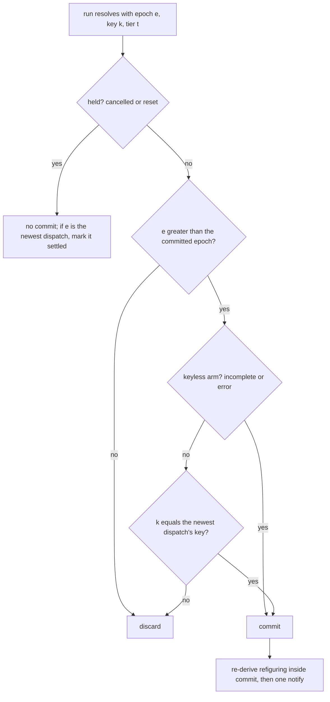

# The answered draft and the re-figuring tell - Plan

## Goal Capsule

- **Objective:** after the household changes an input on the answer page, nothing on that page claims the shown date or verdict was figured at the new input; while the new figure is being worked out, the page says so beside the old one, and the moment it lands the page is whole again.
- **Means:** each committed answer carries the draft it was figured from and a key of its built engine input (KTD1, KTD2); the store commits only runs built from the newest inputs and raises one flag while a different-input run is in flight (KTD3, KTD4); every describing part of the page reads the answered draft (KTD5); the flag drives a calm line on the hero, the band caption and the panel echo (KTD6); a provisional-tier date shows under the provisional tag (KTD8).
- **Authority:** the Product Contract's R-IDs win on behavior; the KTDs win on mechanism; `docs/architecture.md` wins on any engine invariant (none is touched: `src/engine` does not change).
- **Execution profile:** one commit per unit on main (the repo's convention; no branches, no PRs). U1 lands first; U2 and U3 depend on it; U4 depends on U1 and U3; U5 depends on U4.
- **Stop conditions:** stop and surface if any unit needs an engine output to move, a persisted schema to change, or a copy key to carry a digit; stop if `pnpm verify:fit` shows the settled frame of any seed changed; stop if the spine's reveal lead has no existing box the line can overlay without moving the verdict's fold (KTD6).
- **Who finishes:** the pilot builds and gates every unit; Caddie walk 10 reads the new frames (the walk-9 card's HARD-FLAG on W9-R7 lifts only there).

---

## Product Contract

### Summary

The store records, with every answer it shows, the inputs that answer was figured from, and refuses to show an answer built from inputs the household has since replaced. Every sentence on the answer page that names the household's figures reads those recorded inputs. While a run on newer inputs is in flight, a calm line says the shown answer is from before the latest change, on the hero and beside the figures the household is looking at; it clears when the new answer lands.

### Problem Frame

An edit changes the draft at once; the answer changes only when a run commits, and after the first answer the store holds the old answer on screen. Today the band caption (W8-R7's words, `src/ui/answerView.ts` `dateBand` → `src/ui/FuckOffDate.tsx` tracknote), the spend levels, the band ages and the standing notes read the live draft, while the headline, band and ladder read the answer. So for up to ~18-20 s after an edit the couple reads "around 2033, about 9 of 10" over a caption naming their new spending ("That is the same life the date above is measured against."), and then the date changes with no message (walk 9's W9-R7, verified in code by refuter R7).

The research found the window is wider than the caption: the store can commit an answer built from inputs the household has already replaced (spine runs are not cancellable and commit in order; a date sweep can finish before its cancel lands), a provisional/final pair can straddle an edit so the household never sees a provisional for its own change, a blur that changed nothing re-runs the date route's provisional over the shown final and can move the date twice in silence, and the panel's echo says "Edits here flow straight into your answer." through the whole window.

### Requirements

**What the page claims**

- R1. Every part of the answer page that describes the shown answer names only figures that answer was figured at: the band caption's working-year figure, the spend levels, the band ages, the standing note (its choice of note, its words and its door's words), the hero's left-over staleness clause, and the hero's state and Medicare notes. The aged-plan premise line and the sheets' readouts are the same class and are deferred (Scope Boundaries).
- R2. Controls that act keep reading the live draft: the editors, every door's open action, the lever previews, the recommendation lane and the hatch gate.
- R3. An answer built from inputs that are no longer the newest the household asked for never reaches the screen; a re-run of the shown answer's own inputs at a tier no higher than the shown one never replaces it.

**The window**

- R4. While a run on inputs different from the shown answer's is in flight, the page says the shown answer is from before the latest change: on the hero (words per route: the date route names a date, the spine route a verdict), in the date route's band caption, and in the open Assumptions panel's echo. It clears when the first answer at the newest inputs commits.
- R5. The line never shows on a re-run of the same engine inputs (a sharpen, a blur that changed nothing, a label or display-only edit), never sits over an answer figured after the change, never steals focus, never moves the spine verdict's one-frame fold, never rests on color alone, and does not pulse under reduced motion.
- R6. A provisional/final pair whose provisional was superseded by a newer edit does not dispatch its final.
- R9. On the date route, a provisional-tier answer that commits after an edit on the answer page shows under the provisional tag until its final lands (`docs/architecture.md`: the provisional tier "renders only under D1's provisional string class and is never crowned as final"; the hero breaks that today). The first landing breaks it too; tagging the first reveal changes the magic moment, so that is Briggsy's call (Open Questions), not this plan's.

**The harnesses**

- R8. The real-browser harnesses can tell a settled answer page from one inside the window.

### Success Criteria

- Caddie walk 10 captures the window on the phone after Close and on the laptop beside the open panel, and finds no frame where a figure on the page names an input the shown answer was not run at, and no seat reads the old figure as "my edit didn't take".
- Every existing `pnpm verify:fit` arm stays green with no edit to its assertions (the settled frames did not move).

### Scope Boundaries

- W9-R8 (naming the date at the household's real spending) and the survivor reading on the date route are their own register entries.
- Considered and not built: a screen-reader announce at the window's end when the answer moved under an open sheet (spec-flow I5). The hero's existing announcer speaks a crown change once no sheet is open; a change that lands while a sheet is open is never spoken, which is older than this plan. Build it if walk 10's listener seat misses a moved answer after Close.
- Considered and not built: debouncing radio groups that commit on arrow keys (M1). Each key press is a real input change and the line is honest on each; build a debounce only if walk 10 reads the line as flicker.
- Considered and not built: a cue on the main-thread fallback (M2), where a run blocks the event loop and the line may never paint. That path exists only without a worker.
- Considered and not built (R7, removed): a working line on the incomplete-inputs strip during a repair run. Its lead there is "Your answer takes shape as you go." (the list below it is empty once the fact is repaired), which stays true while the repair runs; the flow analysis had quoted the zero-accounts arm's words instead.
- Considered and not built: skipping a recompute whose key matches a run already in flight. It costs a restarted final on a no-op blur during a sharpen; riding an in-flight date sweep is unsafe (any later cancel kills it). Build only if walk 10 or a timing measure shows the restart hurting.
- Considered and not built: a separate message when a date-route final moves the provisional's date. R9's provisional tag already says the shown date is a first reading being sharpened; build a message only if walk 10 reads the final's move as unexplained.

#### Deferred to Follow-Up Work

- The aged-plan premise line (`agedBalancesYear`, M3) and the sheets' readouts opened inside the window (M11: the Healthcare readout, the Roth preview's crown) describe the answer through the live draft; same class, separate register entry.
- A working cue for a compute-error retry on the date route (M9).

---

## Planning Contract

### Key Technical Decisions

- KTD1. **The answered draft rides the resolved answer arms as a required field.** `ModelAnswer`'s `headline` and `date` arms gain `draft` (the draft the run was built from) and `inputKey` (KTD2), both required, as `tier` is. A sibling snapshot field was rejected: a test that plants an answer by spreading the real snapshot (`resultAssumptionsDoor.test.tsx`'s `plantAnswer`) compiles and pairs the planted answer with a null draft, and any "fall back to the live draft when null" would bring the defect back; on the arm, the compiler forces every literal to supply it (the solve lane's committed arm already carries what it solved on, `src/store/memoryModel.ts` `SolveAnswer`). The draft is captured before `ensureSeed` and never serialized (the `lastDisplayed` rule).
- KTD2. **A run's identity is a route-tagged key of its BUILT engine input.** `recompute` already builds `DateSearchInput` or `SimulationParams` before any await; the key is `canonicalIdentityToken` (`src/shared/model.ts`, already imported by the store) of that object, prefixed by the route, with the tier excluded (it is passed beside the input). Never `draftIdentityKey`: the draft carries fields the engine never reads (`chosenGoal`, `heirBracket`, `savedRecommendation`, the save stamps, `spendEntryPeriod`, names, W's `entryPeriod`), and the first run's seed mint swaps the draft object after the build.
- KTD3. **One commit rule beside the epoch guard: only the newest inputs commit.** The store keeps the newest dispatch's key. A resolved run commits only when its epoch beats the committed one (today's rule) and its key equals the newest dispatch's key. A recompute whose built key equals the COMMITTED answer's key at a tier no higher than the committed tier is not dispatched to the engine: it becomes the newest dispatch (so no run on other inputs can commit after it), refreshes the committed arm's `draft` to the live draft in place (same key, so only display-only fields change), settles at once and notifies once. Every other recompute dispatches, including one whose key matches a run already in flight: a duplicate same-input run costs time, never correctness, and riding an in-flight date sweep is unsafe because any later dispatch's cancel kills it. The same-input path never goes through `commit`, never advances the committed epoch and never touches the spend lane (a spine answer's sized spend clause stays); it fires the worker-side cancel only on the date route and only while a run on a different key is in flight (the A→B→A case; spine runs are not cancellable and the newest-key test already holds them off). The keyless arms (`inputs-incomplete`, `compute-error`) commit as today. This one rule answers spec-flow C1 (no answer from replaced inputs, A→B→A included), C3 (no silent downgrade on a blur that changed nothing) and the trace's straddling pair (an old pair's final built from newer inputs carries the newer key and may land; a stale one cannot).
- KTD4. **The re-figuring flag is a store fact, derived in one place.** `refiguring` is true exactly when the newest dispatch has not settled and its key differs from the shown answer's key, or the shown answer is `inputs-incomplete` or `compute-error`; over `idle` and `pending` it is false (the pending view is its own working state). The builder-null demotion to `inputs-incomplete` registers as the newest dispatch and settles at once, so a later-resolving older run cannot leave the flag on. It is set at dispatch with a notify only when it changes, re-derived inside `commit` before the single notify (no frame pairs a new answer with an old flag), and cleared when the newest dispatch returns held (`cancelled`, an engine reset) as well as when it commits. It lives on the snapshot beside `answer` (a fact about the store, not about one answer; its safe default, false, cannot recreate the defect in a planted test).
- KTD5. **Describers read the answered draft; actors read the live one.** `selectElevatedAnswer` reads the resolved arm's `draft` for the spend levels, the band ages and the caption figure (routing `pending` and `compute-error` stays live). In `Result.tsx` the standing-note slot chooses its note, its words and its door's words and beside-text from the answered draft; only the door's open action is live (spec-flow I1: a split choice makes the note vanish or switch). The hero's left-over staleness clause (`stalenessClause`, built from `workingYearLeftOverMoved`) and its `medicarePricedNote`, `medicareExtrasTypicalNote` and `statePricedNote` take the answered draft on the hero; their live values keep feeding the sheets and the recommendation surface, so each becomes two values. The AnswerStrip's zero-accounts guard reads the answered draft.
- KTD6. **The tell's words and seats.** New copy keys, drafted here, shipped flagged for walk 10 (nothing parks): `answerRefiguringDate` "Figuring your date again with your latest change. The one shown is from before it."; `answerRefiguringVerdict` "Figuring this again with your latest change. The answer shown is from before it."; `answerRefiguringCaption`, appended to the band tracknote while the flag is on, "Your latest change isn't in these figures yet."; `assumptionEchoRefiguring`, in the panel echo while the flag is on (in place of the quiet sentence on the date route, in place of the held verdict line on the spine), "Your answer is being figured again with this change." A no-date answer on the date route takes `answerRefiguringVerdict`, never the date words. The AnswerStrip ignores the flag during intake (M7). The hero line takes the eyebrow slot (`fod-provisional`, `cs-provisional` render points) in sentence case, muted ink and a word cue beside the color, and the heading adds the line's id to its existing `aria-describedby` list (both headings already carry `IN_FRAME_DISCLAIMER_ID`, the R13 link; the line's id goes first, the disclaimer's stays) so a reader who jumps to the heading hears it. On the spine it must not move the verdict's fold (R5): it overlays existing space in the reveal lead, decided in U4 with back-nine-design and emil-design-eng loaded, and U5's fit arm is its proof. On the spine the panel echo's line replaces the held verdict line inside the echo's reserved box, never adding a line (insight 035). While the flag is on, the two no-date headlines (`copy.ts`, "No fuck-off date within the next … years — with what you’ve entered so far." and its essentials twin) drop their "with what you’ve entered so far" tail, which the line above them makes false. The breathe pulse runs while the line shows and drops under reduced motion (the existing family list in `src/ui/styles/base.css`).
- KTD7. **The pair guard lives in the callers, the answer in the store.** `recompute` (changed in U1) resolves with whether its run settled as the newest; `recomputeBoth` (`src/ui/Result.tsx`) and `revealAndSharpen` (`src/ui/IntakeApp.tsx`) dispatch the final only when the provisional settled as the newest (R6). The exact return shape is an implementation choice.
- KTD8. **The line clears at the first commit of the newest inputs; a provisional-tier date then shows under the provisional tag.** On the date route the first commit at new inputs is usually the 2,000-path provisional, which can crown a different offset than the final ~15 s later. Architecture's provisional-class rule (R9) puts that answer under the existing `answerProvisionalTag` ("Provisional — with what you’ve entered so far", true there) until its final lands. The view keys the tag on the answer's tier AND on the answer having followed an edit on this page (a first landing keeps today's untagged reveal pending Briggsy's call). So after an edit the date hero reads: the re-figuring line over the old answer, then the provisional tag over the new reading, then the final. Holding the re-figuring line until the final was rejected: its words ("from before it") would be false over the provisional. **As built (U4, `c644ec2f`):** Briggsy ruled the Open Question below on 2026-11-19 ("Yes, tag it"), so the tag rides EVERY provisional-tier date, the first reveal included, and the "followed an edit on this page" signal was never built: the tier alone decides (`src/ui/answerView.ts`'s module note).
- KTD9. **The harness signal is a presence-keyed attribute.** `main.result` carries `data-answer-refiguring` only while the flag is on (the `data-answer-tier` precedent, absent when off); a settled page is `data-answer-tier="final"` with the attribute absent.
- No bake-off: every mechanism choice above was decided from evidence already gathered (the trace, the repo survey and the flow analysis), none needed developed alternatives to judge, and KTD1's choice is the closest call, decided by the compiler-held door.

### High-Level Technical Design

The commit decision for a resolved run (directional; the prose above is authoritative):

The dispatch decision, and the flag's life:

```mermaid
stateDiagram-v2
  [*] --> Settled
  Settled --> SameInputs: recompute, built key equals the shown key, tier no higher
  SameInputs --> Settled: no engine run; refresh the shown arm's draft; flag stays off
  Settled --> Refiguring: recompute, built key differs from the shown key
  Refiguring --> Refiguring: another edit, newest key moves
  Refiguring --> Settled: newest run commits
  Refiguring --> Settled: newest run returns held
  Settled --> Settled: same-key sharpen (provisional to final) commits, flag never on
```

### Assumptions

- The four drafted strings are the pilot's and ship flagged; walk 10 reads them, and the walk's card may re-word them without a council.
- The keyless arms keep today's commit rule; a compute-error from a superseded run committing over a good answer was not observed and is not built against.
- "Different inputs" means a different built engine input; a change only a display reads (a name, the spend's entry period) refreshes the answered draft without raising the line.
- The spine's fold can hold the line inside existing space; if the design unit finds no such space, it stops and surfaces (Goal Capsule's stop conditions).

### Sources & Research

- The pilot's trace of every edit-to-recompute path, the commit branches and the provisional/final pairs; the repo survey of the snapshot pattern, every reader of the draft and the tests that plant answers; the flow analysis's gaps C1-C3, I1-I8 and M1-M11. All three were written this session and folded into the KTDs above.
- Insights 056 (a verdict naming a composite surface's source re-keys every field), 058 (every writer of an invariant), 047 (a tiered consumer re-fires identity-keyed contracts: no focus steal, no remount of the band or its open modal), 070 (a settle wait must wait for a presence), 094 (the epoch pair carries the staleness discipline), 036's 2026-10-31 extension (a region holding a control: the control acts on the live state).

---

## Implementation Units

### U1. The store: the run key, the commit rule, the answered draft and the flag

**Goal:** the store never shows an answer from replaced inputs, records the draft each answer was figured from, and says when a different-input run is in flight.
**Requirements:** R3, R4 (the flag), R5 (same inputs), R6 (the store half).
**Dependencies:** none.
**Files:** `src/store/memoryModel.ts`; tests `src/store/__tests__/memoryModel.test.ts`, `src/store/__tests__/sharpen.test.ts`, `src/store/__tests__/spendLane.test.ts`, and the answer literals the compiler names in `src/ui/__tests__/answerView.test.ts`, `src/intake/__tests__/AnswerStrip.test.tsx`, `src/intake/__tests__/assumptionPanel.test.tsx`, `src/ui/__tests__/recommendationSaveGesture.test.tsx`, `src/ui/__tests__/roomSentenceSeedGate.test.tsx` (each literal gains `draft` and `inputKey` here, so the commit typechecks; U3 owns the behavioral rework).
**Approach:**
1. Add `draft` and `inputKey` to the `headline` and `date` arms (KTD1); fix every literal the compiler names.
2. In `recompute`, take the key of the built input before `ensureSeed` (KTD2); record the newest dispatch's key and epoch.
3. The same-input path exactly as KTD3 states it, outside `commit`.
4. In `commit`, add the newest-key test for keyed arms (KTD3) and re-derive `refiguring` before the notify (KTD4).
5. The builder-null demotion registers as the newest dispatch, settled (KTD4).
6. On every held return, settle the newest dispatch when it is the held one and notify only if the flag changed (KTD4).
7. Add `refiguring` to the snapshot type, its initial value and `notify` (KTD4); `recompute` resolves with KTD7's settled-as-newest result.
**Execution note:** write the store contract as failing tests first; the fake client's date builder returns one shared input, so these tests need a builder that varies with the draft.
**Patterns to follow:** the solve lane's fingerprint at dispatch and on the committed arm; `displayed` written inside `commit`; the coherence subscriber in `sharpen.test.ts`.
**Test scenarios:**
- An edit dispatches a run on a different key: the flag turns on with one notify, the old answer stays, and the flag turns off in the same frame the new answer commits.
- A provisional then final on the same draft: the flag never turns on.
- A blur that changed nothing after a final: no engine call, the shown answer and tier stay, the arm's draft is the live draft.
- A label-only edit (a name): no engine call, the flag stays off, the arm's draft carries the new name.
- A→B→A while B's run is in flight (spine fake, runs not cancellable): the revert to A is a same-input settle with no engine call, so the flag clears at once; B resolves later and does not commit; the screen keeps A's answer throughout.
- A same-input settle on the spine while A's spend clause is sized or pending: the spend figure stays (no `commit`, no spend reset, no cancel).
- A no-op blur while the shown answer is provisional and its final is in flight: the pair's provisional takes the same-input path (no engine call); its final dispatches, supersedes the in-flight final and commits; the flag never turns on.
- Shown A, an edit to B dispatched, then a blur on B with B unchanged: the second B run dispatches (B is not the committed key); the flag stays on until a B run commits; A's arm never takes B's draft.
- Existing tests that re-dispatch one shared input (`memoryModel.test.ts`'s `FAKE_DATE_INPUT`, about eight; `spendLane.test.ts` "a NEWER commit drops the older solve") are rewritten with a draft-varying builder, or assert the same-input skip where that is what they now exercise.
- An edit that empties a required fact while an older spine run is in flight: `inputs-incomplete` commits, the flag is off, and the older run resolves without turning it on.
- Three edits in a row on the spine: only the last edit's answer commits.
- The trace's straddling pair: A's final built from B's draft carries B's key and may commit; nothing built from A commits after B was dispatched.
- The newest dispatch returns `cancelled`, or rejects with an engine reset: the flag clears with nothing committed.
- An edit that empties a required fact: `inputs-incomplete` commits and the flag is off; the repair edit dispatches and the flag is on over the keyless arm.
- The first run of a fresh draft (seed minted after the build): the committed arm's key equals the next same-input build's key.
- Every frame of a subscriber across an edit, a sharpen and a held return pairs the answer with a consistent flag (the `sharpen.test.ts` frames shape).
**Verification:** the store suite and `sharpen.test.ts` are green; `pnpm typecheck` names no unfixed literal.

### U2. The pair guard

**Goal:** a provisional superseded by a newer edit never sends its final, so the newer edit gets its own provisional.
**Requirements:** R6.
**Dependencies:** U1.
**Files:** `src/ui/Result.tsx` (`recomputeBoth`), `src/ui/IntakeApp.tsx` (`revealAndSharpen`); tests `src/ui/__tests__/Result.test.tsx`, `src/ui/__tests__/IntakeApp.test.tsx` or the nearest existing caller test, and every test spy that stubs `recompute` to resolve `undefined` (`IntakeApp.test.tsx:135` and the three others a grep for `recompute` spies finds), which now resolve KTD7's result shape. As built, U1 already moved the four the compiler named to `true` (KTD7's boolean; `true` keeps today's behavior); `resultBudgetDoor.test.tsx`'s two `undefined as never` stubs compile and are still U2's, since the guard reads `undefined` as superseded.
**Approach:** read the settled-as-newest result U1 gives `recompute` (KTD7) after the provisional and skip the final when it is false; no store change here.
**Test scenarios:**
- An edit lands while a pair's provisional is in flight: that pair dispatches no final; the newer pair's provisional and final both dispatch.
- No edit: the pair dispatches both tiers, as today.
**Verification:** the caller tests pass; the date route's fake shows a provisional commit for the last edit of a burst.

### U3. Describers read the answered draft

**Goal:** every sentence on the answer page that names the household's figures names the figures the shown answer was figured at.
**Requirements:** R1, R2.
**Dependencies:** U1.
**Files:** `src/ui/answerView.ts`, `src/ui/Result.tsx`, `src/intake/AnswerStrip.tsx`; tests `src/ui/__tests__/answerView.test.ts`, `src/ui/__tests__/resultPayCheckLine.test.tsx`, `src/ui/__tests__/Result.test.tsx` and the Result tests that plant answers (`resultAssumptionsDoor`, `recommendationSaveGesture`, `goalLeadGate`, `recommendInvite`, `recSaveNoAutoWrite`, `resultBudgetDoor`, `resultControlDoors`, `resultDisclaimer`).
**Approach:** apply KTD5 site by site: `selectElevatedAnswer`'s levels, ages and caption figure from the resolved arm; the standing-note slot (`payCheckNote`) choosing and wording from the answered draft with only `onOpen` live; `stalenessClause` and the hero notes as two values (hero answered, sheets live); the AnswerStrip guard. Planted test answers carry a `draft` (the compiler asks for it).
**Test scenarios:**
- An answer committed at $84,000 W, then W edited to $90,000 with no commit: the caption and the standing note name $84,000; the panel's W field shows $90,000.
- The same edit, then the new answer commits: both name $90,000.
- A W-stale note whose live W was just fixed: the note stays (the answer still runs on the old figure) and its door opens the panel at the seat.
- A budget edit before the run lands: the spend levels are the answered budget's.
- `resultPayCheckLine`'s arms, reworked: each drives a committed answer at the seed's draft, then reads the line.
**Verification:** the reached Result and answerView suites are green; no reader in the KTD5 list touches `snapshot.draft` for a describing value (a grep of the touched files confirms it).

### U4. The tell: words, seats and the settle attribute

**Goal:** the household sees, where it is looking, that the shown answer is from before its latest change, and the harnesses can see it too.
**Requirements:** R4, R5, R8, R9.
**Dependencies:** U1, U3.
**Files:** `src/ui/copy.ts`, `src/ui/answerView.ts`, `src/ui/FuckOffDate.tsx`, `src/ui/ConfidenceStatement.tsx`, `src/intake/AssumptionPanel.tsx`, `src/intake/AnswerStrip.tsx`, `src/ui/Result.tsx` (the attribute), `src/ui/styles/base.css`, `src/ui/styles/fuckOffDate.css`, `src/ui/styles/confidence.css`; tests `src/ui/__tests__/FuckOffDate.test.tsx`, `src/ui/__tests__/ConfidenceStatement.test.tsx`, `src/intake/__tests__/assumptionPanel.test.tsx`, `src/intake/__tests__/AnswerStrip.test.tsx`, `src/ui/__tests__/answerView.test.ts`, `src/ui/__tests__/copyGuard.test.ts`, `src/ui/__tests__/resultDisclaimer.test.tsx`.
**Approach:**
1. Load back-nine-design, emil-design-eng, frontend-design:frontend-design and web-design-guidelines before any change here.
2. Add KTD6's four keys; copyGuard's verdict scope (no digits, no "$", no superlative) governs the `answer*` ones.
3. Thread the flag into the hero views presence-keyed (`...(refiguring ? { refiguring: true } : {})`, the `displayed` idiom) so the settled views' pins hold; render KTD6's seats; the caption clause on the date route only.
4. The panel echo reads the flag (KTD6); the no-date headlines drop their tail while it is on (KTD6).
5. The date hero shows `answerProvisionalTag` while its answer's tier is provisional, the answer followed an edit on this page, and the flag is off (R9, KTD8). As built: provisional tier and flag off, the first reveal included (KTD8's as-built note).
6. `Result.tsx` mirrors the flag as `data-answer-refiguring` (KTD9).
**Test scenarios:**
- Date hero with the flag: the line renders in its slot with KTD6's date words; focus stays where it was; the band's open "Study the range" modal stays open.
- Spine hero with the flag: the verdict words render in the overlay seat (the fold itself is U5's fit arm's to prove; jsdom has no layout).
- Both heroes with the flag: the heading's `aria-describedby` names the line; without the flag it does not.
- Flag off on a final-tier answer: the settled views equal today's (`answerView.test.ts`'s full-view `toEqual` pins hold).
- Date hero on a provisional-tier answer that followed an edit, flag off: `answerProvisionalTag` renders; on the final it is gone. On a first landing's provisional: no tag (today's reveal). As built: the first landing's provisional is tagged too (KTD8's as-built note).
- A no-date answer with the flag: the headline has no "with what you’ve entered so far" tail; without the flag it keeps it.
- The band caption with the flag: W8-R7's sentence plus `answerRefiguringCaption`; without it, W8-R7's sentence alone.
- The panel echo with the flag: on the date route `assumptionEchoRefiguring` replaces the quiet sentence; on the spine it replaces the held verdict line in the same box.
- `main.result` carries `data-answer-refiguring` only while the flag is on.
- copyGuard passes the four new keys.
**Verification:** the reached suites are green; the four design skills' checklists pass on the changed surfaces at 1536×791, 1280×800 and the phone width.

### U5. The harnesses, the gates and the comment sweep

**Goal:** every real-browser wait and every comment tells the truth about the window.
**Requirements:** R5 (the fold), R8.
**Dependencies:** U4.
**Files:** `e2e/caddie-walk.spec.ts` (`armResultRerunWatch`), `e2e/vertical-fit.spec.ts` (the preview arms and the live attribute arm), a dev-only preview beside `src/ui/preview/U7Preview.tsx` that renders both heroes with the flag on, `e2e/reviewSurface.ts`; comments in `src/ui/answerView.ts`, `src/store/memoryModel.ts` (the `ModelAnswer` tier comment), `src/ui/Result.tsx` (the `recomputeBoth` comment), `src/ui/styles/base.css` (the breathe family note), `e2e/vertical-fit.spec.ts` and `e2e/reviewSurface.ts` (each says the hero never renders a provisional tag).
**Approach:** the settle condition everywhere becomes KTD9's; `armResultRerunWatch` waits for the attribute to appear then go. The flag-on frame lasts one run (~3 s on the spine), too short to measure reliably live, so the fit arm measures it on a dev-only preview that renders both heroes with the flag on over a settled answer (the `src/ui/preview/U7Preview.tsx` precedent), and one live arm only checks the attribute appears and clears after an edit.
**Test scenarios:**
- The new fit arm on the preview, spine: the verdict and the R13 disclaimer stay inside one frame at 1536×791 and 1280×800 with the line shown.
- The new fit arm on the preview, date: the line and the caption clause render; nothing overlaps.
- The live arm: edit spending in the panel, Close; `data-answer-refiguring` appears, then clears once a new answer commits.
- The Caddie re-run watch fires on a spine panel edit (today it never does).
**Verification:** `pnpm verify:fit` is green with the new arms; the settled-frame arms measure what they measured before.
**As built (`a18964e8`):** the preview (`src/ui/preview/RefiguringPreview.tsx`, `?preview=refiguring&seed=<key>`) mounts the REAL app on the seed and holds every spine and date run after its first final, rather than rendering the two heroes alone: the fold the spine arm proves runs to the R13 in-frame disclaimer, which `Result.tsx` mounts, not the heroes. The settle is one exported selector, `SETTLED_RESULT` (`e2e/reviewSurface.ts`), and the re-run watch moved there (`armRefiguringWatch`), shared by the Caddie walk and the fit gate's live arm. The planted-fault pass found the store's spine-route frames unpinned (pinned in `e95c17db`).

### U6. Docs and the register

**Goal:** the register, the landmines and every line citation match the shipped code.
**Requirements:** all (record).
**Dependencies:** U5.
**Files:** `docs/backlog.md` (W9-R7's entry: ⚑ BUILT with the commits; its walk-10 condition; and one NEW entry for the deferred describers that still read the live draft, M3's aged-plan premise line and M11's sheet readouts, with M9's retry cue as a rider, after checking the register has none; one NEW entry for the first reveal's untagged provisional date, the Open Question above with its recommended answer; and W9-R7's size from `S` to `M`), `docs/landmines.md` (the window landmine under Caddie walks and fleets: replace the timing workaround with the attribute), `docs/architecture.md` (the store's commit rule, if its store section names the epoch guard), `TODO.md` (walk 10's targets gain the window frames).
**Approach:** run the doc re-anchor on the unit diffs, then the doc-stats gate.
**Test expectation:** none -- documentation only; `pnpm verify:doc-stats` is its gate.
**Verification:** `pnpm verify:doc-stats` exits 0.

---

## Verification Contract

| Gate | When | Proves |
|---|---|---|
| `pnpm typecheck`, `pnpm lint` | every unit | every answer literal carries `draft` and `inputKey`; the store imports nothing from `@intake` |
| the reached vitest files (`pnpm exec vitest run <files>`) | every unit | the scenarios above |
| `pnpm test` (the whole suite, once, unpinned on this laptop) | after U4 | no planted-answer test left behind |
| `pnpm verify:doc-stats` | U6, and any unit that edits a doc | citations and the test count |
| `pnpm build` | after U4 | the production bundle |
| each edited e2e spec through a scratch tsconfig | U5 | `pnpm typecheck` excludes `e2e/`; the TODO close block's gate step 2 has the recipe |
| `pnpm verify:fit` | after U5 | every existing arm green without an edit to its assertions; the new flag-on arms |
| Caddie walk 10 | after U6 | the Success Criteria |

Heavy runs go one at a time and unpinned (`docs/landmines.md`, "THE LENOVO"). Before the first edit, record `git rev-parse HEAD` as the re-anchor base.

## Definition of Done

- R1-R6, R8 and R9 each hold, shown by a named test or gate above (R7 was removed; Scope Boundaries says why).
- Every comment that said the hero never shows a tag, or that the breathe stops "when the final lands", is rewritten to the new law.
- No dead-end code from an abandoned approach remains in the diff.
- The register entry records the commits and names walk 10 as its closing read.

## Open Questions

- **⚑ RULED by Briggsy 2026-11-19 (b9-1): "Yes, tag it."** The first reveal's quick reading carries the provisional tag until the final lands. U6's register entry is filed as a RULED build (its own unit after this plan's), never re-asked. The question as put: should the first reveal's quick reading carry the provisional tag? Architecture says a provisional-tier date renders only under the provisional tag; the hero's first reveal shows it untagged today and then sharpens. Recommended: yes, the tag on the first reveal too (it is the architecture's own rule, and the stylesheet's breathe family was built for it); it changes the magic moment's first frame, so it is his to rule. Filed in U6 as its own register entry.

## Minor faults the plan readers found (not folded in)

- R5's "does not pulse under reduced motion" and "never rests on color alone" have no named test; U4's design checklist covers them.
- The tail-less headlines need variants of `slots.noDateInWindow` and `slots.dateFloorNotWithin`.
- The flag over `inputs-incomplete` and `compute-error` drives only the attribute; no surface renders a line there.
- `resultDisclaimer.test.tsx line 133-139 at 95c715e19` greps both heroes' source; U4's hero edits must keep what it greps.
- A spine A→B→A while A's spend solve is pending: B's dispatch may cancel that solve; the clause falls back to figure-less, never wrong.
- The key omits the seed, which never changes after it is minted.
- On the date route neither the line nor R9's tag has reserved space; the route scrolls, and walk 10 reads it.
- The Caddie re-run watch also fires on the verdict's own changes; its rewrite keys only on the attribute.
- R3's "only the newest inputs commit" also stops a run on replaced inputs that would be honest under neutral words; the strict rule is kept because it also closes the straddling pair and the silent downgrade.
- The register sizes W9-R7 `S`; this plan is six units. U6 re-sizes the entry to `M`.
- The plan sits inside the walk-9 fix round: TODO's START HERE runs the walk-9 form council and its copy round first; this plan's units follow, and walk 10 reads both.

## Risks & Dependencies

- The store change touches the one commit path every answer goes through; the frames test and the A→B→A, straddling-pair and held-return scenarios are the guard.
- Planted-answer tests across the Result suites move together in U3; a missed one shows as a compile error, never a silent pass.
- The spine fold law may leave no room for a line (KTD6); the design unit stops and surfaces rather than adding a row.
