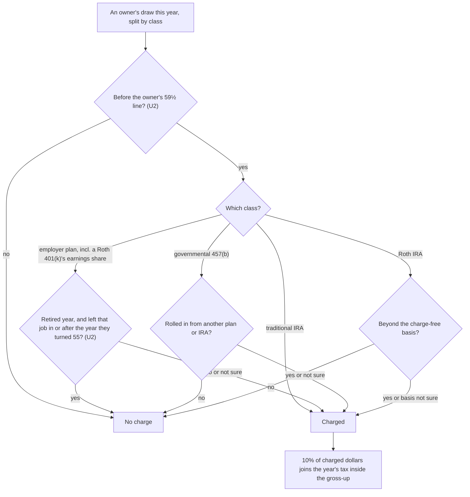
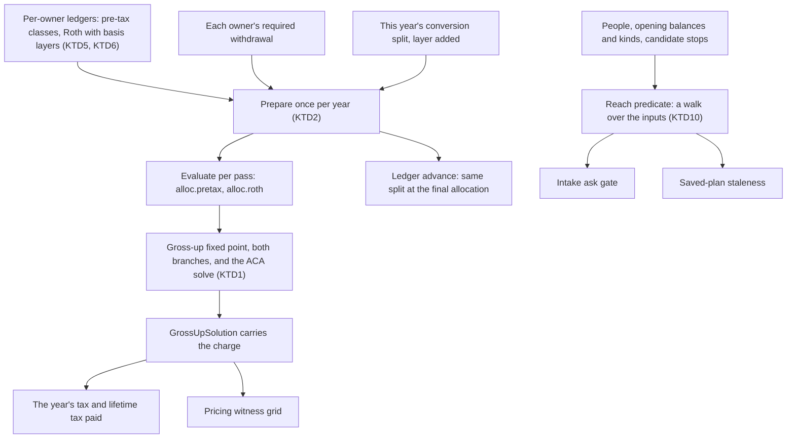
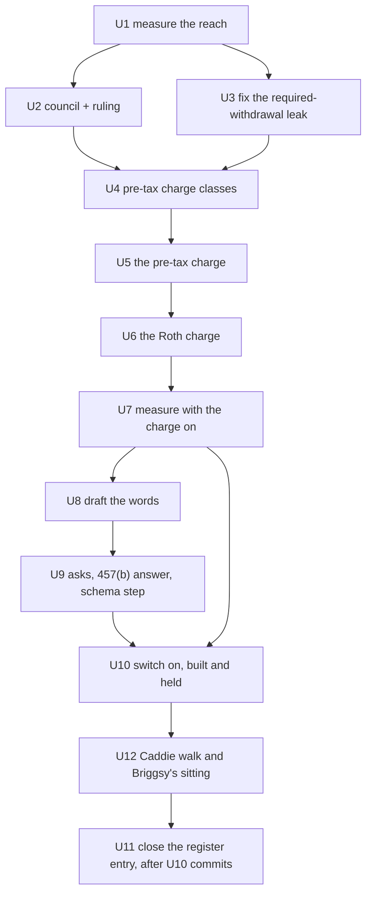

# The 10% Early-Withdrawal Charge - Plan

**Target:** The Back Nine, `projects/the-back-nine` in the `ai-learning-journey` repository. Every file path below is relative to that project folder.

---

## Goal Capsule

- **Objective:** A household that takes money out of a retirement account before 59½ gets a date, a grade, a confidence statement and a recommended withdrawal order that include the 10% the IRS charges on that money. No answer leaves that charge out, and the stopgap note that admits the gap is gone. The Roth income-tax gaps listed under Deferred to Follow-Up Work stay outside this build.
- **Means:** one more tax inside the withdrawal gross-up the engine already solves, computed per owner by one shared producer from held data plus a few new answers (KTD1, KTD2).
- **Authority:** Briggsy rules on the conventions U2 puts to the council and on every household-facing word (R16, R17). The register entry's negatives and product rule D7 bind every unit. `docs/architecture.md` wins on an engine invariant. In this plan the R-IDs win on product behavior and the KTDs on mechanism; a unit overrides neither.
- **Stop conditions:**
  - U1's measurement contradicts the register's picture of who is reached (for example, nothing under 59½ is drawn on any seed, `healthgap` included): the priority is Briggsy's call.
  - U2's ruling changes a requirement or widens scope (an inherited sub-ledger, Roth earnings as income): re-plan the affected units before building them.
  - A hand fixture worked from Form 5329 disagrees with the statute reading the plan assumes.
  - The gross-up or the ACA bisection cannot be shown to converge with the charge in it (KTD7).
  - U1's test refutes the required-withdrawal leak: U3 drops and KTD3's base rule is re-decided.
  - U5 cannot load the official current text of §72(t), §72(e)(8) and §408A(d): stop for Briggsy rather than land the constants directional (KTD8).
  - U7 finds a result that moves the rosy way: stop for Briggsy.
  - U7 finds `dip`'s non-monotone offsets or `datesplit`'s floor crown moved: re-derive that seed's mechanism (insight 025) before any re-pin. If `dip` loses the dip it exists to test, its re-tune is Briggsy's call.
  - U10's timing check misses a threshold: the result goes to Briggsy; the charge is never thinned and the pass cap never trimmed to buy time.
- **Execution profile:** one commit per unit on `main` in the shared checkout, the project's practice; no pull-request split. One named exception: U9's schema floor raise lands in its own follow-up commit (architecture §7.3). Size L: several sessions. Every unit leaves `main` green and leaves production unchanged until U10, apart from U3's own pricing change.
- **Who finishes:** the pilot builds and lands every unit; Briggsy's rulings gate U4 onward (U2) and his read of the words gates U10's commit (U12).

---

## Product Contract

### Summary

Charge the federal 10% additional tax (26 U.S.C. §72(t)) on every draw an owner under 59½ takes from an IRA, an employer plan or a Roth account, on both routes and through every draw channel, as part of the tax the engine already funds. Ask the household only the facts the engine lacks, measure the reach before building and the result after, and retire the stopgap note K1.

### Problem Frame

The engine never checks an owner's age when it draws. `allocateWithdrawal` takes balances and a policy, never an age (`src/engine/sequencing.ts:134-177`), and nothing in `src/` applies §72(t). The only 59½ rule is Pennsylvania's state gate (`src/engine/constants/stateTax.ts:244-250`).

The miss is rosy, so it is a cardinal-rule problem: every uncharged dollar is tax the household really owes. The register files it Tier 0 (`docs/backlog.md`, *Money taken from retirement accounts before age 59½ is never charged the 10% early-withdrawal tax…*). The reach is wider than the working years:

- `healthgap`'s Sam is 40, retired, and owns the household's only Roth IRA; under the default proportional order Sam draws from it for about 20 years before 59½ (`src/ui/devSeeds.ts:1116-1122`).
- `health` and `healthnc` draw Sam's Roth at 59.
- The date search tests stops 0–10 years out (`src/engine/dateSearch.ts:60-69`), so a household in its late 50s draws pre-tax right after a tested stop.
- Since the pay check (2026-10-30), a short working year is paid from savings through the withdrawal order, so an under-59½ owner's pre-tax money can pay part of it, uncharged like every other draw.

The only words about the gap are K1 (`copy.assumptionWorkingYearCheckEarlyCharge`, `src/ui/copy.ts:1702-1703`), and they cover working years only. The retired route says nothing. D7 says a gap like this is a build item, never a sentence: K1 may stand only until the charge lands.

### Requirements

**The charge**

- R1. Each year, each living owner whose draw falls before their 59½ line owes 10% of what they take from a traditional IRA or an employer plan, through every channel that draws pre-tax money: the withdrawal order's spending draw, the draw that pays a conversion's tax, the working-year shortfall draw, and the draws that fund Medicare premiums and the year's other costs.
- R2. Each owner under the line owes 10% on Roth draws beyond the charge-free amount: for a Roth IRA, beyond remaining contributions and beyond conversions whose five-year clock has run; for a Roth 401(k), the earnings share of each draw.
- R3. A Roth conversion is never charged; money drawn from pre-tax to pay its tax is.
- R4. Employer-plan dollars are free of the charge in retired years after the owner left that plan's employer in or after the calendar year they turned 55. IRA dollars never are, nor plans from an employer left before that year, nor any draw in a working year.
- R5. Governmental 457(b) dollars are never charged, except the part rolled in from another plan or an IRA.
- R6. The charge is paid like the year's other tax: it raises the withdrawal the year needs and is never a separate draw. It never enters AGI or any MAGI (taxable Social Security, the ACA credit, IRMAA).
- R7. The charge reaches everything the year's tax already reaches: every date-search candidate, the retired route's confidence statement, every path including a death year, and the recommendation's ranking.

**Use and ask (D7)**

- R8. The engine uses what the household gave: birth years, each account's kind and owner, each retired person's stop age, and each still-working person's tested stop.
- R9. Intake asks only for what the engine lacks: for each employer plan, whether it belongs to its owner's current or most recent job, and for a plan from an earlier job, whether that job ended in or after the year its owner turned 55; each Roth account's charge-free amount as U2 rules it; whether a plan is a governmental 457(b), and how much of it was rolled in; and any birth-timing fact U2 rules in. Every ask offers "not sure".
- R10. "Not sure", and an answer missing from an older save, keep the full charge. An unknown Roth basis is fully charged, never filled with a plausible default.

**Proof**

- R11. Before building, measure the reach on every date seed and on `healthgap`, `health` and `healthnc`: every pre-tax and Roth draw, by channel, owner and age. Build and measure the household the 2026-10-30 amendment names: a date household whose working year runs short while its pre-tax owner is under 59½.
- R12. With the charge built, measure the date, the grade and whether the crown moves, bracketing each seed between "not sure" on every ask and the exempt answers. The landed tree reproduces those numbers byte for byte.
- R13. Every fixture is worked by hand from the statute and Form 5329 Part I, with the form year named. Each pins one side of a boundary or makes the crossing the test: the 59½ line, the age-55 year, a death before 59½, a mixed-age couple, a conversion's five-year clock.

**Saved plans and the stopgap**

- R14. A saved plan the charge reaches reads stale; a household it cannot reach is never told its taxes changed.
- R15. K1 is deleted when the charge lands, and no new note stands in for any part of the charge.

**Briggsy's calls**

- R16. The conventions the charge rests on come from a council sitting and Briggsy's ruling, not from the builder: the register's mixed-age question and the others U2 lists.
- R17. Every household-facing word (each ask, the charge's name wherever tax is shown, any line that changes) is Briggsy's, read in one sitting.

### Key Decisions

- **D7: use it, ask for it, or say nobody can know it; never a note around a gap** (Briggsy's ruling, 2026-10-21, `docs/product.md:79`). Governs R8, R9, R15.
- **"Not sure" keeps the full charge; an unknown Roth basis is fully charged** (the register entry's D7 bullet and ⚑ NEGATIVE, after burned/062). Governs R10.
- **The register's negatives:** never the age-55 exception for IRA dollars; the charge is deterministic arithmetic after the draw, never a new draw. Governs R4, R6.
- **The council the entry names and every household-facing word are Briggsy's calls, planned as steps** (the request). Governs R16, R17.

### Success Criteria

- The register entry carries a before-build reach count per seed and an after-build date, grade and crown per seed, and the landed tree reproduces the after numbers.
- A reader can follow any hand fixture from the draw to Form 5329 Part I lines 1–4 and on to the year's tax.
- After landing, `healthgap`'s answer under the default proportional order includes Sam's Roth charge, K1 is gone, and the register entry is closed with its negatives kept.

### Scope Boundaries

Considered and not built:

- **The other §72(t) exceptions** (disability, substantially equal payments, medical costs above 7.5% of AGI, health premiums while unemployed, first home, education, birth or adoption, the emergency draw, domestic abuse, terminal illness, disasters, an IRS levy, reservists, the public-safety age of 50, a QDRO, long-term-care premiums). Each is something the household asserts; none can be read from the inputs, and charging is the "not sure" side. An "any exception you qualify for?" ask from Briggsy would change this.
- **SIMPLE IRA's 25% rate in the first two years.** The model has no SIMPLE account kind.
- **A non-governmental 457(b).** It is never charged either, but it is not asked; it would need its own kind and its own risk rules.
- **An age-aware withdrawal order, or a bracket-fill limit that adds the 10%.** Without one the crown is the best of the existing candidates, not the true best; U7 measures whether the crown moves, and the gap is filed.
- **A gate on drawing a current employer's 401(k) while still working.** The law mostly forbids it before 59½ and the engine draws it anyway; that is an availability gap, filed, not this charge.
- **Pennsylvania's household-level 59½ gate.** It stays as it is (`src/engine/stateTax.ts:88-97`); only its comment changes if U2's ruling makes the comment untrue.
- **A safe-by-default construct (absent means fully charged, with an explicit off for direct callers).** Weighed in KTD4 and not built: it would move every hand fixture with an owner aged 46–60 without proving anything new about the charge. A production builder path that skipped the construct would change this.
- **Merging the schema raise into U10 so no build reads the new version without pricing it.** Not built while no deployment and no real save exist (`docs/backlog.md:4470`): only a rollback could open a U10 save in a U9 build. Act 5's U24 plans a home build and Briggsy's first real save, so U9 re-checks this at its start (KTD11); if a home or a real save exists by then, the raise and the writers move into U10's commit.
- **A row-level reach for U3's leak fix.** Not built: a row's reach is read only for plans saved before it ships, and no real save exists. A real save made before U3 lands would change this.
- **The death exception for an inherited IRA entered as the household's own.** Until Act 5's inherited-IRA kind lands, such an account can only be entered as a traditional or Roth IRA, and an heir under 59½ is charged on it although §72(t)(2)(A)(ii) frees it (gloomy). U11 records this on the register entry *An inherited IRA has no account kind…*.

#### Deferred to Follow-Up Work

- Roth earnings as ordinary income, if U2 keeps this build to the 10%: its own Tier 0 entry (it moves AGI, the ACA credit and IRMAA).
- The beneficiary exemption for a survivor under 59½, if U2 rules the merge: it rides Act 5's inherited-IRA ledger (`docs/plans/5-workbench-plan.md:69`).
- Roth earnings drawn after 59½ but inside the five-year period (taxed, no 10%).
- The birth-month ask (*Ages are whole years from the birth year alone…*, `docs/backlog.md:1631-1636`), unless U2 folds it in.
- The still-working RMD deferral and the IRA-basis build, which reuse U4's per-owner pre-tax classes.
- A governmental 457(b)'s deferrals are checked against the 401(k) and 403(b) ceiling at intake, since it is entered under those kinds (KTD12): its own register entry.

### Open Questions

Blocking, and settled only by U2's council sitting and Briggsy's ruling (R16). The evidence on each side is in U2.

1. Whose account a mixed-age couple draws first (the register's named council).
2. Inside one owner, which class goes first, the IRA or a plan exempt at 55; and which class a conversion comes from.
3. Where the 59½ line falls when only the birth year is known.
4. Which calendar year counts as the year of separation, on the date route and on the retired route.
5. Whether a survivor under 59½ is charged on the merged dollars or exempt as a beneficiary.
6. The Roth scope: the 10% only or earnings income too, and which Roth facts are asked.

Resolved while planning:

- **The solver golden cases do not move at U10.** There are eight (`src/engine/reference/solver-cases/index.ts:23-32`), every one builds its params by hand with no `pretaxByPerson`, so under KTD4 none carries the construct.
- **A governmental 457(b) is an answer on the existing employer-plan kinds**, not a new account kind (KTD12).

Deferred to implementation:

- Whether the age-55 exception reaches a 401(k)'s designated-Roth dollars and a 457(b)'s rolled-in dollars: read §72(t)(2)(A)(v) and (9) at the source before U4 builds the class sets.
- The derived contraction factor and the exact pass cap (KTD7 sets the floor).
- Exact names of the producer, the construct and the new reach.

---

## Planning Contract

### Key Technical Decisions

- KTD1. **The charge is an addend inside `solveGrossWithdrawal`, in both branches.** It sits beside the state-tax addend in the pre-floor branch and beside `workingYearFederalCharge` in the clamped working-year branch (`src/engine/taxOverlay.ts:1612-1705`), and it rides through the ACA solve the same way (`solveAcaFundedGross`, `src/engine/healthOverlay.ts`). Nothing upstream of the tax reads it. Every tax here is paid by growing the withdrawal inside that fixed point, so a charge worked out after convergence and paid by its own draw would itself be partly pre-tax and owe the charge again; the register's "never a new draw" has only this reading. The engine models no nonrefundable credits, so adding it after the federal tax matches Form 1040 line 23 and §26(b)(2)(C). (R1, R6)
- KTD2. **One producer, prepared once per year and evaluated per pass.** The preparation holds the year-constant facts: a non-mutated snapshot of each owner's ledgers after the death merge, each owner's required withdrawal, the conversion's split, the Roth sub-ledger with this year's conversion layer already added, and each owner's status (under the line or not, working or retired, exempt at 55 or not). The per-pass evaluation reads only the pass's `alloc.pretax` and `alloc.roth`, allocates nothing, and returns the charge. A year with no chargeable dollar prepares a no-charge marker, and the gross-up takes a structural `+ 0` without calling the evaluation, so unreached households pay nothing. The charge leaves the solve on `GrossUpSolution` from the converging pass, the way its income components do, and every readout (the witness, the probe, the year's tax) takes it from there. The ledger advance applies the same split function at the final allocation. This is the `prepareWorkingYearFloor` shape (architecture §7.4) and the project's single-producer law; insight 132 forbids a second derivation in the UI. The money picture is not a reader: it prices no tax (`src/engine/workingYearLedger.ts:6-12`). (R1, R2, R7)
- KTD3. **Each owner's draw is what they actually take: the spending draw is met first from each person's required withdrawal, and the rest is split by each owner's room after their required withdrawal.** Today `advancePerPersonLedger` takes each person's pro-rata share and then their required-withdrawal excess on top (`src/engine/taxOverlay.ts:1002-1024`), so more pre-tax can leave the ledgers than the gross-up taxes (`max(alloc.pretax, rmd)`, `:1632`): with a $20,000 required withdrawal against a $10,000 need, $25,000 leaves and $20,000 is taxed. Splitting the remainder by room (`dp_i − rmd_i`, the rule the conversion already uses at `:1009`) totals exactly `max(alloc.pretax, rmd)` and never overdraws an owner, which a split by balance can do. The last owner takes the residual so the total is exact. U3 fixes the split first, because the charge must key on the real distribution. U2's ruling on whose account a couple draws first applies only in a year whose preparation is not the no-charge marker (some living owner under the line holds chargeable dollars); every other year keeps the by-room split. A different order changes next year's required withdrawals (`:972-990`), so confining it to charge years keeps every unreached couple byte-identical and inside KTD10's one predicate. It goes live with U10's switch-on. (R1, R13)
- KTD4. **Presence-keyed, with a builder-side proof that production always carries it.** The charge runs only when its construct is in the overlay params; a direct caller that leaves it out stays byte-identical, so hand fixtures with owners under 60 keep their meaning (for example `src/engine/__tests__/taxOverlay.test.ts:1628` and `:4870-4885`). The engine cannot tell production from a direct caller (production sets nothing that fixtures lack), so the proof lives on the builder side: a test over every buildable dev seed asserts the construct on the spine params and on every date-search candidate's params. The construct's own consistency (finite, aligned with the people, the per-person ledger and tax present) is checked in `validateParams` and in the overlay backstop. The construct holds facts, never a computed charge: a plan with the current or last job is a relation ("separated at this person's stop in this run"), never a stored calendar year, and for a still-working owner only the job held now takes it, and `simulate` forwards each person's stop and working or retired status per year, because `buildCandidateParams` rewrites each worker's stop per candidate (`src/engine/dateSearch.ts:198-201`). A safe-by-default construct (absent means fully charged) was weighed and rejected (Scope Boundaries). (R7, R13)
- KTD5. **Each owner's pre-tax ledger splits into charge classes:** traditional IRA; employer plan with the current or last job; employer plan from an earlier job, exempt; employer plan from an earlier job, charged ("no" or "not sure"); governmental 457(b) own money; 457(b) rolled-in money. The 457(b) classes exist from day one and stay empty until U9. Classes, not accounts, because two plans from different jobs can carry different answers while the charge only needs to know which rule each dollar follows. Rules:
  - Contributions route by class: 401(k), 403(b) and 457(b) deferrals and every employer match go to the current job's class; traditional-IRA deposits go to the IRA class. Today's contribution channel lumps them (`src/shared/model.ts:351-364`; `src/engine/simulate.ts:793`), so it is split by family, and the overlay asserts at entry that the split channels sum to `pretaxByPerson`.
  - The person ledger stays primary; the classes are derived with the last class as the remainder, so the classes sum to the person ledger by construction. Every outflow has a class rule (the spending draw and the conversion by U2's ruled order, the required-withdrawal excess relocation too); all classes grow by the same `scale`; the three reset sites (`:2763`, `:2791`, `:2915-2922`) reset the classes; a death merge moves every class of the deceased where U2 ruled, conserves the total and is idempotent.
  - The classes live in place, allocated once per path, and are seeded inside the construct, so production params and the solver's run fingerprint (`src/engine/validation/solverRunFingerprint.ts:22-26`) stay unchanged until U10.
  - A permanent probe hook exposes the classes per year, beside `probe?.growthScaled` (`src/engine/taxOverlay.ts:2841`), so property tests can see them.
  - Built once and shaped for the still-working RMD deferral and the IRA-basis entry to reuse. (R4, R5, R8)
- KTD6. **Each owner gets a bounded Roth sub-ledger that carries the charge-free basis across years.** Per owner and per Roth kind, it holds the balance (opening from held accounts), a merged charge-free prefix, and at most five live conversion layers dated by calendar year (plus any pre-plan layers U2 rules asked). It is allocated once per path and advanced in place; the year's preparation (KTD2) turns it into a short breakpoint list.
  - This year's conversion layer exists before the year's draw, because a converted dollar is drawable the same year (`src/engine/taxOverlay.ts:2357-2360`). Each owner's conversion outflow equals the layer added to that owner.
  - A Roth IRA pays contributions, then conversions oldest first with each layer's taxable part first, then earnings (§408A(d)(4)(B)). A Roth 401(k) pays pro rata (§72(e)(8)). A designated-Roth account answered as a governmental 457(b) is exempt except its rolled-in part. So the basis carries its account kind and that answer.
  - Basis and layers are never growth-scaled; basis may exceed the balance after losses; a reset keeps basis and resets only the balance.
  - The household Roth bucket is the sum of the owners' balances when the construct is present, and keeps today's formula when it is absent. In-run contributions arrive on a Roth channel split by kind, for the same reason as KTD5's.
  - The Roth basis is a new saved key, never the existing `basis` field, which means the brokerage cost basis (`src/shared/model.ts:1777`).
  - A per-owner single total was weighed and rejected: it cannot tell a Roth IRA's ordering from a Roth 401(k)'s pro-rata rule for an owner who holds both. (R2, R10)
- KTD7. **The gross-up's and the ACA bisection's convergence proofs are redone with the charge in.** The charge adds up to 0.10 to the tax on a charged marginal dollar, lifting the worst-case factor from about 0.78 to about 0.88; the file's own formula then needs about 360 passes (`src/engine/taxOverlay.ts:527-619`). The bound already spans the engine's whole input domain, so no corner can be ruled out: `GROSS_UP_MAX_PASSES` rises to about 1.05 times the derived figure, at least 384, and `docs/architecture.md` §7.1 states the derivation. The ACA bisection's monotone-within-a-band claim (`src/engine/healthOverlay.ts:162-163`) is re-derived with the charge's slope; its stress point is a pre-65, under-59½ household in the 250–300% band with a taxed benefit. The stress sweep lives in `src/engine/__tests__/taxOverlay.test.ts:4832`'s neighborhood and records its worst measured pass count. The stale k ≈ 0.74 in the docstring at `src/engine/taxOverlay.ts:1049` is corrected. The fail-loud refusal on non-convergence stays. (R6)
- KTD8. **The rate, the 59½ line as U2 rules it and the age 55 are `sourced(...)` constants in `src/engine/constants/tax.ts`.** Each cites its subsection (§72(t)(1), (2)(A)(i), (2)(A)(v), (3)(A), (9)) and Form 5329 Part I with the form year. The 2026 draft moves the charge from Schedule 2 line 8 to line 5, so fixtures pin to Form 5329 line 4's arithmetic and name the year. U5 re-reads §72(t), §72(e)(8) and §408A(d) at the official source first, and the constants land with `directionalUntilPinned: false`: a consumed directional `tax.*` entry would withhold the oracle-cleared token from every household with tax on, production included, from U5 on (`src/engine/validation/consumedConstants.ts`, `src/engine/validation/oracleToken.ts`). The constants join `taxConstants` and the content digest is re-pinned on purpose. Their comment says a later change to any of them ships with a pricing row, because `taxVintageStamp` keys only on the tax year and legal basis (`:394-399`). (R13)
- KTD9. **One switch-on, with as little dark as possible.** U5 and U6 land the construct builder as a pure, unwired export in `src/intake/intakeMap.ts`, taking an explicit per-account answers argument (job link, earlier-job separation, Roth basis, the 457(b) answer and rolled-in amount; an absent answer reads as "not sure"), and the inert `validateParams` arms. Their tests already run the production shape (the builder's output injected through `buildCandidateParams` and `simulate`, crossing two candidates). U7's probe calls that same builder with the exempt answers, and U9 fills the argument from the draft, so no second builder exists. U10 is then the wire, the builder-side proof (KTD4), the pricing row and its reach, the `SOLVER_CODE_VERSION` bump, the witness grid's new `tax` probe, the re-pins, K1's deletion, and U2's couple-order ruling going live (KTD3). One switch-on gives Briggsy's word sitting (R17) one landing and the solver one bump. U3's leak fix is its own earlier pricing event, with its own row and an unconditional `SOLVER_CODE_VERSION` bump: the project's bump law covers any change that can move a ranked figure (`src/engine/solver/solverCodeVersion.ts`), and no dev seed holds pre-tax on both spouses to show it. The charge never enters the working-year cash lines (`workingYearCashLines`, `src/engine/taxOverlay.ts:2593-2607`): a saved left-over answer is compared with those figures (`src/store/staleness.ts:578-585`). (R14, R15)
- KTD10. **The reach is one exported engine predicate, a walk over the inputs that runs no draw.** It reads the people, the accounts' opening balances and kinds, and every candidate stop; it covers every single-death timeline and in-run Roth inflows, and may over-read but never under-read (the rule at `src/engine/dateSearch.ts:321-325`). It reports per owner and per kind of ask: an employer-plan or 457(b) answer counts only where that owner's own draws can be charged; a Roth basis counts where the owner's own draws can be charged or a death merges it into an under-59½ survivor.
  - U6 lands it as a pure, unwired export beside `src/engine/dateSearch.ts:336-351`; U7's measurement and U9's ask gate read it.
  - U10 plumbs it through a new `PricingReach` member (`src/engine/pricingVersion.ts:78-85`), a new staleness-exposure field and `PRICING_REACH_READS` entry (`src/store/staleness.ts:372-374`), a `…ForRun` read in `src/intake/intakeMap.ts` after the `workingYearTaxForRun` precedent, and `src/ui/stalenessExposure.ts`.
  - The ask gate reads it with every new answer treated as unanswered, so answering never moves the step count, and an undecidable read shows the asks.
  - Any wording that names the charge renders only where the predicate reads reached for that run.
  - No UI age check stands in for it. (R9, R14)
- KTD11. **Saved-plan schema step N to N+1, label-only, under architecture §7.3 rule (a).** N is `CURRENT_SCHEMA_VERSION` as it stands when U9 starts (5 today, `src/shared/model.ts:1987`); Act 5 also claims the next version (its KTD16), so whichever plan lands second takes the next free one and judges its step against the first build's saved fields. At U9's start, also check whether Act 5's home build or a real save exists; if so, the raise and the writers move into U10's commit (Scope Boundaries). Label-only holds because every new answer is optional, an absent answer stays "unanswered" (never rewritten as "not sure"; the engine reads it as "not sure"), "not sure" and an amount are an object union (the W and left-over shape), and the asks never enter `missingRequiredFacts` (`src/intake/intakeMap.ts:169`). The step's mechanics:
  - The writer-bug refusal walks into each account (and each person, if U2 rules a birth-timing fact in) and refuses a plan labelled N or lower that carries a new key. It checks for an object and an array before reading, because `decodeScenario` re-throws any error that is not `Corrupt` (`src/shared/scenarioCodec.ts:1098-1099`).
  - Frozen version-N fixtures are minted from a `git archive` of the last commit that writes version N, before U9 changes the writer, as `mint-v4.mts` did. The ladder pin gains N.
  - The floor rises to N+1 in the commit after the bump (`src/shared/__tests__/schemaVersionFloor.test.ts:26`), so a revert of the bump cannot take its guard with it.
  - The codec is also the Save gate (`src/ui/scenarioFromDraft.ts:89`), and a refusal there withdraws the save button with no message, so every edit that voids an answer clears it in the writer: a kind change, an owner change, a working↔retired flip, a Roth IRA ↔ Roth 401(k) change, a change away from an employer-plan kind (which clears the 457(b) answer and its rolled-in amount). `AccountEntry.buildAccount` (`src/intake/AccountEntry.tsx:198-216`) carries the new answers through `FormState` and `formFrom`, so a balance fix never erases them. An answer the reach gate hides is kept.
  - The pairing kind sets are one exported predicate in `src/shared/model.ts`, read by the codec, the intake writer and the engine producer.
  - A U9 build opening a U10 save would run uncharged under the same label; accepted (Scope Boundaries). (R9, R10)
- KTD12. **A governmental 457(b) is an optional per-account answer on the existing employer-plan kinds** (`401k`, `403b`, `roth-401k`): "governmental 457(b)? yes / no / not sure", plus the rolled-in amount. It is gated, paired in the codec, cleared on voiding edits and carried through `buildAccount` like R9's job-link answer, and KTD5's 457(b) classes and KTD6's Roth rule read it. A "not sure" charges the account as the kind it was entered under. New account kinds were weighed and rejected: they would add a contribution-limit family, entries in every kind switch (`src/intake/intakeMap.ts:85-93`, `src/intake/sanity.ts:125-151`) and a coordination with Act 5's own new kinds, none of which the charge needs. A 457(b)'s deferrals keep sharing the 401(k) ceiling at intake, an existing gap filed as its own entry. (R5)
- KTD13. **Measurement follows insight 148 and the project's probe-folder convention.** Each measurement runs from a new `b9-<name>-tools` folder in the Back Nine's Claude project folder (outside the repo: a `README.md` index, a `head` archive of HEAD with a `node_modules` junction, `out` results), starting from `b9-seed-probe`'s `seeds.mts` and `diff.mjs` and `b9-u10-tools`'s `probe.mts` and `precount.mts`. Scratch instrumentation is checked to leave every output unchanged. Beyond draws, the probe counts work deterministically: gross-up calls, passes per call (mean, p99, max) and gross-ups per ACA year. The landed tree reproduces the after-numbers byte for byte. (R11, R12)

### High-Level Technical Design

Which of an owner's dollars a year charges. The conventions marked U2 are rulings; the Roth 401(k) arm through the age-55 test and the 457(b) rolled-in arm are pending the source read in Open Questions.



Where the charge sits in one year, and who reads the producer.



Directional sketch of the year's charge, not an implementation:

```text
prepare(t): per living owner i, from the ledger snapshot, rmd_i, the conversion split and the Roth layers:
  status_i = under the 59½ line? working or retired? which pre-tax classes are exempt this year?
  no living owner under the line and nothing chargeable  =>  NO_CHARGE
evaluate(prepared, alloc.pretax, alloc.roth):
  draw_i  = rmd_i first, the rest by U2's couple order in a charge year, else by room (dp_i - rmd_i);
            the last owner takes the residual                                            (KTD3)
  charged = sum over owners under the line of
              the charged classes' share of draw_i                                       (KTD5)
            + the owner's Roth draw beyond its breakpoint                                (KTD6)
  return 0.10 x charged
gross-up pass: nextGross = net + federal + state + (prepared is NO_CHARGE ? 0 : evaluate(...))
```

The units in order:



### Assumptions

These are bets made without Briggsy's confirmation. Each can be overturned at U2 or U8.

- Money rolled into the last employer's 401(k) or 403(b) from elsewhere is exempt at 55 along with the rest of that plan; the 457(b) case waits on the source read in Open Questions. The statute reaches "distributions … to an employee after separation" with no carve-out, and no IRS statement says otherwise.
- An answer missing from a save is read as "not sure". An older save and the walk's provisional date then run fully charged, never blocked and never uncharged.
- A household the reach predicate cannot reach is never asked the new questions.
- The charge rides in the year's total tax wherever tax is already shown. Whether it also gets a line of its own anywhere is Briggsy's call at U12.
- The other §72(t) exceptions stay out (Scope Boundaries), because none can be read from the inputs.

### Sources and Research

- Statute and forms (read 2026-11-12): 26 U.S.C. §72(t)(1)–(10), §72(e)(8), §408A(d)(2)–(4), §26(b)(2)(C), §4974(c); Form 5329 and its instructions (2025, and the 2026 draft); Pub 590-A, Pub 590-B and Pub 575 (2025); Form 1099-R instructions (2026). The Form 5329 instructions' conversion example (line 1 = $22,000) and Pub 575's designated-Roth example (line 1 = $33,500) are ready-made fixtures.
- North Carolina, Pennsylvania and Florida levy no early-withdrawal tax of their own (N.C.G.S. §105-153.4, §105-153.7; 61 Pa. Code §101.6; Fla. Const. art. VII §5). The federal charge is not in AGI, so it has no state effect.
- The 2025 reconciliation act (Pub. L. 119-21) does not amend §72(t) or §408A. Its official current text could not be loaded on 2026-11-12, so U5 re-reads it at the source before the constants land (KTD8).
- Past lessons (`docs/insights/`): 137 (the government's form is the oracle), 023 (name the rule boundary a fixture crosses), 143 (count every draw channel), 142 (retire the stopgap, read the caller), 014 (test the crossing year of a moving threshold), 148 (measure on a frozen copy, then reproduce), 025 (derive that a mechanism exists before building its fixture), 132 (carry the decision on the wire, never re-derive it in the UI).

---

## Implementation Units

### Unit Index

| U-ID | Title | Key files | Depends on |
|---|---|---|---|
| U1 | Measure the reach on a frozen copy | a `b9-<name>-tools` probe folder; `docs/backlog.md` | none |
| U2 | The conventions: council sitting and Briggsy's ruling | `docs/council-log.md`; `docs/backlog.md` | U1 |
| U3 | Fix the required-withdrawal leak in the per-person split | `src/engine/taxOverlay.ts`; `src/engine/pricingVersion.ts` | U1 |
| U4 | Split each owner's pre-tax into charge classes | `src/engine/taxOverlay.ts`; `src/engine/simulate.ts`; `src/shared/model.ts` | U2, U3 |
| U5 | The pre-tax charge, dark | `src/engine/earlyWithdrawalCharge.ts` (new); `src/engine/taxOverlay.ts`; `src/engine/healthOverlay.ts` | U4 |
| U6 | The Roth sub-ledger and the Roth charge, dark | `src/engine/taxOverlay.ts`; `src/engine/earlyWithdrawalCharge.ts` | U5 |
| U7 | Measure with the charge on | the probe folder; `docs/backlog.md` | U6 |
| U8 | Draft Briggsy's words | `src/ui/copy.ts` | U7 |
| U9 | The asks, the 457(b) answer and the schema step | `src/shared/model.ts`; `src/shared/scenarioCodec.ts`; `src/intake/` | U8 |
| U10 | Switch the charge on (built, then committed after U12) | `src/intake/intakeMap.ts`; `src/engine/pricingVersion.ts`; `src/store/staleness.ts` | U7, U9; its commit waits on U12 |
| U12 | The Caddie walk and Briggsy's one sitting | `e2e/caddie-walk.spec.ts`; `docs/caddie/tape.md` | U9, U10's built tree |
| U11 | Close the register entry and its ripples | `docs/`; `TODO.md`; `src/engine/stateTax.ts` | U10's commit |

### U1. Measure the reach on a frozen copy

**Goal:** Know, before any engine change, which seeds draw money before 59½, through which channels, and how much, and confirm or refute the required-withdrawal leak.

**Requirements:** R11.

**Dependencies:** none.

**Files:**
- a new `b9-<name>-tools` folder in the Back Nine's Claude project folder, per KTD13 (not committed)
- `docs/backlog.md`: the result, as a measured bullet on the early-withdrawal entry, like build 1's count on the pay-check entry

**Approach:**
1. Freeze HEAD per KTD13, and add scratch-only instrumentation that reports each owner's pre-tax and Roth draw per path-year by channel. Show every seed's outputs are unchanged by it.
2. Run every date seed at every candidate stop, plus `healthgap`, `health` and `healthnc`. Count draws by owner, by whole-year age (59 and below, and 60 on its own, so U2 can see both sides of the 59½ line), by working or retired year, and by account family (IRA or employer plan, from the kinds; Roth).
3. Bracket each count: "not sure" on every ask (upper bound) and the exempt answers (each employer plan with the last job, Roth basis equal to the balance).
4. Count the work too (KTD13): gross-up calls, passes per call and gross-ups per ACA year, on every date seed's candidates plus `healthnc`, `healthgap`, `retired` and `surplus`. This is this plan's U7 and U10 baseline.
5. Derive that each missing household's mechanism exists before building it (insight 025), then build it in the probe only: the amendment's short working year paid from an under-59½ owner's pre-tax; a stop on the age-55 boundary; a couple with one spouse past required-withdrawal age and one under 60; a survivor under 59½; a household with pre-plan conversions. For the amendment's household, also report the pay-check spec's KTD20 count.
6. In the probe, run a mixed required-withdrawal couple and compare the pre-tax that leaves the ledgers with the pre-tax the gross-up taxes. This confirms or refutes KTD3's leak, and it measures which seeds the leak reaches (U3's row reach).
7. For U2's stakes only, estimate an upper bound on the date, grade and crown change with a scratch charge added in the frozen copy (household-level, pro rata, "not sure" everywhere). Label it an estimate; U7's measurement is the one that counts.
8. Record the counts, the brackets, the leak result and the estimate in the register entry. If the leak is confirmed, file it as its own Tier 0 entry with its reach.

**Execution note:** the first observation is the leak test (step 6). If it refutes the leak, stop and re-decide KTD3 before going on.

**Patterns to follow:** insight 148; the pay-check build's U10 probe and its KTD20 count (`docs/plans/features/working-year-pay-check-build-spec.md:357`); a dev seed carries no `chosenGoal`, so a solve probe passes one in; no `*.test.ts` under `src/` and never `git stash` `src` (`docs/landmines.md` "Probes and measurement").

**Test expectation:** none. This is measurement only. Its proof is the instrumented copy matching the plain copy on every seed, and the counts reproducing on a second run.

**Verification:** the register entry names, per seed, the under-59½ draws by channel with both brackets and the work counts; the leak is confirmed (with its Tier 0 entry filed) or refuted; the five probe households either exist or are shown impossible.

### U2. The conventions: council sitting and Briggsy's ruling

**Goal:** Turn the six open questions into rulings before any convention-dependent code is written.

**Requirements:** R16; feeds R1, R2, R4, R9.

**Dependencies:** U1, whose numbers size the stakes.

**Files:**
- `docs/council-log.md`: the sitting and its recommendations
- `docs/backlog.md`: a ruled block on the early-withdrawal entry, with each ruling's NEGATIVE

**Approach:** one `/council` sitting puts six questions with U1's numbers; the council recommends and Briggsy rules. Each question carries the evidence on both sides:
1. **Whose account a mixed-age couple draws first** (the register's named question). Splitting by room charges the younger spouse's share, while a real couple can draw the older spouse's account first. Any order other than by room changes next year's required withdrawals for every couple with an age gap, under 59½ or not (KTD3).
2. **Inside one owner, which class goes first.** Drawing both pro rata drains a plan class that is exempt at 55 alongside the charged IRA class. A conversion run from the plan class spends that exempt money, while households usually convert from the IRA.
3. **The 59½ line with birth-year-only ages.** The law keys on a date, so two calendar years are uncertain: the year the owner turns 59 (a July–December birth is under 59½ all year) and the year they turn 60 (a late birth is under it until June 30). Charging both years in full never flatters but overcharges a January–June birth. D7 points at asking: "born before July 1? yes / no / not sure", or the birth month the Tier 0 birth-month entry already prescribes. The ruling also decides the wording of three existing texts that treat 60 as the first uncharged age: the pay-check spec's KTD20 (`docs/plans/features/working-year-pay-check-build-spec.md:357`), Act 5's U3 flag (`docs/plans/5-workbench-plan.md:373`, `:383`), and Pennsylvania's "one year conservative" comment (`src/engine/stateTax.ts:95-96`).
4. **The year of separation for the age-55 rule.** On the date route the shown date is the first year not worked (`src/ui/FuckOffDate.tsx:233`); on the retired route the household enters "the age work stopped" (`src/ui/copy.ts:76-77`). Read naively, the same stop can be exempt on one route and charged on the other.
5. **A survivor under 59½.** Merging the deceased spouse's pre-tax into the survivor's (`src/engine/taxOverlay.ts:2294-2302`) is the "treat it as your own" path, which makes the survivor's early draws chargeable (Pub 590-B). Keeping the account as an inherited IRA keeps the death exception, but modeling that needs an inherited sub-ledger, which Act 5 already plans.
6. **The Roth scope.** The question is whether this build charges only the 10%, or also counts early Roth earnings as ordinary income. Earnings income moves AGI, the ACA credit and IRMAA, so it would join the fixed point and the ACA bisection. Separately: which Roth facts are asked, at what grain (per account), and whether conversions made before the plan are asked. Without that ask, a household running a Roth ladder has its converted dollars read as earnings.

**Test expectation:** none. These are rulings. Every later unit cites the ruled block.

**Verification:** the register entry holds one ruling per question, in Briggsy's words or with his yes. Every follow-up a ruling defers is filed as a register entry.

### U3. Fix the required-withdrawal leak in the per-person split

**Goal:** In every year, the pre-tax that leaves the per-person ledgers equals the pre-tax the gross-up taxes.

**Requirements:** R13 (the charge's base); the Tier 0 entry U1 filed.

**Dependencies:** U1 (the leak confirmed).

**Files:**
- `src/engine/taxOverlay.ts`: `advancePerPersonLedger` and an extracted per-person split that U5's preparation also calls
- `src/engine/__tests__/taxOverlay.test.ts`
- `src/engine/__tests__/perPersonDraw.pbt.test.ts` (new)
- `src/engine/pricingVersion.ts`, `src/engine/__tests__/pricingVersion.test.ts` (pins `solverCodeVersion: 12` at `:150-175`), `src/engine/solver/solverCodeVersion.ts`, `src/engine/__tests__/pricingWitness.test.ts`
- `docs/backlog.md`, `docs/architecture.md`

**Approach:**
1. Write the hand-derived red test first (KTD3's $20,000 / $10,000 case).
2. Extract the split as a pure function: required withdrawals first, the rest by room, the last owner taking the residual (KTD3).
3. Append a pricing-ledger row for the reprice, declaring `tax` with no reach (Scope Boundaries), and bump `SOLVER_CODE_VERSION` unconditionally (KTD9).
4. Close the leak's register entry.

**Execution note:** red first, from a hand derivation, never from the engine's own numbers.

**Patterns to follow:** the per-person ledger's reconciliation contract (`src/engine/taxOverlay.ts:2850-2870`); the RMD fixture at `src/engine/__tests__/taxOverlay.test.ts:1954-1972`.

**Test scenarios:**
- An older spouse holds $500,000 with a $20,000 required withdrawal; the younger holds $500,000 with none; the net need is $10,000. Pre-tax leaving the ledgers is $20,000, all of it from the older spouse; the younger's ledger is untouched by the draw; $10,000 moves to taxable.
- The older spouse's required withdrawal is $5,000 against a $30,000 need: $5,000 counts first and the remaining $25,000 splits by room; per-person figures match the hand derivation.
- A draw near the whole pre-tax pool, where a split by balance would overdraw the owner with the larger required withdrawal: no owner's ledger goes below zero.
- Both spouses are past required-withdrawal age: the total distributed equals `max(alloc.pretax, Σ required)`.
- A single owner with no required withdrawal: byte-identical to today.
- The aggregate path (no per-person ledger): unchanged.
- A conversion year: the conversion still splits by convertible room (`:1009-1013`).
- A death year: the survivor's merged slot, then the split, reconcile.
- Property test: across random two-person ledgers, required withdrawals, conversions and needs, the per-person forced excess equals the aggregate formula at `:2870` exactly, and the ledgers sum to the bucket.

**Verification:** the red test is green; the property holds; the ledger row, the solver bump and the witness pins move together. No dev seed holds pre-tax on both spouses, so the hand fixtures and the property test are the proof, not a seed count.

### U4. Split each owner's pre-tax into charge classes

**Goal:** With the construct present, the engine knows, for every owner in every year, how many of their pre-tax dollars sit in each charge class, without changing any production output.

**Requirements:** R4, R5, R8.

**Dependencies:** U2 (the class order, the couple order and the survivor ruling), U3.

**Files:**
- `src/engine/taxOverlay.ts`: the classes, their advance, the three reset sites, the death merge, the entry check that split channels sum to `pretaxByPerson`, and the probe hook
- `src/shared/model.ts`: the contribution stream split by family (`:351-364`)
- `src/engine/simulate.ts`: `contributionsForYear` (`:793`, `:806`) and the stream validators (`:1009-1014`, `:1077`, `:1096`, `:1176`); forwarding beside `:1980`
- `src/engine/dateSearch.ts`: `truncateStreams` (`:126-139`) and the reach's `contributesPretax` (`:369`)
- `src/intake/intakeMap.ts`: the construct builder's class seeding, exported and unwired
- `src/engine/__tests__/taxOverlay.test.ts`, `src/engine/__tests__/preTaxClasses.pbt.test.ts` (new), `src/engine/__tests__/simulate.test.ts`, `src/engine/__tests__/dateSearch.test.ts`, `src/intake/__tests__/intakeMap.test.ts`
- `docs/architecture.md`

**Approach:** KTD5. First read §72(t)(2)(A)(v) and (9) at the source, to settle which classes the age-55 test covers before the classes are built (Open Questions). Draws take from the classes in the order U2 ruled (question 2); the couple order U2 ruled (question 1) applies only with the construct present (KTD3). At a death the merged dollars go where U2 ruled (question 5); under "treat as own" they join the survivor's IRA class, because the survivor's own separation never covers the deceased's plan. No pricer reads the classes until U5.

**Patterns to follow:** the per-person ledger's vector alignment, length check and integrity checks (`src/engine/taxOverlay.ts:2152-2171`, `:2186-2202`, `:2257-2293`).

**Test scenarios:**
- Alex holds a $700,000 401(k) with the current job and a $200,000 traditional IRA: the current-job class holds $700,000 and the IRA class $200,000, and they sum to Alex's ledger.
- Two 401(k)s from earlier jobs, one answered "left in or after the year I turned 55" and one "not sure", land in the exempt and charged earlier-job classes.
- A 401(k) deferral and its match land in the current job's class; a traditional-IRA deposit lands in the IRA class; split channels that do not sum to `pretaxByPerson` are refused loud at entry.
- A year's draw takes from the classes in U2's ruled order; a hand-worked two-year case matches.
- A death moves every class of the deceased where U2 ruled, conserves the total, and running the merge twice changes nothing.
- Property test, through the probe hook: every year of every path, the classes sum to the person ledger, each stays at or above zero, every class grows by the same factor, and the three reset sites reset them.
- Every dev seed's outputs and run fingerprints are byte-identical to before, because production does not yet carry the construct.

**Verification:** byte-identical outputs and fingerprints on every seed; the class properties green.

### U5. The pre-tax charge, dark

**Goal:** With its construct supplied, the engine charges 10% on every pre-tax dollar R1 names, worked exactly as Form 5329 works it. With the construct absent, nothing changes.

**Requirements:** R1, R3, R4, R6, R7, R13.

**Dependencies:** U4.

**Files:**
- `src/engine/earlyWithdrawalCharge.ts` (new): the producer, prepare and evaluate (KTD2)
- `src/engine/__tests__/earlyWithdrawalCharge.test.ts` (new)
- `src/engine/constants/tax.ts`, `src/engine/constants/__tests__/vintageStamps.test.ts`, `src/engine/validation/consumedConstants.ts`
- `src/engine/taxOverlay.ts`: the addend in both branches of `solveGrossWithdrawal`; the charge on `GrossUpSolution`; the construct's inert `validateParams` arm and overlay backstop; `GROSS_UP_MAX_PASSES`, the contraction comment (`:527-619`) and the docstring at `:1049`
- `src/engine/healthOverlay.ts`: the charge through `solveAcaFundedGross` and the re-derived band bound
- `src/engine/simulate.ts`: forwarding each person's stop and per-year working or retired status
- `src/intake/intakeMap.ts`: the construct builder's pre-tax half with its answers argument, exported and unwired (KTD9)
- `src/engine/__tests__/taxOverlay.test.ts` (the stress sweep beside `:4832`), `src/engine/__tests__/dateSearch.test.ts`
- `docs/architecture.md` §5 (the presence-keyed table) and §7.1 (the bound)

**Approach:** KTD1, KTD2, KTD4, KTD7, KTD8, KTD9. Working years never get the age-55 exemption (R4). Required-withdrawal owners are past 72, so `max(alloc.pretax, rmd)` never hides a charged dollar. Re-read §72(t), §72(e)(8) and §408A(d) at the official source before the constants land (KTD8).

**Execution note:** write each hand fixture from Form 5329 Part I before the code, and name the form year in the fixture.

**Patterns to follow:** the state-tax addend inside the fixed point (`src/engine/taxOverlay.ts:1656-1669`); `prepareWorkingYearFloor` for prepare-once (architecture §7.4); presence keying with a two-layer guard (`:1881-1987`; architecture §6); `paQualifiedAge` for the constant's shape (`src/engine/constants/stateTax.ts:244-250`).

**Test scenarios:**
- One owner whose whole-year age is 50 draws $40,000 of ordinary income from a traditional IRA. Form 5329 lines 1–4 read $40,000, $0, $40,000 and $4,000. The year's gross solves to net the need after federal tax and the charge together, worked by hand at fixed brackets.
- The 59½ line: the same owner at the ages either side of U2's ruled line, pinned one side each, plus a run across the crossing year.
- A mixed-age couple (62 and 55) under the ruled order: only the younger spouse's dollars are charged.
- A retired owner who stopped at 56 draws from a 401(k) with that job and from an IRA: the 401(k) class is exempt and the IRA class charged. The same owner stopped at 52: both charged (Pub 575's "George" example).
- A date search whose candidates put a worker's stop on either side of the age-55 year under U2's separation rule: the exemption arrives at that candidate and never before, and each candidate's construct carries its own stop.
- A short working year whose shortfall is drawn partly from an under-59½ owner's 401(k): charged through the clamped branch, with no age-55 exemption.
- A conversion year: the converted $30,000 is not charged; under pre-tax-first, the part of the conversion's tax drawn from pre-tax is.
- An ACA year for an under-59½ owner: the charge travels through the ACA solve and the returned solution carries it.
- The charge never enters taxable Social Security, ACA MAGI or IRMAA MAGI: for one fixed allocation, the returned income components equal the charge-free run's.
- The producer evaluated on the converging pass's inputs equals the charge on `GrossUpSolution`; the split at the final allocation equals the ledgers' movement.
- A death year with a survivor under the line: the merged dollars are treated as U2 ruled.
- A required-withdrawal owner past 72 is never charged.
- A run where no owner is ever under the line, with the construct present: the evaluation is never called (a probe counter), and outputs equal the construct-absent run byte for byte.
- The construct absent: every existing fixture is byte-identical.
- The construct builder's output, injected through `buildCandidateParams` and `simulate` for two candidates of one seed, yields the charge the direct fixture predicts.
- Convergence: the stress sweep (an under-59½ owner, a large Social Security benefit, a priced state) records its worst pass count and stays within the new cap; the ACA stress point (pre-65, under 59½, 250–300% band, taxed benefit) stays monotone within its band; a forced non-convergence still fails loud.
- Constants: no re-typed 0.10, 59½ or 55 anywhere (the shape test), and the digest re-pinned.

**Verification:** every hand fixture green; every existing fixture byte-identical; architecture §5 and §7.1 updated in the same commit.

### U6. The Roth sub-ledger and the Roth charge, dark

**Goal:** With its construct supplied, the engine charges 10% on each under-59½ owner's Roth draws beyond the charge-free basis, within the scope U2 ruled.

**Requirements:** R2, R3, R10, R13.

**Dependencies:** U5, and U2's Roth ruling (question 6).

**Files:**
- `src/engine/taxOverlay.ts`: the per-owner Roth sub-ledger, the bucket as the owners' sum with the construct present, conversion layers added before the draw, the probe hook
- `src/shared/model.ts`, `src/engine/simulate.ts`, `src/engine/dateSearch.ts`: the Roth contribution channel split by kind (today `rothByPerson` lumps them, `src/engine/taxOverlay.ts:513-514`)
- `src/engine/earlyWithdrawalCharge.ts`: the Roth breakpoints in the preparation
- `src/engine/dateSearch.ts`: the reach predicate, a pure unwired export beside `:336-351` (KTD10), with `src/engine/__tests__/dateSearch.test.ts`
- `src/intake/intakeMap.ts`: the construct builder's Roth half (opening balances per owner and kind from held accounts), exported and unwired
- `src/engine/__tests__/earlyWithdrawalCharge.test.ts`, `src/engine/__tests__/taxOverlay.test.ts`, `src/engine/__tests__/rothLedger.pbt.test.ts` (new)
- `docs/architecture.md`

**Approach:** KTD6. Roth draws split across owners by U2's ruled order. An owner's basis is "not sure", and so zero, until U9 asks for it. Death moves balance, basis and layers together, with dates kept as U2 ruled. If U2 rules earnings income in, stop and re-plan U6 before building it (Goal Capsule): the earnings arm would join the fixed point's income and the ACA bisection and repeat KTD7's convergence work.

**Patterns to follow:** the pre-tax per-person ledger (KTD5; `src/engine/taxOverlay.ts:2180-2203`); the taxable basis, which is never growth-scaled (`:2876-2880`).

**Test scenarios:**
- The Form 5329 instructions' example (2025): conversions of $20,000 in 2021 ($15,000 taxable) and $10,000 in 2022 ($7,000 taxable), plus $4,000 of contributions; a $33,000 distribution at 53 gives line 1 = $22,000 and a $2,200 charge.
- A Roth 401(k) holding $100,000 with $80,000 of basis pays $10,000 to an owner of 50: $2,000 of earnings, a $200 charge.
- `healthgap`-shaped, Sam at 40 with $150,000: basis "not sure" charges every Roth dollar Sam draws before the line; basis equal to the balance charges nothing until it runs out, then charges the rest.
- A conversion drawn in its own year under the proportional order: the converted dollars drawn are the new layer's, and its taxable part is charged.
- An in-run conversion drawn two years later at 50 has its taxable part charged; drawn in its fifth year after the conversion year, nothing is charged.
- A sixth live conversion layer folds the oldest into the charge-free prefix once its clock has run, and no owner ever holds more than five live layers.
- An in-run Roth contribution raises the basis by its amount.
- The owner crosses the 59½ line: Roth charges stop that year under U2's rule.
- A death moves layers and basis as U2 ruled.
- Basis above the balance after losses is allowed; draws are free until the balance is gone.
- Property test, through the probe hook: the owners' Roth balances sum to the household bucket every year, owners' draws sum to `alloc.roth`, each owner's conversion outflow equals the layer added, and basis never scales with growth.
- The reach predicate: an owner of 45 holding a Roth is reached; a couple of 66 and 68 is not; in a couple of 45 and 68, the 45-year-old's plans and both owners' Roth accounts are reached but the 68-year-old's 401(k) is not; a stop crossing the age-55 year between two candidates is read per candidate.

**Verification:** the form's own examples pinned; the Roth properties green; every existing fixture byte-identical with the construct absent.

### U7. Measure with the charge on

**Goal:** Know what the charge does to each seed's date, grade and crown before production is switched on, and fix the numbers U10 must reproduce.

**Requirements:** R12; the amendment's measurement in R11.

**Dependencies:** U6.

**Files:**
- the probe folder from U1, now calling the construct builder U5 and U6 exported (the exempt answers passed through its answers argument; no second builder) and the reach predicate U6 exported
- `docs/backlog.md`: the after-numbers on the entry, and the amendment's household's count and charge on the closed pay-check entry's open dissent

**Approach:**
1. Freeze the tree after U6 (KTD13) and run every date seed and `healthgap`, `health` and `healthnc` with the construct supplied, bracketed between "not sure" everywhere and the exempt answers. Run each reached seed under the shipped taxable-first order as well as the default proportional one, with the charge on and off, and record how much of each move appears only under the default order.
2. Record the date, the grade, the confidence statement and whether the crown or runner-up moves.
3. For each pin U10 will re-check, record whether it moves: `dip`'s `nonMonotoneOffsets` (`src/ui/__tests__/devSeeds.test.ts:401-413`), `datesplit`'s crowns (`:239-306`), the crown-seat tables (`e2e/chart-text.spec.ts:660-698`), `healthSheetSeedGate`'s MAGI and headroom figures (`src/ui/__tests__/healthSheetSeedGate.test.ts:94-144`), the `health` crowns (`src/ui/__tests__/allInWitnessHl50.test.ts`), the `healthnc` 160-path crown flip (`src/ui/__tests__/solvePayloadIdentity.health.test.ts`, `solvePoolIdentity.health.test.ts`), and the seed docblocks (`src/ui/devSeeds.ts:1189-1212`).
4. Re-count the work (KTD13) on the same seeds as U1 and compare.
5. Run the amendment's household and the other probe households.
6. If the crown moves on a seed where the true best order would draw taxable first until 59½, file the age-aware order entry with that seed's numbers.

**Test expectation:** none. This is measurement. Its proof is U10's byte-for-byte reproduction.

**Verification:** every seed has before (U1) and after numbers in the register; the dissent on the pay-check entry has its evidence; every pin in step 3 is marked moved or not; the maximum passes per call stay at or under half the new cap, unreached seeds' counts equal U1's, and reached seeds' mean pass ratio is recorded. If a result moves the rosy way, stop for Briggsy. If `dip` or `datesplit` moved, re-derive that seed's mechanism (insight 025) before any re-pin; a `dip` re-tune is Briggsy's call (Goal Capsule).

### U8. Draft Briggsy's words

**Goal:** Every household-facing word this build adds or changes exists as a plain draft before the surfaces that show it are built.

**Requirements:** R17 (the drafts), R15.

**Dependencies:** U7, which shows what changes, and U2, which settles what is asked.

**Files:**
- `src/ui/copy.ts`: drafts, each tagged with the surface that will show it

**Approach:**
1. Draft plainly, in his "no PhD" register: each ask and its "not sure" (the job link, the earlier job's separation, each Roth account's basis, the 457(b) answer and its rolled-in amount); the charge's name wherever the year's tax is shown; any line whose meaning changes, such as the money picture's "Plus any income tax on what savings pays out…" (`src/ui/copy.ts:602`); K1's deletion; anything a U2 ruling leaves the household to know.
2. copyGuard bans "penalty" only in survivor copy (`src/ui/copyGuard.ts:294-308`); the word itself is his call at U12. Whatever he picks, the charge never becomes a line inside the working-year cash lines (KTD9).

**Test expectation:** none. These are drafts. U12 puts them to Briggsy on real screens, and U10 pins the words he picks.

**Verification:** a draft exists for every ask and every changed line, each naming its surface.

### U9. The asks, the 457(b) answer and the schema step

**Goal:** Intake asks exactly the facts R9 names, of exactly the households the charge can reach, and stores them in a save that an older copy refuses rather than misreads.

**Requirements:** R5, R9, R10.

**Dependencies:** U8 (the words), U6.

**Files:**
- `src/shared/model.ts`: the new optional per-account answers (the job link, the earlier job's separation, the governmental 457(b) answer and its rolled-in amount) and the Roth basis key, the one exported pairing predicate, `CURRENT_SCHEMA_VERSION` (`:1972-1987`) and its docblocks
- `src/shared/scenarioCodec.ts`: the label-only N→N+1 step, the nested writer-bug walk, the pairing checks on the new keys; new version-N fixtures and a mint script beside `src/shared/__tests__/fixtures/mint-v4.mts`; `src/shared/__tests__/schemaVersionFloor.test.ts` in the follow-up commit
- `src/intake/questions.tsx`, `src/intake/flow.tsx`: the ask steps and the voiding-edit clears
- `src/intake/AccountEntry.tsx`: `FormState`, `formFrom`, `buildAccount` (`:76-216`)
- `src/intake/intakeMap.ts`: the builder's answers argument filled from the draft
- `src/engine/earlyWithdrawalCharge.ts`: the 457(b) classes' rules
- `docs/architecture.md` §7.3's ladder
- tests: `src/intake/__tests__/questions.test.tsx`, `accountEntry.test.tsx`, `intakeMap.test.ts`, `sanity.test.ts`, the codec tests, `e2e/intake-fold.spec.ts`

**Approach:** KTD10, KTD11, KTD12. Start by reading `CURRENT_SCHEMA_VERSION` (N) and checking for Act 5's home build or a real save (KTD11). Mint the version-N fixtures first, from a version-N build, before the writer changes. The ask gate reads the reach predicate U6 exported, per owner and per kind of ask. A plan with the job the owner holds now (or, for a retired owner, the last job) takes its separation from the stop (R8); only a plan from an earlier job gets the separation question. Birth timing is asked only if U2 ruled it in. The asks render U8's drafts. The schema step follows the W precedent (build 2's left-over answer, `a9cacf22`). The floor rises in its own follow-up commit.

**Patterns to follow:** `WORKING_YEAR_LEFT_OVER_KINDS` for a "not sure" answer (`src/shared/model.ts:2515`); the codec's `retirementAge` / `workStatus` biconditional (`src/shared/scenarioCodec.ts:341-345`); the label-only step's writer-bug refusal (`:1076-1092`).

**Test scenarios:**
- A version-N save opens at N+1 with no new answers and runs fully charged; every older fixture still opens through its relabels.
- A plan labelled N or lower that carries a new key is refused as a writer bug; a plan labelled N with `enteredAccounts: null` reads "damaged", never a crash.
- The codec refuses a separation, job-link or 457(b) answer on an IRA, and a Roth basis on a non-Roth account; an existing brokerage `basis` still opens.
- Each voiding edit clears its answer: a kind change, an owner change, a working↔retired flip, a Roth IRA ↔ Roth 401(k) change, a change away from an employer-plan kind.
- A still-working owner's plan from an earlier employer never takes the stop relation, even when answered as the most recent job.
- Editing only an account's balance keeps every answer.
- Property test: for every form state × owner status × kind, `buildAccount`'s output passes the codec's account check, so Save never vanishes in silence.
- The gate: a couple aged 45 and 47 with a Roth is asked; a couple aged 66 and 68 is not; in a couple aged 45 and 68, the 45-year-old's plans and both owners' Roth accounts are asked and the 68-year-old's 401(k) is not.
- A draft with a missing required fact is still asked; answering every ask with the exempt answer leaves the step list unchanged.
- Each ask's "not sure" stores as "not sure", and the engine charges in full.
- A 401(k) answered as a governmental 457(b) is never charged except its rolled-in part (a rolled-in "not sure" charges all of it); a 457(b) answer of "not sure" charges it as a 401(k).
- The new steps fold and fit at phone and laptop widths (`e2e/intake-fold.spec.ts`).

**Verification:** codec, intake and property tests green; the version-N fixtures committed before the writer change; the floor raised in the follow-up commit; the steps seen at both widths.

### U12. The Caddie walk and Briggsy's one sitting

**Goal:** Briggsy reads every new and changed word on a real screen, in one sitting, before the charge is committed.

**Requirements:** R17, R15.

**Dependencies:** U9 (the asks render), and U10 built but not committed. U10's commit waits on this unit.

**Files:**
- `e2e/caddie-walk.spec.ts`: an `intake:` target that reaches the asks the way a household does, as `intake:paycheck` does
- `docs/caddie/tape.md`: the walk's record and his read

**Approach:**
1. Walk U9's rendered asks on a reached seed (`healthgap`), through the new intake target.
2. Walk the charge's changed lines on U10's built, uncommitted tree, on `seed:healthgap` and on the amendment's household in the probe.
3. Put the whole bundle to Briggsy in one sitting, never one call at a time, with one more question: whether the amendment's household joins the dev seeds (by precedent his call, `src/ui/__tests__/allInWitnessHl50.test.ts:7-8`), since it enrolls in every seed loop and the Caddie walk.
4. U10 then pins the words he picked and commits.

**Test expectation:** none. These are word decisions; U10 pins them.

**Verification:** the tape records the walk, his read, each word he chose and his call on the dev seed.

### U10. Switch the charge on

**Goal:** Every production run carries the charge, saved plans it reaches read stale, K1 is gone, and the numbers match U7 byte for byte.

**Requirements:** R7, R12, R14, R15.

**Dependencies:** U7, U9. Built first and held uncommitted; its commit waits on U12.

**Files:**
- `src/intake/intakeMap.ts` (`buildOverlay`, `:618-754`): wires the construct builder; the staleness `…ForRun` read
- `src/intake/__tests__/intakeMap.test.ts`: the builder-side proof over every dev seed and candidate (KTD4)
- `src/engine/pricingVersion.ts` and `src/engine/__tests__/pricingVersion.test.ts`; `src/store/staleness.ts` and its test; `src/ui/stalenessExposure.ts` and its test: the reach predicate U6 exported, wired in
- `src/engine/solver/solverCodeVersion.ts`; `src/engine/__tests__/pricingWitness.test.ts`
- K1's removal: `src/ui/copy.ts:1702-1703`, `src/ui/assumptionRegistry.ts:350-376`, `src/intake/__tests__/assumptionPanel.test.tsx`, `src/ui/__tests__/workingYearTaxDisclosure.test.ts`
- the pins U7 marked moved: `src/ui/__tests__/devSeeds.test.ts`, `e2e/chart-text.spec.ts`, `src/ui/__tests__/healthSheetSeedGate.test.ts`, `src/ui/__tests__/allInWitnessHl50.test.ts`, `src/ui/__tests__/solvePayloadIdentity.health.test.ts`, `src/ui/__tests__/solvePoolIdentity.health.test.ts`, `src/ui/devSeeds.ts` docblocks
- `src/ui/devSeeds.ts`: the amendment's household, if Briggsy said yes at U12
- the words he picked at U12, in `src/ui/copy.ts` and their pins; if he ruled a line of the charge's own, the presence-keyed display sink System-Wide Impact describes, with its surface and test
- `e2e/held/solve-timing.spec.ts`: `healthgap:tax` added to its targets

**Approach:** KTD9, KTD10. Re-pin only what U7 recorded as moved, each to the U7 figure. Time the change last (Verification Contract).

**Test scenarios:**
- The builder-side proof: every buildable dev seed's spine params and every date-search candidate's params carry the construct.
- The witness: the new row declares `tax` with its reach, the digest moves and is re-pinned, and the "row-unpinned" refusal does not fire.
- Staleness: a saved `healthgap` plan reads stale; a saved `retired` plan (everyone 64–73) does not; a saved left-over answer on an unreached date seed does not move.
- K1 is absent from the assumptions registry and from its tests' expectations.
- Every seed's date, grade and crown equal U7's numbers, and every re-pinned figure equals U7's.
- On the amendment's household, the money picture's savings-tax line shows in year 0 in Briggsy's words, and the run's year-0 tax includes the charge U7 recorded.
- A short-year household the reach predicate does not reach (for example `dateshort`, if U1 found it unreached) shows the money picture's line unchanged, with no word about the charge.
- A couple aged 66 and 72 with pre-tax on both spouses is byte-identical with the construct present (outputs and run fingerprint) and reads no stale line.

**Verification:** CI green, including `verify:fit:rv`; U7 reproduced exactly; the solver version and ledger row land in this one commit, after U12's sitting; the timing check passed or sent to Briggsy.

### U11. Close the register entry and its ripples

**Goal:** Every doc that states the old behavior or depends on a U2 ruling says the new thing, and the register shows the gap closed.

**Requirements:** R15; the docs half of R14.

**Dependencies:** U10's commit.

**Files:**
- `docs/backlog.md`: the entry's CLOSED block with its negatives kept; the follow-ups filed (among them the 457(b) intake-ceiling entry); the header count; *The first answer assumes money comes out of every account in proportion…*, its Direction amended with U7's split of each move between the charge and the default order; *An inherited IRA has no account kind…*, its Direction amended with the gloomy count Scope Boundaries names
- `src/engine/stateTax.ts:95-96`: Pennsylvania's "one year conservative" comment, reworded only if U2's 59½ ruling makes it untrue (a comment-only edit)
- `docs/roadmap.md`
- `docs/architecture.md`: §5, §7.1, §7.3
- `docs/product.md`: the tax IN/OUT line (`:201`) gains the charge, IN by D7's rule
- `TODO.md`: the D7 queue's item 1(b)
- the pay-check spec's KTD20 text and Act 5's U3 flag, reworded to the ruled 59½ line (or the coordination note, if Act 5 owns that edit)

**Approach:** each earlier unit already updated the docs it changed. This unit closes the entry and the ripples, then re-anchors the cited lines the engine edits moved (`pnpm doc:reanchor`).

**Test expectation:** none. Docs only; `verify:doc-stats` is the gate.

**Verification:** `pnpm verify:doc-stats` green; the register's open count drops by one and the header agrees.

---

## System-Wide Impact

- **Pricing and the recommendation:** every tax-on run changes for a reached household, on both routes. The solver's scored retired spine is reached (`healthgap`, `health`, `healthnc`), so the solver version moves at U10 and possibly at U3.
- **Solve and date-search time:** the charge runs inside every gross-up pass, and an ACA year runs about 40 to 75 gross-ups. The reached pre-65 seeds carry the cost, `healthgap` most of all: about 20 under-59½ years per path on the largest roster (101), never yet timed. Unreached households (`retired`, `nc`, `surplus`, the state twins) must show no change, because the year's preparation gives them a structural `+ 0` (KTD2). The date search is never pooled, so its share of the cost is the same on every device. Any per-year charge output for display rides a presence-keyed sink on display runs only (the `healthOut` / `balancesOut` pattern, `src/engine/taxOverlay.ts:2815-2827`), never the solve's candidate evaluations, whose heap is already 999 MB at P = 12.
- **Saved plans:** the schema moves one version, and its mechanics are deliverables (KTD11): the nested refusal, the minted version-N fixtures, the clears behind the Save gate, the floor raise. No real save exists yet (`docs/backlog.md:4470`), so no household data is converted. The run fingerprint moves once, at U10, because the classes and Roth balances ride the construct.
- **Other register entries:** the still-working RMD deferral and the IRA-basis build reuse U4's classes. The money picture's worded-tax-line trigger re-derives the RMD gate (`src/engine/workingYearLedger.ts:320-335`), and whoever changes that gate edits all three places together.
- **Act 5:** its plan's U3 flag says the run "charges no early-withdrawal penalty" (`docs/plans/5-workbench-plan.md:373`), and it claims the next schema version too (its KTD16). Whichever lands second amends the other's flag text and takes the next free version (KTD11). Act 5's inherited ledger sits outside `alloc.pretax` and `alloc.roth`, so this charge never reaches it.
- **Docs:** `src/engine/taxOverlay.ts` is the most-cited file in the docs. Every engine unit shifts lines that `verify:doc-stats` arm 4 checks.

---

## Risks and Dependencies

| Risk | Mitigation |
|---|---|
| The gross-up or the ACA bisection stops converging with the charge in it | KTD7: re-derive the factor, raise the cap to at least 384, re-derive the band bound, stress both; non-convergence keeps failing loud |
| The charge slows the solve on reached households past "a few minutes" | U1 and U7 count the work; U10 times `healthgap`, `healthnc` and `retired`; a miss goes to the pending-line entry (`docs/backlog.md:4389`) and to Briggsy, never to a thinner charge |
| `dip` loses the dip it exists to test, or `datesplit`'s floor crown moves with the 59½ ruling | U7 marks every pin; a move stops for re-derivation, and a `dip` re-tune is Briggsy's call |
| Act 5 and this build both claim the next schema version | KTD11: the step names the live version's successor; the second to land re-mints its fixtures and re-pins its ladder |
| No dev seed holds pre-tax or Roth on both spouses, so the per-owner split, the couple order and the Roth split never meet a seed | U1 builds such households in the probe and U7 measures them; the hand fixtures and property tests run through the probe hooks |
| A directional constant withholds every household's recommendation from U5 on | KTD8: the source re-read comes first; a failed read stops for Briggsy |
| A U2 ruling widens scope (an inherited sub-ledger, earnings income) | Stop condition: re-plan the affected unit before building it |
| U1 finds almost no reach | Stop condition: the priority goes back to Briggsy |
| A voided answer silently withdraws the household's Save, or an account edit erases an answer | KTD11: clears in the writer for every voiding edit; the `buildAccount` → codec property test |
| A damaged plan crashes the 5→6 walk instead of reading "damaged" | KTD11: the walk checks types first; a test with `enteredAccounts: null` at label 5 |
| The classes or Roth layers drift from the buckets, or the charged dollars drift from what leaves the ledger | KTD5, KTD6: totals by construction; the producer's two pins (KTD2); property tests through the probe hook |
| The law changed in 2026 and the official current Code could not be read | U5 re-reads §72(t), §72(e)(8) and §408A(d) at the source before the constants land (KTD8) |
| A doc citation drifts after an engine edit | `pnpm doc:reanchor`, then `verify:doc-stats`, in the same commit |

---

## Verification Contract

| Gate | Command or check | Applies to |
|---|---|---|
| Types | `pnpm typecheck` | every code unit |
| Layer boundaries and engine purity | `pnpm lint` | every code unit |
| Unit and property tests | `pnpm test` | every code unit |
| Doc numbers and code citations | `pnpm doc:reanchor` when engine lines moved, then `pnpm verify:doc-stats` | every unit that edits a cited file or a doc |
| Production build and bundle budget | `pnpm build`, `pnpm verify:bundle` | U9, U10 |
| Browser gates | `pnpm verify:csp`, `pnpm verify:fit`, `pnpm verify:fit:rv` | U9, U10 |
| State and ACA re-verify | `pnpm verify:state-tax`, `pnpm verify:aca` | in CI, every push |
| Work counts | the probe's gross-up calls, passes per call (mean, p99, max) and gross-ups per ACA year: max passes at or under half the new cap; unreached seeds identical to U1 | U1 (baseline), U7 |
| App timing | `e2e/held/solve-timing.spec.ts` on the production build, U10's parent against U10 alternated A/B/A/B, three samples each, in one quiet session: median ratio at or under 1.03 on `retired` and 1.05 on `healthnc` and on one reached date seed's final tier (which also stays under about 60 seconds); `healthgap` recorded and judged against "a few minutes"; `verify:fit:rv`'s `[rv-lockup]` lines on `surplus` flat; the single-worker times from `e2e/held/solve-pool.spec.ts` for `healthnc` and `healthgap` recorded in the pending-line entry | U10 |
| Reproduction | the U7 probe re-run on the landed tree, byte for byte | U10 |

CI (`.github/workflows/verify-the-back-nine.yml`) runs the gates above it on every push; the work counts and the app timing are run by hand at the units named.

---

## Definition of Done

- Every unit's verification holds, and every gate in the Verification Contract is green on the landed tree, or a timing miss is with Briggsy.
- The register entry is CLOSED with its negatives kept, and every follow-up U2 or U7 named is filed.
- K1 is deleted, and no new note stands in for the charge.
- U7's numbers reproduce byte for byte on the landed tree.
- No scratch instrumentation or abandoned attempt is left in `src/`; the permanent probe hooks (KTD5, KTD6) stay, kept off the wire by their consumer pins.

| Unit | Done when |
|---|---|
| U1 | the reach, both brackets, the work counts, the leak result and the probe households are in the register |
| U2 | six rulings are recorded with Briggsy's word |
| U3 | the leak test and the property are green; the row, the solver bump and the pins land together |
| U4 | outputs and fingerprints are byte-identical; the class properties hold |
| U5 | the Form 5329 fixtures are green; both convergence proofs hold; absent construct is byte-identical |
| U6 | the IRS examples are pinned; the Roth properties hold |
| U7 | after-numbers, pin moves and work counts per seed are recorded |
| U8 | a draft exists for every ask and changed line |
| U9 | the asks, codec, gate and schema tests are green; the version-N fixtures precede the writer change; the floor is raised in its follow-up commit |
| U12 | the walk, his read and his dev-seed call are on the tape |
| U10 | production carries the charge in his words; U7 is reproduced; K1 is gone; the timing check passed or is with Briggsy |
| U11 | the docs are closed and `verify:doc-stats` is green |

---

## Deferred / Open Questions

These are review items left for the author. They do not block implementation and are separate from the plan's blocking Open Questions.

### From 2026-11-12 review

- **R4 charges an earlier-job plan exempt at 55 during working years** (proposed fix, not applied: it changes a requirement). Consequence if unchanged: an owner of 55 to 59 who left one job in or after the year they turned 55 and now works another is charged on the old job's plan in a short working year, though §72(t)(2)(A)(v) keys on separation from the employer that maintains the plan, not on being retired. Change: keep the working-year denial for the plan of the job held now, and exempt the earlier-job-exempt class in every year; add a U5 fixture for that owner.
