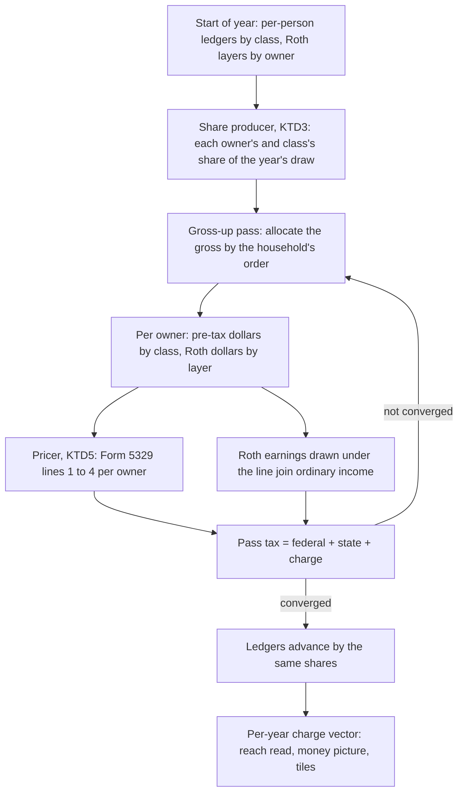

# The 10% Early-Withdrawal Charge - Plan

This plan turns the register entry *Money taken from retirement accounts before age 59½ is never charged the 10% early-withdrawal tax…* (`docs/backlog.md`; item 1(b) of the D7 queue in `TODO.md`) into buildable units. The entry holds the gap, D7's use-and-ask list, the prescription, the 2026-10-30 amendment and the negatives. Where this plan and a primary source disagree on the law, the source wins. Build status lives in the roadmap's You-Are-Here table, never here.

**This repo is public.** The household's real holdings, balances, birth dates and family facts are never written in this plan, its tests, its fixtures or its commits. Every example below is made up.

**Code is cited by file and symbol, without line numbers, on purpose.** Build 2 is moving the same files, and `verify:doc-stats` gates every line-numbered citation in `docs/`.

## Goal Capsule

- **Objective.** A household that will draw on a retirement account before 59½ gets a date, odds and a recommended strategy that already pay the 10% additional tax the IRS would charge on those draws, and that skip it only where the law does. No answer reads better than the household's real tax bill because the charge is missing.
- **Means.** Price the charge inside each year's gross-up from each owner's own share of each draw, read through the account classes the law names (KTD1, KTD3, KTD4).
- **Authority.** `docs/architecture.md` wins on an invariant. `docs/product.md` wins on the why and the what, D7 above all. The primary sources under Sources win on what the law says. The register entry wins on what was measured before this plan. This plan wins on order and mechanism inside those.
- **Stop conditions.** Stop a unit and report when a primary source reads differently from the rule this plan cites, when a byte-identity proof fails on a run with no charged dollar, when a measurement comes back against a decision that rests on it, when the council rules a lever this plan did not size, or when the re-derived convergence rate has no pass cap that holds.
- **Execution profile.** Slices committed to `main` in order, with no branch and no pull request. Phase 1 moves no answer. Phase 2 prices the pre-tax half and Phase 3 the Roth half; each ends with its own measurement. Phase 4 puts the words to Briggsy, then lands the asks, the surfaces and the close. Every unit runs the project's own flow: `/brief`, the unit's build, a whole-file review with an adversary and every finding verified, then `/distill`. While build 2 is open, every `src` commit also runs its sweep and per-key `idcheck` (`TODO.md`), and the units that touch intake, the codec, the saved shape, the money picture or the methodology row (U12 to U14) wait for its close.
- **Who finishes.** The Back Nine's sessions build it. The council rules the mixed-age split (U4). Briggsy rules every word the household reads (U5) and reads each changed surface cold.

## Product Contract

### Summary

The engine charges 10% on the part of each year's retirement-account draw that belongs to an owner under 59½, in every dollar the year's draw funds: the year's spending, its tax (a Roth conversion's included), the ACA and Medicare premiums, a short working year's shortfall and the charge's own draw. It frees the employer plan of a job left in or after the year its owner turns 55, a governmental 457(b)'s own money, and the Roth dollars the law lets out free. Roth earnings drawn early are taxed as income as well as charged. Facts the tool lacks it asks for, and until they are answered it charges in full.

### Problem Frame

Nothing in `src/` applies 26 U.S.C. §72(t). `allocateWithdrawal` (`src/engine/sequencing.ts`) takes balances and a policy and never an age, and the year's ordinary income has no Roth term. A household that stops work in its late 40s or 50s, or a retired spouse under 60, draws pre-tax and Roth money as if it were 60. Every missed dollar is tax the household really owes, so the gap reads rosy: the date reads early, and a strategy that leans on early pre-tax draws or on a conversion paid from them can be crowned.

The working-year methodology row's K1 (`copy.assumptionWorkingYearCheckEarlyCharge`) discloses the short-working-year half alone, and nothing discloses the retired years. D7 rules that the cure is the number, not a sentence (`docs/product.md`, D7).

### Key Decisions

- **Roth earnings drawn before the line are taxed as income, not only charged.** Form 5329 charges only what is includible in income, and Form 8606 puts those same earnings on the 1040; a charge without the income is a figure no form computes. Governs R8.
- **The qualified-distribution five-year clocks that reach owners past the line stay out of this build.** In scope, an unknown first-contribution year would move every older seed that holds a Roth; they are filed (U15). Governs R8, R12.
- **The medical-expense exception (§72(t)(2)(B)) is not built here.** Leaving it out reads gloomier, never rosier; U8 sizes it and U15 files it with that size. Governs R17.
- **A survivor who inherits a spouse's pre-tax money is charged on it before the line.** It follows from the engine's own rollover model (KTD7). Governs R1.

### Requirements

**The charge**

- R1. A draw of pre-tax money (401(k), 403(b), traditional IRA) by an owner under the line is charged 10% of the dollars drawn, in every channel that draws, unless R5 or R6 frees it.
- R2. An owner is under the line in every year that holds a day before their 59½ date (KTD2).
- R3. The charge is figured per owner, on that owner's share of each draw.
- R4. The charge is a tax: the portfolio pays it inside the year, and it never enters income, MAGI, provisional income or a state base.

**What the law frees**

- R5. Employer-plan money (401(k), 403(b), Roth 401(k)) is free when its plan belongs to the job its owner leaves in or after the calendar year they turn 55. IRA money never is.
- R6. A governmental 457(b)'s money is free, except money rolled into it from another plan or an IRA.
- R7. A Roth conversion is never charged; the draw that pays a conversion's tax is charged under R1.

**The Roth**

- R8. A Roth draw by an owner under the line is charged on the taxable part of each conversion still inside its five-year clock and on its earnings, and those earnings are also ordinary income. Contributions, and conversions past their clock, come out free.
- R9. Roth IRA draws follow the ordering rules per owner: contributions, then conversions oldest first, then earnings. Roth 401(k) draws split pro-rata between basis and earnings.

**Facts the tool lacks**

- R10. A fact the household has not given, or has answered "not sure", means the full charge: no exception, and a Roth basis of zero.
- R11. The household is asked only for facts the charge needs and the tool does not hold, and only when the engine says the answer could move.

**What must not move**

- R12. A run with no charged dollar (tax off, or no owner under the line in any year the portfolio draws) matches HEAD on every vector the decision reads.
- R13. Every figure the charge uses lives once, sourced, in the constants table: the rate, the 59½ line, the age-55 year and the five-year clock.

**What the household sees**

- R14. Where the charge moves a figure, the household can see it in its own numbers: the money picture's year, the conversion tile and the methodology row.
- R15. K1 is retired once the charge covers what it disclosed.
- R16. The split of a mixed-age couple's draw between the two owners is the council's call, or Briggsy's when the council finds it a new lever.
- R17. Every exception this build does not model makes the run gloomier, and each is named and filed with its negatives.

### Acceptance Examples

- AE1. Covers R1, R4. Sam, 50 and retired, draws $3,000 from a traditional IRA in a year whose income sits under the standard deduction. Income tax is $0 and the charge is $300 (Form 5329 lines 1, 3 and 4).
- AE2. Covers R5. An owner born in 1970 leaves the job whose 401(k) they draw. Left in 2024, the 401(k) draws stay charged until the line; left in 2025, they are free from then on. The same owner's traditional-IRA draws are charged either way.
- AE3. Covers R2. An owner born in 1966, in a plan starting in 2026: the 2026 draw is charged, since a birthday after June leaves days of 2026 before their 59½ date and the birth month is not held. The 2027 draw is not.
- AE4. Covers R8, R9. A Roth IRA owner of 53, with $4,000 of contributions and a $15,000 conversion made four years back, draws $10,000: $4,000 comes out free and $6,000 from the conversion, so the charge is $600 and the added income $0. The same draw a year later, its clock run, is free.
- AE5. Covers R3, R16. A couple of 63 and 52 draws $40,000 of pre-tax money from balances of three to one. Under the default split the younger owner's $10,000 is charged $1,000.
- AE6. Covers R10. "Not sure" on whether a 401(k) belongs to the job left at the stop age charges its draws as a "no" would.
- AE7. Covers R12. A couple both 61 or over, or any run with tax off, matches HEAD on every vector.
- AE8. Covers R5, R11. A worker of 58 defers into a 401(k), and the date search tests a stop at 59. The 401(k)'s draws are free from the first year after the stop, with no question asked; a short working year's draw from it before the stop is charged.

### Scope Boundaries

- **Not built here, filed with negatives (U15).** Substantially equal periodic payments (§72(t)(2)(A)(iv)), the public-safety age 50 (§72(t)(10)), disability, the medical exception and Form 5329's other exception codes; a nondeductible IRA basis; a survivor who keeps the account as a beneficiary (KTD7). Each omission reads gloomier.
- **Filed as rosy, not built.** The qualified-distribution clocks past the line (Key Decisions), and the bar on drawing a still-working owner's own 401(k) before 59½ (§401(k)(2)(B)), which the short working year's draw ignores.
- **Not touched.** Pennsylvania's 59½ gate stays as it is: its own entry's NEGATIVE keeps it out of this build, and U15 files what the research found against it. The birth-month ask stays with its own entry (KTD2 names the seam).
- **Not a new lever.** Choosing whose account to draw first is a solver lever under `docs/product.md` §5, not this fix, unless the council or Briggsy rules it in (U4).
- **457(b) as its own account kind,** with its own deferral limit beside 402(g), is filed; this build marks the account instead (KTD13).

### Outstanding Questions

- OQ1 (deferred; default set). The mixed-age split (U4). The default is pro-rata by draw-time balance, today's rule.
- OQ2 (blocks the copy of U12 to U14). The words (U5).
- OQ3 (deferred). Whether this build or the workbench plan's U3 and U12 land first is Briggsy's ranking. The plan works in either order (U15).

### Sources

- **Primary, read 2026-11-12.** 26 U.S.C. §72(t), §4974(c), §408A(d), §402A(d) and §401(k)(2)(B) at law.cornell.edu; Treas. Reg. §1.408-8(c), §1.408A-6, §1.408A-10 and §1.402A-1 at law.cornell.edu/cfr; the Instructions for Form 5329 (2025), Part I and its exception codes, at irs.gov/instructions/i5329; Form 5329 (2025) and Form 8606 (2026); Pub 590-A, Pub 590-B and Pub 575 (2025) at irs.gov/publications; the IRS page "Retirement topics: exceptions to tax on early distributions"; the PA DOR Personal Income Tax Guide, Gross Compensation, at pa.gov.
- **A contradiction among them.** Pub 590-B (2025)'s recapture text and its Ishmael example count conversions from 2015 on, while the statute and the Form 5329 instructions use five taxable years. The statute wins, and no fixture is pinned to that example.
- **Read only through a search summary.** *Watson v. Commissioner* (T.C. Summ. Op. 2011-113) and Notice 87-13 Q&A-20 on which plan the age-55 rule covers, and SECURE 2.0 §327's spousal election. Re-read each at its source before a unit leans on it.
- **The repo.** The register entry; insights 137 and 023 (the form is the oracle; walk every rule edge), 143 (count every channel), 142 (D7), 014 (a moving threshold's crossing year), 148 (measure on a frozen copy), 025, 141, 133 and 132 (the brief); and 006, 007, 018, 024, 029, 040, 062, 080, 081, 085, 088, 093, 095, 102, 135, 145, 146, 147, 150 and 151, cited where they bind. `docs/landmines.md` holds the pricing-witness and solver-version traps.

## Planning Contract

### What the research settled

- **The whole-year reading "under 60" is not the safe side** the PA gate's comment (`src/engine/stateTax.ts`) and the pay check's KTD20 call it. Ages count by calendar year (`ageInSimYear` in `src/engine/taxOverlay.ts`). An owner born from July to December reaches 59½ in the first half of the year they turn 60, so that year holds days before the line whenever in it the money is drawn; the engine itself draws first, before growth (`src/engine/decumulation.ts`). The register's *Ages are whole years from the birth year alone — the birth month isn't asked* already says the line runs either way and asks for a ruled crossing convention.
- **The age-55 test is a calendar year,** "in or after the year you reach age 55" (Form 5329 code 01; Pub 575). Birth year alone pins it exactly. It covers the plan of the job left and never an IRA (§72(t)(3)(A)).
- **Intake already knows the plan of the job each worker still holds.** It offers a deferral only to a working owner, and a match only on that owner's employer plan (`src/intake/AccountEntry.tsx`), and neither can go to an old job's plan. A working owner's 401(k), 403(b) or Roth 401(k) that carries either is the plan of the job left at the swept stop: a held fact, which D7 says to use.
- **The 10% falls on what is includible in income** (§72(t)(1)), so a pre-tax draw under the standard deduction still owes it. Form 5329 is filed per spouse.
- **The engine's survivor rollover is the treat-as-own election.** The survivor's RMD runs on the combined balance and their own age, and Treas. Reg. §1.408-8(c)(3) makes such a spouse the owner "for all purposes … (including section 72(t))".
- **The wire loses what the charge needs.** The pre-tax draw is split per owner only after convergence (`advancePerPersonLedger`), pro-rata by draw-time balance. The per-owner ledger and the contribution streams drop the account kind (`KIND_TO_BUCKET` in `src/intake/intakeMap.ts`), and the Roth bucket has no owner.
- **The year's tax is a residual of the gross-up.** It accrues to `lifetimeTaxPaidReal` and on into the pay-less-tax figure (`src/engine/solver/objectiveHeadline.ts`), so a charge priced inside the gross-up reaches the ranking with no new wire. `src/shared/model.ts` documents `lifetimeTaxPaidReal` as income tax.
- **The pricing witness sees exported pricers only** (`src/engine/__tests__/pricingWitness.test.ts`), so a change to how the gross-up composes moves no digest. `PricingReach` has one member, `'working-years'` (`src/engine/pricingVersion.ts`).
- **The change is scored.** The solver runs on seeds with an owner under 60: `health`, `healthnc` and `healthgap` (`src/ui/devSeeds.ts`).
- **The substring gate cannot see 0.10, 59.5 or 55.** `constants.shape.test.ts` says small figures collide and are pinned by assertion. A new `tax.*` entry left directional withholds the oracle token for every tax-on household (`src/engine/validation/oracleToken.ts`).
- **The pass cap may not hold.** The cap comment's own formula, with the charge's slope added, gave the research 231 to 361 passes against today's 192. U7 re-derives it; none of those numbers is a pin.
- **All eight solver oracle cases are 60/60, born 1966, starting 2026** (`SOLVER_CASES` in `src/engine/reference/solver-cases/`), so KTD2 reaches their first year.

### Key Technical Decisions

- KTD1. **The charge is priced inside the gross-up from each pass's own allocation, in both arms of `solveGrossWithdrawal`, the way the state addend rides.** It is post-draw arithmetic: never a new draw, a separate withdrawal or a figure added after convergence. In the clamped working-year arm it sits after the working year's federal and state charges, so a short year's draw is charged too. With no charged owner in the year, the arm runs its literal pre-charge expression, which keeps R12.
- KTD2. **The line is read per calendar year, through one helper: a year is charged when it holds any day before the owner's 59½ date.** With the birth year alone, that is every year through the one they turn 60, since a July-to-December birthday puts 59½ as late as June 30 of that year, and the year can owe the charge whatever the draw date. It is the side that never flatters, which the birth-month register entry offers as a ruled convention. When the birth-month ask lands (its own entry), the same helper frees the year they turn 60 for a January-to-June birthday, and nothing else changes. Chosen over the whole-year "under 60" reading, whose "conservative" premise fails for every July-to-December birthday. The cost is named: all eight solver oracle cases gain a charge in 2026, as does every seed whose owner turns 60 in a drawn year (U7).
- KTD3. **One producer computes, before the fixed point, each owner's and each class's share of the year's pre-tax draw and of a Roth conversion's source.** A conversion splits by convertible room (each owner's pre-tax less their own RMD, over the total), today's `advancePerPersonLedger` rule, never by the draw shares. `GrossUpContext` reads the shares, and `advancePerPersonLedger` and U9's layer write consume the same values after convergence (insight 081). The rule inside it is today's pro-rata by draw-time balance until the council rules (U4), and a ruling changes this one place. A caller with no per-person ledger fails closed: every dollar is charged when any living owner is under the line.
- KTD4. **The classes are an exhaustive `Record<AccountKind, EarlyChargeClass>`** (insight 147). `401k`, `403b` and `roth-401k` are employer plans, eligible for the age-55 rule when they are the plan of the job left at the stop. That is held for a working owner's account that carries a deferral or a match, and asked of every other (U12). `traditional-ira` and `roth-ira` never are. `brokerage` and `hsa` are never charged. The per-person employer-plan sub-ledger it needs is built once, for this build and for *A still-working employer-plan participant's RMD is forced…*. The employer match is pre-tax employer-plan money even when the employee's own deferral goes to a Roth 401(k) (`isEmployerPlanKind` in `src/intake/sanity.ts`), and its dollars land in the owner's stop-job class.
- KTD5. **The charge is an exported pure pricer in its own engine module beside `stateTax.ts`,** computed as Form 5329 lines 1 to 4 for each owner. Exported, it enters the pricing witness's `tax` grid with a "charge ignored" mutant arm that must move the digest.
- KTD6. **The charge rides into the year's tax residual and so into `lifetimeTaxPaidReal`.** It is a tax on the return (Schedule 2), so the pay-less-tax ranking must count it. The docblock in `src/shared/model.ts` is amended to name it. A per-year charge vector is exposed beside it for the reach read and the surfaces, and joins `decisionSurfaceIdentical` (`src/engine/validation/rankingStability.ts`) only if a decision reads it. Chosen over a separate tax field: that would add a vector to every guard, and the ranking would still have to sum it.
- KTD7. **A survivor under the line is charged on the inherited pre-tax money too.** The engine already models the treat-as-own election (What the research settled). Exempting it needs an inherited sub-ledger and beneficiary RMDs, which the workbench plan's inherited ledger would bring. The charge reads gloomy against a real survivor who keeps the account inherited until 59½, and U15 files that with its negatives. The survivor's own money is charged until their own line either way.
- KTD8. **The age-55 rule reads per account, against the separation year of that account's job.** For a retired member it is the entered stop age (free at 55 or more). For a worker on the date route it is the last working year of the swept stop: free when the attained age in that year is 55 or more, the side that never flatters. The rule frees only draws in years after that separation: a short working year's draw from the plan of the job still held stays charged, since §72(t)(2)(A)(v) needs the separation first, and the in-service bar on that draw is filed (U15). Each route gets fixtures at stop ages 54, 55 and 56 (insight 023).
- KTD9. **A new `PricingReach` member, read from the engine's own charge output, qualifies each ledger row,** walking every candidate and every single-death timeline as `workingYearTaxReach` does (`src/engine/dateSearch.ts`). It never reads an age proxy (insights 080, 088). It reads both routes, as the existing for-run reads do. `SOLVER_CODE_VERSION` bumps at each of the two pricing changes: U7, whose row and bump U16 lands in the same commit, and U10.
- KTD10. **The pass cap is re-derived, not guessed.** Re-derive the contraction rate k with the charge's slope in both gross-up arms, find the worst corner the household can actually reach, and set the cap by the cap comment's own method (insights 006, 007). U10 repeats it for the Roth income channel, and the ACA bisection's monotone premise is re-checked each time.
- KTD11. **Each owner's Roth is held as layers: contributions, one layer per conversion year, and earnings,** with Roth 401(k) money held apart and split pro-rata. The engine's own conversions write their layers exactly, split between owners by KTD3. Every layer amount is nominal, typed or engine-written, so each is deflated yearly by the one price index (`src/engine/priceIndex.ts`; insight 135); the open council on the one inflation path is named in U9 and not waited on.
- KTD12. **One schema step carries every saved field this build adds, and lands with the asks (U12).** Its number is the next one when it lands. If the workbench plan's version 6 (its KTD16) has not landed, this build takes it and U15 amends the workbench plan. Absent fields read as "not sure" (R10), and `FLOOR` rises in its own follow-up commit (insight 151).
- KTD13. **A governmental 457(b) is a mark on a 401(k) or 403(b) entry, with one follow-up: did any of it come from another plan or an IRA?** A "no" frees the account; "yes" or "not sure" charges all of it. Chosen over a new account kind, which would need the Record sweep and its own deferral limit, and is filed.
- KTD14. **Reach is counted before the build and effects are measured after each half.** The count runs on the tree after U2, whose identity to HEAD U2 proves (insight 148); it counts every channel on every seed (insight 143). The date, grade and crown are compared after U7 and after U10 against a frozen `git archive` of the HEAD before each, through `selectRecommendation` (`src/engine/solver/select.ts`; insight 095).
- KTD15. **The age-55 year and the line are birth-year clocks that the swept stop crosses.** Each frees more money at a later stop, so alone it makes a one-way step, never a dip (insight 062), and a cost that falls with a later stop cannot make a dip but can erase one. Only KTD8's charged short-year draw grows with the stop. The likelier hit is a lost dip: `dip`'s pinned non-monotone offsets (`src/ui/__tests__/devSeeds.test.ts`) can move inside U7's or U10's own commit. Record them at their old inputs first; a lost dip is re-tuned by its seed's docblock law, re-derived and never re-pinned. U8 and U11 explain every change in a date seed's non-monotone offsets.

### High-Level Technical Design

### Assumptions

Bets this plan made where the entry and the research left room. Each is the pilot's and can be overturned without redoing the engine work under it.

- The default split is pro-rata by draw-time balance until the council rules (U4).
- The year an owner turns 60 is charged until the birth month is asked (KTD2).
- A survivor is charged on inherited money (KTD7).
- The medical exception is filed with its measured size, not built (U8, U15).
- The amendment's witness household is a retired spouse under 60 holding a traditional IRA beside a worker whose year runs short. A worker drawing their own 401(k) hits the in-service bar instead, which is filed (U15). U3 derives the witness's mechanism and intake path before minting it (insights 025, 085).
- A governmental 457(b) with any rolled-in money is charged whole (KTD13).
- Roth earnings count as income only while the owner is under the line (Key Decisions).
- No real plan has been saved yet, so the schema step owes no legacy migration; U12 checks before it lands.

### Sequencing

1. **Phase 1, the rules, the wire and the reach (U1 to U4).** Nothing moves. The council (U4) needs U3's counts.
2. **Phase 2, the pre-tax charge (U6, U7 with U16 in one commit, then U8).** U7 waits for U4's ruling, or for its default when the council hands the split to Briggsy.
3. **Phase 3, the Roth charge (U9 to U11).** It rides on U2's producer and U7's wiring.
4. **Phase 4, the words, the asks, the surfaces and the close (U5, then U12 to U15).** The words (U5) open it, drafted from the charge as built and measured. U12 to U14 wait for build 2's close and for Briggsy's ruling on the words. U15 runs last.

### Risks

- **Convergence.** The charge adds up to 0.10 to the gross-up's contraction rate, and the Roth income channel adds more. A corner may need a much higher cap or may only throw (insight 007). U7 and U10 probe at small net in both arms before any seed is measured.
- **Big moves under the full charge.** With no answers given, `healthgap`'s whole Roth draw becomes earnings: income plus 10%, and higher ACA MAGI near its cliff. Each seed's move is recorded at its old inputs before any answer is set on it (insight 135), and a seed edited to carry an answer gets an engine-acceptance pin (insight 085).
- **The oracle cases move.** KTD2 charges their first year. Each case it reaches is re-derived by hand (DND-012), never re-pinned to the engine's output.
- **Two plans claim the same files.** The workbench plan's U3 flags draws "which the run charges no early-withdrawal penalty", its KTD6 fixes the table's grain, its KTD16 claims version 6, and its U12 adds an inherited-IRA ledger. Whichever lands second amends the other (U15).
- **The Roth half is the larger build.** It may need its own run of sessions; Phase 2 stands alone if Phase 3 stops.
- **Pennsylvania's 401(k) gate** keys to each plan's own retirement terms in the PA guide, not to 59½. Not verified here; U15 files it.

## Implementation Units

### Unit Index

| U-ID | Title | Files touched | Depends on |
|---|---|---|---|
| U1 | The sourced rule table | `src/engine/constants/tax.ts`, its shape test | none |
| U2 | Owner and class on the wire, one share producer | `src/intake/intakeMap.ts`, `src/shared/model.ts`, `src/engine/simulate.ts`, `src/engine/taxOverlay.ts` | U1 |
| U3 | The reach count | `src/engine/taxOverlay.ts` (observation), a tool outside `src/`, `docs/backlog.md` | U2 |
| U4 | The council: who draws first | `docs/decisions/`, `docs/backlog.md` | U3 |
| U5 | The words, put to Briggsy | `docs/backlog.md` | U4, U8, U11 |
| U6 | The pricer | a new module beside `src/engine/stateTax.ts`, the pricing witness | U1 |
| U7 | The charge in the gross-up | `src/engine/taxOverlay.ts`, `src/engine/healthOverlay.ts`, `src/shared/model.ts`, the oracle cases | U2, U4, U6 |
| U16 | The ledger row, the reach read and the seed records | `src/engine/pricingVersion.ts`, `src/store/staleness.ts`, `src/engine/dateSearch.ts`, `src/ui/stalenessExposure.ts`, `src/engine/solver/solverCodeVersion.ts` | U7, in its commit |
| U8 | Measure the pre-tax half | a tool outside `src/`, `docs/backlog.md` | U7, U16 |
| U9 | Each owner's Roth, in layers | `src/intake/intakeMap.ts`, `src/engine/taxOverlay.ts`, `src/engine/roth.ts` | U2 |
| U10 | The Roth charge and its income | `src/engine/taxOverlay.ts`, `src/engine/stateTax.ts`, `src/engine/healthOverlay.ts`, the ledger and solver version | U7, U9, U16 |
| U11 | Measure the Roth half | a tool outside `src/`, `docs/backlog.md` | U10 |
| U12 | The asks and the schema step | `src/shared/model.ts`, `src/shared/scenarioCodec.ts`, `src/intake/AccountEntry.tsx`, `src/ui/copy.ts` | U5, U7, U10, U16 |
| U13 | The surfaces show the charge | `src/engine/workingYearLedger.ts`, `src/ui/healthSheetChrome.ts`, `src/ui/assumptionRegistry.ts` | U5, U7, U10 |
| U14 | Retire K1 | `src/ui/copy.ts`, `src/ui/assumptionRegistry.ts`, their tests, `docs/glossary.md` | U13 |
| U15 | The register and the plans | `docs/backlog.md`, `docs/plans/5-workbench-plan.md`, `docs/architecture.md` | U8, U11, U14 |

### Phase 1: the rules, the wire and the reach

#### U1. The sourced rule table

- **Goal.** The charge's figures exist once, sourced and pinned, before any engine reads them.
- **Requirements.** R13.
- **Dependencies.** None.
- **Files.** `src/engine/constants/tax.ts`, `src/engine/constants/__tests__/constants.shape.test.ts`.
- **Approach.** Four `sourced` entries in `taxConstants`: the rate (§72(t)(1); Form 5329 line 4); the federal 59½ line (§72(t)(2)(A)(i); Form 5329 code 12); the separation age of 55, read by calendar year (§72(t)(2)(A)(v) and (t)(3)(A); Form 5329 code 01; Pub 575); and the conversion clock of five taxable years from January 1 of the conversion's year (§408A(d)(3)(F); Treas. Reg. §1.408A-6 A-5). The federal line is its own entry and never PA's `paQualifiedAge`: a shared value is fine, a shared citation is not. Each entry is pinned, never directional, and read only through the table; `inOutRule`'s note gains the charge. Re-read each source at the primary before pinning (insight 137).
- **Test scenarios.** Each value is pinned by assertion, since the substring gate cannot see it. Each citation names its statute subsection or form line.
- **Verification.** No seed moves, and a tax-on household's oracle token stays clean.

#### U2. Owner and class on the wire, one share producer

- **Goal.** Before each year's gross-up the engine knows which owner and which class of account each dollar of the draw comes from, and no answer moves.
- **Requirements.** R3, R12; prepares R1, R5 and R6.
- **Dependencies.** U1.
- **Files.** `src/intake/intakeMap.ts` (the class Record, beside `KIND_TO_BUCKET`, where the kind maps live); `src/shared/model.ts` (the class vocabulary as a const tuple, typing the per-person pre-tax ledger's split and the pre-tax and match streams of `PersonContributionStreams`, with the `ACCOUNT_KINDS` docblock naming the map); `src/engine/simulate.ts`, which merges the pre-tax and match streams into one slot today; `src/engine/taxOverlay.ts` (`advancePerPersonLedger`, `GrossUpContext`, the death merge); `src/engine/__tests__/taxOverlay.test.ts`.
- **Approach.** KTD4's Record maps each kind to its class. The per-person pre-tax ledger carries a sub-balance per class: the employer plan of the job left at the stop, a governmental 457(b)'s own money, and all other pre-tax. `intakeMap.ts` fills them from each account's kind and what intake already holds: a working owner's employer-plan account that carries a deferral or a match fills the stop-job class from this unit on, its match dollars included (KTD4). Until U12's ask, every other employer-plan dollar lands in "all other pre-tax", the charged class. KTD3's producer computes the shares, `GrossUpContext` carries them, and `advancePerPersonLedger` consumes the same values. The death merge carries each class across to the survivor.
- **Test scenarios.**
  - Byte-identity on every seed and oracle case against a `git archive` of the HEAD before the commit, every field of every result (insights 148, 093).
  - A mutant planted at the producer and one at the consumer each go red.
  - A death year carries every class to the survivor, and the shares of each year sum to the whole draw.
  - The Record's employer-plan members are pinned to `isEmployerPlanKind`, and each owner's classes sum to that owner's pre-tax balance in every year.
- **Verification.** Build 2's sweep and per-key `idcheck` while it is open.

#### U3. The reach count

- **Goal.** Before any charge exists, a count shows which seeds, offsets and tiers draw money under the line, through which channel and how much.
- **Requirements.** The entry's Prescription (1), first half; feeds U4 and U8.
- **Dependencies.** U2.
- **Files.** An opt-in observation in `src/engine/taxOverlay.ts` beside `WorkingYearProbe`; the count tool outside `src/` (`docs/landmines.md`, Probes); `docs/backlog.md`.
- **Approach.** The observation, a new optional callback beside `WorkingYearProbe`, fires in every drawn year of both passes. It records, per owner and per class, the dollars drawn while under the line, split by every term the year's gross funds:
  - the spending, with the HSA's share netted against spending and Medicare together, never against Medicare alone;
  - Medicare's cost and its extras;
  - the ACA net premium in every priced pre-65 year;
  - a short working year's shortfall (`workingYearCashLines`);
  - the tax, as one residual: federal, a priced state, the clamped arm's working-year charge, and a conversion's tax inside it (`src/engine/roth.ts`);
  - the charge's own draw, listed as not yet drawn, since it cannot exist before U7.

  It also records each owner's RMD, so U4's covered span is counted, and an RMD's forced excess as a channel outside the gross, predicted empty under the line. Each owner's channels must sum to U2's per-owner pre-tax draw, so a missed term shows as a residual. Each observation is keyed to its pass, full or floor, and the two are never summed, since the date route crowns the floor track. Roth dollars have no owner until U9, so a year's Roth draw is reported against the under-line owners who hold a Roth account, labeled an upper bound. The year each owner turns 60 is reported on its own line (KTD2).

  Write each seed's prediction before the run (insight 135). On the date seeds, a working owner's 401(k) that carries a deferral counts as charged in working years only: every stop swept there is at 57 or later, so its last working year is at 55 or more and its draws after the stop are free (KTD8). Run on every date seed at every offset and both tiers, on `health`, `healthnc` and `healthgap`, and on three made-up witness households, each minted only after its mechanism and intake path are derived (insights 025, 085):
  - the short-year witness (Assumptions);
  - a mixed-age witness, `healthgap` with its younger owner given a traditional IRA, so both spouses hold pre-tax money and one reaches RMD age while the other is under the line; its gap of more than 10 years crosses the joint-table edge in `selectRmdDivisor` (`src/engine/rmd.ts`; insight 023), which the count names;
  - a crossing witness, a worker of 50 to 54 with a deferring 401(k) and no short year, whose sweep crosses the age-55 year, predicted to step one way at 55 (insight 062).

  No shipped seed holds pre-tax money on both owners, so `healthgap` itself stays the Roth side's upper bound. 10% of the counted pre-tax dollars is a per-year floor on the charge at today's split, never a bound and never an effect: the draw that pays the charge is itself taxed, charged when the order draws pre-tax, and lifts ACA MAGI, IRMAA two years on, provisional income and a priced state's base. Tag each counted year with the readers it reaches; U8 measures the real size. 10% of the Roth upper bound is neither a floor nor a bound. Report on the entry, with the population each figure covers (insight 141).
- **Test scenarios.** The observation changes no value: byte-identity as U2.
- **Verification.** The report names every channel on every seed, including the ones predicted empty.

#### U4. The council: who draws first

- **Goal.** A ruled split for a mixed-age couple's draw, or a framed fork for Briggsy.
- **Requirements.** R16.
- **Dependencies.** U3.
- **Files.** A decision record in `docs/decisions/` with its row in `docs/decisions/README.md`; `docs/backlog.md`.
- **Approach.** Put the entry's question to `/council` with U3's counts: how the year's draw and a conversion's source split between a couple's owners, and between one owner's classes, while someone is under the line. Hand it four facts. Any other split for a couple both past the line moves per-person RMDs, so a new rule can apply only while someone is under it (R12). The sharpest case is a spouse whose forced RMD alone covers the year beside a spouse under the line whose pro-rata share is still charged; its span on U3's mixed-age witness is measured, not guessed, and `healthgap`'s Roth count goes beside it as an upper bound. The Roth has no owner until U9. The PA entry's NEGATIVE calls a draw-order choice a new solver lever under `docs/product.md` §5. Read the usage meter first: a council costs about 1.1M helper tokens. A confident verdict lands in KTD3's producer before U7. A verdict that the split is a new lever goes to Briggsy as a framed recommendation, and U7 proceeds on the default.
- **Verification.** The record names the rule, the alternatives it rejected and its reach on U3's counts.

### Phase 2: the pre-tax charge

#### U6. The pricer

- **Goal.** One pure function prices a year's charge from each owner's draws, with the form as its oracle.
- **Requirements.** R1, R3, R4, R5, R6, R7, R13.
- **Dependencies.** U1.
- **Files.** A new module beside `src/engine/stateTax.ts` and its tests; `src/engine/__tests__/pricingWitness.test.ts`.
- **Approach.** KTD5. Inputs: per owner, the year's dollars by class, whether the owner is under the line (KTD2's helper), and which classes the law frees for that owner (KTD8, KTD13). Output: per owner, Form 5329's line 1, the freed part (line 2), line 3 and line 4. The conversion is never an input (R7). Classes are matched by an exhaustive switch with a `never` guard.
- **Test scenarios.** DND-012, each pinned to a form line or a statute subsection and walked across its rule edge (insight 023):
  - Pub 590-B's own example, $3,000 drawn at 35 with no exception, charged $300; and AE1's draw at 50 under the standard deduction.
  - KTD8's separation year, one helper beside KTD2's: birth year plus the entered stop age for a retired owner; birth year plus `retirementAge` minus 1, the last working year, on the date route. The route is carried per person from `buildCandidateParams`, never inferred, and a person with no carried route takes the date formula, the gloomier one (as KTD3 fails closed). Pinned to Form 5329 code 01 at stop ages 54, 55 and 56: retired charged, free, free; date route charged, charged, free; a worker of 55 at offset 0 charged; the same owner's IRA charged in all six (AE2).
  - AE3's crossing: the years the owner turns 59, 60 and 61.
  - A governmental 457(b) drawn at 50, $0, against one with rolled-in money, charged whole.
  - A $1 draw and a $1,000,000 draw, each snapped to the grain on the gloomy side (insight 146).
- **Verification.** The witness's `tax` grid gains the pricer, and its "charge ignored" mutant arm moves the digest. No seed moves, since nothing calls it yet.

#### U7. The charge in the gross-up

- **Goal.** Every answer pays the pre-tax charge.
- **Requirements.** R1 to R7, R12.
- **Dependencies.** U2, U4 (or its default), U6.
- **Files.** `src/engine/taxOverlay.ts` (`solveGrossWithdrawal`, `GrossUpContext`, the pass cap and its comment), `src/engine/healthOverlay.ts` (`solveAcaFundedGross`), `src/shared/model.ts` (the docblock and the per-year charge vector), `src/engine/reference/solver-cases/` (`caseStateCompanions.ts`'s rule-boundary text among them), the tests.
- **Approach.** Work in this order. First probe k and the cap in both arms against U6's pricer (KTD10), and work each charged oracle case's value by hand from Form 5329, keeping both out of the tree until the pricing commit; AE5 waits for U4, and the witness fixtures for U3. Then call U6's pricer from each pass's own allocation in both arms (KTD1), with U2's shares. The charge stays out of the returned income components, MAGI, the provisional-income seam and `StateTaxYearContext`. Set the cap from the derivation. Expose the per-year charge vector and amend the docblock (KTD6). Re-word `caseStatePa`'s rule-boundary text, which reads both spouses at 60 as past the 59½ gate. U16's ledger row, reach read, solver bump and seed records land in this same commit (`docs/landmines.md`).
- **Test scenarios.**
  - AE5's split, and AE7's couple past the line and tax-off run, byte-identical on every vector beside a presence witness whose charge moves its own output (insight 029).
  - The witness household's short year, charged through the shortfall channel.
  - AE8: a deferring worker's 401(k), free in every year after a stop at 56 or later (a last working year at 55 or more), charged after a stop at 55, and charged in a short working year before the stop.
  - KTD8's six separation fixtures, run end to end: a deferring worker of 54 at offsets 0, 1 and 2, and a retired owner with the stop-job class set on the params (the ask itself is U12's).
  - A conversion year whose tax is drawn from an under-line owner's pre-tax money: the draw is charged, the conversion is not.
  - A death at 66 or later that leaves a survivor under the line, charged on the inherited money (KTD7).
  - A direct call with no per-person ledger fails closed (KTD3).
  - R4's seams, by hand, with the year's health sink on: AE5's couple with the older owner's benefit claimed, under NC. ACA MAGI holds the converged pre-tax draw, its charge-paying dollars included, plus the full benefit; IRMAA MAGI holds the draw plus the taxable benefit; taxable Social Security reads a provisional income without the charge; NC taxes the draw less its deduction. Repeated in the clamped arm, an ACA year and PA under 60, with the charge above zero (insight 029); a mutant folding the charge into any base goes red.
  - The convergence sweep in `taxOverlay.test.ts` gains an under-line owner holding the marginal pre-tax dollar, at small net, in both arms, and the cap's worst corner converges.
- **Verification.** Byte-identity against the `git archive` BEFORE on every run with no charged dollar; a mutation pass on the new arithmetic; `healthnc` re-timed in a browser, since the under-line years now take more passes.

#### U16. The ledger row, the reach read and the seed records

- **Goal.** A saved plan the charge reaches is told its taxes moved, one it does not reach hears nothing, and every seed's move is on record.
- **Requirements.** R12.
- **Dependencies.** U7; it lands in U7's commit.
- **Files.** `src/engine/pricingVersion.ts`, `src/store/staleness.ts`, `src/engine/dateSearch.ts` (a reach walk over both routes, beside `workingYearTaxForRun`), `src/intake/intakeMap.ts` (its for-run read), `src/ui/stalenessExposure.ts`, `src/engine/solver/solverCodeVersion.ts`, the docblocks in `src/ui/devSeeds.ts`, the tests.
- **Approach.** Append the `ENGINE_PRICING_LEDGER` row with the new `PricingReach` member and its read (KTD9), and bump `SOLVER_CODE_VERSION`. Record each seed's move at its old inputs in its docblock (insight 135), and `dip`'s pinned non-monotone offsets before any re-tune (KTD15).
- **Test scenarios.**
  - A plan with every owner past the line, or with tax off, hears no line, and its result is byte-identical.
  - A `healthgap` plan is named.
  - A draft the engine cannot build reads unknown.
  - Each seed the read calls unpriced is byte-identical, and each it calls priced moves.
- **Verification.** As U7.

#### U8. Measure the pre-tax half

- **Goal.** The entry's question answered for the pre-tax half: whether the date, the grade or the crown moves, and by how much.
- **Requirements.** The entry's Prescription (1), second half; R17.
- **Dependencies.** U7, U16.
- **Files.** The count tool outside `src/`; `docs/backlog.md`.
- **Approach.** KTD14, on every date seed at every offset and both tiers, on `health`, `healthnc`, `healthgap` and U3's three witness households; the default split is measured on the mixed-age one, and the charge's own draw is broken out of the tax residual. Write predictions first, and compute both arms of every `min` and `max` on the path, the RMD floor on the pre-tax distribution among them. Two predictions to test: on the date seeds, a date moves only through working-year draws, IRA money and the other classes, since a deferring worker's 401(k) is free after every stop swept there (KTD8); on the spine, the pre-tax half reaches only `healthgap`'s survivor years, since `health`'s pre-tax money belongs to its owner past the line, so a spine crown move here is KTD7's and is reported as such. Size the medical exception on the same runs: each year's priced net ACA premium, Medicare premiums and out-of-pocket cost above 7.5% of AGI, less what the HSA paid, against that year's charged dollars.
- **Verification.** U3's predicted counts against the measured ones, each miss explained.

### Phase 3: the Roth charge

#### U9. Each owner's Roth, in layers

- **Goal.** The engine knows whose Roth each dollar is and which layer it comes from, and no answer moves.
- **Requirements.** R9, R12; prepares R8.
- **Dependencies.** U2.
- **Files.** `src/intake/intakeMap.ts`, `src/engine/taxOverlay.ts` (the Roth bucket, `rothByPerson`, the conversion path), `src/engine/roth.ts`, the tests.
- **Approach.** KTD11. Opening layers come from intake by account owner; with no answers yet, every opening dollar is earnings (R10). Each conversion writes a layer for each converting owner by KTD3's conversion split, so each owner's pre-tax debit equals their layer credit, and the layer is held nominal (KTD11). In-run Roth deposits carry their kind from `contributionsForYear` (`src/engine/simulate.ts`) into their owner's basis layer; `rothByPerson` merges the kinds in `intakeMap.ts` today and must carry them. A Roth draw splits between owners by draw-time Roth balance until U4 rules, then by the ordering rules within each owner, settled at year end (Treas. Reg. §1.408A-6 A-8(a), A-9). Growth goes to earnings. A death merges the decedent's layers into the survivor's by kind, each conversion keeping its own year's clock (treat-as-own, KTD7). Re-read A-5(c), A-8, A-9, A-11 and §1.408A-2 A-4 beside A-3 and A-7(a) before building it.
- **Test scenarios.**
  - Byte-identity as U2.
  - The layers sum to the Roth bucket, to the dollar, in every year of every seed.
  - Which layer pays, on Treas. Reg. §1.408A-6 A-10 Example 6 with no basis: $20,000 converted in year y and $15,000 in y + 1, then $30,000 drawn in y + 5, takes $20,000 from y's layer and $10,000 from y + 1's. Example 4 is re-derived with no basis.
  - One owner's draws cross each ordering edge (contributions, then conversions oldest first, then earnings), and the other owner's layers stay untouched.
  - A year that converts, contributes and draws sorts at year end, its contribution counted first.
  - A couple where one owner's RMD makes convertible room differ from draw-time balance: each owner's pre-tax debit equals their layer credit.
  - A death merges layers by kind, each conversion keeping its year, and one death falls in the year a merged conversion's clock ends.
  - A mutant at the producer and one at the consumer each go red.

#### U10. The Roth charge and its income

- **Goal.** Every answer prices an under-line owner's Roth draw as the forms do.
- **Requirements.** R8, R9, R10, R12.
- **Dependencies.** U7, U9.
- **Files.** As U7 and U16, plus `src/engine/stateTax.ts` (`StateTaxYearContext` and `includeByTreatment`), the MAGI and provisional-income seams and `WorkingYearStateChannels` in `src/engine/taxOverlay.ts`.
- **Approach.** For an owner under the line, the pricer's line 1 gains the taxable part of each conversion layer still inside its clock, and the earnings drawn. The earnings also join ordinary income (Form 8606 line 25c), so every income reader takes them: federal ordinary income, provisional income, ACA MAGI, IRMAA MAGI and the state bases. The state bases take them through a new `StateTaxYearContext` channel with a sourced treatment per profile, in both gross-up arms (`WorkingYearStateChannels` for the clamped arm): NC taxes them, FL stays at zero, and PA taxes a premature Roth draw above its contributions (cost recovery), read at the PA guide before pinning, as a new choice in `includeByTreatment`'s exhaustive switch. A Roth 401(k)'s earnings share is pro-rata (Treas. Reg. §1.402A-1 A-3); the age-55 rule frees its 10% and never its income. Past the line nothing changes (Key Decisions). Re-derive k for this channel (KTD10). The second ledger row and bump land in the same commit.
- **Test scenarios.**
  - AE4, and a conversion drawn in its year + 4 against + 5.
  - The Form 5329 instructions' Roth example, re-derived by hand with no conversion basis, since the engine's conversions carry none.
  - Treas. Reg. §1.408A-6 A-10 Example 2: $2,000 of contributions and $3,000 of a conversion inside its clock, charged $300.
  - Treas. Reg. §1.402A-1 A-7's Roth 401(k): $12,000 drawn from $21,850 of basis and $1,150 of income gives $600 of income and a $60 charge.
  - An owner past the line drawing a Roth: identical to HEAD.
  - An unknown basis: the whole draw is earnings (R10).
  - Example 6's draw (U9) charged $1,000, its y + 1 layer still inside the clock; a survivor under the line charged on the merged layers (KTD7).
  - The readers, by hand from each source, for a no-basis owner under the line. On a Roth-only draw pool with no Social Security and no realized gain, ordinary income and ACA MAGI each rise by exactly the earnings drawn. Beside a spouse's benefit in the torpedo band, taxable Social Security rises once. A 64-and-58 couple's IRMAA MAGI, billed two years on, carries the earnings. The returned components carry the earnings and never the charge.
  - NC's base gains exactly the earnings in both arms, PA follows its pinned treatment, and FL stays byte-identical.
  - The convergence sweep gains pools whose marginal dollar is a zero-basis under-line owner's Roth, alone and pro-rata beside a low-basis taxable pool, with NC on, a large benefit and a small net, in both arms; a pass that crosses from contributions into earnings; and an ACA-priced year whose earnings cross 400% of the poverty line, where `solveAcaFundedGross` still converges and its MAGI-rises-with-gross premise holds. None reaches the re-derived cap.
- **Verification.** As U7 and U16. `healthgap`'s and the `health` family's ACA readouts are recorded at their old inputs before any answer is set.

#### U11. Measure the Roth half

- **Goal.** The entry's question answered for the Roth half.
- **Requirements.** The entry's Prescription (1); R17.
- **Dependencies.** U10.
- **Files.** The count tool outside `src/`; `docs/backlog.md`.
- **Approach.** As U8, on every seed with a Roth owner under the line, once at the full charge and once with a basis set. The charge reaches both arms of every conversion comparison and now rewards a conversion drawn after its clock, so the crown's direction is measured, never predicted (insight 133).
- **Verification.** As U8.

### Phase 4: the words, the asks, the surfaces and the close

#### U5. The words, put to Briggsy

- **Goal.** Briggsy has ruled every word the household will read about the charge before any of it lands.
- **Requirements.** R14, R15.
- **Dependencies.** U4, U8 and U11.
- **Files.** `docs/backlog.md` records his rulings; the drafts live in the session folder.
- **Approach.** Draft from the charge as built and measured, in a seed's own numbers: U7's per-year charge vector (KTD6), U8's and U11's tables, U3's reach and the asks R11 lets through, never a figure predicted before the build. One recommendation and its alternatives for each of these:
  - the charge's name on screen (`src/ui/copyGuard.ts` bans "penalty" only in the survivor copy; the IRS says "additional tax");
  - each ask and its "not sure" (U12's list);
  - the methodology line that replaces K1 and names the exceptions the tool leaves out, without saying the charge cannot be avoided;
  - the money picture's line for a year's charge, and the conversion tile's.

  Bring them as one batch.
- **Verification.** His ruling, in his words, on the entry before U12.

#### U12. The asks and the schema step

- **Goal.** A household can give the facts that free its money, and an unanswered one keeps the full charge.
- **Requirements.** R5, R6, R9, R10, R11.
- **Dependencies.** U5, U7, U10, U16, and build 2's close.
- **Files.** `src/shared/model.ts` (`CURRENT_SCHEMA_VERSION` and the new fields), `src/shared/scenarioCodec.ts`, `src/intake/AccountEntry.tsx`, `src/intake/intakeMap.ts`, `src/ui/copy.ts`, the codec's tests, `docs/architecture.md` §7.3.
- **Approach.** The asks, in Briggsy's words from U5:
  - per 401(k), 403(b) or Roth 401(k) not already known as the plan of a job still held (KTD4): is this the plan of the job its owner leaves, or left, at the stop age entered (yes, no or not sure);
  - per 401(k) or 403(b): the governmental 457(b) mark and its rollover follow-up (KTD13);
  - per Roth owner: contributions to their Roth IRAs to date, and conversions made in each of the last five tax years;
  - per Roth 401(k): its own contributions.

  Each is optional, nominal where it is money, and read as "not sure" when absent. A question shows only when the engine's reach read says its account or owner draws under the line in some run (insight 132). One schema step carries them all (KTD12), with old-copy fixtures sized to the no-real-save state. `basis` is never reused for a Roth basis: the codec does not limit it by kind, and it means a brokerage's cost. Confirm no real plan has been saved before landing.
- **Test scenarios.** Each answer moves its account's charge as R5, R6 and R9 say; "not sure" and absent give the same answer (AE6); each field round-trips the codec; an older copy is handled as §7.3 says.
- **Verification.** A Caddie walk of the asks and Briggsy's cold read.

#### U13. The surfaces show the charge

- **Goal.** Where the charge moves a figure, the household sees it in its own numbers.
- **Requirements.** R14.
- **Dependencies.** U5, U7, U10, and build 2's close.
- **Files.** `src/engine/workingYearLedger.ts` and the money picture's renderer, `src/ui/healthSheetChrome.ts`, `src/ui/assumptionRegistry.ts`, `src/ui/copy.ts`.
- **Approach.** The money picture composes no gross-up tax, so a short year's charge needs its own line there. The conversion tile's cents per converted dollar include the charge on the draw that paid the conversion's tax. The methodology row gains Briggsy's line from U5. Each reads the engine's per-year charge vector, never a re-derived age (insight 132).
- **Verification.** `pnpm verify:fit` at 1536×791, 1280×800 and a phone; a Caddie walk; Briggsy's cold read.

#### U14. Retire K1

- **Goal.** The stopgap disclosure is gone, and nothing still points at it.
- **Requirements.** R15.
- **Dependencies.** U13.
- **Files.** `src/ui/copy.ts` (the key and its "K1–K5" comment), `src/ui/assumptionRegistry.ts` (the key and its order comment), `src/ui/__tests__/workingYearTaxDisclosure.test.ts`, `src/intake/__tests__/assumptionPanel.test.tsx`, `docs/glossary.md`, `docs/backlog.md`.
- **Approach.** Delete the key and re-point every renderer, order pin and comment that names or counts it (insights 018, 086, 087). Grep the key words apart ("59½", "early-withdrawal", "10%", "penalty", "K1"), never one exact phrase. The pay check's build spec names K1 in a dated record and stays.
- **Verification.** No hit is left but dated records, and the order pins pass at the new count.

#### U15. The register and the plans

- **Goal.** Every residual is filed, every claim the charge falsified is corrected, and the sibling plan agrees with what shipped.
- **Requirements.** R17.
- **Dependencies.** U8, U11, U14.
- **Files.** `docs/backlog.md`, `docs/plans/5-workbench-plan.md`, `docs/architecture.md`, `docs/glossary.md`, `docs/landmines.md`, `src/engine/stateTax.ts` (one comment).
- **Approach.**
  - Close the entry with U3's, U8's and U11's numbers.
  - File each with its negatives and direction: the in-service bar on a working owner's own 401(k) (rosy); the medical exception with U8's size; periodic payments, public safety at 50, disability and the other codes; a nondeductible IRA basis; the survivor kept as a beneficiary; the qualified-distribution clocks past the line (rosy); the 457(b) kind.
  - File PA's three findings: the note in `src/engine/constants/stateTax.ts` that PA has no federal-style early-withdrawal exceptions is wrong for IRAs, where death and disability are exempt; PA's whole-year gate is rosy for a July-to-December birthday, whose year turning 60 holds days before 59½; PA's 401(k) gate keys to each plan's own terms (unverified).
  - Correct the PA gate's "one year conservative" comment in `src/engine/stateTax.ts`; the gate itself is unchanged.
  - Amend the birth-month entry: the federal line's helper reads it (KTD2).
  - Amend the workbench plan, citing each foreign unit with its home: its U3 flag reads the engine's charge on the wire instead of an age; its KTD6 grain names the class sub-ledgers; its KTD16 takes the next version if this build took 6; its KTD20 counts the class Record as one more home; its U12's inherited IRA is a class this build frees (§72(t)(2)(A)(ii)). Until that unit lands, an inherited IRA entered as a traditional IRA is charged, and that is filed as gloomy.
  - `docs/architecture.md` gains the charge in the gross-up, the class sub-ledgers, the Roth layers and the schema step.
- **Verification.** `pnpm verify:doc-stats` passes with the register's new count.

## Verification Contract

Run from `projects/the-back-nine`:

- `pnpm typecheck`, `pnpm lint` and `pnpm test` pass on every unit's commit.
- `pnpm verify:doc-stats` passes after every docs change, this plan included.
- U2, U3 and U9 prove byte-identity on every seed and oracle case. U6, U7 and U10 prove it on every run with no charged dollar. Each BEFORE is a `git archive` of the HEAD before the commit, and every field of every result is compared, both date tiers' crowns included (insights 148, 093).
- Every new piece of arithmetic gets a DND-012 fixture pinned to a form line or a statute subsection, and a mutation pass planted at both the producer and the consumer of each carried value.
- While build 2 is open, every `src` commit runs its sweep and per-key `idcheck`.
- U12 and U13: `pnpm verify:fit`, a Caddie walk, and Briggsy's cold read. The oracle judges correctness; his read judges the words.
- Each phase ends with a whole-file review, with an adversary and every finding verified, then `/distill`.

## Definition of Done

- R1 to R17 are met, and AE1 to AE8 exist as tests and pass.
- The register entry is closed with U3's, U8's and U11's numbers, and every U15 filing exists with its negatives.
- K1 is gone, and nothing points at it but dated records.
- Byte-identity holds on every run with no charged dollar.
- No real household fact is in the repo: every field of every fixture, seed, doc and commit message is made up.
- Code from an approach that was tried and dropped is removed.
- Briggsy has ruled the words and read each changed surface cold.

## Documentation Notes

- `docs/architecture.md` gains the charge as a term of the gross-up, the class sub-ledgers and the Roth layers, the new reach member, and the schema step in §7.3 (U15).
- `docs/glossary.md` gains the charge under Briggsy's word and the account classes; its K-range entry drops K1 (U14).
- `docs/landmines.md` gains the re-derived pass cap's corner, and the share producer as the one place the split lives.
- `docs/decisions/` gains the council's record (U4).
- The roadmap's You-Are-Here table carries each unit's status.
