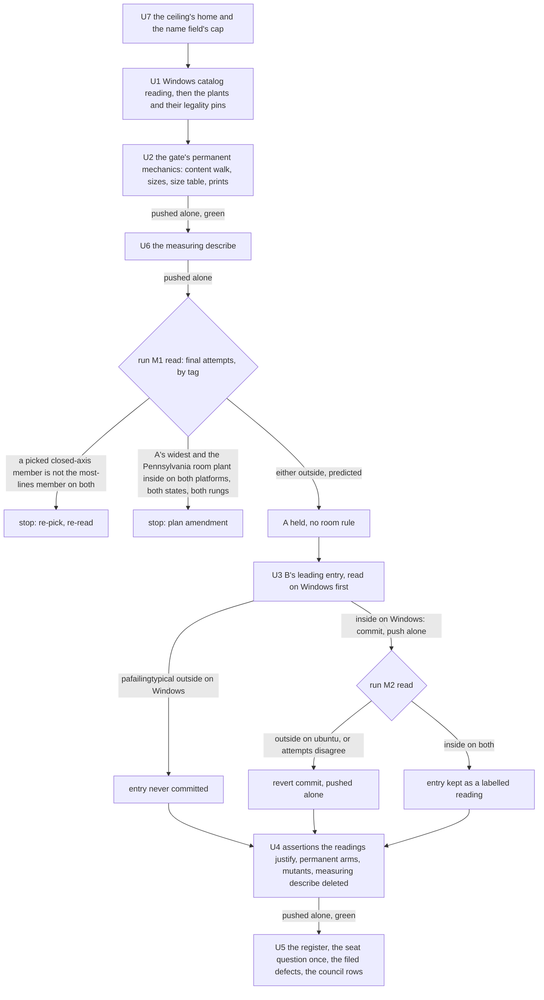
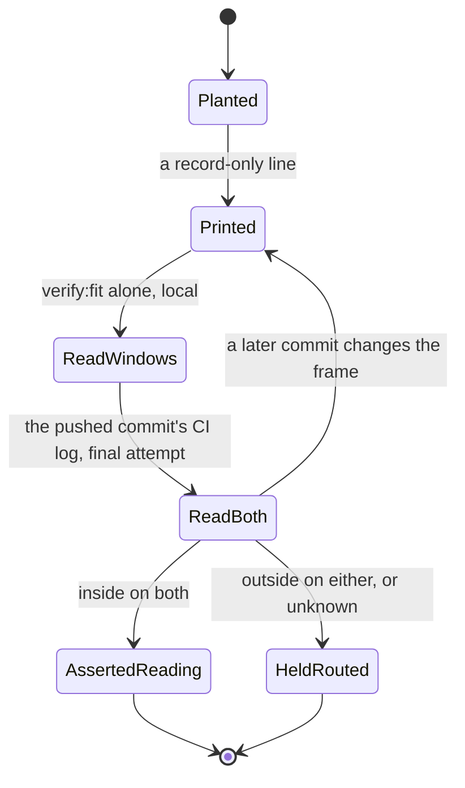

# Frames Outside, Widest-Member Readings - Plan

**Target:** `projects/the-back-nine`. Every path below is relative to it unless it starts with `.github/` or is marked machine-local.

This plan continues `docs/plans/features/one-frame-composites-build-spec.md` (the composites plan). It names constructs, never line numbers, because every unit moves the lines.

---

## Goal Capsule

- **Objective:** on Briggsy's laptop window (1440×731 CSS px at DPR 2), a household the tool is built for never reads a verdict whose "this can be wrong" caveat sits below the fold while the register calls that frame's class fine. After this work each class still outside (A, B and C) says what it is, measured at the widest content the design holds, on Windows and on CI's ubuntu: inside, or outside and routed to the seat question with its evidence. The classes already asserted carry a Windows-only reading at six-character figures: one that reads outside joins the seat question with that reading, and each reads NOT met until its widest plant is read on both platforms.
- **Means:** the design ceiling in one home with the name field capped to it (KTD3, KTD12); the widest-member law written down with every axis classed (KTD1, KTD2); widest plants minted through the real producers (KTD4); one record-only measuring pass on both platforms before any assertion (KTD5, KTD6); the ruled leading entry for the rethink class on its own measuring commit (KTD7); the gate's full-fit walk fixed and two window sizes added (KTD8, KTD9); then assertions only where both platforms read inside (KTD10).
- **Authority:** the project's laws (`CLAUDE.md`, the short tier's law in `--bp-laptop-short`'s docblock in `src/ui/styles/tokens.css`) outrank everything here. Briggsy's ceiling ruling of 2026-11-21 (KTD3) outranks the councils on what "widest" means. The rulings outrank this plan on the rest: council `wf_448928ea-280` as corrected by `wf_9c0bb7ea-938`, recorded in `docs/backlog.md` (the composites entry's prescription (3)) and in `docs/council-log.md`'s two 2026-11-21 rows. Where the two rulings differ, the correction governs. Requirements outrank KTDs on behavior, KTDs outrank units on mechanism.
- **Stop conditions:**
  - a widest plant cannot be minted legal (KTD2), or does not read its class's direction: stop, record the widest reachable household with its derivation, never loosen the proof;
  - on a closed axis whose members both platforms read (U6), the picked member is not the most-lines member on both: stop, re-pick, re-read before any status is written;
  - the room class's widest plant AND the Pennsylvania room plant both read inside 731 on both platforms, in both room states, with both room rungs injected (unpredicted): stop. The room entries are then a plan amendment under the correction's own flip, never built from this plan;
  - `?seed=pafailingtypical` with the scoped leading entry reads outside 731 on either platform: the minimalist's flip fires (KTD7). The entry is not kept, and the work continues without it;
  - a measuring run goes red before `verify:fit`: it measured nothing. Fix and re-push before leaning on it;
  - two attempts of one arm print different numbers, or a first read misses the pending room state: the reading is unknown, and an unknown keeps the frame held.
- **Execution profile:** commits on `main`, one unit per commit, in the order U7, U1, U2, U6, U3, U4, U5. U2, U6, U3 and U4 are each pushed alone, because each one's CI run is evidence the next step waits on. The repo works on `main`, so there is no pull request.
- **The ACA precondition.** CI's verify job runs `pnpm verify:aca` first and `pnpm verify:fit` last, and no step runs after a failed one. `aca-last-verified.json` goes stale at 2026-12-12 00:00 UTC (7:00 PM Eastern on 12-11). The last run whose fit log this plan reads must start before then. If it cannot, the ACA re-verify runs first as its own research job (its `howToClear`), never a date bump.

---

## Product Contract

### Summary

Name the household the one-frame promise is for, in one place: spending under $100,000 a month and names up to 20 characters. Mint the widest households inside that ceiling for the two classes still outside, and read them on both platforms before anything is asserted. Build the one stylesheet entry the rulings allow (tighter survivor leading on "Already short" frames that answered "not sure"), and keep it only if it brings today's Pennsylvania frame inside on both platforms. Fix the gate's full-fit walk, add his full-screen window as an asserting size, print the 841 px edge. Hand every frame still outside to the record card's seat council as one question, with these arms as its acceptance test.

### Problem Frame

After rung 3 landed (2026-11-21), four frames still put the caveat below 731 px. CI run 44884279097 at head `c897505c0` prints the same numbers as Windows on three of them:

- `?seed=surplustypical`, 743.1: "More than covered" with the caveat out of view. Reachable today by any over-funded household that answers "not sure" on Medicare extras.
- `?seed=pafailingtypical`, 736.0: Pennsylvania, "Already short", fresh.
- `?vault=yearsurplus`, 760.8, and `?vault=yearpafailing`, 722.5 on Windows and 743.3 on ubuntu: the same households a year on.

Two councils ruled. The first found that every "inside" reading so far is one couple's figures: nothing reserves room for wider ones, so a plant reading proves the plant, never the class. The second set the bound at the engine's largest dollar figure, a trillion dollars a year.

Briggsy then ruled the bound (2026-11-21): the tool is for a household that knows it needs it. Nobody spending a million dollars a month needs an app to say the plan works. He asked for a named ceiling instead of the engine's extreme.

Planning research found four things the rulings did not have:

- Every plant in the gate spends $6,000 to $8,000 a month, which prints five characters. A household spending $10,000 or more prints six. So every "inside" reading on record was taken one digit narrower than the households the tool is for.
- A household that cannot be saved (a blank name, for one) shows no save box, and the save box sits above the caveat. Such a frame is shorter than any saveable one, so it can never be a class's widest.
- While the room sentence is still being worked out, the frame holds a reserved box whose figure is at least as wide as the settled one. The gate measures that reserved box.
- The gate's own full-fit walk counts `main.result`'s bottom padding as content, which is the whole of the SHOWCASE breach.

### Requirements

**The law**

- R1. Every piece of content that can change the two-pane Result frame's height is classed once, in one home, as CLOSED (a fixed catalog of forms) or CEILINGED (a figure or a name with a named or derived largest form). No axis is left open.
- R2. A household is legal for the law only when the intake's sanity rules pass on it with every rule's fields touched, the engine accepts it, and it sits inside the design ceiling. Every widest plant is proven legal by a unit test, and proven to read its class's direction.
- R3. A class is MET only when its widest plant reads 731 or under on Windows and on CI's ubuntu, in every state the frame holds (the reserved pending box and the settled one). A plant reading is a labelled reading with its population and platform. No doc, docblock or commit calls a class met from narrower plants or from a seat landing.

**The classes**

- R4. Class B (the verdict's direction is `rethink`, the Medicare residual is the typical form): its widest plant is planted and printed, the ruled leading entry is built on a measuring commit, and the entry is kept only under KTD7's test.
- R5. Class A (direction `room`, typical residual): no stylesheet entry lands. Both room rungs are read on an unedited tree against A's widest plant and a Pennsylvania room plant at today's figures. Either outside holds A.
- R6. Class C (`?vault=yearsurplus`, `?vault=yearpafailing`) stays held and printed. No fourth borrow.
- R7. Every frame still outside, with every widest member, goes to the record card's seat council as ONE question whose acceptance test is these arms.

**The gate**

- R8. The full-fit walk measures content. A door whose own box ends past the fold still fails. `.result`'s padding is never trimmed.
- R9. His full-screen window (1440×900 at DPR 2) is an asserting size under the degrade contract (the doors may sit below the fold, nothing else protected may), with the full-fit distance printed. A frame asserts there only after both platforms have read it.
- R10. The 841 px window is printed on the tall echo frames and never asserted.
- R11. Every reading the gate prints carries its attempt number and unrounded values.

**The record**

- R12. Every statement that survivor leading tightens only on echo frames is rewritten in the commit that makes it false.
- R13. The register, the landmines, the roadmap's gate row, the two council rows, `docs/product.md` and `TODO.md` say what was built and what each class reads. Every defect the work surfaces is filed as its own register entry, after reading the register for it.

**The ceiling**

- R14. The name field accepts at most the ceiling's character count, so the name bound is enforced by the app, not assumed by the gate. A larger dollar figure is still accepted and computed: above the ceiling the app makes no one-frame promise and refuses nothing.

### Scope Boundaries

- Not in this plan: the seat itself (the composites entry's prescription (4)). A council sits, then Briggsy rules from 1440×731 previews. This plan hands it the question, the members and the acceptance test.
- Not in this plan: committed six-character plants for the classes already asserted (the spine, the yearly returns, the record plants). U1 reads them once on Windows with temporary seeds, and U5 files what that reading owes.
- Considered and not built:
  - anything for a household above the ceiling: the room sentence at the engine's refusal edge, the pending reserve's extra digit there, the band's axis labels near a trillion dollars. Briggsy's ruling puts them outside the design. U5 records them once so nobody re-finds them.
  - a cap on dollar entry. The ceiling bounds the promise, never the input (R14, and D7's "use it").
  - a `git archive` copy for the room probe. The tree is clean and committed when the probe runs, the candidate rules are injected at run time, and `git status` is checked clean before and after. That gives the same guarantee without serving a dev server from a copy, which nobody has run. Reopen it if a probe ever has to run beside uncommitted edits.
  - a `test.fail` arm that would force `?vault=yearsurplus` back. The held frames are tracked by the register entry and by `TODO.md`'s ranked seat council, so the harm is not silent. Reopen it if a held frame is ever found forgotten.
  - a plant for the failed-save state of the save box. It needs a forced save failure, and every class it could decide is already routed to the seat. U5 files it as an unmeasured member.
  - compile-time exhaustiveness for the gate's leading table. `e2e/` is outside the project's typecheck and CI's, so the table is guarded at run time (KTD11).
  - the overflow-wrap fix. The ruling orders the entry filed; a fix is that entry's build.

#### Must not build (the rulings' NEGATIVE lists, binding)

The register owns these words: the composites entry's RULED bullet, CORRECTED bullet and ⚑ NEGATIVE line. Briggsy's ceiling ruling replaces two of them: "no intake cap" (for names only) and "no unsourced digit bound" (his ruling is the source). The rest stand:

- no tolerance, chosen margin, below-fold allowance or "unreachable" closure;
- no word cut, copy change, abbreviated money, truncation, hero size or new type size;
- no fourth borrow for class C; never rung 3 for class B;
- no room + typical leading entry and no widening of rung 3's key, in the stylesheet or in the gate's helper, unless the stop condition's unpredicted case occurs and the plan is amended;
- no priced-state or Pennsylvania key in CSS;
- never trim `.result`'s padding;
- never `assertFrameFits` on a frame read inside on one platform only;
- never "met" from a narrower plant, from a plant inside by less than one line, or from a seat landing;
- no assertion at 841;
- no new `@media` prelude and no height written in one (the prelude bind in `scripts/__tests__/breakpoint-mirrors.test.ts`);
- no plant keyed to Briggsy's real figures (the repo is public);
- no engine-side fit lever, and no CSS-only reorder or sticky positioning offered as a seat;
- never plant, measure or brief a council at the engine's cap again, and never cap dollar entry (Briggsy's ceiling ruling's own ⚑ NEGATIVE; D7's "use it" stands).

### Deferred to Follow-Up Work

- The seat council and its build (prescription (4)), next in `TODO.md`'s ranked list.
- Committed six-character plants for the asserted classes, sized by U1's Windows reading (U5 files the entry).
- Each defect U5 files.

---

## Planning Contract

### Key Technical Decisions

- KTD1. **The axis table.** These are the axes of the two-pane frame's left column, read from `src/ui/Result.tsx`, `src/ui/resultSave.ts`, `src/ui/ConfidenceStatement.tsx`, `src/ui/TwoTierHeadline.tsx`, `src/ui/twoTier.ts`, `src/ui/SurvivorReadout.tsx`, `src/ui/verdictSentence.ts`, `src/ui/stateTaxDisclosure.ts`, `src/ui/healthSheetChrome.ts` and `src/ui/copy.ts`.

  | axis | kind | widest member, and its source |
  |---|---|---|
  | save box | CLOSED | the reserved box (first, dirty, saving and clean share one minimum height) over none. None renders on a draft that cannot be saved, which is shorter, and on a read-only session (another tab holds the writer, `deriveResultSave`), which mounts the in-flow View-only banner above the frame instead: U1 reads that member against the reserved box. The failed state can run taller and is unmeasured |
  | subordinate face | CLOSED, and coupled | the inline survivor card, or the essentials-relief card above the closed survivor fold (`floorRelief`: an essentials budget whose reading differs from the full one; its trim note on a fresh plan; `?seed=budget` carries it). Not independent of the other axes: a budget stops the spend lane, so a room frame with the relief face shows the figure-less room clause, never the reserve or a sized figure, and the fold hides X and Z. So each class is read as two whole combinations (U1), and the taller is its widest. Where a base cannot show the relief face (its essentials reading equals the full one), U1 records it and the inline combination stands |
  | survivor context form | CLOSED | the basis sentence plus the step-down sentence (the other forms are subsets) |
  | state clause inside the residual | CLOSED | picked by measured line count over Pennsylvania, North Carolina, Florida and the unpriced pair |
  | typical residual form | CLOSED | picked by measured line count over the both-people form and the one-person form (whose name axis is below) |
  | room clause form | CLOSED | picked by measured line count over the sized, unsized and within-a-step forms and the pending reserve. No seed reaches the survivor-short form; it is recorded unmeasured |
  | trim clause form | CLOSED | picked by measured line count over the sized and unsized forms and the pending reserve. Its figures are the entered spending and a solved figure at most that, so six characters (`verdictSentence.ts`) |
  | Y, the couple's spending a month; the entered spending in the room and trim clauses | CEILINGED | six characters: the design ceiling (KTD3) |
  | X, the survivor's spending a month | CEILINGED | at most Y: the intake rule `survivor-ratio-ceiling` holds the share at 1 or under. The engine alone does not bound it |
  | Z, the income step-down a month | CEILINGED | six characters: Briggsy RULED on 2026-11-21 that the ceiling covers the step-down (A9). Derived from source, Z has no finite bound (its Social Security part is held by `pia-over-ceiling`, but intake caps no income stream), so the bound is his ruling's, not the code's |
  | F, the room figure, settled or in the pending reserve | CEILINGED | seven characters: at most three times the entered spending (`SPEND_SOLVE_ROOM_CAP_MULTIPLE`, `reserveClauseFor`). The pending reserve always prints the full three times; the settled figure can print fewer |
  | a typed name | CEILINGED | the name ceiling's characters (KTD12), read at a real-looking 20-character name (RULED by Briggsy 2026-11-21, A7). It renders in the frame only in the one-person typical residual. The fallback "Your spouse" is shorter than the ceiling |

  The band column and the door row are not left-column axes, but both depend on the draft (the band's lattice on the balances, the doors on accounts, filing status and health pricing). Each widest plant keeps its base seed's accounts and filing so those stay the class's own.
- KTD2. **Legal means intake-legal, engine-accepted and inside the ceiling.** A widest plant passes `validateDraft` with every rule's fields touched, passes `validateParams`, and prints no figure wider than KTD1 allows. `validateDraft` reports only violations on touched fields and the rule list is not exported, so the touched set is built by hand and named in the test: per person the retirement age, claim age, birth year and benefit base; the survivor share; the yearly spending and its entry-period confirmation; each person's Medicare extras figure; each account's contribution and employer-match fields; each income stream's survivor, taxable, exclusion and cost-of-living fields; the working-year cost's answer and its amount. Planted counter-cases prove the set reads each family (U1).
- KTD3. **The design ceiling is Briggsy's, and it has one home.** Ruled 2026-11-21: the tool is for a household spending under $100,000 a month. It also covers the income step-down: RULED by Briggsy on 2026-11-21 (A9). The room figure is derived from the spending (at most three times it) and prints up to seven characters by design. The app still accepts and computes any larger figure; above the ceiling it promises nothing about one frame. The ceiling is on the figure as shown: `formatPerMonth` rounds a monthly figure to $10, so the largest figure under the ceiling shows as 99,990, and an entered $99,995 or more shows as 100,000, seven characters, outside the promise. Every shown figure from $10,000 to $99,990 prints six characters in tabular lining numerals (`base.css`'s body rule), so one plant in that range reads the whole range's width. The ceiling is one exported constant, 100,000, beside `GATE_DAY` in `src/ui/devSeeds.ts`, re-exported by `e2e/reviewSurface.ts`, with a docblock that carries the ruling. Each widest figure is that constant less the $10 display step, formatted through `formatPerMonth`, and its expected character count is derived from it, never typed, so a moved ceiling reds the widest pins. Rejected alternative: the engine's cap (`ENGINE_MAX_DOLLAR`), which the correction ruled and Briggsy overrode: it describes a household the tool is not for.
- KTD4. **Every widest plant can be saved.** A draft that cannot be saved renders no save box, and the save box is a left-column row above the caveat, so an unsaveable plant measures a frame shorter than its class. B's and A's widest name both people. The unnamed-spouse fallback needs no plant: its sentence is the named one with a shorter name.
- KTD5. **One record-only measuring describe reads everything first, on both platforms.** It follows the composites probe's shape: each arm drives its frame the way its asserting arm will, asserts the tier it expects, asserts identity (verdict word, direction, the residual's form, the widest strings on the page), asserts no fit, and prints one line by tag. It stays in the tree through U3, so run M2 re-reads every frame B's entry changes, and U4 deletes it. A's two candidate rungs are read inside it, on an unedited stylesheet: the exact scoped rules are injected right after navigation and before the final answer, so both room states are read under them; the baseline is a separate load with nothing injected. The injected rules carry the same `:has()` terms the real entries would, so they win by specificity exactly as a stylesheet entry would. Both sit inside the short tier's `@media` prelude, keyed `.confidence-reveal[data-twopane]:has(.cs-magnitude[data-direction='room']):has(.cs-medicare-residual--typical)`, with no echo term and no state marker (ruling (3)):
  - **the room leading rule** (L3 for room + typical): that key on `.survivor__eyebrow`, `.survivor__context` and `.survivor__stepdown` sets `line-height: var(--leading-tight)`, KTD7's entry with `room` in place of `rethink`;
  - **the room size borrow** (rung 3 for room + typical): that key on `.survivor__context` and `.survivor__context .survivor__stepdown` sets `font-size: var(--text-sm)`, rung 3's rule in `survivor.css` with this key in place of its own.
- KTD6. **Both room states are read, and the pending one is proven caught.** The gate measures right after the final answer, while the room clause can still be pending, so the reserved box is a law state. A room arm's first read takes the caveat bottom and `.cs-magnitude`'s `data-spend` in one evaluation and requires `pending` with the reserve node present. A first read that is already settled leaves the pending reading unknown. The settled read follows once `data-spend` leaves `pending`. The taller of the two is the frame's reading.
- KTD7. **B's leading entry, and the test that keeps it.** The entry sits inside `survivor.css`'s existing short-tier block, after the echo entry: the reveal carrying `.cs-magnitude[data-direction='rethink']` and `.cs-medicare-residual--typical` sets the survivor eyebrow, context and step-down to `--leading-tight`. Its step-down selector is the bare one, as the two existing leading entries use. It has no echo term and no state marker. It newly tightens `?seed=failing`, `failingtypical`, `pafailingtypical` and B's widest plant. It re-matches the two echo frames the echo entry already tightens, whose delta is zero by construction and counts as no evidence.
  - **The test:** `?seed=pafailingtypical`, at today's figures, read from the edited tree, inside 731 on Windows and on ubuntu. This is the correction's recorded flip for the minimalist's dissent. B's widest plant is not the test: it joins the seat set on its own reading.
  - **If the test fails on Windows,** the entry is never committed. **If it fails on ubuntu,** or its attempts disagree, the entry, its key (KTD11's table) and its docblock rewrites are reverted in one commit pushed alone. Either way the plants stay, and `pafailingtypical` joins the seat set.
  - **If Briggsy reads the tighter leading as worse** after the build, the same revert runs. The entry is recorded as provisional: the seat's build re-measures it and removes it if the seat makes it unnecessary.
- KTD8. **The full-fit walk skips exactly two layout ancestors.** When `frameReport` walks without excluding the quiet row, it skips `main.result` and `#root` by identity and measures every element inside them. `#root` has no padding of its own, so measuring its content box would still count `main.result`'s padding. No other element between `#root` and the doors carries block padding at the two-pane widths, and every door's own box stays measured. This loosens the SHOWCASE full-fit arms by `.result`'s tall-tier padding, which is the ruling's intent ("the gate's fault"). U2 proves the walk still bites with a planted fault sized to the fold.
- KTD9. **Two new sizes, and one size table.** `e2e/reviewSurface.ts` gains `LENOVO_FULL` (1440×900 at `REAL_DPR`), the tall edge, and an exhaustive table keyed by size name that gives each size its viewport, its density tier (short or tall) and whether its law is the full fit. Every fit loop reads its tier and its law from that table. Doors, held status and the record's standing line stay per frame, at the call site. The short tier's boundary lives only in `tokens.css`, so the tall edge is bound to it by a new arm in `scripts/__tests__/breakpoint-mirrors.test.ts`: the tall edge equals the declared boundary plus one, and `REAL` and `TIER` sit at or under the boundary while `LENOVO_FULL` and `SHOWCASE` sit above it. Each arm at the two new sizes asserts the laptop tier and the tall density tier before it asserts or prints anything (insight 125). The gate's header says once why `SHOWCASE` and `LENOVO_FULL` carry different laws.
- KTD10. **What each frame asserts at the end.** A frame read inside on both platforms asserts, as a labelled reading. A frame outside on either stays held: its caveat printed, every element the readings showed inside asserted. A widest plant stays as a printing arm that asserts identity only, labelled as the seat's acceptance test. The held constant is renamed and repointed at the seat council; it is not deleted while any frame is held.
- KTD11. **The leading the gate expects is derived from the frame's own markers, through one table.** This KTD lands only with B's entry. If U3 keeps the entry, `assertDensityTier`'s `tightEcho` goes. If the entry is never committed, or is reverted, the table is never written (or leaves with the revert), `tightEcho` stays, and the echo-only statements stay true. The helper reads the direction (`.cs-magnitude[data-direction]`), the echo (`.cs-staleness-note`) and the typical residual (`.cs-medicare-residual--typical`) and looks the expected leading up in a table keyed by direction. The helper's existing list of allowed directions is derived from the table's keys, so a direction with no row reds at run time. The arm still passes its own expectation, which the helper checks against the markers, as rung 3's `register` flag is checked today. Rung 3's own key in the helper is not widened. The helper is spine-only: no date-route arm calls it.

  | direction | echo | typical | survivor leading in the short tier |
  |---|---|---|---|
  | any | yes | any | tight (the echo entry, unchanged) |
  | `rethink` | no | yes | tight (B's entry, new) |
  | `rethink` | no | no | snug |
  | `trim`, `room`, `on-the-line` | no | any | snug |

  Above the tier every cell reads body leading.
- KTD12. **The name ceiling is 20 characters, enforced in the field.** `NameField` stops accepting input at the ceiling, and one exported constant carries the number. A name is not a figure the math needs, so capping it costs the household nothing. The widest plants name one person with a 20-character name, committed once, and that person alone is on typical extras, so the name renders in the residual. Proportional letters differ in width, so Briggsy ruled which 20 (2026-11-21, A7): a real-looking name in title case. A name of unusually wide letters is accepted and sits beyond the promise, and U5 records it with what lies beyond the ceiling. Each reading is labelled with the name it used.

### High-Level Technical Design

The build's sequence and its branches:

A frame's states, and the only moves allowed:

No frame moves to AssertedReading without the run of the commit that last changed it. No state is ever "met" for a plant that is not its class's widest.

The plant catalog. Every figure comes from the real producers and is re-run before it is pinned.

| plant | class | what it is | predicted at `REAL` |
|---|---|---|---|
| B's widest | B | the already-short base, its accounts and filing kept; the state clause and residual form U1 step 1 picks (predicted: Pennsylvania, one person with a 20-character name alone on typical extras); spending, the survivor's spending and the income step-down each at six characters; the taller combination U1 reads (KTD1's subordinate face) | outside |
| A's widest | A | the surplus base, its accounts and filing kept; the state clause and residual form U1 step 1 picks (predicted as for B); spending at six characters and at least a third of the ceiling; the taller of its two combinations: the inline card with the pending reserve's room figure (three times the entered spending) at seven characters, or the relief face with the figure-less room clause | outside, in both states |
| the Pennsylvania room plant | A | `surplustypical` with Pennsylvania, today's figures | outside: about 763.9 unedited (743.1 plus 20.8) and about 744.8 with both room rungs (724.0 plus 20.8), by arithmetic |

Research showed that untaxed income streams keep a high-spending household over-funded while taxable ones tip it to already-short, and that the step-down's median falls back to the Social Security drop unless both people carry a stream. U1 uses that to reach each direction.

The first ruling asked for a Pennsylvania and a North Carolina rethink + typical plant. The correction measures each closed axis at its most-lines member instead, so B's widest carries whichever state clause U1 step 1 reads with the most lines, and the other clauses are read as rows (U6).

### Assumptions

- A1. Digit width is uniform in the loaded fonts, so character count sets a figure's width. `base.css` says so and `e2e/design-tokens.spec.ts` verifies it.
- A2. Injecting a style element works in CI's fit harness as it does locally, because the harness serves `pnpm dev`, which applies no CSP headers. It has never run in CI. If it fails there, the Windows reading alone still fires A's hold, which needs only one outside reading.
- A3. CI keeps writing each printed line into the verify job's log through the reporter Playwright prepends there (the composites plan's A3). `playwright.fit.config.ts` never gains `list`.
- A4. The predictions, written before any run: B's widest outside by about one line; A's widest outside in both states; the Pennsylvania room plant outside; `pafailingtypical` with the scoped entry inside by less than one line (727.3 on Windows from an unscoped append, which is an estimate, not a reading).
- A5. No surface after the Result lets a survivor share above 1 or a benefit base above the intake ceiling reach a real save. The assumption panel's header says its survivor-share edit is checked against the sanity rules on the patched draft and refused. U1 confirms it for both fields by reading the panel's commit path, and files a register entry if either slips through.
- A6. Above the tier, an overflowing frame reads the same caveat bottom at 841, at 900 and at `SHOWCASE`, because every width from 1280 to 1871 renders the same capped frame. Derived from Windows readings; U6's print confirms it.
- A7. The name ceiling's number (20) and its enforcement in the field are the planner's proposal under Briggsy's ruling, put to him on 2026-11-21; he had not answered when this was written. A different number changes one constant and one plant name. Which 20 characters the plants carry was put to him the same day after the check. **RULED by Briggsy 2026-11-21:** a real-looking name, never 20 of the font's widest capital (KTD12).
- A8. Scope taken without asking, since confirmation was off: the widest plants are printed at `REAL`, `LENOVO_FULL` and `SHOWCASE`; the asserted classes get a Windows-only six-character reading, not committed plants.
- A9. Whether the design ceiling also covers the income step-down (KTD1's Z row) was put to Briggsy on 2026-11-21 after the check, recommended yes: a household losing $100,000 a month of income at the first death is the extreme his ruling set aside. **RULED by Briggsy 2026-11-21: yes.** Every monthly figure from the household's own money (the spending, the survivor's spending, the income step-down) is judged under the ceiling; the room figure is derived from the spending and prints up to seven characters.

### Open Questions

None blocks the build. Ruled, never re-ask: **the ceiling. ⚑ RULED by Briggsy 2026-11-21: "let's name a ceiling - we don't need to solve for extremes like that."** (KTD3.)

Two were put to Briggsy on 2026-11-21 after the check and **RULED the same day**, never re-ask:

- **The ceiling's reach to income** (A9): the ceiling also covers the income step-down. Ruled: yes.
- **Which 20-character name the plants carry** (A7): a real-looking name. Ruled: a real-looking name.

Two go to Briggsy's digest in U5, each a ⚑, neither waited on:

- **The tighter survivor leading on "Already short" frames that answered "not sure"** (`?seed=failing`, `failingtypical`, `pafailingtypical`). Walk 10 reads it. If he reads it as worse, KTD7's revert runs.
- **"More than covered" with the caveat out of view is reachable today** on a fresh frame. It is the reason the seat council is next.

### Risks

| risk | mitigation |
|---|---|
| A pushed commit reds before `verify:fit` and prints nothing | every pushed commit runs CI's own list locally, in CI's order, serially; any commit that adds or removes a unit test updates the test count in `README.md` and `docs/roadmap.md` in that commit; the re-anchor runs once, last, inside each commit (Verification Contract) |
| A new seed reds a hand-listed census | U1 names each: the survivor-basis seed gate's rows and its hard count, and the engine-acceptance sweep. Every other suite that loops the seeds passes them unchanged (checked against the tree) |
| The content walk hides a real overflow | U2's planted fault, sized to the fold: every asserting `SHOWCASE` arm must red on a door element |
| The 900 arm's sanctioned doors hide a caveat past the fold | U4's planted fault, injected in the `LENOVO_FULL` arms only |
| A first read misses the pending room state and under-reads class A | KTD6's proof of capture; a miss is unknown, and unknown holds |
| A Windows reading is taken for ubuntu's | no doc line names ubuntu or Linux without a run id; a reading owed says "owed" |
| A planted fault overlaps a fit run and hot-reloads its server | faults run strictly in sequence with every suite; a timeout is never a kill and is re-run with one worker |
| The ACA instant passes with a run still owed | the Goal Capsule's precondition and its fallback |

---

## Implementation Units

### U7. The ceiling's home, and the name field's cap

**Goal:** the design ceiling exists as code the gate and the tests read, and the app enforces the name half of it.

**Requirements:** R1, R14 (KTD3, KTD12).

**Dependencies:** none.

**Files:**
- `src/shared`: the name ceiling, exported, with the ruling in its docblock (the `incomeBounds.ts` precedent: an intake bound that production code reads lives in the shared layer). `NameField` imports it from here, never from `devSeeds.ts`: that module is DEV-only, reached by a dynamic import behind `import.meta.env.DEV`, and a static import from production code would pull it and its seed builders into the shipped bundle. No lint rule stops that import, so this line is the guard.
- `src/ui/devSeeds.ts`: the spending ceiling beside `GATE_DAY` (only tests and the gate read it), with the ruling in its docblock, and a re-export of the name ceiling.
- `src/intake/fields.tsx`: `NameField` stops at the name ceiling.
- `src/intake/__tests__/`: the field's test.
- `e2e/reviewSurface.ts`: re-exports both.
- `docs/product.md`: one line beside D7, in the ruling's words only: the one-frame promise holds for spending under $100,000 a month (a figure shown as 99,990 or less) and names up to 20 characters; a larger figure is still used and computed. Briggsy's answers to A7 and A9 join that line in the commit after he gives them, never before (built: U7 wrote D8 at `1abbf7d3`; his answers joined it the same day).
- `README.md`, `docs/roadmap.md`: the test count, read from `pnpm verify:doc-stats`.

**Approach:**
1. Load the `back-nine-design` skill before touching the field (project law).
2. Add the constants and the cap. The cap is the input's own length limit; no error state and no new copy.
3. Confirm no existing seed, plant or test fixture carries a longer name.

**Patterns to follow:** `GATE_DAY`'s export and docblock; `REAL` re-exported through `e2e/reviewSurface.ts`.

**Test scenarios:**
- Typing a 25-character name into the field leaves the first 20 in the draft.
- A 20-character name is kept whole.
- A restored draft whose name is already longer still renders (the cap limits typing, it never rewrites stored data).

**Verification:** `pnpm test`, `pnpm typecheck`, `pnpm lint`, `pnpm verify:doc-stats` green.

### U1. The catalog reading, the widest plants and their legality

**Goal:** the widest legal household of each class exists as a committed seed, proven legal and proven to read its direction.

**Requirements:** R1, R2, R4, R5 (KTD1, KTD2, KTD3, KTD4, KTD12).

**Dependencies:** U7 (built, `1abbf7d3`). Briggsy answered A7 and A9 on 2026-11-21, so nothing else gates U1.

**Files:**
- `src/ui/devSeeds.ts`: three seeds in `DEV_SEEDS` (B's widest, A's widest, the Pennsylvania room plant), each docblock naming its class, its extras form and what it is for.
- `src/ui/__tests__/devSeeds.test.ts`: each new seed's direction and verdict pinned as found; KTD2's legality pins and their counter-cases; a pin that each widest seed differs from its base only in the fields its docblock names.
- `src/ui/__tests__/survivorSpendingBasisSeedGate.test.tsx`: a hand-derived row per new spine seed, and its hard count.
- `README.md`, `docs/roadmap.md`: the test count.
- The composites record folder's `README.md` (machine-local, Appendix): the catalog table and the six-character reading.

**Approach:**
1. Read the closed axes on Windows, from a scratch probe against a dev server, with temporary seeds reverted by snapshot and byte comparison. The probe needs its own Playwright config (`playwright.fit.config.ts` collects only its three specs): the b9-9 outside probe's shape (machine-local, Appendix). Read every member at six-character figures, in the widest plant's own context:
   1. For each catalog in KTD1, record each member's rendered line count at `REAL` and pick the member with the most.
   2. Read each class's two combinations (KTD1's subordinate face): the inline card with the widest clause form, and the relief face (a temporary essentials-budget twin whose essentials reading differs from the full one) with its folded card and, on a room frame, the figure-less clause. Pick the taller by caveat bottom.
   3. Read the read-only member: the picked combination with a second tab holding the writer, so the View-only banner sits above the frame and the save box is gone, against the same frame with its save box.
2. In the same probe, read each asserted class once at six-character spending:
   1. The population is every frame the gate asserts at `REAL` today outside classes A, B and C: the five `SPINE_SEEDS`, the `pa` and `fl` priced spine frames, `failingentered`, `offtracktypical`, the yearly-return vaults the gate asserts, and the record plants `rec`, `recold`, `yearrec`, `recpa` and `yearparec`. List them once from the spec before the probe runs.
   2. Scale each one's spending to six characters and every other dollar input (balances, income streams) by the same factor, so the household keeps its shape. A step-down that rests on Social Security alone stays at five characters (the benefit base is capped); record each figure's characters as reached. A vault plant's twin is a temporary `AGED_PLANTS` entry over the scaled base, with its base's doctor and view day.
   3. If a twin leaves its class (verdict, direction, residual form or echo), try one other factor. If it still leaves, record "cannot be held in class at six characters" and move on.
   4. Record each caveat bottom, and write each twin's inputs to the record folder so the seat council can plant it again. This is a Windows-only reading of the households the tool is for; it commits nothing. A twin that reads outside 731 marks its class NOT met in the register's composites entry and joins the seat question (U5), labelled "Windows only, temporary seed, ubuntu owed".
3. Mint the three seeds as spreads of their bases, changing only the fields step 1's picks name (every closed-axis member and the combination it picked), and re-run each through the real builder, engine and solve before pinning. A read-only member that read taller is never planted (it needs two tabs): U5 names it in the seat question as a Windows-only member.
4. Add the legality pins with KTD2's named touched set, and the census rows. `devSeeds.ts` and its test are CRLF: edit with the Edit tool.
5. Confirm A5 by reading the assumption panel's commit path for the survivor share and for any benefit-base edit.

**Execution note:** measure before minting. A seed minted from a character count is the mistake the correction names.

**Patterns to follow:** `paFailingTypicalExtras` (a one-field spread); `notSureExtras`; `atCeilingSeed` (a seed tuned to reach a widest form); the census rows' hand derivation and its rounding note; the existing pin that each named change really differs from the base.

**Test scenarios:**
- Each new seed (B's widest, A's widest and the Pennsylvania room plant) passes the sanity rules over the named touched set, the engine accepts it, it sits inside the ceiling, and it saves.
- B's widest reads already-failing and `rethink`; A's widest and the Pennsylvania room plant read over-funded and `room`.
- Each widest seed renders the combination step 1 picked.
- Each widest seed's shown figures have the character counts the ceiling constant derives (six for every monthly figure the picked combination shows; seven for A's pending reserve figure, three times the entered spending through `reserveClauseFor`, when A's widest carries the inline combination), computed through the shipped formatters.
- Counter-cases on a copy of B's widest, each returning exactly its own rule: a survivor share of 2; a benefit base one dollar above the intake ceiling; an income stream's taxable share of 1.5; the same seed with the spending-period confirmation left out of the touched set.
- A copy of B's widest with spending above the ceiling fails the ceiling pin, and so does a copy whose step-down shows above it.
- Each widest seed differs from its base only in the named fields, and each named field does differ.

**Verification:** `pnpm test`, `pnpm typecheck`, `pnpm lint` and `pnpm verify:doc-stats` green; the catalog table and the six-character reading written to the record folder.

### U2. The gate's permanent mechanics

**Goal:** the walk, the sizes and the prints every later unit needs, green on CI by themselves.

**Requirements:** R8, R9, R10, R11 (KTD8, KTD9).

**Dependencies:** U1.

**Files:**
- `e2e/reviewSurface.ts`: `LENOVO_FULL`, the tall edge, the size table.
- `e2e/vertical-fit.spec.ts`: the content-only walk in `frameReport`; offender bottoms kept unrounded at their source; one print helper carrying the attempt and unrounded values, used by `assertFrameFitsHoldingCaveat`'s print and replacing the print half of `assertFullFitHeld`. Every held full-fit print names the doors' bottom and the lowest content bottom whether or not anything sits below the fold: after the content walk the two held `SHOWCASE` frames have no offender, and today's print would say only "no element below the fold". The header's two-laws note.
- `scripts/__tests__/breakpoint-mirrors.test.ts`: KTD9's binding arm.
- `README.md`, `docs/roadmap.md`: the test count.

**Approach:**
1. Change the walk (KTD8) and the prints. Run `pnpm verify:fit` alone and keep every printed line.
2. Read the two held `SHOWCASE` frames' door bottoms from those lines (the asserting `SHOWCASE` arms print nothing), then run the planted fault below.
3. Add the sizes, the table and the mirrors arm.
4. Push alone. The run must be green.

**Patterns to follow:** `REAL` and `SHOWCASE` in `e2e/reviewSurface.ts`; the mirrors test's binding of `REAL.height`; the composites probe's `attempt=` field (the spec as of commit `4625f077`).

**Test scenarios:**
- The two held `SHOWCASE` frames' printed full-fit offenders no longer name `main.result` or `#root`.
- Planted fault, predicted first: the doors row pushed down by the viewport's height reds every asserting `SHOWCASE` arm, each on a door element and none on `main.result` or `#root`; no `REAL` or `TIER` arm reds (they exclude the quiet row).
- `surplustypical`'s `SHOWCASE` door bottom prints as 904.4, not a whole number.
- An arm made to throw on its first attempt only, run locally with one retry, prints two lines under one tag with different attempt numbers.
- Planted fault: the tall edge set to the boundary itself reds the mirrors arm.

**Verification:** `pnpm verify:fit` green alone on Windows; CI green on U2's commit, pushed alone.

### U6. The measuring describe

**Goal:** one pushed commit whose CI log holds a Windows-comparable ubuntu reading for every frame this plan will judge.

**Requirements:** R3, R5 (KTD5, KTD6).

**Dependencies:** U2.

**Files:** `e2e/vertical-fit.spec.ts`: the record-only describe.

**Approach:**
1. Write the describe. Per frame and size it prints the caveat bottom, the left column's end, the doors' bottom where the size shows them, the full-fit offenders, each closed node's line count, the room state, and the attempt:
   - B's widest, A's widest and the Pennsylvania room plant at `REAL`, `LENOVO_FULL` and `SHOWCASE`, each room frame in both states (KTD6);
   - A's widest, the Pennsylvania room plant and `surplustypical` at `REAL` again under each injected candidate (the room leading rule, the room size borrow, both), in both states, each on its own load (KTD5);
   - one row per closed-axis member a committed seed carries: the state clauses on `pa`, `nc`, `fl` and `elsewhere`; the both-people residual on `pafailingtypical`; the room forms on `surplus` and `steer`; the relief face on `budget`;
   - every frame the 900 arm will assert in U4: the five `SPINE_SEEDS`, the `pa` and `fl` priced spine frames (U4's `assertPricedSpineFrame` arms), the fresh rung-3 seeds, the yearly returns, the record plants (their standing line printed);
   - the tall echo set at the tall edge: `yearsurplus`, `yearpafailing` and the record plants, plus the Pennsylvania room plant, whose arm passes no echo.
2. Run `pnpm verify:fit` alone on Windows and keep the lines. Push alone. Read run M1's verify log by tag, final attempts only.
3. Record the table (frame, size, state, Windows, ubuntu, run id) in the record folder and in the next commit's message. Apply the stop conditions.

**Execution note:** a measurement. The describe asserts identity and tier, never a fit.

**Patterns to follow:** the composites probe and the first-and-settled probe, both deleted since: read them in the spec as of commits `4625f077` and `e49e352f`. The b9-9 outside probe's inject and read (machine-local, Appendix). The pending-capture assertion in the spend-lane arm. The non-vacuity pair in `e2e/chart-text.spec.ts`.

**Test scenarios:**
- Each measuring arm throws on a missing element and fails on a non-finite value.
- Each widest arm compares the page with strings whose character counts come from the ceiling constant, never from the seed, and only the strings its combination shows (a relief combination's fold hides X and Z). Planted on the expectation side (the constant divided by ten), the arm reds on the widest-string line, and the household's verdict is unchanged.
- The pending reserve's figure is read from the reserve node's text, which is hidden from a visible-text locator.
- A room arm whose first read is not `pending` reports the pending reading as unknown.
- Each `LENOVO_FULL` and tall-edge arm reds on its tier assertion when its viewport height is planted at 731.
- An injected-rule load's settled reading, after the rule is removed, equals the baseline load's settled reading to 0.1 px.
- Each injected-rule arm, after injection and before it reads, checks the computed value of every property its rule sets, on the element the rule targets, and requires the rung's value. A rule that did not take hold (A2: injection has never run in CI) reds the arm, so a with-rungs reading can never be a baseline reading under another name.

**Verification:** a written table with a Windows and an ubuntu number, or the word unknown, for every frame, size and state above, from run M1's final attempts; `git status` clean after the run.

### U3. Class B's leading entry, on its own measuring commit

**Goal:** the ruled entry, measured from the edited tree on both platforms, kept or reverted by KTD7's test.

**Requirements:** R4, R12 (KTD7, KTD11).

**Dependencies:** U6's run M1 read.

**Files:**
- `src/ui/styles/survivor.css`: the entry, inside the existing short-tier block; the block header and the echo entry's docblock rewritten.
- `src/ui/styles/tokens.css`: the leading rung's line rewritten; the sentence that the no-widening rule governs rung 3; the entry named provisional.
- `e2e/vertical-fit.spec.ts`: KTD11's table in `assertDensityTier`; `DensityRows`' flag and its docblock; the rung list's comment; the yearly-return arm's comment that names the echo as the reason; a per-seed expectation column in the fresh rung-3 list, passed into that loop's one `assertDensityTier` call; the measuring arms for B's widest.
- `TODO.md`: walk 10's "cramped" watch line gains the three fresh frames.

**Approach:**
1. Load the `back-nine-design` skill before touching the stylesheet (project law).
2. Before writing the table, print each `assertDensityTier` caller's three markers in one dry run. The table's predictions come from that list.
3. Write the entry and the table together. An entry without its key reds every frame it reaches.
4. `pnpm build`, then `pnpm verify:fit` alone. Read `pafailingtypical`'s printed caveat. Outside on Windows: stop here, commit nothing from this unit, go to U4.
5. Rewrite every echo-only statement in the same commit (Files). Search the wording, not a list: "echo-scoped", "never tier-wide", "fresh frames", "frames that carry the staleness echo".
6. Push alone. Read run M2: `pafailingtypical`, and B's widest again, whose M2 reading replaces M1's in the record. Outside on ubuntu, or attempts that disagree: revert this commit in a new commit pushed alone.

**Execution note:** the frame's reading must come from the edited tree. The b9-9 numbers were an unscoped append.

**Patterns to follow:** the echo entry and its docblock; rung 3's `register` flag and its derived key; commits `52dd3e90` and `24f5dcd0` (a rung pushed alone and re-read).

**Test scenarios:** each planted fault is predicted first, with the filter it runs under and the chart-text arms that filter also collects; each kill is read on its own failure line. Each kill set is read off step 2's dry-run marker list (every caller's direction, echo and typical residual, at each size it runs), never from memory. The predictions below are the reading so far.
- `failing`, `failingtypical` and `pafailingtypical` read tight survivor leading at `REAL` and `TIER`, and body leading at `SHOWCASE`.
- `failingentered` (rethink, entered extras), `offtracktypical` (trim, typical), `patypical` (on the line, typical) and `surplustypical` (room, typical) still read snug.
- Planted fault: deleting the entry (the file read back to confirm the selector is gone) reds the leading expectation of the three fresh frames at `REAL` and `TIER` on any platform, and cannot red `SHOWCASE`, `LENOVO_FULL` or an echo frame.
- Planted fault: the entry without its typical term reds `failingentered`'s leading at `REAL` and `TIER`; its fit stays green; `yearfailingentered` stays green.
- Planted fault: the entry moved outside the short-tier block reds the three fresh frames' `SHOWCASE` leading (body expected), and `?vault=yearfailing`'s tall-side arm (rethink, typical and echo, body expected at `SHOWCASE`).
- Planted fault: the entry without its `rethink` term reds `surplustypical`, `offtracktypical`, `patypical` and `?seed=budget` (a typical frame) at `REAL` and `TIER`, and `?vault=recpa` (a record plant over `patypical`, no echo) at `REAL`.
- Planted fault: the table ignoring the typical marker reds every caller the dry run lists as rethink with no echo and no typical residual, at `REAL` and `TIER` only (above the tier every cell reads body).

**Verification:** `pafailingtypical`'s caveat printed inside 731 by run M2 on ubuntu and by the local run on Windows, or the revert pushed and green.

### U4. The assertions the readings justify

**Goal:** the gate holds each frame to exactly what both platforms read, and the temporary describe is gone.

**Requirements:** R3, R6, R8, R9, R10 (KTD9, KTD10).

**Dependencies:** U6, and U3 done, skipped or reverted.

**Files:** `e2e/vertical-fit.spec.ts`; `docs/landmines.md` (the held-arms bullet, in this commit because the constant's meaning changes).

**Approach:**
1. `LENOVO_FULL` joins the four frame families, each reading its tier and law from the size table:
   - the spine matrix gains a fourth describe, and `assertPricedSpineFrame` takes the tier;
   - the fresh rung-3 loop's size list gains it;
   - the yearly-return and record arms end with a resize to it and a second read (the resize idiom the `yearfailing` arm uses), with every `REAL` height, width and hard-coded short tier in them read from the size entry.
   The loops that are not fit-law arms never gain it.
2. Each frame asserts the degrade contract at `LENOVO_FULL` only if run M1 read it inside on both platforms. An echo frame names the backup door at its call site, a record frame the record card too. Each arm prints its full-fit distance. A record plant's standing line stays printed, as at `REAL`.
3. The two `SHOWCASE` arms return to the full-fit assertion if run M1's content bottoms read inside on both platforms; otherwise they stay held and printing.
4. `pafailingtypical` at `REAL` returns to `assertFrameFits` only if U3 kept the entry.
5. The tall-edge print stays as a permanent print-only row. Its annotation says why it never asserts (the walk's half-pixel slack makes the worst frame a 0.0 px pass).
6. B's widest and A's widest get permanent printing arms that assert identity and the widest strings. The Pennsylvania room plant gets the held-caveat shape if run M1 showed only its caveat outside, otherwise a printing arm.
7. Rename `FRAMES_OUTSIDE_COUNCIL` and repoint it at the seat council. Rewrite its docblocks and the landmine that says this build deletes it. The old name survives only in dated history lines.
8. Delete the measuring describe.
9. Commit, then run the planted faults on that committed tree, before the push.

**Execution note:** restore last. An assertion returns only after the run of the commit that last changed its frame has been read.

**Patterns to follow:** `assertFrameFitsHoldingCaveat`; the record loop's printed standing line; the mutant runner and its predictions file from b9-8 (machine-local, Appendix), copied into the session's scratchpad with its scratch path, filter and anchors repointed. `devSeeds.ts` and `confidence.css` are CRLF: an anchor written with a bare newline matches nothing.

**Test scenarios:** predicted first, as in U3.
- Planted fault: removing the walk's skip reds exactly the restored `SHOWCASE` arms, each on `main.result`.
- Planted fault, injected inside the `LENOVO_FULL` arms only and sized from each arm's printed headroom: a caveat pushed past the fold reds every asserting `LENOVO_FULL` arm on the caveat element, and no other arm. The sanctioned doors skip their own ancestors, never the caveat.
- Planted fault, if the entry was kept: deleting it reds `pafailingtypical`'s fit at `REAL` (a Windows kill, labelled so; the arm stops there, before its leading check) and its leading expectation at `TIER`, and the leading expectation of `failing` and `failingtypical` at `REAL` and `TIER`. B's widest's printing arm carries no leading check and stays green.
- Every held arm still prints its caveat with its attempt.
- No arm asserts at the tall edge.

**Verification:** `pnpm verify:fit` green alone on Windows; CI green on U4's commit, pushed alone; each fault's kill set matches its prediction.

### U5. The record, and the one seat question

**Goal:** every live statement matches what was built, and the seat council can start from the register alone.

**Requirements:** R7, R13.

**Dependencies:** U4.

**Files:**
- `docs/backlog.md`:
  - the composites entry: prescription (3) marked built with the readings table and each class's status;
  - prescription (4) rewritten once: every member (the fresh room frame marked reachable today, the Pennsylvania room plant, A's widest, both class C frames, B's widest, `pafailingtypical` if the entry was not kept, every asserted-class twin U1 read outside at six characters, labelled "Windows only, temporary seed, ubuntu owed", with its inputs from the record folder, and the read-only member if U1 read it taller), each marked fresh or saved; the acceptance test (the widest arms on both platforms in both room states); the `SHOWCASE` door reading for the widest plants if they pass 917;
  - the DUE line: the fresh frames are not bounded by a first save;
  - new entries, each after reading the register for it: overflow-wrap; six-character plants owed for the asserted classes, with U1's Windows reading; the save box's failed state and the survivor-short room form as unmeasured members; the 841 to 916 band as unasserted outside the 900 arm (841 printed only); an empty-string name rendering a leading dash; a restored vault carrying a survivor share above 1 (append if an entry exists); one entry listing what sits beyond the ceiling and is not built (Scope Boundaries), including a monthly figure entered at $99,995 or more (shown as 100,000) and a 20-character name of unusually wide letters (A7);
  - the step-down attribution entry: this build's sighting appended.
- `docs/landmines.md`: the derived leading table beside rung 3's key, if U3 kept B's entry; the content walk; the rule that every earlier CI step must be green for a measuring commit to measure.
- `docs/roadmap.md`: the "Vertical fit + chart text" gate row gains the content walk, the 900 arm and the 841 print.
- `docs/council-log.md`: both rows' action cells turn to the outcome, with the ceiling ruling and the ⚑ for `failing`, worded as "Caddie walk owed (walk 10's watch line); then awaiting his read". The session that runs walk 10 rewrites it.
- `src/ui/styles/confidence.css`: the 841 scope note amended to name the 900 arm and the 841 print (the file is CRLF).
- `TODO.md`: START HERE moves to this build's whole-file review (with an adversary, every finding verified), then the seat council, keeping the rest of the ranked queue in its order; walk 10's targets gain the new plants; the digest gains the two ⚑ items (Open Questions).
- The composites record folder's `README.md` (machine-local).

**Test expectation:** none -- docs only. `pnpm verify:doc-stats` is the gate.

**Verification:** `pnpm verify:doc-stats` 0; CI green on U5's commit.

---

## Verification Contract

| check | command | when |
|---|---|---|
| CI's own list, in its order, serially | `pnpm verify:aca`, `pnpm verify:state-tax`, `pnpm lint`, `pnpm typecheck`, `pnpm verify:doc-stats`, `pnpm test`, `pnpm build`, `pnpm verify:bundle`, `pnpm verify:csp`, `pnpm verify:fit` | before every push |
| the test count | `README.md` and `docs/roadmap.md`, read from `pnpm verify:doc-stats` | in every commit that adds or removes a unit test, KTD7's revert included |
| e2e types | each edited spec through a scratch tsconfig (`e2e/` is outside `pnpm typecheck`; filter the known `Node.remove` errors) | U2, U6, U3, U4 |
| fit gate | `pnpm verify:fit`, alone on an idle machine, never beside another suite, a planted fault or an edit to `src` | U2, U6, U3, U4 |
| citations | `pnpm doc:reanchor` once per pushed commit, last, never while a planted fault is live; then restore the frozen records it moves | every commit that moves lines in a cited file |
| CI's verify job | the run for the full sha, by run id | every push; runs M1 and M2 read from the verify log, by tag, final attempt only |
| CI's recommendation-chart job | the same sha's `verify-rv-chart-text` result | for "CI green" on every push; not needed to read M1 or M2 |

---

## Definition of Done

- The ceiling is one constant pair, `docs/product.md` states it, and the name field stops at it.
- The three seeds are committed, each proven legal, inside the ceiling, saveable, and proven to read its direction.
- The record folder holds the catalog's line counts, the asserted classes' six-character Windows reading, and a Windows and ubuntu number with run ids for every frame, size and state U6 lists.
- B's leading entry is either kept, with `pafailingtypical` asserted as a labelled reading on both platforms, or absent from the tree with its revert green.
- No room rule exists in any stylesheet, and rung 3's key is unchanged in the stylesheet and in the helper.
- The full-fit walk skips the two layout ancestors and the planted door fault was seen red. Each of the two `SHOWCASE` arms asserts again, or stays held and printing with the seat council named, as run M1 read it.
- `LENOVO_FULL` asserts the degrade contract on every frame both platforms read inside; the tall edge prints and asserts nothing.
- Every frame still outside prints from an arm that names the seat council. The measuring describe, every probe file, every temporary seed and every planted fault are gone, and `git status` is clean.
- The register's prescription (4) carries the one seat question with its members and acceptance test. Each class reads NOT met wherever its widest plant read outside or a member is unmeasured. No statement says "met", "Linux" or "ubuntu" without a run id.
- Every filed defect has its own register entry. `pnpm verify:doc-stats` is 0 and CI is green at the head, on both jobs.

---

## Appendix

### Readings this plan starts from

Windows, 1440×731 at DPR 2, caveat bottom, five-character figures. The rung columns are rules appended unscoped after settle, so they are estimates.

| frame | base | leading entry | size borrow | both |
|---|---|---|---|---|
| `surplustypical` | 743.1 | 734.4 | 732.0 | 724.0 |
| `pafailingtypical` | 736.0 | 727.3 | 702.5 | 696.1 |
| `failingtypical` | 715.3 | 706.5 | 681.7 | 675.3 |
| `yearsurplus` | 760.8 | 760.8 | 750.4 | 750.4 |

CI run 44884279097 (ubuntu, head `c897505c0`): `yearpafailing` 743.3, `yearsurplus` 760.8, `pafailingtypical` 736.0, `surplustypical` 743.1; at `SHOWCASE` the only full-fit offenders on the two held frames are `main.result` and `#root`, printed rounded at 937 and 944.

At 1440×900 (Windows only): `surplustypical` caveat 812.4, doors 904.4; `pafailingtypical` 805.3 and 897.3; `yearsurplus` 841.5 and 1010.3. At `SHOWCASE` the tallest asserting frames' doors end at 873.2 (`patypical`) and 876.7 (`failingtypical`).

The Pennsylvania clause adds 20.8 px to a frame's residual, which is where the Pennsylvania room plant's two estimates come from: about 763.9 unedited (743.1 plus 20.8) and 744.8 with both room rungs (724.0 plus 20.8).

### Where the evidence lives (machine-local, best effort)

`C:\Users\brigg\.claude\projects\C--users-brigg-ai-learning-journey-projects-the-back-nine\b9-repoint\composites\`: both councils' full outputs, the repo research dossier, the b9-9 outside probe and its log, the b9-8 mutant runner and its predictions, and `frames-outside-plan-research\` (this plan's research and deepening findings). Research there that mints households at the engine's cap predates the ceiling ruling and is superseded by KTD3. A missing file blocks nothing: the register's composites entry carries the rulings and the numbers.

---

## Minor faults from the blind readers (listed, not folded)

The three readers (2026-11-21, workflow `wf_3fdd59c9-f09`) graded these `minor`: worth fixing, harming nothing if the builder misses them. Each was checked against the code. The builder takes them in the unit they touch.

1. **U4, lint.** `eslint .` lints `e2e/` with `no-unused-vars` as an error, and lint runs before `verify:fit` in CI. If both `SHOWCASE` arms return to the full fit, `assertFullFitHeld` loses its last caller, and deleting the measuring describe can orphan its helpers. Delete each in the same commit.
2. **Verification Contract, citations.** The re-anchor is the project's whole procedure (`docs/landmines.md`'s citations section): a dry run, `scripts/check-reanchor-moves.mjs`, restoring the frozen records it moves (`e2e/held/fit-24px-measurements.md`, the council log, insight 136), then `scripts/check-citation-pairs.mjs`. "Once per pushed commit" there and "inside each commit" in the Risks table mean the same thing: last, inside every commit that moves cited lines.
3. **Execution profile, pushes.** U7 and U1 are never said to be pushed. Push each alone and read it green before U2, so U2's run carries the gate change alone. U2 uses none of U1's seeds; the order stands only because U6 needs both.
4. **KTD9, the size table.** The tall edge is 1440×841 at `REAL_DPR`. The table covers the two-pane laptop sizes only (`REAL`, `TIER`, `LENOVO_FULL`, `SHOWCASE`, the tall edge); the phone sizes carry no density tier. U2 adds the table and U4 rewires the loops to it.
5. **U7, the shared home.** The name ceiling gets a new module of its own in `src/shared` (`incomeBounds.ts` is the precedent for the layer, but its subject is income).
6. **Problem Frame, the spending range.** The gate's plants spend $5,000 to $8,500 a month (`surplus` and `surplustypical` $5,000, `budget` $5,470, `borderline` $5,970, `offtracktypical` $8,500), not $6,000 to $8,000. Every one still prints five characters, so the finding stands.
7. **KTD7, the minimalist's flip.** The correction's dissent carries a third trigger: the entry also goes "if the seat council rules before this build is pushed".
8. **U6, the member rows.** U1 picks each closed-axis member in the widest plant's own paragraph; U6's rows read the members on other seeds (the state clauses on `pa`, `nc`, `fl`, `elsewhere`, with entered extras). So the stop condition on a picked member compares different paragraphs. A row read on ubuntu is a ranking check, not the pick itself.
9. **U1, the registration sites.** The Pennsylvania room plant is a "not sure" seed with one changed field, so it joins `devSeeds.test.ts`'s `TYPICAL` list (its codec round-trip and staleness-clock arms). The registry-iterating suites the dossier names (`memoryModel.test.ts`, `workingYearQuote.test.ts`, `intakeMap.test.ts`) pass the new seeds unchanged but run once more per seed.
10. **U6, the single-rung reads.** The ruling and the stop condition need only both rungs on, on A's widest and the Pennsylvania room plant. The single-rung reads and the `surplustypical` reads serve only the unpredicted amendment path.
11. **U6 and U3, proof on a thrown-away tool.** The measuring describe's own planted faults (the tier planted at 731, the constant divided by ten, the post-removal baseline) run on code U4 deletes, and U3 and U4 both run the entry-deletion fault. The computed-value check on the injected rules is the one that earns its place (A2).
12. **U5, the overflow-wrap entry.** It should say why it was ordered (a figure at the engine's cap is one unbreakable 14-glyph token) and that Briggsy's ceiling puts that trigger beyond the promise, so it reads no more urgent than the truth.
13. **U5, prescription (4).** Add the members and the acceptance test to it; never rewrite it. It carries Briggsy's own words ("I don't think RightCapital has this challenge…") and the first ruling's seat constraints (a DOM move, the same seat on every two-pane frame, one mount, `aria-describedby` kept, his ruling from 1440×731 previews).
14. **Goal Capsule, the ACA instant.** Everything must be pushed before 2026-12-12 00:00 UTC, U5's docs commit included: after the instant its CI reds at `verify:aca`, and the Definition of Done needs CI green at the head.
