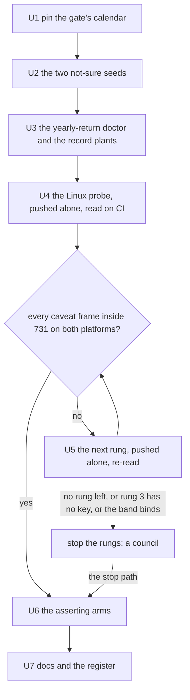

# One-Frame Composites - Plan

**Target:** `projects/the-back-nine`. Every path below is relative to it unless it starts with `.github/`.

---

## Goal Capsule

- **Objective:** on Briggsy's laptop window (1440×731 CSS px at DPR 2), the tallest real households the app can hold show the verdict, its disclosures, the band and the "this can be wrong" caveat without a scroll, on Windows and on CI's Linux. The fit gate keeps measuring those same frames on any date, instead of going red by itself on 2027-01-01.
- **Means:** an explicit calendar for the gate (KTD1, KTD2), plants built only through the app's real producers (KTD3, KTD4, KTD5), record-only Linux probes before anything is asserted (KTD6), the ladder's leading rungs on the return frames and its borrowed size only where a frame still fails (KTD7), then the assertions (KTD8).
- **Authority:** the project's laws (`CLAUDE.md`, and the short tier's law in `--bp-laptop-short`'s docblock in `src/ui/styles/tokens.css`) outrank this plan. Requirements outrank KTDs on behavior, KTDs outrank units on mechanism. Where this plan cites the precedent plan (`docs/plans/features/viewport-1440x731-repoint-build-spec.md`), the cited rule binds.
- **Stop conditions:**
  - pinning the clock changes any number an existing arm prints today (U1): stop and diagnose before U2;
  - a plant's engine-acceptance pin or cause-list proof fails (U2, U3): stop, never loosen the proof;
  - a new plant's caveat is still outside 731 px on either platform after rung 2b and rung 3 has no stable key, or after rung 3, or the band column holds it (U5): stop and call a council, never a tolerance, a word cut, a new type size or a wider scope. The stop halts only the rungs: U6 and U7 still land (U5's stop path).
- **Execution profile:** commits on `main`, one unit per commit, in order. U1, U4 and each rung in U5 are pushed alone, because each one's CI run is the evidence the next step waits on. The record card's seat is not this plan's: a council, then Briggsy's ruling (Open Questions).
- **The ACA precondition.** CI's verify job ran `pnpm verify:aca` before `pnpm verify:fit` (then lines 63 and 96 of the workflow; since the 2026-11-22 split `verify:fit` runs in its own job, `.github/workflows/verify-the-back-nine.yml:147`, so a stale ACA record no longer stops it), and `aca-last-verified.json` goes stale at about 2026-12-12 00:00 UTC (`verifiedOn` 2026-11-12, `maxAgeDays` 30). After that, a push prints no `[fit probe]` line and runs no fit arm. So any push whose evidence is CI's fit log (U1, U4, each U5 rung, U6) lands before then, or after the ACA's re-verify pass (due the week of 2026-12-07, TODO's Check at start).

---

## Product Contract

### Summary

Pin the page clock in every fit harness so the gate's frames stop depending on the date. Add the tallest measured real households as committed plants, built the way the app would really hold them. Read their bottoms on CI's Linux before asserting anything. Step the ladder's leading rungs on the return frames, and its borrowed type size only on a frame that still fails, then assert every new plant. The record-bearing plants assert their caveat. Their standing line is printed until the record card's seat is ruled.

### Problem Frame

The one-frame law is enforced only on the plants the gate renders, and every priced or record-bearing plant carries entered Medicare extras. A household that answers "not sure" funds the typical figure, whose residual runs two lines longer, so the tallest real frames were never planted. Measured at 1440×731 @ 2 on Windows (the register's Tier 0 *The tallest real composites break the one-frame law at his 1440×731 window…*, and the Appendix):

- A Pennsylvania household at its yearly return puts the R13 caveat at 737.3 px, and an off-track one at 744.3. That is "On the line" with "this can be wrong" below the fold, the calm-but-wrong sin.
- Every saved recommendation over typical extras, and the entered-extras household at its yearly return, puts the record card's standing line past 731 (736.9 to 799.3).

A second problem surfaced while planning. The gate reads the wall clock (the register's Tier 0 *The fit gate reads the wall clock…*). Every seed hardcodes `startCalendarYear: 2026`, so on 2027-01-01 every plant renders as a plan built last year. `?vault=rec` and `recold` then move their standing line from 707 to 754.5 px, and CI goes red with no code change (measured under a pinned page clock). The same frame is what a real household meets from the first New Year after it saves a recommendation. No real save exists yet (`docs/backlog.md`: nothing is deployed and no real save exists), so for real households that day is the first New Year after Briggsy's first real saved recommendation (Open Questions). The gate's catalog, though, expires in six weeks unless its calendar is made explicit, and that is this plan's foundation.

### Requirements

**The gate's calendar**

- R1. Every fit-harness arm renders the same frame on any day it runs. A frame aged a year exists only as an explicit plant.
- R2. When the gate's day must move into a later calendar year, a unit test goes red and names the seeds' build-year roll as the job.

**The plants**

- R3. The gate carries the tallest measured real frames as committed plants: Pennsylvania with "not sure" extras, fresh and at its yearly return; an already-failing household with "not sure" extras at its yearly return; the entered-extras household at its yearly return with a saved record (his likeliest return); and Pennsylvania "not sure" with a saved record, fresh and at its yearly return.
- R4. Every plant is a household the app could really hold: the answers the intake writes, a save date the calendar allows, and a record minted through the real mint under the rulebooks of its save. Each is proven by an engine-acceptance pin, and each record by its exact cause list.

**Measurement and the law**

- R5. Before any rung or assertion lands, each new plant's bottoms are read on CI's Linux at the target, beside Windows.
- R6. Every new plant's caveat, and every caveat-class plant's whole frame, holds the one-frame law on both platforms. It gets there only through the ladder's rungs in order, under the short tier's law: the leading rungs on the class of frames that carries the breach, and the borrowed type size only on a frame still outside after them.
- R7. Every record-bearing plant asserts its caveat inside the frame, its card below the caveat, and its card's cause count. Its standing line is printed until the record card's seat is ruled.

### Scope Boundaries

- Not in this plan: the record card's seat (the register entry's prescription (4)). A council sits, then Briggsy rules on his 2026-07-26 placement. The record plants this plan adds are its evidence.
- Considered and not built:
  - seeds whose start year follows the wall year. Shifting `birthYear` alongside moves the Social Security and required-withdrawal birth-year bands on `retired`, the documented knife-edge seed, so every outcome pin would move each New Year. Evidence that would reopen it: a ruling that the gate must see the live year.
  - a `?clock=` URL parameter for viewing a yearly-return plant by hand. Viewed by hand before 2027, the plant floors to a same-year save under older rules, which is still an honest household (KTD3), and the Caddie harness pins its own clock (KTD1). Reopen it if a by-hand reading needs the yearly-return face before New Year.
  - a chosen margin or tolerance on any bottom (insight 065, and the precedent plan's KTD15).

### Deferred to Follow-Up Work

- The seeds' build-year roll. KTD2's binding test reds when the first engine-pricing ledger row of 2027 ships (rows shipped 2026-09-27, 10-09 and 10-21, so likely within weeks of New Year). Do the roll ahead of that row, so the pricing change never lands in one commit with the roll's outcome moves. Filed in U1 with KTD2's surface.
- The unit suite's own wall-clock reads on 2027-01-01, unmeasured. The `annualRoll` tripwire reds the suite that day by design, and nothing else is known. Filed in U1.

---

## Planning Contract

### Key Technical Decisions

- KTD1. **Every fit-harness arm pins its page clock before it navigates, and every node-side date read in those specs reads the same pinned day.**
  - **The days.** The fresh day, `GATE_DAY`, is `FIRST_UNAMBIGUOUS_SAVE_DAY` (`src/engine/pricingVersion.ts:243`). It is read from the source, never typed. Under the pin the plants save on that day: `runPlantDevVault`'s clamp is `max(today, FIRST_UNAMBIGUOUS_SAVE_DAY)` (`src/ui/devSeeds.ts:2737`), and the pinned today is that day. The yearly-return day, `RETURN_DAY`, is the same calendar date one year later. A fixed 365-day count can land in the same calendar year (2028-01-01 + 365 is 2028-12-31).
  - **Their home.** Both days are derived in `src/ui/devSeeds.ts` and exported; `e2e/reviewSurface.ts` re-exports them. The unit tests (KTD2's binding test, U3's arms) and every harness then read one definition, and no unit test imports the Playwright fixture module.
  - **Each plant declares its day.** `AgedPlant` gains an optional view day; a yearly-return plant declares `RETURN_DAY`, and a plant that declares none is viewed at `GATE_DAY`. Every harness that drives a `?vault=` key (the fit arms, U4's probe, `caddie-walk`'s `vault:` targets) pins the day the plant declares, so walk 10's captures show the face the gate certifies. A day is never re-typed per arm.
  - **The pin.** Playwright's `page.clock.setFixedTime` at UTC noon of the day. The fit config sets no `timezoneId`, so Windows reads Eastern time and CI reads UTC; UTC noon is the same calendar day in both, where a midnight pin reads as the day before on Windows. It fixes `Date` and leaves timers and animation frames running (measured 2026-11-20: every frame settled under it). Each arm reads the page's day back and asserts it is the pinned day.
  - **The mechanism.** An auto fixture in `e2e/reviewSurface.ts` that every listed spec takes its `test` from, plus one guard arm that reds when a listed spec imports `test` straight from `@playwright/test`. Without the guard, a future spec would read the wall clock and nobody would notice until a New Year. The fixture pins `GATE_DAY`; one pin helper in the same file re-pins an arm to a plant's declared day and records the day it set, and the read-back asserts the recorded day.
  - **Node-side reads.** Each date the specs compute in Node reads the shared pinned day, never `new Date()`: the stale arm's ledger oracle (`e2e/vertical-fit.spec.ts:2610`) and `recold`'s "Saved in" check (`e2e/vertical-fit.spec.ts:4777`).
  - **Coverage.** `e2e/vertical-fit.spec.ts`, `e2e/chart-text.spec.ts`, `e2e/intake-fold.spec.ts` and `e2e/chart-text-rv.spec.ts`: every CI-gated harness that renders a seed or a plant. Chart-text and the recommendation chart read the plan clock too. Also `e2e/caddie-walk.spec.ts`, so walk 10's captures show each yearly-return plant at `RETURN_DAY`, the face the gate certifies, rather than a same-year save. Not `e2e/csp.spec.ts`, which asserts no layout.
  - **No New Year alarm by default.** Once the gate is pinned, `rec` and `recold` read 707 px on any date, so nothing goes red if the record card's seat is still unruled on 2027-01-01. That date binds only a real household that saved a recommendation in 2026, and no real save exists, so U1 builds no tripwire for it (a guard with no incident behind it). Briggsy ruled that he saves no real plan before New Year (Open Questions), so none is owed.

  Rejected alternative: seeds that follow the wall year (Scope Boundaries).
- KTD2. **The seeds' build year is one constant, bound to the gate's day.** The ten `startCalendarYear: 2026` literals in `src/ui/devSeeds.ts` read one exported `SEED_BUILD_YEAR`. A unit test asserts that `FIRST_UNAMBIGUOUS_SAVE_DAY`'s calendar year equals it (R2), and that `RETURN_DAY`'s year is exactly one later. The day an engine-pricing ledger row ships in a later year, that test reds. Rolling the seeds' year is then a named job, never a date bump. Its known surface: the outcome pins, every seed's birth years (they must move with the start year to keep the same people), and the year literals in `e2e/vertical-fit.spec.ts` (`:1674`, `:3182-3419`). The test's failure message names that surface.
- KTD3. **A yearly return is a plant viewed a calendar year after its save. The doctor never moves the start year.** `doctorYearlyReturn(s, today)`:
  - keeps the seed's start year and every answer;
  - sets `savedAt` to `max(today − YEARLY_RETURN_GAP_DAYS, FIRST_UNAMBIGUOUS_SAVE_DAY)`, the `statestale` floor, so no engine-pricing method line speaks;
  - ages two stamps one step by year arithmetic: `taxVintageDetail.taxYear` − 1, keeping its `legalBasis`, and `healthcareVintage`'s `coverageYear` − 1 and `partBStandardMonthly` − 10. That is the `doctorStaleVault` idiom without its extras strip, its basis rewrite and its start-year move. It touches no other stamp, so the gate speaks exactly two staleness notes, derived in a unit arm.

  The gap lives only inside the doctor: 400 days, `RECORD_AGED_DAYS`' rationale (365 stays inside one year on a leap year's 31 December). At `RETURN_DAY` the floor binds, so the save lands on `GATE_DAY` itself. Viewed at `RETURN_DAY`, the gate renders a plan built in 2026, saved in 2026 and seen in 2027: the aged band, the aged-balances clause and the staleness echo. That works for Pennsylvania, whose start year 2026 meets its first rate row, and it is what the temporary plants measured (Appendix). Viewed by hand at today's real date, the floor makes it a same-year save under older rules, still a real household.
- KTD4. **A record on a yearly return is minted under the rulebooks of its save.** `withMintedRecord` mints it on the doctored save day at this build's solver version. Its `era` is then set to the aged scenario's own five stamps, the record a build of that day would have minted (the `eraOf(s)` idiom, `src/store/__tests__/savedRecommendation.test.ts:44`). The doctor proves at plant time that `deriveSavedRecommendationStatus` yields exactly `['rules-changed']`, and it throws otherwise. `doctorRecordSuperseded`'s docblock, which says no hand should touch the era, is reworded in the same commit to name this one honest exception.
- KTD5. **"Not sure" is the answer the intake writes.** That is `{ kind: 'typical', adoptionVintage: medicareExtrasTypical.value.vintage }` per person (`src/intake/questions.tsx:890`), never a stripped field. A stripped field is a pre-extras save, and it adds a re-confirm line on the gate. Two new seeds carry it: `patypical` (Pennsylvania) and `failingtypical` (the off-track household). Each is a spread of its base that sets only `medicareExtrasByPerson`.
- KTD6. **Linux is read before anything is asserted, at every size the plant's arm will assert.** This is the precedent's KTD8 shape. A record-only describe drives each new plant at its declared day (KTD1), at each viewport its U6 arm asserts, and asserts the tier it expects there (the laptop tier and the short tier at 1440×731 @ 2):
  - `patypical` joins `SPINE_SEEDS` in U6, so it is probed at `REAL` (1440×731 @ 2), `TIER` (1280×800 @ 1) and `SHOWCASE` (1871×917, the full fit with the doors), the matrix `e2e/vertical-fit.spec.ts:1154-1186` runs;
  - every vault plant is probed at `REAL` only, the size the `?vault=stale` arm and the record loop assert.

  Per plant and size it prints one line: `[fit probe] <plant> <size>: clock=<YYYY-MM-DD> attempt=<n> caveat bottom=<px> left end=<px> band end=<px> survivor=<inline|folded> medicare note=<0|1> state note=<0|1>`, plus ` standing bottom=<px> causes=<n>` on a record plant, and ` doors bottom=<px>` at `SHOWCASE`. The clock is the page's day read back. The attempt is Playwright's retry index, so a retried arm's two lines tell themselves apart. The presence fields are what U6 writes into `patypical`'s `SPINE_SEEDS` row and the yearly-return arms' survivor and note checks, read, never guessed (`failing` has never been rendered by a fit arm). The lines are read from CI's verify log by tag, final attempt only. Attempts that disagree are unknown, and an unknown fails the frame.
- KTD7. **The leading rungs go on the return frames; the borrowed size goes only on a frame still outside after them.** The order is the precedent's U3 order, under the short tier's law (rungs 1–2 may apply across the tier; a borrowed register only to a frame still outside after them):
  - rung 2a, the survivor statements' leading → tight, as `.confidence-reveal[data-twopane]:has(.cs-staleness-note)` inside `survivor.css`'s short-tier block;
  - rung 2b, `.cs-staleness-note`'s leading → snug, written at the specificity the precedent names.

  The echo is the class that carries the breach, and from New Year every real return carries it, so rungs 2a and 2b also land on echo frames that already fit: `?vault=stale`, `statestale` and `yearrec`. Every return then reads with one rhythm. Their arms' leading pins take the echo flag. The precedent planned rung 2a tier-wide and never landed it; echo-scoping keeps the fresh frames he has seen unchanged.
  - rung 3, the survivor context and its inner step-down (`.survivor__context .survivor__stepdown`, never a bare `.survivor__stepdown`, which would also shrink the floor relief's trim note) → `--text-sm`. It is keyed to a stable class of each frame still outside after rung 2b, a class that cannot change after the final answer (insight 035). Today none exists: the echo, the Medicare pair and the state note sit on `?vault=stale` too, and the reveal carries no verdict-state attribute. So when U5 reaches rung 3, it stops for a council on the key (a new state hook, or another route), never a wider scope.
  - A fresh frame without the echo (`patypical`, 708.2 on Windows) that Linux puts outside takes the same rule with its own stable class, or the same stop.

  Each rung is pinned on both sides of the tier, the tall side by resizing an echo frame to SHOWCASE (the W5 precedent). Each is followed by `pnpm build`, pushed alone and re-read. Stop at the first rung that holds on both platforms.
- KTD8. **What each plant asserts.** A caveat-class plant gets the full one-frame law in the `?vault=stale` arm's shape. A record plant gets its caveat inside the frame, its card below the caveat in pixels and in the DOM, and its card's cause count. Its standing line is printed, never asserted, until the seat is ruled. This is the 20 px arm's record-only precedent (`e2e/vertical-fit.spec.ts:2077-2090`), never `test.fail`.
- KTD9. **The pin changes no frame today.** After U1, every line the existing arms print (`[U17 record return]`, `[route fit]` and the others) reads the same as before U1, from one `verify:fit` run each side. Today's date (2026-11-20) and `GATE_DAY` (2026-10-22) share a year, and an undoctored plant saves on whatever day the page reads as today, so its frame is the same on both days. The one predicted exception is `?vault=datearrived`'s gate (U1's test scenarios).

### High-Level Technical Design

U1's own docs ride U1's commit (U1's Files). On the stop path, U6 asserts every plant inside 731 on both platforms and gives each stopped frame a record-only arm; the council's ruling builds the rest.

The plant catalog. The Windows numbers come from the temporary plants, with stripped extras where the plant now carries "not sure" (Appendix). U4 re-measures each one.

| plant | base | doctor | day | class | Windows (caveat / standing) |
|---|---|---|---|---|---|
| `?seed=patypical` | `pa` + typical answers | none | `GATE_DAY` | caveat | 708.2 / — |
| `?vault=yearpa` | `patypical` | `doctorYearlyReturn` | `RETURN_DAY` | caveat | 737.3 / — |
| `?vault=yearfailing` | `failingtypical` | `doctorYearlyReturn` | `RETURN_DAY` | caveat | 744.3 / — |
| `?vault=yearrec` | `retired` (entered) | yearly return + record | `RETURN_DAY` | record | 692.4 / 754.5 |
| `?vault=recpa` | `patypical` | `doctorRecordHolds` | `GATE_DAY` | record | 707.4 / 769.4 |
| `?vault=yearparec` | `patypical` | yearly return + record | `RETURN_DAY` | record | 737.3 / 799.3 |

### Assumptions

- A1. The "not sure" answer renders the same result frame as the stripped field the temporary plants measured. On the gate it differs: there is no re-confirm line, and the extras-typical clock stays silent at a fresh vintage. U4's probe confirms or refutes the result frame.
- A2. The 754.5 band-binding frame is faithful. It was measured twice: once by the temporary start-year doctor, and once with no doctor at all, `?vault=rec` under a 2027-01-02 clock. The second needs no birth-year shift, and `yearrec` is that second form plus the aged stamps.
- A3. CI keeps writing test stdout into the verify job's log through the `DotReporter` that Playwright prepends (the precedent's A2). `playwright.fit.config.ts` never gains `list`.
- A4. The tighter leading on echo frames reads calm to his eye. Walk 10 is that check, and its targets gain the new plants (U7).
- A5. The left column binds on both Pennsylvania yearly-return plants. Pennsylvania's aged band has never been measured: the engine refused the start-year doctor, and the clock pin is what first makes it measurable. If U4 shows the band binding on `yearpa` or `yearparec`, no left-column rung moves it, and U5 stops for the council.

### Open Questions

- **The record card's seat. Blocking for the record plants' standing-line assertion only.** Every measured record frame puts the standing line past 731, and the ladder is exhausted (Appendix). A real household meets that frame from the first New Year after it saves a recommendation. After U1 its witness in the gate is `yearrec`. Recommended: the council sits on U4's Linux table, then Briggsy rules on his 2026-07-26 placement. The ruling's build adds the standing-line assertion to every record plant.
- ~~**For Briggsy: will your first real saved recommendation land before New Year?**~~ **⚑ RULED by Briggsy 2026-11-20 (b9-5): "no, not saving a real plan before new years."** So the seat is due before the first New Year after his first real saved recommendation, not 2027-01-01, and U1 builds no tripwire. Never re-ask; if he says he has started saving real plans, the seat comes due before the next New Year.

### Risks

| risk | mitigation |
|---|---|
| A wall-clock read on the page that the pin misses, for example inside a worker | KTD9's before-and-after comparison of every printed line; the engine reads no clock (lint-banned) |
| A rung changes frames beyond the echo frames | each rung's scope is a `:has()` on the echo; the HOLDS twin check and the existing arms' prints catch a leak |
| Linux wraps a frame a line taller than Windows | U4 reads Linux before any rung, and each rung is re-read on Linux (insight 075) |
| The record twin check sits at −1 against ±1 (`docs/landmines.md`) | no rung touches the save slot; any change to the slot re-measures the twin gap first |

---

## Implementation Units

### U1. Pin the gate's calendar

**Goal:** every fit-harness arm renders the same frame on any date (R1), and the seeds' build year is bound to the gate's day (R2).

**Requirements:** R1, R2 (KTD1, KTD2, KTD9).

**Dependencies:** none.

**Files:**
- `src/ui/devSeeds.ts`: `GATE_DAY` and `RETURN_DAY`, derived and exported (KTD1's Their home); `AgedPlant`'s optional view day; `SEED_BUILD_YEAR` replaces the ten literals.
- `e2e/reviewSurface.ts`: re-exports the two days; the auto fixture that pins the clock; the pin helper that re-pins to a plant's declared day and records it; the Node-side pinned-day helper.
- `e2e/vertical-fit.spec.ts`, `e2e/chart-text.spec.ts`, `e2e/intake-fold.spec.ts`, `e2e/chart-text-rv.spec.ts`, `e2e/caddie-walk.spec.ts`: each takes `test` from the fixture; `vertical-fit` also swaps its two Node-side date reads (`:2250`, `:4141`) for the helper; `caddie-walk` pins each `vault:` target at its plant's declared day (before U3 no plant declares one, so every target reads `GATE_DAY`).
- `scripts/__tests__/playwright-harness-partition.test.ts`: the import guard (it already reads every spec's collector).
- `src/ui/__tests__/devSeeds.test.ts`: the binding test.
- U1's docs, in U1's commit, so they land even if U5 stops:
  - `docs/backlog.md`: *The fit gate reads the wall clock…* closed by U1. Two new entries from the Deferred list: the seeds' build-year roll (its trigger is the first 2027 engine-pricing ledger row, so do it before that row; its surface is KTD2's), and the unit suite's 2027 reads. The composites entry's DEADLINE line is re-worded per the Open Question's answer, or its recommended default.
  - `docs/landmines.md`, under the fit gate's area: the gate's calendar. Every arm pins it, a yearly return is a plant viewed at its declared `RETURN_DAY` and never a start-year doctor, and a new harness spec takes `test` from the fixture.
  - `TODO.md`: the Dated row for 2027-01-01 rewritten to what remains, plus a Dated row for the build-year roll beside the `annualRoll` re-source row.

**Approach:**
1. Before U1's code, run `pnpm verify:fit` alone and keep its printed lines. That is the "before" side of KTD9.
2. Derive and export the days and the view-day field in `src/ui/devSeeds.ts`. Then add the re-exports, the fixture, the pin helper and the Node-side helper to `e2e/reviewSurface.ts`, the harnesses' shared home (it already holds `REAL`), per KTD1. The fixture pins `GATE_DAY` by default; an arm driving a plant re-pins through the helper before its own navigation.
3. Point each listed spec's `test` import at the fixture, swap `vertical-fit`'s two Node-side date reads, wire `caddie-walk`'s `vault:` targets to the declared day, and add the guard.
4. Replace the ten seed literals with `SEED_BUILD_YEAR`, and add the binding test (KTD2). No seat tripwire (Briggsy's ruling, Open Questions).
5. Re-run `pnpm verify:fit` alone and compare its printed lines with step 1's. Run `pnpm verify:fit:rv` alone for a green verdict only: its one printed line is a duration, which changes every run.
6. Write U1's docs (Files), then `pnpm verify:doc-stats`.

**Patterns to follow:** `REAL`/`REAL_DPR` in `e2e/reviewSurface.ts` (one home, every harness reads it); the `breakpoint-mirrors.test.ts` binding style for a constant two places share.

**Test scenarios:**
- The binding test passes today: `FIRST_UNAMBIGUOUS_SAVE_DAY` falls in 2026, which equals `SEED_BUILD_YEAR`, and `RETURN_DAY` falls in 2027.
- The binding test reds when `SEED_BUILD_YEAR` is set to 2025, a planted fault reverted by snapshot + `cmp`.
- The guard reds when one listed spec imports `test` from `@playwright/test` (a planted fault, reverted the same way).
- With the fixture's day moved to 2027-01-02, `?vault=rec`'s record arm reds at a standing line near 754.5. This planted fault proves the pin reaches the page; revert it the same way.
- Every arm's read-back day equals the day the pin helper recorded, on Windows and on CI.
- Every line the existing arms print reads the same before and after U1 (KTD9). If any printed line moves, stop (a stop condition). One unprinted change is predicted: `?vault=datearrived`'s gate names the engine-pricing rows its save now falls before, because its doctor saves at today − 30 with no floor. No fit arm prints or counts that gate's notes.

**Verification:** the KTD9 comparison holds; `pnpm test` and `pnpm verify:doc-stats` are green (U1 adds tests); `pnpm verify:fit` and `pnpm verify:fit:rv` are green; CI is green on U1's commit, pushed alone.

### U2. The two "not sure" seeds

**Goal:** Pennsylvania and the already-failing household answer "not sure" on Medicare extras, the way the intake writes it (KTD5).

**Requirements:** R3, R4.

**Dependencies:** U1.

**Files:**
- `src/ui/devSeeds.ts`: `patypical` and `failingtypical` in `DEV_SEEDS`.
- `src/ui/__tests__/devSeeds.test.ts`
- `src/ui/__tests__/survivorSpendingBasisSeedGate.test.tsx`: two census rows, and its count of 16 becomes 18.
- Any other hand-listed seed census the full suite names when it reds.

**Approach:** each seed is a spread of its base that sets only `medicareExtrasByPerson`, one typical entry per person, with `adoptionVintage` read from the constant. `devSeeds.ts` and its test are CRLF (`git ls-files --eol` reads `i/crlf w/crlf` for both, b9-7, 2026-11-20; a U1 reading recorded LF here, which was wrong: an edit script must match CRLF line ends).

**Patterns to follow:** `paAffirmation`'s one-field spread; the census rows' hand derivation in `survivorSpendingBasisSeedGate.test.tsx`.

**Test scenarios:**
- Each seed is engine-accepted (the existing `DEV_SEEDS` sweep adds the arm by itself) and resolves a real `outcomeState`, pinned as found.
- Each seed's answers survive the codec's round trip with `kind: 'typical'` and the live vintage.
- Each seed's fresh save fires no staleness clock (the extras-typical clock is silent at the live vintage).

**Verification:** `pnpm test` green with the census counts moved; `pnpm typecheck` and `pnpm lint` 0.

### U3. The yearly-return doctor and the record plants

**Goal:** the five vault plants of the catalog, each a household the app could really hold (R3, R4).

**Requirements:** R3, R4 (KTD3, KTD4).

**Dependencies:** U2.

**Files:**
- `src/ui/devSeeds.ts`: `doctorYearlyReturn`, the yearly-return record doctor, the `AGED_PLANTS` entries `yearpa`, `yearfailing`, `yearrec`, `recpa` and `yearparec`, and the reworded docblock on `doctorRecordSuperseded`.
- `src/ui/__tests__/devSeeds.test.ts`: the U10 sweep's hand list of `AGED_PLANTS` keys, the engine-acceptance pins, and the record-status arms. Its `plant()` helper gains a base parameter.

**Approach:**
1. `doctorYearlyReturn` per KTD3. It fails loud on a base with no healthcare stamp to age, never a silent no-op.
2. The record doctor composes it with a mint per KTD4, and throws unless the status is exactly `['rules-changed']`.
3. `recpa` is `doctorRecordHolds` over `patypical`: no doctoring beyond the existing one.
4. `yearpa`, `yearfailing`, `yearrec` and `yearparec` declare `RETURN_DAY` as their view day on their `AGED_PLANTS` entries (KTD1); `recpa` declares none. Every harness then pins them there with no per-arm day.
5. Every doctor is exported and docblocked with what it moves, why, and the face it shows at `RETURN_DAY` and by hand at today's date.

**Patterns to follow:** `doctorStateStaleVault` (the floored `savedAt`), `doctorStaleVault` (stamp ageing by year arithmetic), `doctorRecordSuperseded` (prove the cause, never a silent one), `statestale`'s engine-acceptance arm (`devSeeds.test.ts`).

**Test scenarios:** the new arms call each doctor with `today = RETURN_DAY` (or `GATE_DAY` for `recpa`) passed in, never the wall clock. The existing sweeps they extend keep their own `currentEpochDay()`.
- Each yearly-return plant's re-entry gate speaks exactly two staleness notes (the tax and the healthcare clocks), derived through `deriveStaleness` and `composeReentry`, never typed.
- Each plant hydrates, builds, passes `validateParams` and resolves a real `outcomeState`, pinned as found (insight 085).
- `yearrec` and `yearparec`: the status's causes equal `['rules-changed']`; the record's era equals the doctored scenario's five stamps; its fingerprint equals the fresh one; its `mintedAt` year comes before `RETURN_DAY`'s year.
- `yearpa`, `yearfailing`, `yearrec` and `yearparec`: `savedAt` is not before `FIRST_UNAMBIGUOUS_SAVE_DAY`, so the gate's engine-pricing note count is zero, derived from the ledger, never typed.
- Each yearly-return plant fires the tax and healthcare staleness clocks and keeps its start year and answers byte-equal to its base.
- A base with no healthcare stamp makes `doctorYearlyReturn` throw.
- The plant guard's codec round trip keeps every record (no `record-dropped`).

**Verification:** `pnpm test` green; each new key is in the sweep's list; `pnpm typecheck` and `pnpm lint` 0.

### U4. Read Linux before anything is asserted

**Goal:** each new plant's bottoms on Windows and on CI's Linux at the target, before any rung or assertion (R5).

**Requirements:** R5 (KTD6).

**Dependencies:** U3.

**Files:** `e2e/vertical-fit.spec.ts`, the probe describe, placed after the spend-lane describe as the precedent's was.

**Approach:**
1. Restore the precedent's probe shape from commit `83802b7a6`, extended by KTD6's fields. Each arm pins its plant's declared day (KTD1) and drives it at each size KTD6 names, the way its asserting arm will (U6).
2. Run `pnpm verify:fit` alone on Windows and keep the lines.
3. Push the commit alone (the ACA precondition holds). Wait on CI by the full sha and the run id. Read the verify job's log by tag, final attempt only.
4. Record the table: plant, size, Windows, Linux, which column binds, and the presence fields. It goes into U5's or U6's commit message and into the composites folder's README.

**Execution note:** a measurement first. The describe asserts no fit.

**Test scenarios:**
- Each probe arm asserts the laptop tier and the short tier before it prints (insight 125).
- A missing element makes the arm throw, and a non-finite value fails it.

**Verification:** a written table with a Linux and a Windows number for every plant, read from the head run's final attempts.

### U5. Rungs for the caveats that fail

**Goal:** every new plant's caveat inside 731 on both platforms, record plants included (`yearparec`'s caveat measured 737.3), through KTD7's rungs in order (R6). "A failing caveat" below means any new plant whose caveat bottom U4 reads past 731 on either platform.

**Requirements:** R6 (KTD7).

**Dependencies:** U4. U5 is skipped when U4's table shows every new plant's caveat inside on both platforms.

**Files:**
- `src/ui/styles/survivor.css` and `src/ui/styles/confidence.css`, inside their existing short-tier blocks.
- `e2e/vertical-fit.spec.ts`: each rung's computed-style pin on both sides of the tier. `assertDensityTier`'s survivor-leading band gains an echo flag, passed by every echo arm (`?vault=stale`, `statestale` and the new yearly-return plants), whose pins rung 2a moves. A new reader covers `.cs-staleness-note`'s leading.
- `src/ui/styles/tokens.css`: the law's docblock names the new rungs beside W1–W7, L1 and L2.

**Approach:** for each failing frame, take the next rung:
1. Write it.
2. `pnpm build`, because the CSS minifier is what refuses a broken nest (insight 061).
3. Pin it on both sides of the tier.
4. Run `pnpm verify:fit` alone.
5. Push it alone and re-read the probe lines on Linux.

The precedent's Windows deltas are the starting estimates: rung 2a −8.8 px, rung 2b −2.7 px, rung 3 −11.2 px (Appendix). Each later rung is re-measured on top of the earlier ones. The Windows estimates already put the already-failing yearly return at 732.9 after rung 2b, so expect rung 3, and with it KTD7's council stop on its key, unless Linux measures it inside. A caveat that the band column holds (A5) also stops for the council: no left-column rung moves it.

**Execution note:** the rule decides, not the estimate. A rung that does not move the Linux number did nothing (insight 075).

**The stop path.** When a stop condition fires (no rung left, rung 3 with no stable key, or the band column binding), U5 ends at the last rung that landed, already pinned and pushed alone, and asks for the council with U4's table and each rung's re-read. It does not wait for the ruling. U6 then runs on that head: it asserts every plant whose caveat is inside on both platforms and gives each stopped frame a record-only arm. A breach at `TIER` takes the same rungs, since `TIER` sits inside the short tier. A breach at `SHOWCASE` sits outside the tier, where no rung applies, so it stops the same way.

**Test scenarios:**
- Each rung's pin reds on every platform when its rule is deleted (a planted fault, reverted by snapshot + `cmp`). Name, before running it, which arms can red and which cannot (insight 126).
- On the tall side, the echo frame resized to SHOWCASE reads every new rung dark.
- No rung moves a frame without the staleness echo: the existing arms' printed lines stay the same.
- If rung 3 lands, `?vault=stale`, `statestale` and `yearrec` keep the survivor context and its step-down at body size, and so does the floor relief's trim note on every frame.

**Verification:** U4's table, re-read, shows every new plant's caveat inside 731 on both platforms at the commit U6 builds on, or, on the stop path, names each stopped frame and the council asked.

### U6. The asserting arms

**Goal:** the gate holds every new plant to its law (R6, R7), and the probe describe goes.

**Requirements:** R6, R7 (KTD8).

**Dependencies:** U5, done or stopped (its stop path), or U4 when U5 was skipped.

**Files:** `e2e/vertical-fit.spec.ts`.

**Approach:**
1. `?seed=patypical` joins `SPINE_SEEDS` (the REAL/TIER/SHOWCASE matrix, the 20 px arm and the 24 px arms that loop it). Its row's `medicareNote`, `stateNote` and `survivor` are U4's probe fields, never guessed.
2. `yearpa` and `yearfailing` get arms in `?vault=stale`'s shape at their declared day, with their survivor and note checks taken from U4's probe fields:
   - the gate frame first: the affirm button inside the frame, and the note count derived from the ledger;
   - then the result: the echo visible, one visible caveat, the backup door below it, `assertFrameFits` with the backup door sanctioned, the survivor basis inline, and the density tier with KTD7's flags.
3. `yearrec`, `recpa` and `yearparec` join the record loop, each at its declared day. Each asserts its caveat inside the frame, its card below the caveat in pixels and in the DOM, and its card's cause count. Each prints its `[U17 record return]` line with the standing bottom. The loop's standing-line assertion stays on `rec` and `recold` only. `yearrec` and `yearparec` carry the echo, so their density check passes KTD7's echo flag.
4. On U5's stop path, each stopped frame's caveat assertion is held: its arm prints its caveat bottom and asserts everything else, the 20 px arm's record-only precedent (`e2e/vertical-fit.spec.ts:2077-2090`, never `test.fail`). Its comment names the council, and the council's ruling build restores the assertion.
5. Delete the probe describe.

**Patterns to follow:** the `?vault=stale` arm, the record loop and its `[U17 record return]` print, and the 20 px arm's record-only comment, quoted at the record plants' print.

**Test scenarios:**
- Deleting a caveat-class plant's rung reds its arm (U5's planted fault, now reading the asserting arm).
- A record plant whose card loses a cause reds its cause-count assertion.
- Seating a record plant's card above its caveat reds its order assertion.

**Verification:** `pnpm verify:fit` green alone on Windows; CI green on both jobs at the head.

### U7. Docs, the register and the landmines

**Goal:** every live statement matches what was built.

**Requirements:** R1–R7.

**Dependencies:** U6 (which also runs on U5's stop path). U1's docs already landed with U1.

**Files:**
- `docs/backlog.md`:
  - the composites entry's prescriptions (1) and (3) marked built, with U4's table. On the stop path, (3) is marked built up to the last rung, with the stopped frames and the council named. Its prescription (4) stays open, with the due date U1 wrote.
  - the Tier 3 yearly-return entry pointed at the composites entry.
- `TODO.md`: walk 10's targets gain the new plants, each at its declared day through the Caddie harness's pin.

**Test expectation:** none -- docs only. `pnpm verify:doc-stats` is the gate.

**Verification:** `pnpm verify:doc-stats` 0.

---

## Verification Contract

| check | command | when |
|---|---|---|
| types | `pnpm typecheck`, plus each edited spec through a scratch tsconfig (`e2e/` is outside it; filter the eight known `Node.remove` errors) | every unit |
| lint | `pnpm lint` | every unit |
| unit suite | `pnpm test` | U1, U2, U3 |
| build | `pnpm build` | U1, every U5 rung, U6 |
| fit gate | `pnpm verify:fit`, alone on an idle machine, never beside another suite | U1 (before and after), U4, every U5 rung, U6 |
| recommendation chart | `pnpm verify:fit:rv`, alone | U1 |
| doc numbers | `pnpm verify:doc-stats` | U1, U2, U3, U7 (CI runs it before `verify:fit`, so a stale count hides the fit run) |
| CI | the run for the full sha, by run id (`gh run view <id> --json status,conclusion`) | every push; U4 and each rung read from the log; a fit-evidence push only while `aca-last-verified.json` is fresh (the Goal Capsule's ACA precondition) |

---

## Definition of Done

- Every arm in the four fit harnesses and the Caddie harness pins its clock, each `?vault=` plant at its declared day. The binding test stands, and the KTD9 comparison read the same. U1's docs landed in U1's commit.
- `patypical`, `failingtypical`, `yearpa`, `yearfailing`, `yearrec`, `recpa` and `yearparec` are committed. Each has its engine-acceptance pin, and each record has its cause-list proof.
- U4's table holds a Windows and a Linux number for every plant, and it is written in the commit history and in the composites folder's README.
- Every caveat-class plant passes the one-frame law on CI and on Windows. On U5's stop path, each stopped frame instead prints from an arm that holds only its caveat assertion, naming the council. Each rung that landed has its pins on both sides.
- Every record plant asserts its caveat, its order and its cause count, and prints its standing line.
- The probe describe is gone. No temporary plant, scratch file or abandoned rung is left in the tree.
- The register, the landmines file and the TODO say what was built, and `pnpm verify:doc-stats` is 0.

---

## The blind readers' minor faults (listed, not folded)

Three blind readers (builder, rules, owner; Opus xhigh, run `wf_ca8f7965-32e`, 2026-11-20) found 29 faults. Their eight misleads were checked against the code and fixed above in five fixes: each `?vault=` plant declares its day, read by every harness including the Caddie walk (KTD1); the probe reads every size an arm asserts, with its presence fields (KTD6, U4, U6); U5's stop path, with U1's docs riding U1; the ACA precondition; and the seat's tripwire made Briggsy's call (Open Questions). Their 21 minors are listed here, each checked against the code, for the unit named to take as it builds. "Closed" marks a minor the fixes above settled in passing.

- **U1, Node-side reads (builder 5, rules 4).** `e2e/caddie-walk.spec.ts:837` typed the Roth plan's start year as `new Date().getFullYear() + 1`, on the wall clock, in a spec U1 pins. Closed in U1: it reads `pinnedYear(page) + 1`. Durations (`chart-text-rv.spec.ts:90`, `:97`) stay on the clock.
- **U1, the guard's set (builder 8, rules 9, owner 6).** A typed list of the five specs misses the future spec the guard exists for. Take the set from the fit, fit-rv and Caddie configs' own collectors, which `playwright-harness-partition.test.ts` already runs. Closed in U1: the guard reads the three collectors, each required to collect at least one spec.
- **U1, the read-back (builder 6).** Closed: the pin helper records the day it set.
- **U1, the save-day slip, the 365-day reason and the days' home (rules 7, rules 10a).** Closed: KTD1's rewrite.
- **KTD2, the roll's surface (rules 10b).** It also includes `e2e/caddie-walk.spec.ts`'s year literals (`:1326-1344`, `:1542-1571`, `:2062-2063`). Closed in U1: the binding test's failure message and the build-year-roll register entry name them.
- **Every fit-evidence push (builder 11, rules 3).** U1–U3 add tests, so `README.md`'s and `docs/roadmap.md`'s counts move (`verify:doc-stats`). CI runs `verify:doc-stats` and `pnpm test` before `verify:fit`, and doc-stats arm 4 reads this plan's line citations. Run both before U4's push, each U5 rung's push and U6's push, the precedent's habit, so a red there never starves the fit evidence.
- **U3, the test helper (builder 7).** The record describe's `plant()` hard-coded its describe's `TODAY` and the `retired` base. Closed in U3: it takes a base and a day, and stamps the save as `runPlantDevVault` does; U3's own describe drives each plant through `AGED_PLANTS` at its declared day.
- **U3, the survivor census (rules 11).** Its docblock said the universe held "the four aged vault plants", and only the seed count was enforced. Closed in U3: the five rows (hand-derived), the docblock re-worded, and the census arm now also reads `AGED_PLANTS`, so a new spine-based vault plant without a row reds by itself.
- **U3/U4, yearfailing's survivor and notes (builder 9).** Closed: U4's probe fields.
- **U4, the gate frame (builder 10).** U6 asserts the yearly-return gate's affirm button inside the frame, but the probe reads only the result. Add ` gate affirm bottom=<px>` to the yearly-return probe lines. That gate also speaks the elapsed line: `RETURN_DAY` − `GATE_DAY` is 365 days, and the line fires from 365 (`src/ui/reentryChrome.ts:362-366`).
- **KTD7, the rung-3 brief (rules 5).** Two reasons given for the stop are wrong. `.confidence-reveal` does carry `data-framing` (`src/ui/ConfidenceStatement.tsx:399`), and `?vault=stale` renders no `.cs-state-note`. A `.cs-medicare-residual--typical` class also exists. The conclusion stands: stale is borderline, so its framing is `action-first`, the same as a failing household (`src/ui/outcomeStates.ts:54-59`), and nothing separates the failing frames from stale. Brief the council with these facts.
- **KTD7, the key's shape (owner 3).** The key's shape can be put to the council when U5 starts, not after two rung pushes: a verdict attribute set once the final answer lands (insight 035), or the precedent's selector list of each failing frame's class. KTD7's last bullet also stops a fresh frame at rungs 1–2, which is wider than the tier's law requires: rungs 1–2 may apply across the tier.
- **A5 (rules 6).** Pennsylvania's aged band was measured: `b9-4-clock2027.txt` reads `?seed=pa` at 2027-01-02 with the band at 32–645.2 px. The typical left column runs to 688 px, so the left column binds. Keep A5's council stop as a guard, but its premise is settled.
- **Scope Boundaries, the wall-year seeds (rules 8).** A forward birth-year shift crosses no Social Security retirement-age or SECURE 2.0 band for `retired` (born 1960 and later is 67 and 75). The rejection stands on other reasons: NC's year-keyed rate steps (`src/engine/constants/stateTax.ts:89-92`), the per-year deflation of the Social Security tax thresholds, the IRMAA growth base, and other seeds' birth years crossing bands (`failing`, 1953 → 1954, crosses the deemed-filing cutoff). Restate it, so nobody refutes the weak reason and reopens the idea.
- **R4, KTD3, KTD4, faithfulness (owner 4).** The yearly-return plant is a 2026 save stamped with the 2025 rulebooks, which no build of that day wrote. A real 2026 record seen in 2027 would likely also show `solver-changed`. What is faithful: the stamps sit one year behind the build, as a real return's do, and the standing line sits above the cause list, so the cause count moves no protected line. Drop "still a real household" for the by-hand face, and check that nothing on the frame prints the stamp year.
- **The Goal line (owner 5).** Its list of what fits leaves out the record card's standing line, which the law also protects and every record plant still breaches. "Instead of going red by itself" also reads as if that red were a false alarm. Say both in U7's register words.
- **Walk 10 (owner 7).** KTD9's one predicted face change, `?vault=datearrived`'s gate naming the engine-pricing rows, also shows on the Caddie walk (`e2e/caddie-walk.spec.ts:2173-2201`, `:958-987`). Add it to walk 10's watch items, so a reader never logs it as a regression.

---

## Appendix

### The measured catalog (Windows, 1440×731 @ 2, temporary plants, reverted)

Source: `C:\Users\brigg\.claude\projects\C--Users-brigg-ai-learning-journey-projects-the-back-nine\b9-repoint\composites\README.md`, b9-3's section and the "b9-4" sections. That is machine-local, and the register's Tier 0 entry carries the same numbers.

| frame | caveat | standing | with U3's whole ladder |
|---|---|---|---|
| Pennsylvania, typical, yearly return | 737.3 | — | 715.4 |
| off track, typical, yearly return | 744.3 | — | 701.7 |
| retired, typical, saved record | 686.6 | 748.6 | 731.1 |
| Pennsylvania, typical, saved record | 707.4 | 769.4 | 751.9 |
| retired, typical, yearly return + record | 716.5 | 778.5 | 747.9 |
| Pennsylvania, typical, yearly return + record | 737.3 | 799.3 | 768.7 |
| retired, entered, yearly return + record, start year kept | 674.9 | 736.9 | 706.3 |
| Pennsylvania, entered, yearly return + record | 695.7 | 757.7 | 727.1 |
| retired, entered, yearly return + record, a year on (the band binds) | 692.4 | 754.5 | 745.8 |

The ladder's steps on the caveat frames (Pennsylvania / off track): rung 2a 728.5 / 735.6, rung 2b 725.8 / 732.9, rung 3 715.4 / 701.7.

### The 2027-01-01 measurement (HEAD code, the page's clock pinned to 2027-01-02)

`?vault=rec` and `recold`: caveat 692.4, standing 754.5 (today 645 / 707). `?seed=retired`, `pa`, `budget` and `?vault=statestale`: caveat 692.4. `?vault=stale`: 716.5, unchanged. The band grows from 529 to 645.2 px on every frame built in 2026.
