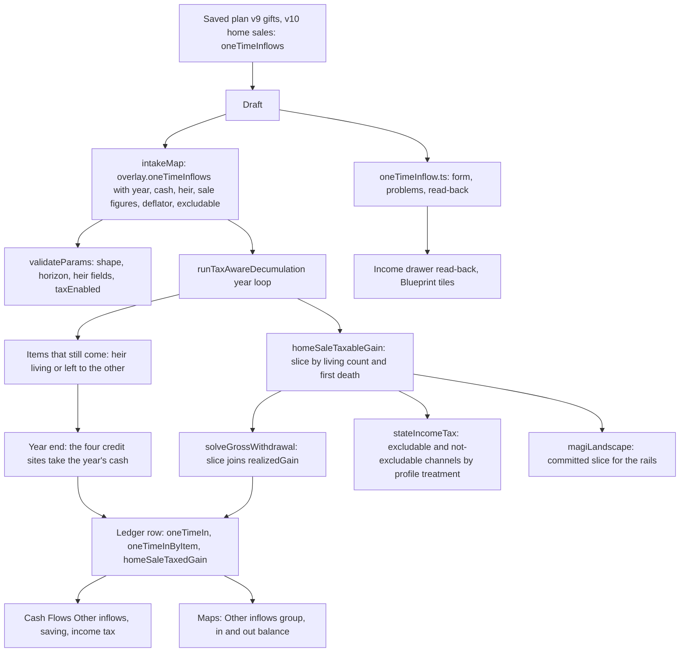

# One-Time Money In (an Inheritance, a Gift, a Home Sale) - Plan

## Goal Capsule

- **Objective.** A household expecting money once (an inheritance, a gift, or what it keeps from selling its home) gets an answer that counts that money in the year it arrives, on the paths where it still comes, and charges the tax the law charges on it (less the exceptions Scope Boundaries names, the 3.8% surtax and a home sold in a state other than the plan's among them), with the money and its tax shown in its own numbers on the screens where RightCapital shows them.
- **Means.** A dated list of one-time inflows on the saved plan and the engine params, credited to the taxable account at the end of its calendar year on every path where it still comes (KTD1, KTD3, KTD12), with a home sale's taxable gain joining the year's federal tax through `realizedGain` and the state tax and the solver's rails through new presence-keyed channels (KTD6, KTD7, KTD8).
- **Authority.** This plan's Requirements win on product behavior and its KTDs win on mechanism. Project law outranks both: `CLAUDE.md`, `docs/architecture.md` (the byte-identity and presence-key invariants, the single shared market draw, the constants discipline), and `docs/product.md` §4 (D7).
- **Execution profile.** Built on main, as one or more commits per unit in the order of the units below; no branches and no pull requests (`CLAUDE.md`, *Test cadence*). Two halves, each with its own schema version: the inheritance-or-gift half (U1 to U6) first, then the home-sale half (U7 to U12). Every commit that touches `src/engine` or `src/intake/intakeMap.ts` carries `pnpm engine:identity`'s first line in its message.
- **Who finishes.** The pilot builds, reviews and ships every unit. Briggsy reads the new words after they ship; they ship flagged, never held for his read. One call is his (Open Questions), with a recommended answer the build proceeds on; it gates only the home-sale half, so a "no" skips U7 to U12 whole. About five sessions, two and a half per half: U1 and U2, U3 and U4, U5 and U6; then U7 to U9, U10 to U12.
- **Stop conditions.** Stop the line and diagnose when any of these happens: `engine:identity` moves a key on an existing seed or plant; a tax rule this plan rests on disagrees with its primary source; the gross-up stops converging on any plant carrying a home sale; U2's or U9's measure (KTD3, as reopened) finds the year-end credit lets more than 1 in 100 of the thin-savings fixture's paths last that run out with the money spread over its year, or reads a higher share of paths lasting than the spread (reopen KTD3 before the next unit).

---

## Product Contract

### Summary

The household can add money it expects once, on Profile → Income: an inheritance or gift (one amount, and for a couple whose it is), or a home sale (what it sells for, what was paid, what is kept, whether it was the main home, and whether it was ever rented or depreciated). Each item has the calendar year the money arrives. The engine adds the kept money to the taxable account at the end of that year at full cost basis, on every path where it still comes, and taxes a home sale's gain above the main-home exclusion as a long-term capital gain that year, federal and state. Cash Flows, Maps, Blueprint and the drawers show it in the household's numbers. A plan with none runs exactly as today.

### Problem Frame

Only recurring income streams and spending lines exist (`src/shared/model.ts`: `IncomeStream`, `BudgetLineItem`). A household that expects an inheritance, or plans to sell its home and downsize, can only enter it as an "Other" income stream with the same start and end age. That leaks: a year's draw is floored at zero and nothing credits income above spending back to savings (`cashTermsForYear` in `src/engine/simulate.ts`; `docs/architecture.md`, "never contributes surplus back"), so every lump dollar above that year's spending vanishes, and in a working year all of it does. The answer reads gloomy by the size of the lump, unmeasured. A home sale's gain is never taxed at all. The register files this as *A known one-time inflow — an inheritance, a home sale, downsizing — has no place to go* (`docs/backlog.md`), and the RightCapital map ranks it gap 5 (`docs/plans/rightcapital-map.md`, rows 75 and 85).

RightCapital handles both: an inheritance under Income → Other → Inheritance (amount and year, tax-free for cash and investments, shown in Cash Flows' "Other Inflows" column), and a main-home sale as a Goals → Primary Home Relocation card that prices the capital-gains tax (its help center, read second-hand through search on 2026-11-28, as the map's sources note).

### Requirements

**Entering it**

- R1. The household can add any number of one-time inflows on Profile → Income through its Add menu, each one of two kinds: an inheritance or gift, or a home sale. The first-run stepper's Income step shows the same cards.
- R2. Every item has a name and the calendar year the money arrives, from the plan's first year (`startCalendarYear`) through its last horizon year. A year outside that range is refused in words that name the range.
- R3. An inheritance or gift asks one amount, in today's dollars: the cash or investments the household expects to inherit, after any estate or inheritance tax, or a gift of cash. The question says an IRA, 401(k), 403(b) or annuity doesn't belong in it, because those are taxed when money is taken out, and neither do shares given by someone living, because they keep the giver's cost. For a couple it asks whose it is (one of them, or both), and when it is one person's, whether it would still come to the other if that person has died first.
- R4. A home sale asks five things: what it would sell for today after agent fees and closing costs; what was paid for it, plus the closing costs paid when buying it and any improvements, less any gain rolled into it from a home sold before May 1997; how much will be kept to invest after paying off any loan on it and buying the next home, before any income tax on the sale (at most the first figure, and $0 allowed); whether it will have been owned and lived in as the main home of everyone in the household for at least 2 of the 5 years before the sale, with no other main home sold in the 2 years before it; and whether any part of it was ever rented out or depreciated (a home office included), or was a rental or second home after 2008 before it became the main home. A yes to that last question is refused in words, because part of such a sale's gain is taxed in ways these questions can't capture and the tool doesn't price it yet.
- R17. An item dated in the year the plan's balances were last saved (the plan's first year on a plan never saved) asks whether the money had come in by then. A gift that had is refused in words, because it is in the balances already; a home sale that had closed is kept as closed, counts $0 kept, still counts its tax, and its card and drawer say so. One rule with R15: both key on the year the balances were saved, never on today's year.

**How it counts**

- R5. The kept money joins the taxable account at the end of its calendar year at full cost basis, in a working or a retired year, in the same calendar year whatever stop the date search tests. It earns nothing in its arrival year and does not pay that year's bills.
- R6. On a path whose savings run out in or before the money's year, the path still counts as running out and the money is not counted on it. After both people have died it is not counted. A couple's item that is one person's counts only on paths where that person is living in its year, unless the household said it would still come to the other.
- R7. An inheritance or gift adds nothing to any tax.
- R8. A home sale's gain is its sale amount in the sale year less what was paid, which is a fixed past dollar figure. For federal tax, a main home leaves out $500,000 of gain while both people are living (the year one dies included) and in the first year after a death; it leaves out $250,000 for a one-person household or a survivor after that. A home that was not the main home leaves out nothing, and neither does a home sale 2 or fewer calendar years after an earlier main-home sale. The rest, when above $0, is a long-term capital gain in the sale year, in the federal tax, the share of Social Security that is taxed, and the incomes the ACA subsidy and the Medicare surcharge read. The left-out amounts and the price paid are fixed dollars, so in today's dollars they shrink every year.
- R9. State tax: North Carolina taxes the federally taxed part; Pennsylvania taxes nothing of a main-home gain and all of any other sale's gain (a home that was not the main home, or one sold 2 or fewer calendar years after an earlier main-home sale); Florida taxes nothing. An unpriced state runs as today.
- R10. A plan with no one-time inflow runs exactly as today, byte for byte, on every seed and plant.

**Showing the work**

- R11. Each drawer reads the answer back in the household's numbers: the year and the amount added to the taxable account (in today's dollars and in that year's dollars), and for a home sale the gain, the part left out and the part taxed, at the sale year's prices, for a couple and, where it differs, for a survivor; never a dollar of tax, which is one engine figure for the year. When a part is taxed, it says the 3.8% surtax on investment income isn't counted yet, so the sale year's tax may read low, and it names the plan's state as the one whose rules apply. A home sale's drawer names the housing costs a sale ends (a mortgage payment, property tax) and the ones it starts (rent, a retirement community's monthly fee), to change or add in Expenses; on the date route it says a line's years count from when work stops, so a line can't yet be set to start or end in the sale's year and may start or end in a different year on each stop the answer tries. A plan with no savings says the money can't be counted because the plan runs out in its first year.
- R12. Cash Flows' Summary shows each year's one-time money in an "Other inflows" column and again as saving into the taxable account, so Maps still balances every year; a home sale's tax shows inside that year's income tax.
- R13. Blueprint shows each item on its Goals timeline at its calendar year, with both ages, and in its Income lane beside the Income page's other cards.
- R14. Each drawer says the year and amount are the household's own estimate and the answer counts them as entered. Settings' methodology says how one-time money counts.
- R15. On a plan whose balances were last saved in or after an item's calendar year, an item not saved as closed says so on its card, in its drawer and at the re-entry gate: dated before that year, if the money came, it is in those balances, so the item should be deleted or the money counts twice; dated in that year, the same if the money came in before the save. A sale saved as closed and dated before that year says it of its tax: it was paid from those balances, so the item should be deleted or the tax counts twice.

**Compatibility**

- R16. Schema version 9 holds the list and its inheritance-or-gift items; version 10 adds the home-sale kind. A plan saved by a build opens in an older build as "saved by a newer version", and an older plan opens here unchanged. A kept what-if carries the plan's items unchanged.

### Key Decisions

- **It lives on Profile → Income, not Goals or Net Worth.** RightCapital takes an inheritance under Income; its home-sale card is a Goals relocation that also models the next home, which B9 doesn't hold, and B9's Net Worth holds no property. One home for all money coming in. Governs R1.
- **Two kinds only.** The map names an inheritance and a home sale; a gift has an inheritance's tax character. Everything else is a non-goal (Scope Boundaries). Governs R1, R3, R4.
- **Two halves, the gift half first.** The inheritance-or-gift half is built whatever Briggsy's answer to the Open Question; the home-sale half is its own units and its own schema version, so a "no" skips it whole (insight 190). Governs R1, R16.
- **The kept figure is asked, never derived.** B9 has no loan record and doesn't model the next home, so only the household knows what it keeps. The tax still reads the gain, from the sale and cost figures. Governs R4.
- **The money arrives at the end of its year.** The convention every year-end credit in the engine already follows. It reads the arrival year low on a path whose arrival-year return is positive or whose draw empties savings first, and high on a path whose return is negative, where the money skips that year's loss; U2 and U9 measure both directions (KTD3). Governs R5, R6.
- **No Action Items lever in this gap.** No lever touches income today, and a what-if carries the plan's items as they are. RightCapital's tray has an "Existing asset sales" section; that is filed for later. Governs R16.

### Acceptance Examples

- AE1. **Covers R5, R7.** Given a retired plan and a $200,000 inheritance in 2031, when it runs, then 2031's draw and tax are the same as without it, the taxable account and its cost basis each end 2031 $200,000 higher on every funded path, and 2032 onward differs.
- AE2. **Covers R8.** Given a couple selling their main home in 2032, $900,000 after costs in today's dollars, paid $300,000, both living, when 2032 runs, then the gain is $900,000 less $300,000 deflated to 2032, the left-out part is $500,000 deflated to 2032, and the rest is taxed as a long-term gain in 2032.
- AE3. **Covers R8.** Given the same sale on a path where one person's last year living is 2032, 2031 or 2030 (so 2032 is the death year, the first year after it, or the second), then 2032 leaves out $500,000 deflated in the first two cases and $250,000 deflated in the third.
- AE4. **Covers R9.** Given the AE2 sale in Pennsylvania, then 2032's state tax equals the same plan's without the sale; in North Carolina it adds the state rate on the federally taxed part.
- AE5. **Covers R5, R10.** Given a working household on the date route with a $250,000 inheritance in 2030, then every tested stop credits it in calendar 2030, and a plan without it reads IDENTICAL on every `engine:identity` key.
- AE6. **Covers R3, R6.** Given a couple's $200,000 inheritance in 2031 that is the first person's and would not come to the second if the first has died, then a path where the first person's last year living is 2030 counts none of it, and a path where it is 2031 counts all of it.

### Scope Boundaries

- Not built, filed for later (U6 and U12 file each):
  - The arrival year's bills, and a sale's own tax, paid from the money first (RightCapital's way, insight 185's front-of-the-gross shape). Year end reads the arrival year low on most paths (one year's growth on the money, and the tax on that year's draw) and high on a path whose arrival-year return is negative; on a thin path the arrival year's draw or the sale's tax can run the path out before the money lands, so R6 drops it all. U2 and U9 measure both directions on a thin-savings fixture, and the register entry records both counts.
  - An IRA, 401(k) or annuity the household expects to inherit (gap 3 takes only one already inherited; R3's words keep it out of a gift's amount).
  - A home in a different state from the plan's: B9 prices one state for the whole plan, so a home sold in North Carolina after a move to Florida misses North Carolina's tax on the gain. R11 names the plan's state.
  - Gap 8's stresses: a higher-inflation stress must re-deflate a sale's cost and exclusion through the stressed index, or the gain reads low (filed on `docs/plans/rightcapital-map.md`'s gap 8 line, as gap 4's deflator line was).
  - The late spouse's half of the home reset to its value at death on a survivor path (IRS Publication 523). Leaving it out overstates a survivor's taxed gain, never understates it.
  - An Action Items lever to leave an item out or move its year (RightCapital's "Existing asset sales").
  - The 3.8% surtax on investment income: unpriced everywhere in the engine (the register's Tier 0 NIIT entry); this gap adds the home sale to that entry's reach and says so in the drawer (R11).
  - A budget line that should start or end at the sale. An ending cost (a mortgage payment, property tax) left running reads gloomy; a starting cost (rent, a community's monthly fee) left out reads rosy. On the date route a line's years count from each tested stop, so a line set to end at the sale ends too soon on an earlier stop (rosy), and a rent line starts too late on a later one (rosy); no budget line runs in a working year at all. R11 says so where the household reads it; calendar-year line windows are their own build, filed beside gap 4's loan half (U12).
- Non-goals, considered and not built:
  - A second home or rental sold with depreciation taken, a partial exclusion for a move forced by work or health, Pennsylvania's work or health exception to its two-year rule, gifted investments that keep the giver's cost, an inherited IRA (gap 3's kind), and life insurance on a household member. Each changes the tax in ways one question can't capture; the words name the two kinds the tool prices, and R4's last question refuses a rented, depreciated or once-second home in words. Evidence that would change the call: one of them in Briggsy's plan.
  - A property record on Net Worth (home value, growth, property tax). The map rates it a gap only when a sale is planned, which this gap covers.
  - A cap on how many items a plan holds. No harm traced: each item is one credit and at most one gain; the one way two sales interact, the two-year rule, KTD6 handles.
  - Gain from years after 2008 when the home was a rental or second home before it became the main home (§121(b)(5), taxed even with no depreciation) and depreciation taken on any part of it (§121(d)(6)): R4's last question refuses such a sale in words. A home only one spouse lived in (the law gives $250,000; the question's "no" gives $0, the gloomy side): R4's words say the question means both of them.

### Open Questions

- **Does Briggsy's own plan expect a home sale, an inheritance, or both?** His ruled order names both (`docs/plans/rightcapital-map.md`, "The order", item 5), so the build proceeds on both. The gift half (U1 to U6) is built first whatever the answer. The home-sale half is its own units, U7 to U12, about two and a half of the five sessions, and the answer is wanted before U7 starts: a "no" skips U7 to U12 whole and files that half as one register entry pointing at this plan (U6), as gap 4's loan half was filed. Recommended answer: build both, because his order names the home sale and a downsizing is the commonest late-life inflow. Never written into the repo with his answer (the repo is public). **Answered 2026-11-28 (Briggsy, b9-8): build the home-sale half.** The pilot offered to add the Action Items switch (Scope Boundaries' "An Action Items lever to leave an item out or move its year", RightCapital's "Existing asset sales") at the end of this half so a sale can be tried with and without, and took his "yeah lets do it" as a yes to that too (his to overrule): it is planned after U12, not yet as a unit here.

### Sources

- Tax rules, each quoted from its primary source on 2026-11-28 (statute, regulation or the agency's own publication): IRC §102, §1014, §1015 (inheritance and gifts, basis); IRC §121(a), (b)(1)–(5), (d)(2), (d)(6) and Publication 523 (2025) (the exclusion, its tests, nonqualified use, the surviving spouse, the half step-up, depreciation, the gain formula); Rev. Proc. 2025-32 (the exclusion is absent from the 2026 inflation-adjusted list, so it is not indexed); 42 U.S.C. 1395r(i)(4), IRC §36B(d)(2)(B), §86(b)(2) (the taxed slice is in each MAGI, the left-out part is not); IRC §1411 and the IRS NIIT Q&A #10–11; 72 P.S. §7303(a)(3)(vii) and 61 Pa. Code §103.13(h) (Pennsylvania's full exclusion, no dollar limit, its two-year rule, its surviving spouse, no two-year window for the survivor); 72 P.S. §2102, §2116, §2144 (Pennsylvania inheritance tax follows the person who died, and the estate pays by default); G.S. 105-153.4(a) (North Carolina starts from federal AGI); FL Const. Art. VII §5(a).
- Code: the year-end credit's four sites in `runTaxAwareDecumulation` (`src/engine/taxOverlay.ts`, build 2's `creditThisYear`); `stepYear` in `src/engine/decumulation.ts` (a contribution lands after the year's growth); `solveGrossWithdrawal`'s `realizedGain`; gap 3's state channel (`inheritedDistribution` in `src/engine/stateTax.ts`, `ncInheritedDistribution` / `paInheritedDistribution` in `src/engine/constants/stateTax.ts`); gap 3's heir fields (`heirIndex`, `leftTo`, `INHERITED_LEFT_TO` in `src/shared/model.ts`; the exit on `alive[heirIndex]` in `taxOverlay.ts`); gap 4's deflator (`nominalDeflator` in `src/intake/priceFrame.ts`); `CommittedYearIncome` in `src/engine/magiLandscape.ts`; `workingYearTaxReachOfRun` in `src/engine/dateSearch.ts`; the save stamp (`savedAt`, re-stamped on every save in `src/ui/scenarioFromDraft.ts`) and the re-entry gate (`composeReentry` in `src/ui/reentryChrome.ts`).
- Lessons: insights 093 (an absent construct must run the old expression), 134 (a flow is dated by the year it is paid), 151 (the version ladder blinds its own guards), 167 (store a value in its own frame), 183 (ask the fact the law reads), 185 (a forced inflow's shapes), 190 (a gated half gets its own units and its own schema step).

---

## Planning Contract

### Key Technical Decisions

- KTD1. **An item is keyed by its calendar year and converted to a sim year in the engine, the inherited IRA's way.** Sim year t is `year − startCalendarYear` (`model.ts`'s calendar rule; insight 134). The engine's arm in `validateParams` refuses a year outside `[startCalendarYear, startCalendarYear + maxHorizonYears − 1]` by name, as `inheritedIrasRefusal` does (`src/engine/simulate.ts`). On the date route `buildCandidateParams` passes the overlay through unchanged (`src/engine/dateSearch.ts`), so every tested stop credits the same calendar year with no new code. Rejected: the budget line's frame, years counted from the work stop, which would move the money with every tested stop (insight 167).
- KTD2. **A top-level list on the saved plan (`oneTimeInflows?`) and on the overlay params, absent when empty; never an income stream and never an account kind.** An income stream's surplus is floored away (the register's NEGATIVE); an account kind would add the money to today's balances. Every new key is written only when the household has an item, never as an empty list or an `undefined`-valued key (DND 009; the identity recorder digests key presence). The overlay is built whenever an item exists: `buildOverlay`'s early return for a household with no accounts, no premium and no income (`src/intake/intakeMap.ts`) gains that condition, and the engine arm requires `taxEnabled`, as gap 3's does.
- KTD3. **The kept money is folded into build 2's four year-end credit sites in `runTaxAwareDecumulation`, presence-keyed.** The four sites are `stepYear`'s contribution argument, the taxable basis, the taxable bucket after the growth scale, and the knife-edge branch's fresh buckets. One local carries the year-end cash, `yearEndTaxableCash = oneTimeThisYear > 0 ? creditThisYear + oneTimeThisYear : creditThisYear`, and the four sites read it in place of `creditThisYear`; with no item it is `creditThisYear` itself, so every site's expression is today's (insight 093). ⚑ NEGATIVE: never fold the money into `contributionTotal`, which feeds the ACA empty-overlap throw (`taxOverlay.ts`, "a priced ACA year cannot carry a contribution inflow"), so an inheritance in a pre-65 ACA-priced year would make the run infeasible; and never into `leftOverCredit` or `probe.creditComposed`, which stay build 2's credit alone (three readers subtract or compare it: `simulate.ts`'s income-not-kept, `savingsView.ts`, `yearTableChrome.ts`). The money is forfeited in a year the savings run out, as a deposit is, and a path that ran out earlier never reaches it, because both depletion branches end the loop. Rejected: crediting it at the front of the year's gross so it pays that year's bills (RightCapital's way; insight 185's shape). That reads the arrival year more faithfully but moves the year's allocation under every withdrawal policy, the bracket fill, the ACA cliff branch and the working-year floor. Year end is not one-sided: `stepYear` (`src/engine/decumulation.ts`) adds a contribution after the year's growth, so the money skips the arrival year's return (low where it is positive, high where it is negative), and on a thin path the year's draw or a sale's tax can run savings out before it lands (R6, low). So the measure counts two things on a thin-savings params fixture built in the test (a retired couple whose paths run near out in the money's year): the paths that last only under the year-end credit (rosy flips) and the paths that last only with the money credited at the year's start (gloomy flips). The year's-start counterfactual needs no new engine code: the same gift dated one calendar year earlier lands after that year's growth, which is the start of the original year; for a sale, that gift plus the same sale with $0 kept in the original year, so its tax stays put. The fixture's item year is at least the plan's second year. U2 takes the gift half of the measure as soon as the credit lands, U9 the sale half. If the rosy flips pass 1 in 100 of the fixture's paths, the pilot reopens this KTD before the next unit; the gloomy flips are recorded only (gloomy is never the sin), and both counts go into the register's front-of-the-gross entry (U6, U12). **Reopened 2026-11-28 (b9-3, U2), and year end kept.** Against the year's start the rosy flips passed 1 in 100: a grid of 64 thin fixtures (a retired couple, $650,000, $45,000 to $60,000 a year, a gift of $100,000 to $650,000 in year 3, 6, 10 or 14; 2,000 paths, seed 20261128) reached 36 rosy flips (1.8%), every point past 1% a gift of about 60% of the savings or more. But the year's start is the harshest case on a falling year, not the truth: the household gives the year, never the date. Against the money spread over its year (half at its start, half at its end: the same average exposure to the year's return, half of it there for the year's bills, no new engine code) the rosy flips stay at or under 1 in 100 at all 64 points (most 20 of 2,000), the gloomy flips outnumber them at 61 (one tie), and the share of paths that last is lower under year end at 61 points (by up to 8 points of the share), the same at one, and higher at two by 2 and 5 paths of 2,000 (0.1 and 0.25 points). Crediting at the year's start instead would read rosy against that spread on up to 8.8% of paths. So the measure's yardstick is the spread: rosy flips against it at or under 1 in 100, and the share lasting no higher under year end; the year's-start counts are still printed and go to the register beside it. U2's test runs the fixture where most paths run out near the money's year ($55,000 a year, $400,000 in year 10: 830 of 2,000 paths without it run out within three years either side): against the spread rosy 12, gloomy 59; against the year's start rosy 20, gloomy 93; lasting 986 under year end, 1,033 spread, 1,059 at the year's start, 248 without the money.
- KTD4. **The engine computes a home sale's gain from figures intake hands it, in one frame.** Per sale, intake passes the amount realized (today's dollars), the price paid (fixed dollars), whether the sale is excludable, and the household-figure deflator for the sale year (`nominalDeflator(startCalendarYear, t)` in `src/intake/priceFrame.ts`, gap 4's KTD3). The engine divides both fixed-dollar figures, the price paid and the statute's exclusion, by that one deflator, so the gain and its exclusion are compared in the same dollars. For every plan built in or before the price index's anchor year that deflator is exactly `cumulativePriceIndex`, the level every frozen tax figure in the run reads (`priceFrame.ts`'s header, test-pinned); a later-built plan rebases to its build year as gap 4's figures do, while every other frozen statute figure stays on `cumulativePriceIndex` (`stateTax.ts`'s standard deduction); U12 adds the sale to the register's open entry on plans built after the anchor year. The rule lives in one pure engine helper, `homeSaleTaxableGain`, which intake's drawer read-back calls too, so the two can never compute it differently (the `workingYearCredit` precedent in `src/engine/moneyGrain.ts`).
- KTD5. **The statute's figures are one sourced constant.** `homeSaleExclusion` in `src/engine/constants/tax.ts` carries $250,000 and $500,000 with the §121(b) citation and a note that they are frozen in nominal dollars (absent from Rev. Proc. 2025-32), never re-typed elsewhere (the constants discipline, `docs/architecture.md` §8). It is `directionalUntilPinned: false` with a primary citation: every `tax.*` entry counts as consumed by every tax-on run (`tax.ts`), so a directional flag would withhold every household's oracle token, and `constants.shape.test.ts` refuses a non-primary citation. The consumption registry (`src/engine/validation/consumedConstants.ts`) and its test gain it.
- KTD6. **Which amount a path leaves out.** Excludable is the saved main-home answer, unless an earlier main-home sale in the list falls 2 or fewer calendar years before this one (the federal and Pennsylvania two-year rules, read gloomily on whole years); intake decides it and passes the flag. Federal: an excludable sale leaves out the joint figure while two people are living, and in the first year with one living after starting as two; the single figure for a one-person household or any later survivor year; nothing when not excludable. The engine counts a person living through the year they die (`simulate.ts`: living while `t < deathOffset`), so the first year with one living is the year after the death, always within §121(b)(4)'s "not later than 2 years after"; the year after that may not be, so it gets the single figure (gloomy, never rosy). The taxed slice is floored at $0 (a loss on a home is not deductible). The late spouse's half step-up is not modeled (Scope Boundaries).
- KTD7. **The federal slice rides `realizedGain`; the state gets its own channel.** Inside `solveGrossWithdrawal` the year's taxed slice is a gross-independent addend to `realizedGain`, present only in a year that carries one, so it reaches the long-term brackets (`ordinaryPlusCapitalGainsTax`), the §86 provisional income, the returned MAGI components (the ACA reading, and IRMAA's, which adds the working-year override to them) and the working-year federal charge, all through code that already reads `realizedGain`. The state call keeps the draws' own `realizedGain` (the sale must never ride it: Pennsylvania would tax an excluded gain) and gains two presence-keyed channels on the state context, gap 3's `inheritedDistribution` shape, each summed over the year's sales with every sale's gain floored at $0 before summing (a loss on one home never offsets another): `homeSaleGainExcludable`, the federal taxed slices of excludable sales, and `homeSaleGainNotExcludable`, the whole gains of the others (with no exclusion that is their federal slice). Each is priced through `includeByTreatment` by its own sourced `StateIncomeTreatment` on the profile, no new vocabulary: North Carolina `'taxed-ordinary'` on both (G.S. 105-153.4(a)); Pennsylvania `'exempt'` on the first and `'taxed-ordinary'` on the second (72 P.S. §7303(a)(3)(vii); Class 3 at the flat rate, no 59½ gate); Florida the structural $0. Both join `WorkingYearStateChannels`, so the working-year state charge spreads them. A new profile key moves `stateTaxVintageStamp`, so every saved priced-state plan reads its state tax as changed at its next unlock; no real save exists yet, so nothing is harmed.
- KTD8. **The solver's rails and the date search learn the new income, as a gain, never as ordinary income.** `CommittedYearIncome` (`src/engine/magiLandscape.ts`) gains its own optional `committedGain`, the year's taxed slice. It enters `acaMagiAtFill`, `irmaaMagiAtFill` (the sum and the §86 provisional), `acaCliffFillHeadroom`'s closed form, and the deduction's MAGI and provisional inside `taxableIncomeAtFill`; it stays out of `ordinaryAtFill` and the ordinary taxable income the bracket edge compares, because a long-term gain stacks above the ordinary brackets (`ordinaryPlusCapitalGainsTax` in `src/engine/taxCore.ts`). Gap 3's ordinary-income pattern would leave a sale year's ceilings short of the true edge. The solver's anchor carries it too: `solveAnchor.committedIncomeForYear` takes the both-living slice, every frame of a run with a sale carries the field (0 in other years), and `candidates.assertFrames` gains the same one-run-agrees clause it has for `inheritedDistribution` (insight 143). `SOLVER_CODE_VERSION` goes from 13 to 14 (`src/engine/solver/solverCodeVersion.ts`), so every saved recommendation re-solves; `pricingVersion.test.ts`'s pin moves to 14 with gap 3's reason and no pricing-ledger row, because a run without a sale prices byte for byte. The working-year reach walk's `portfolioIncomeIn` (`dateSearch.ts`) reads "a home sale's sim year is t" as reached, the allowed over-read, because its "unpriced never under-reads" claim holds only while it lists every source of a clamped year's portfolio income; a cash inheritance adds no taxable income and needs nothing there, and neither the gift half nor its credit needs a solver version.
- KTD9. **The ledger row gains three optional fields, present only in a run carrying an item.** `oneTimeIn` (the year's credited total, 0 in a year with none or a year the savings ran out) and `oneTimeInByItem` (index-aligned with the params list, for the drill; every entry 0 in a year the savings ran out or for an item whose heir has died, so the drill never names money the run did not count) arrive in U2; `homeSaleTaxedGain` (the federal taxed slice, present only in a funded year that has one) arrives in U9. A run with no item keeps its row shape byte for byte, so no seed's `table` arm moves. The taxable reconciliation identity in `model.ts` gains the term. The screens give the money its own ids: the Summary column `other-inflows` and the Planned Saving drill `one-time-kept`, both reading `oneTimeIn`, and a Maps saving leaf with that same id, because `mapsView.test.ts` pins every leaf to its Summary cell by id. On Maps the money's in leaf joins its own group, `'other-inflows'` ("Other inflows", the Summary's header), placed after Planned distribution, never folded into Income inflows; its tone takes an `RC_PAIRS` row against each neighbour (`src/viz/palette.ts`). The taxed slice is a taxed-part line in the Income drill beside `pay-taxed-i`, never under Income tax (`taxPaid` alone, never a drill: `cashFlowsView.ts`'s law) and never on Maps (income with no money moved, the inherited `booked` precedent). Item names reach the drill through `TableMeta`, as `TableMeta.inherited` does (`src/ui/workbench/tableRun.ts`).
- KTD10. **Two schema versions, each codec checking shape only.** Version 9 holds the list with the inheritance-or-gift kind; version 10 adds the home-sale kind (Key Decisions, two halves). The item: `id`, `kind` (a list vocabulary as `INCOME_TYPES` is: `'gift'` at 9, `'homeSale'` joining at 10), `name`, `year`, `amountReal` (received for a gift, kept for a home sale), and for a couple's gift that is one person's, `heirIndex` and `leftTo` (gap 3's `INHERITED_LEFT_TO`, `'other-member' | 'someone-else'`), both present or both absent; for a home sale only, flat on the item, `soldForReal`, `paidDollars`, `mainHome`, and `closed?: true` (R17: written only when the sale had closed by the save year, and then `amountReal` is 0). A home sale carries no heir fields (a home is the household's). Flat, because the R7 registry's gate does not see nested fields (`src/ui/assumptionRegistry.ts`, its gate-scope warning). The codec checks types, finiteness, $0 to `ENGINE_MAX_DOLLAR`, a gift's amount above $0, a home sale's sold-for amount above $0 and its kept amount at most its sold-for amount, the kind vocabulary of its version, `heirIndex` an integer with its `leftTo` beside it, the home fields present exactly on a home sale, `closed` only with $0 kept, and unique ids. An empty list decodes as none (gap 4's KTD9 accepted an empty `loans` list on purpose): a refusal would send the whole saved plan to the damaged-data screen over one writer slip. The writer never writes one, intake spreads the list only when it holds an item, and the engine still refuses an empty list (KTD2; U2's `validateParams` arm), as it refuses heir fields on a one-person plan (gap 3's rule). It sets no floor or ceiling on `year` against `startCalendarYear` (gap 4's KTD9 precedent); intake re-asks a year out of range (KTD11) and the engine refuses one by name (KTD1). The 8 → 9 step names its literal successor and refuses a version-3-to-8 plan that carries the list; the 9 → 10 step refuses a version-9 plan that carries a home sale; `FLOOR` rises in its own later commit each time (insight 151). Gap 4's loan half, which had pencilled in version 9 for its loan record, takes the next free version when it is built (U6 corrects both records).
- KTD11. **Intake owns the form, the problems and the params.** A new `src/intake/oneTimeInflow.ts` holds the form and its one decision tree (the `incomeForm.ts` pattern), the problems, the params builder (the heir fields; for a sale the deflator and the excludable flag) and the drawer's read-back through `homeSaleTaxableGain`. `missingRequiredFacts` re-judges the live draft: a year out of range, or a couple's unanswered whose-is-it, is an absent fact the drawer re-asks, never a silent drop, a guess or an engine throw (the inherited IRA's `askedYear` and `leftTo` precedents in `src/intake/inheritedIra.ts`). An item not saved as closed and dated in or before the calendar year of the plan's last save (`savedAt`; the plan's first year when never saved) is flagged by `src/store/staleness.ts` on both routes (R15), and a closed sale only when dated before that year: one rule keyed on the save year with R17, never on today's year, unlike a passed budget line, which keys on the wall-clock year and the spine route only. `savedAt` is re-stamped on every save (`scenarioFromDraft.ts`), so a re-save in an item's own year turns the flag on. Its surfaces are the card's note, the drawer and the re-entry gate (`composeReentry` in `src/ui/reentryChrome.ts`, counted in the report's `anyStale`).
- KTD12. **A couple's one-person inheritance or gift counts only while that person is living, unless it would still come to the other.** For a couple, intake asks whose it is; when it is one person's, the item carries `heirIndex` and `leftTo`. The year loop counts such an item only when `leftTo` is `'other-member'` or the heir is living in the item's year (living while `t < deathOffset`, the engine's rule), as the inherited IRA's exit reads `alive[heirIndex]` (`taxOverlay.ts`). An item that is both people's, and every item on a one-person plan, counts while anyone is living (R6). Why: a will or a state's anti-lapse rule usually sends a predeceased child's share to that child's descendants, not to the in-law, and longevity is sampled (`intakeMap.ts`'s `longevityMode: 'sampled'`), so crediting it on every path reads rosy on the survivor paths the confidence statement reads. Rejected: inferring the heir or defaulting to "both", which is that rosy reading.

### High-Level Technical Design

From the saved plan to the screens:

What a home sale leaves out, per path and year (KTD6):

| Excludable (main home, no other main-home sale in the 2 calendar years before) | People living in the sale year | First death | Federal left out | Pennsylvania taxed |
|---|---|---|---|---|
| yes | two | — | $500,000 ÷ deflator | $0 |
| yes | one, started as two | the person's last year living was the year before | $500,000 ÷ deflator | $0 |
| yes | one, started as two | earlier | $250,000 ÷ deflator | $0 |
| yes | one, started as one | — | $250,000 ÷ deflator | $0 |
| no | any | any | $0 | the whole gain |

North Carolina taxes the federal slice in every row; Florida taxes nothing.

### Assumptions

- The gift half is built whatever the answer to the Open Question; the home-sale half is built on its recommended answer.
- The household types the sale and kept figures in today's dollars and the price paid in the dollars it paid, and a home keeps pace with prices until it is sold. A home's own growth is unknowable (markets), so the drawer says so instead of asking.
- Briggsy reads the new words after they ship, each flagged in the close's "For Briggsy" line.

### System-Wide Impact

- **Engine identity.** Every engine and `intakeMap` commit reads IDENTICAL on every existing key; U3's and U10's seeds each add one key, "new, not compared".
- **The solver.** `SOLVER_CODE_VERSION` 14 (U9) re-solves every saved recommendation once (KTD8). The fingerprint hashes the whole params, so a plan with an item gets its own fingerprint with no wiring.
- **State tax staleness.** U8's new profile keys fire the state-tax staleness clock on every saved priced-state plan (KTD7); no real save exists yet.
- **Doc citations.** Edits to `taxOverlay.ts`, `simulate.ts`, `model.ts` and `intakeMap.ts` shift line-numbered citations across many docs; each commit runs `pnpm doc:reanchor` once and `pnpm verify:doc-stats` (the landmine on a second apply double-shifting stands).
- **The CSP.** No change: new screens use the kit and Highcharts already proven under the header.

### Risks

| Risk | Mitigation |
|---|---|
| A new term in a summed expression moves bytes on plans without it | Each site keeps today's expression when absent (KTD3, KTD7); `engine:identity` per commit |
| The slice inside the fixed point changes convergence | It is gross-independent, a constant per year; a U9 test runs the largest seed sale to convergence on a priced state with Social Security |
| A received inheritance counts twice: balances updated, item still dated (a plan opened years later, or re-saved in the item's own year) | R15's flag at or before the save year, on the card, in the drawer and at the re-entry gate (KTD11) |
| A couple's inheritance credited on a path where its heir has died | KTD12's heir rule; AE6 in U2 |
| The year-end credit reads high on a path whose arrival-year return is negative | KTD3's two-direction measure in U2 and U9; its rosy count reopens KTD3 |
| The reach walk under-reads a clamped working year with a sale | KTD8's channel and its own test |
| The deflator frames diverge on a plan built after the anchor year | One deflator for both fixed figures (KTD4); a test pins equality with `cumulativePriceIndex` for an anchor-year build |

---

## Implementation Units

### Half A: an inheritance or gift (built first, whatever the Open Question's answer)

### U1. Version 9: the one-time list, its gift kind, the codec and the step

- **Goal.** The saved plan can hold inheritances and gifts, checked by the codec for shape and guarded by a version-9 step.
- **Requirements.** R16, R10; KTD2, KTD10, KTD12.
- **Dependencies.** None.
- **Files.**
  - `src/shared/model.ts`: `OneTimeInflow` with its kind vocabulary as a list (`'gift'`; U7 adds `'homeSale'`) and `heirIndex?` / `leftTo?` beside `IncomeStream`; `CurrentScenario.oneTimeInflows?` with an "absent means none, never an empty list" docblock; `SCENARIO_V3_FIELDS`; `CURRENT_SCHEMA_VERSION` = 9 and the label history.
  - `src/store/memoryModel.ts`: the draft's optional block.
  - `src/shared/scenarioCodec.ts`: `checkOneTimeInflowV9`, the list check in `checkV3Fields` (`keptWhatIfs`' shape), `versionNineFieldIn`, the 8 → 9 step, the header ladder.
  - `src/ui/assumptionRegistry.ts` (`DRAFT_DISPOSITIONS`: `profile`) and `src/ui/workbench/factRegistry.ts` (`DRAFT_FACTS`: an interim `not-a-fact` with the why "no drawer writes this list until gap 5's U4"; the registry's walk test fails on a shown field no drawer stamps, and the drawer kind arrives in U4, which moves it to `nested` with its flat `INFLOW_FACTS` record).
  - Tests: `src/shared/__tests__/scenarioCodec.test.ts`; `src/shared/__tests__/schemaVersionFloor.test.ts` (a later commit); `src/store/__tests__/session.test.ts` and `src/ui/__tests__/scenarioFromDraft.test.ts` (raw-byte version literals); `src/ui/__tests__/draftFromScenario.test.ts` (round trips).
  - `docs/architecture.md` §7.3: the prose and the chart.
- **Approach.**
  1. Add the type, the field and the codec checks (KTD10, version 9's half).
  2. Add the 8 → 9 step and its probe, the version-8 bump's pattern (`f3313636`).
  3. Move the version pins as the version-8 bump did: the version-8 pin becomes "decodes as current", a new absolute pin at 9, and the literal-successor list gains 8.
  4. Raise `FLOOR` to 9 in its own later commit, with the 8 → 9 sentence in that test's header.
- **Patterns to follow.** The version-8 bump (`f3313636`, floor `cbbf8d66`); `keptWhatIfs`' list check; `needAtMostMaxDollar`; gap 3's `leftTo` check.
- **Test scenarios.**
  - A version-8-labelled plan carrying `oneTimeInflows` is refused as a writer bug; the same plan labelled 9 decodes; the version-4 fixtures still climb the ladder.
  - A duplicate id, an unknown kind, a `'homeSale'` item (version 10's kind), a $0 gift, a negative or non-finite amount, a non-integer year, `heirIndex` without `leftTo` or the reverse, a `leftTo` outside its vocabulary: each refused.
  - An empty list decodes as a plan with none; deleting a draft's last item writes no key and the plan stays saveable (`scenarioFromDraft` ready).
  - A gift at `ENGINE_MAX_DOLLAR` decodes.
  - Round trips through draft and scenario keep every field and write no key when the list is absent.
  - A plan labelled 10 surfaces "saved by a newer version".
- **Verification.** The codec, session and draft suites green; `pnpm typecheck` green; `pnpm verify:doc-stats` green after the §7.3 edit.

### U2. The engine: the one-time construct, the heir rule and the year-end credit

- **Goal.** A run carrying one-time inflows credits each item's cash to the taxable account at the end of its year on every path where it still comes, on every route, and records it on the row; a run without any is byte-identical; the gift half of KTD3's measure is taken.
- **Requirements.** R5, R6, R7, R10; KTD1, KTD2, KTD3, KTD9, KTD12.
- **Dependencies.** U1 (the shared item type).
- **Files.**
  - `src/shared/model.ts`: `OverlayParams.oneTimeInflows?` (the params item: year, cash, `heirIndex?`, `leftTo?`; U9 adds the sale's figures), the row fields `oneTimeIn` and `oneTimeInByItem`, the taxable reconciliation identity's term.
  - `src/engine/simulate.ts`: the `validateParams` arm (shape, structured-clone safety, an empty list refused, `taxEnabled` required, finite dollars, years inside the horizon, the heir fields together and only on a couple's plan, as gap 3's `leftTo` check is), the `taxInputs` spread.
  - `src/engine/taxOverlay.ts`: the year's total by calendar year over the items that still come (KTD12), the four credit sites, the row fields.
  - Tests: new `src/engine/__tests__/oneTimeInflow.test.ts`; `src/engine/__tests__/ledgerRows.test.ts`; `src/engine/__tests__/dateSearch.test.ts`.
- **Approach.**
  1. Declare the params construct and its refusals, `inheritedIrasRefusal`'s pattern, with throw twins in `runTaxAwareDecumulation` for the new `TaxYearInputs` field (finite cash at least $0, tax on), the house's validateParams-plus-overlay-backstop discipline.
  2. Sum the year's items by calendar year in the year loop, counting a one-person item only while its `leftTo` is `'other-member'` or its heir is living that year (KTD12, gap 3's `alive[heirIndex]` read).
  3. Read KTD3's one local at the four credit sites.
  4. Write the row fields only in a run carrying the construct (KTD9).
  5. Take the gift half of KTD3's measure. If its rosy flips pass 1 in 100, stop and reopen KTD3 before U3.
- **Execution note.** Write the presence test first: a construct-absent run must reproduce today's terminal, depletion and every row field bit for bit before any site changes.
- **Patterns to follow.** Build 2's credit (`workingYearLeftOverSavedReal`, the four sites, `workingYearCredit.test.ts`); gap 3's `inheritedIrasRefusal` and its heir exit in `taxOverlay.ts`.
- **Test scenarios.**
  - Covers AE1. A retired run with $200,000 in year 3: years 0–2 identical to the run without it; year 3's draw and tax identical; year 3's taxable end and cost basis each exactly $200,000 higher on a fixed-return path; year 4 onward differs.
  - Each credit site's own delta: the taxable bucket and the basis take the money, pre-tax, Roth and HSA take $0 (insight 093's multi-site arm).
  - Two items in one year: the row's total is their sum and `oneTimeInByItem` holds each.
  - A path depleted in the item's year: the credit is forfeited, and `oneTimeIn` and every `oneTimeInByItem` entry read 0 on that row; a path depleted earlier has no row for the year.
  - The knife-edge branch: fresh buckets hold the year's cash in taxable at full basis.
  - Covers AE6. A couple's item that is the first person's with `leftTo: 'someone-else'`: a path whose first person's last year living is the year before the item counts 0 and its row reads 0; one whose last year living is the item's year counts it; with `'other-member'` both paths count it; an item both people's counts while either is living.
  - Covers AE5. A date-route run: two tested stops credit the same calendar year.
  - Refusals by name: an empty list, a year before `startCalendarYear`, a year past the horizon, `taxEnabled` off, a non-finite cash figure, heir fields on a one-person plan, `heirIndex` without `leftTo`.
  - A construct-absent run's rows have no new key.
  - KTD3's gift measure, on the thin-savings fixture built in the test (a retired couple; a both-people's gift landing in a year where paths run near out; as reopened, the yardstick the same money spread over its year, half a year earlier, and the year's start for direction): the rosy and gloomy counts recorded for U6's register entry, the rosy count against the spread asserted at or under 1 in 100 of the paths, and the share lasting no higher under year end.
- **Verification.** The engine suites green; `engine:identity` IDENTICAL on every key.

### U3. Intake: the gift's form, problems, params, the save-year flag and the `dateinherit` seed

- **Goal.** A draft's inheritances and gifts become engine params, with every problem caught in words before a run, an item in or before the save year flagged, and a dev seed that witnesses the date route.
- **Requirements.** R2, R3, R6, R15, R17, R10; KTD2, KTD11, KTD12.
- **Dependencies.** U2.
- **Files.**
  - New `src/intake/oneTimeInflow.ts`: the form, the decision tree, the problems, the params builder (U10 adds the sale's arm and read-back).
  - `src/intake/intakeMap.ts`: the overlay's early return, the presence-keyed spread; `missingRequiredFacts`.
  - `src/intake/sanity.ts`: the item fields for `validateDraft` and `allRuleFields`. **As built (b9-4, 2026-11-28): no rule added.** The year out of range is KTD11's missing fact (`oneTimeInflowProblems`, read by `missingRequiredFacts`); a sanity rule on the same predicate would be its second home (insight 081), and through `allRuleFields` it would refuse a birth-year fix in Family over a gift at the horizon's edge, where KTD11 re-asks the year instead. A $0 or missing amount is refused by the form's tree and the codec; no other path writes an item.
  - `src/store/staleness.ts`: KTD11's save-year flag, both routes. **As built:** `balancesSaveYear` (the one save-year rule R15 and R17 share) and `oneTimeInflowsAtOrBeforeSave`; the report's `oneTimeMoney.atOrBeforeSave` feeds `anyStale` only, and U4 draws its gate line. R17's answer is never saved and never seeded: the drawer asks it again on every edit of an item dated in the save year. The year range for the form and the missing fact is `oneTimeYearRange` (`intakeMap.ts`), off the same `horizonFor` the engine's `maxHorizonYears` reads. The new label `oneTimeYearLabel` sits on the stepper's Income step (`FACT_STEPS`).
  - `src/ui/devSeeds.ts`: `dateinherit` (a twist on `dateDipSeed`: $250,000 in a working year, both people's).
  - Tests: new `src/intake/__tests__/oneTimeInflow.test.ts`; `src/intake/__tests__/intakeMap.test.ts`; `src/store/__tests__/staleness.test.ts`; `src/ui/__tests__/devSeeds.test.ts` (its list of date seeds carrying W gains `dateinherit`); `src/ui/__tests__/stalenessExposure.test.ts` (`W_KEYED` gains `dateinherit`).
- **Approach.**
  1. The decision tree asks R3's figures and refuses each in words: a year out of range (naming it), a $0 or missing amount; on a couple's plan an unanswered whose-is-it, or an unanswered still-comes for a one-person item, is an absent fact (KTD11). It takes the save year from its caller (the scenario's `savedAt` year, or the plan's first year when never saved; intake reads no clock) and, for an item dated in that year, R17's answer: an arrived gift is refused.
  2. The params builder passes `heirIndex` and `leftTo` only for a couple's one-person item.
  3. The overlay is built whenever an item exists (KTD2).
  4. `staleness.ts` flags by KTD11's rule, beside (never inside) the wall-clock budget check.
- **Patterns to follow.** `incomeForm.ts` (`buildIncomeStream`); `inheritedIra.ts`'s absent-fact rule and its `leftTo` question (`inheritedLeftToLabel`); gap 4's seeds (`daterepeat`, `withConfirmedW`); `staleness.ts`'s `savedAt` reads.
- **Test scenarios.**
  - A gift round-trips through the form unchanged; editing keeps the id.
  - Each refusal fires with its words: year one before `startCalendarYear`, one past the horizon, a $0 amount; a couple's item with no whose-is-it answer is an absent fact.
  - A household with no accounts, no premium and no income but one gift gets an overlay carrying it.
  - A plan with no item builds params with no new key.
  - Staleness keys on the year of the last save (the scenario's `savedAt`, the year `agedBalancesYearFor` in `src/ui/resultSave.ts` reads): balances saved in 2028 flag an item dated 2027 (R15's firm words) and one dated 2028 (its in-the-year words); balances saved in 2026 and viewed in 2028 flag nothing, because those balances predate the money; a plan saved in 2026 with an item dated 2027 and re-saved in 2027 flags it; a date-route plan flags as a spine-route one does.
  - R17: a gift dated in the save year answered "had already come in" is refused with its words; an item dated after the save year is never asked.
  - Every every-seed arm `dateinherit` reaches is updated in the same commit.
- **Verification.** The intake, store and seed suites green; `engine:identity` IDENTICAL on every existing key with one new key, not compared.

### U4. Profile → Income: the card, the gift drawer and Blueprint

- **Goal.** The household adds, edits and deletes inheritances and gifts on the Income page and in the stepper, each drawer reading the answer back in its own numbers; Blueprint shows each on its Goals timeline and in its Income lane; the save-year flag shows on the card, in the drawer and at the re-entry gate.
- **Requirements.** R1, R2, R3, R11, R13, R14, R15, R17; KTD11, KTD12.
- **Dependencies.** U3.
- **Files.**
  - `src/ui/screens/profile/profileView.ts`: the Add menu item "Inheritance or gift" (U11 adds "Home sale"), one card per item carrying R15's line as its `note` (the slot `survivorNoteFor` fills on income cards), the `DrawerTarget` kind and `cardIdOf`; `incomeView`'s empty line (`profileIncomeOtherNone`) names the new Add item and, with an item present, says no ongoing income is entered.
  - New `src/ui/screens/profile/drawers/oneTimeFields.ts` (the pure half) and `OneTimeDrawer.tsx`; `src/ui/screens/profile/drawerHost.tsx`; `drawers/drawerSave.ts`'s `placeOf`.
  - `src/ui/workbench/factRegistry.ts`: `oneTimeInflows` moves from U1's interim `not-a-fact` to `nested`, with a flat `INFLOW_FACTS` record in `RECORDS`, a `nested` union member and a `FactStamp` member.
  - `src/ui/screens/setup/stepperView.ts`: `FACT_STEPS` for any new missing-fact label.
  - `src/ui/screens/profile/blueprintView.ts`: a Goals-timeline tile at the item's calendar year with both ages, under its own Goals legend item (its own id, so Edit hides it alone) and with its category word; on Income, Savings, Expenses, the Income lane gains a `shared` row ("Both of you", the Expenses lane's shape) holding the one-time tiles, because `ownerOf` returns null for the new kind and `iseBody`'s per-person filter would drop them; `addFor`'s income group gains the Add item.
    **As built (b9-5, 2026-11-28):** a couple's item that is one person's sits in that person's Income cell (`ownerOf` reads its `heirIndex`); only a both-people item takes the "Both of you" row, so the row never names a one-person item as the household's. `drawerSave.ts`'s `placeOf` is unchanged: no `validateDraft` rule reads an item's fields (U3), so no refusal can name one. The card, tile and drawer read the year the balances were saved from the PERSISTED plan (`balancesSaveYear` over IntakeApp's persist state, handed down through the shell; since the review's round 1, `11fa931f`: `balancesYearFor` in `src/ui/resultSave.ts`, handed to the shell and the stepper alike, today's year once the balances changed this session): the draft's `savedAt` is its load-time stamp, so a re-save in an item's own year would not flag it until a reload.
  - `src/viz/palette.ts`: the Goals tile's tone, with an `RC_PAIRS` row against each tone it sits beside on the Goals timeline. **As built:** orange, whose four rows already stood as `floor`; each row now names the gift tile.
  - `src/ui/reentryChrome.ts`: one line per flagged item in `composeReentry`, beside the budget re-confirms, counted in the report's `anyStale`.
  - `src/ui/copy.ts`: every word below; `src/ui/copyGuard.ts` samples.
  - Tests: new `src/ui/screens/profile/drawers/__tests__/oneTimeFields.test.tsx`; `profile/__tests__/profileView.test.ts`, `blueprintView.test.ts`; `setup/__tests__/stepperView.test.ts`; `src/ui/workbench/__tests__/factRegistry.test.tsx`; the re-entry chrome's test; `src/viz/__tests__/colorblind.test.tsx` (it re-measures the new rows); `src/ui/__tests__/copyGuard.test.ts`; `e2e/rc-screens.spec.ts` (fit arms).
- **Approach.**
  1. The card shows the name, the year and the amount added ("Adds $350,000 in 2032").
  2. The drawer asks R3's figures in plain words with a today's-dollars hint, and for a couple whose it is and, for one person, whether it would still come to the other (the inherited IRA drawer's `leftTo` question as the pattern); then it reads back the amount added at the end of its year, in today's dollars and that year's.
  3. Every drawer carries R14's estimate line, R17's question for an item dated in the save year, and R15's line when the item is flagged.
  4. Words follow `back-nine-design` and the copy guard (no certainty, no directive verbs); the D7 line names only what is unknowable (when an estate settles, how large it is).
- **Patterns to follow.** `OtherIncomeDrawer.tsx` and `otherIncomeFields.ts` (a list record by index); the inherited IRA drawer's `leftTo` question; gap 4's `livingLineRepeatRate.test.tsx`; gap 4's once tile in `blueprintView.ts`; the Expenses lane's `shared` row.
- **Test scenarios.**
  - Add, edit and delete a gift through the drawer; Save refuses each R3 problem in place and names it.
  - A couple's drawer asks whose it is and, for one person, the still-comes question; a one-person plan asks neither.
  - The read-back on `dateinherit` matches the params the draft builds.
  - A flagged item shows R15's words on its card, in its drawer and at the re-entry gate.
  - The stepper's Income step shows the cards and the Add item.
  - Blueprint places the Goals tile at its calendar year with both ages, on both routes; the Income lane's "Both of you" row holds it; the Add menu lists the item.
  - Fit arms: the gift drawer with every line, at 1440 × 731 and at the phone; the Income page with two items.
- **Verification.** The composer, drawer and copy suites green; the U4 fit arms on Windows with `-g`, alone; the eye on `dateinherit` at both sizes.

### U5. Cash Flows, Maps and Settings

- **Goal.** The year-by-year table and its map show the money coming in and going to savings, and Settings says how one-time money counts.
- **Requirements.** R12, R14; KTD9.
- **Dependencies.** U2, U3 (its seed and the draft's item names).
- **Files.**
  - `src/ui/screens/retirement/cashFlowsView.ts`: the `other-inflows` column in the in band (drill: each item by name, from `oneTimeInByItem`), the `one-time-kept` drill under Planned Saving, and a taxable line on Accounts' deposits table reading `oneTimeIn`, so the taxable balance's jump has a line.
  - `src/ui/screens/retirement/mapsView.ts`: the money as an in leaf in a new `MapGroup`, `'other-inflows'` ("Other inflows", in `GROUP_NAME`, placed after Planned distribution in `IN_GROUPS`), and as a saving leaf with the `one-time-kept` id; in a year with one-time money, a note that it arrives at the end of the year, pays none of that year's bills, and goes back out under Planned saving, kept in taxable (the `mapsInheritedMoved` shape).
  - `src/viz/palette.ts`: the group's tone, with an `RC_PAIRS` row against each neighbour on the map (income, distribution, the gap's stone).
  - `src/ui/workbench/tableRun.ts`: the item names in `TableMeta`, as an optional field (present only when the plan carries an item), so the `TableMeta` literals in `railChrome.test.ts` and `yearTableChrome.test.ts` still compile.
  - `src/ui/screens/settings/settingsView.ts` and `src/ui/assumptionRegistry.ts`: a methodology row, present only when the plan carries an item, beside the inherited IRA's pace row.
  - `src/ui/copy.ts`.
  - Tests: `retirement/__tests__/cashFlowsView.test.ts`, `mapsView.test.ts`; `settings/__tests__/settingsView.test.ts`; `src/viz/__tests__/colorblind.test.tsx`; `e2e/rc-screens.spec.ts`.
- **Approach.** Each cell reads one row field and nothing is summed (`cashFlowsView.ts`'s law); the column, the group and the note are left out in a plan with none (its empty-column law). The methodology row says the money counts at the end of its year at full cost, and a one-person item only while that person is living unless it would still come to the other (U11 adds the home sale's sentences).
- **Patterns to follow.** Gap 3's U13 (`taken` in, `movedToTaxable` out, `inheritedScreens.test.ts`).
- **Test scenarios.**
  - The `dateinherit` seed: the item year's Other inflows cell equals `oneTimeIn`; its drill names the item; the `one-time-kept` drill and the Accounts taxable line each equal `oneTimeIn`.
  - Maps balances in that year with no gap node, draws the Other inflows group, and prints the moved note.
  - A plan with no item has no Other inflows column, group or note, and no methodology row.
  - Fit arm: Cash Flows Summary with the column, at 1440 × 731 and at the phone.
- **Verification.** The screen suites green; the U5 fit arm on Windows with `-g`, alone; the eye on Cash Flows and Maps at both sizes.
- **As built (b9-6, 2026-11-28).** The Summary's group is id `other` ("Other inflows", drill `other`) over the one top column `other-inflows` ("Inheritances and gifts", `oneTimeIn`); its drill adds a column per item, `other-inflows-<k>`, headed by the household's own name (`TableMeta.oneTime`, the draft's names in the params' order, present only when the run carries the list). Planned saving's drill line is `one-time-kept` ("Inheritances and gifts, kept in taxable"), and on a run with no put-in it shows at the top by the group's existing rule (`dateinherit`). Accounts → Additions to accounts gains `one-time-taxable` after Taxable. One footnote, `cashFlowsOneTimeNote`, rides any of those columns. Year 0's amount prints exact, a later year's with "~", as entered other income does. **Maps draws one in leaf per item, not one leaf:** `other-inflows-<k>`, named by the item, so the flow says what came in (the drill's cells pin them); the year's whole goes out as `one-time-kept` under Planned saving, with `mapsOneTimeKept`. The group's tone is deep indigo (series slot 9, `--highcharts-color-9`; its tile tint the saving tiles'), never orange beside distribution's orange: it clears income green (0.281), distribution orange (0.404) and the gap's stone-500 (0.170) under every simulation; the two existing deep-indigo rows name it and one new row (`stoneGap` against `deepIndigo`) joins `RC_PAIRS`. Settings' row is a new seat, `one-time-money`: a line per item in its card's words, the rule, and the heir line only where an item is one person's (KTD12); no door, since each item's home is its Profile → Income drawer. **The look found one defect older than U5:** a drill reached on the phone by scrolling the frame opened with the old frame's scroll, its first column under Year and Age; the table is now keyed by where the reader is (`CashFlows.tsx`), and U5's fit arm checks the drill opens at its frame's left edge. U5's arm also audits Maps on the inheritance's year at his window (9 nodes, drawn to one scale, inside 731). "Other inflows" spans one column, so on the phone its name slides under the held columns only as far as its own column does; insight 186's hold needs a group wider than its name.

### U6. The gift half's docs and register

- **Goal.** Every record says what the gift half built and files what it didn't.
- **Requirements.** Half A's.
- **Dependencies.** U1–U5.
- **Files.** `docs/architecture.md` (the credit sites, the presence-keyed constructs, §7.3, KTD12's heir rule); `docs/glossary.md`; `docs/roadmap.md` (gap 5's row); `docs/plans/rightcapital-map.md` (gap 5's inheritance built, row 75); `docs/plans/features/spending-line-repeat-and-rate-build-spec.md` and the register's Tier 3 loan entry (the loan takes the next free version, not 9); `docs/backlog.md`.
- **Approach.** Narrow the register's one-time inflow entry to the home sale (U12 closes it). File the gift half's Scope Boundaries items: front-of-the-gross funding with U2's two counts, the IRA the household expects to inherit, and the tray lever. When Briggsy's answer is "no sale", file the home-sale half as one register entry pointing at this plan's U7 to U12.
- **Test expectation.** None: documents only; `pnpm verify:doc-stats` gates them.
- **Verification.** `pnpm verify:doc-stats` green.

### Half B: a home sale (gated by the Open Question; a "no" skips U7 to U12 whole)

### U7. Version 10: the home-sale kind and its fields

- **Goal.** The saved plan can hold a home sale, checked by the codec for shape and guarded by a version-10 step.
- **Requirements.** R16, R4, R17; KTD10.
- **Dependencies.** U1.
- **Files.**
  - `src/shared/model.ts`: `'homeSale'` joins the kind vocabulary; the flat sale fields `soldForReal`, `paidDollars`, `mainHome`, `closed?: true`; `CURRENT_SCHEMA_VERSION` = 10 and the label history.
  - `src/shared/scenarioCodec.ts`: the sale arm of the item check, `versionTenFieldIn`, the 9 → 10 step, the header ladder.
  - Tests: `src/shared/__tests__/scenarioCodec.test.ts`; `src/shared/__tests__/schemaVersionFloor.test.ts` (a later commit); `src/store/__tests__/session.test.ts`, `src/ui/__tests__/scenarioFromDraft.test.ts`, `src/ui/__tests__/draftFromScenario.test.ts`.
  - `docs/architecture.md` §7.3.
- **Approach.** U1's four steps at the next version: the type and checks (KTD10, version 10's half), the 9 → 10 step and its probe, the pins moved, then `FLOOR` to 10 in its own later commit.
- **Patterns to follow.** U1's bump.
- **Carried from the gift half's review (b9-7, 2026-11-28; round 1's advisory).** Nothing reads an item's `kind` yet: `oneTimeInflowParams` and `buildOneTimeInflow` (`src/intake/oneTimeInflow.ts`) treat every item as a gift, and the card's drawer route sends every one-time card to the gift drawer. This commit, which widens `ONE_TIME_INFLOW_KINDS`, makes each of those exhaustive over the kind (a `switch` with a `never` default), so a home sale can never run as a tax-free gift (insight 147).
- **As built (b9-8, 2026-11-28).** `OneTimeInflow` is a union, `OneTimeGift | OneTimeHomeSale`, told apart by `kind` (`src/shared/model.ts`), so the heir fields can sit only on a gift and the sale fields only on a sale, and a compile check holds `ONE_TIME_INFLOW_KINDS` equal to the union's kinds both ways. `OneTimeInflowKey` is every kind's keys, which the facts registry places. The codec's item check switches on the kind (`checkOneTimeGiftV9`, `checkOneTimeHomeSaleV10`), each refusing the other kind's fields. Three readers are exhaustive: `oneTimeInflowParams` (a home sale THROWS, never runs as a gift), `buildOneTimeInflow` and `oneTimeInflowFormFrom` take and make only a `OneTimeGift`, and the gift drawer reads its item through `storedGiftAt` (`drawers/oneTimeFields.ts`; a home sale THROWS). Readers of an heir read it through `'heirIndex' in item`, so a sale reads as the household's (the card's "For", Blueprint's cell, Settings' heir line). No writer creates a sale yet, so both throws are unreachable from the app. **Forward obligations:** U10 replaces the params throw with the sale's params; U11 routes a sale's card (Profile and Blueprint) to its own drawer, since until then a sale's card opens the gift drawer, which throws (U10's `homesale` seed makes that reachable in dev between U10 and U11), and moves the four sale fields' interim `not-a-fact` dispositions in `INFLOW_FACTS` (`src/ui/workbench/factRegistry.ts`) to `shown` in its drawer; U10's `staleness.ts` work keys a closed sale's flag on `closed`.
- **Test scenarios.**
  - A version-9-labelled plan carrying a home sale is refused as a writer bug; labelled 10 it decodes; a version-9 plan with gifts climbs unchanged.
  - A home sale missing `mainHome`, a $0 sold-for amount, a kept amount above the sold-for amount, `closed` with kept above $0, a gift with home fields, a home sale with heir fields: each refused.
  - A home sale with $0 kept decodes; round trips keep every field.
  - A plan labelled 11 surfaces "saved by a newer version".
- **Verification.** The codec, session and draft suites green; `pnpm typecheck` green; `pnpm verify:doc-stats` green.

### U8. The home-sale tax rule: the constant, the helper, the state treatments

- **Goal.** One sourced home for the exclusion figures, one pure helper for the taxed slice, and each priced state's treatment of a home's gain, before any run reads them.
- **Requirements.** R8, R9; KTD4, KTD5, KTD6, KTD7.
- **Dependencies.** None inside the half (it can be built beside U7).
- **Files.**
  - `src/engine/constants/tax.ts`: `homeSaleExclusion`.
  - New `src/engine/homeSale.ts`: `homeSaleTaxableGain` (inputs: the sale's figures, the deflator, the sim year t, and for each person who started in the household their `deathOffset`, the first sim year they are not living, as `simulate.ts` builds it), and the whole gain before any exclusion for the state.
  - `src/engine/constants/stateTax.ts`: four sourced `StateIncomeTreatment` entries on the profiles, KTD7's two channels per priced state (`ncHomeSaleGainExcludable` and `ncHomeSaleGainNotExcludable`, both `'taxed-ordinary'`; `paHomeSaleGainExcludable` `'exempt'` and `paHomeSaleGainNotExcludable` `'taxed-ordinary'`); `src/engine/stateTax.ts`: the two context fields through `includeByTreatment`.
  - Tests: new `src/engine/__tests__/homeSale.test.ts`; `src/engine/__tests__/stateTax.test.ts`; `src/engine/validation/__tests__/consumedConstants.test.ts` (and its registry `src/engine/validation/consumedConstants.ts`, where the four state entries count as consumed only by a run with a sale, as the inherited treatments do).
- **Approach.** The helper follows KTD6's table exactly: joint while every starting person's `deathOffset` is after t, or when t equals the earliest `deathOffset` (the first year with one living); single after that, or for a household that started as one. The state channels follow gap 3's `inheritedDistribution` shape.
- **Patterns to follow.** `ncInheritedDistribution` / `paInheritedDistribution` (`5daa4eb4`); `workingYearCredit` in `src/engine/moneyGrain.ts` as a shared pure rule.
- **Test scenarios.**
  - Covers AE2. A main-home sale at deflator 1, both living: $900,000 realized, $300,000 paid, slice $100,000.
  - The same at deflator 1.2: cost $250,000 and exclusion $416,666.67 in today's dollars, slice from those.
  - Covers AE3. The dying person's `deathOffset` after the sale year (both living in it): joint; equal to the sale year (the death fell the year before): joint; one before the sale year: single; a one-person household: single.
  - Not excludable: slice equals the whole gain; a gain below $0: slice $0.
  - State, on a fixture whose base is already above the state's standard deduction: North Carolina's tax rises by its rate on the federal slice; Pennsylvania's is unchanged when excludable and rises by its rate on the whole gain when not; Florida unchanged; two sales in one year, one excludable and one not, price each through its own channel; absent fields price today's base byte for byte.
  - The constant is read by the helper and listed as consumed; the values match §121(b), typed once.
- **Verification.** The new and touched engine suites green; `pnpm lint` (engine purity) green; `engine:identity` IDENTICAL on every key.
- **As built, first half (b9-8, 2026-11-28).** `homeSaleExclusion` in `src/engine/constants/tax.ts` (single $250,000, joint $500,000; §121(b)(1), (b)(2)(A) and (b)(4) cited per figure; `pinTo` the statute and Pub 523; in `taxConstants`, so the tax-table content pin in `vintageStamps.test.ts` is re-pinned with no vintage bump, its reason written there), and `src/engine/homeSale.ts`: `homeSaleJointExclusionAt(t, deathOffsets)` (joint while `t` is at or before the earliest `deathOffset`, single after it and for a household that started as one) and `homeSaleTaxableGain(sale, t, deathOffsets)`, returning the whole gain (floored at $0, for the state), the part left out (at most the gain) and the taxed part. Its test (`src/engine/__tests__/homeSale.test.ts`) works every figure by hand from Pub 523's worksheets; `consumedConstants.test.ts` gains the witness row.
- **As built, second half (b9-1, 2026-11-28).** Four sourced entries in `src/engine/constants/stateTax.ts`, each with its own citation: `ncHomeSaleGainExcludable` and `ncHomeSaleGainNotExcludable` (`'taxed-ordinary'`, G.S. 105-153.4(a)), `paHomeSaleGainExcludable` (`'exempt'`, 72 P.S. § 7303(a)(3)(vii) and 61 Pa. Code § 103.13(h): the whole gain, no dollar limit; a grounded search the same day agreed and cited pa.gov's REV-625 brochure and a Chief Counsel memo, neither read directly) and `paHomeSaleGainNotExcludable` (`'taxed-ordinary'`, § 7303(a)(3)); the profile's `homeSaleGainExcludableTreatment` and `homeSaleGainNotExcludableTreatment`, FL `'none'` on both. `StateTaxYearContext` gains `homeSaleGainExcludable` and `homeSaleGainNotExcludable`, presence-keyed, each priced through `includeByTreatment` inside the base the deduction reduces. The new profile keys move `stateTaxVintageStamp` for all three states (KTD7, accepted: no real save exists). The consumed-constants rule keys the four entries on any one-time item for now, the over-inclusive side, because the params carry no sale figures before U9; **U9 narrows it to a run carrying a sale** (its file list). `stateTax.test.ts` gains the state arms above; `consumedConstants.test.ts` the rule's arm.

### U9. The engine: a home sale's gain in the year's tax

- **Goal.** A sale's taxed slice is charged in its year through the federal, state, MAGI and working-year channels, and the solver and the date search read it; the sale half of KTD3's measure is taken.
- **Requirements.** R8, R9, R10; KTD3, KTD6, KTD7, KTD8.
- **Dependencies.** U2, U7, U8.
- **Files.**
  - `src/shared/model.ts`: the params item's sale figures (amount realized, price paid, excludable flag, deflator) and the row's `homeSaleTaxedGain`.
  - `src/engine/simulate.ts`: the `validateParams` arm's sale checks (finite figures, a finite deflator above 0).
  - `src/engine/taxOverlay.ts`: the year's slice from `homeSaleTaxableGain` (the living count and the first death from the year's household years), the `realizedGain` addend in `solveGrossWithdrawal`, KTD7's two state channels on the state and working-year state calls (`WorkingYearStateChannels`), `homeSaleTaxedGain` on the row.
  - `src/engine/magiLandscape.ts`: `committedGain`; the overlay's bracket-fill site that builds the year's `CommittedYearIncome`; `src/engine/solver/solveAnchor.ts` (`committedIncomeForYear`) and `src/engine/solver/candidates.ts` (`assertFrames`); `src/engine/solver/solverCodeVersion.ts`: 14.
  - `src/engine/dateSearch.ts`: `portfolioIncomeIn`'s channel.
  - `src/engine/validation/consumedConstants.ts`: the home-sale treatments' rule narrows from any one-time item (U8's over-inclusive placeholder) to a run whose params carry a sale, with its test arm moved the same way.
  - `src/engine/workingYearLedger.ts`: `savingsTaxLine` gains a `homeSaleLands` arm beside gap 3's `inheritedLands`, so a year-0 sale with a taxed slice keeps the money picture's "Plus any income tax on what savings pays out" line.
  - Tests: `src/engine/__tests__/oneTimeInflow.test.ts`; `src/engine/__tests__/magiLandscape.test.ts`; `src/engine/solver/__tests__/candidates.test.ts`; `src/engine/__tests__/dateSearch.test.ts`; `src/engine/__tests__/workingYearLedger.test.ts`; `src/engine/__tests__/pricingVersion.test.ts` (the pin re-set to 14, no ledger row).
- **Approach.**
  1. Compute the slice once per year, before the gross-up, from KTD6's inputs.
  2. Add it to `realizedGain` only in a year that carries one (KTD7), and pass the two state channels the same way.
  3. Teach the landscape and the reach walk (KTD8); bump the solver version in the same commit.
  4. Take the sale half of KTD3's measure. If its rosy flips pass 1 in 100, stop and reopen KTD3 before U10.
- **Patterns to follow.** Gap 3's U12 (`inheritedIncome` as its own additive term; `inheritedDistribution` on the landscape and the state calls); `SOLVER_CODE_VERSION`'s bump in `632abe9a`.
- **Test scenarios.**
  - Covers AE2. A retired couple's sale year: federal tax rises by the long-term tax on the slice stacked on that year's ordinary income; the taxable Social Security share rises as §86 says; the ACA and IRMAA MAGI components include the slice; the row's `homeSaleTaxedGain` equals it.
  - Covers AE3. The same sale on paths whose dying person's last year living is the sale year, the year before, and two years before: joint, joint, single.
  - A sale year's bracket-edge headroom equals the no-sale year's except through the senior-bonus phase-out and the §86 share; the ACA-cliff and IRMAA headrooms sit lower by the slice.
  - The anchor: a sale inside the conversion window puts the slice in that year's frame, and `assertFrames` refuses a run whose frames disagree on it.
  - KTD3's sale measure, on U2's thin-savings fixture with a sale landing in a year where paths run near out (as reopened in U2, the yardstick the kept money spread over its year: half as a gift a year earlier, half kept by the same sale, whose tax stays in its year; the year's start for direction, the kept money as a gift a year earlier plus the same sale with $0 kept): both counts recorded for U12's register entry, the rosy count against the spread asserted at or under 1 in 100 of the paths, and the share lasting no higher under year end.
  - A date-route run with a sale inside the stop search's window: the sale year is a working year on some tested stops and a retired year on others, and the search still converges.
  - Covers AE4. Pennsylvania: the state tax equals the no-sale run's when excludable, and rises by the flat rate on the whole gain when not; North Carolina: rises by the rate on the slice.
  - A clamped working year with a sale: the working-year federal and state charges include it, and IRMAA's history two years on adds the slice to the override.
  - The reach walk reports a clamped working year with a sale as reached.
  - A params fixture with a sale gain far above the joint exclusion converges on a priced state with Social Security.
  - A year with no slice, and a run with only gifts, are byte-identical to the gift half in every tax figure.
- **Verification.** The engine and solver suites green; `engine:identity` IDENTICAL on every key.
- **As built (U9, 2026-11-28).** The params item carries `homeSale?: HomeSaleGainInput` (the four figures; the kept cash stays `cashReal`), the type now declared in `src/shared/model.ts` and re-exported by `src/engine/homeSale.ts`, which gains `homeSaleYear` (one year's federal slice and the two state channels, each sale floored before summing; `undefined` in a year with no sale) and `carriesHomeSale`. `validateParams` and the overlay's `checkOneTimeInflows` refuse a sale's figures by name (finite, $0 to `ENGINE_MAX_DOLLAR`, a boolean flag, a deflator finite above 0) and a sale carrying heir fields (KTD10; a refusal the plan's list did not name). The overlay reads each path's death years once off its household years (`firstYearNotLiving`), computes the year's sales once before the gross-up, adds the slice to the federal gain only (`gain` in `solveGrossWithdrawal`: §86, both brackets, the returned MAGI components, the working-year federal charge) and passes the two channels on both state calls; the row's `homeSaleTaxedGain` is present in a funded year with a sale dated in it (0 when the exclusion covers the whole gain). `CommittedYearIncome.committedGain` enters both MAGIs, §86 and the deduction's MAGI and the ACA-cliff closed form; `simulate.homeSaleCommittedGainAllLiving` feeds the anchor (every frame of a run with a sale, 0 elsewhere) and the money picture's `homeSaleLands`; `assertFrames` refuses frames that disagree on the field; `SOLVER_CODE_VERSION` 14 with no ledger row; the reach walk reads a sale's year as reached; the consumed-constants rule keys on a sale. The `GROSS_UP_MAX_PASSES` comment carries the k argument and the float-staircase bound, and a test runs a sale at the dollar ceiling. `stepYear`'s docblock states the lean per path. **KTD3's sale measure** (U2's fixture: $650,000, $55,000 a year, 2,000 paths, seed 20261128; a main home sold in year 10 for $700,000, paid $100,000, $400,000 kept): 908 paths without the kept money run out within three years either side; against the spread rosy 3, gloomy 86; against the year's start rosy 13, gloomy 124; lasting 924 under year end, 1,007 spread, 1,035 at the year's start, 224 without the money. Rosy against the spread is under 1 in 100, so KTD3 stands. **For U12's front-of-the-gross register entry (U9's review, `wf_5708f410-799`, its refuter's probe on the same fixture and seed):** that point is the mildest a sale gives (an excludable sale, its slice $100,000 while both live, $350,000 on survivor paths), and a sale that may leave nothing out reads far gloomier under year end: the same point with `excludable: false`, rosy 0 and gloomy 180 against the spread, lasting 640 under year end, 820 spread, 836 at the year's start; a heavy point (year 10, $650,000 kept, $55,000 a year, sold for $1,000,000, paid $100,000), rosy 0, gloomy 588, lasting 737 against 1,325; and year 14, $650,000 kept, $45,000 a year, not excludable, rosy 0, gloomy 502, lasting 1,239 against 1,741 (25 points). Most of a sale's gloomy lean is not the year's return: its own tax is drawn from savings in the sale year, before the kept money lands at year end, so a thin path runs out and forfeits the whole kept amount (R6), where a real household pays that tax out of the proceeds. Rosy stayed 0 to 3 in 2,000 at every point, so it is gloom, never the sin; the entry records it beside the gift half's counts.

### U10. Intake for a home sale and the `homesale` seed

- **Goal.** A draft's home sale becomes engine params, with every problem caught in words before a run, its excludable flag and deflator computed, a read-back for the drawer, and a seed that witnesses it.
- **Requirements.** R4, R8, R15, R17, R10; KTD4, KTD6, KTD11.
- **Dependencies.** U3, U9.
- **Files.**
  - `src/intake/oneTimeInflow.ts`: the sale's form arm, its problems, the params builder's deflator and excludable flag, the read-back through `homeSaleTaxableGain`.
  - `src/intake/sanity.ts`: the sale fields.
  - `src/store/staleness.ts`: a closed sale's flag (KTD11).
  - `src/ui/devSeeds.ts`: `homesale` (a retired North Carolina couple selling a main home with a gain above the joint exclusion).
  - Tests: `src/intake/__tests__/oneTimeInflow.test.ts`; `src/intake/__tests__/intakeMap.test.ts`; `src/store/__tests__/staleness.test.ts`; `src/ui/__tests__/devSeeds.test.ts`; `src/ui/__tests__/survivorSpendingBasisSeedGate.test.tsx` (its seed count and ROWS list gain `homesale`, a spine seed).
- **Approach.**
  1. The decision tree asks R4's figures and refuses each in words: a kept amount above the sold-for amount, a $0 or missing sold-for amount, a missing figure, and a yes to R4's last question (rented out, depreciated, or a rental or second home after 2008 before the main home: the tool doesn't price that sale yet). For an item dated in the save year, R17's answer: an arrived sale is marked `closed` with its kept amount $0.
  2. The params builder computes the deflator per sale and the excludable flag (KTD6's two-year rule across the list's main-home sales).
  3. The read-back calls `homeSaleTaxableGain` for the couple's case and, when different, the survivor's.
  4. `staleness.ts` flags a closed sale only when dated before the save year, with R15's tax words.
- **Patterns to follow.** U3's gift arm; `staleness.ts`'s `savedAt` reads.
- **Test scenarios.**
  - A home sale round-trips through the form unchanged; editing keeps the id.
  - Each refusal fires with its words: kept above sold-for, a $0 sold-for amount, a yes to the rented-or-depreciated question.
  - Two main-home sales two calendar years apart: the later one is not excludable; three years apart: both excludable; a non-main home: not excludable.
  - The params carry the deflator `nominalDeflator(startCalendarYear, t)` and equal `cumulativePriceIndex` for an anchor-year build.
  - R17: a home sale dated in the save year answered "had already closed" is saved `closed`, keeps its gain figures and counts $0 kept, and reopening it shows it closed.
  - Staleness: a closed sale dated before the save year is flagged with the tax words; one dated in the save year is not.
  - Every every-seed arm `homesale` reaches is updated in the same commit.
- **Verification.** The intake, store and seed suites green; `engine:identity` IDENTICAL on every existing key with one new key, not compared.

### U11. The home sale on Profile, Blueprint, Cash Flows, Maps and Settings

- **Goal.** The household adds, edits and deletes a home sale; its drawer reads back the gain, the part left out and the part taxed; the screens show the sale's money and its tax.
- **Requirements.** R1, R4, R11, R12, R13, R14, R15, R17; KTD9, KTD11.
- **Dependencies.** U4, U5, U10.
- **Files.**
  - `src/ui/screens/profile/profileView.ts`: the "Home sale" Add item and its card; a closed sale's card says the sale closed in its year and its gain's tax counts, never "Adds $0".
  - `src/ui/screens/profile/drawers/oneTimeFields.ts` and `OneTimeDrawer.tsx`: the sale arm.
  - `src/ui/workbench/factRegistry.ts`: the sale fields in `INFLOW_FACTS`; `closed` is stamped by the drawer like every other field.
  - `src/ui/screens/profile/blueprintView.ts`: the sale's tiles (U4's legend item and lane row; "Home sale" in `addFor`).
  - `src/ui/screens/retirement/cashFlowsView.ts`: the item drill labels a sale "kept from the home sale"; the taxed slice is a taxed-part line in the Income drill beside `pay-taxed-i` (KTD9).
  - `src/ui/screens/retirement/mapsView.ts`: in a year with a taxed home-sale gain, a note that the gain, in dollars, counts as that year's income, so its tax is on the map but the gain isn't (the `mapsInheritedBooked` shape); the taxed slice stays off the map.
  - `src/ui/screens/settings/settingsView.ts`: the methodology row's sale sentences.
  - `src/ui/copy.ts`; `src/ui/copyGuard.ts` samples.
  - Tests: `oneTimeFields.test.tsx`; `profileView.test.ts`, `blueprintView.test.ts`; `cashFlowsView.test.ts`, `mapsView.test.ts`; `settingsView.test.ts`; `copyGuard.test.ts`; `e2e/rc-screens.spec.ts`.
- **Approach.**
  1. The drawer asks R4's figures in plain words. The sold-for and kept fields carry today's-dollars hints; the price-paid hint says to enter the dollars actually paid back then, plus closing costs and improvements at what they cost, never adjusted for prices since. R4's last question is refused on a yes, in place.
  2. It reads back the amount added at the end of its year; the gain, the part left out and the part taxed at that year's prices, for a couple and, where different, for a survivor; the surtax note when a part is taxed; and the plan's state by name.
  3. A closed sale (R17): the drawer hides the kept question and says the money is already in the balances, so only the sale's tax counts; answering not closed, or moving the year off the save year, brings the kept question back blank.
  4. The housing sentence (R11), by route: on the spine route it names the costs the sale ends and the ones it starts, to change or add in Expenses; on the date route it adds that a line's years count from when work stops, so a line can't yet start or end in the sale's year and may land in a different year on each stop the answer tries (gap 4's `budgetDateRouteEndNote` wording as the pattern).
  5. The methodology row adds: a home's gain is taxed above the main-home amount, the late spouse's half is not reset, and the surtax isn't counted. The D7 line names what a home sells for as unknowable.
- **Patterns to follow.** U4's gift arm; gap 3's `mapsInheritedBooked`; gap 4's `budgetDateRouteEndNote`.
- **Carried from the gift half's review (b9-7, 2026-11-28).** R15's in-or-before split is written in three compares that agree today: `oneTimeInflowsAtOrBeforeSave` (`src/store/staleness.ts`), `oneTimeFlagWords` (`drawers/oneTimeFields.ts`) and `OneTimeDrawer.tsx`'s `form.year < ctx.saveYear` (the save year itself is R17's). The closed-sale arm reaches all three, and a closed sale's card and drawer word R15 of its tax, never telling the household to delete it.
- **Test scenarios.**
  - Add, edit and delete a sale through the drawer; Save refuses each R4 problem in place and names it; the price-paid hint never says today's dollars.
  - The read-back for the `homesale` seed matches `homeSaleTaxableGain` for the couple and the survivor.
  - A sale with no taxed part shows no surtax note.
  - A closed sale: the drawer hides the kept question and says why; the card says it closed and its tax counts.
  - The housing sentence's spine and date-route forms.
  - The `homesale` seed: the sale year's Other inflows cell equals `oneTimeIn` and its drill names the sale; the Income drill shows the slice as a taxed part; Maps balances and prints the booked note.
  - Fit arms: the home-sale drawer with every read-back line, at 1440 × 731 and at the phone; Cash Flows Summary on `homesale`.
- **Verification.** The composer, drawer, screen and copy suites green; the U11 fit arms on Windows with `-g`, alone; the eye on `homesale` at both sizes.

### U12. The sale half's docs and register

- **Goal.** Every record says what was built and files what wasn't.
- **Requirements.** All.
- **Dependencies.** U7–U11.
- **Files.** `docs/architecture.md` (§7.3, §8's new constant, KTD7's channels, KTD8's rails); `docs/glossary.md`; `docs/roadmap.md` (gap 5's row); `docs/plans/rightcapital-map.md` (gap 5 built, rows 75 and 85; the gap 8 line's re-deflate note); `docs/backlog.md`.
- **Approach.** Close the register's one-time inflow entry. File the sale half's Scope Boundaries items: the survivor's half step-up, the home in another state, the line that should start or end at a sale (beside gap 4's loan half's calendar-year endings), the non-goals as one entry with their evidence, and U9's two counts in the front-of-the-gross entry. Add the home sale to the NIIT Tier 0 entry's reach and to the open entry on plans built after the anchor year (KTD4).
- **Test expectation.** None: documents only; `pnpm verify:doc-stats` gates them.
- **Verification.** `pnpm verify:doc-stats` green.

---

## Verification Contract

| When | Check |
|---|---|
| Every commit | `pnpm typecheck`, `pnpm lint`, and the unit test files the change reaches (`pnpm vitest run <files>`) |
| A commit touching `src/engine` or `src/intake/intakeMap.ts` | `pnpm engine:identity` against its parent, alone on a quiet tree; its first line in the commit message |
| A new words slot in `src/ui/copy.ts` | A sample in the copy guard's `SLOT_RENDER`, and the universal advice check passes |
| A new dev seed | Every every-seed arm and hard count it reaches updated in the same commit, `stalenessExposure.test.ts`'s `W_KEYED` for a date-route seed |
| A new tone beside another | Its `RC_PAIRS` row in `src/viz/palette.ts` in the same commit; `colorblind.test.tsx` green |
| A commit moving a doc, a test count or a cited line | `pnpm verify:doc-stats`, with `pnpm doc:reanchor` once where a cited line moved |
| A new or changed screen (U4, U5, U11) | Its `verify:fit` arms on Windows with `-g`, alone |
| After each push | CI's four jobs on the full sha; a red is fixed in the next commit |

## Definition of Done

- Every unit's Verification holds, and CI is green on the last code commit.
- Each unit was opened with `/brief <that unit's topic>`; the whole-file review of each half ran with an adversary and every finding verified; `/distill` ran on the lessons owed.
- `engine:identity` read IDENTICAL on every existing key at every engine or `intakeMap` commit.
- AE1 to AE6 each hold in a named test (AE2 to AE4 in the sale half).
- KTD3's two counts are taken for both halves and filed; neither rosy count passed its line, or KTD3 was reopened.
- No code is left from an approach that was tried and dropped.
- The register's one-time inflow entry is closed (U12), or on a "no" the home-sale half is filed whole (U6), and every Scope Boundaries item has its entry (U6, U12).
- New words ship flagged in the close's "For Briggsy" line.
