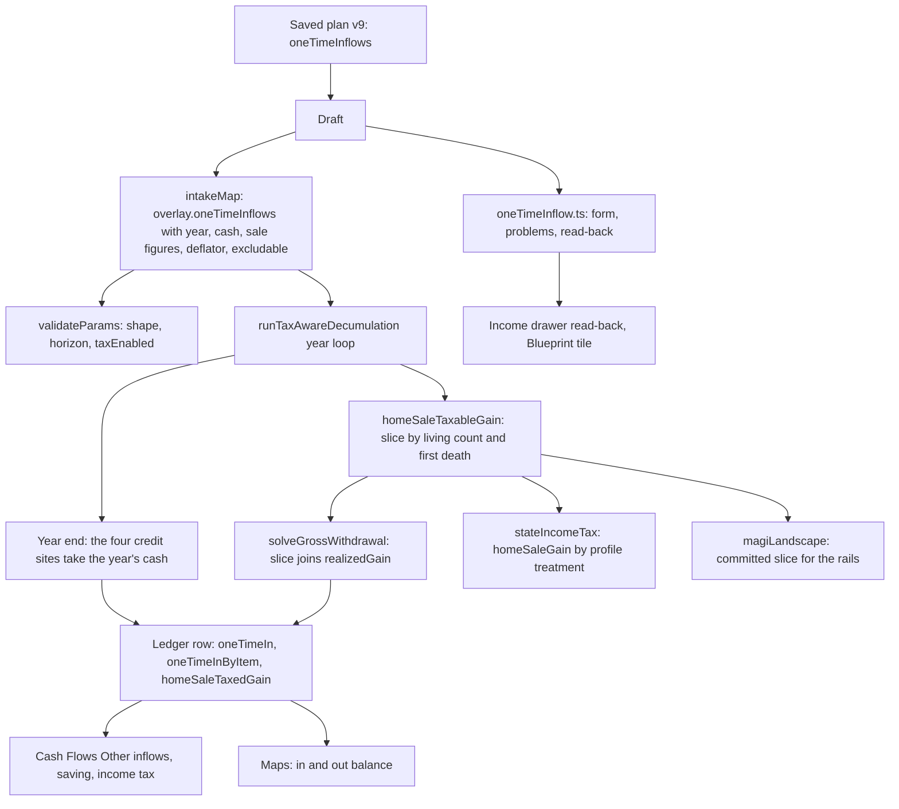

# One-Time Money In (an Inheritance, a Gift, a Home Sale) - Plan

## Goal Capsule

- **Objective.** A household expecting money once (an inheritance, a gift, or what it keeps from selling its home) gets an answer that counts that money in the year it arrives and charges exactly the tax the law charges on it, with the money and its tax shown in its own numbers on the screens where RightCapital shows them.
- **Means.** A dated list of one-time inflows on the saved plan and the engine params, credited to the taxable account at the end of its calendar year, with a home sale's taxable gain joining the year's tax through the engine's existing channels (KTD1, KTD3, KTD6).
- **Authority.** This plan's Requirements win on product behavior and its KTDs win on mechanism. Project law outranks both: `CLAUDE.md`, `docs/architecture.md` (the byte-identity and presence-key invariants, the single shared market draw, the constants discipline), and `docs/product.md` §4 (D7).
- **Execution profile.** Built on main, as one or more commits per unit in the order of the units below; no branches and no pull requests (`CLAUDE.md`, *Test cadence*). Every commit that touches `src/engine` or `src/intake/intakeMap.ts` carries `pnpm engine:identity`'s first line in its message.
- **Who finishes.** The pilot builds, reviews and ships every unit. Briggsy reads the new words after they ship; they ship flagged, never held for his read. Nothing in this plan waits on him.
- **Stop conditions.** Stop the line and diagnose when any of these happens: `engine:identity` moves a key on an existing seed or plant; a tax rule this plan rests on disagrees with its primary source; the gross-up stops converging on any plant carrying a home sale.

---

## Product Contract

### Summary

The household can add money it expects once, on Profile → Income: an inheritance or gift (one amount), or a home sale (what it sells for, what was paid, what is kept, and whether it was the main home). Each item has the calendar year the money arrives. The engine adds the kept money to the taxable account at the end of that year at full cost basis, and taxes a home sale's gain above the main-home exclusion as a long-term capital gain that year, federal and state. Cash Flows, Maps, Blueprint and the drawers show it in the household's numbers. A plan with none runs exactly as today.

### Problem Frame

Only recurring income streams and spending lines exist (`src/shared/model.ts`: `IncomeStream`, `BudgetLineItem`). A household that expects an inheritance, or plans to sell its home and downsize, can only enter it as an "Other" income stream with the same start and end age. That leaks: a year's draw is floored at zero and nothing credits income above spending back to savings (`cashTermsForYear` in `src/engine/simulate.ts`; `docs/architecture.md`, "never contributes surplus back"), so every lump dollar above that year's spending vanishes, and in a working year all of it does. The answer reads gloomy by the size of the lump, unmeasured. A home sale's gain is never taxed at all. The register files this as *A known one-time inflow — an inheritance, a home sale, downsizing — has no place to go* (`docs/backlog.md`), and the RightCapital map ranks it gap 5 (`docs/plans/rightcapital-map.md`, rows 75 and 85).

RightCapital handles both: an inheritance under Income → Other → Inheritance (amount and year, tax-free for cash and investments, shown in Cash Flows' "Other Inflows" column), and a main-home sale as a Goals → Primary Home Relocation card that prices the capital-gains tax (its help center, read second-hand through search on 2026-11-28, as the map's sources note).

### Requirements

**Entering it**

- R1. The household can add any number of one-time inflows on Profile → Income through its Add menu, each one of two kinds: an inheritance or gift, or a home sale. The first-run stepper's Income step shows the same cards.
- R2. Every item has a name and the calendar year the money arrives, from the plan's first year (`startCalendarYear`) through its last horizon year. A year outside that range is refused in words that name the range.
- R3. An inheritance or gift asks one amount: the cash or investments the household expects to receive, after any estate or inheritance tax, in today's dollars. The question says an IRA, 401(k), 403(b) or annuity doesn't belong in it, because those are taxed when money is taken out.
- R4. A home sale asks four things: what it would sell for today after agent fees and closing costs; what was paid for it, plus the closing costs paid when buying it and any improvements, less any gain rolled into it from a home sold before May 1997; how much will be kept to invest after paying off any loan on it and buying the next home (at most the first figure, and $0 allowed); and whether it will have been the main home of everyone in the household for at least 2 of the 5 years before the sale.
- R17. An item dated this calendar year or earlier asks whether the money has already come in. A gift that has is refused in words, because it is in the balances already; a home sale that has closed counts $0 kept and still counts its tax.

**How it counts**

- R5. The kept money joins the taxable account at the end of its calendar year at full cost basis, in a working or a retired year, in the same calendar year whatever stop the date search tests. It earns nothing in its arrival year and does not pay that year's bills.
- R6. On a path whose savings run out in or before the money's year, the path still counts as running out and the money is not counted on it. After both people have died it is not counted.
- R7. An inheritance or gift adds nothing to any tax.
- R8. A home sale's gain is its sale amount in the sale year less what was paid, which is a fixed past dollar figure. For federal tax, a main home leaves out $500,000 of gain while both people are living (the year one dies included) and in the first year after a death; it leaves out $250,000 for a one-person household or a survivor after that. A home that was not the main home leaves out nothing, and neither does a home sale 2 or fewer calendar years after an earlier main-home sale. The rest, when above $0, is a long-term capital gain in the sale year, in the federal tax, the share of Social Security that is taxed, and the incomes the ACA subsidy and the Medicare surcharge read. The left-out amounts and the price paid are fixed dollars, so in today's dollars they shrink every year.
- R9. State tax: North Carolina taxes the federally taxed part; Pennsylvania taxes nothing of a main-home gain and all of any other home's gain; Florida taxes nothing. An unpriced state runs as today.
- R10. A plan with no one-time inflow runs exactly as today, byte for byte, on every seed and plant.

**Showing the work**

- R11. Each drawer reads the answer back in the household's numbers: the year and the amount added to the taxable account (in today's dollars and in that year's dollars), and for a home sale the gain, the part left out and the part taxed, at the sale year's prices, for a couple and, where it differs, for a survivor; never a dollar of tax, which is one engine figure for the year. When a part is taxed, it says the 3.8% surtax on investment income isn't counted yet, and it names the plan's state as the one whose rules apply. A home sale's drawer says to change any housing lines the sale ends or changes in Expenses. A plan with no savings says the money can't be counted because the plan runs out in its first year.
- R12. Cash Flows' Summary shows each year's one-time money in an "Other inflows" column and again as saving into the taxable account, so Maps still balances every year; a home sale's tax shows inside that year's income tax.
- R13. Blueprint shows each item on its Goals timeline at its calendar year, with both ages.
- R14. Each drawer says the year and amount are the household's own estimate and the answer counts them as entered. Settings' methodology says how one-time money counts.
- R15. On a plan whose balances were last saved in a calendar year after an item's year, the item says so: if the money came, it is in those balances, so the item should be deleted or the money counts twice.

**Compatibility**

- R16. Schema version 9 holds the items. A plan saved by this build opens in an older build as "saved by a newer version", and an older plan opens here unchanged. A kept what-if carries the plan's items unchanged.

### Key Decisions

- **It lives on Profile → Income, not Goals or Net Worth.** RightCapital takes an inheritance under Income; its home-sale card is a Goals relocation that also models the next home, which B9 doesn't hold, and B9's Net Worth holds no property. One home for all money coming in. Governs R1.
- **Two kinds only.** The map names an inheritance and a home sale; a gift has an inheritance's tax character. Everything else is a non-goal (Scope Boundaries). Governs R1, R3, R4.
- **The kept figure is asked, never derived.** B9 has no loan record and doesn't model the next home, so only the household knows what it keeps. The tax still reads the gain, from the sale and cost figures. Governs R4.
- **The money arrives at the end of its year.** The convention every year-end credit in the engine already follows; the arrival year reads slightly low, never high (KTD3). Governs R5, R6.
- **No Action Items lever in this gap.** No lever touches income today, and a what-if carries the plan's items as they are. RightCapital's tray has an "Existing asset sales" section; that is filed for later. Governs R16.

### Acceptance Examples

- AE1. **Covers R5, R7.** Given a retired plan and a $200,000 inheritance in 2031, when it runs, then 2031's draw and tax are the same as without it, the taxable account and its cost basis each end 2031 $200,000 higher on every funded path, and 2032 onward differs.
- AE2. **Covers R8.** Given a couple selling their main home in 2032, $900,000 after costs in today's dollars, paid $300,000, both living, when 2032 runs, then the gain is $900,000 less $300,000 deflated to 2032, the left-out part is $500,000 deflated to 2032, and the rest is taxed as a long-term gain in 2032.
- AE3. **Covers R8.** Given the same sale on a path where one person's last year living is 2032, 2031 or 2030 (so 2032 is the death year, the first year after it, or the second), then 2032 leaves out $500,000 deflated in the first two cases and $250,000 deflated in the third.
- AE4. **Covers R9.** Given the AE2 sale in Pennsylvania, then 2032's state tax equals the same plan's without the sale; in North Carolina it adds the state rate on the federally taxed part.
- AE5. **Covers R5, R10.** Given a working household on the date route with a $250,000 inheritance in 2030, then every tested stop credits it in calendar 2030, and a plan without it reads IDENTICAL on every `engine:identity` key.

### Scope Boundaries

- Not built, filed for later (U8 files each):
  - The arrival year's bills, and a sale's own tax, paid from the money first (RightCapital's way, insight 185's front-of-the-gross shape). Year end reads low: one year's growth on the money and the tax on that year's draw, and on a thin path the arrival year's draw or the sale's tax can run the path out before the money lands, so R6 drops it all. U4 measures that on the `homesale` seed and the register entry records the measure.
  - An IRA, 401(k) or annuity the household expects to inherit (gap 3 takes only one already inherited; R3's words keep it out of a gift's amount).
  - A home in a different state from the plan's: B9 prices one state for the whole plan, so a home sold in North Carolina after a move to Florida misses North Carolina's tax on the gain. R11 names the plan's state.
  - Gap 8's stresses: a higher-inflation stress must re-deflate a sale's cost and exclusion through the stressed index, or the gain reads low (filed as a landmine under the stress area).
  - The late spouse's half of the home reset to its value at death on a survivor path (IRS Publication 523). Leaving it out overstates a survivor's taxed gain, never understates it.
  - An Action Items lever to leave an item out or move its year (RightCapital's "Existing asset sales").
  - The 3.8% surtax on investment income: unpriced everywhere in the engine (the register's Tier 0 NIIT entry); this gap adds the home sale to that entry's reach and says so in the drawer (R11).
  - A budget line that should end at the sale (a mortgage payment, property tax): budget lines count from the work stop, so on the date route no line can end in a calendar year. The household sets the line's window; the gap 4 loan half owns calendar-year endings.
- Non-goals, considered and not built:
  - A second home or rental sold with depreciation taken, a partial exclusion for a move forced by work or health, Pennsylvania's work or health exception to its two-year rule, gifted investments that keep the giver's cost, an inherited IRA (gap 3's kind), and life insurance on a household member. Each changes the tax in ways one question can't capture; the words name the two kinds the tool prices. Evidence that would change the call: one of them in Briggsy's plan.
  - A property record on Net Worth (home value, growth, property tax). The map rates it a gap only when a sale is planned, which this gap covers.
  - A cap on how many items a plan holds. No harm traced: each item is one credit and at most one gain.

### Sources

- Tax rules, each quoted from its primary source on 2026-11-28 (statute, regulation or the agency's own publication): IRC §102, §1014, §1015 (inheritance and gifts, basis); IRC §121(a), (b)(1)–(4), (d)(2) and Publication 523 (2025) (the exclusion, its tests, the surviving spouse, the half step-up, the gain formula); Rev. Proc. 2025-32 (the exclusion is absent from the 2026 inflation-adjusted list, so it is not indexed); 42 U.S.C. 1395r(i)(4), IRC §36B(d)(2)(B), §86(b)(2) (the taxed slice is in each MAGI, the left-out part is not); IRC §1411 and the IRS NIIT Q&A #10–11; 72 P.S. §7303(a)(3)(vii) and 61 Pa. Code §103.13(h) (Pennsylvania's full exclusion, no dollar limit, its surviving spouse, no two-year window for the survivor); 72 P.S. §2102, §2116, §2144 (Pennsylvania inheritance tax follows the person who died, and the estate pays by default); G.S. 105-153.4(a) (North Carolina starts from federal AGI); FL Const. Art. VII §5(a).
- Code: the year-end credit's four sites in `runTaxAwareDecumulation` (`src/engine/taxOverlay.ts`, build 2's `creditThisYear`); `solveGrossWithdrawal`'s `realizedGain`; gap 3's state channel (`inheritedDistribution` in `src/engine/stateTax.ts`, `ncInheritedDistribution` / `paInheritedDistribution` in `src/engine/constants/stateTax.ts`); gap 4's deflator (`nominalDeflator` in `src/intake/priceFrame.ts`); `CommittedYearIncome` in `src/engine/magiLandscape.ts`; `workingYearTaxReachOfRun` in `src/engine/dateSearch.ts`.
- Lessons: insights 093 (an absent construct must run the old expression), 134 (a flow is dated by the year it is paid), 151 (the version ladder blinds its own guards), 167 (store a value in its own frame), 183 (ask the fact the law reads), 185 (a forced inflow's shapes).

---

## Planning Contract

### Key Technical Decisions

- KTD1. **An item is keyed by its calendar year and converted to a sim year in the engine, the inherited IRA's way.** Sim year t is `year − startCalendarYear` (`model.ts`'s calendar rule; insight 134). The engine's arm in `validateParams` refuses a year outside `[startCalendarYear, startCalendarYear + maxHorizonYears − 1]` by name, as `inheritedIrasRefusal` does (`src/engine/simulate.ts`). On the date route `buildCandidateParams` passes the overlay through unchanged (`src/engine/dateSearch.ts`), so every tested stop credits the same calendar year with no new code. Rejected: the budget line's frame, years counted from the work stop, which would move the money with every tested stop (insight 167).
- KTD2. **A top-level list on the saved plan (`oneTimeInflows?`) and on the overlay params, absent when empty; never an income stream and never an account kind.** An income stream's surplus is floored away (the register's NEGATIVE); an account kind would add the money to today's balances. Every new key is written only when the household has an item, never as an empty list or an `undefined`-valued key (DND 009; the identity recorder digests key presence). The overlay is built whenever an item exists: `buildOverlay`'s early return for a household with no accounts, no premium and no income (`src/intake/intakeMap.ts`) gains that condition, and the engine arm requires `taxEnabled`, as gap 3's does.
- KTD3. **The kept money is folded into build 2's four year-end credit sites in `runTaxAwareDecumulation`, presence-keyed.** The four sites are `stepYear`'s contribution argument, the taxable basis, the taxable bucket after the growth scale, and the knife-edge branch's fresh buckets. One local carries the year-end cash, `yearEndTaxableCash = oneTimeThisYear > 0 ? creditThisYear + oneTimeThisYear : creditThisYear`, and the four sites read it in place of `creditThisYear`; with no item it is `creditThisYear` itself, so every site's expression is today's (insight 093). ⚑ NEGATIVE: never fold the money into `contributionTotal`, which feeds the ACA empty-overlap throw (`taxOverlay.ts`, "a priced ACA year cannot carry a contribution inflow"), so an inheritance in a pre-65 ACA-priced year would make the run infeasible; and never into `leftOverCredit` or `probe.creditComposed`, which stay build 2's credit alone (three readers subtract or compare it: `simulate.ts`'s income-not-kept, `savingsView.ts`, `yearTableChrome.ts`). The money is forfeited in a year the savings run out, as a deposit is, and a path that ran out earlier never reaches it, because both depletion branches end the loop. Rejected: crediting it at the front of the year's gross so it pays that year's bills (RightCapital's way; insight 185's shape). That reads the arrival year more faithfully but moves the year's allocation under every withdrawal policy, the bracket fill, the ACA cliff branch and the working-year floor; the year-end gap is gloomy and small, so it is filed with its measure (Scope Boundaries).
- KTD4. **The engine computes a home sale's gain from figures intake hands it, in one frame.** Per sale, intake passes the amount realized (today's dollars), the price paid (fixed dollars), whether the sale is excludable, and the household-figure deflator for the sale year (`nominalDeflator(startCalendarYear, t)` in `src/intake/priceFrame.ts`, gap 4's KTD3). The engine divides both fixed-dollar figures, the price paid and the statute's exclusion, by that one deflator, so the gain and its exclusion are compared in the same dollars. For every plan built in or before the price index's anchor year that deflator is exactly `cumulativePriceIndex`, the level every frozen tax figure in the run reads (`priceFrame.ts`'s header, test-pinned); a later-built plan rebases to its build year as gap 4's figures do. The rule lives in one pure engine helper, `homeSaleTaxableGain`, which intake's drawer read-back calls too, so the two can never compute it differently (the `workingYearCredit` precedent in `src/engine/moneyGrain.ts`).
- KTD5. **The statute's figures are one sourced constant.** `homeSaleExclusion` in `src/engine/constants/tax.ts` carries $250,000 and $500,000 with the §121(b) citation and a note that they are frozen in nominal dollars (absent from Rev. Proc. 2025-32), never re-typed elsewhere (the constants discipline, `docs/architecture.md` §8). The consumption registry (`src/engine/validation/consumedConstants.ts`) and its test gain it.
- KTD6. **Which amount a path leaves out.** Excludable is the saved main-home answer, unless an earlier main-home sale in the list falls 2 or fewer calendar years before this one (the federal and Pennsylvania two-year rules, read gloomily on whole years); intake decides it and passes the flag. Federal: an excludable sale leaves out the joint figure while two people are living, and in the first year with one living after starting as two; the single figure for a one-person household or any later survivor year; nothing when not excludable. The engine counts a person living through the year they die (`simulate.ts`: living while `t < deathOffset`), so the first year with one living is the year after the death, always within §121(b)(4)'s "not later than 2 years after"; the year after that may not be, so it gets the single figure (gloomy, never rosy). The taxed slice is floored at $0 (a loss on a home is not deductible). The late spouse's half step-up is not modeled (Scope Boundaries).
- KTD7. **The federal slice rides `realizedGain`; the state gets its own channel.** Inside `solveGrossWithdrawal` the year's taxed slice is a gross-independent addend to `realizedGain`, present only in a year that carries one, so it reaches the long-term brackets (`ordinaryPlusCapitalGainsTax`), the §86 provisional income, the returned MAGI components (the ACA reading, and IRMAA's, which adds the working-year override to them) and the working-year federal charge, all through code that already reads `realizedGain`. The state call keeps the draws' own `realizedGain` (the sale must never ride it: Pennsylvania would tax an excluded gain) and gains two presence-keyed channels on the state context, gap 3's `inheritedDistribution` shape, each summed over the year's sales with every sale's gain floored at $0 before summing (a loss on one home never offsets another): `homeSaleGainExcludable`, the federal taxed slices of excludable sales, and `homeSaleGainNotExcludable`, the whole gains of the others (with no exclusion that is their federal slice). Each is priced through `includeByTreatment` by its own sourced `StateIncomeTreatment` on the profile, no new vocabulary: North Carolina `'taxed-ordinary'` on both (G.S. 105-153.4(a)); Pennsylvania `'exempt'` on the first and `'taxed-ordinary'` on the second (72 P.S. §7303(a)(3)(vii); Class 3 at the flat rate, no 59½ gate); Florida the structural $0. Both join `WorkingYearStateChannels`, so the working-year state charge spreads them. A new profile key moves `stateTaxVintageStamp`, so every saved priced-state plan reads its state tax as changed at its next unlock; no real save exists yet, so nothing is harmed.
- KTD8. **The solver's rails and the date search learn the new income, as a gain, never as ordinary income.** `CommittedYearIncome` (`src/engine/magiLandscape.ts`) gains its own optional `committedGain`, the year's taxed slice. It enters `acaMagiAtFill`, `irmaaMagiAtFill` (the sum and the §86 provisional), `acaCliffFillHeadroom`'s closed form, and the deduction's MAGI and provisional inside `taxableIncomeAtFill`; it stays out of `ordinaryAtFill` and the ordinary taxable income the bracket edge compares, because a long-term gain stacks above the ordinary brackets (`ordinaryPlusCapitalGainsTax` in `src/engine/taxCore.ts`). Gap 3's ordinary-income pattern would leave a sale year's ceilings short of the true edge. The solver's anchor carries it too: `solveAnchor.committedIncomeForYear` takes the both-living slice, every frame of a run with a sale carries the field (0 in other years), and `candidates.assertFrames` gains the same one-run-agrees clause it has for `inheritedDistribution` (insight 143). `SOLVER_CODE_VERSION` goes from 13 to 14 (`src/engine/solver/solverCodeVersion.ts`), so every saved recommendation re-solves; `pricingVersion.test.ts`'s pin moves to 14 with gap 3's reason and no pricing-ledger row, because a run without a sale prices byte for byte. The working-year reach walk's `portfolioIncomeIn` (`dateSearch.ts`) reads "a home sale's sim year is t" as reached, the allowed over-read, because its "unpriced never under-reads" claim holds only while it lists every source of a clamped year's portfolio income; a cash inheritance adds no taxable income and needs nothing there.
- KTD9. **The ledger row gains three optional fields, present only in a run carrying an item.** `oneTimeIn` (the year's credited total, 0 in a year with none or a year the savings ran out), `oneTimeInByItem` (index-aligned with the params list, for the drill), and `homeSaleTaxedGain` (the federal taxed slice, present only in a funded year that has one). A run with no item keeps its row shape byte for byte, so no seed's `table` arm moves. The taxable reconciliation identity in `model.ts` gains the term. The screens give the money its own ids: the Summary column `other-inflows` and the Planned Saving drill `one-time-kept`, both reading `oneTimeIn`, and a Maps saving leaf with that same id, because `mapsView.test.ts` pins every leaf to its Summary cell by id. The taxed slice is a taxed-part line in the Income drill beside `pay-taxed-i`, never under Income tax (`taxPaid` alone, never a drill: `cashFlowsView.ts`'s law) and never on Maps (income with no money moved, the inherited `booked` precedent). Item names reach the drill through `TableMeta`, as `TableMeta.inherited` does (`src/ui/workbench/tableRun.ts`).
- KTD10. **Schema version 9 and its codec checks shape only.** The item: `id`, `kind` (`'gift' | 'homeSale'`), `name`, `year`, `amountReal` (received for a gift, kept for a home sale), and for a home sale only, flat on the item, `soldForReal`, `paidDollars` and `mainHome`. Flat, because the R7 registry's gate does not see nested fields (`src/ui/assumptionRegistry.ts`, its gate-scope warning). The codec checks types, finiteness, $0 to `ENGINE_MAX_DOLLAR`, a gift's amount above $0, a home sale's kept amount at most its sold-for amount, the kind vocabulary, the home fields present exactly on a home sale, unique ids, and an empty list refused as a writer bug. It sets no floor or ceiling on `year` against `startCalendarYear` (gap 4's KTD9 precedent); intake re-asks a year out of range (KTD11) and the engine refuses one by name (KTD1). The 8 → 9 step names its literal successor and refuses a version-3-to-8 plan that carries the list; `FLOOR` rises to 9 in its own later commit (insight 151). Gap 4's loan half, which had pencilled in version 9 for its loan record, takes the next version when it is built (U8 corrects both records).
- KTD11. **Intake owns the form, the problems and the params.** A new `src/intake/oneTimeInflow.ts` holds the form and its one decision tree (the `incomeForm.ts` pattern), the problems, the params builder (the deflator, the excludable flag) and the drawer's read-back through `homeSaleTaxableGain`. `missingRequiredFacts` re-judges the live draft: a year out of range is an absent fact the drawer re-asks, never a silent drop or an engine throw (the inherited IRA's `askedYear` precedent in `src/intake/inheritedIra.ts`). An aged plan's passed item is flagged by `src/store/staleness.ts`, as a budget line whose window has passed already is.

### High-Level Technical Design

From the saved plan to the screens:

What a home sale leaves out, per path and year (KTD6):

| Excludable (main home, no sale in the 2 years before) | People living in the sale year | First death | Federal left out | Pennsylvania taxed |
|---|---|---|---|---|
| yes | two | — | $500,000 ÷ deflator | $0 |
| yes | one, started as two | the person's last year living was the year before | $500,000 ÷ deflator | $0 |
| yes | one, started as two | earlier | $250,000 ÷ deflator | $0 |
| yes | one, started as one | — | $250,000 ÷ deflator | $0 |
| no | any | any | $0 | the whole gain |

North Carolina taxes the federal slice in every row; Florida taxes nothing.

### Assumptions

- Both kinds are built in this gap; the map names both.
- The household types the sale and kept figures in today's dollars, and a home keeps pace with prices until it is sold. A home's own growth is unknowable (markets), so the drawer says so instead of asking.
- Briggsy reads the new words after they ship, each flagged in the close's "For Briggsy" line.

### System-Wide Impact

- **Engine identity.** Every engine and `intakeMap` commit reads IDENTICAL on every existing key; U5's seeds add two keys, "new, not compared".
- **The solver.** `SOLVER_CODE_VERSION` 14 re-solves every saved recommendation once (KTD8). The fingerprint hashes the whole params, so a plan with an item gets its own fingerprint with no wiring.
- **State tax staleness.** The new profile key fires the state-tax staleness clock on every saved priced-state plan (KTD7); no real save exists yet.
- **Doc citations.** Edits to `taxOverlay.ts`, `simulate.ts`, `model.ts` and `intakeMap.ts` shift line-numbered citations across many docs; each commit runs `pnpm doc:reanchor` once and `pnpm verify:doc-stats` (the landmine on a second apply double-shifting stands).
- **The CSP.** No change: new screens use the kit and Highcharts already proven under the header.

### Risks

| Risk | Mitigation |
|---|---|
| A new term in a summed expression moves bytes on plans without it | Each site keeps today's expression when absent (KTD3, KTD7); `engine:identity` per commit |
| The slice inside the fixed point changes convergence | It is gross-independent, a constant per year; a U4 test runs the largest seed sale to convergence on a priced state with Social Security |
| A plan opened years later counts a received inheritance twice (balances updated, item still dated) | R15's staleness line (KTD11) |
| The reach walk under-reads a clamped working year with a sale | KTD8's channel and its own test |
| The deflator frames diverge on a plan built after the anchor year | One deflator for both fixed figures (KTD4); a test pins equality with `cumulativePriceIndex` for an anchor-year build |

---

## Implementation Units

### U1. Version 9: the one-time list, its bounds, the codec and the step

- **Goal.** The saved plan can hold one-time inflows, checked by the codec for shape and guarded by a version-9 step.
- **Requirements.** R16, R10; KTD2, KTD10.
- **Dependencies.** None.
- **Files.**
  - `src/shared/model.ts`: `OneTimeInflow` and its kind vocabulary beside `IncomeStream`; `CurrentScenario.oneTimeInflows?` with an "absent means none, never an empty list" docblock; `SCENARIO_V3_FIELDS`; `CURRENT_SCHEMA_VERSION` = 9 and the label history.
  - `src/store/memoryModel.ts`: the draft's optional block.
  - `src/shared/scenarioCodec.ts`: `checkOneTimeInflowV9`, the list check in `checkV3Fields` (`keptWhatIfs`' shape), `versionNineFieldIn`, the 8 → 9 step, the header ladder.
  - `src/ui/assumptionRegistry.ts` (`DRAFT_DISPOSITIONS`: `profile`) and `src/ui/workbench/factRegistry.ts` (`DRAFT_FACTS` nested, a flat `INFLOW_FACTS` record listed in `RECORDS`).
  - Tests: `src/shared/__tests__/scenarioCodec.test.ts`; `src/shared/__tests__/schemaVersionFloor.test.ts` (a later commit); `src/store/__tests__/session.test.ts` and `src/ui/__tests__/scenarioFromDraft.test.ts` (raw-byte version literals); `src/ui/__tests__/draftFromScenario.test.ts` (round trips).
  - `docs/architecture.md` §7.3: the prose and the chart.
- **Approach.**
  1. Add the type, the field and the codec checks (KTD10).
  2. Add the 8 → 9 step and its probe, the version-8 bump's pattern (`f3313636`).
  3. Move the version pins as the version-8 bump did: the version-8 pin becomes "decodes as current", a new absolute pin at 9, and the literal-successor list gains 8.
  4. Raise `FLOOR` to 9 in its own later commit, with the 8 → 9 sentence in that test's header.
- **Patterns to follow.** The version-8 bump (`f3313636`, floor `cbbf8d66`); `keptWhatIfs`' list check; `needAtMostMaxDollar`.
- **Test scenarios.**
  - A version-8-labelled plan carrying `oneTimeInflows` is refused as a writer bug; the same plan labelled 9 decodes; the version-4 fixtures still climb the ladder.
  - An empty list, a duplicate id, an unknown kind, a gift with home fields, a home sale missing `mainHome`, a kept amount above the sold-for amount, a $0 gift, a negative or non-finite dollar figure, a non-integer year: each refused.
  - A home sale with $0 kept and a gift at `ENGINE_MAX_DOLLAR` decode.
  - Round trips through draft and scenario keep every field and write no key when the list is absent.
  - A plan labelled 10 surfaces "saved by a newer version".
- **Verification.** The codec, session and draft suites green; `pnpm typecheck` green; `pnpm verify:doc-stats` green after the §7.3 edit.

### U2. The home-sale tax rule: the constant, the helper, the state treatments

- **Goal.** One sourced home for the exclusion figures, one pure helper for the taxed slice, and each priced state's treatment of a home's gain, before any run reads them.
- **Requirements.** R8, R9; KTD4, KTD5, KTD6, KTD7.
- **Dependencies.** None.
- **Files.**
  - `src/engine/constants/tax.ts`: `homeSaleExclusion`.
  - New `src/engine/homeSale.ts`: `homeSaleTaxableGain` (inputs: the sale's figures, the deflator, the living count, whether the household started as two, the first death's sim year, the sim year), and the whole gain before any exclusion for the state.
  - `src/engine/constants/stateTax.ts`: a `HomeSaleGainTreatment` vocabulary and `ncHomeSaleGain` / `paHomeSaleGain`, sourced, on the profiles; `src/engine/stateTax.ts`: the `homeSaleGain` context field priced exhaustively by treatment.
  - Tests: new `src/engine/__tests__/homeSale.test.ts`; `src/engine/__tests__/stateTax.test.ts`; `src/engine/validation/__tests__/consumedConstants.test.ts` (and its registry `src/engine/validation/consumedConstants.ts`).
- **Approach.** The helper follows KTD6's table exactly; the state treatment follows gap 3's `inheritedDistributionTreatment` (an exhaustive switch, so a new state must choose).
- **Patterns to follow.** `ncInheritedDistribution` / `paInheritedDistribution` (`5daa4eb4`); `workingYearCredit` in `src/engine/moneyGrain.ts` as a shared pure rule.
- **Test scenarios.**
  - Covers AE2. A main-home sale at deflator 1, both living: $900,000 realized, $300,000 paid, slice $100,000.
  - The same at deflator 1.2: cost $250,000 and exclusion $416,666.67 in today's dollars, slice from those.
  - Covers AE3. First death at the sale year minus 1: joint figure; minus 2: single figure; a one-person household: single.
  - Not excludable: slice equals the whole gain; a gain below $0: slice $0.
  - State: North Carolina's added base equals the federal slice; Pennsylvania's is $0 when excludable and the whole gain when not; Florida $0; an absent field prices today's base byte for byte.
  - The constant is read by the helper and listed as consumed; the values match §121(b), typed once.
- **Verification.** The new and touched engine suites green; `pnpm lint` (engine purity) green.

### U3. The engine: the one-time construct, its checks and the year-end credit

- **Goal.** A run carrying one-time inflows credits each item's cash to the taxable account at the end of its year, on every route, and records it on the row; a run without any is byte-identical.
- **Requirements.** R5, R6, R7, R10; KTD1, KTD2, KTD3, KTD9.
- **Dependencies.** U1 (the shared item type).
- **Files.**
  - `src/shared/model.ts`: `OverlayParams.oneTimeInflows?` (the params item: year, cash, and the sale's figures with deflator and excludable flag, read only by U4), the three optional row fields, the taxable reconciliation identity's term.
  - `src/engine/simulate.ts`: the `validateParams` arm (shape, structured-clone safety, an empty list refused, `taxEnabled` required, finite dollars, years inside the horizon), the `taxInputs` spread.
  - `src/engine/taxOverlay.ts`: the year's total by calendar year, the four credit sites, the row fields.
  - Tests: new `src/engine/__tests__/oneTimeInflow.test.ts`; `src/engine/__tests__/ledgerRows.test.ts`; `src/engine/__tests__/dateSearch.test.ts`.
- **Approach.**
  1. Declare the params construct and its refusals, `inheritedIrasRefusal`'s pattern, with throw twins in `runTaxAwareDecumulation` for the new `TaxYearInputs` field (finite cash at least $0, the sale figures, a finite deflator above 0, tax on), the house's validateParams-plus-overlay-backstop discipline.
  2. Sum the year's items by calendar year in the year loop.
  3. Read KTD3's one local at the four credit sites.
  4. Write the row fields only in a run carrying the construct (KTD9).
- **Execution note.** Write the presence test first: a construct-absent run must reproduce today's terminal, depletion and every row field bit for bit before any site changes.
- **Patterns to follow.** Build 2's credit (`workingYearLeftOverSavedReal`, the four sites, `workingYearCredit.test.ts`); gap 3's `inheritedIrasRefusal`.
- **Test scenarios.**
  - Covers AE1. A retired run with $200,000 in year 3: years 0–2 identical to the run without it; year 3's draw and tax identical; year 3's taxable end and cost basis each exactly $200,000 higher on a fixed-return path; year 4 onward differs.
  - Each credit site's own delta: the taxable bucket and the basis take the money, pre-tax, Roth and HSA take $0 (insight 093's multi-site arm).
  - Two items in one year: the row's total is their sum and `oneTimeInByItem` holds each.
  - A path depleted in the item's year: the credit is forfeited and `oneTimeIn` reads 0 on that row; a path depleted earlier has no row for the year.
  - The knife-edge branch: fresh buckets hold the year's cash in taxable at full basis.
  - Covers AE5. A date-route run: two tested stops credit the same calendar year.
  - Refusals by name: an empty list, a year before `startCalendarYear`, a year past the horizon, `taxEnabled` off, a non-finite cash figure.
  - A construct-absent run's rows have no new key.
- **Verification.** The engine suites green; `engine:identity` IDENTICAL on every key.

### U4. The engine: a home sale's gain in the year's tax

- **Goal.** A sale's taxed slice is charged in its year through the federal, state, MAGI and working-year channels, and the solver and the date search read it.
- **Requirements.** R8, R9, R10; KTD6, KTD7, KTD8.
- **Dependencies.** U2, U3.
- **Files.**
  - `src/engine/taxOverlay.ts`: the year's slice from `homeSaleTaxableGain` (the living count and the first death from the year's household years), the `realizedGain` addend in `solveGrossWithdrawal`, the state and working-year state calls' `homeSaleGain`, `homeSaleTaxedGain` on the row.
  - `src/engine/magiLandscape.ts`: `committedGain`; the overlay's bracket-fill site that builds the year's `CommittedYearIncome`; `src/engine/solver/solveAnchor.ts` (`committedIncomeForYear`) and `src/engine/solver/candidates.ts` (`assertFrames`); `src/engine/solver/solverCodeVersion.ts`: 14.
  - `src/engine/dateSearch.ts`: `portfolioIncomeIn`'s channel.
  - `src/engine/workingYearLedger.ts`: `savingsTaxLine` gains a `homeSaleLands` arm beside gap 3's `inheritedLands`, so a year-0 sale with a taxed slice keeps the money picture's "Plus any income tax on what savings pays out" line.
  - Tests: `src/engine/__tests__/oneTimeInflow.test.ts`; `src/engine/__tests__/magiLandscape.test.ts`; `src/engine/solver/__tests__/candidates.test.ts`; `src/engine/__tests__/dateSearch.test.ts`; `src/engine/__tests__/workingYearLedger.test.ts`; `src/engine/__tests__/pricingVersion.test.ts` (the pin re-set to 14, no ledger row).
- **Approach.**
  1. Compute the slice once per year, before the gross-up, from KTD6's inputs.
  2. Add it to `realizedGain` only in a year that carries one (KTD7), and pass the state field the same way.
  3. Teach the landscape and the reach walk (KTD8); bump the solver version in the same commit.
- **Patterns to follow.** Gap 3's U12 (`inheritedIncome` as its own additive term; `inheritedDistribution` on the landscape and the state calls); `SOLVER_CODE_VERSION`'s bump in `632abe9a`.
- **Test scenarios.**
  - Covers AE2. A retired couple's sale year: federal tax rises by the long-term tax on the slice stacked on that year's ordinary income; the taxable Social Security share rises as §86 says; the ACA and IRMAA MAGI components include the slice; the row's `homeSaleTaxedGain` equals it.
  - Covers AE3. The same sale on paths whose dying person's last year living is the sale year, the year before, and two years before: joint, joint, single.
  - A sale year's bracket-edge headroom equals the no-sale year's except through the senior-bonus phase-out and the §86 share; the ACA-cliff and IRMAA headrooms sit lower by the slice.
  - The anchor: a sale inside the conversion window puts the slice in that year's frame, and `assertFrames` refuses a run whose frames disagree on it.
  - The gloom measure: on the `homesale` seed, the share of paths the sale itself runs out (the sale's tax drawn before the money lands), recorded for U8's register entry.
  - A date-route run with a sale inside the stop search's window: the sale year is a working year on some tested stops and a retired year on others, and the search still converges.
  - Covers AE4. Pennsylvania: the state tax equals the no-sale run's when excludable, and rises by the flat rate on the whole gain when not; North Carolina: rises by the rate on the slice.
  - A clamped working year with a sale: the working-year federal and state charges include it, and IRMAA's history two years on adds the slice to the override.
  - The reach walk reports a clamped working year with a sale as reached.
  - The largest seed sale converges on a priced state with Social Security.
  - A year with no slice, and a run with only gifts, are byte-identical to today in every tax figure.
- **Verification.** The engine and solver suites green; `engine:identity` IDENTICAL on every key.

### U5. Intake: the form, the problems, the params and the seeds

- **Goal.** A draft's one-time inflows become engine params, with every problem caught in words before a run, an aged plan's passed item flagged, and two dev seeds that witness both kinds and both routes.
- **Requirements.** R2, R3, R4, R6, R15, R17, R10; KTD2, KTD4, KTD6, KTD11.
- **Dependencies.** U3, U4.
- **Files.**
  - New `src/intake/oneTimeInflow.ts`: the form, the decision tree, the problems, the params builder, the read-back.
  - `src/intake/intakeMap.ts`: the overlay's early return, the presence-keyed spread.
  - `src/intake/sanity.ts`: the item fields for `validateDraft` and `allRuleFields`; `missingRequiredFacts`.
  - `src/store/staleness.ts`: a passed item on an aged plan.
  - `src/ui/devSeeds.ts`: `dateinherit` (a twist on `dateDipSeed`: $250,000 in a working year) and `homesale` (a retired North Carolina couple selling a main home with a gain above the joint exclusion).
  - Tests: new `src/intake/__tests__/oneTimeInflow.test.ts`; `src/intake/__tests__/intakeMap.test.ts`; `src/store/__tests__/staleness.test.ts`; `src/ui/__tests__/devSeeds.test.ts`; `src/ui/__tests__/stalenessExposure.test.ts` (`W_KEYED` gains `dateinherit`).
- **Approach.**
  1. The decision tree asks R3's or R4's figures and refuses each in words: a year out of range (naming it), a kept amount above the sold-for amount, a missing figure. It takes the wall year from its caller (intake reads no clock) and, for an item dated that year or earlier, R17's answer: an arrived gift is refused, an arrived home sale's kept amount is set to $0.
  2. The params builder computes the deflator per sale and the excludable flag (KTD6's two-year rule across the list's home sales).
  3. The read-back calls `homeSaleTaxableGain` for the couple's case and, when different, the survivor's.
  4. The overlay is built whenever an item exists (KTD2).
- **Patterns to follow.** `incomeForm.ts` (`buildIncomeStream`); `inheritedIra.ts`'s absent-fact rule; gap 4's seeds (`daterepeat`, `withConfirmedW`); `staleness.ts`'s passed budget line.
- **Test scenarios.**
  - A gift and a home sale round-trip through the form unchanged; editing keeps the id.
  - Each refusal fires with its words: year one before `startCalendarYear`, one past the horizon, kept above sold-for.
  - Two home sales two calendar years apart: the later one is not excludable; three years apart: both excludable; a non-main home: not excludable.
  - The params carry the deflator `nominalDeflator(startCalendarYear, t)` and equal `cumulativePriceIndex` for an anchor-year build.
  - A household with no accounts, no premium and no income but one gift gets an overlay carrying it.
  - A plan with no item builds params with no new key.
  - Staleness keys on the year of the last save (the scenario's `savedAt`, the year `agedBalancesYearFor` in `src/ui/resultSave.ts` reads): balances saved in 2028 flag an item dated 2027; balances saved in 2026 and viewed in 2028 flag nothing, because those balances predate the money.
  - R17: a gift dated this year answered "already came in" is refused with its words; a home sale so answered keeps its gain figures and counts $0 kept.
  - Every every-seed arm the two seeds reach is updated in the same commit.
- **Verification.** The intake, store and seed suites green; `engine:identity` IDENTICAL on every existing key with two new keys, not compared.

### U6. Profile → Income: the card, the drawer and Blueprint

- **Goal.** The household adds, edits and deletes one-time inflows on the Income page and in the stepper, each drawer reading the answer back in its own numbers, and Blueprint shows each on its timeline.
- **Requirements.** R1, R2, R3, R4, R11, R13, R14, R15, R17; KTD11.
- **Dependencies.** U5.
- **Files.**
  - `src/ui/screens/profile/profileView.ts`: two Add menu items ("Inheritance or gift", "Home sale"), one card per item, the `DrawerTarget` kinds and `cardIdOf`.
  - New `src/ui/screens/profile/drawers/oneTimeFields.ts` (the pure half) and `OneTimeDrawer.tsx`; `drawerHost.tsx`; `drawerSave.ts`'s `placeOf`.
  - `src/ui/screens/setup/stepperView.ts`: `FACT_STEPS` for any new missing-fact label.
  - `src/ui/screens/profile/blueprintView.ts`: a Goals-timeline tile at the item's calendar year with both ages; `ownerOf`'s case (the household lane).
  - `src/ui/copy.ts`: every word below; `src/ui/copyGuard.ts` samples.
  - Tests: new `src/ui/screens/profile/drawers/__tests__/oneTimeFields.test.tsx`; `profile/__tests__/profileView.test.ts`, `blueprintView.test.ts`; `setup/__tests__/stepperView.test.ts`; `src/ui/workbench/__tests__/factRegistry.test.tsx`; `src/ui/__tests__/copyGuard.test.ts`; `e2e/rc-screens.spec.ts` (fit arms).
- **Approach.**
  1. The card shows the name, the year and the amount added ("Adds $350,000 in 2032").
  2. The drawer asks R3's or R4's figures in plain words with today's-dollars hints, then reads back: the amount added at the end of its year; for a home sale, the gain, the part left out and the part taxed at that year's prices, for a couple and, where different, for a survivor; the surtax note when a part is taxed (R11).
  3. Every drawer carries R14's estimate line, R17's question for an item dated this year or earlier (the drawer reads the wall date, as the inherited IRA's asked year does), and, on a passed item, R15's line.
  4. Words follow `back-nine-design` and the copy guard (no certainty, no directive verbs); the D7 line names only what is unknowable (when an estate settles, how large it is, what a home sells for).
- **Patterns to follow.** `OtherIncomeDrawer.tsx` and `otherIncomeFields.ts` (a list record by index); gap 4's `livingLineRepeatRate.test.tsx`; gap 4's once tile in `blueprintView.ts`.
- **Test scenarios.**
  - Add, edit and delete each kind through the drawer; Save refuses each R4 problem in place and names it.
  - The read-back for the `homesale` seed matches `homeSaleTaxableGain` for the couple and the survivor.
  - A gift's drawer shows no tax line; a sale with no taxed part shows no surtax note.
  - The stepper's Income step shows the cards and the Add items.
  - Blueprint places the tile at its calendar year with both ages, on both routes.
  - Fit arms: the home-sale drawer with every read-back line, at 1440 × 731 and at the phone; the Income page with two items.
- **Verification.** The composer, drawer and copy suites green; the U6 fit arms on Windows with `-g`, alone; the eye on both seeds at both sizes.

### U7. Cash Flows, Maps and Settings

- **Goal.** The year-by-year table and its map show the money coming in and going to savings, the sale's tax inside the income tax, and Settings says how one-time money counts.
- **Requirements.** R12, R14; KTD9.
- **Dependencies.** U3, U4.
- **Files.**
  - `src/ui/screens/retirement/cashFlowsView.ts`: the `other-inflows` column in the in band (drill: each item by name, from `oneTimeInByItem`, labelled "kept from the home sale" for a sale), the `one-time-kept` drill under Planned Saving, the taxed slice as a taxed-part line in the Income drill (KTD9), and a taxable line on Accounts' deposits table reading `oneTimeIn`, so the taxable balance's jump has a line.
  - `src/ui/screens/retirement/mapsView.ts`: the money as an in leaf and as a saving leaf with the `one-time-kept` id; the taxed slice stays off the map.
  - `src/ui/workbench/tableRun.ts`: the item names in `TableMeta`.
  - `src/ui/screens/settings/settingsView.ts` and `src/ui/assumptionRegistry.ts`: a methodology row, present only when the plan carries an item, beside the inherited IRA's pace row.
  - `src/ui/copy.ts`.
  - Tests: `retirement/__tests__/cashFlowsView.test.ts`, `mapsView.test.ts`; `settings/__tests__/settingsView.test.ts`; `e2e/rc-screens.spec.ts`.
- **Approach.** Each cell reads one row field and nothing is summed (`cashFlowsView.ts`'s law); the column is left out in a plan with none (its empty-column law). The methodology row says: the money counts at the end of its year at full cost, a home's gain is taxed above the main-home amount, the late spouse's half is not reset, and the surtax isn't counted.
- **Patterns to follow.** Gap 3's U13 (`taken` in, `movedToTaxable` out, `inheritedScreens.test.ts`).
- **Test scenarios.**
  - The `homesale` seed: the sale year's Other inflows cell equals `oneTimeIn`; its drill names the item; the Income drill shows the slice as a taxed part; the `one-time-kept` drill and the Accounts taxable line each equal `oneTimeIn`.
  - Maps balances in the sale year with no gap node.
  - A plan with no item has no Other inflows column and no methodology row.
  - Fit arm: Cash Flows Summary with the column, at 1440 × 731 and at the phone.
- **Verification.** The screen suites green; the U7 fit arm on Windows with `-g`, alone; the eye on Cash Flows and Maps at both sizes.

### U8. The docs and the register

- **Goal.** Every record says what was built and files what wasn't.
- **Requirements.** All.
- **Dependencies.** U1–U7.
- **Files.** `docs/architecture.md` (the credit sites, the presence-keyed constructs, §7.3, §8's new constant); `docs/glossary.md`; `docs/roadmap.md` (gap 5's row); `docs/plans/rightcapital-map.md` (gap 5 built, rows 75 and 85); `docs/plans/features/spending-line-repeat-and-rate-build-spec.md` and the register's Tier 3 loan entry (the loan's version is the next one, not 9); `docs/backlog.md`.
- **Approach.** Close the register's one-time inflow entry. File each Scope Boundaries item (front-of-the-gross funding with its measure, the survivor's half step-up, the tray lever, the line that should end at a sale, the non-goals as one entry with their evidence). Add the home sale to the NIIT Tier 0 entry's reach.
- **Test expectation.** None: documents only; `pnpm verify:doc-stats` gates them.
- **Verification.** `pnpm verify:doc-stats` green.

---

## Verification Contract

| When | Check |
|---|---|
| Every commit | `pnpm typecheck`, `pnpm lint`, and the unit test files the change reaches (`pnpm vitest run <files>`) |
| A commit touching `src/engine` or `src/intake/intakeMap.ts` | `pnpm engine:identity` against its parent, alone on a quiet tree; its first line in the commit message |
| A new words slot in `src/ui/copy.ts` | A sample in the copy guard's `SLOT_RENDER`, and the universal advice check passes |
| A new dev seed | Every every-seed arm and hard count it reaches updated in the same commit, `stalenessExposure.test.ts`'s `W_KEYED` for a date-route seed |
| A commit moving a doc, a test count or a cited line | `pnpm verify:doc-stats`, with `pnpm doc:reanchor` once where a cited line moved |
| A new or changed screen (U6, U7) | Its `verify:fit` arms on Windows with `-g`, alone |
| After each push | CI's four jobs on the full sha; a red is fixed in the next commit |

## Definition of Done

- Every unit's Verification holds, and CI is green on the last code commit.
- `engine:identity` read IDENTICAL on every existing key at every engine or `intakeMap` commit.
- AE1 to AE5 each hold in a named test.
- No code is left from an approach that was tried and dropped.
- The register's one-time inflow entry is closed and every Scope Boundaries item has its entry (U8).
- New words ship flagged in the close's "For Briggsy" line.
