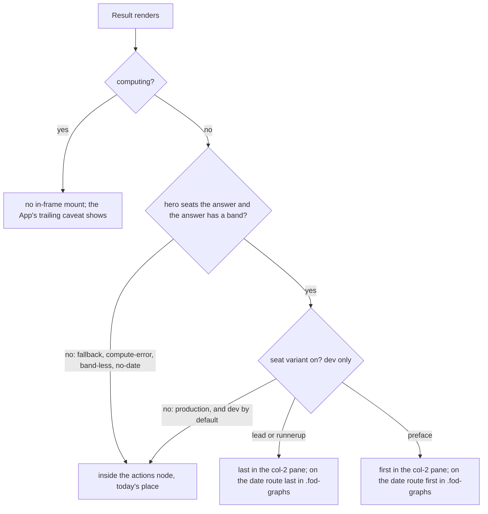
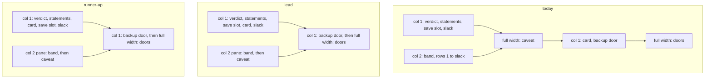
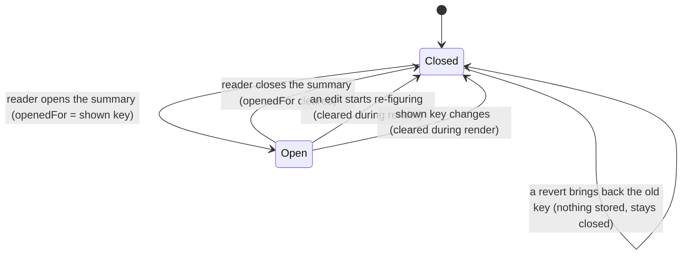
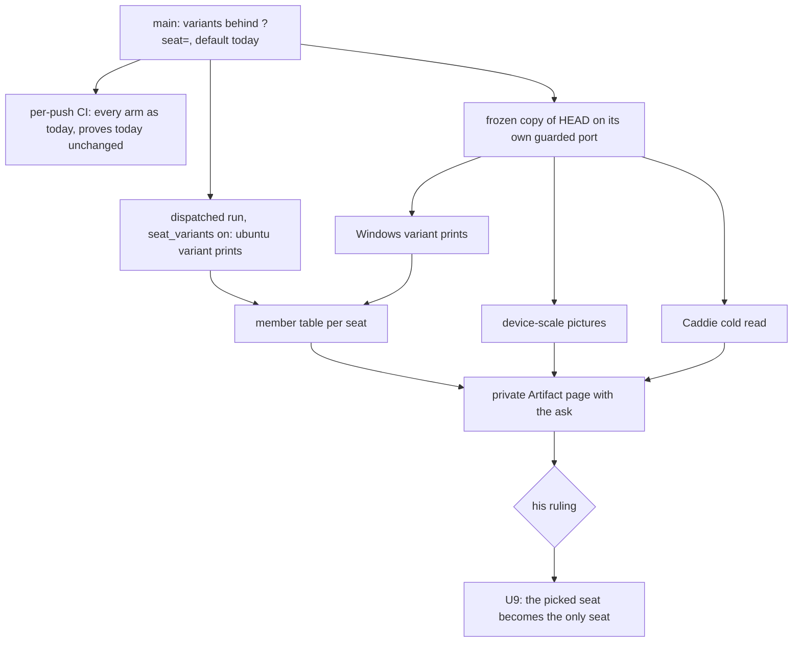

# The Record Card's Seat - Plan

**Target:** `projects/the-back-nine`. Every path below is relative to it unless it starts with `.github/` or is marked machine-local.

This plan continues `docs/plans/features/frames-outside-widest-member-build-spec.md` (the frames-outside plan) and builds the council-decided parts of the seat council `wf_2976a19c-c00` (`docs/council-log.md`, the 2026-11-22 row; the register's composites entry, prescription (4)). It names constructs, never line numbers, because every unit moves the lines.

**Numbering.** Plan requirements are R1 to R12 and R14. The number 13 is skipped on purpose, so "R13" always means `docs/product.md`'s R13, the "this can be wrong" caveat (`#r13-caveat`).

---

## Goal Capsule

- **Objective:** Briggsy picks where "this can be wrong" and the saved-strategy card sit on his 1440×731 window from real pictures of his own app and a table of measured numbers, and the seat he picks then keeps the caveat in frame on every frame the register names that it can reach, with each frame it cannot reach named as a held trade. Before he picks, nothing a household sees moves, except two council-decided fixes that hold under any seat.
- **Means:** both candidate seats live on main behind a dev-only URL setting that production cannot reach (KTD3). Windows readings and the pictures come from a frozen copy of HEAD (KTD8, KTD9), ubuntu readings from a dispatched CI run on main (KTD10), and the ruling build (U9) follows his pick.
- **Authority:** the project's laws (`CLAUDE.md`; the protected list and the short tier's law in `src/ui/styles/tokens.css`) outrank everything here. Briggsy's rulings outrank the council: the 2026-07-26 seat (the card below the caveat) stands until he re-opens it, D8's ceiling (`docs/product.md`) bounds every widest member, and his window is 1440×731 @ 2. The council's verdict outranks this plan on what it decided, except the departures in the Contradictions section, each carried with its evidence. This plan owns the rest.
- **Stop conditions:**
  - after U4, U12 or U5, any arm that asserts today's seat prints a different number than it did at HEAD before U4: the default seat is not byte-identical. Stop and fix before any variant reading.
  - the frozen copy's server fails its served-root check, or its port is already held: no reading and no picture is taken from it.
  - in a variant, R13 wraps to three or more lines in col 2 at 1088 px or 1440 px on either platform: record it and put it to Briggsy as a measured fact. Never rescue the seat by trimming words or padding the type.
  - a measuring run goes red before its arms print: it measured nothing. Fix and re-run before leaning on it.
  - two attempts of one arm print different numbers, or a first read misses the pending room state: the reading is unknown, and an unknown frame stays held.
  - after his ruling, a member reads outside 731 on either platform: it stays a named held trade, never "met" (R12).
- **Execution profile:** commits on `main`, one unit per commit, in the order U10, U1, U2, U11, U3, U4, U12, U5, U6, U7, U8, then U9 after his ruling. The repo works on `main`, so there is no pull request and no branch. Pushes are grouped so each CI run is evidence for the next step: U10 with U1; then U2, U11 and U3 together (one run reads the moved fold, `recbudget` and the read-only member); then U4, U12 and U5 together (CI runs only the head, and that run proves today's seat unchanged); then the dispatched variant run (U6); then the docs of U6 to U8 together. U9 is pushed alone.
- **The ACA precondition:** `aca-last-verified.json` goes stale at 2026-12-12 00:00 UTC. Since the 2026-11-22 CI split, `verify:aca` runs only in the `verify` job, and `verify-fit` runs in its own job with no `needs:`, so a stale record reds the quick job and never hides a fit reading (checked in `.github/workflows/verify-the-back-nine.yml`). A red main is still fixed in the next commit.
- **Who finishes:** the pilot builds U10 and U1 to U8, puts the ask to Briggsy (U8), and builds U9 once he rules. Nothing in this plan ships the seat before his ruling.

---

## Product Contract

### Summary

Build the parts of the seat council's verdict that hold under any seat: one caveat mount decided in one place, the survivor fold moved last and closed at the next edit, and the View-only notice moved into the empty save cell. Put both candidate seats (lead and runner-up), plus the caveat-first "preface" form, on main behind a dev-only switch. Read every member frame in every seat on both platforms, capture the pictures, run a cold read, and put one ask to Briggsy. After he rules, make his pick the only seat and rewrite the gate to it.

### Problem Frame

On his 1440×731 window the tallest real frames put "this can be wrong" below the fold under a reassuring verdict, and a saved recommendation's card puts its standing line ("It may no longer fit the two of you") there too. That is the cardinal sin's own shape: calm, and wrong about how sure it is. The ladder of whitespace, leading and borrowed type sizes is exhausted on these frames (the register's composites entry). The council found the remaining lever is where the caveat and the card sit, not how big anything is. Today the caveat is a full-width row below both panes, so its height is the taller pane's height. Col 2's band height does not depend on the household (529 px fresh, 645.2 px a year on), so a caveat at the foot of col 2 lands near 576 / 692 px (derived) whatever the household or the month. That answers his worry that the layout should not care when a plan was saved.

The seat re-opens his 2026-07-26 ruling and KTD10 of `docs/plans/features/viewport-1440x731-repoint-build-spec.md`, so it is his to pick. He picks from pictures, and a picture proves one sample (insight 123). So every member frame needs a measured reading beside the pictures, on Windows (his machine) and on ubuntu (the gate's platform).

### Requirements

**One caveat, always**

- R1. Every resolved Result frame shows exactly one in-frame R13 caveat, named by the verdict's `aria-describedby`. A frame with zero or two visible caveats stays unrepresentable on every state: hero-seated, band-less, fallback, computing.
- R2. Until Briggsy rules, the production build shows today's seat byte-identically. The only visible changes on main are the survivor fold's move and early close (R6) and the View-only notice's move (R8).

**The seats he picks from**

- R3. The lead seat: the caveat is the last thing in col 2, under the band (spine) or under the graphs (date route). The card sits in col 1 directly under the save slot, and below a full-width beat row when a solve's beat shows.
- R4. The runner-up seat: the caveat sits as in R3, and the card sits directly ahead of the save slot in reading order and on screen.
- R5. The preface form: the caveat is the first thing in col 2, above the band, with the card as in R3. It exists only for his footnote-versus-preface call and is captured, not gated.
- R6. A frame whose answer has no band (the spine's $0-portfolio reading, the date route's no-date reading) keeps today's caveat seat in every seat variant.

**The survivor fold**

- R7. The survivor fold sits last among the statements under the verdict, after the Medicare pair, the state note and the staleness echo. An opened fold closes when the household's next edit starts a new figure, never seconds later when that figure lands, and never re-opens on its own.
- R8. On a read-only Result at the two-pane width, the View-only notice sits in the save slot's cell. Over the re-entry gate, the intake walk, the computing frame and every single-column frame it stays where it is today. A screen reader hears it once, at unlock, as today.

**Evidence and the ruling**

- R9. Every member frame named in prescription (4)'s members list, plus the new `recbudget` plant, the planted read-only member and the `steer` beat frame, is read in each seat (today, lead, runner-up) on Windows and ubuntu, in both room states where the frame has them. Also read: R13's line count in col 2 at 1440 px and 1088 px, the caveat's position across the sharpen from provisional to final, and where `yearrec`'s beat starts after a re-open tap.
- R10. Briggsy rules from device-scale captures at 1440×731 @ 2 of today, lead, runner-up and preface, with phone (390×844 @ 3) and 24 px-root captures of the same plants and a member table per seat. One ask carries five questions: the seat; that the phone's reading order changes with it; whether the standing line (lead) or the save slot (runner-up) may scroll on the members still outside; the opened fold's law under each outcome; and whether the committed beat should carry R13's scope sentence.
- R11. Before the ask, a Caddie cold read answers "what does this line qualify?" for the col-2 caveat on the spine and on the date route, where it sits under the ladder's own caveat.
- R12. Nothing is called met because a seat landed. A class is met only when its widest plant reads at or under 731 px on Windows and ubuntu in both room states. The register and docs carry the council's corrections and this plan's departures.

**After the ruling**

- R14. The picked seat becomes the only seat. The switch, the losing variants and the variant arms are deleted, every gate pin that encodes the 2026-07-26 seat is rewritten to the ruled law, and a held arm swaps to asserting only where its member reads inside on both platforms in both room states.

### Key Decisions

- **The seat, lead against runner-up, and footnote against preface are Briggsy's** (council `wf_2976a19c-c00`, yours-to-close). Governs R3, R4, R5, R10, R14.
- **The 2026-07-26 seat stands until he re-opens it** (his ruling; KTD10 of the 1440×731 re-point plan). Governs R2, R14.
- **A class is met only on its widest plant, read on both platforms in both room states** (the Hawk's honored veto; the frames-outside plan's widest-member law). Governs R12, R14.
- **The opened fold becomes a sanctioned scroll only once a col-2 caveat lands** (council-decided). Governs R7, R10.

### Scope Boundaries

- No new rung, type size, leading step or padding trim (the short tier's law), and no change to R13's words or the card's words.
- No CSS-only reorder, no `order` property, no sticky positioning, and no JS measurement for a seat (binding constraints of the frames-outside plan).
- No engine change. Nothing under `src/engine/` moves.
- The date route keeps its ORDER + REACH law; it is never asserted as one frame.
- The card's open naming ruling (*The saved-record card does not name the strategy*) is untouched.
- **Considered and not built:**
  - a production-bundle guard proving the variant code is dead-code-eliminated. The variants are unreachable in production by construction (KTD3), and download size does not matter (his ruling), so bytes alone harm nothing. It would change if a variant read anything a production session can set.
  - a $0-portfolio plant. Band-less frames keep today's seat byte-identically (R6), and the jsdom matrix covers the mount. It would change if R6 changed.
  - a general "read only these fit arms on ubuntu" dispatch input. This plan adds only the narrow one it needs (KTD10); the general one belongs to the owed CI-frequency chat with Briggsy.

#### Deferred to Follow-Up Work

- Re-measuring the provisional rung entries (B's L3 entry says the seat build removes it if the seat makes it unnecessary) belongs to U9, on the ruled seat.
- Whether the 841 to 916 px tall band needs an asserting arm is decided in U9 from U6's LENOVO_FULL and TALL_EDGE readings.
- Whether the committed beat carries R13's scope sentence is asked in U8; any build is a follow-up.

---

## Planning Contract

### Contradictions found and resolved

The request asked for every contradiction to be named with its resolution. Each was traced in source (dossiers under Sources).

- C1. **The council lists "the card row above the slack" as land-now; the card row cannot land on today's seat.** Today's caveat is a full-width row after the `1fr` slack. A card row between the save slot and the slack paints the card above the caveat while the DOM keeps the caveat first: a CSS-only reorder (WCAG 2.4.3). It also re-creates the July breach, because the slack carries no free space (702 → 858 / 952 px measured at 1536×791). The split's reason, "fixes the affirmative-alone frame on today's seat too", fits only the fold. **Resolution:** the card row exists only inside the seat variants (KTD5) and reaches production only through U9.
- C2. **"The fallback renders it before actionsNode" moves the caveat on every failure frame.** As a direct child of `main.result` it would gain `.result`'s flex gap and sit above the save slot on every compute-error, inputs-incomplete and indeterminate frame, the frames a household meets after a failed edit. **Resolution:** on every frame the hero does not seat, the caveat stays inside the actions node exactly where it is today (KTD1). The one-mount law the council wanted holds either way.
- C3. **"Re-closes when a new FINAL answer lands" collapses the fold seconds after the edit, directly above "Save changes".** On the spine every sheet's Apply closes the sheet, then a provisional and a byte-identical final commit under the same input key. A close at the final collapses about 125 to 132 px under the reader's pointer (insight 035). **Resolution:** the fold closes when the edit starts a new figure, worked out during render, with no remount and no effect (KTD2). The council's mechanism constraints are kept whole.
- C4. **"Every member on both platforms from a frozen head copy" cannot be met from a copy alone.** A frozen copy reads Windows only (no WSL, no Docker on this laptop), and CI builds main only. **Resolution:** the variants live on main behind a dev-only switch (KTD3). Windows readings come from the frozen copy (KTD8), and ubuntu readings from a dispatched run of main (KTD10).
- C5. **Laptop-only previews would rule the phone silently.** With the caveat moved in the DOM, single-column order becomes lead, band, caveat, then the statements, save slot and doors, under every variant and at a 24 px root on his own window (insight 125). No gate notices, because ORDER + REACH still holds. **Resolution:** the phone and 24 px captures join the ask, and the ask says so (R10).
- C6. **Neither variant closes the acceptance test as written.** Lead: `yearparec` and `yearparecone` keep their standing lines outside (about 739 / 759, derived). Runner-up: the unsanctioned save slot drops about 142 px (holds face) to 251 px (superseded face) on every record frame. Both: every beat row now starts below the pane, so it drops by about the caveat's height plus a gap, and the steer arm's "note in frame" law is at risk. **Resolution:** the ask carries the scroll question (R10), `steer` is read in every seat (R9), and every member still outside after U9 is a named held trade (R12).
- C7. **An unconditional hero slot would move the caveat on band-less frames at every width.** The $0-portfolio reading and the no-date reading carry no `data-twopane`, so the caveat would land straight after the verdict on the laptop too. **Resolution:** the hero is handed the caveat only when the answer has a band (KTD1, R6).
- C8. **Three brief facts were wrong.** The caveat is a full-width row today, not a col-1 node. `FRAMES_OUTSIDE_COUNCIL` no longer exists in `e2e/vertical-fit.spec.ts`; every held arm uses `SEAT_COUNCIL`. There is no `[fit probe]` tag; ubuntu readings come from the `verify-fit` job's log, grepped by the spec's own tags.

### Key Technical Decisions

- KTD1. **One seat predicate, in `src/ui/answerView.ts`, decides where the caveat mounts.** It returns one of three places: the hero's pane (a seat variant is on and the answer has a band), the actions node (every other resolved frame, hero-seated or not), or nowhere (computing). `Result` reads it once and drives three things from it: the mount, the hero's caveat prop and `main.result`'s `data-inframe-disclaimer`. Today those are two expressions of one condition kept equal by hand. The band fact is `view.band !== undefined`, computed beside `resolvedFocusKey`. It equals the hero's own resolved band on every reachable frame, resting on two premises the matrix pins. First, `Result` always passes `onReconfirm`, so `agedFanBlocked` never fires. Second, an indeterminate headline routes to the fallback, never to a hero. Any hero handed the caveat still renders it unconditionally. On the spine that means the pane sits outside `ConfidenceStatement`'s `{resolved && …}` guard, so the predicate can never claim a mount the hero skips. `seatInLead` comes from the same derivation. Rejected: a predicate inside `Result.tsx`, because `Result` cannot see whether the band resolved; and `Disclaimer.tsx`, because it ships in the entry chunk and must not import `answerView` types.
- KTD2. **The fold's open state is derived during render, keyed on the shown answer's input key, and cleared at the edit.** The hero holds "the answer key this fold was opened under". The fold is open only while that key equals the shown answer's key and no re-figuring is under way. A new presence-keyed view field carries the committed answer's `inputKey` through `selectElevatedAnswer`. The rules:
  1. The native toggle handler reads the element's own open state and writes the shown key on open or clears it on close. It never flips a stored value, so the asynchronous `toggle` that follows a React-driven close writes "cleared" onto "cleared": no loop, no stale key.
  2. A render-phase reset at the top of the component clears the key the moment a re-figuring starts, the shown key moves, or the view carries no key (pending, compute-error). It follows `Result`'s existing render-phase reset of the assumptions seat.
  3. A fold the reader opens while a re-figuring is already under way counts as opened for the incoming figure. The state records that, the derived open stays true so the element and React agree, and when that figure lands the state re-keys to it instead of clearing.

  The edit raises `refiguring` in the same render that closes the sheet: `recompute` marks the newest key, refreshes the flag and notifies before its first `await`, and `commitAssumptionEdit` does the same with the panel open. So the fold closes in the same render as the edit, never re-opens on an A → B → A revert, and cannot resurrect after a compute-error unmounts it. No `key` remount (focus would drop from the summary) and no `useEffect` (a frame painted open, then collapsed, is a layout shift). A `useLayoutEffect` runs before paint, so it is the named fallback if the render-phase form cannot keep the element and the state equal in the real browser. Rejected keys: the view object (rebuilt every render), the answer object (it changes on the spine's byte-identical provisional → final step, which shares an `inputKey` because `runKey` leaves the tier out), and a bare key never cleared (it re-opens on a revert). No controlled `
` exists anywhere in `src/` to copy, so U2's real-browser arms carry the proof. Only the folded form moves; the inline survivor statement stays where it is.
- KTD3. **The seat variants live on main behind a dev-only `?seat=` setting, unreachable in production by construction.** `src/main.tsx` already reads `?preview`, `?seed` and `?vault` behind `import.meta.env.DEV` and passes them down as props. The seat setting is read the same way and threaded App → IntakeApp → Result as an optional `seat` prop, the way `readOnly` already travels; in production the read is skipped, so the prop is always absent and means today. `src/ui/seatVariant.ts` holds only the type and a pure `parseSeat` that maps `lead`, `runnerup` and `preface`, and logs a dev-console error and returns today for anything else. `Result` stamps `main.result[data-seat]` only when a variant is on, and every variant CSS rule keys on that attribute, so production never matches one. Variant code may ship as bytes until U9 deletes it (download size does not matter). Rejected: a value read from the URL when the module loads, because `answerView.test.ts` runs in the node environment (a load-time `window` read throws) and a per-test seat would need `vi.resetModules()`, which creates a fresh app model; also patches applied only inside the frozen copy, because ubuntu could then never read a variant before the ruling (C4).
- KTD4. **The lead's pane is a new col-2 wrapper rendered only when a variant is on.** On the spine it holds `.cs-band` then the caveat; in preface form, the caveat then `.cs-band`. It is `display: contents` in single column (the `.fod-graphs` pattern) and the col-2 grid cell from row 1 through the slack at two-pane. On the date route the caveat becomes the last child of `.fod-graphs` (first, in preface form). Never inside `.cs-band` or `aside.band-drawer`. Today's DOM is untouched when no variant is on, so every `> .cs-band` child selector in CSS and in `e2e/vertical-fit.spec.ts` keeps matching in today's seat. Variant arms use descendant selectors. The caveat in the pane takes zero inline padding: col 2 is 408 px at 68rem, and the inline gutter would wrap R13's 372 px first sentence. The existing `.disclaimer--in-frame` grid rules still match the moved caveat and do nothing on a flex or block child, but `app.css`'s 68rem padding rule still applies, so the zero-inline override must out-specify it. The caveat keeps its block padding, because the density arm pins W3's 4 px / 8 px, including the short tier's `padding-top`. Text alignment stays as today. On the date route `.fod-graphs` is taller than one frame, so the variant changes only the caveat's width and reading order there, never an in-frame position.
- KTD5. **The card keeps its DOM place under the lead and moves ahead of the save slot under the runner-up.** Lead: DOM order save slot → surface → card is unchanged, and a col-1 grid row directly under the save slot is templated only when a record card is present (`:has(.rec-record)`). Runner-up: the actions node renders the card before the save slot, so reading order and screen order agree. In both, when a solve's beat takes the full-width row, the card steps below it. The card stays inside the actions node's `display: contents` chain, so the fit gate's over-broad-sanction check still holds.
- KTD6. **Every variant's grid templates are written whole for each frame state, and an explicit track exists only where a frame needs it.** The variants drop today's full-width caveat row. On the spine they re-define the tail rows (backup door, quiet doors) for four states: record-free, record, beat, and beat with record. The date route has one state, because a date household never holds a record or a beat; its variant template keeps `.fod-graphs` spanning rows 1 to 4 and puts the backup door in row 4 and the doors in row 5. The beat row's top becomes max(col-1 end, pane end) plus one gap. Every explicit track costs one row gap on every frame it applies to, so a track is templated only under the `:has()` that needs it. New rules go inside the existing `@media (min-width: 68rem)` and short-tier blocks with their exact preludes (`scripts/__tests__/breakpoint-mirrors.test.ts`).
- KTD7. **The View-only notice uses a two-copy pattern keyed to the two-pane grid.** The App-root live region stays always mounted, announces at unlock as today, and is never removed from the accessibility tree.
  1. On a read-only, resolved Result, the actions node renders a static copy at the save slot's DOM position, so it is a grid item in the save slot's cell. It carries `aria-hidden`, because its words are already in the tree.
  2. Inside the 68rem block only, the cell copy shows only under `[data-twopane]`, and a `:has()` rule on `#root` (the App-root banner is an earlier sibling of `main.result`, so `~` cannot reach it) visually hides the App-root copy with the `sr-only` clip while the two-pane cell copy is present.
  3. Below 68rem, and on every frame without `[data-twopane]` (band-less, compute-error, fallback), the cell copy is hidden and the App-root copy shows as today.

  So a sighted reader sees exactly one copy at every width, and a screen reader hears it once, by construction rather than by timing. The condition keys on `readOnly`, never on `save.kind === 'none'`, which also covers an incomplete answer in a writable tab. Rejected: `display: none` on the App-root live region, because whether it re-announces when it reappears (leaving the Result for the intake walk) depends on the screen reader and cannot be checked in jsdom.
- KTD8. **Windows readings and the pictures come from a frozen `git archive` copy of HEAD, guarded so it cannot attach to a live tree.** The copy lives in the session scratchpad. It holds `index.html`, `vite.config.ts`, `public/`, `src/`, `e2e/`, the `tsconfig*.json` files, `package.json` and the Playwright configs, plus a `node_modules` junction. Its Vite gets its own `cacheDir`. Every harness run from it (the fit config, the Caddie config and the capture config) uses a patched copy of its config with its own port, `--strictPort` and `reuseExistingServer: false`, and checks before every run that the served `/src/main.tsx` hashes equal to the copy's own. The clock is pinned per plant through `e2e/reviewSurface.ts`'s fixtures (`RETURN_DAY` for yearly returns). Teardown removes the junction alone before deleting the copy. Why: seven live sessions share one checkout, both the Caddie and fit configs reuse a server already on their port locally, and a dev server has never been served from a copy before (`docs/landmines.md`'s frozen-copy entries).
- KTD9. **The pictures are taken by a held capture spec, at device scale, first frame first.** A new `e2e/held/` spec with its own config captures 2880×1462 frames at 1440×731 @ 2, 1170×2532 at 390×844 @ 3, and the 24 px-root frame at 1440×731, before any full-page shot, re-asserting the root size before each one (insight 127). Each picture's caption names the plant, the seat, the room state, the platform and the root size (insight 123). They reach him as one private Artifact page with the member table and the ask, which also opens on his phone.
- KTD10. **Ubuntu readings come from a dispatched run of main: the full gate plus the variant arms.** `workflow_dispatch` gains one boolean input, `seat_variants`, passed to the `verify-fit` job as a job-level `env:` value. The job's steps and every other job stay exactly as they are, because `scripts/__tests__/ci-gate-completeness.test.ts` refuses any job-level `if:` ("a skipped job is not a pass"), any step-level `if:` on a gate step and any argument on one. The variant describe is skipped unless that environment value is set, so every push, and every local run without it, behaves exactly as today. A dispatched run costs one full run of the gate (about 36 minutes at the last split run). U9 deletes the input with the describe. Rejected: a run that skips the other jobs or narrows `verify:fit` with `-g`, because it needs that guard weakened, which is a policy change.
- KTD11. **`recbudget` is the recommendation's own household: a budget and a saved record that still holds.** Every record plant today sits on a household with no budget, so no frame combines the relief line, the survivor fold and the card. A saved record exists only on a vault, so it is a `?vault=` plant: an `AGED_PLANTS` entry with base `budget` and the holding-record doctor, driven by `gotoVaultFinal`. It is proven like the `recpa` plant in `src/ui/__tests__/devSeeds.test.ts` (planted, holding, no causes), and the registry test's base, doctor and view-day line gains it. It is read closed and open in every seat.
- KTD12. **The read-only member is planted with a real second tab.** The fit harness opens a second page in the same context. That page navigates to `/` with only the seat setting (`/?seat=<variant>` under a variant, so it reads the same seat) and types the dev passphrase. A second `?vault=` navigation would clear the shared vault, and the first tab answers the open-tab probe, so the plant would fail. `e2e/vault.spec.ts` drives the store layer, so it is a precedent only for opening a second page in one context. The read-only face shows the gate's "Continue to your answer", so the helper drives that button, never `gotoVaultFinal`.

### High-Level Technical Design

Where the caveat mounts, by state (KTD1):

How each seat composes the two-pane frame (record frame, no beat; R3, R4, R5):

The fold's open state (KTD2):

How the evidence reaches him (KTD3, KTD8, KTD9, KTD10):

### Assumptions

These are bets the plan makes without his confirmation; each is cheap to change before its unit.

- A1. The pictures and the ask reach him as one private Artifact page; he reviews output, never plans or diffs.
- A2. The preface form is built as a third variant so he can make the footnote-versus-preface call from pictures. It is captured and read at REAL only, never gated.
- A3. "1088" in the council's owed reading means the gate's FLOOR size, 1088×800 @ 1 (68rem at a 16 px root).
- A4. The one-input dispatch change (KTD10) needs no ruling from him: per-push CI is unchanged, and the general version is left to the CI-frequency chat.
- A5. A two-tab plant runs stably on CI's ubuntu. If it flakes, the read-only member is read on Windows only and marked so in the table.
- A6. The committed beat's scope sentence is asked, not built.

### Risks and Mitigations

| Risk | Mitigation |
|---|---|
| A variant rule leaks into today's seat and moves an asserting arm | Every variant rule keys on `main.result[data-seat]`; U4's stop condition compares every asserting arm's print before and after. |
| The frozen copy attaches to another session's dev server | KTD8's own port, `--strictPort`, no reuse, served-root hash check before each run. |
| The controlled `
` desyncs between a native toggle and React's prop | Toggle writes state only through `onToggle`. A real-browser arm opens, edits and checks closed; jsdom cannot see this. |
| ubuntu wraps R13 to a third line in col 2 at 1088 | Read on both platforms (R9); a third line is a stop condition reported to him, never trimmed. |
| The read-only two-tab plant flakes on CI | A5; the table marks a Windows-only reading. |
| A stale `&seat=` in a harness URL after U9 silently measures the winner | U9 greps `e2e/` and `.claude/` for `seat=` and deletes every use with the switch. |
| CI minutes, with the CI-frequency chat owed | KTD10 keeps every per-push run unchanged; the variant reads cost one dispatched full run (about 36 minutes), plus one more only if a fix needs re-reading. |
| A controlled `
` has no precedent in `src/` | KTD2's rules plus U2's two real-browser arms and planted fault; `useLayoutEffect` is the named fallback. |

---

## Implementation Units

**Unit index** (navigation only; the unit bodies are authoritative):

| U-ID | Title | Key files | Depends on |
|---|---|---|---|
| U10 | The register's corrections and this plan's departures | `docs/backlog.md`, `docs/landmines.md` | none |
| U1 | One caveat predicate and its matrix test | `src/ui/answerView.ts`, `src/ui/Result.tsx` | none |
| U2 | The survivor fold, moved last and closed at the edit | `src/ui/ConfidenceStatement.tsx`, `src/ui/answerView.ts`, `e2e/vertical-fit.spec.ts` | U1 |
| U11 | The `recbudget` plant | `src/ui/devSeeds.ts` and its two tests | none |
| U3 | The View-only notice in the save cell, and its two-tab plant | `src/ui/Result.tsx`, `src/ui/styles/app.css`, `e2e/reviewSurface.ts`, `e2e/vertical-fit.spec.ts` | U1 |
| U4 | The switch and the spine's seat variants | `src/main.tsx`, `src/ui/seatVariant.ts`, `src/ui/Result.tsx`, `src/ui/ConfidenceStatement.tsx`, `confidence.css` | U1, U2 |
| U12 | The date route's seat variants | `src/ui/FuckOffDate.tsx`, `fuckOffDate.css`, `src/ui/answerView.ts` | U4 |
| U5 | The variant arms and the dispatch input | `e2e/vertical-fit.spec.ts`, `e2e/reviewSurface.ts`, `.github/workflows/verify-the-back-nine.yml` | U3, U11, U12 |
| U6 | The readings on both platforms | composites README (machine-local), `docs/backlog.md` | U5 |
| U7 | The Caddie cold read | `e2e/caddie-walk.spec.ts`, `docs/caddie/cold-read-log.md` | U12 |
| U8 | The pictures and the ask | `e2e/held/` (new spec and config), `e2e/held/shots.config.ts` | U6, U7 |
| U9 | The ruling build (only after his ruling) | everything the picked seat touches | U8 and his ruling |

### U10. The register's corrections and this plan's departures

- **Goal:** the register says what the council found and what this plan departed from, before any code moves.
- **Requirements:** R12.
- **Dependencies:** none.
- **Files:** `docs/backlog.md` (the composites entry), `docs/landmines.md` (the fit gate's section).
- **Approach:**
  1. Check each council correction against the register and apply only the missing ones. The "moot" line is already struck at HEAD. Still owed: the PA superseded records are a trade, class A stays NOT met, and a seat landing makes nothing met.
  2. Record C1 to C8 in the composites entry, each with its evidence and this plan's path.
  3. Add a landmine entry: the variants key on `main.result[data-seat]`, and every `> .cs-band` read throws under a variant.
- **Test expectation:** none (docs only); `pnpm verify:doc-stats` passes.
- **Verification:** the register's composites entry names each correction and each departure once, with no restated rule.

### U1. One caveat predicate and its matrix test

- **Goal:** one function decides where the caveat mounts, and a test proves exactly one caveat on every reachable state. Nothing moves on screen.
- **Requirements:** R1, R2, R6.
- **Dependencies:** none.
- **Files:** `src/ui/answerView.ts`, `src/ui/Result.tsx`, `src/ui/__tests__/answerView.test.ts`, `src/ui/__tests__/resultDisclaimer.test.tsx`.
- **Approach:**
  1. Add the predicate and the band fact beside `resolvedFocusKey` (KTD1); derive `seatInLead` from the same function.
  2. `Result` reads it once for the mount, the hero prop and `data-inframe-disclaimer`. In this unit the "pane" outcome is unreachable, because no variant exists yet.
  3. Keep the caveat inside the actions node on every non-hero frame (C2).
- **Patterns to follow:** `resolvedFocusKey` and `selectElevatedAnswer` in `src/ui/answerView.ts`; the docblocks in `src/ui/Disclaimer.tsx`.
- **Test scenarios** (jsdom sees the DOM and attributes; it loads no CSS, so visibility and rows stay the fit gate's):
  - A spine reading with a band, not computing: exactly one `#r13-caveat` inside the actions node, `data-inframe-disclaimer` present, and the verdict's `aria-describedby` resolves to it.
  - A spine reading with no band (a $0 portfolio): one caveat inside the actions node, the attribute present, the hero handed no caveat.
  - A date `dates` reading with a band: one caveat, the attribute present.
  - The date no-date reading: one caveat in the actions node, the attribute present.
  - A compute-error frame on each route: one caveat in the actions node, after the hero, at the same DOM position as before.
  - inputs-incomplete and an indeterminate headline (fallback): one caveat in the actions node, which renders after the strip as today.
  - Computing (pending, and idle with nothing missing): no in-frame caveat and no attribute.
  - An aged spine plant (plan clock past zero): one caveat, `.cs-band` renders, and the hero's band resolves (pins KTD1's first premise).
  - The predicate's pure table in `answerView.test.ts`: every reachable (answer kind × route × band present × computing) state maps to its place. The pane outcome appears only with a variant argument, which U4 adds.
- **Verification:** the unit tests pass, the existing `resultDisclaimer` and `recommendInvite` pins pass unchanged, and no `e2e/` arm needs a change.

### U2. The survivor fold, moved last and closed at the edit

- **Goal:** an opened survivor fold can never leave "Part B and the surcharge are in these numbers" in frame with its residual below the fold, and it closes at the household's next edit.
- **Requirements:** R7.
- **Dependencies:** U1 (the new view field rides the same `answerView` pass).
- **Files:** `src/ui/ConfidenceStatement.tsx`, `src/ui/answerView.ts`, `src/ui/__tests__/ConfidenceStatement.test.tsx`, `src/ui/__tests__/answerView.test.ts`, `e2e/vertical-fit.spec.ts` (the opened-fold arm), `src/ui/styles/confidence.css` (the Medicare note's hairline comment only, if the read shows it).
- **Approach:**
  1. Move the folded form after the staleness echo inside the statements; the inline survivor statement stays in its slot.
  2. Thread the committed answer's `inputKey` through `selectElevatedAnswer` as a presence-keyed field on the spine reading (KTD2).
  3. Make the fold's `open` derived in render under KTD2's three rules.
  4. Extend the opened-fold arm so it also asserts, opened, that the summary and the whole Medicare pair sit above the doors, in DOM and on screen. It stays print-only for the fit itself: the fold's sanction takes effect only with a col-2 caveat (Key Decisions). Its band read takes the band selector through `MeasureInit`, because the measure is serialized into the page.
  5. Add a real-browser re-close arm that copies "the re-figuring signal, live" (`armRefiguringWatch` and its log), with the fold's `open` attribute added to what it watches. At the first frame where re-figuring is on, the fold must already read closed. Add a second arm on `?preview=refiguring`, which holds the re-figuring window open, for KTD2's third rule. This is a new kind of check, so plant one fault (an effect-based close) and see it red.
  6. Run the arms that read the fold (`docs/landmines.md`'s slot bullet): `assertSurvivorBasis`, `assertDensityTier`'s fold rows, the widest and derived-member describes and `printOpenedFold`. Read the closed-fold frames before and after on Windows (`budget`, `failingwidest`, `surpluswidestrelief`). The derived claim is height-neutral, and it must be read, not assumed.
- **Patterns to follow:** `Result`'s render-phase reset of the assumptions seat; the fold test's summary click in `ConfidenceStatement.test.tsx`; `armRefiguringWatch` in `e2e/vertical-fit.spec.ts`.
- **Test scenarios:**
  - A relief reading: the fold's summary follows the Medicare residual, the state note and the staleness echo in DOM order.
  - A reading without relief: the inline survivor statement keeps its slot, before the Medicare pair.
  - The fold opened, then a re-render with the same answer key and no re-figuring: it stays open.
  - The fold opened, then re-figuring turns on: it is closed in that same render, and the summary element is the same node (no remount).
  - The fold opened at key A, an edit to B, then a revert to A: it stays closed.
  - The fold opened, then the spine's byte-identical final commits under the same key: it stays open.
  - The fold opened, a compute-error unmounts it, then a retry on the same inputs: it renders closed.
  - The fold opened and the summary holding focus, then an edit: focus stays on the summary node.
  - The fold opened while re-figuring is on: it stays open, and when the incoming figure lands it is still open, now keyed to the new figure.
  - A pending view (no key) after an open fold: the stored key is cleared.
  - Real browser (the re-close arm): open the fold, apply a budget edit through the sheet, and the fold reads closed at the first watched frame where re-figuring is on, with no frame painted open after it.
  - Real browser (the `?preview=refiguring` arm): open the fold during the held window, let the figure land, and the element's `open` and the rendered state still agree; a later edit closes it.
- **Verification:** the unit tests pass, and the planted fault reds the re-close arm. The closed-fold readings match HEAD to 0.1 px on Windows, and on ubuntu in this push's CI log. The opened-fold arm prints its new order lines.

### U11. The `recbudget` plant

- **Goal:** a plant of the household the recommendation exists for: a budget, the relief line, the survivor fold and a saved record that still holds.
- **Requirements:** R9.
- **Dependencies:** none. It is pushed with U2, so that run already reads a frame with the relief line, the fold and the card together.
- **Files:** `src/ui/devSeeds.ts`, `src/ui/__tests__/devSeeds.test.ts`, `src/ui/__tests__/survivorSpendingBasisSeedGate.test.tsx`.
- **Approach:** add the `AGED_PLANTS` entry (KTD11) and its proof, and add `vault:recbudget` to the survivor census's plant and row lists, which read `AGED_PLANTS` and otherwise red.
- **Patterns to follow:** the `recpa` entry and its test; the registry test's base, doctor and view-day line.
- **Test scenarios:**
  - `recbudget` plants a legal household whose record's status holds with no causes.
  - The plant carries a budget, and its reading shows the relief line and the folded survivor statement.
  - The registry test lists its base (`budget`), doctor (holding record) and view day.
  - The survivor census counts the new plant and passes.
- **Verification:** the three test files pass, and the record loop can navigate `?vault=recbudget` on Windows.

### U3. The View-only notice in the save cell, and its two-tab plant

- **Goal:** on a read-only Result at two-pane width, the View-only notice fills the save slot's empty cell instead of adding about 92 px above the page. It is read on a real planted member.
- **Requirements:** R8, R9.
- **Dependencies:** U1 (the condition sits beside the caveat predicate in `Result`).
- **Files:** `src/ui/Result.tsx`, `src/ui/ViewOnlyBanner.tsx` (a static, `aria-hidden` face), `src/ui/styles/app.css`, `src/ui/styles/confidence.css` and `src/ui/styles/fuckOffDate.css` (the cell's placement), `src/ui/__tests__/ViewOnlyBanner.test.tsx`, `src/ui/__tests__/resultReadOnly.test.tsx` (new; Result-level jsdom tests live beside `resultDisclaimer.test.tsx`), `scripts/__tests__/breakpoint-mirrors.test.ts` (must stay green), `e2e/reviewSurface.ts` (the two-tab helper), `e2e/vertical-fit.spec.ts` (a print arm and the one-visible check).
- **Approach:**
  1. The actions node renders the static copy at the save slot's DOM position on a read-only, resolved Result (KTD7 step 1).
  2. `app.css`, inside the 68rem block, shows the cell copy only under `[data-twopane]` and clips the App-root copy to `sr-only` through the `:has()` rule (KTD7 step 2). Outside the block, and without `[data-twopane]`, nothing changes (KTD7 step 3).
  3. Add the two-tab helper (KTD12), a print arm reading the read-only member's caveat and the notice's box on `rec` and one yearly return at REAL, and an assertion that exactly one View-only notice is visible. That assertion is a new kind of check, so plant one fault (both copies visible) and see it red.
- **Patterns to follow:** the disclaimer's two-mount law in `app.css` (the hide rule there uses `~`, which cannot reach the earlier App-root sibling here, hence `:has()`); `context.newPage()` in `e2e/vault.spec.ts`.
- **Test scenarios:**
  - jsdom, read-only, resolved: the cell copy renders inside the actions node at the save slot's position with the notice's text and `aria-hidden`, and the App-root live region stays mounted.
  - jsdom, read-only, computing: no cell copy.
  - jsdom, writable with an incomplete answer (`save.kind === 'none'`): no cell copy.
  - jsdom, the App-root region: mounted before its text populates, as `burned/045` requires (the existing `ViewOnlyBanner` pin stays green).
  - Real browser at REAL on the read-only member: exactly one visible View-only notice, in the save cell; the App-root copy is clipped, not removed (still in the accessibility tree).
  - Real browser at REAL on a read-only band-less or fallback frame: the App-root copy shows as today, and the cell copy is hidden.
  - Real browser at PHONE on the read-only member: exactly one visible notice, the App-root one above the page as today.
  - Real browser on the read-only gate: the App-root notice is visible.
- **Verification:** the unit tests pass, and the planted fault reds the one-visible check. The print arm reads the read-only member on Windows, and on ubuntu in this push's log, or the table marks it Windows-only (A5).

### U4. The switch and the spine's seat variants

- **Goal:** `?seat=lead`, `?seat=runnerup` and `?seat=preface` render each seat on the spine in a dev server. Without the setting, and always in production, the app is byte-identical to today's seat.
- **Requirements:** R2, R3, R4, R5, R6.
- **Dependencies:** U1 (the predicate gains its variant argument), U2 (the fold's position is part of every frame read).
- **Files:** `src/main.tsx`, `src/ui/App.tsx` and `src/ui/IntakeApp.tsx` (the `seat` prop's path), `src/ui/seatVariant.ts` (new: the type and `parseSeat`), `src/ui/answerView.ts`, `src/ui/Result.tsx`, `src/ui/ConfidenceStatement.tsx`, `src/ui/styles/confidence.css`, `src/ui/styles/app.css`, `src/ui/__tests__/seatVariant.test.ts` (new), `src/ui/__tests__/resultDisclaimer.test.tsx`, `scripts/__tests__/breakpoint-mirrors.test.ts` (must stay green).
- **Approach:**
  1. Read `?seat=` in `src/main.tsx` behind `import.meta.env.DEV` and thread it as an optional prop to `Result` (KTD3).
  2. Pass the variant into the predicate. A date answer under a variant still maps to the actions node until U12.
  3. In pane mode `ConfidenceStatement` takes a caveat slot and renders the pane outside its `{resolved && …}` guard (KTD1, KTD4).
  4. Stamp `main.result[data-seat]` only when a variant is on.
  5. Write the spine's grid templates for the four frame states (KTD6), the card row (lead) and the card-first actions order (runner-up) (KTD5), plus the zero-inline-padding override (KTD4).
- **Patterns to follow:** `src/main.tsx`'s DEV-gated `?seed=` and `?vault=` reads and their props; `.fod-graphs`' `display: contents` wrapper; the existing `:has(.rec-record)` and beat steps in `confidence.css`.
- **Test scenarios:**
  - `parseSeat`: `lead` → lead, `runnerup` → runner-up, `preface` → preface, `junk` → today with one console error, nothing → today. (The production case, the read skipped, cannot run in vitest, where DEV is always true; KTD3's construction carries it.)
  - jsdom, `<Result seat="lead">`, a spine reading with a band: exactly one caveat, last in the pane after `.cs-band`; the card after the save slot in DOM; the attribute present.
  - jsdom, runner-up, a record frame: one caveat in the pane; the card before the save slot in DOM.
  - jsdom, preface: the caveat first in the pane, before `.cs-band`.
  - jsdom, lead, a band-less spine reading: the caveat in the actions node, as today (R6).
  - jsdom, lead, a date `dates` reading (before U12): the caveat in the actions node.
  - jsdom, lead, computing: no in-frame caveat and no attribute.
  - jsdom, no `seat` prop: the reveal's node order on a record frame equals today's (a snapshot of the order).
- **Verification:** typecheck, lint, `pnpm build` and the unit tests pass. A no-variant run of the record loop and the spine matrix at REAL prints the same numbers as HEAD on Windows. The push's CI run (with U12 and U5) is all green with unchanged prints on ubuntu (the stop condition).

### U12. The date route's seat variants

- **Goal:** under a variant, the date route's caveat sits last in `.fod-graphs` (first, in preface form), with today's seat untouched.
- **Requirements:** R3, R5, R6.
- **Dependencies:** U4.
- **Files:** `src/ui/FuckOffDate.tsx`, `src/ui/styles/fuckOffDate.css`, `src/ui/answerView.ts`, `src/ui/__tests__/answerView.test.ts`, `src/ui/__tests__/FuckOffDate.test.tsx`, `scripts/__tests__/breakpoint-mirrors.test.ts` (must stay green).
- **Approach:**
  1. Flip the predicate's date arm to the pane outcome under a variant, band present.
  2. `FuckOffDate` takes the caveat slot and renders it inside `.fod-graphs` (KTD4).
  3. Add the one variant template (KTD6).
- **Patterns to follow:** the existing `.fod-graphs` wrapper and its child margin resets.
- **Test scenarios:**
  - jsdom, lead, a date `dates` reading with a band: exactly one caveat, the last child of `.fod-graphs`, after the ladder.
  - jsdom, preface, the same reading: the caveat the first child of `.fod-graphs`.
  - jsdom, lead, the no-date reading: the caveat in the actions node, as today (R6).
  - jsdom, no `seat` prop: `FuckOffDate`'s existing pins (the pay-check note before `.fod-graphs`, the describedby list) pass unchanged.
- **Verification:** the unit tests pass, and the date ORDER arms (`dip`, `date65`, `datenc`, `datestale`, `datearrived`) pass unchanged with no variant.

### U5. The variant arms and the dispatch input

- **Goal:** one describe prints every member's numbers in every seat, and a dispatched CI run reads only that describe on ubuntu.
- **Requirements:** R9.
- **Dependencies:** U3 (the two-tab helper), U11 (`recbudget`), U12 (both routes' variants).
- **Files:** `e2e/reviewSurface.ts` (a seat option on the seed and vault helpers), `e2e/vertical-fit.spec.ts` (the variant describe), `e2e/chartTextAudit.ts` (its overprint predicate, reused), `.github/workflows/verify-the-back-nine.yml`, `scripts/__tests__/ci-gate-completeness.test.ts`.
- **Approach:**
  1. Give `gotoSeedFinal` and `gotoVaultFinal` a separate seat option. Never concatenate it onto the plant key: `plantDay` falls back to `GATE_DAY` for an unknown key, so a yearly plant would be read on the wrong day with no error.
  2. Add a describe titled `seat variant:` (no brackets, because `-g` is a regular expression and `[…]` is a character class), skipped unless its environment value is set. Its log lines carry the tag `[seat variant]`; extend `printReading`'s tag type. Each line carries the plant, seat, size, room state, caveat bottom, standing-line bottom, save-slot bottom, band bottom and R13's line count. The band read takes its selector through `MeasureInit`.
  3. The lines cover each member × {today, lead, runnerup} × {REAL in both room states, LENOVO_FULL}, preface at REAL only, R13's line count at REAL and FLOOR, `recbudget` closed and opened, the read-only member (U3's helper, its second page opened at `/?seat=<variant>`), `steer`, the sharpen (the caveat's position at the provisional and final tiers on a date plant and a spine plant), and `yearrec`'s beat start after a re-open tap.
  4. After its prints, each variant frame asserts what holds under any seat, in this order: `assertResolvedSpine` or `assertResolvedDate`, `assertOneVisibleDisclaimer` (laptop), `assertDensityTier` (short), a pairwise no-overlap check between the caveat, the band, the card, the save slot and the beat, then `assertCaveatOrderAndReach` last, because it scrolls. The no-overlap check covers KTD6's four states without a solve, by injecting a committed beat as the record loop's beat arm does. Row-uniqueness becomes a pairwise box test (the overprint predicate in `e2e/chartTextAudit.ts`), because the two columns share rows. It is a new kind of check, so plant one fault (the card's row moved onto the caveat's) and see it red.
  5. Add the `seat_variants` input and pass it to `verify-fit` as a job-level `env:` value (KTD10). No `if:`, no step change.
- **Patterns to follow:** the widest-plant and derived-member describes' `printReading` and room-state machinery (`installMeasure`, `printPending`); their `> .cs-band` read becomes a descendant read inside the variant describe only. The record loop's beat arm for the injected beat.
- **Test scenarios:**
  - `ci-gate-completeness.test.ts`: the audit still credits every gate, no `if:` was added at job or step level, and the input exists, is boolean and defaults off.
  - The variant describe with its environment value unset: collected, and reported skipped, not passed. No per-push minutes.
  - The variant describe with the value set, locally on one member (`-g "seat variant: .*yearrec"`): prints one line per seat with every field present and none `NaN`, and every assertion passes.
  - The planted overlap fault: the no-overlap check reds on the variant frames it reaches.
- **Verification:** the CI completeness test passes, a local flagged run of one member prints and passes in all three seats, and the planted fault reds.

### U6. The readings on both platforms

- **Goal:** a member table per seat, every number read on Windows from the frozen copy and on ubuntu from a dispatched run, filed where the register points.
- **Requirements:** R9, R12.
- **Dependencies:** U5.
- **Files:** the composites README (machine-local, `C:\Users\brigg\.claude\projects\C--Users-brigg-ai-learning-journey-projects-the-back-nine\b9-repoint\composites\README.md`) with the raw logs beside it; `docs/backlog.md` (the composites entry's readings bullet).
- **Approach:**
  1. Build the frozen copy and its guard (KTD8). Run the variant describe there through the copy's patched fit config with its environment value set, on a quiet tree, one worker if four-worker timeouts appear.
  2. Dispatch `seat_variants` on main, find the run by full sha, and extract every `[seat variant]` line from the `verify-fit` job's log, final attempt only (the CI reporter prints them glued after the progress dots).
  3. Table each member × seat: caveat, standing line, save slot, band, both platforms, both room states, with the Windows − ubuntu difference. Mark every number derived or read.
  4. Name which members are inside, outside, or split (the PA superseded faces) under each seat, plus R13's line counts and the sharpen and beat-start readings.
- **Test expectation:** none (readings and docs).
- **Verification:** every member in prescription (4)'s list, `recbudget` and the read-only member has a read number in each seat on both platforms, or a stated reason it has one platform only. Two attempts agree, or the frame is marked unknown.

### U7. The Caddie cold read

- **Goal:** know whether a reader takes the col-2 caveat as the chart's caption, before he is asked.
- **Requirements:** R11.
- **Dependencies:** U12.
- **Files:** `e2e/caddie-walk.spec.ts` (a seat option, for example a `CADDIE_SEAT` environment value, on its inline vault drive and its seed URLs), `docs/caddie/cold-read-log.md` (the card).
- **Approach:** give the Caddie walk its seat option; it plants vaults through its own navigation, so U5's helper option never reaches it. Then run the `caddie` skill against the frozen copy through its patched Caddie config (KTD8) on lead and preface captures of a fresh spine frame, `yearrec`, and a date `dates` frame where R13 sits under the ladder's own caveat. The question: "what does this line qualify?". The card's verdict goes into the ask as evidence for the footnote-versus-preface call, never as the call.
- **Test expectation:** none (a cold read).
- **Verification:** a chaired card is filed, with the question answered per frame.

### U8. The pictures and the ask

- **Goal:** Briggsy can rule in one sitting, from his phone or laptop.
- **Requirements:** R10, R11.
- **Dependencies:** U6, U7.
- **Files:** `e2e/held/seat-previews.spec.ts` (new), `e2e/held/seat-previews.config.ts` (new), `e2e/held/shots.config.ts` (its `testIgnore` gains the new spec, or the partition test reds on a spec two configs claim), the Artifact page source in the session scratchpad.
- **Approach:**
  1. Capture from the frozen copy (KTD8, KTD9) in every seat (today, lead, runner-up, preface) at 1440×731 @ 2: `surplustypical` (fresh, over-funded), `yearrec` idle and after a re-open (pending beat), `yearparec` (the PA split face), `recbudget` closed and opened, a committed beat, and a date `dates` frame.
  2. Capture today, lead and runner-up at 390×844 @ 3 and at a 24 px root on 1440×731, for `yearrec` and `surplustypical`.
  3. Publish one private Artifact page: the pictures side by side, U6's member table per seat, U7's card, and the five questions of R10. Each question carries a recommended answer. The page names that the phone's reading order changes under any col-2 seat.
  4. Stop. Nothing in U9 starts before his answer.
- **Patterns to follow:** `e2e/held/council-24px-shots.spec.ts` (held instrument, first frame first); `e2e/held/shots.config.ts`.
- **Test expectation:** none (captures). The held spec stays out of every CI harness: run `scripts/__tests__/playwright-harness-partition.test.ts` with vitest and see it green.
- **Verification:** each picture's caption matches its plant, seat, room state, platform and root size. The page opens, and the md5 of two pictures that should differ do differ.

### U9. The ruling build (only after his ruling)

- **Goal:** the seat he picked is the only seat, and the gate asserts it.
- **Requirements:** R12, R14.
- **Dependencies:** U8 and his written answer.
- **Files:** everything U4, U12, U5 and U7 touched; `e2e/vertical-fit.spec.ts` throughout; `docs/backlog.md`; `docs/landmines.md`; `docs/roadmap.md` (the Validation-gates "Vertical fit + chart text" row); `src/ui/styles/tokens.css` (the protected list, only if he rules a line may scroll).
- **Approach:**
  1. Make the picked variant's DOM and CSS the base. Delete the switch, `src/ui/seatVariant.ts`, the losing variants, the variant describe, the dispatch input and every `seat=` use in `e2e/` and `.claude/`.
  2. Rewrite every pin that encodes the 2026-07-26 seat: the record loop's card-below-caveat pixels and DOM check, its row pins and beat-step row table, and the KTD9 twin check's stated reason. Also the backup-door-below-caveat checks on `?vault=stale`, the yearly loop and `statestale`; the steer arm's order law (restated: the note's bottom inside the window, the caveat's bottom above the note's top, the note's top below the pane's bottom, the doors last); the five date ORDER arms (re-expressed against `.fod-band` and `section.fod-ladder`); and every `> .cs-band` read.
  3. Swap each held arm (`SEAT_COUNCIL`) and each `standing: 'print'` row to asserting only where U6 read its member inside on both platforms in both room states. Every other member stays held under a renamed constant that names the trade, and `SEAT_COUNCIL` is deleted.
  4. Apply his answer on the opened fold's law (R7's sanction) and on any line he lets scroll.
  5. Re-measure the provisional rung entries on the ruled seat, and remove each the seat makes unnecessary, starting with B's L3 entry.
  6. Update the register's statuses class by class (R12) and the roadmap row.
- **Test scenarios:**
  - Each rewritten arm asserts the ruled law on the frames it covers and reds on a planted fault that breaks that law: one planted fault per new assertion family (the card's ruled position, the steer order, the date order).
  - A clip planted on the pane wrapper reds `assertCaveatOrderAndReach` (insight 124).
  - Each member the table read inside asserts at REAL and LENOVO_FULL on Windows and on ubuntu.
  - `grep` for `seat=` and `data-seat` across `src/`, `e2e/` and `.claude/` finds nothing.
- **Verification:** the full CI run on the ruling commit is green. The register names each class met or held with its widest plant's readings.

---

## Verification Contract

Per the project's Test cadence (`CLAUDE.md`): CI is the one full check, and the laptop never repeats it.

| When | Command or check | Units |
|---|---|---|
| Every commit | `pnpm typecheck`, `pnpm lint` | all code units |
| Every commit | `pnpm vitest run <the test files the unit names>`, including `scripts/__tests__/breakpoint-mirrors.test.ts` (U3, U4, U12), the survivor census (U11), `scripts/__tests__/ci-gate-completeness.test.ts` (U5) and `scripts/__tests__/playwright-harness-partition.test.ts` (U8) | U1 to U5, U8, U9, U11, U12 |
| A doc, test count or citation moved | `pnpm verify:doc-stats` | U10, U6, U9, and any unit that adds tests |
| Before the U4, U12 and U5 push | `pnpm build` | U4 |
| A moved slot (`docs/landmines.md`'s slot bullet) | the arms that read it: for U2 the fold's readers (`assertSurvivorBasis`, `assertDensityTier`'s fold rows, the widest and derived describes, `printOpenedFold`); for U4 and U12 the record loop, the spine matrix and the date ORDER arms with no variant | U2, U4, U12 |
| Windows readings only | `pnpm verify:fit -g "<the arms read>"`, alone on a quiet tree, from HEAD for U2 to U5; from the frozen copy through its patched configs (KTD8) for U6 to U8 | U2 to U8 |
| ubuntu readings | the push's CI run by full sha (U2 to U5); a dispatched run with `seat_variants` on main (U6), found by full sha, final attempt only | U2 to U6 |
| Planted faults | only for a new kind of check: U2's re-close, U3's one-visible notice, U5's no-overlap, U9's three, plus U9's pane-clip fault | U2, U3, U5, U9 |
| A CI red | fixed in the next commit; read the run by full sha at each session start | all |

---

## Definition of Done

- Every unit's Verification holds, and each pushed group's CI run is green on all four jobs.
- Before his ruling (U10 and U1 to U8): production shows today's seat byte-identically, except R7 and R8. The ask is published, and its member table has a read number for every member in every seat, or a stated reason for one platform only.
- After his ruling (U9): one seat, no switch, no variant arms, no dispatch input, no `seat=` anywhere. Every pin states the ruled law, and the register names every class met or held with its numbers.
- No dead-end code: an approach abandoned during a unit is removed from the diff, not left behind.
- The frozen copy's junction is removed alone and the copy deleted, and no harness server is left serving a port.

---

## Sources

- The seat council: `docs/council-log.md` (2026-11-22 row); the whole verdict, machine-local: `C:\Users\brigg\.claude\projects\C--Users-brigg-ai-learning-journey-projects-the-back-nine\b9-repoint\composites\b9-1-1122-seat-council-wf_2976a19c-c00.json`.
- The register: `docs/backlog.md`, the composites entry (prescription (4), its members and acceptance test).
- Prior plans: `docs/plans/features/frames-outside-widest-member-build-spec.md`, `docs/plans/features/one-frame-composites-build-spec.md`, `docs/plans/features/viewport-1440x731-repoint-build-spec.md` (KTD10), `docs/plans/features/act4-u17-saved-recommendation-build-spec.md` (the 2026-07-26 ruling).
- Insights: 035 (content changing above a control), 065 (render the maximum), 097 (copy swaps on fold-law frames), 118 (rasterizer widths), 123 (a picture proves one sample), 124 (the reach oracle), 125 (rem breakpoints move with the font), 127 (full-page shots drop font emulation).
- Planning research, machine-local and best effort (the plan governs any disagreement): `C:\Users\brigg\.claude\projects\C--Users-brigg-ai-learning-journey-projects-the-back-nine\b9-repoint\composites\b9-2-1122-seat-plan-research\` (`repo-research-layout.md`, `repo-research-gate.md`, `spec-flow.md`, `council-dossier.txt`).
