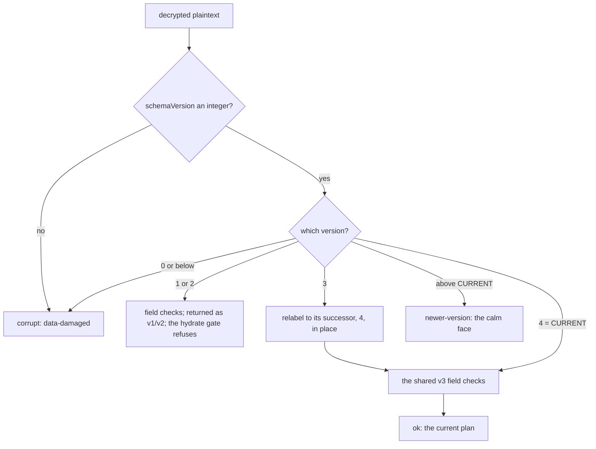

# Schema version 4: an older copy refuses a current save - Plan

## Goal Capsule

- **Objective:** A copy of The Back Nine built before this change can no longer open a plan a current copy saved and show an answer worked out without the fields it does not know; it shows its own "saved by a newer version" message instead. Every plan that could already exist, including a first save made on a copy that has not updated yet, still opens in a current copy.
- **Means:** a label-only bump of the saved plan's `schemaVersion` from 3 to 4, with version 3 read as the same plan under the current label (KTD1, KTD2).
- **Authority:** Briggsy's ruling of 2026-10-31 (the ⚑ RULED bullet on the register entry *A copy of the app built before the pay check opens a plan carrying W without a word…*) > this plan > the entry's filed prescription > older docs. `docs/product.md` R39 is amended in the same change (U5), because it says the opposite today.
- **Stop conditions:**
  - Any old build's own committed version-4 pins fail, or a cited read finds an old path that installs or writes before it decodes, in the U4 proof. The mechanism the ruling rests on is then false: stop and report.
  - Any dev seed's engine output moves (R6). The bump must not touch the engine: stop and find why.
  - Version 3 and version 4 turn out to need different field checks. The relabel in KTD2 would then be a migration, not a label: stop and re-plan.
- **Execution profile:** two commits on main. U6 and U4 run first, before any edit (they read the old builds). The first commit lands U1, U2, U3, U5 and U6's fixtures together: the type change forces every site at once, and the docs must not contradict the code for even one commit. The second commit adds only the version-floor test (KTD1), so a revert of the first commit cannot take its own guard with it. Built hands-on, one unit after another; no `ce-work`.
- **Who finishes:** the pilot (session b9-2), then the whole-file ultramode review and `/distill`.

---

## Product Contract

### Summary

Bump the saved plan's version number from 3 to 4 and keep reading 3. A copy built before the bump already treats any version above 3 as "saved by a newer version", so every current save becomes one it refuses calmly. A current copy reads a version-3 plan as the same plan with the label moved to 4. Its next save writes 4. Nothing in the engine changes.

### Problem Frame

Since the pay check went live (`c07e5758`, 2026-10-30), a date-route plan carries the working-year cost W, and every save carries the working-years stamp `dateVintage.workingYearsVintage`. A copy built before that commit, such as a cached app whose update is still waiting behind the "Update ready" toast or a tab left open, decodes such a plan cleanly, because its codec passes fields it does not know. It then runs every working year without the pay check and the earnings test, says nothing, and drops the working-years stamp if it saves. No real plan has been saved yet, so changing the version now strands nothing. After Briggsy's first real save, the same change would need to keep that save readable, which is why the ruling put a clock on it.

### Requirements

**Older copies refuse a current save**

- R1. Every plan a current copy encodes (every user Save) carries `schemaVersion` 4. Restore lands a backup's own bytes and export copies the stored ciphertext, unchanged (KTD2).
- R2. A copy built before this change meets a plan a current copy wrote with its own "saved by a newer version" state at unlock, at recovery unlock and at backup restore. It reaches that state before it installs the plan, claims the writer or writes anything.

**Nothing that may already exist is stranded**

- R3. A current copy opens a version-3 plan, whether a vault or a backup file, as the same plan with the same fields, and keeps doing so in every later build. Its next save writes version 4.
- R4. Version-1 and version-2 plans keep today's behavior: they decode, then the hydrate gate refuses them.

**The ladder stays honest for the next bump**

- R5. A plan above the current version reaches the "saved by a newer version" state in this build too, and every version from 1 up to the current one is decoded by its own arm.
- R6. No engine output moves on any dev seed.

**The records say what is true**

- R7. Every live doc and code comment that states the current version, the "no version bump" rule or "a bump strands every saved plan" says what is now true, including the rule for when a future field must bump.
- R8. The register closes the old-copy entry with its NEGATIVEs, and files the two gaps this change leaves open (see Scope Boundaries).

### Key Decisions

- **Bump the version rather than wait for old copies to age out.** (session-settled: user-approved — chosen over leaving the version at 3 and letting old copies age out through the update toast: with the bump, an old copy refuses calmly instead of running a plan without W, unflagged.) Governs R1, R2.

### Success Criteria

- In the real old builds (`c07e5758^`, and the commit just before this change), unlocking, recovering and restoring a version-4 plan each reach the "saved by a newer version" state ("This plan was saved by a newer version of the app. Update to the latest version, then open it."), proven by each old build's own committed tests and a cited read of its unlock and recovery paths (U4).
- A real version-3 plan from each of those old builds decodes in the new build as the current plan (U6's fixtures, U2's arm).
- Every dev seed's engine output is byte-identical before and after (R6, Verification Contract).

### Scope Boundaries

**Considered and not built**

- **A prompt for W on a date-route plan that has none.** A version-3 plan saved by a copy older than `c07e5758` has no W. Once relabeled, a current copy runs it without the pay check, and only the assumptions panel's W row says so ("Not answered yet — the working years aren't checked until it is"). Not built here, because three things hold at once. Such a plan needs a first save made on a pre-2026-10-30 copy with a service worker, and no deployment of this app exists and `pnpm dev` runs without one (Assumptions). The standing law forbids return-path asks for fields added before the first real save. And the cure is a new surface with its own words and walk. Under D7 a gap is a build item, never a note, so U5 files it as its own register entry, keyed on the plan's shape (date route and no W), not on its version. Evidence that would change the call: a real vault whose date-route plan has no `workingYearCost` (a shape key: a re-save by a current copy re-mints the working-years stamp, so the stamp cannot mark such a plan).
- **A reload door on the current "saved by a newer version" face.** Old copies' faces are frozen; nothing fixes them for this bump. The current face is the one a future version 5 will meet, and it has no reload control. U5 files it as a register entry for the next bump.
- **Refusing version 3.** Rejected in KTD2: it strands a first save made on a copy that had not updated yet.
- **A real-browser walk of the old builds.** Both old builds' own committed tests already pin the refusal at decode, at the unlock face and at restore, and the refusal is the codec's, not the service worker's (U4). The walk would re-prove that at the cost of extra worktrees, swapped dev servers and a shared profile. Evidence that would change the call: an old build's own pins fail, or a cited read finds an old path that installs or writes before it decodes.
- **Renaming the field-generation sub-types** (`SavedRecommendationV3`, `WorkingYearCostV3`, `*VintageV3`, `checkV3Fields`, `SCENARIO_V3_FIELDS`). They name the v3 field set, which version 4 carries unchanged, and renaming them would edit `src/engine` (KTD3).

**Deferred to Follow-Up Work**

- The version-1/2 dead end: a v1/v2 plan is installed and its writer claimed before the hydrate gate refuses it, and a v1/v2 backup lands before it dead-ends (the TODO ladder block, `session.ts` unlock and recovery, `backup.ts` restore). Pre-existing, and no build ever wrote v1 or v2. It stays on the register's *The couple's own data — no draft saving, no format migration, no way to delete*.
- The forward-compat landmine on the scenario-level `chosenGoal` vocabulary gate (register Tier 1, the third goal). This change makes its "bump" cure a one-line change but does not rule it.

**Outside this change**

- `BACKUP_FORMAT_VERSION` stays 1. It versions the backup file's envelope; moving it would make old copies say "newer format" on every backup, a different refusal that never reaches the plan's version.
- No engine, intake, budget or viz change.

---

## Planning Contract

### Key Technical Decisions

- KTD1. **One constant owns the current version.** `CURRENT_SCHEMA_VERSION = 4` lives in `src/shared/model.ts`, declared just above the type it discriminates, as `BACKUP_FORMAT_VERSION` is: `model.ts` is the only home without an import cycle. The mint, the codec's top arm, the codec's "newer" threshold and the hydrate gate all read it, and no production file re-types a literal 4 outside the codec's version-3 step, whose literal successor is KTD2's rule. The store needs no import: it maps the codec's reason, never the number. One test pins the literal on purpose (U2's absolute pin), because every derived pin stays green if the change is reverted. A second, separate commit adds a version-floor test that asserts the constant is at least 4 and says in its failure message that a real save may exist (the one-way door); it sits outside the bump's own commit, so a revert of that commit reds it. Each later bump raises the floor in its own follow-up commit. The next bump is then a one-line change plus one relabel arm while its field checks stay identical (KTD8's rule), and the ladder pin in U2 catches a bump that forgets the arm.
- KTD2. **The codec reads version 3 by relabeling it to its literal successor, 4, in place, and handing it to the version-4 arm.**
  - **What it moves.** Versions 3 and 4 have identical fields, so the version-4 arm runs the existing v3 field checks on both. The relabel touches only the discriminant; every stamp the staleness reader diffs at unlock stays as written.
  - **Why the successor, not the constant.** Each step names only the version after it. Relabeling straight to `CURRENT_SCHEMA_VERSION` would carry a version-3 plan past whatever step a later bump adds between 4 and 5; a chain of successor steps cannot skip one.
  - **Why read version 3 at all.** After this change ships, the only writers of a version-3 plan are copies older than the change, and one of them can make Briggsy's first real save. Refusing it has no honest face today. Kept decodable but refused at the hydrate gate, it shows "That didn't work. Try again." over a reload that loops. Dropped from the ladder, it reads as "damaged".
  - **Why it is permanent.** A backup keeps the version of the save it was cut from forever: export copies the stored ciphertext, and restore writes the file's original bytes. A vault that is opened but never re-saved also stays version 3 indefinitely.
  - **Why the codec, and not elsewhere.** The codec is one site, and it covers all three decode sites (unlock, recovery unlock, restore's probe) plus the mint's own round trip. Relabeling at the hydrate gate would keep 3 in `AnyScenario`, leave the nine test guards vacuous and let 3 reach every typed consumer. Relabeling at session install is two sites for one rule. `draftFromScenario` strips the label, so the hydrate gate is the relabel's only runtime reader.
  - **Why the disk is left as written.** Only a user Save re-encodes the model. Unlock writes nothing, recovery's re-key rewrites only the passphrase wrap, restore writes the file's own bytes, and export copies the ciphertext. Every writer that encodes a model encodes an object the codec just decoded, so it always carries the current version. Rewriting the disk to version 4 at unlock was rejected:
    - it breaks D1 (nothing is written until Save);
    - a read-only tab and a recovery-unlocked session cannot write, so it could not cover every open;
    - it would turn restore's byte-for-byte landing into land-then-rewrite;
    - it adds no protection, since an old copy could open the version-3 vault before any current copy did.
  - **Two constraints on the arm.** After the relabel, nothing in memory can tell which version the disk held, so nothing may key provenance on the in-memory `schemaVersion`; key it on the plan's shape. The code and comments for this arm never call a version-3 plan "legacy", which already means a plan missing optional fields (`staleness.ts`, `resultSave.ts`).
  - **Not carried: the on-disk version in the decode result.** Nothing would read it: staleness is judged from the stamps, the filed W prompt keys on shape, and re-saving on open is barred (`recSaveNoAutoWrite.test.tsx`). The accepted cost: the mint's own round trip cannot see a relabel, so its post-round-trip check becomes a type narrowing, and only `pnpm typecheck` catches a mint that stamps a literal 3 (the Verification Contract's runtime-equivalent mutant).
  - The bake-off was not considered: project instructions switch it off.
- KTD3. **The current type's discriminant becomes `typeof CURRENT_SCHEMA_VERSION`, and the type is renamed `ScenarioV3` → `CurrentScenario`.**
  - **What fixes the guards.** 3 leaves `AnyScenario` (now `Scenario | ScenarioV2 | CurrentScenario`), so every `=== 3` comparison in `src` becomes a type error that forces a decision at that site. That includes the nine `if (…schemaVersion === 3)` guards in `scenarioCodec.test.ts`, which a kept 3 would let pass silently while their assertions never run.
  - **Why a name with no version in it.** A type named V3 whose discriminant is 4 misleads every later reader. A name like `ScenarioV4` would need renaming again at every bump (about 240 lines in 30 files each time). `CurrentScenario` costs the same churn once and none after; a version that later has to be frozen for an up-convert step gets its own `ScenarioVn` then. The rename moves no line, so doc citations stay put. The name is unused anywhere in the repo today.
  - **What keeps its name.** The field-generation sub-types (`SavedRecommendationV3`, `WorkingYearCostV3`, the `*VintageV3` stamps, `checkV3Fields`, `SCENARIO_V3_FIELDS`) name the v3 field set, which version 4 carries unchanged, and five engine constants files import the stamp types; renaming them would edit `src/engine`. `model.ts` says this in one line.
- KTD4. **The hydrate gate compares to the constant.** `IntakeApp.tsx`'s `model.schemaVersion !== 3` becomes a comparison with `CURRENT_SCHEMA_VERSION`. Versions 1 and 2 are refused there as today (R4). Version 3 never reaches it, because the codec relabels. Its comment, which says only version 3 can arrive, is rewritten.
- KTD5. **"Too new" in tests is derived, not typed.** Every test that needs a newer-than-this-build version uses `CURRENT_SCHEMA_VERSION + 1`, so the next bump never re-breaks them the way this one breaks the two tests that hard-code 4 (`scenarioCodec.test.ts`, `backup.test.ts`).
- KTD6. **The old builds are the oracle in both directions (DND 012).** A test running the new codec against version 5 proves the new build's own contract, not what a copy built at `c07e5758^` does with a 4. And a version-3 fixture made by relabeling the current fixture would move with the shared checks if they ever tightened, so real version-3 backups could strand silently. So:
  - U4 runs each old build's own committed version-4 pins and records cited reads of its unlock paths, in a durable folder outside the repo;
  - U6 freezes the plaintext each old build mints for one dev seed (pre-W, and post-W with W and its working-years stamp) as committed fixtures, and U2 decodes them at the current version in every later build;
  - the committed newer-version pin is the current build's own `CURRENT + 1` arm (KTD5), the mechanism the next bump's old copies will rely on.
- KTD7. **Engine byte-identity is proven, not argued.** The engine never reads `schemaVersion` (its inputs come from the draft, which has none), so identity is structural. It is still checked with the existing HEAD-versus-tree seed probe (`b9-a6-tools\seeds.mts` run from a `git archive` of HEAD and from the tree, then `cmp`).
- KTD8. **The rule for future fields is written down once, in `docs/architecture.md` §7.3; R39 cites it, and the `SCENARIO_V3_FIELDS` docblock points to it (every new field must join that list to compile).** It is stated from the older reader's side. A new field or value bumps the version when an older copy that ignores it would:
  - (a) work out a different answer (W: an old copy ran without it, silently);
  - (b) refuse a value it does not know (the filed `stateTaxReading` and `chosenGoal` vocabulary cases), and so call a good plan "damaged";
  - (c) drop or rewrite it when it saves (the working-years stamp: every save re-mints the vintage stamps from the build's own constants).

  Otherwise the field stays additive within the current version. The `SCENARIO_V3_FIELDS` pointer catches only new top-level fields; U2's schema-surface pin enforces (b) and (c), which never touch that list. On the reader's side, a label-only step relabels to its literal successor (KTD2); a bump that adds or changes a required field writes a real up-convert step instead, because a relabeled plan missing that field would carry a type that says it has it.
  - Once a real save carries a version, the bump that introduced it is never reverted and the constant is never lowered: a build with a lower ladder top shows that save as "saved by a newer version" with no newer version to update to. Roll forward instead.

### High-Level Technical Design

The decode ladder after the change:

Who opens what:

| Plan on disk | A copy older than `c07e5758` (pre-W) | A copy from `c07e5758` to just before this change | A copy with this change |
|---|---|---|---|
| version 3, no W | opens, runs without W (as today) | opens; W unanswered (as today) | opens as 4; W unanswered; only the panel's W row says so (the filed residual) |
| version 3, with W | opens, runs without W, drops the working-years stamp on save (the defect) | opens correctly | opens as 4, correctly |
| version 4 | "saved by a newer version" (R2) | "saved by a newer version" (R2) | opens |
| version 5 or above | "saved by a newer version" | "saved by a newer version" | "saved by a newer version" (R5) |

### Assumptions

- No real vault exists on any device (Briggsy, 2026-10-21: nobody, not even him, has used it). Only code-generated dev plants and seeds exist.
- No deployed copy of this app exists: the project has no `.vercel` link and no deploy workflow. `pnpm dev` runs with the service worker off (`vite.config.ts`, `devOptions.enabled: false`). So a stale cached copy can exist only on an origin that served a built copy with its service worker (`pnpm preview`, a future deployment), or as a tab left open on old code.
- Pre-bump dev plants left in a dev browser's IndexedDB keep opening after the change (they are version 3 and relabel). Playwright contexts start clean, so CI meets none of them.

### Risks

- **Reverting this change after a real version-4 save is a one-way door.** A reverted build meets that save with "saved by a newer version" and has no newer version to offer, so the vault and every backup cut after it are intact but unreachable until a forward fix. Before the first real save a revert costs nothing. KTD8 carries the rule; U5 writes it on the closed register entry as a NEGATIVE. The version-floor test (KTD1) guards a revert because it sits in its own later commit, outside the one a revert would undo.
- **The rename touches about 30 files.** It is mechanical and the type checker proves it. Each file keeps its own line endings. Restart any running dev server after the edit (the stale-HMR law).
- **Shifted doc citations.** About 234 line-number citations point into the files this change edits, and `verify:doc-stats` checks only that each lands on a real line. Run `pnpm doc:reanchor HEAD --apply` exactly once after the commit's content is final, restore the frozen `e2e/held/fit-24px-measurements.md` it rewrites, and re-read by hand the citations whose meaning is the version gate (the TODO ladder block, the roadmap U4 row, `docs/backlog.md`'s `chosenGoal` landmine, `docs/architecture.md` §7.3, `docs/plans/4-recommendation.md`, the U17 spec).
- **The full suite times out three heavy files under load** (`budgetTwoTrack`, both `solvePayloadIdentity` files, a `SaveFlow` wait). Re-run red files alone before diagnosing.

### Sources and Research

- Inventory of every producer and consumer of the version (writers, gates, copy keys, types, plants, tests by class, docs): machine-local, best effort, `C:\Users\brigg\.claude\projects\C--Users-brigg-ai-learning-journey-projects-the-back-nine\b9-schema-v4-proof\repo-research.md`. A missing copy is not a blocker; this plan governs.
- User-flow and edge-case analysis (flows F1–F9, gaps): `spec-flow.md`, same folder and caveat. The resolved review of this plan (every finding and its disposition): `plan-review.md`, same folder.
- The old copy's refusal, read in the old code: `git show c07e5758^:projects/the-back-nine/src/shared/scenarioCodec.ts` (`version > 3` → `newer-version`), its `session.ts` unlock arm, `backup.ts` restore arm and `unlockCopy.ts` mapping to `unlockNewerVersion`. Every copy since U8 (`90d2efe5`, 2026-06-27) behaves this way.
- Lessons: insight 102 (a tolerance is a claim about a population: name who writes a version-3 plan after the change), 073 (identity consumers go through `scenarioIdentity`), 085 (every vault doctor needs an engine-acceptance pin), 046 and 049 (the codec is the restore trust boundary), 018 and 041 (sweep code comments for a superseded premise), 126 (predict which mutants cannot red).

---

## Implementation Units

### U1. The current version: one constant, the renamed type, the single mint

- **Goal:** every writer stamps version 4 from one constant, and version 3 leaves every exported type.
- **Requirements:** R1, R6; KTD1, KTD3.
- **Dependencies:** none.
- **Files:**
  - `src/shared/model.ts` (the constant; the type and its docblock; `AnyScenario` and its docblock; the field-set header note)
  - `src/ui/scenarioFromDraft.ts` (the mint and its round-trip check)
  - the rename, production (the type is named in these, by line count): `src/shared/model.ts`, `src/shared/scenarioCodec.ts`, `src/ui/devSeeds.ts`, `src/store/memoryModel.ts` (its key-level draft guards), `src/ui/draftFromScenario.ts`, `src/ui/resultSave.ts`, `src/store/savedRecommendation.ts`, `src/ui/scenarioFromDraft.ts`, `src/ui/healthSheetChrome.ts`, `src/store/staleness.ts`, `src/ui/reentryChrome.ts`, `src/ui/SaveFlow.tsx`, `src/ui/assumptionRegistry.ts`; prose mentions only in `src/engine/constants/solver.ts`, `src/intake/intakeMap.ts` and `src/store/savedRecommendationMint.ts` (comments; the engine file's change is comment-only)
  - the rename, tests: `src/ui/__tests__/reentry.test.tsx`, `src/shared/__tests__/scenarioCodec.test.ts`, `src/store/__tests__/staleness.test.ts`, `src/ui/__tests__/draftFromScenario.test.ts`, `src/shared/__tests__/model.test.ts`, `src/store/__tests__/savedRecommendation.test.ts`, `src/ui/__tests__/resultSave.test.ts`, `src/ui/__tests__/vaultRoundTrip.test.ts`, `src/ui/__tests__/devSeeds.test.ts`, `src/ui/__tests__/recommendationSaveGesture.test.tsx`, `src/ui/__tests__/recommendationSaveView.test.ts`, `src/ui/__tests__/survivorSpendingBasisSeedGate.test.tsx`, `src/ui/__tests__/RecommendationSurface.test.tsx`, `src/store/__tests__/savedRecommendationMint.test.ts`
  - the minted-version pins: `src/ui/__tests__/scenarioFromDraft.test.ts`, plus the `toBe(3)` / `!== 3` sites in `devSeeds.test.ts`, `vaultRoundTrip.test.ts`, `savedRecommendation.test.ts` and `savedRecommendationMint.test.ts`
  - `e2e/` is not type-checked and names no version beyond its version-1 store fixture (`e2e/vaultHarness.ts`), which stays
- **Approach:**
  1. Add the constant and type the discriminant from it (KTD1).
  2. Rename the type across `src` (KTD3), keeping each file's line endings.
  3. Point the mint and its post-round-trip check at the constant.
  4. Follow every type error the compiler raises at a `=== 3` / `!== 3` site to its decision: the mint's check and the hydrate gate (U3) compare to the constant; the codec's v3 arm keeps its literal (U2).
- **Patterns to follow:** `BACKUP_FORMAT_VERSION` in the same file: a constant declared above the interface it discriminates, the field typed from it, and its reader comparing with `>` for newer.
- **Test scenarios:**
  - A plan minted from any dev seed's draft carries `schemaVersion` 4, read through the constant (`scenarioFromDraft.test.ts`).
  - `scenarioIdentityKey` of a plan changes only in its version token across the change (`model.test.ts`'s base fixture moves to 4).
  - The existing minted-version pins in `devSeeds.test.ts`, `vaultRoundTrip.test.ts`, `savedRecommendation.test.ts` and `savedRecommendationMint.test.ts` read the constant, not a typed 4.
- **Verification:** `pnpm typecheck` passes, and no `=== 3` / `!== 3` comparison on a version remains in `src` outside the codec's version-3 arm.

### U2. The decode ladder: version 3 relabels, version 4 is current, newer is above it

- **Goal:** the codec opens 1 through 4, labels 3 as the current version, and calls anything above the current version newer.
- **Requirements:** R3, R4, R5; KTD2, KTD5, KTD6.
- **Dependencies:** U1, U6 (its frozen fixtures).
- **Files:** `src/shared/scenarioCodec.ts` (the ladder and its header); test `src/shared/__tests__/scenarioCodec.test.ts`; the fixtures U6 commits under `src/shared/__tests__/fixtures/`.
- **Approach:**
  1. The version-3 step relabels the parsed object to 4 in place and hands it to the version-4 arm, which runs the existing v3 field checks (KTD2). The in-place edit follows the codec's own convention for dropping a bad saved recommendation.
  2. The "newer" threshold moves to the constant and runs right after the integer check, before any version arm, as `backup.ts` orders its format check. The output is the same for every input, and the threshold becomes testable.
  3. The v1 and v2 arms are not touched (R4).
  4. Rewrite the header's three paragraphs that this changes: the division of labor (the codec now also moves a label, never a field), the ladder, and the tolerant reader (cite KTD8's home). Rewrite the comments that call v3 the forward-written shape or the current version.
- **Test scenarios:**
  - A version-4 plan (the existing `V3` fixture, renamed and labeled 4) round-trips by deep equality.
  - A version-3 plan built as an untyped object (so the compiler cannot help) decodes ok with `schemaVersion` equal to the constant, and every other field is deep-equal to its version-4 twin.
  - A version-3 plan carrying a bad saved recommendation drops it as its version-4 twin does: same `droppedAtoms`, same remaining fields.
  - A version-3 plan with a bad required field fails exactly as its version-4 twin does, so a version-3 plan never skips the checks.
  - Each frozen real version-3 plan from U6 (pre-W, and post-W) decodes ok with `schemaVersion` equal to the constant, its other fields unchanged.
  - The absolute pin: a plan labeled with the literal 4 decodes ok as the current version. It is the one place a test types the literal (KTD1).
  - `CURRENT_SCHEMA_VERSION + 1` returns `newer-version` with `got` equal to it (moved from the hard-coded 4).
  - The ladder pin: every integer from 1 to `CURRENT_SCHEMA_VERSION` reaches a named arm (never "N is not a valid version"), `CURRENT_SCHEMA_VERSION + 1` is newer, and 0 is corrupt. Raising the constant without adding an arm turns this test red.
  - A relabeled plan is itself current: for each version from 3 to `CURRENT_SCHEMA_VERSION`, decoding, encoding the result and decoding again deep-equals the first decode.
  - The schema-surface pin (KTD8): one test records, beside `CURRENT_SCHEMA_VERSION`, every vocabulary the codec checks and the key sets the four vintage-stamp mints return. If either changes while the version does not, it fails with a message citing §7.3's rules (b) and (c); the author then bumps, or updates the record with a one-line reason why no older copy is harmed.
  - The version-1 and version-2 round trips are unchanged.
  - The nine guards that compared to 3 compare to the constant and still run their assertions.
- **Verification:** the codec suite passes. The mutants in the Verification Contract that target this file red exactly their predicted tests.

### U3. The store and the hydrate gate

- **Goal:** unlock, recovery unlock and restore keep refusing a newer plan before anything is installed, claimed or written, and the hydrate gate admits exactly the current version.
- **Requirements:** R2 (this build's own half), R3, R4, R5; KTD4, KTD5.
- **Dependencies:** U1, U2.
- **Files:**
  - `src/ui/IntakeApp.tsx` (the gate and its comment)
  - `src/store/backup.ts` (its result-type comment, if it names a version)
  - tests: `src/store/__tests__/session.test.ts`, `src/store/__tests__/backup.test.ts`, `src/ui/__tests__/vaultRoundTrip.test.ts`, `src/ui/__tests__/IntakeApp.test.tsx`, and `src/ui/__tests__/UnlockScreen.test.tsx` (its mocked newer-version result uses `got: 4`; it moves to `CURRENT_SCHEMA_VERSION + 1`, KTD5)
- **Approach:**
  1. The gate compares to the constant (KTD4); rewrite its comment.
  2. No change to `session.ts` or `backup.ts` logic: their newer-version arms already run before install, claim and write.
- **Test scenarios:**
  - Unlock of a vault whose plan is `CURRENT_SCHEMA_VERSION + 1` returns `newer-version`; the session installs nothing (`currentModel()` stays null) and claims no writer. The same for recovery unlock. Neither arm is pinned today.
  - Restore of a backup whose plan is `CURRENT_SCHEMA_VERSION + 1` returns `newer-version` and lands nothing (moved from the hard-coded 4).
  - Restore of a version-3 backup stores the file's own bytes: the stored model record (IV and ciphertext) is byte-identical to the file's. The unlock that follows yields version 4 in memory. No test pins restore's original-bytes contract today.
  - A version-3 vault unlocks to a version-4 model in memory while the stored model record is byte-identical to the bytes before the unlock.
  - After the next save, the stored plan is version 4 on disk. The test reads this with its own key: derive, unwrap, decrypt, then a plain JSON parse with no codec, because the codec would report 4 whatever the disk held.
  - The hydrate gate sends a version-1 model to `restore-failed`, which pins today's refusal; it was untested. A current model hydrates to re-entry, as the existing hydrate tests already show.
- **Verification:** the store and IntakeApp suites pass.

### U4. The old-copy proof, run in the real old builds' own tests

- **Goal:** prove, with the old code as the oracle, what a copy built before this change does with a version-4 plan.
- **Requirements:** R2; KTD6; the Success Criteria.
- **Dependencies:** U6's `c07e5758^` worktree. Runs before any edit to the main checkout, which is the post-W old build until then.
- **Files:** none in the repo. The run log and cited reads go in a durable folder under the project's memory directory (`b9-schema-v4-proof\`).
- **Approach:**
  1. In each old build (the `c07e5758^` worktree, and the main checkout before any edit), run its own committed version-4 pins: `src/shared/__tests__/scenarioCodec.test.ts` (an unknown newer version reaches the calm newer-version state), `src/store/__tests__/backup.test.ts` (a backup whose model a newer app saved returns newer-version and lands nothing) and `src/ui/__tests__/UnlockScreen.test.tsx` (newer-version maps to `copy.unlockNewerVersion`).
  2. Cite, from each old build's `session.ts`, that the unlock and recovery-unlock arms return newer-version before they install the model or claim the writer.
- **Test expectation:** none added; it runs the old builds' own tests.
- **Verification:** both old builds' runs pass by exit code, and the cited lines are recorded with their commit, in the folder's README.

### U5. Docs, comments and the register

- **Goal:** no live doc or comment contradicts the change, and the gaps it leaves are filed as build items.
- **Requirements:** R7, R8; KTD8.
- **Dependencies:** U1, U2, U3 (the facts they make true), U4 (its result goes on the closed entry).
- **Files:**
  - `docs/product.md` (R39)
  - `docs/architecture.md` (§7.3)
  - `docs/roadmap.md` (the U4 row, the R39 row, the "no migration ladder" line, the test count)
  - `README.md` (the test count)
  - `docs/backlog.md` (the entry, the migration-ladder bullet, the three W-coverage claims, two new entries, the header count)
  - `TODO.md` (the ladder block, START HERE)
  - `docs/glossary.md` (W's entry calls it "additive-optional within schemaVersion 3"; it is the field this bump exists for)
  - the code comments the inventory lists in `src/shared/model.ts` (including a pointer to §7.3 at the `SCENARIO_V3_FIELDS` docblock, KTD8), `src/shared/scenarioCodec.ts`, `src/ui/scenarioFromDraft.ts`, `src/ui/draftFromScenario.ts`, `src/ui/IntakeApp.tsx`, `src/ui/resultSave.ts`, `src/store/memoryModel.ts`, `src/store/db.ts`, `src/intake/AccountEntry.tsx` and `src/intake/AllocationEntry.tsx`
- **Approach:**
  1. R39: replace "no version bump … a bump would strand every saved plan" with what is now true. The plan is version 4. A version-3 plan reads as the same plan. The bump rule is KTD8's, with its home cited, dated, and citing his 2026-10-31 OK.
  2. §7.3: the ladder as the High-Level Technical Design draws it, plus KTD8's rule, stated once.
  3. The register:
     - Close the old-copy entry with U4's result and its NEGATIVEs:
       - never refuse version 3, and never relabel version 1 or 2;
       - never call version 3 "legacy";
       - never move `BACKUP_FORMAT_VERSION` for a model bump;
       - never key provenance on the in-memory `schemaVersion` (key it on shape);
       - once a real version-4 save exists, never revert the bump or lower the constant (roll forward, KTD8);
       - accepted: the store's write API takes `AnyScenario`, so R1 holds because there is one mint, not because the compiler enforces it (narrowing it would mean rewriting the version-1 fixture behind the store suites).
     - Correct the RULED bullet's "closes this half too" to "closes it for any vault or backup whose source save a current copy made", naming the residual.
     - Correct the migration-ladder bullet ("the first bump to v4 strands every saved plan"): version 3 relabels, and versions 1 and 2 stay refuse-only.
     - Scope the three "every saved date-route plan carries W" claims by the plan's shape: every date-route plan whose W step was walked carries W; a pre-W save opened and re-saved by a current copy does not (the filed W ask).
     - On the never-revert NEGATIVE, name a hosting rollback too, once a deploy target exists: it lowers the version with no commit any test can see.
     - File the shape-keyed W ask and the reload door (Scope Boundaries), each with its population, direction and evidence trigger. Bump the header count.
  4. TODO: re-scope the ladder block to versions 1 and 2. Rewrite START HERE for the review and `/distill`.
  5. The "additive within v3" lines in live docs (roadmap rows near the U-table, register entries for holdings, HSA and dependents) are judged one by one against R7: most are true as history and stay; any that states the rule for a future field cites §7.3 instead.
  6. Plan docs, decision records, insights and closed entries are dated records and stay as written.
  7. The test count on `README.md` and `docs/roadmap.md` is updated from a real run.
- **Test expectation:** none — docs and comments only. `pnpm verify:doc-stats` is the gate.
- **Verification:** `pnpm verify:doc-stats` passes after `pnpm doc:reanchor` has run once; a grep for live sentences stating "schemaVersion 3" as current, or "no version bump" as a rule, finds none outside dated records.

### U6. Freeze real version-3 plans from the old builds

- **Goal:** commit the exact plaintext each old build writes, so every later build is tested against real version-3 plans rather than a relabeled copy of its own fixture.
- **Requirements:** R3; KTD6.
- **Dependencies:** none (it reads only the old builds).
- **Files:** two committed fixtures under `src/shared/__tests__/fixtures/`: one from `c07e5758^` (pre-W) and one from the commit just before this change (post-W, carrying W and the working-years stamp).
- **Approach:**
  1. One detached git worktree, with no branch, at `c07e5758^`. The post-W build is the main checkout itself, before any edit. `package.json` and `pnpm-lock.yaml` are unchanged from `c07e5758^` to HEAD, so the worktree's `node_modules` is a directory junction to the main checkout's, the pattern the `b9-a6-head` copy uses. Remove the junction alone before removing the worktree.
  2. In each of the two builds, mint the `date` dev seed's plan through that build's own mint, run from that worktree's own sources (a script under `tsx`, or the module imported in that build's dev page, whichever its imports allow), and write its encoded plaintext out unchanged.
  3. Commit both files as captured. The fixture holds the dev seed's invented household only, no real data.
- **Test expectation:** the fixtures are consumed by U2's frozen-plan arm.
- **Verification:** each file decodes with the old build's own codec as version 3. The pre-W file has no W and no working-years stamp. The post-W file carries both.

---

## Verification Contract

| Gate | Command | What it proves |
|---|---|---|
| Types | `pnpm typecheck` | the rename is complete and no version-3 comparison survives outside the codec arm |
| Lint | `pnpm lint` | layer boundaries and engine purity hold |
| Unit suite | `pnpm test` | every arm in U1–U3; known load timeouts re-run alone |
| Doc numbers | `pnpm verify:doc-stats` | the test count and the register's count match; citations land |
| Build and budget | `pnpm build`, `pnpm verify:bundle` | the production build compiles; entry JS stays under 300 KiB |
| Fit | `pnpm verify:fit` | every vault arm (stale, statestale, wyclock, datecoststale, datestale, datearrived, rec, recold) plants and opens through the new mint |
| CSP | `pnpm verify:csp` | the real-IndexedDB vault arms in Chromium and WebKit still pass (they run on a version-1 fixture, untouched) |
| Engine identity | the `b9-a6-tools\seeds.mts` probe from a `git archive` of HEAD and from the tree, then `cmp` | R6 |
| Old copies | U4 (each old build runs its own pins) and U6 (frozen real version-3 plans) | R2 and R3, with the old code as the oracle |
| Mutants | `b9-h2-cure\mutants.cjs` with a spec for the set below, plus `pnpm typecheck` for the literal-3 mutant | each mutant reds exactly its predicted tests |
| CI | both jobs on the pushed commit, read by run id | the Linux, case-sensitive run agrees |

**The mutant set, with predicted kills.** Run with the per-test runner `b9-h2-cure\mutants.cjs` and its spec format (each failure's own test and line), not the file-level `mutants-spec.cjs`; the literal-3 mutant also needs its own `pnpm typecheck` run.

- **The version-3 step's relabel removed** (version 3 returns as 3). Red: the U2 version-3 and frozen-fixture decode arms, the U3 version-3 unlock and restore arms. The compiler does not catch it, because the arm casts.
- **The newer check left at `> 3`**, and separately **the newer check at `>=` the constant.** Both are live once the check runs before the arms (U2 step 2), and both red the same set: the version-4 round trip, the ladder pin, the mint test and every test that mints or opens a plan, devSeeds plants included.
- **The version-3 step deleted** (3 is corrupt). Red: the U2 version-3 and frozen-fixture decode arms, the U3 version-3 unlock and restore arms, and the ladder pin.
- **The relabel applied to versions 1 and 2.** Red: the v1/v2 round trips and the version-1-fixture session and backup suites.
- **The hydrate gate compared to 3.** Red: the existing IntakeApp hydrate tests (each feeds a current model).
- **The mint stamps a literal 3.** Equivalent at runtime: the mint's own round trip relabels the candidate to 4, so the saved plan is still 4. Only `pnpm typecheck` reds (the literal no longer fits the type).
- **The version-3 step relabels straight to the constant** instead of its successor. Equivalent while the constant is 4, so nothing reds; KTD2's successor rule is its guard.
- **The constant raised to 5 with no 4-to-5 step.** Red: the ladder pin, U2's absolute pin, the version-3 and frozen-fixture decode arms, and U3's version-3 unlock and restore arms. The mint and open tests stay green, because they read the constant.
- **The constant alone lowered to 3.** Red: every mint, plant and open test (the version-3 step lifts the mint's 3 to 4, which the codec's top arm then calls newer), plus the version-floor test.
- **The bump reverted in the codec** (the constant 3 and the version-3 step removed). Red: only U2's absolute pin and the version-floor test.
- **Restore stores a re-encoded copy of the decoded plan** instead of the file's own bytes. Red: only U3's restore byte arm.
- **Unlock rewrites the stored plan with the relabeled model.** Red: only U3's unlock byte arm.

---

## Definition of Done

- Every gate in the Verification Contract passes by exit code on the committed tree, and CI is green on both jobs for each pushed commit, read by run id.
- Every mutant reds exactly its predicted tests (the literal-3 mint reds only `pnpm typecheck`; the relabel-to-the-constant mutant reds nothing and is recorded as equivalent), and each file is restored and byte-compared.
- U4's two old-build runs pass and their cited lines are recorded; U6's worktree is removed (the junction first); no port is held.
- Every dev seed's engine output is byte-identical before and after.
- The register entry is closed with its NEGATIVEs and U4's result; the two new entries are filed; the header count, the test count and R39 agree with the code.
- The version-floor test lands in its own second commit.
- No abandoned-attempt code, no scratch file in the repo, no running dev server or headless browser left behind.
- START HERE names the next sizable step: the whole-file ultramode review of this change, then `/distill`.

---

## As built (b9-3, 2026-10-31)

Built as planned, in two commits. What the build changed from the plan, and why:

- **U4 and U6 ran in `git archive` copies, not a detached worktree plus the live checkout.** One archive of `c07e5758^` (59417d29) and one of HEAD (`c4831850`, whose `src` was unchanged since `68aba728`), each with a `node_modules` junction. The same tracked sources, no worktree registered in a checkout other sessions share, and the post-W build could not pick up another session's uncommitted edit. Runs, cited reads and the mint script: `b9-schema-v4-proof\README.md` in the project's memory folder.
- **The M10 prediction reads differently.** "Newer" is judged on the DISK label before any arm (U2 step 2), so with the constant lowered to 3 the mint's 3 relabels to 4 and lands on "not a valid version" (corrupt), not on "newer" as the Verification Contract worded it. The kill set is the same.
- **Arms beyond the plan's list:** a version-3 vault through RECOVERY unlock (the re-key leaves the model record byte-identical); the hydrate gate refuses version 2 and null as well as version 1; every dev seed's save carries the current version in the plan AND in the encoded bytes; the version-3 twin's required-field arm runs four field kinds.
- **The schema-surface pin reads the codec's own source** for its vocabulary arguments (each `needVocab` third argument, plus the order-key `includes`), so a NEW vocabulary the record does not hold reds, not only a changed one. The record stores no version: a second typed 4 would make the absolute pin no longer the one place a test types the literal.
- **`src/engine/constants/solver.ts`'s rename is a `note:` string in a constants entry, not a comment.** Nothing reads it (only `.value` is consumed); the seed probe proved every dev seed's engine output byte-identical.
