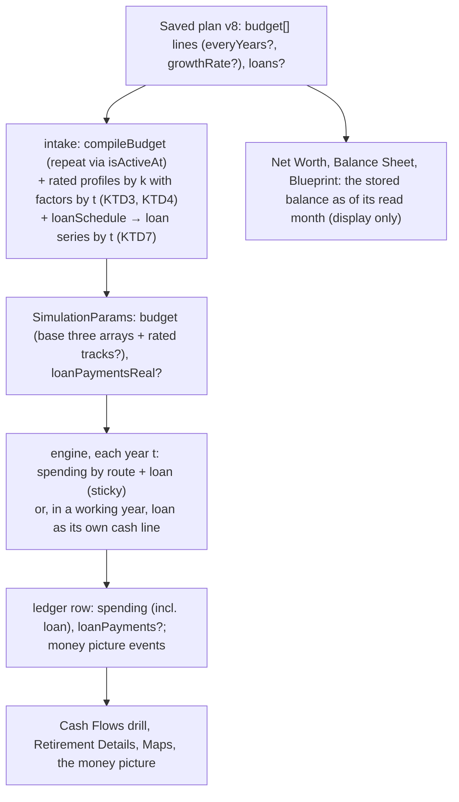
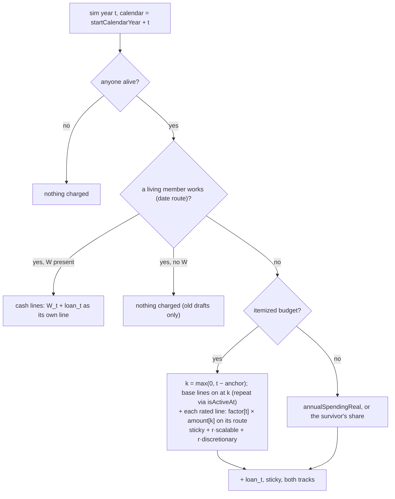

# Spending Lines That Repeat or Grow at Their Own Rate, and Loans That End - Plan

## Goal Capsule

- **Objective.** A household whose costs don't follow general inflation gets an answer that prices them right: a car bought every five years is charged in those years only, a cost that rises faster or slower than prices is charged at its own pace, and a mortgage is charged at its fixed dollar payment until the calendar year it is paid off. The loan is entered on Net Worth, where RightCapital asks for it; the repeat and the rate are entered on the Living expenses lines (RightCapital's Goals card for them is deferred); each is shown back in the household's own numbers.
- **Means.** Three constructs, each in its own frame: a repeat and a rate on a budget line, and a loan as its own record on Net Worth (KTD1, KTD2).
- **Authority.** This plan's Requirements win on product behavior and its KTDs win on mechanism. Project law outranks both: `CLAUDE.md`, `docs/architecture.md` (the byte-identity and presence-key invariants, the single shared market draw), and `docs/product.md` §4 (D7).
- **Execution profile.** Built on main, as one or more commits per unit in the order of the Unit Index; no branches and no pull requests (the project's practice: `CLAUDE.md`, *Test cadence*). Every commit that touches `src/engine` or `src/intake/intakeMap.ts` carries `pnpm engine:identity`'s first line in its message.
- **Who finishes.** The pilot builds, reviews and ships every unit. Briggsy reads the new words after they ship; they ship flagged, never held for his read. One fact is his to give (Open Questions): it gates the loan half only.
- **Stop conditions.** Stop the line and diagnose when any of these happens: `engine:identity` moves a key on an existing seed or plant that the unit did not mean to move; the price index throws on any plant; two sources disagree about a rule this plan rests on.

---

## Product Contract

### Summary

A budget line gains two optional answers: how often it repeats, and how its dollars change (with prices, the same dollar amount every year, or up by a chosen percent). A mortgage or other loan becomes its own record on Profile → Net Worth, paid at its fixed payment until it is paid off. The engine prices all three in the right frame on both routes, the screens show them, and a plan with none of them runs exactly as today.

### Problem Frame

Every budget line is charged flat in today's dollars across its window (`compileBudget` in `src/budget/budgetToSpending.ts`). That is right for most living costs and wrong for three common ones.

A purchase that comes back every few years, such as a car, can only be entered as one line for one year or as a steady yearly cost. The first leaves out every later car; the second charges a car's worth every year.

A cost whose price doesn't follow general inflation can't say so. A fixed-rate mortgage payment is the sharpest case: its dollars never change, so in today's dollars it shrinks every year, and it stops in a set calendar year. Today it reads too high in every later year and never ends unless its line has an end year. That end year counts from the work stop, so on the date route it moves with every stop the search tests (insight 167). The register files this as *Every spending line keeps pace with inflation — a fixed mortgage payment that shrinks in real terms can't be marked*.

RightCapital handles all three. A goal is one-time or recurring, with an "annual increase" of general inflation or a custom rate. A mortgage is a Loan on Net Worth, with balance, rate, term and payment, paid until the balance runs out, its payments in Cash Flows' expenses and its balance shown as a debt. The map ranks this as gap 4 (`docs/plans/rightcapital-map.md`, rows 76, 79 and 80). The workbench plan's U18 and KTD27 planned only the repeat, and U18's file list predates Act 6.

### Requirements

**Spending lines**

- R1. A budget line can repeat every N years, N a whole number from 2 to 50: it is charged in its start year and every N years after, inside its window.
- R2. A budget line can say how its dollars change: with prices (the default, today's behavior), the same dollar amount every year, or up by a chosen percent a year in dollars, from just above 0% to 15%.
- R3. A line's amount is its price in the plan's first year. A line that doesn't change with prices is grown at its own rate from then and charged in today's dollars through the one price index.
- R4. A rated line costs the same in a given calendar year whatever stop the date search tests. A repeat's years count from the stop, as every line's window does.

**Loans**

- R5. The household can enter a mortgage or other loan on Profile → Net Worth: its name, whose it is, the balance today, the interest rate, the monthly payment of principal and interest, and, optionally, a calendar year it will be paid off early.
- R6. A loan's payments run until the balance is paid, worked out from the balance, rate and payment, counted from the month the balance was read. With an early payoff year, the payments stop that year and the remaining balance is paid at once.
- R7. A loan's payment stays the same in dollars, so in today's dollars it shrinks each year by the one price index, and it ends in its calendar year whatever stop is tested.
- R8. A loan is paid in every year it runs, working or retired, and a death does not shrink it. A working year with no working-year cost charges nothing, as today (only old drafts reach one; see Scope Boundaries).
- R9. Net Worth shows each loan's balance as a debt beside the invested accounts. No screen adds them into a net worth total, because the house is not in the model.

**Showing the work**

- R10. Cash Flows shows each year's loan payments as a part of that year's spending, and the working-year money picture names the year a loan ends or is paid off.
- R11. Every screen that names a line's years or amount says when it repeats, and each drawer reads back what an answer means in the household's numbers: a rated line's cost in a later year in today's dollars, a loan's payoff, and an early payoff's lump sum.
- R12. The household is told where a loan's payment must be left out (living expenses, the one spending figure, the working-year cost), and every sentence that quotes the household's spending names its loans and any repeat inside the figure, so a payment is never counted twice or left unsaid.

**Compatibility**

- R13. A plan with none of the new answers runs exactly as today, on every seed and plant.
- R14. A plan saved by this build opens in an older build as "saved by a newer version". An older plan opens here unchanged. A kept what-if saves and reloads every answer on the lines it carries; a replaced line's rate follows the live plan line, and a replaced line whose repeat has changed is refused by name (KTD13).

### Key Decisions

- **A loan is its own record on Net Worth, as RightCapital does it, not a fixed-dollar budget line with an end year.** A line's end counts from the stop, and a mortgage ends in a calendar year. Governs R5, R6, R7, R9.
- **The repeat and the rate live on the Living expenses lines, not on a new Goals card.** Lines are B9's home for itemized spending, and KTD27 already planned the repeat there. Governs R1, R2.
- **An early payoff is a calendar year only.** RightCapital also offers an age or a retirement; on the date route those would make the remaining balance depend on each tested stop. Governs R6.

### Acceptance Examples

- AE1. **Covers R1.** **Given** a $40,000 line with startYear 3 and a repeat of 5, **when** the plan compiles, **then** it is charged in plan years 3, 8, 13 and so on, and in no year between.
- AE2. **Covers R3, R4.** **Given** a line typed at $10,000 that "stays the same dollar amount" on a plan built in 2026, **when** its year lands in calendar 2036 on two different tested stops, **then** both charge $10,000 divided by the price index's growth from 2026 to 2036.
- AE3. **Covers R6, R7.** **Given** a $300,000 balance read in January 2026, at 6% with a $1,798.65 monthly payment, **when** the plan runs, **then** it pays $21,583.80 a year in dollars through 2055, the last payment carrying the $1.58 left over (KTD7), and nothing after, each year divided by the price index's growth to that year.
- AE4. **Covers R6.** **Given** the AE3 loan with an early payoff year of 2036, **when** the plan runs, **then** 2026 to 2035 pay the yearly payment, 2036 pays the $251,057.43 still owed at its start, and nothing is paid after.
- AE5. **Covers R8.** **Given** a loan and a sampled death in its third year, **when** the survivor years run, **then** the loan's charge in each later year is the same as on a path with no death.
- AE6. **Covers R13.** **Given** any existing seed or aged plant, **when** `pnpm engine:identity` compares this build with its parent, **then** every key is identical.

### Scope Boundaries

**Considered and not built**

- A random inflation draw per future: never (the single shared market draw, `docs/architecture.md` §3). The register's sampled-inflation build owns it.
- The mortgage interest deduction: B9 takes the standard deduction (register *Tax is always figured with the standard deduction…*). Leaving it out over-funds, the harsh side.
- The house as an asset, or a net worth total: property is a later map gap. A loan balance netted against the invested accounts alone would understate the household.
- A variable rate, an adjustable mortgage or a home-equity line: today's payment is held. The drawer says the tool can't know future rates. What would change it: a household with one in its real plan.
- An early payoff at an age or at retirement: see Key Decisions. What would change it: Briggsy asking for "pay it off when I stop".
- A repeat on the before-the-stop survivor path: there `k` is held at 0, so a repeat that starts at 0 is charged every such year. It is harsh and rare.
- A loan in a working year with no working-year cost: such a year charges nothing today ("lives on salary"), and the stepper asks the cost before Continue, so only old drafts reach it.
- A balance left at the last death: never charged, and the same in every candidate, so it can't change a ranking. The leave-more figure's printed level does include an unsecured loan's unpaid balance (rosy by that much); a mortgage's is offset by the house the model leaves out. Filed by U11.
- A fixed obligation that is not a loan and ends in a calendar year (a term-life premium, a lease): it stays a line whose end counts from the stop, so on early tested stops it ends early. A calendar-frame end on a budget line is filed by U11.
- An automatic subtraction to stop double counting: the tool can't know what a line or a typed figure includes, so R12's words do it.
- A staleness clock for an ended loan: no incident, so no guard. Net Worth shows the last payment's year.
- An intake re-check of a stored loan's problems on every read: nothing edited outside the loan drawer moves a loan's problems, the drawer refuses them before Save, and a stored one that slipped through errs harsh (its payments run to the horizon). What would change it: a second writer of loans.
- Frozen version-7 fixtures minted by the old build, and a planted fault on the version floor: the version-6 and version-7 bumps shipped without either, no real save exists yet, and the floor test is not a new kind of check.
- A worker round-trip test for the new params or ledger fields: params and ledger rows cross to the worker whole, by structured clone, with no field list (`engineProtocol.ts`, `engineWire.ts`), so such a test cannot fail.
- A Caddie walk of the new surfaces: dropped under Briggsy's 2026-11-22 rulings (no extra Caddie read; the words ship flagged for his later read), as the workbench plan applied them.

#### Deferred to Follow-Up Work

- A Goals card for a purchase goal (RightCapital's Goals → Asset purchase), which would let a household with one spending figure add a repeating car without itemizing everything.
- Repeat and rate controls in the Action Items tray, and a loan what-if (RightCapital's extra debt payment or early payoff in a proposed plan). This plan only makes the tray carry the new fields.
- A future loan or a refinance (RightCapital's New Loan card).
- A Net Worth tab in Cash Flows with each loan's balance by year.
- Moving nominal income streams from the flat 3% onto the price index (the register's *A pension that doesn't keep up with inflation is shrunk by a fixed 3%…*). This plan widens that entry's reach (U11).
- Gap 8's higher-inflation stress test must move the loans' and rated lines' deflator too, or a fixed loan reads unchanged under it (U11 records it on the map).
- The survivor card's "assumes $X" line for a plan with a loan, a repeating line or a rated line (KTD11).

### Open Questions

- **Does the household carry a mortgage or other fixed-payment loan into the plan's years?** Only Briggsy knows. The project's yardstick is "does RightCapital do it, and does his plan need it", and nothing on record says whether his plan needs a loan. It gates the loan half only: `loans` in U2, and U5, U6, U12, U7, U10 and U13's loan parts. The line half (U2's line fields, U3, U4, U8, U9) is built first either way. Recommendation: build the loan half if he says yes. If he says no, file it as one deferred register entry. If he hasn't answered when U2 starts, U2 ships the line fields alone, and the loan half takes the next schema version when it is built.

### Sources

- Insights 167 (store an edit in its target's frame; a calendar-fixed value stays calendar), 135 and 138 (a frozen-dollar figure divides by the one price index, a growth goes through `cpiGrowth`), 058 (every writer of the year-0 total reconciles), 055 (presence-keyed, absent byte-identical), 151 (a version ladder's guards), 041 (re-check a plan step written before a later decision), 035 (a reserved height never jumps).
- RightCapital: `docs/research/rightcapital-ui-reference.md` (the drawer, §2.4 and §2.5), its reference screen of the Loan drawer (outside the repo, named there), and its help center as summarized by a grounded search on 2026-11-27 (goals: one-time or recurring, annual increase general or custom; loans: on Net Worth, payment until the balance runs out, payments in Cash Flows' expenses, balances in Cash Flows → Net Worth, living expenses told to leave loan payments out).

---

## Planning Contract

### Key Technical Decisions

- KTD1. **Each construct is priced in its own frame, and the engine applies anything that depends on the calendar year.** The compiled budget is indexed by `k`, years since the stop, and is built once per run: the date search never recompiles it per tested stop (`dateSearch.ts`, `buildCandidateParams`). A repeat depends only on `k`, so it belongs in the compile. A rate's growth and a loan's deflation depend on the sim year `t` (`t = Y + k` on the date route), so they are compiled at intake into arrays by `t` and joined with the `k` windows in the engine, year by year. Rejected: deflating inside the `k` arrays, which is wrong on every date-route candidate but one (harsh for a fixed payment, rosy for a line rising faster than prices); recompiling per candidate, which would need the engine to import the budget layer (banned by the layer rules). No bake-off: the layer rule and the date search's single compile settle it.
- KTD2. **A loan is a top-level list on the saved plan (`loans?`) and a top-level series on the engine params, never an account kind and never on the overlay.** As an `EnteredAccount` kind, `initialPortfolio` would add the balance to the money (rosy), the `mix` lever would write a blend onto it, and five exhaustive per-kind tables would need a row. On the overlay it would vanish for a household with no accounts, premium or income, where `buildOverlay` returns nothing. ⚑ NEGATIVE: never an `EnteredAccount` kind.
- KTD3. **The deflator is the one price index on its own base for every plan built through the index's anchor year, and the build year's growth after that.** The engine's real dollars are the anchor year's (`priceIndex.ts`'s header: "a plan first run later still prices against that base"). In sim year `t`, with calendar year C = `startCalendarYear + t` and B′ = the later of `startCalendarYear` and the anchor year (read from the constants, `medicareCostTrend.value.anchorYear`, never typed), a nominal figure is divided by `cpiGrowth(B′, C)` for C after B′ and by 1 otherwise. For a plan built in or before the anchor year (every fresh seed, and the aged plants built in 2024 and 2020) that is exactly `cumulativePriceIndex(C)`, the path every frozen-dollar figure in the same run already reads. For a plan built later it rebases to the build year, a deliberate departure: the household types its payment in the build year's dollars, so year 0 must charge the typed figure. The Part B and statute figures keep the anchor base, so that split already exists for those plans; U11 files it. Rejected: the flat 3% the income streams use, which is the register's open contradiction, not a ruling. The factors are computed at intake, where `startCalendarYear` lives.
- KTD4. **A rate is a nominal yearly increase that replaces general inflation; absent means "with prices".** This is the income-stream convention (`grossAtYear` in `src/intake/otherIncome.ts`). The saved field `growthRate` is a fraction (0.05 means 5%), the kit's `PercentInput` output and `colaPct`'s convention: 0 is the same dollar amount every year, and a custom rate is above 0 and at most 0.15. Its bounds live in one cited module, `src/shared/spendingBounds.ts` (the `incomeBounds.ts` pattern), read by the codec, `validateBudgetItems` and the drawer. An absent field takes today's branch untouched: `((1+π)/(1+π))^t` is not exactly 1 in floating point, and the index's π changes by year. Growth runs from the plan's year 0, because a line carries no year it was typed in. A rated line typed into a plan built years earlier is therefore overcharged by its growth since the build year (harsh), and its read-back uses the engine's calendar year, never the wall clock. A rated line's factor in sim year `t` is `(1 + g)^t ÷ deflator(t)` (KTD3). The working-year cost quote counts a rated line at its typed amount, because W is one flat figure across the working years (up to 10). That residual is harsh for a fixed line and rosy for a rising one, so the W question carries a stopgap line while its build is open (U13) and U11 files the build.
- KTD5. **A repeat is read through the one window helper, `isActiveAt` (KTD27, carried from `docs/plans/5-workbench-plan.md`).** Every year-0 reader already calls it; only the compile's fill loop keeps its own range, and U3 moves that loop onto it first. The saved field `everyYears` is a whole number from 2 to 50 (bounds in `spendingBounds.ts`); 1 is refused because it would be a second spelling of "every year". The line is on at `k` when `k` is inside its window and `k − startYear` is a multiple of N. The year-0 total counts the line as the helper says at `k = 0`, so the engine's reconciliation check still agrees. The working-year cost quote counts every repeating line it doesn't leave out at amount ÷ N, whatever its start year, and names the average. The survivor's held share of W (`workingYearCostForYear`) reads `sticky[0]`, which holds a sticky repeat that is on at `k = 0` at its full amount (harsh; stated, not changed). `isRampedBudget` counts a repeating line (U3) and a rated one (U4) as ramped.
- KTD6. **The year-0 total and its reconcilers stay on a line's typed amount; the engine applies the rate factor separately.** A rated line keeps its raw amounts in its own `k` profile and never joins the three base arrays, so unrated lines compile byte-identically. In the engine, a rated line adds `factor[t] × amount[k]` to its route (sticky, scalable essentials or discretionary), so the survivor share and the floor track treat it as they treat its tier and category today. Two engine readers of the base arrays at `k = 0` gain the rated tracks' raw `amount[0]`: the reconciliation check in `validateParams` (otherwise every plan with a rated line on at year 0 runs indeterminate) and the survivor's held share in `workingYearCostForYear` (each rated sticky track's `amount[0]`; otherwise a fixed housing line is scaled away on a survivor working year, rosy). The out-of-pocket medical containment check stays on the base arrays, because the medical line is never rated.
- KTD7. **A loan record carries the month and year its balance was read, and its schedule is worked out once, in intake.** The fields are an id, a name, an owner (a string vocabulary, one per person or both, checked with `needVocab` and bounded by the household's people), the balance, `balanceYear`, `balanceMonth`, `interestRate` (a fraction, at most 0.30, bounds in `spendingBounds.ts`), the monthly payment, and an optional `payoffYear`. The read date follows the inherited IRA's `askedYear`, because `startCalendarYear` is the build year and never moves on a re-save, so a payoff counted from the build year would end early. The schedule (`src/intake/loanSchedule.ts`) walks month by month from the read month. Each plan year from the build year through the year before the payoff charges 12 payments, including the months of the read year already paid and any years before the read year (harsh, the full-year convention every line follows). The payoff year charges the months still owed. A balance left after a scheduled payment that is under 1% of the payment is paid with that payment, so a cent-rounded payment never makes a stray last month. With `payoffYear`, that year pays the balance the walk holds at its start (never below 0) and no payments. A 0% loan takes its own path (no division by the rate). A payoff past the horizon pays to the horizon. Every page shows the stored balance with its read month and year; the walk feeds only the payoff read-back, the last-payment year and the payoff events, and its yearly balances wait for the deferred Cash Flows Net Worth tab. Rules that need the walk (a payment that never pays off, a `payoffYear` past the natural payoff) are `loanProblems` in the same module, and the drawer refuses on them before Save; the codec never runs the walk (KTD9).
- KTD8. **How a year charges a loan.** Every year is charged through one presence-keyed params series by `t`, real dollars after KTD3, with any early-payoff amount included in its year. In a retired year it is added to essentials spending as sticky (never scaled by the survivor share), on the full track and the floor track. In a working year it is its own working-year cash line beside the working-year cost (W). Inside W it would be scaled by the survivor share and printed as "What a year costs". Drawn outside the cash lines, the left-over credit would count money paid to the lender. A working year with no W charges nothing, as today. The ledger row gains `loanPayments?`, written only in a year the loan was charged, and that row's `spending` includes it.
- KTD9. **Schema version 8, one step for all three, and the codec checks shape only.** Every new field is written only when answered, never as an `undefined`-valued key (DND 009, and the identity recorder digests key presence). The codec checks shape and simple arithmetic: types, finiteness, the bounds in `spendingBounds.ts`, unique loan ids, the owner vocabulary, `balanceYear` at or after `startCalendarYear`, `payoffYear` at or after `balanceYear`. It never reads the wall clock (the hydrate step re-runs the codec on every open, so a passed year would make a plan unopenable) and never runs the loan walk (a computed bound that tightens later would make a good saved plan read as damaged). It accepts an empty `loans` list, which every reader treats as absent; the writers still never store one. The 7 → 8 step, on the shape of `versionSevenFieldIn`, guards every access (it runs before any check) and refuses a version-7 plan that carries a new field in `budget[i]`, in a kept what-if's spending add or replace lever's `line`, or a `loans` list. `FLOOR` moves to 8 in its own later commit. Any later change to how the engine charges the loan series or the rated tracks, with no params change, must bump `SOLVER_CODE_VERSION` (the saved recommendation's params hash cannot see it; the IRMAA precedent in `docs/architecture.md` §7.2).
- KTD10. **Double counting is closed with words.** The Living drawer, the one-figure spending help and the W question name the loans entered on Net Worth and say to leave their payments out. The loan drawer says the reverse, naming all three places, and names the household's working-year cost with both figures when one exists, because a W typed before the loan was entered never goes stale on its own. Its payoff read-back ("At $X a month this is paid off in {month year} — does that match your statement? If your statement ends later, your payment may include property tax or insurance; enter principal and interest only.") catches a payment typed with tax and insurance in it, because that payoff lands years early. No sum is changed automatically.
- KTD11. **The survivor card's "assumes $X" line is accepted as lost for any plan whose spending isn't steady.** A loan, a repeat or a rate makes `steady` false by construction (the `Object.is` check in `simulate.ts`). The line is informational and the card's figures stay right. Filed as a register entry (U11), so the loss isn't silent.
- KTD12. **The working-year events gain a loan-coded shape.** Today an event names a person or the household (the union in `src/shared/model.ts`), and a draft event's `person` is required and checked against the people (`workingYearLedger.ts`). A loan, often owned by both, fits neither, and its words must name it. A third shape `{ code: 'loanEnds' | 'loanPaidOff', loan }` carries the loan's index in the draft's list. Both codes join `WORKING_YEAR_LEDGER_EVENT_CODES` and `CAN_LOWER_THE_BOTTOM_LINE` (a last payment cannot lower the bottom line; an early payoff can). The year-0 money picture gains a going-out loan line, because its lines must sum to the bottom line exactly (`roundLinesToBottomLine`). Without these, a loan ending inside the working window throws in the ledger, intake catches it as `'unknown'`, and the money picture and a saved left-over credit silently disappear.
- KTD13. **A kept what-if's replaced line follows the live plan line's rate, and is refused by name when the plan line's repeat has changed.** The tray cannot edit `everyYears` or `growthRate`. A replace lever takes `growthRate` from the plan line it replaces, never from the line stored when it was kept (insight 167): R3 keeps an amount's meaning the same under every rate choice. A repeat changes what an amount means (per occurrence, not per year), so pairing a stored amount with a later repeat would run a cost several times too low (rosy) and Apply would copy it in. So when the live plan line's `everyYears` differs from the stored line's, the lever is refused by name with a new refusal kind, `line-repeat-changed`, worded like `line-gone` (whatIf.ts never re-targets a lever, R21). An add lever keeps its own repeat and rate. `sameLine` compares only what the tray can edit.

### High-Level Technical Design

From the saved plan to the screens:

What one engine year charges:

### Assumptions

These are the planner's bets. They were not put to Briggsy (the plan step ran with its scope confirmation off), and each is his to overrule:

- He wants RightCapital's Loan on Net Worth rather than the map's older wording, "a fixed-dollar line that can end". That wording was written before the 2026-11-24 clone ruling.
- A repeating purchase belongs on the Living expenses lines for now; a Goals card is deferred.
- An early payoff year is enough; "at retirement" is not needed yet.
- The loan's owner is asked for display only (Blueprint's per-person Net Worth tab).
- A custom rate from just above 0% to 15% covers real lines; a cost that falls in dollars is not offered.
- Losing the survivor card's "assumes $X" line on a plan with a loan, a repeating line or a rated line is acceptable for now (KTD11).

### System-Wide Impact

- **The engine contract.** New presence-keyed params (rated tracks on the compiled budget, the loan series) and a new ledger row field. Absent, every arm is byte-identical: `engine:identity` proves it at each engine or `intakeMap` commit. The run key and the solver fingerprint hash the whole built params, so they pick up the new fields with no change; date-search candidates carry top-level params through their spread.
- **The saved shape.** Version 8. An older open tab sees "saved by a newer version". A budget line sits in two saved places (`budget`, and a kept spending lever's `line`); the saved recommendation, the vintage stamps and the backup file hold no copy (the backup is the same ciphertext, checked by the codec on restore).
- **Compile-time homes of the draft.** `ScenarioDraft`'s field list and its shape tie in `src/store/memoryModel.ts`, `src/ui/assumptionRegistry.ts`, `src/ui/workbench/factRegistry.ts` and `src/shared/stableIds.ts` each gain the loans (U2).
- **Every writer of the year-0 total** (insight 058) goes through `budgetYearZeroFullTotal`, so KTD5 and KTD6 keep them reconciled with no call-site change.
- **The working-year money picture** gains a cash line, a year-0 going-out line and a loan-coded event shape (KTD8, KTD12).
- **Every sentence that quotes spending:** the verdict's `magnitudeClause` and its reserved height `reserveClauseFor` (`src/ui/verdictSentence.ts`, composed on Probability) and `spendLevels` (`src/ui/answerView.ts`), on one-figure and budget plans alike (U13).
- **Pages that say B9 holds no debts:** `snapshotInvestedStopgap` in `src/ui/copy.ts`, used on five pages (Balance Sheet, Snapshot, Investment, Blueprint, Net Worth), and the header laws in `balanceSheetView.ts`, `NetWorth.tsx` and `comparisonsView.ts` (U13).
- **Docs.** `docs/architecture.md` §5 (the new presence keys) and §7.3 (the version chart, which still stops at 6), the glossary, the map, the roadmap's You-Are-Here table, and the register (U11).

### Risks

| Risk | Mitigation |
|---|---|
| A presence-keyed field leaks an `undefined` key or a multiply-by-1 into an existing seed's run | Absent fields take today's code path untouched (KTD4, KTD6, KTD9); `engine:identity` at every engine or `intakeMap` commit; new seeds for the new shapes, never edits to existing seeds |
| A typed "5" is stored as 5 where the engine reads a fraction, or the reverse (rosy, unseen by any range check) | One unit, the fraction, in KTD4 and KTD7; one bounds module read by every check; end-to-end tests from a typed percent to the engine's factor (U8) and monthly rate (U7) |
| A household reads the rate as "on top of inflation" and types 2% meaning 2% more than prices (rosy) | The three-way choice and a read-back that names the cost in today's dollars and says whether it rises slower or faster than prices (U8) |
| A payment typed with escrow pays off years early and deflates the tax part away (rosy) | "Principal and interest only" in the words, and the payoff read-back with its next step (KTD10) |
| A W typed before the loan keeps the payment, so every working year is charged twice (harsh) | The loan drawer names W with both figures (KTD10, U7) |
| An edited loan keeps an old read date under a new balance, so it ends early (rosy) | The read date is re-stamped exactly when the balance changes (U7) |
| A kept what-if freezes a line's rate, or runs an old amount under a new repeat (rosy) | KTD13 |
| A year-0 repeat inflates the headline's quoted monthly spend (rosy) | The quoted figure says it is the first year's and names the repeat inside it (U13) |
| A new seed trips a hard-counted gate (the survivor basis gate's seed count and "no card-bearing seed is ramped", the every-seed arms, the shown-lines sum) | The repeat and rate seeds ride the date route with a confirmed W; U6 re-cuts the survivor gate for the mortgage seed; each unit updates its counts |
| Line-numbered citations in docs move as files change | Cite code by symbol in this plan; `pnpm doc:reanchor` and `verify:doc-stats` arm 4 for docs that cite lines |
| A new drawer row or sentence overflows at the phone tier, or a reserved height jumps | Fit arms for each new surface at his window and the phone (U7, U8, U10, U13) |

---

## Implementation Units

| U-ID | Title | Key files | Depends on |
|---|---|---|---|
| U2 | Version 8: the new fields, their bounds, the codec and the step | `src/shared/model.ts`, new `src/shared/spendingBounds.ts`, `src/shared/scenarioCodec.ts`, `src/store/memoryModel.ts` | — |
| U3 | The repeat | `src/budget/budgetToSpending.ts`, `src/budget/budgetModel.ts`, `src/intake/workingYearQuote.ts`, `src/ui/devSeeds.ts` | U2 |
| U4 | The rate, priced by the engine | `src/budget/budgetToSpending.ts`, `src/intake/intakeMap.ts`, `src/engine/simulate.ts` | U2 |
| U8 | The Living drawer's repeat and rate | `src/ui/screens/profile/drawers/ExpensesDrawers.tsx`, `expensesFields.ts`, `src/budget/budgetModel.ts` | U3, U4 |
| U9 | The tray and kept what-ifs carry the new fields | `src/ui/screens/retirement/ActionItemsTray.tsx`, `trayView.ts`, `src/intake/whatIf.ts` | U3, U4 |
| U5 | The loan schedule and its problems | new `src/intake/loanSchedule.ts` | U2 |
| U6 | Loans in retired years | `src/intake/intakeMap.ts`, `src/engine/simulate.ts`, `src/ui/devSeeds.ts` | U4, U5 |
| U12 | Loans in working years and the money picture | `src/engine/taxOverlay.ts`, `src/engine/simulate.ts`, `src/engine/workingYearLedger.ts`, `src/intake/workingYearLedgerRows.ts` | U6 |
| U7 | Entering loans on Net Worth and in the stepper | new `src/ui/screens/profile/drawers/LoanDrawer.tsx` and `loanFields.ts`, `NetWorth.tsx`, `profileView.ts`, `drawerHost.tsx` | U5, U12 |
| U10 | Cash Flows' loan column | `src/ui/screens/retirement/cashFlowsView.ts` | U6 |
| U13 | Loans on the read-only pages, and the spending words everywhere | `balanceSheetView.ts`, `blueprintView.ts`, `verdictSentence.ts`, `answerView.ts`, `ExpensesDrawers.tsx`, `src/ui/copy.ts` | U7, U8 |
| U11 | The docs and the register | `docs/architecture.md`, `docs/glossary.md`, `docs/plans/rightcapital-map.md`, `docs/plans/5-workbench-plan.md`, `docs/roadmap.md`, `docs/backlog.md` | all above |

Build order: U2, U3, U4, U8, U9 (the line half, entered end to end), then U5, U6, U12, U7, U10, U13 (the loan half, gated by the Open Question), then U11. U1 was folded into U3 (its helper already exists), so the ID is unused. If the loan half is not built, U13 keeps only its repeat words (step 5 and the W stopgap line) and lands after U8.

### U2. Version 8: the new fields, their bounds, the codec and the step

- **Goal.** The saved plan can hold a line's repeat and rate and a list of loans, checked by the codec for shape and guarded by a version-8 step.
- **Requirements.** R14, R13; KTD2, KTD4, KTD5, KTD7, KTD9.
- **Dependencies.** None. `loans` and `LoanRecord` join only if the Open Question is answered yes by then.
- **Files.**
  - `src/shared/model.ts`: `BudgetLineItem` gains `everyYears?` and `growthRate?`; `CurrentScenario` gains `loans?`; a `LoanRecord` type; `CURRENT_SCHEMA_VERSION` = 8; `SCENARIO_V3_FIELDS` gains `loans`.
  - New `src/shared/spendingBounds.ts`: the cited bounds and their predicates (repeat 2–50, growth above 0 to 0.15 or exactly 0, interest 0 to 0.30), on the `incomeBounds.ts` pattern.
  - `src/shared/scenarioCodec.ts`: `checkBudgetLineItemV3` checks both line fields; a loan shape check; `checkV3Fields` reads `loans`; `versionEightFieldIn` and the 7 → 8 step.
  - Compile-time homes: `src/store/memoryModel.ts` (`ScenarioDraft`'s list and shape tie; `loans` noted as a user fact carried by `...draft`, never seeded or re-stamped, like `keptWhatIfs`), `src/ui/assumptionRegistry.ts`, `src/ui/workbench/factRegistry.ts` (`DRAFT_FACTS` gains `loans`; a loan record whose fields are filed as not-a-fact until U7 gives them a drawer; `balanceYear` and `balanceMonth` not-a-fact for good, as `askedYear` is), `src/shared/stableIds.ts` (`idsInUse` includes loan ids).
  - Tests: `src/shared/__tests__/scenarioCodec.test.ts` (the version pins; `laterFields` gains `loans`; the schema-surface record gains the owner vocabulary); `src/shared/__tests__/schemaVersionFloor.test.ts` (in a later commit); `src/store/__tests__/session.test.ts` and `src/ui/__tests__/scenarioFromDraft.test.ts` (the raw-byte version literals); `src/ui/__tests__/draftFromScenario.test.ts` (round trips).
  - `docs/architecture.md` §7.3: prose and the Mermaid chart.
- **Approach.**
  1. Add the types, the bounds module and the codec's shape checks (KTD9). The codec accepts an empty `loans` list.
  2. Add the 7 → 8 step (KTD9), looking only at spending levers whose op is add or replace.
  3. Move the version pins as the version-7 bump did: the version-7 pin becomes "decodes as current", a new absolute pin at 8, and the literal-successor list gains 7.
  4. Raise `FLOOR` to 8 in its own later commit, and add the 7 → 8 sentence to that test's header.
- **Patterns to follow.** The version-7 bump (`d55681ab`, then `341bed33` for the floor); `incomeBounds.ts` and `colaRateInRange` for the bounds; the inherited IRA's `askedYear` for the read date; the `chosenGoal` round-trip tests in `draftFromScenario.test.ts`.
- **Test scenarios.**
  - A version-7-labelled plan is refused as a writer bug when it carries `everyYears` on a budget line, `growthRate` on a kept replace lever's line, or a `loans` list. The same three plans labelled 8 decode. The version-4 fixtures still climb the ladder and decode as current.
  - Each bound at its edges, on both sides: `everyYears` 1 refused, 2 and 50 accepted, 51 and 2.5 refused; `growthRate` −0.0001 refused, 0 and 0.15 accepted, 0.1501 and NaN refused; `interestRate` 0 and 0.30 accepted, 0.3001 refused.
  - Refused: a loan with balance 0, a duplicate loan id, an owner outside the vocabulary, a `payoffYear` before `balanceYear`, a `balanceYear` before `startCalendarYear`, `balanceMonth` 0 or 13. Accepted: `loans: []`.
  - Round trips through draft and scenario keep each new field when present and write no key when absent, for a line, a lever line and a loan.
  - A plan labelled 9 surfaces "saved by a newer version".
- **Verification.** The codec, session and draft suites green; `pnpm typecheck` green; `pnpm verify:doc-stats` green after the §7.3 edit.

### U3. The repeat

- **Goal.** A line with a repeat is charged in its start year and every N years after, inside its window, on both routes.
- **Requirements.** R1, R4, R11 (the quote's words), R13; KTD5.
- **Dependencies.** U2.
- **Files.** `src/budget/budgetToSpending.ts` (the fill loop), `src/budget/budgetModel.ts` (`isActiveAt` gains the repeat; the validator's new error kind; `isRampedBudget`), `src/intake/budgetForm.ts` (`BUDGET_ERROR_COPY` gains the kind), `src/intake/workingYearQuote.ts`, `src/ui/copy.ts` (the quote's average words; the ramp note), `src/ui/devSeeds.ts` (a new seed), tests in `src/budget/__tests__/`, `src/intake/__tests__/workingYearQuote.test.ts`, and the every-seed arms' counts in `src/ui/__tests__/devSeeds.test.ts`.
- **Approach.**
  1. Move the compile's fill loop onto `isActiveAt`, changing no behavior (KTD27's first step; it may share the unit's commit).
  2. Give `isActiveAt` the repeat test (KTD5) and the validator its error kind and words.
  3. The working-year cost quote counts each repeating line it doesn't leave out at amount ÷ N and names the average ("a $40,000 car every 5 years counts as $8,000 a year").
  4. The ramp note's words cover a repeat.
  5. Add one seed on the date route with a confirmed W (`withConfirmedW`), carrying a repeating line from year 0, fact-complete; update the every-seed arms' hard counts.
- **Execution note.** Red first: write the hand-listed active years before the compile change.
- **Test scenarios.**
  - Covers AE1. A $40,000 essentials line, start 3, repeat 5, no end, horizon 30: the compiled years are exactly 3, 8, 13, 18, 23 and 28, against a hand-written list.
  - With endYear 14 the same line is charged at 3, 8 and 13 only.
  - A repeat from year 0 is in the year-0 total, and every writer leaves the scalar reconciled (`budgetDraftPatch`, `writeOopMedical`, the stress raise).
  - A repeat from year 0 makes `isRampedBudget` true and shows the anchor note.
  - The W quote with a $40,000 essentials line repeating every 5 years adds $8,000 whether it starts in year 0 or year 1, and its words name the average. A discretionary repeat that starts later stays left out, as a later discretionary line is today.
  - The validator refuses a repeat of 1 or 2.5 with its own error kind and words.
- **Verification.** `engine:identity` IDENTICAL on every existing key (the new seed is new, not compared); the engine's reconciliation check never fires on the new seed.

### U4. The rate, priced by the engine

- **Goal.** A rated line is charged at its typed amount grown at its rate from the plan's first year and divided by the one price index, correct on every tested stop.
- **Requirements.** R2, R3, R4, R13; KTD1, KTD3, KTD4, KTD5, KTD6.
- **Dependencies.** U2.
- **Files.** `src/shared/model.ts` (`CompiledBudget` gains an optional list of rated tracks: route, amount by `k`, factor by `t`; the docblocks of `CompiledBudget` and of `workingYearCostForYear`'s held share), `src/budget/budgetToSpending.ts` (a rated line leaves the base arrays for its own profile), `src/budget/budgetModel.ts` (`isRampedBudget` is true for any line with `growthRate` present), `src/ui/copy.ts` (the ramp note's words cover a line that changes at its own rate), `src/intake/intakeMap.ts` (the factors from `startCalendarYear`, KTD3), `src/engine/simulate.ts` (the per-year join; the reconciliation check and `workingYearCostForYear` read the rated `amount[0]`, KTD6; `validateParams` holds the new arrays finite, at least 0, at the horizon's length), `src/ui/devSeeds.ts` (date-route seeds with a confirmed W: one with a fixed-dollar housing line, one with a rising line), tests in `src/budget/__tests__/`, `src/engine/__tests__/` and `src/intake/__tests__/`.
- **Approach.**
  1. The compile routes a line with `growthRate` into its own profile by `k` (its window and repeat applied, raw amount), never into the three base arrays.
  2. Intake builds each rated line's factor by `t` (KTD3, KTD4).
  3. In the year's spending, after the base terms, each rated track adds `factor[t] × amount[k]` to its route. The floor track takes the essentials routes only, as today.
  4. The reconciliation check and the survivor's held share add the rated raw `amount[0]` (KTD6).
  5. With no rated line present, every one of these paths runs exactly as today.
- **Execution note.** Red first, with the oracle written by `Math.pow` from the index's constants, never through the compile (DND 012; the style of `frozenNominalDeflation.test.ts`).
- **Test scenarios.**
  - Covers AE2. A $10,000 fixed-dollar line on a 2026 plan in calendar 2036 is charged 10,000 ÷ (1.032^9 × 1.024), each rate read from the constants, on the all-retired route and at date-route stops 0 and 5.
  - A line at a rate of 0.05: its charge in sim year 10 is 10,000 × 1.05^10 ÷ the deflator for that year.
  - An aged plan built in 2024 with a rated line runs without throwing, with a divisor of 1 through the anchor year, equal to `cumulativePriceIndex` in every year.
  - A plan built in 2028 charges a fixed-dollar line its typed amount in year 0.
  - A rated discretionary line on a survivor path is scaled by the survivor share; a rated sticky line is not.
  - A date-route survivor working year with a rated sticky housing line gives the same W_t as its unrated twin.
  - A rated essentials line is in the floor track; a rated discretionary line is not.
  - A plan whose rated line is on at year 0 passes the reconciliation check on both routes, and its year-0 total holds the typed amount.
  - A budget whose only departure from flat is a lifelong rated line makes `isRampedBudget` true and shows the anchor note.
- **Verification.** `engine:identity` IDENTICAL on every existing key.

### U8. The Living drawer's repeat and rate

- **Goal.** The household can say a line repeats or how its dollars change, and sees what that means in its numbers.
- **Requirements.** R1, R2, R11; KTD4, KTD5.
- **Dependencies.** U3, U4.
- **Files.** `src/ui/screens/profile/drawers/ExpensesDrawers.tsx` (`LineRow`), `expensesFields.ts`, `src/budget/budgetModel.ts` and `src/intake/budgetForm.ts` (the error kind for a blank or out-of-range custom rate, and its words), `src/intake/budgetForm.ts` and `src/ui/screens/profile/profileView.ts` (the readout and the Expenses card), `src/intake/steps.ts` (the year-0 tier split, if the repeat is named there), `src/ui/screens/profile/blueprintView.ts` (`lineTile`: "every N years" and the repeat icon), `src/ui/copy.ts`, tests beside each, fit arms in `e2e/rc-screens.spec.ts`.
- **Approach.**
  1. Each line row gains "How it changes": "Goes up with prices" (removes the key), "Stays the same dollar amount" (0), or "Goes up by __% a year". Only the first choice removes the key. A blank or out-of-range box under the third holds Save with words.
  2. Under a rate, a read-back names the plan's first year + 10 as a calendar year, from `startCalendarYear` (KTD4), worded as a price, not a schedule, and says whether the line rises slower or faster than prices ("That's slower than prices are expected to rise, so in 2036 a year of this would cost about $8,500 in today's dollars"). It holds whether or not the line is charged that year.
  3. Each row gains "Repeats every __ years" (blank means every year).
  4. Where the year-0 total is printed (the readout, the Expenses card), a repeat on at year 0 is named ("including a $40,000 car in your first year"), never "this year". The switch to one figure warns that repeats and rates become one steady figure.
  5. Blueprint's tile says "every N years" instead of "for N years".
- **Patterns to follow.** `LineRow`'s commit-on-blur by spread and its NaN rule for a cleared box. Load `back-nine-design`, `emil-design-eng` and `web-design-guidelines` first (a clone unit does not load `frontend-design`).
- **Test scenarios.**
  - Choosing "Stays the same dollar amount" writes `growthRate: 0`; choosing "Goes up with prices" removes the key.
  - "Goes up by" with a blank box, or with 16, holds Save with its words; it never saves as "with prices".
  - A typed "5" under "Goes up by" reaches U4 as a factor at year 10 of 1.05^10 ÷ the deflator.
  - A repeat of 5 writes `everyYears: 5`; clearing it removes the key.
  - The read-back for a $10,000 fixed line on a 2026 plan names 2036 and the hand-worked figure (AE2's), and says it rises slower than prices.
  - Blueprint's tile for a repeating line says "every 5 years".
  - Fit arms: a line row with both new controls open at 1440 × 731 and at the phone.
- **Verification.** The fit arms green on Windows; the drawer and Blueprint suites green.

### U9. The tray and kept what-ifs carry the new fields

- **Goal.** No path through the Action Items tray or a kept what-if loses a line's repeat or rate, or runs an old amount under a new repeat.
- **Requirements.** R14 (kept what-ifs); KTD13.
- **Dependencies.** U3, U4.
- **Files.** `src/ui/screens/retirement/ActionItemsTray.tsx` (`LineDrawer`'s editing seed and its Save carry the line's other fields by spread; the added row's "a year" words for a repeat), `src/ui/screens/retirement/trayView.ts` (`sameLine` compares only tray-editable fields; a repeat line's row words and comparison figure), `src/intake/whatIf.ts` (the replace arm takes `growthRate` from the plan line and refuses `line-repeat-changed`, KTD13), the refusal's words in `src/ui/copy.ts`, tests beside each.
- **Approach.** Carry, don't offer: the tray gets no new controls in this plan.
- **Test scenarios.**
  - Editing an added line that carries `everyYears` and `growthRate` in `LineDrawer` keeps both on Save.
  - Keep an amount change on a plan line, then add a rate to that plan line in Profile: the kept what-if runs the line with the new rate and the kept amount.
  - Keep an amount change on an annual plan line, then give that plan line a repeat of 5 in Profile: the kept what-if is refused with `line-repeat-changed` and its words.
  - An add lever's own repeat and rate are kept as stored.
  - A kept what-if carrying a repeating added line saves, reloads and applies with the repeat intact.
  - A repeat line's tray row reads "$40,000 every 5 years".
- **Verification.** The tray and what-if suites green.

### U5. The loan schedule and its problems

- **Goal.** One pure function turns a loan record into its payments by calendar year, and names the problems that need the walk.
- **Requirements.** R6, R7; KTD7.
- **Dependencies.** U2 (the `LoanRecord` type).
- **Files.** New `src/intake/loanSchedule.ts` (the schedule and `loanProblems`), new `src/intake/__tests__/loanSchedule.test.ts`.
- **Approach.** The month-by-month walk, the charging rules, the leftover rule, the payoff amount and the 0% path are KTD7's. Deflation is not done here; U6 applies KTD3. The read-back, the natural payoff, the early-payoff lump, Net Worth's last-payment year and the payoff events all read this module's output, so no two screens can disagree.
- **Execution note.** Red first, against published and hand-worked figures, with the closed form B(1+i)^n − P((1+i)^n − 1)/i as the independent check (DND 012).
- **Test scenarios.**
  - Covers AE3. $300,000 at 0.06 for 30 years: the textbook payment is $1,798.65 a month. Read in January 2026, the loan pays 12 × 1,798.65 in each year 2026 to 2055, the last payment carrying the $1.58 left over, and nothing in 2056.
  - Covers AE4. With `payoffYear` 2036, 2036 pays $251,057.43 (the walk, matched by the closed form at 120 months) and nothing after.
  - Read in July 2026 instead, the natural payoff moves to June 2056, and 2026 still charges 12 payments.
  - A plan built in 2026 with the AE3 loan read in January 2028 charges 2026 and 2027 too, and its last payment falls in the same calendar year as the same loan in a plan built in 2028.
  - A natural payoff past the horizon (a 30-year loan read in 2026 on a 20-year horizon) pays every year to the horizon.
  - A $24,000 loan at 0 with a $500 payment pays $500 a month for 48 months and stops; with `payoffYear` set to its second year it pays the walk's balance then, never NaN.
  - A `payoffYear` equal to the natural payoff year pays the walk's balance at that year's start, never below 0.
  - `loanProblems` names a payment at or below the first month's interest, and a `payoffYear` past the natural payoff.
- **Verification.** The new test file green; no engine change.

### U6. Loans in retired years

- **Goal.** A loan's payments are charged in every retired year they run, on both routes, and the ledger shows them.
- **Requirements.** R7, R8 (retired years), R13; KTD2, KTD3, KTD8.
- **Dependencies.** U4 (the deflator), U5.
- **Files.** `src/shared/model.ts` (`SimulationParams` gains `loanPaymentsReal?`; `LedgerYearRow` gains `loanPayments?`), `src/intake/intakeMap.ts` (`buildParams` sums each loan's schedule and divides by the deflator), `src/engine/simulate.ts` (the retired-year spending block, both tracks; `validateParams` holds the series finite and at least 0; `ledgerYearRow`), `src/ui/devSeeds.ts` (an all-retired mortgage seed), `src/ui/__tests__/survivorSpendingBasisSeedGate.test.tsx` (re-cut: a `steady` flag per row, the year-0 pin read from `spendingReal`, the seed count), tests in `src/engine/__tests__/` and `src/intake/__tests__/`.
- **Approach.**
  1. `buildParams` compiles the loans into one series by `t` (KTD8). It is absent when there are no loans or the list is empty.
  2. A retired year adds the loan to essentials spending, outside the survivor share.
  3. The ledger row writes `loanPayments` only in a year the loan was charged (KTD8).
- **Execution note.** Red first, with the yearly real charge worked by hand from U5's schedule and the index's constants.
- **Test scenarios.**
  - Covers AE3. On an all-retired plan the engine's yearly loan charge equals the hand-worked schedule ÷ the deflator through 2055, then 0.
  - Covers AE5. A survivor path charges the same loan amount as a both-alive path in every year.
  - `loans: []` builds params identical to an absent list.
  - A plan with no loans writes no `loanPayments` key on any row.
- **Verification.** `engine:identity` IDENTICAL on every existing key; the mortgage seed runs.

### U12. Loans in working years and the money picture

- **Goal.** A loan is charged in every working year it runs as its own cash line, and the money picture shows it, names its end and stays whole.
- **Requirements.** R8 (working years), R10 (the events), R13; KTD8, KTD12.
- **Dependencies.** U6.
- **Files.** `src/engine/taxOverlay.ts` (the working-year terms; `workingYearCashLines` gains the loan line; the finite-and-at-least-0 backstop lists the new field), `src/engine/simulate.ts` (`cashTermsForYear`'s working-year check; the working-year row's `spending` includes the loan), `src/shared/model.ts` (the loan-coded event shape; the codes in `WORKING_YEAR_LEDGER_EVENT_CODES`; `WorkingYearLedgerYear0.goingOut` gains the loan line), `src/intake/intakeMap.ts` (`workingYearDraftEvents` emits the loan events), `src/engine/workingYearLedger.ts` (the year-0 `signed` list and `goingOut`; `CAN_LOWER_THE_BOTTOM_LINE`), `src/intake/workingYearLedgerRows.ts` (`eventLine` and the going-out rows, with words that name the loan), `src/ui/devSeeds.ts` (a date-route seed whose joint loan ends inside the working window), `src/ui/__tests__/devSeeds.test.ts` (the shown-lines sum gains the loan line; the counts), tests in `src/engine/__tests__/` and `src/intake/__tests__/`.
- **Approach.** The loan joins the working-year cash lines as its own line, so the shortfall, the left over, the capped credit and the picture's money in against money out all see it. The year-0 picture shows it as a going-out line, and the event shape is KTD12's.
- **Test scenarios.**
  - The AE3 loan on a date-route plan ends in 2055 at stops 0 and 5.
  - In a working year the loan lowers the left over by its charge, and the left-over credit never counts it.
  - The year-0 picture's lines sum to its bottom line exactly with a loan present.
  - A joint loan whose last payment falls in a working year carries `loanEnds` with the loan's name in its words; the money picture is shown, not `'unknown'`.
  - An early payoff year inside the working window carries `loanPaidOff`, which may lower the bottom line.
  - A working year with no W charges and writes nothing for the loan.
- **Verification.** `engine:identity` IDENTICAL on every existing key; the new seed's money picture renders.

### U7. Entering loans on Net Worth and in the stepper

- **Goal.** The household can add, edit and delete a loan where RightCapital asks for it, on the laptop and the phone, in Profile and in the stepper.
- **Requirements.** R5, R9 (Net Worth), R11 (the read-backs), R12 (the loan drawer's half); KTD7, KTD10.
- **Dependencies.** U5, U12 (so no household can enter a loan its working years don't charge).
- **Files.** New `src/ui/screens/profile/drawers/LoanDrawer.tsx`, `drawers/loanFields.ts` and `drawers/__tests__/loanFields.test.tsx`; `src/ui/screens/profile/profileView.ts` (`DrawerTarget` gains loan and new-loan; `cardIdOf`; `netWorthView`; `accountAddItems('net-worth')` offers Loan); `src/ui/screens/profile/drawerHost.tsx` (the switch that opens each drawer); `src/ui/screens/profile/NetWorth.tsx` and `src/ui/screens/setup/Stepper.tsx` (the Loans category, which turns the category list into a real switch); `src/ui/screens/setup/stepperView.ts` (the Net Worth step's words name loans); `src/ui/workbench/factRegistry.ts` (the loan fields become shown) and its test's made-up households; `src/ui/copy.ts`; fit arms in `e2e/rc-screens.spec.ts`.
- **Approach.**
  1. The drawer asks name, whose (each person or both), balance today, interest rate, monthly payment ("principal and interest only — property tax and insurance stay in your living expenses"), and an optional early payoff year, whose help says it means one payment of what is left that year, not extra payments along the way.
  2. On a new loan, or when the balance box saves a changed value, it stamps `balanceYear` and `balanceMonth` from the local wall date, never earlier than the plan's first year (so the codec's floor always holds). Any other edit keeps them. The balance box names its month and year when they aren't this month's.
  3. It reads back the payoff from U5 (KTD10's words, with the next step on a mismatch), and, when an early payoff year is set, the lump ("In 2036 the $251,057 still owed is paid at once, out of your savings that year"). It refuses on `loanProblems` in words before Save.
  4. Its leave-out words name all three places (living expenses, the one spending figure, what a working year costs), and, when the draft carries a working-year cost, name it with both figures ("Your working-year cost is $X a year. If it includes this $Y a month payment, lower it."). A variable rate gets one line: the tool holds today's payment and can't know future rates. A fixed payment gets one can't-know line: if prices rise more slowly than expected, the payment costs more in today's dollars than shown.
  5. Net Worth lists each loan with its stored balance in parentheses, "owed as of {month year}", and its last payment's year; the band stays "Invested accounts". Investment is selected on open, unless there are no invested accounts and a loan exists, in which case Loans is. Saving a new loan selects Loans, so its row shows. Each category row is a button with `aria-current`, its selection shown by the 4 px left edge and fill as today, and the right strip and rows follow it. On the phone the category list is shown when a loan exists, in Profile and in the stepper.
  6. Deleting the last loan removes the key.
- **Patterns to follow.** `OtherIncomeDrawer.tsx` with `otherIncomeFields.ts` (a list record with edit and new targets); `assertDrawerFits` in `e2e/rc-screens.spec.ts`; the drawer anatomy in `docs/research/rightcapital-ui-reference.md`. Load `back-nine-design`, `emil-design-eng` and `web-design-guidelines` before the first edit (a clone unit does not load `frontend-design`).
- **Test scenarios.**
  - Saving a complete new loan writes one record with its read month and year, and the plan reruns.
  - A typed rate of "6" reaches U5 as a monthly rate of 0.005.
  - Renaming a loan in a later year keeps its read date; typing a new balance in a later year re-stamps it and moves the read-back.
  - A payment at or below the first month's interest is refused with its words, and Save is held.
  - An early payoff year before this year or past the natural payoff is refused.
  - The read-back shows December 2055 for the AE3 loan read in January 2026; with `payoffYear` 2036 it also reads back $251,057 in 2036.
  - The leave-out words name all three places; a draft with a typed W shows W's figure beside the payment, and a draft with no W does not.
  - Deleting the only loan leaves no `loans` key.
  - Saving a first loan leaves the Loans rows on screen, on the laptop and the phone; a household with a loan and no invested accounts opens onto Loans.
  - The stepper's Net Worth step offers Loan in its Add menu, and Next is never blocked by a loan.
  - Fit arms: the loan drawer and Net Worth's Loans category at 1440 × 731 and at the phone, the loans reachable on the phone.
- **Verification.** The fit arms green on Windows; the drawer and registry suites green.

### U10. Cash Flows' loan column

- **Goal.** Cash Flows shows each year's loan payments as part of spending, so the household can see a fixed payment shrink in today's dollars and stop.
- **Requirements.** R10; KTD8.
- **Dependencies.** U6.
- **Files.** `src/ui/screens/retirement/cashFlowsView.ts` (a column in the Expenses drill read from `loanPayments`, headed as part of Spending, for example "of which loan payments", and left out when empty in every year, per its header law), `src/ui/copy.ts` (one note: the loan is inside Spending, and a fixed payment shrinks in today's dollars), tests beside it, a fit arm for the drill with the column.
- **Approach.** Retirement Details, Maps and the workbench year table read the row's `spending` total, which includes the loan, so they need no change and get no new node.
- **Test scenarios.**
  - On the mortgage seed the column shows, falls year by year and is empty after the payoff year.
  - In a loan year, Spending equals the row's `spending`, loan included, and the column equals the row's `loanPayments`, with nothing re-derived.
  - On a plan with no loans the column is absent.
- **Verification.** The fit arm green on Windows.

### U13. Loans on the read-only pages, and the spending words everywhere

- **Goal.** Every page that lists what the household holds shows its loans in the right place, and every sentence that quotes its spending or asks for it names its loans and any repeat inside the figure.
- **Requirements.** R9, R12; KTD4, KTD10.
- **Dependencies.** U7, U8.
- **Files.** `src/ui/screens/dashboard/balanceSheetView.ts`, `src/ui/screens/dashboard/snapshotView.ts`, `src/ui/screens/investment/investmentView.ts`, `src/ui/screens/profile/blueprintView.ts`, `src/ui/screens/profile/NetWorth.tsx` (the header law: Loans join Investment as a kind of record B9 holds), `src/ui/screens/retirement/comparisonsView.ts` (the header law), `src/ui/screens/profile/drawers/ExpensesDrawers.tsx` (the leave-out words; the date-route note), the one-figure spending help and the W question's help, `src/ui/verdictSentence.ts` (`magnitudeClause` and `reserveClauseFor`), `src/ui/answerView.ts` (`spendLevels`), `src/ui/copy.ts` (`snapshotInvestedStopgap` stops saying B9 doesn't ask about debts), the pinning tests in `balanceSheetView.test.ts`, `snapshotView.test.ts`, `investmentView.test.ts` and `blueprintView.test.ts`, fit arms in `e2e/rc-screens.spec.ts`.
- **Approach.**
  1. Balance Sheet lists loans as a Loans group after the invested kinds, in its Details tab and the Current tab's breakdown, values in parentheses, the stored balance as of its read month; no liabilities bar. Snapshot's Invested accounts card and the Investment page show no loans; only their stopgap line changes.
  2. Blueprint shows a payoff tile, a one-person loan in its owner's Net Worth column, and a joint loan once, in a line under the two owner columns, never in both.
  3. The Living drawer, the one-figure spending help and the W question name the entered loans and say to leave their payments out. On the date route, a fixed line with a Through year shows "A loan payment that ends in a set year? Add it as a loan on Net Worth, so it ends then whatever year you stop."
  4. The words beside every quoted spending figure name the loans and their last year ("besides your loan payments until 2055"), on one-figure and budget plans alike. `reserveClauseFor` reserves the longest such clause, so the band below never jumps when the figure lands (insight 035).
  5. When a repeating line is on at year 0, `magnitudeClause` and `spendLevels` say the figure is the first year's and name the repeat inside it ("$10,000 a month in your first year, with a $40,000 car in it").
  6. While a rated line exists, the W question carries one stopgap line: a line that changes at its own rate is counted here at its first-year price (KTD4).
- **Test scenarios.**
  - The stopgap line no longer mentions debts on any of the five pages.
  - Balance Sheet lists a loan in its Loans group and draws no liabilities bar; Snapshot's invested card shows no loan.
  - Blueprint shows a joint loan once, under the two columns, and a one-person loan in its owner's column.
  - With a loan entered, the Living drawer, the one-figure spending help and the W question each name it.
  - On the date route a fixed line with a Through year shows the loan note; on the all-retired route it does not.
  - The verdict's spending clause and `spendLevels` name the loan on a one-figure plan and on a budget plan.
  - On the U3 repeat seed the verdict's spending clause says "in your first year" and names the car.
  - With a rated line present the W question shows the stopgap line; without one it does not.
  - Fit arms: Balance Sheet and Blueprint with the mortgage seed, and Probability's verdict with the longest loan clause, at 1440 × 731 and at the phone.
- **Verification.** The pinning tests and the fit arms green on Windows.

### U11. The docs and the register

- **Goal.** Every doc says what was built, and every residual is a register entry, not a note.
- **Requirements.** All, as records.
- **Dependencies.** Every unit above.
- **Files.** `docs/architecture.md` §5 (the new presence keys), `docs/glossary.md`, `docs/plans/rightcapital-map.md` (rows 76, 79 and 80 to "Have"; gap 8's line on the deflator), `docs/plans/5-workbench-plan.md` (U18 points to this plan), `docs/roadmap.md` (the You-Are-Here row), `docs/backlog.md`.
- **Approach.**
  1. Close the register's mortgage entry with this plan's commits.
  2. Extend the pension entry: a fixed pension and an equal fixed loan payment now deflate by different figures.
  3. File: the survivor-card line (KTD11); a rated line in the working-year cost quote, with its stopgap line (KTD4); the anchor-base split for plans built after the anchor year (KTD3); the leave-more figure's unsecured unpaid balance; a calendar-frame end for a fixed obligation that is not a loan; each deferred item above that has no entry yet.
- **Test expectation.** None, docs only. `pnpm verify:doc-stats` is the check.
- **Verification.** `verify:doc-stats` green.

---

## Verification Contract

| When | Check |
|---|---|
| Every commit | `pnpm typecheck`, `pnpm lint`, and the unit test files the change reaches (`pnpm vitest run <files>`) |
| A commit touching `src/engine` or `src/intake/intakeMap.ts` | `pnpm engine:identity` against its parent, alone on a quiet tree; its first line in the commit message |
| A new words slot in `src/ui/copy.ts` | A sample in the copy guard's `SLOT_RENDER`, and the universal advice check passes |
| A new dev seed | Every every-seed arm and hard count it reaches (the survivor basis gate, `devSeeds.test.ts`) updated in the same commit |
| A commit moving a doc, a test count or a cited line | `pnpm verify:doc-stats`, with `pnpm doc:reanchor` where a cited line moved |
| A new or changed screen (U7, U8, U10, U13) | Its `verify:fit` arms on Windows with `-g`, alone |
| After each push | CI's four jobs on the full sha; a red is fixed in the next commit |

## Definition of Done

- Every unit's Verification holds, and CI is green on the last code commit.
- `engine:identity` read IDENTICAL on every existing key at every engine or `intakeMap` commit.
- AE1 to AE6 each hold in a named test (AE3 to AE5 only if the loan half is built).
- No code is left from an approach that was tried and dropped.
- The register's mortgage entry is closed, or, if the loan half is not built, re-filed as deferred with the Open Question's answer; every residual this plan names has a register entry (U11).
- New words ship flagged in the close's "For Briggsy" line.
