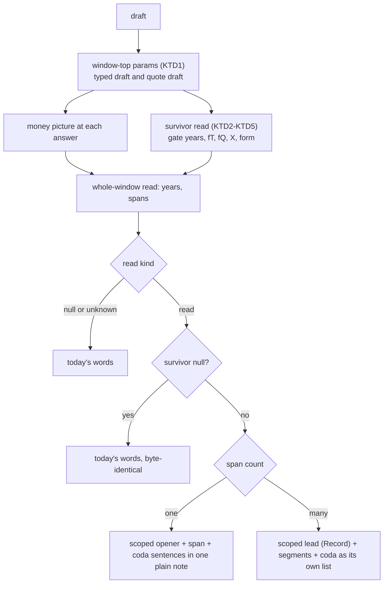

# The typed-below line's survivor path - Plan

---

## Goal Capsule

- **Objective:** a household that typed a working-year figure below its spending, and said all of the left over goes into savings, reads a typed-below line whose comparisons are no longer rosier than the engine on the paths where one of them dies while the other still works.
- **Means:** scope the comparisons to "you're both alive" and add one ceiling for a year when only one of them is alive, both shown only where the engine can draw such a year (KTD2, KTD3, KTD5, KTD6, KTD7).
- **Authority:** the register's Tier 0 entry *The typed-below line's comparisons are the all-alive picture's…* (`docs/backlog.md`) and council `wf_dfb7949b-4a7` (8/10, execute; `docs/council-log.md`, 2026-11-14; record `b9-build2-surplus\u11-wholewindow\council-survivor\result.json` in the session folder) own the mechanism; this plan owns how it is built. On a conflict the council's ruling wins, then this plan's R-IDs, then its KTDs. One departure from the council's letter is on record and serves its own bar ("never rosier than the engine"): X's rounding (KTD4), flagged for Briggsy's digest. `docs/architecture.md` wins on any engine invariant.
- **Stop conditions:**
  - The seeded death-path test (U5) finds a survivor working year whose shortfall difference exceeds X, or whose whole draw net of its income tax moves by anything but the shortfall difference. Stop and report: the coda's bound or its rider no longer holds, and the fix goes back to council.
  - The sweep or the per-key idcheck shows any engine output moved. Stop: this build adds reads and words, never an engine change (R13).
- **Execution profile:** one commit to `main` carrying every unit (the project ships on `main`; there is no PR). The commit runs the review's gates (Verification Contract) before it lands.
- **Who finishes:** the pilot builds it; the rebuild's review round 3, the mutant pass and walk 8 follow as their own steps (TODO.md START HERE).

---

## Product Contract

### Summary

The typed-below line's comparisons gain "you're both alive", and the line gains one closing part, "If only one of you is alive", that states the most this answer takes less from savings in such a year, X, read from the engine's own survivor rule. Both appear only where the engine can draw a working year in which one spouse has died and the other still works; everywhere else the line is byte-identical to today. The engine does not change.

### Problem Frame

The typed-below line (`src/intake/workingYearLeftOver.ts`, the whole-window rebuild, `docs/plans/features/typed-below-whole-window-rebuild-spec.md`) compares, span by span, what this answer does to savings in each working year against what the answer at today's quote would do. Every figure it prints is the all-alive money picture's. On a path where one spouse dies (the engine samples no death before 66) while the other works, the engine credits no left over on either side (`workingYearCredit`, `src/engine/moneyGrain.ts`) and charges W by its survivor rule (`workingYearCostForYear`, `src/engine/simulate.ts`), so the two answers differ by the difference of their two survivor charges. The review's round 2 (`wf_6f207739-5a3`, finding #1, three of three refuters) measured the miss: household C, a $105,000 all-sticky budget with $90,000 typed, prints "at most $9,637 to $10,000 a year more" for 2029–2032, and in 2032 the engine's difference is $13,609 on 58 of 4,000 passes. `bothCredit` runs $2,117 over and `same` up to $13,117 under its "adds the same". Every miss is on the rosy side.

The rebuild's plan rejected a death-frame sentence on the premise "the 'at most' pair is true on a death path" (its L80). That premise holds for the credits (a death credits nothing) and fails for the differences.

### Requirements

**Where the new words show**

- R1. The scope and the coda show only where the engine can draw a working year of the window in which one spouse is dead and the other still works (KTD3); everywhere else every host prints exactly today's words.
- R2. Where the line makes no comparison (no fresh typed figure, an answer the run does not credit, or a window read of `unknown`), nothing changes, even on a household that would open the gate.

**The scope**

- R3. Where the gate shows, "you're both alive" rides the head nouns the council named: the one-span opener and the short kinds' year subject in every span, and a lead above two or more spans on every host (the Result, the re-entry gate, and the left-over seat in the details sheet and on the money-picture step). In a block of two or more spans, the `same`, `bothCredit` and `quoteCreditsNothing` segments carry no year noun and take their scope from that lead, which comes before the spans in reading order on every host (the council's accepted residual).
- R4. The counts sentence, the moved clause and the fail-safe credit sentence (`workingCostTypedBelowAdds`) stay unconditioned: they state what the answer credits, which a death never raises.

**The coda**

- R5. Where the gate shows and the read has at least one span, the line ends with one coda after the spans and before any door, under the condition "If only one of you is alive" (a label on two or more spans, the opening clause of its sentence on one). It states X with "at most", names the answer at the quote it compares with, and carries the income-tax rider. (⚑ **AMENDED 2026-11-16 by the tax rider build**, `docs/plans/features/typed-below-tax-rider-build-spec.md`, its R3 and KD2; council `wf_33aa98fe-a26`: the rider is the spans' own, ", not including any difference in income tax and Medicare’s income surcharge.", through the one helper, so the line names the same costs one way; direction-free, it holds in survivor years, where the typed answer was measured paying $61 to $163 more tax.)
- R6. X is the engine's survivor charge at the quote's figure less its survivor charge at the typed figure, rounded up to the dollar after the money grain's float-dust tolerance, so it never sits under the difference of the two draws on the cent grain (KTD4).
- R7. The coda's second sentence names the two figures X is the difference of: the quote and the typed figure where X is their whole gap on the cent (⚑ **AMENDED 2026-11-16 by the tax rider build**, its KD2: that sentence now echoes X before the typed figure, "That $X a year is the whole gap to your figure of $T a year.", so "That" can never read as the rider's costs; the quote stays in the first sentence), otherwise the two survivor charges themselves, each pair printed so the two figures differ wherever they differ (`formatMoneyPair`) and the quote in its own source's words (spending or budget).
- R8. The coda never says "on your own" (`copy.ts` uses it for a living one-earner year) and never states that nothing is credited after a death.

**The read**

- R9. The gate, X and the coda's figures come from the engine's own functions (`survivalToYear`, `workingYearCostForYear`, `personOffsetsFor`) on the window-top candidate the money picture already composes, never a re-typed rule, age or ratio.
- R10. The gate and X ride inside the whole-window read's `read` arm, so a line can never show the scope without the coda's figure.

**Proof and records**

- R11. The coda's bound is proved on the whole engine: a seeded death path over every kind of household the council named.
- R12. Every host's pinned words, the copy guard, the density law and the fit gate are regenerated for the new words, and a household that does not open the gate pins today's words byte for byte.
- R13. Every engine output is byte-identical (the sweep and the per-key idcheck against the `ww3` baseline).
- R14. The rebuild plan's false premise (its L22, L44, L51, L80), the register entry, `docs/architecture.md`'s typed-below paragraph and `docs/landmines.md` are amended in the same commit.

### Key Decisions

- **The council's hardened (B), carried as ruled.** Scope on each claim's head noun, one coda, X from the engine's survivor rule, gated on `survivalToYear`. (C), each difference replaced by the whole W gap, was rejected because it leaves `same` and `bothCredit` rosy; (D), leaving the words, was vetoed under D7. Governs R1, R3, R5, R6, R7.
- **The mortality words ship as drafts flagged for walk 8.** "You're both alive" and "If only one of you is alive" are the council's; the app's other survivor screens say "on your own" (`assumptionSurvivorRatioLabel`, `survivorReadoutEyebrow`), and that departure is a walk-8 read, not a reason to change the words here. Governs R5, R8.
- **The gate is household-wide, never per span.** On the witnesses the spans before 2032 carry the scope too; it is true there and keeps scoped and unscoped spans from sitting side by side. Governs R1, R3.

### Acceptance Examples

- AE1. **Covers R1, R3, R5, R7.** Given household C (Alex 58, working; Sam 60, retired) on a $105,000 all-sticky budget, "All of it" at $5,985, typed $90,000; when the Result renders; then the short span's year subject carries "you're both alive", the Result gains the scoped lead before the span list, the two `same` segments sit under that lead, and the coda reads X = $15,000 with "That is the whole gap to your figure of $90,000 a year."
- AE2. **Covers R6, R7.** Given A (spending $90,000, typed $84,000, survivor ratio 0.75, no budget); then X = $4,500 and the coda's second sentence names the two survivor charges, $63,000 at the figure and $67,500 at the spending.
- AE3. **Covers R1, R12.** Given the same household with Sam aged 56 at year 0 (no window year reaches 66); then every host's words equal today's, byte for byte.
- AE4. **Covers R6, R7.** Given a typed figure that leaves a raw survivor difference of $0.09 (`cMonth874999`); then X prints "$1", and the two charges print to the cent ($78,749.91 and $78,750.00), never as two equal dollar figures.

### Scope Boundaries

- Considered, not built: a separate exported survivor read beside the window read. It makes "scope shown, X unknown" representable (R10).
- Considered, not built: naming the survivor ratio or the held part in the coda. It would re-type the engine's rule in intake (insight 132), and the ratio is an app default most households never set.
- Considered, not built: a per-span gate. It would put scoped and unscoped spans side by side; the council ruled a household-wide gate.
- Considered, not built: a "takes the same" coda form for a survivor ratio of 0. Intake refuses that ratio (`survivor-ratio-floor`, `src/intake/sanity.ts`), no household has a saved plan yet, and the two-figure form stays true there ("at most $0"). A ratio of 0 reaching a live plan would change the call.
- Considered, not built: reading `longevityMode`. Intake always builds `'sampled'` (`src/intake/intakeMap.ts`, `buildParams`); under `'fixed-horizon'` the gate would over-show, which is the widening side.
- Considered, not built: a coda year ("from 2032"). The council's words name no year, and the crowned seed's own crown may never reach the gate year (a walk-8 read).

#### Deferred to Follow-Up Work

- Walk 8 reads cold: the scope; the coda; C's `same` segments under the scoped lead, beside a scoped short span; the "it" in "plus any income tax on it"; the "on your own" departure; and a coda whose printed figures subtract to $1 under its X (the round-up, the gloomy side, as round 2 left "$4,015 short … $16 short … at most $4,000").
- The income-tax rider is unsized and untested: on a death path the two answers can draw from different accounts, so the tax difference is not simply the tax on X. The rider says "any"; walk 8 reads it, and a measurement is owed before any sentence sizes it. (⚑ **AMENDED 2026-11-16 by the tax rider build:** the review's round 3 measured the typed answer paying $61 to $163 more tax in survivor RMD years, and the coda now carries the spans' direction-free rider, "not including any difference in income tax and Medicare’s income surcharge", which holds either way and sizes nothing; the "it" walk 8 was to read is gone. Walk 8 reads the new rider instead.)
- The all-alive Medicare surcharge lag goes into the register as a new Tier 0 candidate (U7). A working-year draw at the quote enters the IRMAA history (`src/engine/taxOverlay.ts`, the post-branch history write), which prices an enrolled retired spouse's Medicare two years on, so an all-alive span's "takes at most $D … plus any income tax" can understate a later all-alive working year's difference at joint thresholds. It is unmeasured and pre-existing, and its prescription is measure first.

---

## Planning Contract

### Key Technical Decisions

- KTD1. **One window-top route, shared by the money picture and the survivor read.** A memoized intake read returns the window-top candidate's params (`buildDateInputBeforeLeftOver(d)` then `buildCandidateParams(input, DATE_OFFSET_WINDOW_TOP, 1)`) or `'unknown'`, on exactly the money picture's `'unknown'` conditions (no date input, no W, a horizon at or below the window top, a throw). `composeWorkingYearLedger` is rewritten to call it, keeping the producer's own call inside its try, so the two can never build different candidates. The council's STOP check is recorded here as verified: the route is a pure function of the draft (no clock: the draft carries `startCalendarYear`), and the three fields `workingYearCostForYear` reads (`budget`, `survivorOopMedicalReal`, `survivorSpendingRatio`) pass through `buildCandidateParams` untouched (`{ ...params, people, paths, overlay }`).
- KTD2. **The survivor read rides the window read's `read` arm.** `composeTypedBelowWindow` adds `survivor: TypedBelowSurvivor | null`, null exactly where the gate is off, computed from the typed draft's and the quote draft's own window-top params (KTD1). Each survivor charge reads its own run's carried W (`overlay.accumulation.workingYearCostReal` on that draft's candidate). `null` and `unknown` reads carry no survivor by type (R10). The memo stays the window read's (`typedBelowWindowMemo`, keyed on the source draft).
- KTD3. **The gate predicate, exactly.** The gate is on where some year t of the read's working years has an ordered pair (i, j), i ≠ j, such that j works at t (`t < personOffsetsFor(people).offsets[j].retire`) and the engine can sample i dead by t (`survivalToYear(people[i], t) < 1`). Both reads are the engine's: `survivalToYear` is below 1 exactly where the sampler can draw a death (none before 66), so no age is re-typed. A one-person household has no pair and reads off. A year where the only worker is the one who may have died is no working year, so a worker's possible death never opens the gate by itself. The read keeps the gate's calendar years (`survivorYears`, ascending and non-empty) so the witness test can pin them.
- KTD4. **X is the raw difference rounded up, after the dust tolerance; a departure from the council's letter, on record.** The council's item (3) and the register's Prescription (3) say "each side snapped to the cent, the difference rounded up". This plan departs from that formula because it can print a cent-grain draw difference as a dollar less (below), the rosy side the same ruling exists to forbid; the red team's attack 6 ("sound when X is rounded up") is the bar it keeps. X = ⌈fQ − fT − dust⌉ dollars, with `fQ`, `fT` the two survivor charges and dust the money grain's tolerance (`HALF_CENT_DUST` in `src/engine/moneyGrain.ts` is private and in cents: export it, or a dollar twin beside it, from that leaf, an engine-file edit that changes no output). The two answers' cash in a survivor working year differs by exactly fQ − fT (W comes off the cash dollar for dollar; nothing else in that year's cash reads W), and each draw is snapped to the cent separately, so the cent-grain draw difference can sit a cent above a difference of cent-snapped charges. Rounding the raw difference up keeps X at or above it, at most $1 over (insight 146: name the grain the comparison is read on, here the draws'). Snapping each charge first was considered and rejected: on $90,000.02 against $84,000.01 at 0.75 it prints $4,500 under a $4,500.01 draw difference.
- KTD5. **The coda's form is an exhaustive Record over two members** (insight 147), the council's whole/part: `wholeGap` where the charges' difference equals the quote less the typed figure on the cent grain (an all-sticky budget, or a survivor ratio of 1); `survivorCharges` otherwise (a ratio below 1, or a vault ratio above 1). The form is decided on cents, never by comparing the held part with Q or T.
- KTD6. **Where the coda is drawn.** On a one-span line the coda's sentences close the plain note, its condition opening the sentence ("If only one of you is alive in a working year, …"), so the one-span `
` and its pins keep their shape (the council's one-span ruling). On two or more spans it is a typed `coda` part on `NoteParts`, allowed only where the door is null (by type: the typed-below composer never sets a `NoteDoor`, and W's stale line, the only parts value with a door, never carries a coda), drawn by `NotePartsBlock` as its own one-item list after the spans' list, reusing the segment's markup and classes, before the doorless button. A separate list keeps the condition out of the list the both-alive lead introduces, so neither a screen reader nor the eye takes it as one more both-alive item (the council: "never a span segment"). `notePartsText` includes it, and `isPlainNote` is false wherever a coda is present.
- KTD7. **The scope is a frame field; the lead comes from a host × span-count Record.** `TypedBelowSpanFrame` gains a required `bothAlive` boolean, so every e2e frame literal fails the scratch-tsconfig typecheck until it states one. The one-span opener and the short kinds' year subject read it, in every span (the council's red team, its attack 1: a lead three items up is a context rescue for a sentence with its own year noun). The multi-span lead comes from a Record keyed by host kind (`result`, `gate`, `sheet`, `step`) and span count (`one`, `many`): with the gate off, today's lead (none on the Result and the gate, `workingLedgerLeftOverSpansLead` on the seat); with it on, the scoped lead on every host; `one` names no lead on any host. The `same`, `bothCredit` and `quoteCreditsNothing` segments carry no year noun and lean on the lead (R3).
- KTD8. **The density law reads structure, and gains the coda's own rule** (the council's "structural density test"). The composer builds the line as structure before it folds a one-span line into one paragraph: the opening's sentences, each span's label and sentences, and the coda's sentences. That structure is exported for the test, and the law reads it instead of slicing a folded paragraph with a regex, so the coda's sentences are never counted as span sentences. Span sentences keep their law (one side per dollar sentence). The coda is two sentences: the first states X with "at most", the quote side and the rider; the second states exactly the pair X is the difference of, and nothing else. The law's hosts add the two seat hosts. (⚑ **AMENDED 2026-11-16 by the tax rider build**, its KD2 and U3: the whole-gap second sentence echoes X, so `codaLaw` holds a strict branch there, exactly two figures, the first X to the cent and the quote less the typed figure X within $1, with plants for an echo off X and a bare "That is the whole gap…"; the first sentence's rider is the spans' rider, and the density law gained a span rider rule over every kind.)
- KTD9. **The death-path proof runs the whole engine on a seeded death.** For each of the six households the council named, both drafts run through the real run's route (`buildCandidateParams(buildDateInput(d), DATE_OFFSET_WINDOW_TOP, 1)`, so the saved left over rides and the credit rule is exercised) and `simulate` at `paths: 1` with the recording probe, on a seed whose path has Sam dead by sim year 6 and Alex alive through the window. The six share Alex and Sam, and the draw schedule is a pure function of path and horizon dimensions, so one seed scan serves all six. Per survivor working year the test asserts three things:
  - each answer's credit is 0;
  - the two drafts' shortfalls differ by at most X;
  - their whole draws net of income tax (`fundingNet`) differ by exactly the shortfall difference, so no premium or surcharge moved.

  Why none should move: in a survivor working year no living member is Medicare-enrolled. A member's onset is `max(65 − currentAge, retireOffset)` (`src/engine/healthcareStreams.ts`, `medicareOnsetForPerson`), which is the window top (10) for every worker, and a dead member is never billed. A candidate gates ACA premiums to years at or after its stop. The surcharge a working-year draw feeds two years on lands either after the window (the survivor's own enrollment) or on an all-alive year (Scope Boundaries, deferred). The six X values are derived by hand in U1's tests, never through `workingYearCostForYear` (DND 012).

### High-Level Technical Design

How one draft becomes the line, gate on or off (this shape is binding):

The coda's words by form (drafts, flagged for walk 8; figures as the line prints them, the quote in its source's words):

| form | first sentence | second sentence |
|---|---|---|
| `wholeGap` | In such a working year, this answer takes at most $X a year less from your savings than it would at your budget's $Q a year, plus any income tax on it. | That is the whole gap to your figure of $T a year. |
| `survivorCharges` | In such a working year, this answer takes at most $X a year less from your savings than it would at your spending of $Q a year, plus any income tax on it. | Such a year's costs count as $fT a year at your figure and $fQ at your spending. |

⚑ **AMENDED 2026-11-16 by the tax rider build** (R5's and R7's amendments): both first sentences end ", not including any difference in income tax and Medicare’s income surcharge." in place of "plus any income tax on it.", and `wholeGap`'s second sentence reads "That $X a year is the whole gap to your figure of $T a year." The rows stay as this build shipped them, for the record.

On a one-span line the first sentence opens "If only one of you is alive in a working year, this answer takes at most…". On the gate the answer is "your answer", as the spans say it there.

The scoped leads (drafts, flagged for walk 8; each ends with a colon above the span list):

| host | gate off (today) | gate on |
|---|---|---|
| the Result | none | What this answer adds to your savings in each working year you’re both alive: |
| the re-entry gate | none | What your answer adds to your savings in each working year you’re both alive: |
| the seat (sheet and step) | What this answer adds to your savings in each working year: | What this answer adds to your savings in each working year you’re both alive: | Where the quote is the budget, every "your spending" above reads "your budget" (the per-source Record, as `SPAN_QUOTE` does).

### Assumptions

- The survivor ratio every witness carries is the app default, 0.75 (`src/shared/appDefaults.ts`), so the witnesses' X values are 0.75 of the gap: A $4,500, TM $15,750.
- C at 90 % and 80 % sticky are built the way the council's probe builds them (`clerk-death-allkinds.mts`, `budgetOf`: housing sticky, food not), so the held part is `budget.sticky[0]`: $94,500 and $84,000, giving X = $12,375 and $11,250.
- The coda's multi-span placement (its own list before the door) and the one-span closing sentences are the pilot's reading of the council's yours-to-close placement call, shipped flagged for walk 8.

### Minor faults (the blind readers', listed here, not folded into the units)

- New copy slots keep the `workingCost…` or `workingLedger…` prefix as well as "Survivor", so they reach `PAY_CHECK_SLOTS` and the R16 sweep's `toContain` check.
- U6 edits `e2e/caddie-walk.spec.ts`, which no CI gate runs: its words are checked only by the scratch-tsconfig typecheck until walk 8.
- The Verification Contract's re-anchor row keeps the TODO close block's full step 3: classify with `b9-phaseb-review\b9-5-mutants\classify-reanchor.mjs`, and refuse the moves of the quoted examples in `docs/landmines.md`. U7's new register entry and landmine land before `doc:reanchor --apply`, or their own shifts need the TODO's by-hand rule.
- U7's `TODO.md` edit is the squeaky close's (START HERE names the review round 3 next).
- The council's dissent names what would flip the gate (it cannot call `survivalToYear`; a witness finds a death-path working year it misses; walk 8 rules the 66 floor belongs on the line). U5's engine gate witness covers the second; the third is a walk-8 read.
- The coda's second sentence "That is the whole gap…" follows "plus any income tax on it", so "That" can read as the tax: a walk-8 read, beside the pilot's leads and the `survivorCharges` sentence, which are the pilot's words, not the council's. (⚑ **Resolved 2026-11-16 by the tax rider build**, its KD2: the sentence echoes X, "That $X a year is the whole gap…". The pilot's leads and the `survivorCharges` sentence stay walk 8's reads.)
- U1's vault ratio of 1.2 is as unreachable through intake as the ratio of 0 the plan declined a form for; it stays as a cheap arm test of the two-member Record, not as a reachable household.
- KTD1's shared route has no incident behind it; it is kept because the survivor read must read the same candidate the money picture composes, and one memo is the smallest way to say so.
- The deferred Medicare lag disagrees with the council red team's angle (1), which read only the override feed: the history write adds the computed gross-up's MAGI too (`src/engine/taxOverlay.ts`, the post-branch write). The register entry U7 files states both.

### Sequencing

U1, U2 and U3 have no dependencies on each other. U4 needs all three. U5 needs U1. U6 needs U4. U7 lands with the commit.

---

## Implementation Units

### U1. The window-top route and the survivor read

- **Goal:** one memoized window-top params read shared with the money picture, and the survivor read inside the whole-window read.
- **Requirements:** R1, R2, R6, R7, R9, R10; KTD1–KTD5.
- **Dependencies:** none.
- **Files:** `src/intake/intakeMap.ts`, `src/intake/workingYearLeftOver.ts`, `src/engine/moneyGrain.ts` (the dust export only, KTD4), `src/ui/devSeeds.ts` (a `stillWorking` builder export, if none exists), `src/intake/__tests__/workingYearLeftOver.test.ts`, `src/intake/__tests__/typedBelowWitnesses.ts`.
- **Approach:**
  1. In `intakeMap.ts`, add the exported, WeakMap-memoized window-top params read (KTD1) and rewrite `composeWorkingYearLedger` to take its params from it, the producer's call staying inside its own try.
  2. In `workingYearLeftOver.ts`, compute the survivor read inside `composeTypedBelowWindow` after the years are read, from the typed and quote drafts' window-top params (KTD2, KTD3). Each charge calls `workingYearCostForYear(params, carriedW, false)` with its own run's carried W.
  3. Compute X and the form (KTD4, KTD5).
  4. In `typedBelowWitnesses.ts`, add the households the later units share as separate named exports, never members of `TYPED_BELOW_WITNESSES` (its sweeps assume a gate-on household with six readings). Each is derived from the `stillWorking` dev seed's draft (export a builder from `src/ui/devSeeds.ts` if none is exported), with `birthYear` kept consistent with `currentAge`, and every retired person's `retirementAge` set at or below their `currentAge` (`stillWorking`'s Sam retired at 58; left at 58, a Sam of 55–57 would read as still working and open the gate through Alex):
     - the council's C on a budget: $105,000 at 100 %, 90 % and 80 % sticky, quote confirmed, "All of it" at its live figure, then $90,000 typed; and C at 100 % with $101,000 typed (the council probes' construction, `clerk-death-allkinds.mts`);
     - TM and the pension household recast as all-sticky budgets;
     - gate witnesses: Sam 56 (off), Sam 57 (on in 2035 only), a younger non-worker (worker 62, retired non-worker 55: off, since the only worker's death leaves no working year), both working at 58 and 60 (on).
- **Patterns to follow:** `workingYearLedgerForRun`'s memo and `'unknown'` arms; `workingYearTaxReach`'s draw-free walk over death timelines (`src/engine/dateSearch.ts`); `SPAN_FIGURES` for an exhaustive Record.
- **Test scenarios:**
  - Every existing `TYPED_BELOW_WITNESSES` household reads the gate on, its survivor years 2032–2035.
  - Sam 56: the survivor read is `null`. Sam 57: survivor years are [2035]. The younger non-worker reads `null`. Both working reads on.
  - A one-person draft built through the test builder reads `null` (no pair).
  - X and form, each X derived by hand in the test (never through `workingYearCostForYear`, DND 012):
    - A: $4,500, `survivorCharges`;
    - C at 100 %: $15,000, `wholeGap`; at 90 %: $12,375, `survivorCharges`; at 80 %: $11,250, `survivorCharges`; at $101,000 typed: $4,000, `wholeGap`;
    - TM and pension as budgets: $21,000, `wholeGap`;
    - a budgetless draft at ratio 1.0 with a monthly T that carries cents: `wholeGap`;
    - a vault ratio of 1.2: `survivorCharges`, X above the gap;
    - `cMonth874999`: X = $1;
    - $90,000.02 against $84,000.01 at 0.75: X = $4,501 (KTD4's rounding case).
  - A "spent" answer on a gate-on household reads `null` (no survivor). The `unknown` arm needs no test: no draft reaches it (its docblock), and R10 holds by type.
- **Verification:** the read's tests pass; every engine output stays byte-identical (the sweep, Verification Contract).

### U2. The coda part and its renderer

- **Goal:** `NoteParts` can carry a labelled coda that every block host draws after the spans and before the door.
- **Requirements:** R5; KTD6.
- **Dependencies:** none.
- **Files:** `src/ui/noteParts.ts`, `src/ui/NotePartsBlock.tsx`, `src/ui/styles/noteParts.css`, and the block's existing test (create `src/ui/__tests__/notePartsBlock.test.tsx` if none exists).
- **Approach:**
  1. Add an optional `coda` (a `NoteSegment`) to `NoteParts`, typed so a coda and a non-null door cannot both be set (KTD6); absent everywhere but the typed-below line.
  2. Update `notePartsText`: coda after the segments.
  3. Update `isPlainNote`: false when a coda is present.
  4. Draw the coda in `NotePartsBlock` as its own one-item list after the segments' list, reusing the segment's markup and classes, before the doorless button. Add a modifier class only for the spacing the block needs; the label's face stays the segments' (weight and size, never colour, back-nine-design's law). Load the four design skills before touching the block or its stylesheet (`CLAUDE.md`, UI design skills).
- **Patterns to follow:** the existing segment `div > dt + dd` and the door's last item in `NotePartsBlock.tsx`.
- **Test scenarios:**
  - A parts value with two segments and a coda renders the coda's label and sentences in a second list after the segments' list and before the button.
  - `notePartsText` orders opening, segments, coda.
  - A parts value without a coda renders byte-identically to today (the existing pins hold).
- **Verification:** the block tests pass; no existing NoteParts pin moves.

### U3. The words

- **Goal:** the scoped opener, year subject and leads, and the coda's slots, in the catalog.
- **Requirements:** R3, R4, R5, R7, R8; KTD5, KTD7.
- **Dependencies:** none.
- **Files:** `src/ui/copy.ts`, `src/ui/__tests__/copyGuard.test.ts`.
- **Approach:**
  1. Add `bothAlive` to `TypedBelowSpanFrame`. Scope `spanAnswerHead`'s one-span opener ("Each working year you're both alive, …") and `spanYears` ("each working year you're both alive"; one year: "that working year, if you're both alive,").
  2. Add the scoped lead for the Result and the gate (one slot taking the answer) and the seat's scoped lead (a copy key beside `workingLedgerLeftOverSpansLead`).
  3. Add the coda slots with "Survivor" in each key: the label, the first sentence (one-span and labelled forms), and one second sentence per form (KTD5's table), each taking the quote's source and its figures pre-formatted as a pair. Use the typographic ’ throughout.
  4. Join every new slot to `TYPED_BELOW_SPAN_SLOTS` and give each a `SLOT_RENDER` sample.
  5. Widen the frame cross-product to `bothAlive` both ways and update its count assertion.
- **Patterns to follow:** the `workingCostTypedBelowSpan*` slots and their docblocks; `SPAN_QUOTE` for a per-source Record.
- **Test scenarios:**
  - Every new slot passes `CATASTROPHE_LEXICON` (its key matches `isSurvivorKey`) and HAWK_BAN.
  - No coda slot's render contains "on your own".
  - With `bothAlive` false, every span slot renders today's string exactly.
- **Verification:** `copyGuard.test.ts` passes with the new slots in its sweeps.

### U4. The composer on every host

- **Goal:** the line puts the scope and the coda on the Result, the gate and both seats where the gate shows, and today's words elsewhere.
- **Requirements:** R1, R2, R3, R4, R5, R7, R12; KTD6, KTD7, KTD8.
- **Dependencies:** U1, U2, U3.
- **Files:**
  - `src/intake/workingYearLeftOver.ts`
  - `src/intake/__tests__/workingYearLeftOver.test.ts`
  - `src/ui/__tests__/resultPayCheckLine.test.tsx`
  - `src/ui/__tests__/reentry.test.tsx`
  - `src/intake/__tests__/assumptionPanel.test.tsx`
  - `src/intake/__tests__/workingCostStep.test.tsx`
  - `src/ui/__tests__/copyGuard.test.ts`
  - `src/ui/__tests__/devSeeds.test.ts`
- **Approach:**
  1. Pass the gate into `typedBelowSpansParts` as the frame's `bothAlive`.
  2. Choose the lead from KTD7's host × span-count Record. This retires the bare `lead` argument, so `workingYearCostTypedBelowLine` and `workingYearLeftOverAtQuoteLine` pass their host kind.
  3. Build the line as structure first (KTD8: opening sentences, spans, coda), export it for the density law, then fold a one-span line into its plain note. Append the coda by span count (KTD6), its figures through `formatMoneyPair` and the quote's source words (R7).
  4. Retype by hand every vitest pin the gate now changes, with the scope and the coda written out (about 20 cases across the listed suites; the vitest pins are hand-typed on purpose, so never compose them from the slots, which would make them tautologies). AE3's expected words are today's hand pins, kept as they are.
  5. Point the density law at the exported structure (KTD8) and extend the composed-line sweeps (`TYPED_BELOW_COMPOSED`, the retired-wordings sweep) to the coda.
- **Patterns to follow:** `SEAT_OPENS_ON_COUNTS` and `TYPED_BELOW_COUNTS` (exhaustive Records); the test file's `plain`, `line`, `segment`, `HOSTS` helpers.
- **Test scenarios:**
  - Covers AE1. C at 100 % on the Result: the short span's scoped year subject, the scoped lead, the two `same` segments under it, and the `wholeGap` coda as its own list.
  - Covers AE2. A on every host: a one-span plain note ending with the one-span coda sentences, naming $63,000 at the figure and $67,500 at the spending.
  - C at 80 % on the gate: the coda's second sentence says "your budget", never "your spending".
  - Covers AE4. `cMonth874999`: the two charges print to the cent beside "at most $1".
  - TM (three spans) on the gate: the gate's scoped lead and the coda with "your answer".
  - The pension and crowned seeds on both seat hosts: the seat's scoped lead. The `step` host still opens on the counts sentence.
  - Reading order, on every host with two or more spans (the council's a11y check): the scoped lead's text comes before the spans' list in the rendered DOM, and the coda's list comes after it.
  - Covers AE3. Sam 56 on all four hosts: every composed line `toEqual`s today's composition.
  - A "spent" answer on a gate-on household: the counts sentence alone, unchanged.
  - The density law passes over every witness, budget twin and one-year form on all four hosts, including the coda's rule. A planted coda with a third figure reds it.
  - `reentry.test.tsx`'s gate `
` outerHTML pin moves only by its words (one-span stays a `
`).
- **Verification:** every listed suite passes; the composed-line sweeps count the coda.

### U5. The death-path proof

- **Goal:** prove on the whole engine that X bounds a survivor working year's difference, and that the all-alive figure does not.
- **Requirements:** R11; KTD9.
- **Dependencies:** U1.
- **Files:** `src/engine/__tests__/typedBelowSurvivor.test.ts` (new), `src/engine/__tests__/workingYearCredit.test.ts`.
- **Approach:**
  1. Scan seeds with `sampleCouplePath` over `buildDraws(s, 1, maxHorizonYears, 2)` for a path with Sam dead by sim year 6 and Alex alive through the window, as `workingYearCheck.test.ts` does (Sam's death at 66 has probability about 1.45 %, so a 2,000-seed scan finds one).
  2. For each of U1's six council households, run both drafts through the real run's route and `simulate` at `paths: 1` with the recording probe (KTD9).
  3. Add the credit-0 tripwire beside the credit tests.
- **Patterns to follow:** `workingYearCheck.test.ts`'s seed scan and `recordingProbe`; `workingYearCredit.test.ts`, which already imports intake's read and witnesses.
- **Execution note:** run the shortfall assertion first against the all-alive span difference on C at 100 %, and see it red, before pointing it at X.
- **Test scenarios:**
  - On each of the six households, every survivor working year: each answer's recorded credit is 0; the shortfall difference (quote less typed), each shortfall snapped to the cent with `toCents`, is at most the read's X; and the `fundingNet` difference equals the shortfall difference to the cent.
  - The first survivor working year the engine's own death path shows on C at 100 % (2032) equals the read's first gate year (the council's gate witness, checked against the engine rather than a typed year).
  - Planted: on C at 100 %, 2032's shortfall difference (the engine's $13,609) exceeds the $10,000 the all-alive span prints for 2029–2032, so the same assertion against the all-alive figure reds.
  - Tripwire: `workingYearCredit(cash, year0, stored, false)` is 0 for a positive cash. Its message names the coda's dependence on it and the landmine (U7).
- **Verification:** the test passes. A mutant that feeds the coda the all-alive difference reds the bound assertion on C at 100 %.

### U6. The fit gate and the caddie arm

- **Goal:** the real-browser gates read the new words on every unlock that opens the gate, and the one-frame fit law holds.
- **Requirements:** R12; KTD6, KTD7.
- **Dependencies:** U4.
- **Files:** `e2e/vertical-fit.spec.ts`, `e2e/caddie-walk.spec.ts`.
- **Approach:**
  1. Grep `e2e/` for every typed-below slot and frame literal.
  2. Add `bothAlive: true` to each frame. Compose the expected lines from the slots with the new lead and coda.
  3. Update the label checks to include the coda's label, in its own list.
  4. Keep the one-span selectors (`p.fod-note.cs-paycheck-note`, `p.left-over__at-quote`): the one-span line stays a `
`.
  5. Typecheck every edited spec through the scratch tsconfig (the project's typecheck skips `e2e/`; `docs/landmines.md`, The fit gate and e2e).
  6. If an arm overruns the one frame, fix the layout, never the words (content outranks aesthetics).
- **Patterns to follow:** the existing `PAY_CHECK_UNLOCKS` entries and `assertDoorlessStandingBlock`.
- **Test scenarios:**
  - The `datesavedtyped`, `…moved` and `…pension` unlocks at both sizes: the composed line, its labels including the coda's, and the one frame.
  - The `?seed=date` $72,000 arm: a one-span `same` line with the scoped opener and the one-span coda in one `
`.
- **Verification:** `pnpm verify:fit`, pinned, passes every arm.

### U7. The records

- **Goal:** the docs stop asserting the false premise, and the next build is warned.
- **Requirements:** R14.
- **Dependencies:** lands with U1–U6.
- **Files:** `docs/plans/features/typed-below-whole-window-rebuild-spec.md`, `docs/backlog.md`, `docs/architecture.md`, `docs/landmines.md`, `README.md`, `docs/roadmap.md`, `TODO.md`.
- **Approach:**
  1. Amend the rebuild plan in place, each line on its own terms:
     - L22 and L44 (R1): add the survivor charges (`workingYearCostForYear`) to the engine outputs a printed figure may come from;
     - L51 (R5): an "at most" figure stays true on a death path for the credits; the differences are scoped and bounded by this plan;
     - L80: the death-frame sentence is now built (this plan), and its premise holds only for the credits.
  2. Mark the register entry built with the commit, and correct its "a death at 65 or later" to 66 (the engine's floor, the council's correction). Amend the register's ⚑ NEGATIVE that still says "'at most' on both credits is true past a crown, on a death path…" (council `wf_f74697d1-f2e`'s, `docs/backlog.md`, the line the council cites as `:1762`): true of each credit on a death path, not of their difference, which this build scopes and bounds.
  3. Add the survivor read to `docs/architecture.md`'s typed-below paragraph.
  4. File the landmine the council called "the U12 landmine" in `docs/landmines.md`. The coda's bound rests on a death crediting nothing (build 2's KTD5, `moneyGrain.ts`). The day anything credits a survivor year, the tripwire reds, and the coda's words and X must change with it. Build 2's D7 item "the left over after a death" (`working-year-surplus-build-spec.md`) is the work that would do it.
  5. File the all-alive Medicare surcharge lag (Scope Boundaries) as a new Tier 0 register entry whose prescription is measure first.
  6. Retype the test count in `README.md` and `docs/roadmap.md` under `verify:doc-stats`.
- **Test expectation:** none (docs). `verify:doc-stats` gates the citations and counts.
- **Verification:** `pnpm verify:doc-stats` exits 0.

---

## Verification Contract

Each heavy run alone, in sequence, pinned to the P-cores through `<B>\tools\run-pinned.cmd`, reading `PINNED_EXIT` and the run's own "Tests" or "passed" line (never the exit code alone). `<B>` is `C:\Users\brigg\.claude\projects\C--Users-brigg-ai-learning-journey-projects-the-back-nine\b9-build2-surplus`.

| gate | proves |
|---|---|
| `git rev-parse HEAD` before the first edit | the re-anchor base |
| `pnpm typecheck`, `pnpm lint` | types and layer law (intake may import `@engine/*`) |
| every edited e2e spec through a scratch tsconfig | the frame literals state `bothAlive` |
| `pnpm doc:reanchor <base>` dry, classified, then `--apply` once; restore `e2e/held/fit-24px-measurements.md` | citations move with the code |
| the full suite, pinned and alone | every unit's tests and the moved pins |
| `pnpm verify:doc-stats` | counts and citations |
| `pnpm build`, then `pnpm verify:fit`, pinned | the real-browser words and the one-frame law |
| `pnpm exec tsx <B>\tools\sweep.mts <label> --today=20758`, then `node <B>\tools\idcheck.mjs <label> ww3` | R13: every engine output byte-identical, per key |

---

## Definition of Done

- Every unit's test scenarios pass, and every gate in the Verification Contract passes on the commit's tree.
- AE3's household prints today's words on all four hosts, byte for byte.
- The sweep is identical to the `ww3` baseline on every key, with a row added to `<B>\README.md`'s table.
- No experimental or abandoned code is left in the diff; scratch probes stay in the session folder.
- The commit message says the plan was planned, confidence-checked, checked and read, and names the build's register entry.
- CI is green on the commit.
