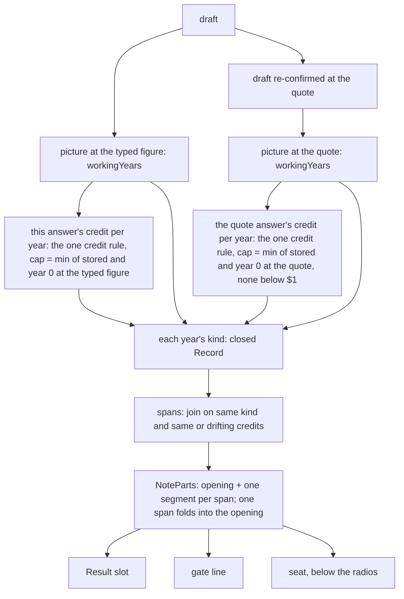

# The typed-below line over the whole working window - Plan

## Goal Capsule

- **Objective:** a still-working couple who typed a working-year figure below their own spending, and said all their left-over pay goes into savings, can read on the Result, the re-entry gate and the left-over seat (in the details sheet and on the walk's money-picture step) how much more their answer adds to their savings than the answer at their own spending would, in every working year, in the engine's own dollars. No year goes unnamed, and no figure is smaller than the engine's own (KD3 says where a figure is a floor against a real working year).
- **Means:** one every-year field on the money picture and one shared engine credit rule (KTD1, KTD2); the typed-below composer reads both pictures year by year and groups the years into spans (KTD3, KTD4); the words take the shape council `wf_f74697d1-f2e` ruled (KD1, KD2).
- **Authority, in order:** council `wf_f74697d1-f2e` (2026-11-13; the metric and the shape, with its dissent); the parent plan `docs/plans/features/working-year-surplus-build-spec.md` (R1–R16, KTD1–KTD17, its NEGATIVE list); the earlier rulings this line already carries (council `wf_7fa86902-35c` on the clause words, council `wf_22858e04-f7a` on the parts form, Briggsy's 2026-11-09 verb ruling, "update"); `docs/architecture.md` on every invariant; then this plan. Where this plan and a ruling disagree, the ruling wins and the plan is the defect.
- **Stop conditions:** stop the line and fix before going on if:
  - any engine run moves: a sweep key's `provisional`, `final` or `preview`, or the overlay's credits (`stream11.mts`'s `creditComposed` hashes), on any key;
  - a spine key moves at all, or a date key moves anywhere but the picture's new field;
  - W's stale line, or B's waiting seat outside V8's one planned sentence, changes words on any seed;
  - a composed credit disagrees with the overlay's `creditComposed` on a pinned witness;
  - the line prints a dollar figure that no engine function produced (a figure carried forward from a listed row, or re-derived from the gap).
- **Execution profile:** ordered commits on `main` (the project ships no PRs). Commit 1 is U1 + U2, dark engine work. Commit 2 is U3, a dark intake read with its engine pins. Commit 3 is U4 + U5 + U6: the words, the hosts, every pin and gate, the e2e specs and the docs, together, so no commit leaves a spec reading old words. Every `src` commit runs the Verification Contract.
- **Who finishes:** the pilot, across sessions. Each build unit's session opens with `/brief <that unit's topic>`. The words ship flagged for Briggsy under the batched-oracle law. After the build, the flow owes the whole-file review (an adversary, every finding verified), a mutant pass, the sweep and idcheck, `verify:fit`, `doc:reanchor` last; then walk 8 and its card, which clears walk 7's held R1. Walk 8 runs walk 7's 14 targets plus three this plan adds: the pension seed `datesavedtypedpension` (the five-span line on the gate, the Result and the sheet), the crowned seed `datesavedtypedcrowned` (a span named past the headline's date), and `intake:typedbelow` carried one step further, to the walk's money-picture step (U5). Its phone reader reads TM's gate, where three segments sit ahead of the decision pair.

---

## Product Contract

### Summary

The typed-below line stops sizing year 0 alone. For each working year it puts this answer's credit beside the credit the answer at today's spending would give, both "at most", and names every run of years where that pair holds, in time order. A run of years that comes up short at the spending names its shortfall and the whole yearly difference. One run reads as plain sentences; two or more draw as labelled parts, on all three hosts (the Result, the gate, and the left-over seat, which is drawn in the details sheet and on the walk's money-picture step).

### Problem Frame

U11 walk 6 found that a household can type its old working-year figure back in below today's spending and have the stored "All of it" credited whole, with no screen saying so. Walk 6's fix round added the typed-below line, and walk 7's added what it does in short years and in year 0. The round review of walk 7's fix round (`docs/backlog.md`, the Tier 0 entry *A figure typed below today's spending clears W's stale line for good…*, its round-review bullet) then found the line year-0-centric. It sizes the lean once ("That year, this answer adds $6,000…"), names only the first later run of short years, drops runs entirely when year 0 at the spending is exactly $0, hides a credit when a run straddles the gap, rounds the spending and the typed figure apart, and states a floor as exact.

Council `wf_f74697d1-f2e` then found the review's own fix measured the wrong thing. The review sized the lean as x_t = (credit at the typed figure) − (print at the spending). The lean that moves the answer is the gap between the two answers' credits. The answer at the spending is capped at its own year-0 print, so its credit stays at that cap while pay rises. On A (`datesavedtyped`), x_t says 2033 and 2034 add nothing, while the engine credits $16,985 against the honest answer's $10,985, the same $6,000 as every other year. On TM (`datesavedtypedmoved`), x_t says $762 in 2033–2034, where the gap is $11,000. Walk 6's measurement (`docs/backlog.md`, the entry's ⚑ MEASURED bullet) and walk 6's R1 founding docblock in `src/ui/copy.ts` already used the pair; the review switched without saying so.

### Requirements

**Every figure from the engine**

- R1. Every dollar figure the line prints is an engine output or arithmetic on printed engine figures: each working year's printed bottom line at the typed figure and at today's quote (the money picture's every-year field, KTD1), and each year's credit for both answers from the engine's one credit rule (KTD2). No figure is re-derived from the gap, and no unlisted year borrows a listed row.
- R2. Every engine run stays byte-identical. The new field is output only, and the credit rule's extraction changes no credit.

**What the line says**

- R3. For each working year the line compares this answer's credit with the credit of the answer at today's quote, never a credit against a print (KD1).
- R4. Every year of the picture's window lies in exactly one span. A span ends where either answer's credit changes value without drifting under one binding term, or where the year's kind changes (KTD3). Every span is named, in time order, on all three hosts; a span that recurs later is its own span.
- R5. Each credit, and each figure for what this answer takes less from savings, is said with "at most". No credit sentence and no "at most" figure carries a "still working" condition, and no span is cut at a crowned stop: an "at most" figure stays true past the crown (where neither answer credits or draws), on a path where someone has died, and where the quote leaves a cost out (KD3). A flat "takes $4,000 a year less" would be false past the crown, so no span says one. The "comes up … short" sentences stay facts of the picture at the quote.
- R6. A span other than `same` that comes up short at the quote names its shortfall there and what this answer does at the typed figure (left over, still short, or exactly $0), each in its own words (KTD7), and gives the span's whole yearly difference as one figure. Every figure that counts a shortfall drawn from savings carries the money picture's own rider for the income tax on that draw ("plus any income tax on those shortfalls", after `workingLedgerSavingsTax`): the engine adds each shortfall to what savings funds and grosses the draw up for tax (`fundingNet` in `src/engine/taxOverlay.ts`), so a bare figure would sit below the engine's own gap. A `same` span names no shortfall: the answer there is the answer at the quote, and its short years stay on the money picture's later rows.
- R7. One span reads as plain sentences. Two or more draw as note parts, one segment per span, the span's years as its label (KD2, KTD6).
- R8. One side per dollar sentence: a span's dollar sentence states the quote's side (its shortfall, its credit, or its nothing) or the typed figure's side (the ruled clause with this answer's credit or shortfall), never both, and the span's yearly difference rides only its second sentence. No "so"-chains, and at most two sentences per span. A test checks every witness (KD2).
- R9. The line names the typed figure yearly, "your figure of $84,000 a year" (V12), and the quote by its source, "your spending of $90,000 a year" or its budget twin, "your budget's $90,000 a year" (V7), on every host. The gate's door (`gateDoor`, shared with W's stale door) keeps "your $84,000 figure", since rewording it would reword W's stale door (R11); U6 files that door's V12 form.
- R10. B's waiting seat ends on year 0 as the reason nothing is added (V8): "Because your first working year, 2026, comes up short at that cost, updating to $105,000 or more won't add any, but it puts those shortfalls into your answer."

**What does not move**

- R11. W's stale line, B's waiting seat's run and every word either says outside R10 stay byte-identical (KTD5).
- R12. The line is a pure function of the draft: it reads no crown and no outcome, so the Result draws the same line on the provisional and the final tier (KTD4).

### Key Decisions

- KD1. **The pair, never x_t.** Council `wf_f74697d1-f2e`, 7/10, nine seats and the red team, no abstentions; the Honesty Hawk vetoed x_t and the verdict ships its honest alternative. Governs R3, R5.
- KD2. **One span per sentence (no sentence covers two spans), at most two sentences per span, on all three hosts; strict time order, parts at two or more spans, density per sentence** (the council's items (3) and (5)). The window total (S2), S1 plus a total (S3) and a short form on the Result with the detail on the sheet (S4) were rejected unanimously: a total sums years the crowned plan may never work and hides a span that comes back (insights 141, 103); couples leave from the Result, so S4 is a cut under D7. ⚑ Council-flagged as yours-to-close, executed, read by walk 8: the parts form at two or more spans, strict time order with repeated spans, the span words and labels, the short span's whole yearly difference as one figure. Governs R4, R6, R7, R8.
- KD3. **"At most" on both credits retires "at least" and the working-years condition.** Walk 3's (aw)(a) condition law covers claims that need someone working to be true; an upper bound does not. The law still governs a flat figure, so what this answer takes less from savings is "at most" too (R5). Each span's yearly difference is exact against the engine's answer at the quote, and a floor against a real working year wherever the quote leaves a cost out (V5: PA's state tax on pay, what the W help adds, in every state); the opening's counts sentence ("A working year almost always costs at least what you spend, so this answer can look better than it really is") carries that lean, and walk 8 reads whether a PA reader takes "$6,000 less" as the whole of it. Governs R5.
- **Dissent (the minimalist, with the fiduciary seat).** Keep one string: one flat pair true across the window ("It adds at most $16,985 a year. At $90,000 a year it would add at most $10,985 a year, $6,000 less."), then only the spans where the honest credit dips or a year runs short; file the parts form for walk 8. **It flips** if walk 8 reads TM's multi-span line as clear rather than a wall, the drift household shows few spans, and readers do not carry TM-at-$95,000's "$1,000 less" across its $11,000 years.

### Scope Boundaries

- W's stale line keeps today's read and words. Its own copy of V3 (only the first later short run is named) and its `resumesFrom` read are filed to the register (U6), not built here.
- The stamp question stays the Tier 0 entry's prescription (2), its council's call. U6 appends there that the crowned date leans on the window's later years: later candidates credit them, so the over-credit can only move a crown earlier.
- The money picture's drawn rows (`src/intake/WorkingYearLedger.tsx`) do not change; nothing draws the new field.
- The gate's door words keep "your $84,000 figure" (R9, R11); U6 files their V12 form.
- **Considered, not built:** reading the crowned stop (the gate composes before any run, and the outcome is two-track; it would fork one composer three ways, insight 081); a death-frame sentence (the "at most" pair is true on a death path); a window total (KD2); a per-year dollar figure for the income tax on a short year's draw (it depends on which accounts each path draws from, so the money picture prints none; its own rider names the tax, and R6 follows it). Evidence that would change the crown call: walk 8 readers who take a span past their date as money they will get, read on the crowned seed U5 adds.

#### Deferred to Follow-Up Work

- Walk 8 and its card, the step after this build (its targets: the Goal Capsule).
- The register items U6 files: the stale line's V3 hole and `resumesFrom`, the gate door's V12 form, and the crown note on prescription (2).

---

## Planning Contract

### Key Technical Decisions

- KTD1. **The every-year field.** `WorkingYearLedger` gains `workingYears`: a readonly array index-aligned with sim year t, one entry per working year of the window (0..span − 1), each `{ yearsIn, calendarYear, bottomLine, cash }` in year 0's own field words and grain. The producer already composes every year (`years[t].lines.cash` in `src/engine/workingYearLedger.ts`); the field is a map over them through `workingYearBottomLine`. Entry 0 equals `year0.bottomLine` and `year0.cash` (pinned). The ledger is never persisted and never on the worker wire (`src/shared/model.ts`, the type's header), so no schema moves.
- KTD2. **One credit rule.** The parent plan's R8 credit rule moves out of the overlay's year loop (`src/engine/taxOverlay.ts`, the build-2 credit block after the check composes its lines) into one exported pure function in `src/engine/moneyGrain.ts`, the grain leaf both the overlay and intake can import. It takes a year's cash, year 0's print, the stored figure and whether everyone is alive, and returns the credit the overlay credits today (0 at or below $0). The overlay calls it; the extraction must leave every credit `Object.is` today's (`stream11.mts`'s `creditComposed` hashes and the sweep prove it, KTD8). Intake calls the same function per picture year. The picture is composed before the answer (`buildDateInputBeforeLeftOver`), so it cannot carry the stored figure; intake supplies it, and the rule still has one home (the council's E2).
- KTD3. **The span model.** Each window year gets one kind from a closed set, keyed by an exhaustive `Record` (insight 147):
  - `bothCredit`: this answer credits at least $1, and so does the answer at the quote;
  - `quoteCreditsNothing`: this answer credits at least $1; the answer at the quote credits nothing in a year that is not short there (its question goes unasked: year 0 at the quote below $1, the parent plan's R5 gate; year 0 exactly $0 on C at $110,985, year 0 short on B retyped);
  - `shortLeftOverAtTyped`: short at the quote, at least $1 left over at the typed figure;
  - `shortStillShortAtTyped`: short at both;
  - `shortEvenAtTyped`: short at the quote, exactly $0 at the typed figure (credits nothing, draws nothing);
  - `same`: both answers credit the same and draw the same, compared on the printed grain. It is read first, ahead of every other kind. It is wider than a typed figure cents below the quote ($8,749.99 a month): any year where the stored figure caps both answers and neither is short is `same`, as on `?seed=date` with $72,000 typed under its $84,000 of spending, where both answers credit the stored $16,985 in every year.
  Adjacent years join one span when their kind matches and, for each answer, the credit is the same dollar figure or both years' credits are bound by the year's own left over (a drift). The binding term is the smallest term of the rule. Cash and print count as one term, "the year's own left over"; the cap is the smaller of the stored figure and year 0's print (KTD4). A tie between the cap and the year's own left over counts as bound by the cap, except in year 0: there the cap is the year's own print by definition (wherever the stored figure does not sit below it), so a year-0 tie counts as bound by its own left over. There is no tuned ratio. A range ("$X to $Y") appears only inside a drifting span (the council's split rule, its (2): split wherever the credit rule changes which term binds, or the short kind changes; a range survives only where one binding term drifts).
  Why this tie rule (found by four of the check's reviewers): "a tie counts as bound by both terms" joined TM at $95,000's 2028 (the quote answer's $15,985, its cap and its print) to 2029's $5,985 step, one span "$5,985 to $15,985" where the witness table pins three. This rule gives the table's three spans there and keeps the drift household at two. Weighed and set aside: the cap on every tie (it splits year 0 off every drifting household, an artifact of how the cap is defined) and joining the neighbour that shares the tie's figure (the same spans on every witness, harder to state).
- KTD4. **Two pictures, read from the draft alone.** The typed-figure picture is `workingYearLedgerForRun(d)`; the quote's is `workingYearLedgerForRun(writeConfirmedWorkingYearCost(d))`, memoized on the source draft as `checkAtQuoteMemo` already is (the re-confirmed draft is a fresh object every call). Both credits pass the household's stored figure (`saved.quotedReal`). This answer's cap is the smaller of the stored figure and year 0's print at the typed figure (the parent plan's R8 cap: on TM the stored $16,985, below the $26,985 print). The quote answer's cap is the smaller of the same stored figure and year 0's print at the quote, the figure the run with W confirmed at the quote carries in its saved or saved-moved state (`carriedWorkingYearLeftOver`, `src/intake/intakeMap.ts`), and it credits nothing where year 0 at the quote is below $1. Because both take the stored figure, the quote answer never credits more than this answer in any year, so the kind set stays exhaustive. The composer reads no outcome, so one composer serves the gate (which composes before any run), the Result and the seat.
- KTD5. **Fork, not rebuild.** The typed-below line gets its own whole-window read beside `checkAtQuote`. `checkAtQuote`, `laterShortOf`, `shortRunFrom`, `quoteLeavesNothing` and every word of W's stale line stay as they are. Rebuilding that core would change words on `datesavedrisen`, `datesavedrisenshort`, `datesavedrisenlater` and `datesavedfourbuckets` that this plan does not scope, and computing `resumesFrom` from every year would add a gain-years sentence off the seeds. Their existing pins (`e2e/vertical-fit.spec.ts` RISEN_LINE family, `e2e/caddie-walk.spec.ts`, `src/ui/__tests__/devSeeds.test.ts`, `src/intake/__tests__/workingYearLeftOver.test.ts`'s `shortRunFrom` / `laterShortOf` arms) prove they did not move.
- KTD6. **The line returns parts.** `workingYearCostTypedBelowLine` returns `NoteParts` (`src/ui/noteParts.ts`): the opening (the counts sentence and its lean; on the Result where it holds the slot, the moved clause), then one segment per span. One span folds into the opening as plain text, so `isPlainNote` holds and every host draws today's single paragraph. The opening's own credit sentence (`workingCostTypedBelowAdds`) retires wherever spans speak: each span states this answer's credit, and one cap said twice read as a math error (walk 7's R3 (c)). The seat's line (`workingYearLeftOverAtQuoteLine`) returns the spans, behind a short lead when there are two or more, and opens with the counts sentence where its host says nothing above it carries the lean (host 3). The hosts:
  1. The Result's standing slot draws the parts through its existing `NotePartsBlock` branch, and that branch passes the button whenever `onOpen` is set (`src/ui/FuckOffDate.tsx`: today it drops the button when the parts carry no door, and the typed-below line never carries one).
  2. The gate pushes `{ text, parts }` for the typed-below line (`src/ui/reentryChrome.ts`), as it already does for W's stale line.
  3. The seat (`src/intake/WorkingYearLeftOverQuestion.tsx`) draws `NotePartsBlock` below the radios, a plain paragraph for one span. Nothing above the radios reads the answer (the parent plan's R6). The seat is drawn in two places. In the details sheet, the W row's typed-below note sits directly above it and carries the lean. On the walk's money-picture step (`WorkingLedgerStepBody`, `src/intake/questions.tsx`) nothing above it does: the W note lives on the W step, and the seat's only lean there today is the sentence this plan retires ("…your pay doesn't really leave over"). So on that step the seat's line opens with the counts sentence in its "Your" form (`workingCostTypedBelowCounts` or its budget twin, the Result's own opening), ahead of the spans and the lead. The step tells the seat so through a prop; the seat never guesses its host. Without it, the step would show the pair with nothing saying which answer is the real one.
- KTD7. **The span words (drafts; council-flagged, walk 8 reads them).** "This" on the Result, "Your" on the gate and seat, lower-cased mid-sentence. A one-span line opens its first sentence with "Each working year,"; a segment's label is its years ("2026 through 2028", "2029"). The budget twin is below the table.

  | Kind | First sentence | Second sentence |
  |---|---|---|
  | `bothCredit` | This answer adds at most $16,985 a year to your savings. | At your spending of $105,000 a year, it would add at most $5,985, $11,000 less. |
  | `quoteCreditsNothing` | This answer adds at most $16,985 a year to your savings. | At your spending of $110,985 a year, it would add nothing, $16,985 a year less. |
  | `shortLeftOverAtTyped` | At your spending of $105,000 a year, each comes up $3,652 to $4,015 short, and this answer would add nothing. | Your figure of $84,000 a year leaves those shortfalls out of this answer, and it adds at most $16,985 a year to your savings, at most $20,637 to $21,000 a year more, plus any income tax on those shortfalls. |
  | `shortStillShortAtTyped` | At your spending of $105,000 a year, each comes up $4,015 short. | At your figure of $101,000 a year, each still comes up $15 short, and this answer takes at most $4,000 a year less from your savings, plus any income tax on it. |
  | `shortEvenAtTyped` | At your spending of $Q a year, each comes up $S short. | At your figure of $T a year, each leaves nothing over and nothing short, and this answer takes at most $S a year less from your savings, plus any income tax on it. |
  | `same` | This answer adds the same to your savings as it would at your spending of $Q a year. | (none) |

  One-year spans say "it comes up", "that shortfall". The seat's lead at two or more spans: "What this answer adds to your savings in each working year:". The clause "leaves those shortfalls out of this answer" is council `wf_7fa86902-35c`'s ruled wording; "takes none of those shortfalls" stays struck. The tax rider follows the money picture's own (`workingLedgerSavingsTax`, "Plus any income tax on what savings pays out, which the answer counts too."): "any", because a draw from a Roth account carries none (R6).
  **The budget twin.** Where the quote is the budget's first year after work stops, "your spending of $Q a year" reads "your budget's $Q a year" ("At your budget's $105,000 a year, it would add at most $5,985, $11,000 less."). `workingCostQuoteBudget` is a whole sentence ("Your budget's first year after work stops comes to $X a year."), not a phrase, so it never fills the slot; the opening's counts twin already says which year of the budget the figure is.
  **A one-span `same` line keeps the opening's lean.** "This answer can look better than it really is" stays true there: the answer is the answer at the spending, and a working year can cost more than the spending, so that answer can look better too. Never "here it doesn't".
- KTD8. **The sweep's new baseline.** U1 moves exactly the 23 pictured date keys (`sweep-walk5.json`'s 20 plus the three newest seeds, `datesavedtyped`, `datesavedfourbuckets`, `datesavedtypedmoved`; `sweep-walk7round2.json` holds all 23 beside the 21 spine-and-`datesolo` keys), inside `picture.workingYears` only. The proof is per key: strip `picture.workingYears` from each candidate record and compare to `walk5` (the three newest to `sweep-walk7round2.json`), compare `provisional`, `final` and `preview` whole, and keep all 21 spine-and-`datesolo` keys identical. `idcheck.mjs` gains a strip option for this (the tools folder, outside the repo). The new baseline is named `wholewindow` and recorded in the build-2 README's table with each moved key's reason; walk7round2 goes into that table too. U2's credit proof is `stream11.mts` with `stream11-compare.mjs` (the build-2 README's "Step 2, the stream"), never `stream.mts`: `stream.mts` works each credit out BY HAND from the probed cash and never hooks `creditComposed`, so a broken extraction would leave its hashes equal to HEAD's. `stream11.mts`'s SAVED and MAX arms hash the overlay's own `creditComposed` on every W key; run it on a frozen `git archive` HEAD copy and on the tree and compare per key.
- KTD9. **The copy gates.** Each new slot gets a `SLOT_RENDER` sample and a numeral-sentinel entry by hand. The parent plan's R16 list, `LEFT_OVER_STRINGS`, gains the span slots by name, never the bare `workingCostTypedBelow` prefix: the counts slots end on "can look better than it really is", which its ban reds. `RETIRED_EVERYWHERE` and `HAWK_BAN` gain a sweep over the composed lines (Result, Result with the moved clause, gate, seat) of every witness; no composed typed-below line is swept today.

### High-Level Technical Design

The witnesses' spans, every figure the engine's own (sourced cell by cell in the research record, Sources):

| Witness | Spans (years: kind, this answer vs the quote answer) |
|---|---|
| A, `datesavedtyped` | 2026–2035: bothCredit, $16,985 vs $10,985 (one span, plain) |
| PA (A in Pennsylvania) | 2026–2035: bothCredit, $16,064 vs $10,064 (one span) |
| TM, `datesavedtypedmoved` | 2026–2028 bothCredit $16,985 vs $5,985 · 2029–2032 shortLeftOverAtTyped, $3,652–$4,015 short, $16,985 credited · 2033–2035 bothCredit $16,985 vs $5,985 |
| TM at $95,000 spending | 2026–2028 $16,985 vs $15,985 · 2029–2032 $16,985 vs $5,985 to $6,348 (a drift) · 2033–2035 $16,985 vs $15,985 |
| C plus Sam's pension at 64–65 | 2026–2028 · 2029 short · 2030–2031 $16,985 vs $3,005 to $3,368 · 2032 short · 2033–2035 (five spans) |
| C at $110,985 spending | 2026–2028 quoteCreditsNothing · 2029–2032 shortLeftOverAtTyped · 2033–2035 quoteCreditsNothing |
| C typed at $101,000 | 2026–2028 $9,985 vs $5,985 · 2029–2030 shortStillShortAtTyped · 2031–2032 shortLeftOverAtTyped, $348 · 2033–2035 $9,985 vs $5,985 |
| C at $7,916.67 a month | every span $9,999 a year apart, 2035 included (credits, not prints: the print artifact of $10,000 in 2035 disappears) |
| C at $8,749.99 a month | one `same` span (its 2029–2032 short years stay on the money picture, R6) |
| `?seed=date` with $72,000 typed under $84,000 | one `same` span: the stored $16,985 caps both answers in every year (the fit gate's coordinate-tap arm) |
| B retyped at $84,000 (year 0 short at the quote) | probed in U3: a short span from 2026, then `quoteCreditsNothing` in every later year not short there |
| The crowned seed (`datesavedtypedcrowned`) | constructed and probed in U3: a multi-span household whose crowned date falls before a later span |

### Assumptions

- The span label is its years alone ("2026 through 2028"); the condition-free "at most" grammar needs no head-noun scope beyond them (KD3).
- Year 0's tie counts as bound by its own left over, so the drift household reads as two spans (2026–2032 and 2033–2035); later ties count as bound by the cap, so TM at $95,000 reads as three (KTD3). U3 prints both reads before U4 words them.
- The fit gate's new arm runs on a dev seed for the pension household, keyed `datesavedtypedpension` (built from `datesavedrisenlater` plus the pension and the $84,000 retype, as the research probe builds it).
- The crowned seed, `datesavedtypedcrowned`, is TM's household with savings raised until the date route crowns an offset inside the window, before its 2033–2035 span (probed in U3; the research found no seed that crowns inside a span: A crowns after its run, TM, B and C crown no date).
- Under a moved left over, the cap is said twice on TM: on the Result the moved clause comes first and each span then states its own credit (a span's credit can drift below the cap); on the gate each of the three spans says "at most $16,985" before the moved line that explains it, the order walk 7's R3 (c) was found in. Walk 8 reads both, and the dissent's base-pair form is the fallback on either.

### Sequencing

U1 → U2 → U3 → U4 → U5 → U6, in three commits (the Goal Capsule). U3 is dark: nothing draws its read until U4. U4, U5 and U6 land together because the e2e specs and the caddie arm pin the words U4 writes.

---

## Implementation Units

### U1. The money picture's every-year field

- **Goal:** the picture returns each working year's printed bottom line and cash (KTD1).
- **Requirements:** R1, R2.
- **Dependencies:** none.
- **Files:** `src/shared/model.ts`, `src/engine/workingYearLedger.ts`, `src/engine/__tests__/workingYearLedger.test.ts`, `src/ui/__tests__/devSeeds.test.ts`.
- **Approach:**
  1. Add the field and its docblock in the type's existing words ("Signed whole dollars, by year 0's rule").
  2. Emit it from the producer's `years` loop through `workingYearBottomLine`; no new import.
  3. Extend `expectMatchesTheRun` to check every year's `cash` `Object.is` the run's own composed cash, and its print as `workingYearBottomLine` of it.
- **Patterns to follow:** `year0.bottomLine` / `year0.cash`; `expectFiniteAndSigned` already walks any `bottomLine` path.
- **Test scenarios:**
  - On `datesavedtyped`, `workingYears` has 10 entries, 2026–2035, entry 0 equal to `year0`'s print and cash.
  - On the drift household (`datesavedrisen` plus Sam's $10,000 nominal-flat alimony), the unlisted years 2027–2030, 2032 and 2034 print what the run composes ($26,693 … $25,722 at the typed figure), never the listed year before them.
  - On every W seed, each entry's cash `Object.is` the run's `checkComposed` cash for that year.
  - The import allowlist test passes unchanged.
- **Verification:** the sweep moves only the 23 pictured date keys, only in `picture.workingYears` (KTD8).

### U2. One credit rule

- **Goal:** the parent plan's R8 credit rule lives in one exported engine function that the overlay calls, with every credit unchanged (KTD2).
- **Requirements:** R1, R2.
- **Dependencies:** U1 (same commit).
- **Files:** `src/engine/moneyGrain.ts`, `src/engine/taxOverlay.ts`, `src/engine/__tests__/moneyGrain.test.ts` (new, or the grain's existing test file), `src/engine/__tests__/workingYearCredit.test.ts`.
- **Approach:** an extract-function refactor: the overlay still records year 0's print at t = 0 and calls the function for each checked year. The leaf keeps importing nothing (its source test).
- **Execution note:** prove byte identity on a frozen `git archive` HEAD copy before trusting the tree (insight 148): `stream11.mts` reads the CWD's `src`, so run it once from the HEAD copy and once from the project, then `stream11-compare.mjs` per key (KTD8; the build-2 README's last full run took about 77 minutes, pinned to the P-cores).
- **Test scenarios:**
  - A cash of $1,644.996 credits $1,644.996, not the $1,645 print (the raw cash joins the min).
  - A short year credits 0; a year with someone dead credits 0.
  - The cap binds at the stored figure, at year 0's print, and at the year's own print, each on a hand-built case.
  - `workingYearCredit.test.ts`'s R8-by-hand arms stay green unedited.
- **Verification:** `stream11.mts`'s `creditComposed` hashes equal the HEAD copy's on every W key, both tracks; the sweep's `provisional`, `final` and `preview` are identical on every key.

### U3. The whole-window read

- **Goal:** intake reads both pictures and both answers' credits for every window year and groups them into spans (KTD3, KTD4), dark.
- **Requirements:** R1, R3, R4, R12.
- **Dependencies:** U1, U2.
- **Files:** `src/intake/workingYearLeftOver.ts`, `src/intake/__tests__/workingYearLeftOver.test.ts`, `src/engine/__tests__/workingYearCredit.test.ts`.
- **Approach:**
  1. A new read beside `checkAtQuote`, memoized on the source draft, returning the window's spans (or `null` where the line reads none, under the same predicates `typedBelowCarried` uses today).
  2. Each year's credits come from U2's function; nothing re-types a `min`.
  3. The kinds are an exhaustive `Record`; a new kind fails to compile until every reader handles it.
  4. Both answers' credits pass the household's stored figure (KTD4); the tie rule is KTD3's (year 0's tie bound by its own left over, a later tie by the cap).
- **Execution note:** test-first. Probe each constructed witness through the shipped producer before pinning a figure; print the read on each witness before typing a by-hand expectation. A printed read that disagrees with a span count below is a stop: the rule or the witness is wrong, and the test is never edited to match the print.
- **Patterns to follow:** `checkAtQuoteMemo`; the `CheckWords` and `TypedBelowAtQuote` Records.
- **Test scenarios:**
  1. A: one `bothCredit` span, 2026–2035, $16,985 against $10,985. PA: one, $16,064 against $10,064.
  2. TM: three spans, the 2033–2035 span `bothCredit` at $16,985 against $5,985 (the year x_t called $762).
  3. TM at $95,000, typed by hand (the tie rule's witness): three spans, 2026–2028 at $16,985 against $15,985, 2029–2032 a drift of $5,985 to $6,348 at the quote, 2033–2035 at $16,985 against $15,985.
  4. The drift household: two spans, 2026–2032 (year 0's tie joins the drift) and 2033–2035.
  5. The pension household: five spans, 2029 and 2032 each its own short span.
  6. C at $110,985: `quoteCreditsNothing`, short, `quoteCreditsNothing`. B retyped at $84,000 (year 0 short at the quote, probed first): a short span from 2026, then `quoteCreditsNothing` in every later year not short there.
  7. C typed at $101,000: the straddle splits 2029–2030 (`shortStillShortAtTyped`) from 2031–2032 (`shortLeftOverAtTyped`, $348).
  8. A `shortEvenAtTyped` year: C typed where a short year prints exactly $0 at the typed figure (about $100,985; probe for the figure).
  9. A `whole` household whose lean starts after year 0, constructed and probed: its year 0 reads `same` (the stored figure caps both answers), then the lean's spans.
  10. `same`: C at $8,749.99 a month and `?seed=date` with $72,000 typed, each one `same` span. C at $7,916.67 a month: every span $9,999 apart, 2035 included.
  11. The crowned seed (`datesavedtypedcrowned`, constructed and probed): its crowned date falls before a later span, and in every year of every span the span's "at most" figures are at or above what the crowned candidate's own run credits (`creditComposed` on that candidate; nothing past its stop). This is KD3's claim checked on a witness.
  12. Every span list covers every window year exactly once, on every witness.
  13. The engine pin (the council's E3): the read's per-year credit for each answer `Object.is` the overlay's `creditComposed` on the typed-figure run and on the run with W confirmed at the quote, for A 2033–2035, TM 2029–2035, the drift household, $7,916.67 a month and the `whole` household (the one witness where the stored figure caps the quote answer, so a cap read without it would fail; `src/ui/__tests__/devSeeds.test.ts`'s `creditComposed` arm is the template).
  14. The line's read is the same object on a draft whatever outcome the Result holds (no crown read).
- **Verification:** every test above green; the sweep unchanged from U1's baseline (U3 composes nothing the sweep records).

### U4. The words

- **Goal:** the typed-below line, its gate twin and the seat's line speak the spans (KTD6, KTD7), and B's waiting seat names year 0 as its reason (R10).
- **Requirements:** R3–R10.
- **Dependencies:** U3.
- **Files:** `src/ui/copy.ts`, `src/intake/workingYearLeftOver.ts`, `src/intake/__tests__/workingYearLeftOver.test.ts`, `src/intake/__tests__/assumptionPanel.test.tsx`, `src/intake/__tests__/workingCostStep.test.tsx`, `src/ui/__tests__/devSeeds.test.ts` (seed witnesses).
- **Approach:**
  1. New span slots in KTD7's words; retire `workingCostTypedBelowYearExtra`, `workingCostTypedBelowShortCredit`, `workingCostTypedBelowShortLess`, `workingCostTypedBelowAtQuoteLeftOver`, `workingCostTypedBelowAtQuoteNone`, `workingCostTypedBelowAtQuoteShort` and `workingCostTypedBelowAtQuoteLaterShort` with their last reader.
  2. `workingYearCostTypedBelowLine` and `workingYearLeftOverAtQuoteLine` return parts (KTD6); the opening's credit sentence retires where spans speak.
  3. The typed figure reads "your figure of $84,000 a year" wherever the typed-below family names it: the spans, `workingLedgerLeftOverFigureAt`, its rose and fell twins, `stalenessLeftOverMovedAt`, `stalenessLeftOverClauseAt` (R9).
  4. `workingLedgerLeftOverWaitingShort` ends on R10's sentence; its run comes from `quoteLeavesNothing` unchanged.
  5. The short rows carry "at most" on what this answer takes less, and the tax rider on every figure that counts a shortfall drawn from savings (R5, R6, KTD7).
  6. The budget twin reads "your budget's $Q a year" (KTD7).
  7. `workingYearLeftOverAtQuoteLine` takes the host's word on whether the lean sits above it, and opens with the counts sentence in its "Your" form where it does not (KTD6, host 3).
- **Test scenarios:**
  1. By hand, the whole composed line (Result, Result with the moved clause, gate, seat) on A, TM, TM at $95,000, the pension household, C at $110,985, C typed at $101,000, B retyped, the `shortEvenAtTyped` witness, the two `same` witnesses (C at $8,749.99 a month and `?seed=date` with $72,000 typed) and the budget twin. Every row of KTD7's table is typed out at least once, the tax rider on TM and on C typed at $101,000 included. A copy plant inside a slot is killed only by words typed out.
  2. The seat's line opens with the counts sentence when its host says nothing above carries the lean (the walk's money-picture step), and not in the details sheet, on A and TM.
  3. A one-span line is a plain note (`isPlainNote`); a two-span line has one segment per span with its years as the label.
  4. The density test, over every witness's composed lines: no dollar sentence names both sides (a "your spending of" or "your budget's" figure beside a "your figure of" one fails, R8); a span's yearly difference sits only in its second sentence; no sentence holds two "so"s; no span holds more than two sentences; and every figure for what the answer adds or takes is "at most" or a fact of the picture ("comes up … short").
  5. The seat's line and the Result's spans agree word for word apart from "This" / "Your" and the seat's own opening (the one-composer identity test, re-pinned to the parts).
  6. B (`datesavedrisenshort`): the waiting seat ends on R10's sentence; every other waiting arm's words are unchanged.
  7. W's stale line on `datesavedrisen`, `datesavedrisenshort`, `datesavedrisenlater` and `datesavedfourbuckets` is byte-identical (KTD5).
  8. A monthly-typed W names "your figure of $84,000 a year", never "your $84,000 figure".
- **Verification:** the typecheck reds on any retired slot still read; every test above green.

### U5. The hosts and the browser gates

- **Goal:** the three hosts draw the parts (the seat on both the steps that draw it), and the browser gates read them (KTD6).
- **Requirements:** R7, R9.
- **Dependencies:** U4 (same commit).
- **Files:** `src/ui/Result.tsx`, `src/ui/FuckOffDate.tsx`, `src/ui/IntakeApp.tsx`, `src/ui/reentryChrome.ts`, `src/intake/WorkingYearLeftOverQuestion.tsx`, `src/intake/questions.tsx`, `src/ui/devSeeds.ts`, `src/ui/__tests__/reentry.test.tsx`, `src/ui/__tests__/resultPayCheckLine.test.tsx`, `src/ui/__tests__/IntakeApp.test.tsx`, `src/ui/__tests__/devSeeds.test.ts`, `e2e/vertical-fit.spec.ts`, `e2e/caddie-walk.spec.ts`.
- **Approach:**
  1. The Result builds its `w-typed-below` standing note from the parts; `FuckOffDate`'s parts branch passes the button whenever `onOpen` is set.
  2. The gate's `ReentryTypedBelow` carries parts; `composeReentry` pushes `{ text, parts }`.
  3. The seat draws `NotePartsBlock` below the radios for two or more spans, its paragraph for one. `WorkingLedgerStepBody` passes the prop that opens the seat's line with the counts sentence (KTD6, host 3); the details sheet does not.
  4. Add the dev seeds `datesavedtypedpension` and `datesavedtypedcrowned` (Assumptions) and register them. Any `DEV_SEEDS` key walks as `seed:` and `vault:`, so walk 8 takes both as targets.
  5. The fit spec reads parts: `PAY_CHECK_UNLOCKS`' `typedBelowLine` / `typedMovedLine` re-composed; the pension seed joins the unlock arms and the standing-slot placement arm; the coordinate-tap arm's at-quote and slot assertions re-pinned by hand to one `same` span (`?seed=date` with $72,000 typed, KTD3), in the seat and the slot alike.
  6. The caddie arm `intake:typedbelow` follows the new words and goes one step further: after its W-step capture it continues to the money-picture step and captures it (`walk-typed-below-ledger`: the seat under "All of it", its line opening with the counts sentence). B's waiting-seat pin follows R10's words.
- **Test scenarios:**
  1. The Result draws TM's line as a block with three segments and its "Update your figure for a working year" button present.
  2. The gate draws TM's line as parts, then the moved line as its own line.
  3. The seat draws the parts below the radios; a tap on "Spent" changes nothing above them (the parent plan's R6, pinned over TM's five states).
  4. On the walk's money-picture step, TM's draft under "All of it" draws the counts sentence and then three segments below the radios, and a tap moves nothing above them.
  5. `verify:fit`: the pension seed's `PAY_CHECK_UNLOCKS` arm (the gate's decision pair inside the first frame at 1536×791) and its standing-slot placement arm (`assertStandingLinePlaced`: order and reach) at both `PAY_CHECK_VIEWPORTS` pass. The date route is a scrolling tier, so the plan makes no new one-frame claim; whether the five-segment line reads as a wall is walk 8's read.
- **Verification:** `verify:fit` green pinned to the P-cores; every edited spec typechecks through a scratch tsconfig; `pnpm build` passes the entry-chunk guard.

### U6. The copy gates, the docs and the register

- **Goal:** the composed lines are swept by the copy laws (KTD9), and the docs and register say what shipped.
- **Requirements:** R11; the parent plan's R8 and R16.
- **Dependencies:** U4, U5 (same commit).
- **Files:** `src/ui/__tests__/copyGuard.test.ts`, `src/ui/__tests__/hawkBan.ts` (only if a lexicon needs an entry), `docs/backlog.md`, `docs/architecture.md`, `docs/plans/features/working-year-surplus-build-spec.md`.
- **Approach:**
  1. KTD9's gates.
  2. In `docs/backlog.md`'s Tier 0 typed-below entry: mark the round-review prescription built, correct its x_t metric to the pair with the council's citation, and append the crown note to prescription (2). File the stale line's V3 hole and `resumesFrom` as their own Tier 0 entry (rosy: a short run the check would draw stays unsaid), traced to this plan's KTD5. File the gate door's V12 form ("your $84,000 figure" in `gateDoor`, shared with W's stale door) beside it, traced to R9.
  3. `docs/architecture.md`'s credit sites and picture rows name the one credit function and the every-year field; the parent plan's R8 cites its new home.
- **Test scenarios:**
  - `RETIRED_EVERYWHERE` and `HAWK_BAN` run over every witness's composed lines and stay non-vacuous (each pattern still planted once).
  - The parent plan's R16 list counts the span slots and still reds "better" planted in one of them.
- **Verification:** `verify:doc-stats` exit 0 (the register's open count and every cited line).

---

## Verification Contract

| Gate | When | What passes |
|---|---|---|
| `pnpm typecheck` | every commit | exit 0 |
| `pnpm lint` | every commit | exit 0 (engine purity, layer boundaries) |
| `pnpm test` | every commit, pinned to the P-cores | every test green; read the summary lines, never the launcher's exit code |
| edited e2e specs through a scratch tsconfig | commit 3 | typecheck clean (`TODO.md`'s landmine: the specs are outside `pnpm typecheck`) |
| `pnpm verify:fit` | commit 3, pinned | every arm green, the pension arm included |
| `pnpm verify:doc-stats` | every commit | exit 0 |
| `pnpm build` | commit 3 | passes, the entry-chunk guard included |
| the parent plan's R10 sweep + per-key idcheck (`b9-build2-surplus\tools`) | every `src` commit | commit 1: only `picture.workingYears` moves, on the 23 pictured date keys (KTD8); commits 2–3: identical to `wholewindow` on every key it holds (commit 3's new pension and crowned seeds are tree-only keys) |
| the overlay's credits (`stream11.mts` + `stream11-compare.mjs`, a frozen HEAD copy against the tree) | commit 1 | every W key's `creditComposed` hashes equal HEAD's, both tracks |
| mutant pass | after the build | every planted mutant killed (copy `u11-walk7-round\mutants.cjs`; predictions written first) |
| `pnpm doc:reanchor <commit before the first edit>` | last | then `verify:doc-stats` exit 0 |

---

## Definition of Done

- R1–R12 hold, each with its pin.
- Every engine run is byte-identical; the sweep's only move is the new field, recorded as the `wholewindow` baseline with a reason per key.
- W's stale line and B's waiting seat (outside R10) are byte-identical on every seed.
- The three hosts draw the parts (the seat on the details sheet and on the walk's money-picture step, opening there with the counts sentence), the Result keeps its button, and `verify:fit` passes with the pension household.
- Walk 8's three added targets exist: the pension and crowned seeds, and `intake:typedbelow`'s money-picture capture.
- No retired slot, no dead branch of the old year-0 read, and no probe or scratch file is left in the tree.
- The register, the architecture doc and the parent plan say what shipped; the build-2 README's table carries the new baseline.
- The whole-file review, the mutant pass and `doc:reanchor` have run; walk 8 is START HERE's next step.

---

## Risks

| Risk | Mitigation |
|---|---|
| The pension household's five segments read as a wall | No browser gate can fail on length: the date route scrolls, and at 68rem and up the gate gives its decision pair a column of its own. So walk 8 reads the pension seed on the gate, the Result and the sheet, laptop and phone. A reader who calls it a wall takes the form to a council before any word changes; the cure is form, never a cut (D7). |
| The cap is said twice on TM, on the Result (the moved clause, then each span's $16,985) and on the gate (each span's "at most $16,985", then the moved line): walk 7's R3 (c) recurs | Assumptions record both; walk 8 reads both; the dissent's base-pair form is the fallback if readers call it a math error. |
| The tie rule reads a household into more spans than reads well | U3 prints the drift household and TM at $95,000 before U4 words them; a split that reads as a wall goes to walk 8 with the dissent's flip condition. |
| Prescription (2)'s council, decided after this build, stales a typed-below figure or withholds its credit | Either way this line's words go with it (`freshTypedBelow` returns `null`, or the credit it sizes is gone). The build still ships honest words now, since a gap is a build item (D7), and U6's crown note puts this line in front of that council. |
| A retired slot's last reader hides in `e2e/` | Grep `e2e/` for every retired and renamed slot before commit 3 (commit 2 of walk 7's round went red in CI exactly this way). |
| `doc:reanchor` moves a citation written fresh in the tree | Run it against the commit before the first edit (`docs/landmines.md`). |

---

## Sources

- The origin and its NEGATIVE block: `docs/backlog.md`, the Tier 0 entry *A figure typed below today's spending clears W's stale line for good…*.
- Council `wf_f74697d1-f2e` (this plan's KD1–KD3, the dissent); its digest row goes into `docs/council-log.md` with this plan's commit.
- The round review's record, machine-local: `~/.claude/projects/C--Users-brigg-ai-learning-journey-projects-the-back-nine/b9-build2-surplus/u11-walk7-round/review/FINDINGS.md`.
- The research behind this plan, machine-local and best effort (the plan governs any disagreement), in `~/.claude/projects/C--Users-brigg-ai-learning-journey-projects-the-back-nine/b9-build2-surplus/u11-wholewindow/`: `research/witnesses.md` (the witness tables, every cell sourced, beside the probe and its outputs in `research/wit/`), `research/window-trace.md` (the window and the crown), `research/repo-research.md` (the repository patterns), `research/spec-flow.md` (the edge cases), and `council/` (the drafts the council read and its full result).
- Insights 081, 101, 132, 139, 140, 141, 145, 146, 147, 148 (`docs/insights/`).
