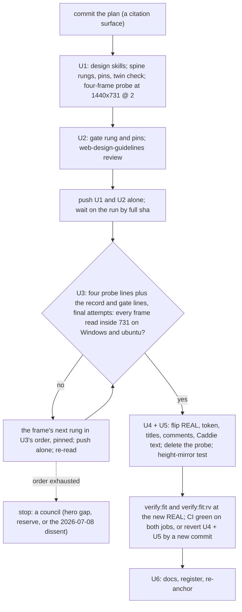

# The 1440x731 re-point of the one-frame fit law - Plan

## Goal Capsule

- **Objective:** on Briggsy's own laptop window (1440×731 CSS px at DPR 2), every frame an arm measures shows its verdict, its disclosures, its band and the R13 "this can be wrong" caveat without a scroll, and so do the record card's standing line and the re-entry gate's route; every word that shows today still shows, with no new type size and no change to the hero's size (a subordinate line may only borrow a register an equal-rank subordinate in its frame already wears, per KTD4). The known exception is the yearly-return composite, which no arm measures (Open Questions).
- **Means:** density only, on insight 082's ladder, inside the existing short-laptop tier (KTD3, KTD4, KTD6); before the gate's frame moves, Linux CI records the four spine frames it has never logged at exactly 1440×731 @ 2, and the record card's and the gates' ubuntu bottoms are read from lines their arms already print (KTD8, KTD15); then the law token, the gate's `REAL` and the Caddie harness re-point to his window together (KTD1, KTD9, KTD14).
- **Authority:** the Product Contract's R-IDs win on behavior; the KTDs win on mechanism; `docs/architecture.md` §12 wins on the chart-text and fit-tier invariants; `.claude/skills/back-nine-design/SKILL.md` wins on tone. No engine file changes (`src/engine` is untouched).
- **Execution profile:** one commit per unit on main (the repo's convention; no branches, no PRs), except U5, which rides in U4's commit. This plan is committed before U1, because once tracked it is a `verify:doc-stats` citation surface that every unit re-anchors. U1 and U2 land at the old `REAL` and are pushed alone; U3 reads that run and lands only if its rule demands; U4 with U5 lands only after U3's rule passes; U6 follows.
- **Stop conditions:** stop and surface if any frame needs a word cut, a copy edit, a hero size, a new type size, the hero lockup's gaps (KTD5) or the save slot's reserve (KTD7) to fit; stop if a frame's in-file measured before → after differs from KTD6's bottom row by more than 1 px (the cascade is not what this plan read: insight 075); stop if U3's ladder is exhausted for any frame; stop if the 917 SHOWCASE frame or the phone frame changes by any pixel; stop if a chart-text arm reds at the new `REAL` (a separate defect, never a density rung).
- **Who finishes:** the pilot builds and gates every unit; Caddie walk 10 (queued next) is the first read of the new density by his eye's proxy, and his own eye audits at product cadence.

---

## Product Contract

### Summary

The plan buys the 6 to 46 px each red frame lacks at 731 from neutral whitespace in the subordinate column, the band card and the re-entry gate's confirm half, then from one step of leading on the survivor statement and the non-typical Medicare pair, all inside the existing ≤840 px laptop tier. Before the gate moves, four record-only arms measure on Linux CI, at exactly 1440×731 @ 2, the four spine frames ubuntu has never logged (budget, which is also the held re-figuring window's frame, stale, statestale and surplus), and the record card's and the gates' ubuntu bottoms are read from lines their arms already print on the same run; then the law, the fit gate and the Caddie capture harness point at his window in one commit.

The likeliest outcome, if July's record still holds (A3: ubuntu wraps the typical Medicare residual one line taller, about 21 to 28 px), is that `?vault=stale` (14.5 px of Windows slack) needs U3's rungs, the tight leading step, then the staleness-note step and possibly rung 3, and that `?seed=budget` (24.8 px) may need the tight step. So the expected push cycles are the U1+U2 push (the probe read), possibly one U3 rung push, then the U4 flip.

### Problem Frame

Briggsy's Dell died on 2026-11-19 and with it the 1536×791 @ 2.5 window every fit law, gate arm and Caddie capture was tuned to. His new Lenovo window, measured in his own Chrome, is 1440×731 @ 2. The width change costs nothing: the result frame is capped at `--content-wide` (70rem, 1120 px) and every fluid type token sits at its cap from about 1031 px up, so 1440 lays out exactly as 1536 did (measured: the same y-values to a tenth of a pixel). The 60 px of lost height is the whole problem. With `REAL` swapped to his window, the brief's run found 8 of 188 `verify:fit` arms red, all the one-frame law or its siblings; the steer note's in-frame arm is GREEN there and is not a ninth (KTD16: it measures the note after the goal pick's own scroll, at 593.25 px; the planning probe's 755.25 px is the note's position with the page scrolled back to the top, the same at 1536×791); `?seed=pa`, the longest priced clause, sits only 2.5 px inside on Windows (the Appendix has every frame's measured stack).

The law as written cannot simply move. `--laptop-fit-height` says 800 and is read by no CSS; the gate enforces `REAL.height`, which was 791; the token's comments, the stylesheet headers and the spec header each restate the old frame. The short-laptop tier (`(min-width: 68rem) and (max-height: 840px)`) already applies at 731, so a fix that restates its values moves nothing (insight 075), and on every Medicare-bearing frame the `:has()` note-frame rules out-rank that tier at every height. A frame that says "On the line, 7 of 10" with "this can be wrong" scrolled out of sight is the calm-but-wrong sin the Honesty-Hawk veto exists to prevent, so this is not a cosmetic unit.

### Requirements

**The law and its gate**

- R1. The one-frame law's binding frame is Briggsy's laptop window, 1440×731 CSS px at DPR 2: `--laptop-fit-height`, `REAL`/`REAL_DPR`, the gate's titles and every LIVE statement the Appendix lists under "Live statements of the old window" name it, and no arm keeps the 1536×791 values.
- R2. At `REAL`, every protected element is inside 731 px: the eight red arms (the spine matrix's budget arm, the held re-figuring spine arm, the `?vault=stale` and `?vault=statestale` arms, the `datesavedfourbuckets` unlock arm, both record arms, the spend lane's laptop arm) turn green, every other `verify:fit` arm stays green, and `verify:fit:rv` is green as its own gate.
- R3. Before `REAL` moves, the frames at risk are known to be inside 731 px on Windows AND on CI's ubuntu metrics, read on a green CI run, never inferred from Windows: the four spine frames ubuntu has never logged from record-only arms at exactly 1440×731 @ 2, and the record card's standing line and the gates' routes from the lines their arms already print at the old `REAL`, which read the same as 731 would because those frames are top-aligned and the layout is width-invariant from about 1031 px up. The other fold-asserting frames keep more Windows slack than A3's ubuntu delta and are asserted on ubuntu by U4's CI run (KTD8).
- R4. The 917 SHOWCASE frame, the phone and every sub-68rem tier render byte-identical; TIER (1280×800) and FLOOR (1088×800) may only get tighter and must still fit.

**Density only**

- R5. No word, copy key or sentence changes; no hero size, no new type size, no move of the 68rem breakpoint; the hero lockup (verdict word, count reading, magnitude clause and the gaps between them) is untouched.
- R6. Every density step sits on insight 082's ladder (whitespace before leading; a type register only by borrowing one an equal-rank subordinate in the same frame already wears, and only for a frame rungs 1–2 cannot fit) and is pinned by a computed-style assertion that goes red on every platform when its rule is deleted; each rung's mutant kill set is predicted before it is run.
- R7. Insight 035's reserved boxes hold: the save slot keeps its reserve; the spend lane's pending clause keeps reserving the sized sentence (the phone band-delta arm stays at ≤0.5 px); the eyebrow slot stays one line inside the page (its top at y ≥ 0), and the verdict and the caveat do not move while it shows.

**The harness and the record**

- R8. The Caddie capture harness captures his window (1440×731 @ 2) and the phone, and the reader-panel prompts and the skill describe that window from the same commit that moves `REAL`.
- R9. Every LIVE statement of the old window moves; dated measurements keep their numbers; every line-numbered citation still resolves (`pnpm verify:doc-stats` green).
- R10. The 20 px two-pane overrun stays an open fork: its recorded numbers are re-recorded at the new `REAL`, never asserted.

### Success Criteria

- CI's `verify` and `verify-rv-chart-text` jobs are green on U4's commit, which is ubuntu asserting every protected element inside 731 px at `REAL`.
- Walk 10's capture at `REAL` shows the answer, its caveat and the record card's standing line in the first frame, with no reader card flagging the density as cramped (his eye supersedes it).

### Scope Boundaries

- Moving the 68rem width breakpoint (a council decision, 2026-06-29).
- The recommendation surface's own fit (`verify:fit` excludes it; `docs/landmines.md` "The fit gate and e2e").
- Any copy change: a copy edit on a fold-law frame is a layout change that needs its own council (insight 097).
- Resolving the 20 px fork (R10): the register owns it.
- The date route's density: it promises ORDER and REACHABILITY, never one frame (council 2026-09-13); it changes only through the two rules it shares with the spine, the in-frame footer (W3) and the band drawer (W7), and its own short-tier block stays whitespace-only.
- Frames no arm measures at any height, which predate this unit: the view-only second tab (the banner above `main`), the failed save slot (which may grow past the reserve), and the yearly return that carries both a saved record and aged vintages (see Open Questions).
- Considered and not built: a new height tier (KTD3); spending the hero lockup's gaps or `.result`'s top padding (KTD5); shrinking the save slot's reserve on saved frames (KTD7); retiring the fixed frame for a priority order, the 2026-07-08 dissent, whose own flip condition ("density closes the budget") is met again at 731; moving the record card or relaxing its standing-line law (KTD10); a SHOWCASE arm at his Lenovo's 1440×900 full screen (measured: budget's caveat at 800.2, stale's at 785.7, about 100 px inside, with the tier off); permanent per-arm geometry logging (a ubuntu-only breach still reds CI with its measured bottom, and a log line costs one push to add then); a tall-side pin of the gate's spacing (no contract sets a tall rhythm for the gate; the planning probe checks its byte identity once, at build, U1 and U2); a pre-flip CI dispatch at 1440×731 @ 2 through a `REAL` override (a red on U4's push is caught at once and reverted by a new commit, and an override is cheap to add if such a red ever recurs; reopen it then). Evidence that would reopen each is named on its KTD or here.

#### Deferred to Follow-Up Work

- Caddie walk 10 at the new `REAL` (queued next in `TODO.md`), pointed by U6 at the frames this unit changed and at the watch items it names.
- The record card's reach check uses `scrollIntoViewIfNeeded` in the record arm's step (4), which reaches through clips a reader cannot (insight 124); this unit does not touch that step, and the register gets the entry.
- A dev plant for the yearly-return composite (a saved record plus aged vintages) and its measurement (Open Questions).

---

## Planning Contract

### Key Technical Decisions

- KTD1. **The law's frame becomes his window, and the old window is replaced, not kept.** `--laptop-fit-height` becomes `731px` with a docblock naming the Lenovo window measured 2026-11-19; `REAL` becomes `{ width: 1440, height: 731 }` and `REAL_DPR` becomes `2`. Keeping 1536×791 arms would test a layout identical to `REAL`'s with 60 px more room (measured), so they would add runtime and no coverage. The brief's lean, challenged once against the evidence and kept.
- KTD2. **TIER stays 1280×800 @ 1, re-described: it is not a narrower-width arm.** At a 16 px root, 1280, 1440, 1536 and 1871 all render the same capped 1120 px frame (measured identical y-values; `TODO.md:952` recorded the same at 1440/1536/1280). TIER's real coverage is a DPR-1 laptop and the short tier at 800 px; its docblock and the "at the fit-law tier floor" describe titles say that. FLOOR (1088) stays the only narrower two-pane width. This overturns the brief's "narrower-WIDTH arm" rationale while keeping the arm.
- KTD3. **The existing ≤840 tier carries the fix; no new height tier.** His window is inside it; a new tier would mint a third rhythm, a new boundary literal and an untested band between tiers (the warning in `confidence.css`'s staleness-echo SCOPE NOTE). Every height from 731 to 840 fits once 731 does, and above 840 the generous rhythm fits too (his 1440×900 full screen measured about 100 px inside). The 917 SHOWCASE keeps today's rhythm because every rule sits inside `(max-height: 840px)`. Evidence that would reopen this: a laptop window of his inside 761–840 px whose frame reads cramped.
- KTD4. **The ≤840 tier's law is amended from "whitespace only" to insight 082's ordered ladder, with one home.** The amended law: rung 1 whitespace, then rung 2 leading (body → snug → tight), then rung 3 a type register only by borrowing one an equal-rank subordinate in the same frame already wears, and only for a frame U3's measured rule finds still outside the frame; never a new size, never the hero. It lives once, in `--bp-laptop-short`'s docblock in `src/ui/styles/tokens.css`; the short-tier headers in `survivor.css`, `confidence.css`, `result.css`, `app.css`, `save.css` and `band.css` point there instead of restating it (seven restatements are the drift class KTD12 guards against), and `fuckOffDate.css`'s header says the date route's own block stays whitespace-only. Why amend: whitespace outside the hero is exhausted on the record frames (measured: whitespace alone leaves `?vault=rec`'s standing line at 731.4, 0.4 px over), and the round 2–5 precedent of putting leading in the unconditional two-pane rules would also change the 917 SHOWCASE. The 2026-07-08 council wrote "type NEVER moves" before insight 082 named leading and register as rungs 2 and 3; the amendment cites 082.
- KTD5. **The hero lockup and `.result`'s top padding are outside the ladder.** The lead's two 8 px gaps would buy 8 px (measured) by crowding the 44 px verdict word onto its count line, which is the hero's presentation (R5). The top padding holds the eyebrow slot (18.2 px line plus 8 px margin inside 32 px, top at 5.8 px, measured in the held window), and no token sits between 24 and 32 px. Evidence that would reopen either: U3's ladder exhausted with a frame still outside 731.
- KTD6. **The rung set, its seats and its measured payment.** Nine rules; the deltas are browser measurements at 1440×731 @ 2 with the candidate rules appended and their computed values read back, not token sums. Rungs 1 and 2 change no line break (line counts measured equal before and after on every frame), so wrap behavior on either platform is unchanged by them.

| rung | rule (all inside `@media (min-width: 68rem) and (max-height: 840px)`) | file | budget | stale | statestale | surplus | rec standing | gate route |
|---|---|---|---|---|---|---|---|---|
| W1 | `.survivor` and `.survivor-fold` padding-top 12 → 4 (`--space-1`, the Medicare note's hairline rhythm); the opened fold's inner body follows to 4, continuing W2's stack rhythm | `survivor.css` | 16 | 8 | 8 | 8 | 8 | 0 |
| W2 | `.survivor-reveal` and `.survivor-fold__summary` gap 8 → 4 | `survivor.css` | 16 | 12 | 12 | 12 | 12 | 0 |
| W3 | `.disclaimer--in-frame` padding-top 8 → 4 | `app.css` | 4 | 4 | 4 | 4 | 4 | 0 |
| W4 | the non-typical note frames' grid row-gap and `.reveal__subordinates` row-gap 4 → 2 (the typical frames' round-5 value) | `confidence.css` | 0 | 0 | 14 | 12 | 14 | 0 |
| W5 | `.rec-record` padding-block 12/12 → 8/8, gap 8 → 4 | `confidence.css` | 0 | 0 | 0 | 0 | 8 | 0 |
| W6 | the gate: `.save--reentry` padding-top 40 → 32, `.reentry` row-gap 20 → 12, `.reentry-confirm` gap 20 → 12, `.reentry-confirm > .reentry-group` lead-in 16 → 8, `.reentry-confirm > .save-actions` lead-in 16 → 8 | `save.css` | 0 | 0 | 0 | 0 | 0 | 56 |
| W7 | the inline band drawer: padding-top 20 → 16 and padding-bottom 24 → 16 (longhands, the inline 24 px untouched), its accent tab's top 24 → 20 (it sits at padding-top + 4 and moves with it; out of flow), pull margin 12 → 8, the drawer's legend margin 16 → 8 and gap 8 → 4 | `band.css` | 0 | 7.9 (see below) | 0 | 0 | 0 | 0 |
| L1 | `.survivor__context`, `.survivor__stepdown`, `.survivor__eyebrow` leading 1.55 → `--leading-snug` 1.4 | `survivor.css` | 10.2 | 13.2 | 13.2 | 13.2 | 13.2 | 0 |
| L2 | the Medicare pair and the state note on non-typical frames, leading 1.4 → `--leading-tight` 1.3 (the typical frames' value) | `confidence.css` | 0 | 0 | 11.2 | 11.2 | 11.2 | 0 |
| | **measured before → after (Windows), slack at 731** | | 752.4 → 706.2, 24.8 | 753.7 → 716.5, 14.5 | 737.2 → 674.9, 56.1 | 761.9 → 701.5, 29.5 | 777.4 → 707.0, 24.0 | 753.7 → 697.7, 33.3 |

  How to read a cell: it is what that rung pays at the frame's protected element with the rest of the primary set applied. On every frame but stale the cells add to the bottom row. Stale's W7 cell does not add: the band takes 32 px off the band column, and that pays 7.9 px at the caveat only because, once the left column shrinks past 25.2 px, the band (with its aged premise) would otherwise become the binding column. The left column's comparable end is the save slot's bottom + 2 px: 702.4 at HEAD, 25.2 px clear of the band's 677.2. W7 keeps the left column binding, at 669.2 against the band's 645.2, 24.0 px to spare (without W7 the caveat stops at 724.5, and W7 alone on HEAD pays nothing). So stale's cells sum to 45.1 against its measured 37.2, and the stop condition and U1 compare each frame's before → after, never a single cell. The held re-figuring window is budget's frame (706.2), with the eyebrow's top unchanged at 5.8 px. Retired and nc go 706.1 → 645.8; health already fits. Placement law, each rule checked against the cascade it must beat:
  - W4 and L2 carry the specificity of the `:has()` note-frame rules they step (`confidence.css line 342-356 at 95c715e19` and confidence.css line 374-413 at 95c715e19) and sit after them, in the existing short-tier block.
  - W1, W2 and L1 edit `survivor.css`'s existing short-tier block in place; W1 also reaches the opened fold's inner `.survivor` (it out-ranks `.survivor-fold > .survivor`), which is wanted and pinned.
  - W5 is written on the existing seat selector `.confidence-reveal[data-twopane] .rec-record` (specificity 0,3,0; `src/ui/styles/confidence.css line 509 at 95c715e19`), never a bare `.rec-record`: the card's padding and gap come from `.rec-note` in `src/ui/styles/recommendation.css line 421-429 at b69c28483`, whose load order against `confidence.css` depends on the module graph, so only the higher specificity wins for certain.
  - W3 is a new short-tier block in `app.css` after its `≥68rem` in-frame block; it also reaches the in-frame mount on non-two-pane answers at ≥68rem (fallback and range frames), which is harmless.
  - W6 sits at the end of `save.css`, after the base `.reentry-group` rule. Two of its selectors are gate-wide spacing above both halves (`.save--reentry` padding-top and `.reentry` row-gap, which lift both columns 16 px as a block, keeping the halves starting on one line); the rest are confirm-scoped. The story column's own spacing is never touched (its gap moves no route pixel, and the walk-9 form council's `--space-5` before the survivor part is reasoned against that column's spacing), and `.save-actions` is never touched outside the gate.
  - W7's tab rule (`.band-drawer__tab` top) sits in the same `band.css` block; the tab is absolutely positioned, so it moves no pixel of the frame. It pays 0 px and no contract sets its top, so it carries no pin.
  - W7 sits in `band.css` after the base `.band-drawer` rule (`twoPaneHonestyFloor.test.ts` reads the first `.band-drawer` rule's shorthand for the inline chrome, which stays); it covers both routes' inline drawers, the only `.band-drawer` there is, and the enlarge modal's row legend is outside `.band-drawer`, so it is untouched.
- KTD7. **The save slot's reserve is not spent.** On saved frames the slot holds a 27.9 px badge inside an 84 px reserve (56 px of whitespace), but that reserve is insight 035's no-shift law for the Save gesture, and the CTA rows of budget and surplus already fill it (84.8 px), so any gap inside it is a no-op there. Evidence that would reopen it: a ruling that a returning saved household can never see the CTA again.
- KTD8. **Linux is measured at exactly the target, by four record-only arms, before the gate moves; the rest of the ubuntu evidence is read from lines the asserting arms already print.**
  1. U1 adds a record-only describe (the probe describe) at 1440×731 @ 2 over exactly the four spine frames ubuntu has never logged (the Appendix's ubuntu table, "not logged today"): `?seed=budget` (it is also the held re-figuring window's frame), `?vault=stale`, `?vault=statestale`, and `?seed=surplus` (pending and sized). The precedent is the 20 px arm, which asserts its tier and records its frame. Each probe arm drives its frame exactly as its asserting arm does, asserts the tier with the spec's existing `assertTier` (these four are stamped two-pane spine frames) plus the short tier (`matchMedia('(min-width: 68rem) and (max-height: 840px)')`), asserts no fit, and prints one line: `[fit probe] <frame>: caveat bottom=<px> left end=<px> band end=<px>`, each to one decimal. The left end is the save slot's bottom + 2 px; the band end is the band's, which spans grid rows 1 to 5. Both column ends are printed because on stale the band can bind (KTD6's stale note). No JSON, no per-paragraph line counts, and no selector contract beyond those three elements.
  2. Measuring at the target answers three questions at once for those four frames: the Linux wrap delta, the DPR 2-versus-2.5 question that insight 118's device-pixel rounding leaves open, and centring (the four frames overflow 731, so the y-values are what `REAL` will read).
  3. The record card and the gates get no probe arm. Their ubuntu bottoms are read from lines their arms already print on green runs, on the same CI run at the old `REAL`: `[U17 record return] ?vault=rec …: … standing bottom=…`, and the same for `recold` (`e2e/vertical-fit.spec.ts line 4496 at 95c715e19`) and `[route fit] ?vault=<gate>: the route's bottom at …` (`e2e/vertical-fit.spec.ts line 3919 at 95c715e19`), both seen in run 44744842253's log. A 791-window reading of those bottoms is the 731-window reading, for two measured reasons: those frames are top-aligned at 791 (the planner measured `?vault=rec` staying top-aligned after the fix, and `.save` does not centre), and the layout is width-invariant from about 1031 px up (the same y-values at 1440 and 1536 to a tenth of a pixel).
  4. The other fold-asserting frames (`pa`, `fl`, `elsewhere`, `healthnc`, retired, nc, health, and the steer note) are not probed. Each caveat keeps more slack after the fix than A3's 21 to 28 px (`pa`, the least, at 666.6, 64.4 px inside), the steer note's arm reads it after the pick's own scroll (KTD16), and U4's CI run asserts all of them at the new `REAL`.
  5. How the lines reach the log: `playwright.fit.config.ts:54` lists `[['github'], ['html']]` on CI. `GitHubReporter.printsToStdio()` is false, and when no configured reporter prints to stdio Playwright 1.63 (`lib/runner/index.js`) prepends a `DotReporter` on CI; that reporter is what writes test stdout into the verify job's log. Each line is glued after the progress dots and carries no test name, so U3 parses by tag, keeps only each arm's final attempt, and treats disagreeing attempts as unknown. Never add `list` to the fit config: it would change the line format U3 parses. (`playwright.fit-rv.config.ts` lists `list`, and its comment at `:37` is accurate; it is not touched.)
  6. The probe describe is deleted in U4.
- KTD9. **The rungs and the probe land before the re-point, and the record twin check becomes hero-relative.** U1 and U2 only tighten, but tightening moves some frames under 791 px, where `.result` centres them (measured: `?seed=retired` drops 10.6 px at 791 while `?vault=rec` stays top-aligned), so the record arm's absolute "caveat unmoved vs the record-free twin, ±1 px" check would read about 11 px and red at the old `REAL`. Its claim is that the card is purely additive below the caveat, so the comparison becomes the caveat's distance from the hero's top, which keeps the claim and still kills its mutant (the card seated in row 4 moves the caveat about 150 px). Both distances are computed from unrounded rects and only their difference is rounded before it is compared to ±1 px, because the two caveats already start 0.8 px apart (705.3 against the twin's 706.1 at HEAD), and rounding each distance first could add up to another pixel. Every other cross-state comparison in the fit spec reads one frame against itself and is unaffected. U4 flips `REAL` only when U3's rule passes for every frame U3 reads on both platforms, and deletes the probe describe.
- KTD10. **The record card's standing-line law stays.** It is the pilot's invariant from the Caddie HARD-FLAG on cards 6–7 (the superseded face's one meaning-bearing line), layered on Briggsy's 2026-07-26 ruling that put the card below the caveat. Density meets it at 707.0 (24.0 px slack), and on this frame CI's ubuntu numbers already equal Windows (705/777 in run 44744842253), so the placement fork the learnings research raised does not arise on the plants the gate walks. Evidence that would reopen it: U3's ladder exhausted on `rec`/`recold`; the yearly-return composite, predicted outside the frame even after the ladder, is a separate fork (Open Questions).
- KTD11. **The gate gets its first short-tier block, on the gate's top spacing and its confirm half only.** Scoped per KTD6's placement law, so the first-save ceremony, the unlock screen and the story column's own spacing keep their rhythm. Untouched: the walk-9 form council's `--space-5` before the survivor part (pinned by `assertTypedBelowParts`), the label-one-step-larger type (`assertLabelType`) and the route heading's body face. The 2026-11-12 council's "route in frame … on CI Linux" bound moves with `REAL.height`; at 697.7 px (Windows = Linux on this arm) its dissent's flip trigger does not fire, and the two typed-moved gates, which run one line taller on Linux (706.8 vs 682.0 at HEAD), land near 651 px. A gate draws one read-back group when one bucket set is empty (`ReEntry.tsx`'s `ReadbackGroup` renders nothing for no rows), so the group lead-in pin applies only where a second group renders.
- KTD12. **The height mirror is bound by a unit test in `breakpoint-mirrors.test.ts`.** The file already imports `e2e/reviewSurface.ts`. It gains one test: `--laptop-fit-height` equals `REAL.height` in px (the incident is the 768-vs-800 split that hid the 2026-07-08 regression, and it was the fit-height token). No test binds every `(max-height: …px)` literal to `--bp-laptop-short`: no incident asks for one. KTD3's premise that REAL and TIER sit inside the short tier and SHOWCASE above it is already enforced by U1's two-sided density helper, which reds the moment a viewport crosses the boundary.
- KTD13. **W3 is shared by both routes and is not the killed "disclaimer density".** The 2026-07-08 council killed re-laying the R13 text (it recovers 0 px; the two-sentence layout is deliberate). W3 moves only the hairline-to-text padding (4 px measured); the text keeps its two lines at 13 px.
- KTD14. **The Caddie text moves in the same commit as `REAL`.** `e2e/caddie-walk.spec.ts` reads `REAL`/`REAL_DPR`, so its captures follow the constant with no code change; the reader-facing text (the skill's description and instructions, the taste corpus heading, the two reader-panel prompts in `.claude/workflows/`, the spec's comments) must not lag it, or a walk in between would hand readers 1440 frames labelled 1536×791.
- KTD15. **U3's rule is the law itself; reserve comes only from rungs 1–2.** A frame passes when its protected element is inside 731 px (the gate's own bound) at the target on both platforms. No margin is chosen beyond that (insight 065: a chosen bound is not a measured one). This is a deliberate departure from the ask, which was "a margin for Linux CI's taller metrics": the plan measures ubuntu at the target instead of choosing a margin. A probe arm and its asserting arm read the same page at the same viewport, and the record and gate lines read top-aligned, width-invariant frames (KTD8), so a pass is a CI pass. The margin the primary set leaves (14.5 px or more on Windows, frame by frame in KTD6 and the Appendix) is data, not a rule. A register rung (rung 3) fires only for a frame that fails, in the order U3 lists; exhaustion stops the unit and calls a council, never a tolerance and never a red flip. Under A3 the likeliest outcome is that stale needs U3's rungs (the tight leading step, then the staleness-note step, possibly rung 3) and budget may need the tight step; the expected push cycles are the U1+U2 push (the probe read), possibly one U3 rung push, then the U4 flip.
- KTD16. **The steer note is green at 731, measured by the pilot after planning (b9-1).** Its arm (`e2e/vertical-fit.spec.ts line 1252-1276 at 95c715e19`) reads the note's box right after the goal pick, without `settleLayout`, in viewport coordinates. Closing the GoalPicker leaves focus on a quiet door (`BUTTON.btn-quiet`), and the browser scrolls that door into view. At 1440×731 @ 2 the scroll reaches the page's end (scrollHeight 893 − 731 = 162 px), so the note's bottom reads 593.25 px; at 1536×791 @ 2.5 it scrolled 72 px, which is not the page's end (893 − 791 = 102), the focused door only being brought into view, and the note read 683.25. The note's page position (755.25) is the same at both windows. The planning probe ran `settle()`, whose `scrollTo(0, 0)` undid that scroll, and so read 755.25 as the viewport position. The brief's real `verify:fit` run at 1440×731 shows the arm passed at both its viewports. So the steer note is no red arm and no requirement. The rungs lower its page position to about 698.9 as a side effect; it is not in the probe describe (KTD8), and its own arm asserts it at the new `REAL` in U4. That the pick scrolls the verdict partly out of view is the beat frame's sanctioned scroll (the arm's header), and it predates this unit.

### High-Level Technical Design

The sequence and its gate:

Where each frame's pixels come from (measured, Windows; the full stacks are in the Appendix):

| frame | over at 731 | binding column after the fix | whitespace paid | leading paid | slack after |
|---|---|---|---|---|---|
| `?seed=budget`, the held window | 21.4 | left | 36.0 | 10.2 | 24.8 |
| `?vault=stale` | 22.7 | left, its end (the save slot + 2 px, 669.2) 24.0 px below the band's end (645.2) | 24.0 | 13.2 | 14.5 (both payments count only because W7 lowers the band 32 px) |
| `?vault=statestale` | 6.2 | left | 38.0 | 24.4 | 56.1 |
| `?seed=surplus`, pending and sized | 30.9 | left | 36.0 | 24.4 | 29.5 |
| `?vault=rec` / `recold` standing line | 46.4 | left | 46.0 | 24.4 | 24.0 |
| `?vault=datesavedfourbuckets` route | 22.7 | confirm half | 56.0 | 0 | 33.3 |
| `?seed=steer`, the steer note (a beat frame; only the note must be in frame; GREEN at HEAD, KTD16) | 0 (593.25 in the viewport after the pick's scroll) | the full-width beat row under the panes | (via the rungs above it) | (via the rungs above it) | its page position 755.25 → 698.9, a side effect, never a requirement |

### System-Wide Impact

- **Surfaces the rules reach:** the spine two-pane (every rung but W6); the date route through W3 and W7 only; fallback and range answers at ≥68rem through W3; the re-entry gate's confirm half (W6); the record frames, including the one with a beat also on screen (rows 7 to 9; no row number changes); the opened survivor fold (W1).
- **Tiers:** REAL, TIER, FLOOR and the 20 px root at REAL (still two-pane at 1440: 68rem = 1360 px) take the rungs; the 20 px arm records, never asserts. The phone, the landscape phone, the 24 px root (stacked at 1440) and SHOWCASE stay byte-identical, because every rule sits inside `(min-width: 68rem) and (max-height: 840px)`.
- **Centring:** `.result` centres any frame shorter than the viewport. After the fix, at 731 only health stays centred; at 791 and 800 budget, retired, nc and health centre (which is why KTD9 moves the twin check); at 917 all do, as today.
- **Portals:** the enlarge modal, the assumption panel (94dvh = 687 px at 731) and the GoalPicker are outside every scoped selector.
- **Reserved boxes:** the save slot, the spend lane's pending reserve and the eyebrow slot are untouched (R7).
- **Gates and guards:** `verify:fit` (the fit, chart-text and intake-fold specs), `verify:fit:rv`, `twoPaneHonestyFloor.test.ts`, `breakpoint-mirrors.test.ts`, `verify:doc-stats` (citations and the test count), and the Caddie harness, which follows `REAL` implicitly.
- **Unchanged:** the engine, the CSP posture (stylesheet classes only), chart-text containment (the drawer stays the bound), and every line break the rungs 1–2 touch.

### Open Questions

- **The yearly-return composite (deferred, not blocking this unit; a fork for Briggsy).** His likeliest real return, the check-in after the yearly tables roll, carries both the saved record card and the staleness echo, and the aged band with its premise; `rec`/`recold` age no vintage, so no arm has ever measured it. Predicted from this plan's measured stacks (unmeasured, no plant exists): its left column matches `?vault=statestale`'s (625.6 after the fix), its aged band matches `?vault=stale`'s (645.2 after W7), so the band binds and the standing line lands near 755 px after the full primary set (about 24 px outside 731; more if the residual is the typical one). Every planned rung but W7 acts on the left column, so none reaches it. It was already outside at the old frame (about 809 px against 791 by the same arithmetic: statestale's caveat at 737.2 plus the card's 72.1 px to its standing line) and has never been gated. The standing line is the superseded face's one meaning-bearing sentence, and the yearly return is exactly when supersession is likely. Recommended: a follow-up unit adds the plant and measures it; if the measurement confirms the breach, a placement council sits and Briggsy rules on his own 2026-07-26 ruling whether that line may scroll or the card needs a different seat.

### Assumptions

- A1. Briggsy's 1440×731 @ 2 window (his Chrome, 2026-11-19) is the only laptop window the law serves; a raised browser font remains the 20 px fork's business.
- A2. CI keeps writing test stdout into the verify job's log, as run 44744842253 shows. It does so not through the github reporter (its `printsToStdio()` is false) but through the `DotReporter` Playwright 1.63 prepends on CI when no configured reporter prints to stdio (KTD8); `playwright.fit.config.ts:54` never gains `list`, which would change the line format U3 parses. A missing or unparseable line makes that frame's margin unknown, which fails U3's rule for it.
- A3. The July 2026 record (the typical Medicare residual wrapping one line taller on ubuntu on budget and stale, about 21 to 28 px) may still hold; the four probe arms measure it, and U3 carries pre-measured rungs for it.
- A4. The tighter subordinate column, band card and gate read calm to his eye: no "cramped" ruling of his is on record (his recorded density reads are "no scroll, love it!" and "dead white space = failure"); walk 10 is the check.

---

## Implementation Units

### U1. The spine density rungs, their pins, the twin check and the probe describe

**Goal:** the spine frames, the held window, the spend lane and the record card carry W1–W5, W7, L1 and L2 at the short tier, each pinned on both sides of the tier boundary; the probe describe records the four spine frames ubuntu has never logged at 1440×731 @ 2 (KTD8); `REAL` is still 1536×791.

**Requirements:** R2, R3, R4, R5, R6, R7.

**Dependencies:** this plan committed (it becomes a citation surface).

**Files:**
- `src/ui/styles/survivor.css` (W1, W2, L1 in the existing short-tier block; its header points to the tier's law)
- `src/ui/styles/confidence.css` (W4, W5, L2 in the existing short-tier block; its header points to the law; the round-4 comment's "the R13 disclaimer's own register (--text-sm)" corrected, since the disclaimer is `--text-xs`; CRLF file, Edit tool only)
- `src/ui/styles/app.css` (W3, a new short-tier block after the `≥68rem` in-frame block)
- `src/viz/band.css` (W7, a new short-tier block after the base drawer and legend rules)
- `src/ui/styles/tokens.css` (`--bp-laptop-short`'s docblock becomes the law's one home, per KTD4)
- `src/ui/styles/result.css`, `src/ui/styles/fuckOffDate.css` (short-tier header comments only, per KTD4)
- `e2e/vertical-fit.spec.ts` (the two-sided density pins, the statestale echo pin, the Medicare leading regimes, the hero-relative twin check, the four-arm probe describe, and the density-tier wording at the lines U1 rewrites: the header's "(40px → 32px, whitespace only)" at `e2e/vertical-fit.spec.ts` (lines 53–55 at `87e3c8070`; removed by Act 6 · RC18), `assertResultPadding`'s WHITESPACE-ONLY docblock at `e2e/vertical-fit.spec.ts line 536-537 at 7933cf12e`, and the four "791 ≤ 840" call-site comments at `e2e/vertical-fit.spec.ts line 1179 at 95c715e19`, `e2e/vertical-fit.spec.ts line 2713 at 95c715e19`, `e2e/vertical-fit.spec.ts line 3056 at 95c715e19` and `e2e/vertical-fit.spec.ts line 4369 at 95c715e19`)

**The instrument (the planning probe), handed over:** `C:\Users\brigg\.claude\projects\C--Users-brigg-ai-learning-journey-projects-the-back-nine\b9-repoint\probe\`. `probe.mjs` is the read-only layout probe the Appendix's stacks came from: usage `node probe.mjs <outDir> [scenarioRegex] [candidateCssFile]`, against a dev server on port 4197; read its header before the first run. It drives each frame as its arm does, records the rendered tier, settles, appends any candidate CSS last in `<head>`, re-settles, and reads every block's box from the page top. Its scenarios include the gate plants and the SHOWCASE (1871×917) spine frames, and `PROBE_VP=<w>x<h>x<dpr>` re-targets its 1440×731 scenarios to another viewport (the phone). `cand/` holds the candidate CSS sets; `cand/P.css` is the primary rung set (its header: "the plan primary: p1 + L2 + the gate block g2"; its gate block is wider than W6's confirm scope, which moves no route pixel, KTD6). `summ.mjs` and `tables.mjs` summarise its output.

**Approach:**
1. Load the four UI design skills before touching a stylesheet: `back-nine-design`, `emil-design-eng`, `frontend-design:frontend-design` and `web-design-guidelines` (`TODO.md`'s START HERE (2) and `CLAUDE.md` require them for any UI surface).
2. Take the "before": run the planning probe on the clean tree before the first edit (that tree is HEAD), with no candidate CSS, at 1440×731 @ 2, at SHOWCASE and at the phone. No `git archive`, no frozen copy, no second server.
3. Edit the four stylesheets per KTD6 (W5 on its seat selector), then take the "after": the same probe on the edited tree, with no candidate CSS, so it reads the in-file cascade (insight 148's method, with the clean tree before the first edit standing in for its frozen copy). Each spine frame's before → after must match KTD6's bottom row to 1 px, or stop; this covers the spine columns only, since the gate column is U2's (W6). SHOWCASE and the phone must read identical. Never run the probe while `src` is being edited (HMR).
4. Give the short tier's values one home in the spec: `assertResultPadding` widens into a two-sided density helper (short tier at `REAL` and TIER, tall at SHOWCASE) that replaces it at its existing call sites rather than adding a second call. It reads `rowGap`, never `gap`; exact strings for gaps and paddings, ratio bands for leading (the `assertMedicareSnugLeading` form); it branches in the page on `.cs-medicare-residual--typical` where the tall value depends on the frame; and it fails loudly when a row's element is required and missing (insight 029), gating optional rows (the fold, the step-down, the record card) on facts the arm already asserts. It reads W4 (the reveal and subordinates row-gaps) on budget, retired, nc and health, and takes an option that skips W4 at the `?vault=stale` and `?vault=statestale` call sites (`e2e/vertical-fit.spec.ts line 2715 at 95c715e19`, `e2e/vertical-fit.spec.ts line 3058 at 95c715e19`), where those arms' own echo-gap pins already own W4. It also pins the drawer's inline padding at 24 px (the honesty-floor derivation's input) and the opened fold's inner padding (4 px short, 12 px tall).
5. W4's values on `?vault=stale` and `?vault=statestale` stay in those arms' own echo-gap pins (statestale's two `4px` reads become `2px`; stale's already read `2px`), and the helper skips W4 there (step 4).
6. `assertMedicareSnugLeading` takes the tier: at the short tier every Medicare frame and health's state note read tight (1.25–1.35); at the tall tier the typical modifier reads tight and the rest snug (1.35–1.45). Both callers move (the spine matrix and `assertPricedSpineFrame`, whose `snug` option and docblock for `pa`/`fl` change with it), and the SHOWCASE arm calls it, so round 2's snug rule keeps a reader.
7. The record HOLDS arm compares the caveat's distance from the hero's top between `?vault=rec` and its record-free twin, both distances from unrounded rects and only the difference rounded, per KTD9.
8. Rewrite the density-tier wording at the lines this unit touches (the Files entry above): the WHITESPACE-ONLY docblock, the four "791 ≤ 840" comments and the header's "(40px → 32px, whitespace only)" each point at the tier law's one home, `--bp-laptop-short`'s docblock in `src/ui/styles/tokens.css` (KTD4).
9. Add the probe describe (KTD8): four arms, `?seed=budget`, `?vault=stale`, `?vault=statestale` and `?seed=surplus` (pending and sized), each driven exactly as its asserting arm drives it, each asserting `assertTier` and the short tier, asserting no fit, and printing its one `[fit probe]` line after its frame's own settle (the stale and statestale drives settle inline, not through `settleLayout`). No asserting arm prints it.

**Execution note:** measure first, on a quiet tree: step 2's "before" is taken before any `src` edit, and no pin is written before step 3's "after" matches.

**Patterns to follow:** the round-5 block's scoping and comment form in `confidence.css`; `assertMedicareSnugLeading`'s ratio bands and modifier branch; `assertTier`'s in-page `matchMedia` read; the 20 px arm's record-only shape; the plain-text `[route fit]` and `[U17 record return]` line shape.

**Test scenarios:**
- Happy path: `?seed=budget` at `REAL` reads, through the helper, `.result` padding-top `32px`, `.survivor` padding-top `4px`, `.survivor-reveal` and `.survivor-fold__summary` row-gap `4px`, `.disclaimer--in-frame` padding-top `4px`, the drawer `16px`/`16px` with inline `24px`, the pull margin-bottom `8px`, the legend margin-top `8px` and row-gap `4px`, the step-down and both eyebrows at 1.35–1.45, and the reveal row-gap `2px`.
- Happy path: `?seed=retired` and `?seed=nc` at `REAL` read, through the helper, the reveal and subordinates row-gaps (W4) at `2px` and the Medicare pair at 1.25–1.35; `?seed=health` reads `2px` and its state note at 1.25–1.35.
- Happy path: at the `?vault=stale` and `?vault=statestale` call sites the helper skips W4, and those arms' own echo-gap pins read the reveal and subordinates row-gaps at `2px`.
- Happy path: TIER reads the same short-tier values (800 is inside the tier).
- Edge case: SHOWCASE reads every tall value: `.result` `40px`, survivor padding-top `24px` and gap `12px`, in-frame padding-top `8px`, drawer `20px`/`24px`, pull `12px`, legend `16px`/`8px`, survivor leading 1.55, retired/nc row-gap `4px` and the pair snug, budget's typical pair tight; and its FULL-fit assertion holds.
- Happy path: `?vault=rec` and `?vault=recold` read `.rec-record` padding `8px`/`8px` and row-gap `4px`; the hero-relative twin check passes at the old `REAL` (where the absolute check would read about 11 px); the worst-case three-clause card still moves the caveat by nothing.
- Error path (mutant): seating the card back in grid row 4 reds the hero-relative twin check (about 150 px).
- Edge case: `budget` with its fold opened (by `assertSurvivorBasis`, after the frame) shows the inner body at 4 px under the summary.
- Edge case: the held spine window keeps the line one line, its top at 5.8 px, the verdict and caveat unmoved, and the frame fit.
- Integration: the spend lane's phone band-delta arm stays at ≤0.5 px and the reduced-motion arm still sees the swap.
- Integration: each of the four probe arms asserts `assertTier` and the short tier, asserts no fit, and prints exactly one `[fit probe] <frame>: caveat bottom=<px> left end=<px> band end=<px>` line (surplus prints one for pending and one for sized), every figure a number to one decimal; a missing element throws instead of printing a blank.
- Integration: at the old `REAL` (U1 and U2), each rung's mutant (delete its rule) reds its density pin on every platform and NO fold assertion. The pins are the only falsifier per rung (insight 075); write each kill set down before running it. The new-`REAL` half (still no fold red there: the largest single-rung payment at a protected element is 16 px, and the tightest frame after the fix, stale, loses at most 13.2 px to one deletion, 729.7, still inside) is observed at U4.

**Verification:** each spine frame's in-file before → after matches KTD6's bottom row to 1 px; `pnpm test` green (U1 edits `tokens.css` and `band.css`, which unit tests read); `pnpm verify:fit` green at the old `REAL` (every arm, the probe describe included) with the four arms' `[fit probe]` lines in its log; the planning probe finds 1871×917 and the phone identical before and after.

### U2. The re-entry gate's short-tier rung and its pins

**Goal:** the gate's route sits inside 731 px on every gate arm, and the gate's spacing is pinned for the first time.

**Requirements:** R2, R3, R5, R6.

**Dependencies:** U1 (the density helper).

**Files:**
- `src/ui/styles/save.css` (W6, a new short-tier block at the end of the file)
- `e2e/vertical-fit.spec.ts` (the gate's density rows in the unlock-line arms' route block)

**Approach:**
1. Add W6 per KTD6 and take the gate column's before → after with the planning probe (U1's instrument, the "before" from U1's clean-tree run, the "after" on the edited tree with no candidate CSS) at 1440×731 @ 2: `datesavedfourbuckets`' route 753.7 → 697.7 (KTD6's gate column, to 1 px, or stop), every other gate route at 626.0, the stale/statestale affirm at 391. The gate needs no centring correction (`.save` does not centre). The same probe confirms the gate at 1871×917 and at the phone is unchanged.
2. Assert the gate's short-tier values in the route block: `.save--reentry` padding-top `32px`, `.reentry` row-gap `12px`, `.reentry-confirm` row-gap `12px`, the confirm half's actions margin-top `8px`, and the second group's margin-top `8px` where a second group renders.
3. After the gate's pins land, run a `web-design-guidelines` review pass over the changed surfaces (the spine two-pane, the band drawer, the record card and the gate's confirm half, at 1440×731 @ 2, 1280×800 and the phone), fixing what it finds inside this plan's laws (sibling precedent: `docs/plans/features/answered-draft-build-spec.md:209` and `docs/plans/features/answered-draft-build-spec.md:226`).

**Patterns to follow:** the unlock-line arm's existing order (gate notes, door, route fit, affirm); `save.css`'s `≥68rem` gate block comment form.

**Test scenarios:**
- Happy path: `datesavedfourbuckets` at `REAL` reads its five short-tier values and its route ends inside 731.
- Happy path: every other gate-door plant (`datecoststale`, `datesavedstale`, the three risen, `datesavedtyped`, `datesavedtypedmoved`, `datesavedtypedpension`) keeps its route in frame, its door the next sibling of the buttons, its heading in the body face and its label type one step larger.
- Edge case: the typed-moved and typed-pension gates keep `.note-parts__closing`'s `--space-5` margin and their story-column gap at `20px`.
- Integration: at the old `REAL`, deleting one W6 rule reds its pin and no route assertion; the new-`REAL` half (still no route red: the largest part, the confirm half's three gaps, leaves the route at 721.7) is observed at U4.

**Verification:** the gate arms are green at the old `REAL`, and each prints its `[route fit]` line (U3's gate input); the `web-design-guidelines` pass's findings are fixed or answered in the commit.

### U3. Read the ubuntu numbers at the target and apply a rung only where the law demands

**Goal:** before `REAL` moves, every frame U3 reads (the four probe frames, the record card's standing line and every gate's route, KTD8) is known to be inside 731 px at 1440×731 @ 2 on both platforms, from measurements.

**Requirements:** R3, R6.

**Dependencies:** U1 and U2 pushed alone, with CI's `verify` and `verify-rv-chart-text` jobs green on that head (waited on by full sha).

**Files:** none when every frame passes. When a rung lands: `src/ui/styles/survivor.css` (the tight step and the register rungs) or `src/ui/styles/confidence.css` (the staleness echo's leading and the record card's internal rungs), each in that file's existing short-tier block; `e2e/vertical-fit.spec.ts` (that rung's density pin, on both sides of the tier).

**Approach:**
1. From the head run's `verify` log, read, final attempt only (attempts that disagree are unknown, which fails the frame): the four `[fit probe]` lines (budget, stale, statestale, surplus pending and sized: caveat bottom, left end, band end), the `[U17 record return]` lines' `standing bottom=` for `rec` and `recold`, and every gate's `[route fit]` line (KTD8). Put each beside the local Windows number from the same commit's `verify:fit` run, which prints the same lines; record the table (frame, source line, Windows, ubuntu, which column binds) in the commit message that acts on it.
2. Apply KTD15's rule.
3. A failing frame takes the next rung in its order, pinned, pushed alone and re-read. The deltas below are Windows measurements over the full primary set; a later rung's delta is re-measured on top of the earlier ones before it lands, and a register rung changes line breaks, so its own ubuntu delta is read on its own run.
   - First, for any failing spine frame, rung 2's last step: `.survivor__eyebrow`, `.survivor__context` and `.survivor__stepdown` leading snug → `--leading-tight` (1.3), written tier-wide in `survivor.css`'s short-tier block like L1. Measured: budget −6.8 px (699.4), stale −8.8 (707.7), surplus −8.7 (692.8), rec and its record-free twin retired −8.8 alike (so KTD9's twin check holds). It changes no line break.
   - `?vault=stale` and `statestale`, next: (a) `.cs-staleness-note` leading to snug, rung 2: −2.7 px, written as `.confidence-reveal[data-twopane] .cs-staleness-note` in `confidence.css`'s short-tier block, because the echo's base rule sits later in that file at lower specificity, so a bare selector there would lose (insight 075); then (b) rung 3, the survivor context and its inner `.survivor__stepdown` span to `--text-sm`, scoped to frames that carry both the staleness echo and the Medicare pair or the state note (the equal-rank subordinates that wear `--text-sm` in that column): −11.2 px over the primary set.
   - `?seed=budget` and the held window, next: rung 3, the floor-relief trim note (`.floor-readout .survivor__stepdown`) to `--text-sm`, borrowing the same register: −5.6 px over the primary set.
   - `?vault=rec` and `recold`, next: rungs inside the card, below the caveat, which pay at the standing line (the record frames' protected element) and leave everything above the caveat untouched: `.rec-record` padding-top 8 → 4 and gap 4 → 2, then `.rec-record__standing` leading to snug; measured together −8.7 px at the standing line (698.3) with the caveat unmoved. No rule scoped by `.rec-record` may touch an element above the caveat, because the HOLDS arm's twin check (KTD9) requires the spine above the caveat to read the same with or without a record; that check is part of any record rung's verification. Still outside after these: stop for KTD10's placement council.
   - `?seed=surplus`, next: rung 3, the survivor context and its span to `--text-sm`: −11.2 px over the primary set. Its scope must never key a type size on the spend lane's state attribute (`data-spend`), which can go pending → unsized after the final (`src/ui/ConfidenceStatement.tsx line 257 at 95c715e19`; `src/ui/verdictSentence.ts:60`, `src/ui/verdictSentence.ts:74`, `src/ui/verdictSentence.ts:87`), so a size keyed on it would shift the frame mid-view (insight 035, R7). If surplus ever needs rung 3, find a scope that does not change after the final, or stop for a council. When several frames reach rung 3, the scope is a selector list of each failing frame's class, never the whole tier, so the borrow stays off frames that fit (R6).
   - The gate: no rung is planned; ubuntu equals Windows on `datesavedfourbuckets` at HEAD, and the ubuntu-taller typed-moved gates are predicted near 651 px; their `[route fit]` lines confirm or refute both.
   - `pa`, `fl`, `elsewhere`, `healthnc` and the steer note: not probed (KTD8), and no rung is planned (measured after the fix on Windows: `pa` 666.6, `fl` and `elsewhere` 645.8, `healthnc` 601.3, the steer note's page position 698.9, each with more slack than stale's 14.5); a red on U4's CI run is answered by U4's revert and then a measured rung of its own.
4. A frame still outside 731 after its order is exhausted stops the unit (KTD15).

**Execution note:** a measurement and a decision first; CSS only for a frame the rule fails.

**Test scenarios:**
- Happy path: every frame passes; the unit changes no file and the evidence table goes into U4's commit message.
- Error path: a missing, unparseable or attempt-disagreeing line is an unknown margin, which fails the frame.
- Integration (if a rung lands): its pin reds on every platform when its rule is deleted, and the re-read run shows the frame inside 731 on both platforms.

**Verification:** a written table shows every frame U3 reads inside 731 on Windows and on ubuntu, at the target (for the record card and the gates, through their top-aligned old-`REAL` lines, KTD8), at the commit U4 builds on.

### U4. Re-point the law, the gate's REAL and every live statement in the specs and styles

**Goal:** the law token, `REAL`/`REAL_DPR`, the TIER and SHOWCASE docblocks, the spec's comments and titles and the height-mirror test name his window, and all three fit gates pass there.

**Requirements:** R1, R2, R3, R9 (code surfaces), R10.

**Dependencies:** U3's rule passed. Lands in one commit with U5 (KTD14).

**Files:**
- `e2e/reviewSurface.ts` (`REAL`, `REAL_DPR` and their docblock; TIER's per KTD2; SHOWCASE's provenance, which called 1871×917 "his SCREEN", the Dell's)
- `src/ui/styles/tokens.css` (`--laptop-fit-height: 731px` and its docblock)
- `src/ui/styles/app.css`, `src/ui/styles/result.css`, `src/ui/styles/confidence.css` (LIVE comments that type 800 px as the law, per the Appendix list)
- `src/ui/copy.ts` (the standing line's length-note comment, re-measured at `REAL`, keeping its line count, since many citations point past it; no string changes)
- `e2e/vertical-fit.spec.ts` (the four-arm probe describe deleted; the live comments the Appendix lists under "Live statements of the old window", among them the frame-contract header's 1536 example, the "both laptop tiers (791, 800)" note, the 20 px docblock with its numbers re-recorded from this unit's run, and the record arm's "TIGHT BY CONSTRUCTION" note together with its stale citation of the copy length note; the TIER describe titles "at the fit-law tier floor")
- `e2e/chart-text.spec.ts` (the header's "REAL 1536 @2.5", the hard-typed "1536 → 320" log string, read from `REAL.width`, and the enlarge-modal note, 497.1 px at 731)
- `e2e/held/council-24px-shots.spec.ts` (its "this 1536 window" comment)
- `scripts/__tests__/breakpoint-mirrors.test.ts` (KTD12)
- `README.md` and `docs/roadmap.md` (the "NNN tests across NN files" count `verify:doc-stats`'s first arm checks, moved in this commit)

**Approach:**
1. Flip the constants and the token with their comments in one commit, so no tree state has the law and the gate disagreeing.
2. Add KTD12's test and watch it red once against a planted wrong value (restored by snapshot and `cmp`).
3. Run `verify:fit` alone at the new `REAL`, then `verify:fit:rv`; read the 20 px arm's recorded offenders into its docblock as a dated record.
4. Observe the mutants' new-`REAL` half (U1 and U2 observed only the old one): each rung's mutant (delete its rule) reds its density pin and NO fold or route assertion at 731, as each kill set written down at U1 and U2 predicts.
5. Read, as first evidence at 731, the assertions that never ran there because each red arm stopped at its first failure: the budget arm's folded-survivor basis, the held arm after its caveat check, the stale and statestale arms' survivor basis, `datesavedfourbuckets`' whole post-affirm half (its result walk, standing block and in-sheet hit test in a 687 px sheet), the record arms' sanction check, frame walk, survivor basis and reach step, and the spend lane's sized frame. A red there is a never-run assertion meeting 731, to diagnose, never a reason to loosen it.

**Execution note:** never run a browser gate while `src` is being edited (HMR); `verify:fit` runs alone, unpinned, its exit code read from its own log line.

**Patterns to follow:** `e2e/reviewSurface.ts`'s docblock voice (measured, dated, which device); `breakpoint-mirrors.test.ts`'s source-bind form.

**Test scenarios:**
- Happy path: `verify:fit` green at 1440×731 @ 2 (the probe describe gone), the eight formerly red arms green, `?seed=pa` and the steer note with them.
- Happy path: `verify:fit:rv`'s three arms green at the new `REAL` (never run at 1440 before).
- Happy path: KTD12's test passes with `--laptop-fit-height: 731px` and `REAL.height` 731.
- Error path: KTD12's test reds against its plant (the token at `800px`).
- Integration: at the new `REAL`, each rung's mutant reds its density pin and no fold or route assertion (the largest single-rung payment at a protected element is 16 px; stale, the tightest, reads 729.7 with its largest rung deleted; the gate's largest W6 part leaves the route at 721.7).
- Edge case: the 20 px arm still asserts two panes at 1440 and records, never asserts, the frame.
- Edge case: the 24 px arms still render the stacked tier and hold ORDER and REACHABILITY.
- Integration: the assumption panel's extent arm keeps the dialog inside 731 (94dvh = 687 px).
- Integration: a chart-text seat flip at the new `REAL` (its seat tables carry thin margins at `REAL`, and DPR 2 is the one input the width-identity measurement did not cover) inside the gate's 2 px seat-boundary band is tolerated by that gate's design; outside it, stop and diagnose (Goal Capsule).
- Error path: any red on U4's CI run (a chart-text arm, `verify:fit:rv`, or a tail never run at 731) is answered by reverting U4 and U5 with a new commit at once, so main is green while it is diagnosed; the re-point lands again only with that cause fixed.

**Verification:** CI's two jobs green on this commit (ubuntu asserting every protected element inside 731 at the new `REAL`); `pnpm verify:doc-stats` green.

### U5. Re-point the Caddie capture harness's text and run one capture

**Goal:** the Caddie describes the window it now captures, so walk 10 reads the frame he sees.

**Requirements:** R8, R9.

**Dependencies:** lands in U4's commit (KTD14).

**Files:**
- `.claude/skills/caddie/SKILL.md` (the frontmatter `description`; the device-scale crop factor, 2.5×/3× → 2×/3×; the DPR line and the 3840 px full-frame figure, now 2880 px)
- `.claude/skills/caddie/taste-corpus.md` (the Layout & density heading)
- `.claude/workflows/caddie.js`, `.claude/workflows/caddie-ab.js` (the reader-panel prompt's "real/" line)
- `e2e/caddie-walk.spec.ts` (the long-edge comment; its measured note keeps its dated numbers)

**Approach:**
1. Replace each LIVE statement of 1536×791 @ 2.5 with 1440×731 @ 2, and the Dell's "1871×917 screen" warning with the fact that SHOWCASE is a tall test arm, not any screen of his.
2. Keep the "read small text from device-scale crops" rule: a full frame at device scale is 2880 px on its long edge, still over the ~2576 px ingestion cap.
3. After the commit, run `pnpm caddie:walk` with one `CADDIE_TARGETS` entry (capture only; the reader panel is a separate workflow).

**Test scenarios:**
- Happy path: the capture's `real/` states carry a `fold.json` whose `viewport` reads width 1440, height 731, dpr 2, and crops at 2×.
- Edge case: a grep of `.claude/` for `1536x791`, `1536×791`, `2.5dpr`, `2\.5×`, `2.5/3` and `3840` finds only dated history.

**Verification:** the capture bundle reports his window; the skill list's description names it.

### U6. Docs, the register and the line-citation re-anchor

**Goal:** every LIVE doc statement of the old window names his window, the 20 px fork's record is current, the dated corrections are filed, and the citation gate is green.

**Requirements:** R9, R10.

**Dependencies:** U4.

**Files:**
- `docs/glossary.md` (the Caddie entry), `docs/roadmap.md` (the Validation-gates "Vertical fit + chart text" row), `docs/landmines.md` (the "manual 1536×791 measure" line; new entries: the amended tier law's home, and how test stdout reaches CI's verify log on green runs: the github reporter prints none (`printsToStdio()` is false), so Playwright prepends a `DotReporter` on CI, and that is what writes it; never add `list` to `playwright.fit.config.ts`, which would change the line format a log reader parses), `docs/architecture.md` (§12's one-frame-law bullet: the 20 px fork's premise at 1440 and its re-recorded numbers)
- `docs/backlog.md` (the LIVE lines the Appendix lists, the 20 px fork's numbers among them; on the open 20 px fork's register entry (`docs/backlog.md:4331-4332`), a note beside its rejection reason (2), "the only levers are barred by the whitespace-only law", that KTD4 amended that law; new entries: the record card's reach check, the yearly-return composite ⚑, the view-only and failed-save frames)
- `docs/insights/082-when-whitespace-reservoirs-hit-floor-the-next-fit-rung-is-the-subordinate-disclosure-type-register.md` (a dated correction: the R13 disclaimer has worn `--text-xs` since 2026-06-14, so round 4's register was borrowed from the frame's other `--text-sm` subordinates, the survivor eyebrow, the save hint and the band legend; the rung's honesty stands, its attribution was wrong)
- `docs/plans/5-workbench-plan.md` and `docs/plans/features/working-year-surplus-build-spec.md` (their forward 1536×791 arms)
- `TODO.md`, in order:
  1. Drop the b9-3 block's stale note that the spec hard-codes `deviceScaleFactor: 2.5`, which `c1ef71da` already fixed.
  2. Move START HERE's item (2), the re-point itself, off the list as done, and note that START HERE (1), U3's one unguarded describer, is done too (`2d0de57a`).
  3. Move the live landmine "The gate is two columns at 1536; his screen is 1440×731 now …" to the new window: the gate is now measured at 1440×731, and the rest of the entry (nothing pins the story column; any fix is static) stays.
  4. Add walk 10's re-point targets to START HERE's walk-10 step: `seed:budget`, `vault:stale`, `vault:statestale`, `seed:surplus`, `vault:rec`, `vault:recold` and `vault:datesavedfourbuckets` at the new `REAL`.
  5. Add walk 10's watch items beside them: W1's 4 px seat under the hairline on the survivor card and on the opened fold; the hero-to-first-card boundary (about 7 px with the hairline, against the hero's own 8 px gaps; its fallback is 8 px on that card, costing 4 px at every protected bottom: stale 14.5 → 10.5, budget 24.8 → 20.8, rec 24.0 → 20.0); L1 and L2's tighter leading; W5's record card with its standing line in frame; W6's tightened confirm half; and W7's drawer and tab.

**Approach:**
1. Move LIVE statements only; dated measurements, the council log and the cold-read log keep their numbers.
2. Run the re-anchor routine after the last edit (below).

**Test expectation:** none beyond the gates -- docs only; `pnpm verify:doc-stats` (all six arms) is the check.

**Verification:** `pnpm verify:doc-stats` green with its exit code read from a file; a grep of the live surfaces for 1536×791 finds only dated history.

---

## Verification Contract

Every commit, run from the project directory on a quiet tree, before its push:

| gate | when | what it proves |
|---|---|---|
| `pnpm typecheck`, `pnpm lint` | every commit | types and the layer boundaries |
| each edited e2e spec through a scratch tsconfig (absolute `types`, the 8 pre-existing `Node.remove` errors filtered) | U1–U4 | `e2e/` is outside `pnpm typecheck` |
| `pnpm test` | U1, U2, U4, and any commit touching `scripts/` | the unit suite and the count its stats surfaces carry; U1 edits `tokens.css` and `band.css`, which `twoPaneHonestyFloor.test.ts`, `ConfidenceBand.test.tsx`, `viewBoxMirrors.test.ts`, `tokens.test.ts` and `colorblind.test.tsx` read, and CI runs `pnpm test` before `verify:fit`, so a unit red would starve U3 of its lines |
| `pnpm build` | every commit touching `src/` | the production bundle |
| `pnpm verify:fit`, alone, unpinned, exit code from its own log line | U1, U2, any U3 rung, U4 | every arm at the current `REAL`; the four `[fit probe]` lines and the `[U17 record return]` and `[route fit]` lines (Windows) |
| `pnpm verify:fit:rv` | U4 only (CI runs it on the U1/U2 push U3 reads) | the RV chart text |
| the re-anchor routine, then `pnpm verify:doc-stats` | every commit that moves lines a doc cites, this plan included | citations resolve; counts current |
| CI `verify` and `verify-rv-chart-text` on the pushed head, waited on by full sha, logs read | the U1/U2 push (U3's input), any U3 rung, U4 | the ubuntu metrics local Windows cannot give |

The re-anchor routine, per commit:

1. Before the commit's first edit, record its base sha.
2. After its last edit, run the dry run into a file: `pnpm doc:reanchor <base sha> > <dry file>`.
3. Check the dry run by content: `node scripts/check-reanchor-moves.mjs <dry file> <base sha>` (usage at `scripts/check-reanchor-moves.mjs:8-14`); read every SKIPPED and REVIEW line it reports by hand, and check by hand the start and end lines of any range it calls "NOT a pure shift".
4. Hand-check the far-from-filename bare tokens (`TODO.md`'s b9-3 block) and the second number of every comma pair.
5. Refuse the moves of the quoted examples in `docs/landmines.md` and in TODO's own step 3.
6. Restore `e2e/held/fit-24px-measurements.md`, `docs/council-log.md` and insight 136.
7. Run `pnpm doc:reanchor <base sha> --apply` once; every doc the apply rewrites goes into that commit.

The CI `verify` job runs `verify:aca` first, then `verify:doc-stats`, the unit tests, the build and `verify:csp`, all before `verify:fit`, so a citation left on a blank line would starve U3 of its numbers: the local gates run first.

`pnpm verify:csp` is not owed: no rule changes how CSS is delivered (stylesheet classes only, no inline style, no injected `<style>`). Each rung's mutant run writes its predicted kill set down before it runs and counts a red only on its own failure line (insights 126, 152); a plant is grep-verified as landed and restored by snapshot plus `cmp`, never `git checkout`.

## Definition of Done

- All eight formerly red arms green at 1440×731 @ 2 on Windows and on CI's ubuntu run, and with them every frame an arm measures (R2, R3); the known exception is the yearly-return composite, which no arm measures (Open Questions).
- SHOWCASE and the phone identical to HEAD in the planning probe's before → after; the stacked tiers untouched (R4).
- Every rung pinned by computed style on the short side; the spine rungs' tier boundary pinned on the tall side too, while the gate's W6 is pinned on the short side only and its tall side checked once by the planning probe (Scope Boundaries); each mutant's kill set predicted, then observed at the old `REAL` in U1 and U2 and at the new `REAL` in U4 (R6).
- The law token, `REAL`/`REAL_DPR`, the height-mirror test, the Caddie skill and prompts and every LIVE doc line name 1440×731 @ 2; the 20 px fork re-recorded (R1, R8, R9, R10).
- No abandoned experiment in the diff: no probe script, no temporary `REAL` swap, no leftover plant; the four-arm probe describe deleted in U4.

## Risks & Dependencies

| risk | mitigation |
|---|---|
| ubuntu wraps the typical residual one line taller on budget or stale (A3) | the four probe arms measure it at the target; U3's pre-measured rungs, in ladder order |
| A rule placed below the specificity or source order it must beat does nothing at the failing frame (insight 075) | KTD6's placement law per rule and U1's in-file before → after, the planning probe on the clean tree and then on the edited tree |
| Tightening centres a frame at the old `REAL` and reds a cross-frame comparison | KTD9: the twin check reads hero-relative; every other comparison is within one frame |
| The band column becomes binding on another aged frame | each `[fit probe]` line carries both column ends, and U3 reads them |
| A cycle slips past the ACA re-verify date: CI's `verify` job runs `verify:aca` first, and `aca-last-verified.json` (verified 2026-11-12, `maxAgeDays` 30) goes stale about 2026-12-12, which reds CI before any probe line prints | if the build will cross that date, run the ACA re-verify pass first |
| A future copy edit or wrap flip eats a frame's margin | the fit arms red with the measured bottom in their failure, on the platform that breaches (insight 097) |
| `confidence.css` is a CRLF file | Edit tool only, never `sed -i` |
| The re-anchor tool double-shifts or misses far tokens | the routine above, applied once per commit, hand checks named |

---

## The blind readers' faults

Three blind readers (builder, rules, owner; workflow run `wf_87f565fa-928`, all three "after-fixes") filed 28 faults, 5 of them misleads; the pilot checked each against the code and ruled (b9-1, 2026-11-20).

- builder 1 (misleads): resolved by KTD8's four-frame probe.
- builder 2 (misleads): resolved by KTD8's four-frame probe; U1's coverage claim and its grep scenario deleted.
- builder 3 (misleads): fixed in U1 steps 4–5 and its test scenarios (the helper reads W4 on budget, retired, nc and health, and skips it at the stale and statestale call sites).
- builder 4 (misleads): fixed in U1 (the planning probe handed over; steps 2–3, the frozen-HEAD copy dropped) and the Appendix's provenance.
- builder 5 (minor): fixed in the Verification Contract (`pnpm test` at U1 and U2) and U1's Verification.
- builder 6 (minor): fixed in the Verification Contract (the re-anchor routine as numbered steps, the script call with its arguments).
- builder 7 (minor): fixed in U1 (Files, step 8), U4's Files and the Appendix's live-statements list.
- builder 8 (minor): fixed in U1 step 3 (spine columns only) and U2 step 1 (the gate column).
- builder 9 (minor): resolved by KTD8's four-frame probe; the mutant wording fixed in U1's and U2's test scenarios, U4 step 4 and its test scenarios, and the DoD.
- builder 10 (minor): fixed in U6 (the TODO item as a numbered list, with the landmine, START HERE (2) and START HERE (1)).
- builder 11 (minor): fixed in U1 step 1 (the four design skills), U2 step 3 (the `web-design-guidelines` pass) and the High-Level Technical Design diagram.
- builder 12 (minor): fixed in Risks (the ACA row) and the Verification Contract's CI order.
- rules 1 (misleads): resolved by KTD8's four-frame probe; the reporter premise fixed in KTD8 step 5, A2 and U6's landmine entry, and `playwright.fit-rv.config.ts` dropped from U1 and the Appendix.
- rules 2 (minor): resolved by KTD8's four-frame probe; U1's coverage claim and its grep scenario deleted.
- rules 3 (minor): fixed in KTD6's placement law (W5 on its seat selector).
- rules 4 (minor): fixed in the Verification Contract (`pnpm test` at U1 and U2).
- rules 5 (minor): fixed in U3 step 3 (the surplus rung never keys a size on `data-spend`).
- rules 6 (minor): fixed in KTD6's stale note and the High-Level Technical Design table (the save slot + 2 px).
- rules 7 (minor): fixed in KTD16 (the scroll reaches the page's end at 731, not at 791).
- rules 8 (minor): fixed in U6 (the note on the 20 px fork's register entry).
- rules 9 (minor): fixed in the Summary and KTD15 (the departure from the ask, the likeliest outcome, the expected cycles).
- owner 1 (minor): resolved in part by KTD8's four-frame probe; its lighter path (flip and let CI find it) is not taken, because A3 predicts a red main (Summary, KTD15).
- owner 2 (minor): fixed in KTD12 (one test), U1 step 4 and its test scenarios (no tab pins), KTD6's W7 tab note, U4 and the DoD.
- owner 3 (minor): fixed in U1 step 1 and U2 step 3.
- owner 4 (minor): fixed in the Summary and KTD15.
- owner 5 (minor): fixed in the Goal Capsule and the DoD.
- owner 6 (minor): fixed in the Verification Contract (`verify:fit:rv` at U4 only).
- owner 7 (minor): fixed in U6 (the landmine entry deleted).

---

## Appendix

### Measured vertical stacks at 1440×731 @ 2

Provenance: the planning probe, a read-only Playwright script now kept at `C:\Users\brigg\.claude\projects\C--Users-brigg-ai-learning-journey-projects-the-back-nine\b9-repoint\probe\probe.mjs` (U1 hands it over; the primary rung set is `cand/P.css` beside it) (`chromium` from the project's `@playwright/test`, the project's dev server, each frame driven exactly as its arm drives it, `settleLayout`'s recipe, the tier asserted before every read: `matchMedia('(min-width: 68rem)')` true, two grid columns, the short tier true). Candidate rules were appended last to `<head>` after settle and their computed values read back. Columns: the block, its box at HEAD, its whitespace (margin, padding, border, gap), its type (font-size / line-height (ratio) × lines), and its bottom with the primary rung set applied (changed values in brackets). Indentation dots show depth; the band column follows the lead. W5's bottom padding (12 → 8) and the date-route reach of W7 were derived after the run (W5's bottom padding sits below the standing line and moves no protected pixel).

#### `?seed=budget` (the held window is this frame plus the eyebrow line at 5.8 → 24.0, unchanged)

| block | top → bottom (h) | whitespace | type | after |
|---|---|---|---|---|
| main.result | 0 → 832.4 | pad 32/32 | | 786.2 |
| ·reveal (grid) | 32 → 800.4 | row-gap 2 | | 754.2 |
| ··reveal__lead | 32 → 153.8 (121.8) | gap 8 | | 153.8 |
| ···cs-verdict | 32 → 81.3 (49.3) | | 44/49.3 (1.12) ×1 | 81.3 |
| ···cs-reading | 89.3 → 117.9 (28.6) | | 22/28.6 (1.3) ×1 | 117.9 |
| ···cs-magnitude | 125.9 → 153.8 (27.9) | | 18/27.9 (1.55) ×1 | 153.8 |
| ··cs-band | 32 → 561 (529) | | | 529 |
| ···band-drawer | 32 → 561 | pad 20/24, border 1/1 | | 529 [pad 16/16] |
| ····band-drawer__pull | 53 → 73.1 | margin 0/12 | 13/20.2 (1.55) ×1 | 69.1 [margin 0/8] |
| ····band-figure | 85.1 → 429.6 (344.4) | | | 421.6 |
| ····band-legend | 445.6 → 536 (90.4) | margin 16/0, gap 8 | | 512 [margin 8/0, gap 4] |
| ··reveal__subordinates | 155.8 → 612.3 | gap 2 | | 570.1 |
| ···survivor.floor-readout | 155.8 → 332.5 | pad 12/0, border 1/0 | | 304.7 [pad 4/0] |
| ····survivor-reveal | 168.8 → 332.5 | gap 8 | | 304.7 [gap 4] |
| ·····survivor__eyebrow | 168.8 → 193.5 | | 16/24.8 (1.55) ×1 | 183.1 [lh 22.4 (1.4)] |
| ·····survivor__verdict | 201.5 → 237.4 (35.8) | gap 12 | | 223.0 |
| ·····survivor__reading | 245.4 → 268.8 | | 18/23.4 (1.3) ×1 | 250.4 |
| ·····survivor__stepdown | 276.8 → 332.5 | | 18/27.9 (1.55) ×2 | 304.7 [lh 25.2 (1.4)] |
| ···survivor-fold (closed) | 334.5 → 416.2 | pad 12/0, border 1/0 | | 374.0 [pad 4/0] |
| ····survivor-fold__summary | 347.5 → 416.2 | gap 8 | | 374.0 [gap 4] |
| ···cs-medicare-note | 418.2 → 485.6 | pad 4/0, border 1/0 | 16/20.8 (1.3) ×3 | 443.3 |
| ···cs-medicare-residual (typical) | 487.6 → 612.3 | | 16/20.8 (1.3) ×6 | 570.1 |
| ··result-save-slot (CTA 52 + gap 8 + hint 24.8) | 614.3 → 699.1 (84.8) | min-block-size 84 | | 656.9 |
| ··recommendation-surface (idle, row 4 = 0) | 701.1 → 701.1 | | | 658.9 |
| ··disclaimer--in-frame | 703.1 → **752.4** | pad 8/0, border 1/0 | 13/20.2 (1.55) ×2 | **706.2** [pad 4/0] |

#### `?vault=stale` result

| block | top → bottom (h) | whitespace | type | after |
|---|---|---|---|---|
| main.result | 0 → 954.5 | pad 32/32 | | 917.3 |
| ··reveal__lead | 32 → 153.8 | gap 8 | (as budget) | 153.8 |
| ··cs-band | 32 → 677.2 (645.2) | | | 645.2 |
| ···band-drawer | 32 → 598.8 | pad 20/24, border 1/1 | | 566.8 [pad 16/16] |
| ····band-drawer__pull | 53 → 73.1 | margin 0/12 | 13/20.2 (1.55) ×1 | 69.1 [margin 0/8] |
| ····band-figure (aged: two annotation rows) | 85.1 → 467.4 (382.2) | | | 459.4 |
| ····band-legend | 483.4 → 573.8 | margin 16/0, gap 8 | | 549.8 [margin 8/0, gap 4] |
| ···band-premise | 602.8 → 677.2 | margin 4/0 | 16/24.8 (1.55) ×3 | 645.2 |
| ··reveal__subordinates | 155.8 → 614.4 | gap 2 | | 581.2 |
| ···survivor | 155.8 → 388.3 | pad 12/0, border 1/0 | | 355.1 [pad 4/0] |
| ····survivor-reveal | 168.8 → 388.3 | gap 8 | | 355.1 [gap 4] |
| ·····survivor__eyebrow | 168.8 → 193.5 | | 16/24.8 (1.55) ×1 | 183.1 [lh 22.4] |
| ·····survivor__verdict | 201.5 → 237.4 | gap 12 | | 223.0 |
| ·····survivor__reading | 245.4 → 268.8 | | 18/23.4 (1.3) ×1 | 250.4 |
| ·····survivor__context | 276.8 → 388.3 | | 18/27.9 (1.55) ×4 | 355.1 [lh 25.2] |
| ···cs-medicare-note | 390.3 → 457.7 | pad 4/0, border 1/0 | 16/20.8 (1.3) ×3 | 424.5 |
| ···cs-medicare-residual (typical) | 459.7 → 584.5 | | 16/20.8 (1.3) ×6 | 551.3 |
| ···cs-staleness-note | 586.5 → 614.4 | | 18/27.9 (1.55) ×1 | 581.2 |
| ··result-save-slot (saved badge 27.9 in 84) | 616.4 → 700.4 | min-block-size 84 | | 667.2 |
| ··disclaimer--in-frame | 704.4 → **753.7** | pad 8/0, border 1/0 | 13/20.2 (1.55) ×2 | **716.5** [pad 4/0] |

#### `?vault=statestale` result

| block | top → bottom (h) | whitespace | type | after |
|---|---|---|---|---|
| ·reveal (grid) | 32 → 910 | row-gap 4 | | 843.7 [row-gap 2] |
| ··cs-band | 32 → 561 | (as budget) | | 529 |
| ··reveal__subordinates | 157.8 → 592 | gap 4 | | 539.6 [gap 2] |
| ···survivor | 157.8 → 390.3 | pad 12/0, border 1/0 | | 355.1 [pad 4/0] |
| ·····survivor__context | 278.8 → 390.3 | | 18/27.9 (1.55) ×4 | 355.1 [lh 25.2] |
| ···cs-medicare-note | 394.3 → 466.5 | pad 4/0, border 1/0 | 16/22.4 (1.4) ×3 | 424.5 [lh 20.8 (1.3)] |
| ···cs-medicare-residual | 470.5 → 560.1 | | 16/22.4 (1.4) ×4 | 509.7 [lh 20.8 (1.3)] |
| ···cs-staleness-note | 564.1 → 592 | | 18/27.9 (1.55) ×1 | 539.6 |
| ··result-save-slot (saved) | 596 → 680 | min-block-size 84 | | 625.6 |
| ··disclaimer--in-frame | 688 → **737.2** | pad 8/0, border 1/0 | 13/20.2 (1.55) ×2 | **674.9** [pad 4/0] |

#### `?seed=surplus`, the spend lane's pending frame (the sized frame measures the same: the reserve equals the sized sentence)

| block | top → bottom (h) | whitespace | type | after |
|---|---|---|---|---|
| ·reveal (grid) | 32 → 857.9 | row-gap 4 | | 793.5 [row-gap 2] |
| ··reveal__lead | 32 → 209.5 (177.5) | gap 8 | | 209.5 |
| ···cs-magnitude (pending: the reserved grid cell, three lines of the widest sized sentence) | 125.9 → 209.5 (83.7) | | 18/27.9 (1.55) | 209.5 |
| ··reveal__subordinates | 213.5 → 615.8 | gap 4 | | 565.5 [gap 2] |
| ···survivor | 213.5 → 446.1 | pad 12/0, border 1/0 | | 410.9 [pad 4/0] |
| ·····survivor__context | 334.5 → 446.1 | | 18/27.9 (1.55) ×4 | 410.9 [lh 25.2] |
| ···cs-medicare-note | 450.1 → 522.3 | pad 4/0, border 1/0 | 16/22.4 (1.4) ×3 | 480.3 [lh 20.8] |
| ···cs-medicare-residual | 526.3 → 615.8 | | 16/22.4 (1.4) ×4 | 565.5 [lh 20.8] |
| ··result-save-slot (CTA) | 619.8 → 704.6 (84.8) | min-block-size 84 | | 652.3 |
| ··disclaimer--in-frame | 712.6 → **761.9** | pad 8/0, border 1/0 | 13/20.2 (1.55) ×2 | **701.5** [pad 4/0] |

#### `?vault=rec` / `?vault=recold` (both faces measure the same to the standing line)

| block | top → bottom (h) | whitespace | type | after |
|---|---|---|---|---|
| ·reveal (grid) | 32 → 994.3 | row-gap 4 | | 916.0 [row-gap 2] |
| ··reveal__subordinates | 157.8 → 560.1 | gap 4 | | 509.7 [gap 2] |
| ···survivor | 157.8 → 390.3 | pad 12/0, border 1/0 | | 355.1 [pad 4/0] |
| ·····survivor__context | 278.8 → 390.3 | | 18/27.9 (1.55) ×4 | 355.1 [lh 25.2] |
| ···cs-medicare-note | 394.3 → 466.5 | pad 4/0, border 1/0 | 16/22.4 (1.4) ×3 | 424.5 [lh 20.8] |
| ···cs-medicare-residual | 470.5 → 560.1 | | 16/22.4 (1.4) ×4 | 509.7 [lh 20.8] |
| ··result-save-slot (saved) | 564.1 → 648.1 | min-block-size 84 | | 595.7 |
| ··disclaimer--in-frame | 656.1 → 705.3 | pad 8/0, border 1/0 | 13/20.2 (1.55) ×2 | 645.0 [pad 4/0] |
| ··rec-record (row 6) | 709.3 → 865.5 | pad 12/12, gap 8 | | 787.2 [pad 8/8, gap 4] |
| ···rec-note__head | 721.3 → 741.5 | | 18/20.2 (1.12) ×1 | 675.1 |
| ···rec-record__standing | 749.5 → **777.4** | | 18/27.9 (1.55) ×1 | **707.0** |

#### `?vault=datesavedfourbuckets` gate (the route is the confirm half's last block)

| block | top → bottom (h) | whitespace | type | after |
|---|---|---|---|---|
| main.save.save--reentry | 0 → 1126.1 | pad 40/96 | | [pad 32/96] |
| ·section.reentry (grid) | 40 → 1030.1 | row-gap 20 | | [row-gap 12] |
| ··save-step__heading | 40 → 81.6 | | 32/41.6 (1.3) ×1 | 73.6 |
| ··reentry-confirm | 101.6 → 753.7 | gap 20 | | 697.7 [gap 12] |
| ···reentry-group (balances) | 101.6 → 289.1 | | | 273.1 |
| ····reentry-group__legend | 101.6 → 119.5 | margin 0/8 | 16/17.9 (1.12) ×1 | 103.5 |
| ····reentry-rows (four buckets) | 127.5 → 289.1 | pad 12/12, border 1/1, gap 8 | 18/27.9 ×1 each | 273.1 |
| ···reentry-group (Social Security) | 325.1 → 458.7 | margin 16/0 | | 426.7 [margin 8/0] |
| ····reentry-group__legend | 325.1 → 360.9 | margin 0/8 | 16/17.9 (1.12) ×2 | 328.9 |
| ····reentry-rows | 368.9 → 458.7 | pad 12/12, border 1/1, gap 8 | | 426.7 |
| ···save-actions | 494.7 → 602.7 | margin 16/0, gap 12 | | 554.7 [margin 8/0] |
| ···reentry-door | 622.7 → **753.7** | | | **697.7** |
| ····reentry-door__heading | 622.7 → 650.5 | margin 0/4 | 18/27.9 (1.55) ×1 | 594.5 |
| ····route paragraph | 654.5 → 753.7 | | 16/24.8 (1.55) ×4 | 697.7 |

### The other tiers and heights, measured

| frame | 1280×800 TIER | 1871×917 SHOWCASE | 1088×800 FLOOR | 1536×791 @ 2.5 (the old REAL) | 1440×900 @ 2 (his full screen, HEAD) |
|---|---|---|---|---|---|
| `?seed=budget` | 752.4 → 713.1 | 808.7 → 808.7, unchanged, doors in frame | 752.4 → 713.1 | 752.4 → 708.6 (centred after the fix) | 800.2, tier off |
| `?seed=retired` | 706.1 → 660.9 | 759.6 → 759.6, unchanged | 706.1 → 660.9 | 706.1 → 656.4 (centred after the fix) | not measured |
| `?seed=health` | 647.8 → 626.1 | 718.3 → 718.3, unchanged | not measured | not measured | not measured |
| `?vault=stale` | not measured | not measured | not measured | not measured | 785.7, tier off |
| `?vault=rec` caveat | not measured | not measured | not measured | 705 (ubuntu, run 44744842253) | 737.3, tier off |

(Frames shorter than the viewport are centred, so their numbers include half the leftover height; the old-`REAL` column is why KTD9 moves the twin check.)

### The other fold-asserting frames at 1440×731 @ 2 (HEAD → the primary set, Windows)

| frame | protected element | HEAD | after | note |
|---|---|---|---|---|
| `?seed=pa` | in-frame caveat | 728.5 | 666.6 | the longest priced clause; 2.5 px inside at HEAD |
| `?seed=fl` | in-frame caveat | 706.1 | 645.8 | |
| `?seed=elsewhere` | in-frame caveat | 706.1 | 645.8 | |
| `?seed=healthnc` | in-frame caveat | 646.0 | 601.3 | |
| `?seed=steer` | the steer note's PAGE position (scrolled to the top) | 755.25 | 698.9 | GREEN at HEAD in the gate (KTD16): its arm reads the note after the pick's scroll, 593.25 px in the viewport; 755.25 at 1536×791 too |
| `?seed=retired`, `?seed=nc` | in-frame caveat | 706.1 | 645.8 | |
| `?seed=health` | in-frame caveat | 623.6 | 591.6 | fits and is centred at both |

### Live statements of the old window (what R1 and R9 move)

Each entry below states 1536×791, 2.5 DPR or the 800 px law as a live instruction; U4 and U5 move the code and skill entries, U6 the docs. U1, which replaces `assertResultPadding`, moves the density-tier statements it rewrites (`e2e/vertical-fit.spec.ts` (lines 53–55 at `87e3c8070`; removed by Act 6 · RC18), `e2e/vertical-fit.spec.ts line 536-537 at 7933cf12e` and the four "791 ≤ 840" comments), so they are listed in U1, not here. Dated measurements stay (the council log, the cold-read log, insights, dated stylesheet notes such as "measured at the real 1536×791 stale frame", and the plan docs already built).

- `e2e/reviewSurface.ts:16-32`: the `REAL`/`REAL_DPR` docblock and constants, the "1871×917 is his SCREEN" note, and TIER's "the shortest laptop the fit law serves".
- `e2e/vertical-fit.spec.ts` (line 46 at `87e3c8070`; removed by Act 6 · RC18): the frame-contract header's example "a 1536 laptop a stacked device".
- `e2e/vertical-fit.spec.ts` (line 424 at `87e3c8070`; removed by Act 6 · RC18): `assertTier`'s docblock example.
- `e2e/vertical-fit.spec.ts line 1731 at 95c715e19`: "both laptop tiers (791, 800)".
- `e2e/vertical-fit.spec.ts line 2051 at 95c715e19`: "at 24 px both 1536 and 1280 render the stacked tier".
- `e2e/vertical-fit.spec.ts line 2079-2096 at 95c715e19`: the 20 px docblock's premise ("the 1536 laptop STAYS two-pane", "≤ 22.6 px"); its numbers are re-recorded.
- `e2e/vertical-fit.spec.ts line 4530-4533 at 95c715e19`: the record arm's "TIGHT BY CONSTRUCTION (~10px at 1536×791)" note and its stale pointer to the copy length note.
- `e2e/vertical-fit.spec.ts line 902 at 1c08f2288`, `e2e/vertical-fit.spec.ts line 1782 at 95c715e19`, `e2e/vertical-fit.spec.ts line 1795 at 95c715e19`: the "at the fit-law tier floor" describe titles.
- `e2e/chart-text.spec.ts:27`, `e2e/chart-text.spec.ts line 824 at 95c715e19`, `e2e/chart-text.spec.ts line 1289 at 95c715e19`, `e2e/chart-text.spec.ts line 1803 at 95c715e19`: the header's "REAL 1536 @2.5", "from 320 to 1536", the hard-typed "1536 → 320" log string, and the 537.9 px modal-figure note.
- `e2e/caddie-walk.spec.ts line 37 at e992e9d69`: the "1536px long edge" comment.
- `e2e/held/council-24px-shots.spec.ts:88`: "this 1536 window renders the STACKED tier".
- `src/ui/styles/tokens.css line 135-205 at e992e9d69`: `--laptop-fit-height` and `--bp-laptop-short` with their docblocks.
- `src/ui/styles/app.css` lines 37-44 and 35 at e992e9d69: the "800px" law and the "1536 px laptop" example.
- `src/ui/styles/result.css line 203-207 at b69c28483`: the "800px" law.
- `src/ui/styles/confidence.css line 253 at 95c715e19`, `src/ui/styles/confidence.css line 260 at 95c715e19`: the "--laptop-fit-height" and "800px" law notes.
- `src/ui/copy.ts:2038-2044`: the standing line's length note ("774px with 17px of frame left").
- The Caddie: the skill's frontmatter description and its crop, DPR and full-frame lines; the taste corpus's Layout & density heading; the reader-panel prompt line in `.claude/workflows/caddie.js` and `.claude/workflows/caddie-ab.js`.
- Docs: `docs/glossary.md`'s Caddie entry; `docs/roadmap.md`'s Validation-gates "Vertical fit + chart text" row; `docs/landmines.md`'s "manual 1536×791 measure" line; `docs/architecture.md` §12's 20 px fork premise and its "his 1536 px laptop renders the sub-68rem STACKED layout" example; `docs/backlog.md`'s tall-tap premise ("At his laptop's 1536 px width…"), the survivor prescription ("rec's standing line sits at 777 of 791"), the two "manual 1536×791 measure" lines, the 20 px fork entry, and the date-route and committed-recommendation empty-column entries framed "at 1536×791"; `docs/plans/5-workbench-plan.md`'s forward fit arms at 1536×791; `docs/plans/features/working-year-surplus-build-spec.md`'s owed Caddie walk at 1536×791 @ 2.5×; `TODO.md`'s b9-3 block note that the spec hard-codes `deviceScaleFactor: 2.5` (already fixed by `c1ef71da`).

### ubuntu evidence in hand (CI run 44744842253, ubuntu-26.04, 1536×791 @ 2.5, HEAD `ce07ed8b`)

| arm | ubuntu | Windows (this plan's probe) |
|---|---|---|
| `?vault=rec` / `recold` caveat, standing line | 705, 777 | 705.3, 777.4 |
| gate routes (all but two) | 682.0 | 682.0 |
| `datesavedfourbuckets` route | 753.7 | 753.7 |
| `datesavedtypedmoved` / `typedpension` route | 706.8 | 682.0 (the route paragraph is one 24.8 px line longer on ubuntu) |
| `?seed=retired` / `nc` first-door bottom | 758 | 758.1 |
| `?seed=budget`, `?vault=stale`, `statestale`, `surplus` | not logged today | U1's four probe arms report them at the target (KTD8) |
