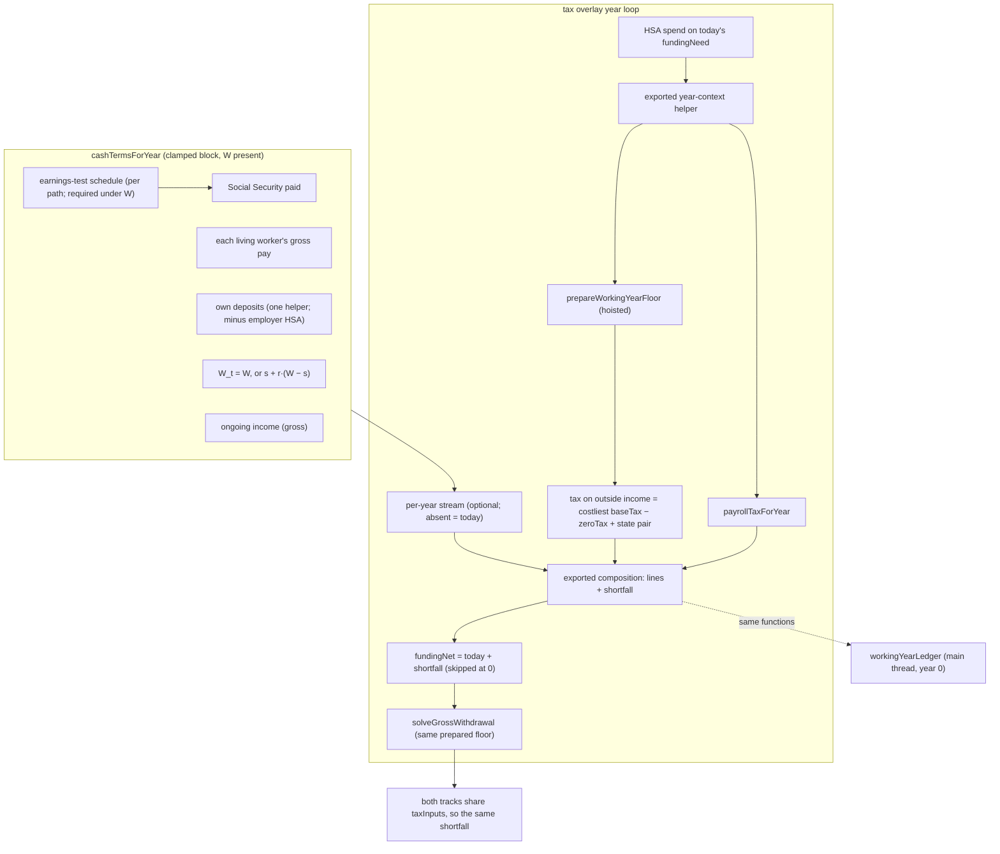
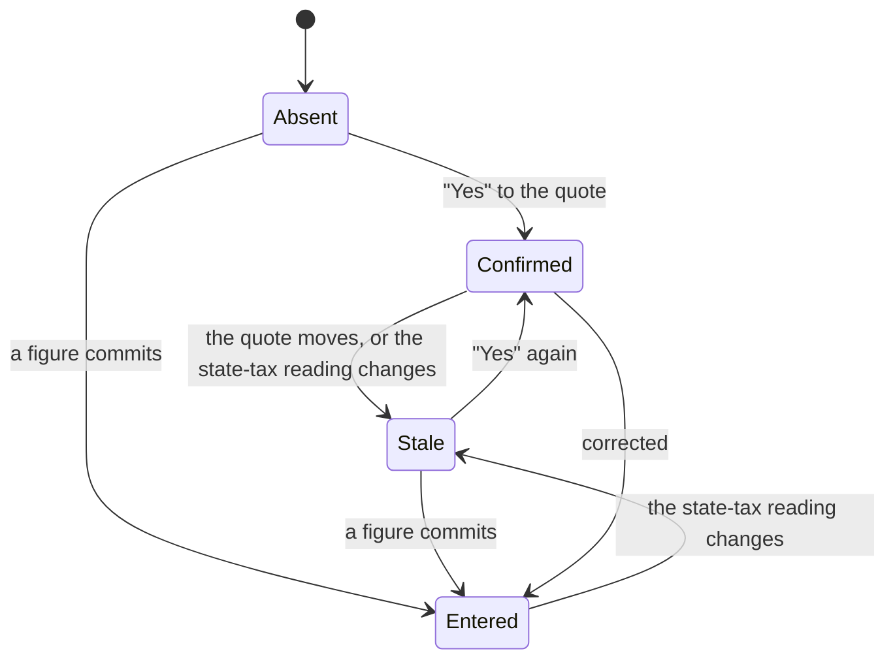

# feat: Check a working year's pay against what the household says a working year costs

## Summary

The household gives a new setup answer, W: what a year costs while someone still works. Once it does, every working year runs a real money check.
- **Money in:** gross pay, Social Security as actually paid after the earnings test, and pension or other income.
- **Money out:** federal payroll tax, the income tax the engine charges on that year's outside income, the household's own savings deposits, and W.
- **A shortfall** is drawn from savings through the household's own withdrawal order, the same on both tracks.

A household without W runs byte-identical to today, and on return it is asked for W before its answer is shown. A static year-0 money picture shows the check in the household's own numbers. The working-year methodology row is rewritten for a household that answered W.

---

## Problem Frame

The origin is the register's Tier 0 entry *A working year never checks the household's pay against its spending…* (`docs/backlog.md`). Its ⚑ MEASURED, ⚑ RULED and ⚑ NEGATIVE bullets are binding, except where KTD1, KTD11 and KTD12 record a reasoned refinement. The ruling is council `wf_2247c0df-73b` (7.5/10, executed; `docs/council-log.md` 2026-10-21). Briggsy's D7 (`docs/product.md` §4) is the rule it serves: use every number the household gave, ask for any number the engine needs and lacks, and say "nobody can know" only of markets, lifespans and future law.

**The gap today.** On the date route, `cashTermsForYear` (`src/engine/simulate.ts`) sets the year's draw to 0 whenever the accumulation construct is present and any living member works. This is the §7 clamp of `docs/decisions/accumulation-fuck-off-date.md`. The clamp assumes pay covers living costs, the tax on pay and every deposit, and nothing checks it. The intake holds pay and deposits, but it holds no working-year cost.

**What was measured** (b9-7, corrected by the council's red team):
- With everyone alive, no seed is short.
- One reachable short path-year exists, on `dip`, and all of it is the "Go-go years" retirement line charged at k = 0.
- The real rosy holes are households no seed models: health premiums taken from pay or bought directly, working-only costs, and a part-time earner beside a retired spouse.

**Why W is a new answer.** The Honesty Hawk vetoed a check fed by the k = 0 retirement budget: it invents gaps and misses costs that end when work ends. So the check runs only on a new answer.

**The primaries are read.** The council named two primaries as blockers. Both were read on 2026-10-21, and a skeptic confirmed every figure at two hosts:
- payroll: 26 U.S.C. §3101; Form 8959 instructions; IRS Topics 560 and 751; Pub 15 (2026); FR Doc 2025-19763;
- the earnings test: 42 U.S.C. §402(q)(7), §403(b) and (f); 20 CFR 404.412, .415, .428–.439; POMS RS 00615.482 / .490 and RS 02501.021 / .025 / .030 / .080 / .095; IRS Pub 915.

---

## Requirements

**The answer**
- R1. W is the household's yearly cost while anyone works, in today's dollars.
  - **Included:** every health premium paid while working, whether taken from pay or bought directly (Medicare excepted); local wage and earned-income taxes; state disability and family-leave payroll deductions; and any state income tax the engine does not charge on pay.
  - **Excluded:** the engine figures these itself, so W leaves them out. They are federal Social Security and Medicare payroll tax, federal income tax, the state income tax the engine charges on pay (NC today), savings deposits, and Medicare premiums.
- R2. Setup requires W on the date route through a confirm-or-correct question.
  - The question quotes the household's own figure in its own entry period.
  - The codec keeps W optional, and W never joins `missingRequiredFacts`.
- R3. The quote never includes a discretionary line that is windowed or starts later. Every other year-0 line counts, plus the out-of-pocket medical figure. The question names the lines it left out.
- R4. An answer goes stale when either of two things moves:
  - the quote it confirmed;
  - the state-tax reading it was given under (which state tax W must include).

  The engine keeps using the last figure the household gave. Every surface that can show a date says so (KTD21).

**The check**
- R5. In a clamped year with W present, the cash and the shortfall are:
  - cash = the living workers' gross pay + Social Security paid + ongoing income (gross) − federal payroll tax − tax on outside income − own deposits − W_t;
  - shortfall = max(0, −cash), added to `fundingNet` and drawn through the withdrawal order.
- R6. Tax on outside income is the working-year floor's costliest-reading `baseTax − zeroTax`, plus the charged state's `baseTax − zeroTax`. It is read from the one preparation the charge uses.
- R7. Own deposits are each living worker's credited deposits after `contributionsForYear`'s death and Medicare-onset filters. They exclude the employer match and the employer's HSA dollar.
- R8. Payroll tax per worker is 6.2 % of gross wages up to the wage base, plus 1.45 % of all wages. The return adds 0.9 % of its combined wages above its filing status's line, deflated by the price index.
- R9. On a survivor path, W_t = s + r·(W − s), where s = min(W, S). S is the survivor-sticky part of a working year:
  - budgetless: S = the out-of-pocket medical M, which reduces exactly to `budgetlessSurvivorSpending`;
  - budget: S = the every-year survivor-sticky lines + M.
- R10. Both tracks charge the same shortfall in working years.
- R11. The §7 clamp line and the `net` / `netFloor` formulas are untouched, and deposits stay as entered. In a W-present run their `ss` input carries the earnings test.

**Social Security as actually paid**
- R12. In a W-present run, a living person who works while entitled to a benefit before full retirement age has benefits withheld under the earnings test:
  - in calendar years wholly before the FRA year, $1 for every $2 above the lower exempt amount;
  - in the FRA year, $1 for every $3 of pre-FRA-month earnings above the higher amount, at KTD11's worst-case stopgap until the birth month is asked;
  - a worker's excess is charged by whole months against the family on their record;
  - a beneficiary's own excess is then charged against only their own remaining benefits.
- R13. Each withheld month is credited by recomputing that benefit's own reduction with the month removed:
  - retirement and spousal benefits at the payee's full retirement age;
  - a widow(er)'s benefit at 62 and at survivor FRA.
- R14. A survivor is tested on the survivor's own earnings, against the retirement full retirement age, and the deceased's earnings never reach the survivor's benefit.
- R15. Withheld benefits are never taxed. The one withholding reaches cash, taxable Social Security and IRMAA-MAGI together.

**The picture and the words**
- R16. A static year-0 money picture lists every R5 term that is nonzero. Social Security names any amount the test withheld. The lines sum to the bottom line to the dollar, and the picture names the first later working year whose lines change. It is computed by one engine producer and shown as a setup step and in the panel's W row. It is never `role=alert`, never shown by color alone, and is a `<dl>`.
- R17. With W answered, the working-year methodology row's two sentences are rewritten, with one stopgap key per open gap. Without W, today's sentence stays verbatim.

**Invariance and persistence**
- R18. With W absent, every run is byte-identical to today:
  - every existing test passes unedited, except the disclosure test that splits by arm;
  - every pricing-witness digest is unmoved;
  - no `ENGINE_PRICING_LEDGER` row is added, and `SOLVER_CODE_VERSION` stays 11.
- R19. W present requires the construct, `taxEnabled` and `healthcareEnabled`. W and S must be finite, 0 ≤ S and S ≤ W ≤ `ENGINE_MAX_DOLLAR`. A wiring fault fails loud.
- R20. A W-present vault is never re-priced silently. The `workingYears` figures carry their own vintage stamp and staleness clock (U13).

**Measurement and docs**
- R21. Every date seed and plant is measured before and after at both tiers, and two witness seeds are minted: one short, one stale. The pre-59½ shortfall-draw count is recorded. Every fixture is derived from outside the engine.
- R22. The product doc, architecture, the decision record, the register, the glossary and the roadmap say how a working year is modeled.

---

## Key Technical Decisions

- KTD1. **W keys everything new, the earnings test included.**
  - The council ruled "W absent ⇒ byte-identical."
  - No ledger family can name a working-year cash change or a retirement-year Social Security change. The register entry *The engine-pricing ledger cannot name…* holds that a reach never supplies a phrase.
  - A W-absent vault keeps today's two earnings-test errors (tax on withheld benefits, no FRA credit), and both run gloomy.
  - D7 is met by asking, not by re-pricing silently: every returning date-route vault without W is asked before its answer shows (U12).
  - Rejected: an earnings test that runs whatever W is (no family can name the move).
- KTD2. **W, S and the employer-HSA vector ride `DateSearchInput` and land on each candidate's rebuilt construct.**
  - `buildCandidateParams` (`src/engine/dateSearch.ts`) discards `overlay.accumulation` and rebuilds it. The rebuild carries `workingYearInvestmentByPerson` from the input, which is the floor's route.
  - Rejected: the base construct, which the rebuild drops silently.
- KTD3. **Setup requires W through an advance gate on the W step, never through `missingRequiredFacts`.**
  - A missing fact would hold every working household's provisional answer until the last question (the surface-early law in `src/intake/questions.tsx`).
  - It would also land every legacy vault on "Still needed".
  - The gate follows `src/intake/sanity.ts`'s blocked-advance shape.
- KTD4. **The answer is a top-level ScenarioV3 key**, `workingYearCost`, discriminated over a closed vocabulary `WORKING_YEAR_COST_KINDS` = `confirmed` | `entered`.
  - `confirmed` carries `quotedReal`, and `entered` carries `amountReal` plus its `entryPeriod`. Both carry the `stateTaxReading` the answer was given under (KTD18).
  - It follows the `MedicareExtrasEntryV3` and `heirBracket` precedents, and sits at the top level so it keeps its R7 seat.
  - The draft never holds a figure-less `entered`: the type-a-figure choice lives in component state until a valid figure commits. A panel clear keeps the last committed answer.
  - The vocabulary is closed. Build 2's surplus answer gets its own top-level key, never a new kind here.
  - Rejected: a live "same as spending" token (the Hawk's veto), and a bare number (staleness undetectable).
- KTD5. **The quote is one exported pure intake function**, which also returns S and the employer-HSA vector.
  - No budget: `annualSpendingReal`.
  - A budget: every line active at k = 0, plus M, except discretionary lines that are windowed or start later. A finite-ended essential (a mortgage ending at k = 5) stays in.
  - The question names the lines left out. If the quote is $0, the step asks for one figure.
  - It is quoted in the household's spend entry period. A budget household stays yearly, like its anchor line.
  - `dip` quotes $36,000: Home and Living, with "Go-go years" left out.
- KTD6. **The check splits by what each site knows.**
  - In `cashTermsForYear`'s clamped block, when W is present, compute:
    - wages per living worker;
    - Social Security paid;
    - ongoing gross income;
    - own deposits, through one exported helper that applies `contributionsForYear`'s death and Medicare-onset filters (the onset is passed as a new optional argument) and subtracts the employer-HSA vector, floored at 0;
    - W_t (R9).
  - Carry them on a new optional per-year stream beside `workingYearOutsideIncome`. `spending` and `spendingReal` never change.
  - The overlay adds payroll tax and the tax on outside income (KTD7). An exported pure composition function returns the lines and the shortfall. The overlay and the money picture both call it.
- KTD7. **The year loop's order, in `src/engine/taxOverlay.ts`.**
  - The HSA qualified spend stays sized on today's `fundingNeed`, without the shortfall: the HSA pays only qualified medical, and the out-of-pocket stream is window-gated to 0 in a clamped year.
  - Then come `stateMinLivingAge` and the floor preparation, hoisted.
  - Then the payroll tax and the composition.
  - Then `fundingNet` = today's expression + shortfall, with the addend skipped when the stream is absent or the shortfall is 0.
  - The gross-up context then carries the prepared floor into `solveGrossWithdrawal`, so the charge and the take-home read one preparation.
  - The floor depends only on year-constant inputs and never on `net`, and a clamped year never takes the ACA branch, so one preparation per pass is exact.
  - `totalTaxPaidReal` keeps meaning portfolio-funded tax. Payroll and pay tax ride inside the shortfall, by design.
- KTD8. **Tax on outside income is the costliest reading's `baseTax − zeroTax`, plus the state pair.**
  - It includes the extra taxable Social Security the pay drives, and the tax on the entered investment income I.
  - It never includes `zeroTax` (savings funds it) or the Medicare draw (already in `fundingNet`).
  - The per-pass charge picks its own costliest reading, so for every reading r, increment_r* ≥ increment_r and baseTax_r' ≥ baseTax_r. The household's total charge is therefore never below its full tax under any reading.
- KTD9. **Payroll tax is one pure producer**, `payrollTaxForYear(wagesByWorker, filing, calendarYear)`, in `src/engine/payrollTax.ts`.
  - Wages are gross pay. 401(k), 403(b) and 457(b) deferrals stay in payroll-tax wages (§3121(v)(1)(A); Pub 15).
  - The two 0.9 % lines, $250,000 married filing jointly and $200,000 single, are frozen nominal, and are divided by the same year's price index (insight 135). The engine has no married-filing-separately status.
  - The wage base is wage-indexed and held flat in real terms. The direction is disclosed: real wages grow, so pay above $184,500 is taxed slightly low (rosy).
  - Filing status is the regime's own filing status. Payroll tax never reduces the income-tax base (§275(a)(1)(A)).
- KTD10. **The earnings test is one pure, per-path producer**, in `src/engine/earningsTest.ts`.
  - **The calendar frame.** It works in the engine's calendar frame: sim-year t is calendar year `startCalendarYear + t`, and the attained age is that year minus the birth year.
  - **Charging.** It charges month by month over the chargeable months. The family on each earner's record goes first, keyed on the earner's FRA, never the payee's. Each beneficiary's own excess comes next, against only that beneficiary's remaining benefits. Partial months split on the unreduced basis (404.439).
  - **The survivor-year composition** (the deceased's realized claim, the locked start age, eligibility at 60, and max(own, survivor) with which one wins) is first extracted from `cashTermsForYear` into one exported helper that both call. An `Object.is` arm proves the extraction before any test logic lands.
  - **Crediting.** Each benefit has its own crediting entry:
    - worker and spouse: the private `reductionFactor` with n − credits;
    - widow(er): `survivorBenefitAnnual`'s linear 28.5 % arithmetic with monthsEarly − credits, RIB-LIM's larger-of kept ahead of it, credited at 62 and at survivor FRA, and counting only months before survivor FRA.
  - **Fast path.** A candidate where no living member is entitled before FRA while working gets the explicit no-test schedule, and its run is identical to W-absent.
  - **Every caller under W.** `cashTermsForYear` throws when W is present and no schedule is passed. The callers are:
    - the hot loop;
    - `survivorIncomeStepDownMonthlyReal`, with one schedule for the path's deaths and one for its both-alive counterfactual;
    - `survivorSpendingBasis`, with the no-death schedule (it reads only `spendingReal`, so its output cannot move);
    - the test seam `netWithdrawalForYear`;
    - the money-picture producer.
- KTD11. **The discretization's edges.**
  - **The FRA calendar year.** Without a birth month, that year's real 0–11 pre-FRA months cannot be placed. The stopgap is gloomy in both legs: withhold on the worst case (11 pre-FRA months of earnings above the higher amount at $1 per $3), and credit none of those months. It is pinned so the filed birth-month ask (a D7 build) sees it move.
  - **The first-year monthly test** (404.435) cannot change an annual answer. Work stops on a year boundary, so the last working year has 12 service months and every later year has no earnings.
  - **Wage indexing.** The exempt amounts are wage-indexed and held flat in real terms, disclosed as in KTD9.
  - **A worker who dies before FRA** never receives their own credit (404.412).
  - **RIB-LIM** reads the deceased's actual reduced benefit at death. Whether SSA uses a credited figure there is UNREAD. If it does, the survivor reads gloomy. It is filed.
- KTD12. **The year-0 money picture is one engine producer**, `workingYearLedger(input)`, computed on the main thread.
  - The ruling said "read from the wire". The setup step and the panel row must render from the draft before, or without, any sweep, and a W edit must redraw without one. The ruling is honored in substance: every line comes from the engine producer, and the UI computes nothing. The 'dates' outcome never carries a second picture.
  - It composes the exported pieces the overlay uses: `cashTermsForYear` with the schedule, `payrollTaxForYear`, and a new exported pure year-context helper extracted from the overlay's year loop. That helper returns the filing status, count65, the calendar year, the priced state and `minLivingAge` from the household, the living set and t. The year loop calls the same helper, and `resolveYear` stays private behind it.
  - It runs on the no-death timeline with the window top as Y (year 0 is identical for every Y ≥ 1).
  - It returns finite fields only (DND 009). The next change is the first t ≥ 1 whose composed lines differ from year 0 by more than a dollar, named by the line that moved. The payroll line's continuous drift from the deflated 0.9 % line is excluded.
  - Intake reads it through `intakeMap.workingYearLedgerForRun` (the `workingYearTaxForRun` try/catch-to-`'unknown'` shape). The read is called only while the money-picture step or the panel's W row is mounted, and is memoized on the draft reference.
  - A test pins the producer's year 0 against the overlay's own recorded year 0 on every W-carrying seed.
- KTD13. **The new figures go in a new constants table**, `src/engine/constants/workingYears.ts` (prefix `workingYears.`, year key `WORKING_YEARS_YEAR`).
  - It holds:
    - payroll: the OASDI rate and the wage base, the HI rate, and the two 0.9 % lines;
    - the earnings test: the two exempt amounts and its two rates.
  - Each figure is `sourced`, with its primary and a "read 2026-10-21" attestation.
  - The consumed-constants walk gets a family rule: the family is consumed iff the construct carries W (the `medicareExtrasTypical` presence refinement). WITNESS rows bind each key to `payrollTax.ts` or `earningsTest.ts`, and nothing joins the excluded set. No spine run carries W, so no recommendation's walk changes.
  - The table has its own vintage stamp and clock (U13).
- KTD14. **No pricing-ledger row and no solver bump.**
  - With W as the key, no saved vault's recompute moves (`pricingVersion.ts`: "a row that reaches no family … must not exist"). The W-absent byte-identity arms and the unmoved witness digests prove it.
  - The next change to the W-keyed path has no family that can name it. U11 files that obligation.
- KTD15. **The reach walk over-reads, on the safe side.** For a W-present input, any clamped year with a living worker reads priced by structure, with no schedule and no tax evaluation. This is recorded in the walk's residual paragraph. A W-absent input walks bit-identically to today.
- KTD16. **Validation.**
  - `validateParams`: W and S are finite, 0 ≤ S ≤ W ≤ `ENGINE_MAX_DOLLAR`, and the employer-HSA vector is aligned, finite and ≥ 0.
  - W present requires `taxEnabled` and `healthcareEnabled`. Medicare is the engine's to price, and only under healthcare.
  - `buildCandidateParams` throws on W over a tax-off base, mirroring its existing `taxEnabled` throw.
  - The overlay backstop mirrors the floor's R8 arms:
    - the stream without the marker or with tax off throws;
    - entry presence must equal the bridge mask;
    - a non-finite entry throws.
- KTD17. **The steps.**
  - The W step and the money-picture step follow other-income whenever `isDateRoute` holds, with no draft gate on the picture step. So the step count never moves while the household answers.
  - The picture step's terminal Continue is the new `onComplete` trigger.
  - The quoted figure sits in a slot above a static legend.
- KTD18. **The state-tax reading.** One exported predicate built over the state's base system (the classification `includeClampedBase` uses), never over roster membership:
  - federal-AGI-derived (NC): leave the state's income tax out of W;
  - class-based (PA): keep PA's tax on pay and any local wage tax in;
  - none (FL): nothing to leave out;
  - unpriced or unanswered: keep it in.
- KTD19. **Briggsy's words, shipped and flagged.**
  - The pilot drafts every new string: the W question and help, the picture's labels, the row rewrite, every stopgap line, the stale and not-yet-answered lines, the return-path ask, and the vintage clock's line. The Caddie walks them, and they ship flagged (the batched-oracle law).
  - They never say "conservative", never use `role=alert`, and never rely on color alone. No key starts with a verdict or control prefix.
  - The council's R27 reading also ships flagged: both tracks charge W in working years, and the essentials trim starts at the stop date.
- KTD20. **The pre-59½ count is a probe-only observation.** It counts the shortfall-attributable pre-tax draws by an owner under 60 in working years. 60 is the whole-year proxy for 59½, and it over-counts age 59. It is never put on the wire.
- KTD21. **Stale is never silent.** The engine uses the last figure the household gave (R4), and four surfaces say when it is stale:
  - the W step renders no option checked, with a calm note (`role="note"`) present before any tap;
  - the result shows a standing calm line that opens the panel's W row;
  - a panel commit that moves the quote opens the W row's re-confirm in the same edit;
  - on unlock, a `workingYearCostStale` exposure read adds a "worth a look" line to `anyStale`, never to `rulesMoved`.
- KTD22. **The return path asks (D7).**
  - A writable date-route vault whose built run lacks W meets the W question before its answer is revealed, as a step after the re-entry confirm.
  - "Not now" reveals today's W-absent answer, with a standing line saying the pay check has not run and pointing at the W row.
  - A read-only vault shows that line only.
  - This is a framing choice, shipped and flagged for him.

---

## High-Level Technical Design

One clamped year with W present:

The W answer:

The engine reads W in every state but Absent. Stale reads the last figure given, and KTD21's surfaces say so.

---

## Implementation Units

**Phase A** is engine only and inert in the app: nothing sets W until Phase B. The W-absent recompute spike stays its witness. **Phase B** is intake, persistence and UI, and goes live: U7, U8, U12 and U13 land together as one commit, because the draft-key compile gate and the R7 completeness walk tie them. **Phase C** covers seeds, measurement and docs.

### U1. The working-years constants table

- **Goal:** every payroll and earnings-test figure in one sourced, cited, roll-gated table.
- **Requirements:** R8, R12, R18, R20.
- **Dependencies:** none.
- **Files:**
  - `src/engine/constants/workingYears.ts` (new);
  - `src/engine/constants/index.ts` (registry, `ALL_CONSTANTS`);
  - `src/engine/constants/__tests__/constants.shape.test.ts` (the derived count);
  - `src/engine/validation/consumedConstants.ts` and `src/engine/validation/__tests__/consumedConstants.test.ts` (the family rule and WITNESS rows);
  - `src/engine/constants/__tests__/annualRoll.tripwire.test.ts` (`WORKING_YEARS_YEAR` in the partial-roll set);
  - `src/shared/__tests__/scaffold.smoke.test.ts` (the literal year pin).
- **Approach:** as KTD13.
  - Payroll: OASDI 6.2 %; wage base $184,500 (FR 2025-19763, Topic 751); HI 1.45 %; Additional Medicare Tax 0.9 % above $250,000 (married filing jointly) and $200,000 (single) (§3101(b)(2); the Form 8959 instructions).
  - Earnings test: $24,480 and $65,160, with rates 1/2 and 1/3 (§403(f)(3); FR 2025-19763).
  - Each frozen-nominal line says its consumer deflates it, and each wage-indexed figure states its real-flat direction.
- **Patterns to follow:** `src/engine/constants/tax.ts` (`sourced`, citations); the gate-honesty rule (a `PRIMARY_READ` attestation); the `medicareExtrasTypical` presence refinement in `consumedConstantEntries`.
- **Test scenarios:**
  - Every key has a citation, a boolean flag and a read attestation, and reads without throwing.
  - The registry count rises.
  - A spine run's consumed walk includes no `workingYears.` key, and a W-present date candidate's walk includes all of them.
  - Each key has its WITNESS row.
  - The tax table's content digest is unmoved.
  - A roll that skips `WORKING_YEARS_YEAR` reds the tripwire.
- **Verification:** shape, consumed, vintage and tripwire tests green; typecheck and lint clean.

### U2. The payroll-tax producer

- **Goal:** one pure function prices a year's federal payroll tax.
- **Requirements:** R8.
- **Dependencies:** U1.
- **Files:**
  - `src/engine/payrollTax.ts` (new);
  - `src/engine/__tests__/payrollTax.test.ts` (new);
  - `src/engine/__tests__/frozenNominalDeflation.test.ts` (the 0.9 % lines join the frozen-nominal roster).
- **Approach:**
  - Per worker: 6.2 % × min(wages, base) + 1.45 % × wages.
  - Per return: 0.9 % × max(0, Σ wages − line(filing) ÷ the year's price index).
  - Fail loud on a non-finite or negative wage, and on a filing status outside `'mfj' | 'single'`.
- **Execution note:** test-first. Every expected figure is typed from the IRS source.
- **Patterns to follow:** `taxableSocialSecurity`'s deflated-threshold signature (`src/engine/taxCore.ts`); the frozen-nominal test's closed-form `oracleIndex`; insight 137.
- **Test scenarios:**
  - **IRS fixtures.** Form 8959 instructions Example 5 (Erin $150,000, Frank $175,000, joint) gives 0.9 % × $75,000. The skeptic's couple ($190,000 and $90,000, joint) totals $21,349.00. A single survivor at $230,000 totals $15,044.00.
  - **Edges.** Wages exactly at the base; pay above it; one worker at $0; combined wages exactly at the line.
  - **Deflation.** In a later year the deflated line binds lower. The expected value uses `oracleIndex`, never `cumulativePriceIndex`.
  - **Errors.** A NaN wage, a negative wage, an unknown filing status.
- **Verification:** every fixture matches to the cent.

### U3. The earnings-test producer and the credits

- **Goal:** pay Social Security as the law pays it while someone works before full retirement age, and credit every withheld month on that benefit's own schedule.
- **Requirements:** R12, R13, R14, R15.
- **Dependencies:** U1.
- **Files:**
  - `src/engine/earningsTest.ts` (new);
  - `src/engine/socialSecurityBenefit.ts` (the credited entries for worker, spouse and widow(er));
  - `src/engine/simulate.ts` (the extracted survivor-year helper);
  - `src/engine/__tests__/earningsTest.test.ts` (new);
  - `src/engine/__tests__/socialSecurityBenefit.test.ts`;
  - `src/engine/__tests__/simulate.test.ts`.
- **Approach:** as KTD10 and KTD11. Land the survivor-year extraction first, with its `Object.is` arm.
- **Execution note:** test-first. The skeptic-verified worked example is the oracle.
- **Patterns to follow:** `reductionFactor`, `applyFactorAnnual` (dime rounding), `householdBenefits` and `survivorBenefitAnnual` in `src/engine/socialSecurityBenefit.ts`.
- **Test scenarios:**
  - **The research worked example.** The worker is $1,500 at 62 (PIA ≈ $2,142.86) and the spouse $700, with $60,000 of wages in 2026:
    - excess $17,760;
    - January–August fully withheld, September partial at $160, split $1,360 / $680;
    - cash paid $8,640;
    - 9 crediting months each;
    - over five years, the credits give about $1,964 and $959.
    - Figures are re-derived under the engine's dime rounding, with the difference stated.
  - **Dual-earner spouse.** She has her own benefit plus a spousal excess, and the husband's excess exceeds the family total. His excess withholds his benefit and her spousal excess only. Her own benefit is paid unless her own excess reaches it.
  - **Two earners.** The worker's excess takes the family first. The spouse's own excess then takes only her remaining benefits (the POMS RS 02501.095 B.4 shape).
  - **Age gap.** A spouse past FRA, on a younger worker's record, loses months to his excess and earns no credit.
  - **The FRA calendar year.** A 1960+ person in the year they attain 67 is withheld at the worst-case stopgap and credited nothing for it. A year wholly before uses the lower amount at 1-for-2.
  - **Survivor.**
    - The worker's earnings never reach the widow(er)'s benefit.
    - A working survivor before FRA is tested on her own wages.
    - A survivor who started at 60 and works to 65 is credited on the linear 28.5 % schedule, with a credit landing at 62.
  - **Death before FRA.** The worker never receives their own credit, and RIB-LIM reads the uncredited benefit.
  - **Forgiven excess.** Excess beyond the year's chargeable benefits is forgiven, never carried.
  - **Fast path.** No early claim while working gives the no-test schedule.
  - **Extraction.** The survivor-year helper's extraction is `Object.is`-identical across a seeded survivor sweep.
  - **Errors.** A non-finite wage or benefit fails loud.
- **Verification:** every fixture is typed from the statute and regulation arithmetic, and the producer is pure.

### U4. W plumbing and validation

- **Goal:** W, S and the employer-HSA vector reach every candidate, and a bad input is refused before any run.
- **Requirements:** R18, R19.
- **Dependencies:** none.
- **Files:**
  - `src/shared/model.ts` (`AccumulationParams`: `workingYearCostReal?`, `workingYearStickyReal?`, `employerHsaByPerson?`);
  - `src/engine/dateSearch.ts` (`DateSearchInput`, `buildCandidateParams` landing and its tax-off throw);
  - `src/engine/simulate.ts` (`validateParams`);
  - `src/engine/__tests__/simulate.test.ts`;
  - `src/engine/__tests__/dateSearch.test.ts`.
- **Approach:** as KTD2 and KTD16. Spread each field only when present.
- **Patterns to follow:** `workingYearInvestmentByPerson`'s landing, and its R19 arm.
- **Test scenarios:**
  - W, S and the vector land on every Y ≥ 1 candidate, and are absent when the input lacks them.
  - W on the base construct is dropped. This pins the landmine.
  - `validateParams` refuses:
    - NaN, a negative value, or a value above the cap, for W or S;
    - S > W;
    - a misaligned or negative employer-HSA vector;
    - W with tax off, or with healthcare off.
  - It accepts W = 0 with S = 0.
  - `buildCandidateParams` throws on W over a tax-off base.
  - The Y = 0 candidate equals its construct-dropped twin with W present.
- **Verification:** with no producer reading W yet, every existing test stays green unedited.

### U5. The check: stream, shortfall, both tracks

- **Goal:** a W-present clamped year draws its real shortfall, and a W-absent run is unchanged to the bit.
- **Requirements:** R5–R11, R15, R18, R19.
- **Dependencies:** U2, U3, U4.
- **Files:**
  - `src/engine/simulate.ts` (the clamped block, the required schedule, the own-deposit helper, the stream, `taxInputs`, `survivorIncomeStepDownMonthlyReal`'s schedules);
  - `src/engine/taxOverlay.ts` (the year-context helper, KTD7's order, the composition, the backstop, the probe-only observation hook);
  - `src/engine/dateSearch.ts` (KTD15);
  - `src/engine/__tests__/simulate.test.ts`, `taxOverlay.test.ts`, `dateSearch.test.ts`;
  - `src/engine/__tests__/pricingWitness.test.ts`.
- **Approach:** as KTD6–KTD10 and KTD15.
- **Execution note:** extract the year-context helper and reorder the loop first, then run the full suite. The reorder alone must be byte-identical, with `fundingNeed` pinned unchanged, before any new term lands.
- **Patterns to follow:** the floor's presence spread under accumulation ∧ `taxEnabled`; its R8 cross-checks; the `healthOut` observation sink.
- **Test scenarios:**
  - **W absent.** Every existing simulate, overlay, dateSearch, devSeeds and golden test passes unedited. A per-path `Object.is` holds across the new code path. The witness digests are unmoved.
  - **W present, no shortfall, no early claim.** The run is per-path `Object.is` to W-absent (the fast path plus the skipped addend).
  - **W present and short.** A one-earner household ($40,000 pay, $35,000 W, $6,000 own deposits) draws a hand-computed shortfall. Its draw's tax rides the floor's increment, and both tracks draw the same.
  - **Own deposits.** An owner with $1,000 of employer HSA and $3,000 of own HSA is charged $3,000. A member past Medicare onset deposits no HSA. The match is never charged.
  - **No double counts.** A retired, enrolled spouse's Medicare stays its own `fundingNet` term, never in the shortfall. `zeroTax` is never subtracted.
  - **Survivor W.** On `dip`'s figures (Home $20,000 sticky, Living $16,000, r = 0.75), a budget survivor year charges $32,000, never $27,000. A budgetless M household charges m + r(W − m). S > W clamps to W.
  - **Survivor step-down.** In a W-present `runTwoArm` with an early claim while working, `incomeStepDownMonthlyReal` equals the step-down composed on the same per-path schedules.
  - **Hoisted floor.** It is prepared exactly once per clamped year per `runTaxAwareDecumulation` pass, so a budget run sees two per path-year. The charge and the take-home read the same object.
  - **Wiring faults.** W present with no schedule throws. The stream without the marker, the stream with tax off, an entry without a masked year and a non-finite entry each throw.
  - **Reach walk.** A W-present input with any clamped year reads priced. A W-absent input stays bit-identical (the existing `dateSearch.test.ts` arm).
  - **Convergence.** The gross-up converges, with the stress sweep sampling W and S.
- **Verification:**
  - The W-absent suite is green unedited, and the W-present arms are green.
  - Final-tier wall time on a W-present `dip` with an early claim while working stays within +10 % of today's measured figure.
  - A W-present arm of the unlock recompute spike records its time beside the W-absent arm, which stays unchanged.

### U6. The year-0 money picture producer

- **Goal:** one engine function returns year 0's lines and the next change.
- **Requirements:** R16.
- **Dependencies:** U5, U7.
- **Files:**
  - `src/engine/workingYearLedger.ts` (new);
  - `src/shared/model.ts` (the result type, finite fields only);
  - `src/intake/intakeMap.ts` (`workingYearLedgerForRun`);
  - `src/engine/__tests__/workingYearLedger.test.ts` (new);
  - `src/intake/__tests__/intakeMap.test.ts`.
- **Approach:** as KTD12. The lines are pay, Social Security paid (with any amount withheld), other income, federal payroll tax, tax on outside income, own deposits, W, and left over or short.
- **Patterns to follow:** `workingYearTaxForRun` (a main-thread engine read, try/catch to `'unknown'`).
- **Test scenarios:**
  - On every W-carrying seed, year 0 equals the overlay's recorded year 0 through the observation hook.
  - The lines sum to the bottom line to the dollar, on every date seed and on the short seed.
  - A 63-year-old with a 60–63 catch-up returns the year the deposit steps down, with the deposits reason.
  - A household with no change in the window returns none.
  - A W-absent or unbuildable draft returns `'unknown'`.
  - Every field is finite.
- **Verification:** the cross-check and sum tests are green on every W-carrying seed.

### U7. Model and codec

- **Goal:** the W answer persists and round-trips, with its R7 seat.
- **Requirements:** R2, R4, R18.
- **Dependencies:** U4. It lands with U8, U12 and U13.
- **Files:**
  - `src/shared/model.ts` (`workingYearCost`, `WORKING_YEAR_COST_KINDS`, `SCENARIO_V3_FIELDS`);
  - `src/shared/scenarioCodec.ts` and `src/shared/__tests__/scenarioCodec.test.ts`;
  - `src/store/memoryModel.ts` (the optional `Pick`, no seed);
  - `src/ui/assumptionRegistry.ts` (`DRAFT_DISPOSITIONS` row-editable, the new seat);
  - `src/intake/intakeMap.ts` (`buildDateInput` carries W, S and the employer-HSA vector through the KTD5 function).
- **Approach:** as KTD4. No schema version bump (the tolerant reader; the `heirBracket` precedent).
- **Patterns to follow:** `heirBracket` (`2816d036`); `MedicareExtrasEntryV3`; `needVocab`.
- **Test scenarios:**
  - Each kind round-trips through the codec.
  - Absent decodes as absent.
  - The null sweep turns a null field into a corrupt result.
  - Refused:
    - an unknown kind;
    - a kind missing its figure;
    - a stray figure on the wrong kind;
    - a negative or non-finite figure;
    - a confirmed `quotedReal` ≤ 0;
    - an unknown `entryPeriod` or `stateTaxReading`.
  - `buildDateInput` carries the fields only when W is present, and a legacy draft builds byte-identically.
  - A panel clear never deletes `workingYearCost`.
- **Verification:** codec, memory-model and registry tests green.

### U8. The question, the money-picture step and the panel row

- **Goal:** setup asks W and shows the money picture, and the panel lets the household answer, correct or re-confirm W.
- **Requirements:** R1–R4, R16, R17.
- **Dependencies:** U6, U7.
- **Files:**
  - `src/intake/questions.tsx` (`workingCostStep` and `workingLedgerStep` after `otherIncomeStep`; the last-step comment);
  - `src/intake/workingYearQuote.ts` (new, KTD5, with the KTD18 predicate);
  - `src/intake/sanity.ts` (the advance gate and a W period rule mirroring `spend-period-unconfirmed`);
  - `src/intake/WorkingYearLedger.tsx` (new);
  - `src/intake/AssumptionPanel.tsx` (the W row);
  - `src/ui/Result.tsx` (the standing stale line);
  - `src/ui/copy.ts`;
  - `src/intake/intake.css`;
  - tests: `src/intake/__tests__/questions.test.tsx`, the sanity test beside `sanity.ts`, `workingYearQuote.test.ts`, `WorkingYearLedger.test.tsx`, `assumptionPanel.test.tsx`;
  - `src/ui/__tests__/copyGuard.test.ts` (a slot render sample for each new slot);
  - `e2e/vertical-fit.spec.ts` and `e2e/caddie-walk.spec.ts` (an intake target that reaches both steps).
- **Approach:** as KTD5, KTD12, KTD17, KTD18, KTD19 and KTD21.
  - **The question.** "Yes", or one figure (a `CurrencyField` with the period control in a reserved slot).
  - **The help.** It names what to include and what the tool figures, by the KTD18 reading.
  - **The gate.** It blocks Continue while W is unanswered or stale.
  - **The money picture.** A `<dl>` whose heading reads the plan clock through `planClockAnchor`. An aged vault says it shows the plan's first working year as entered, and a change year past the crowned date is worded conditionally. "Short" carries the word and a minus sign. "Left over" carries the build-2 stopgap line.
  - **The `'unknown'` face.** No `<dl>` and no zeros: one calm line naming the missing facts or the refusal. Continue still advances.
- **Patterns to follow:**
  - `SpendStepBody`'s two faces;
  - the spend-period force-confirm and `medicare-extras-entered-blank`;
  - the `<dl>` in `src/ui/ReEntry.tsx`;
  - the `work-investment` panel row and its `onCommitEdit` → `recomputeBoth` path;
  - the reserved-height `.not-saved-note`.
- **Test scenarios:**
  - **The quote.** Budgetless quotes the spending figure in its period. `dip` quotes $36,000 and names "Go-go years". An essential "Mortgage" line (start 0, end 5) is in. A discretionary "Travel" line (start 0, end 3) is out. A budget with no k = 0 lines asks for a figure.
  - **The help.** A PA draft says to keep PA's tax in, an NC draft says to leave it out, and an unpriced state says to keep it in. Every draft names directly-bought health plans and local wage taxes.
  - **The period.** 9,000 typed under the unconfirmed month default blocks Continue until a period is tapped. 7,000 under the month default stores 84,000 a year.
  - **The steps.** Both appear on the date route only, after other-income, and the step count is unchanged when W is answered. Flipping every worker to retired removes both.
  - **Stale.**
    - Editing spending after confirming makes the step stale: no radio is checked, the note is present before the first tap, and tapping "Yes" writes the new `quotedReal`.
    - An entered figure goes stale only when the state-tax reading changes.
    - After the reveal, raising spending shows the standing line on the result, and re-confirming clears it.
  - **The `'unknown'` face.** It renders the calm line with no `<dl>`.
  - **Accessibility.** The picture is a `<dl>` with header terms, with no `role="alert"` and no live region, and "Short" reads with color stripped.
  - **Copy guard.** Every new key and slot passes the universal gates, the curly apostrophe and the banned words.
- **Verification:**
  - green unit tests;
  - `verify:fit` arms for both steps at 1536×791 and at PHONE, including the `datesolo` re-walk's `'unknown'` face;
  - a Caddie walk of both steps, the panel row and the stale line, with the card filed;
  - `verify:bundle` entry bytes recorded before and after, within an 8 KiB allowance (the copy catalog ships in entry JS), with the engine modules confirmed outside the entry graph.

### U9. The methodology row, by arm

- **Goal:** a household with W reads the rewritten row with one stopgap line per open gap, and a household without W reads today's row.
- **Requirements:** R17.
- **Dependencies:** U4, U7.
- **Files:**
  - `src/ui/assumptionRegistry.ts` (`MethodologyDisclosure` gains an armed variant);
  - `src/intake/intakeMap.ts` (`workingYearCostForRun(d)`, the `workingYearTaxForRun` shape);
  - `src/intake/AssumptionPanel.tsx`;
  - `src/ui/copy.ts`;
  - `src/ui/__tests__/workingYearTaxDisclosure.test.ts`.
- **Approach:**
  - **Rewrite.** It covers the row's two sentences: the check now runs on their figure, and a short year is drawn from savings.
  - **Stopgap keys**, one per open register gap, each naming its direction:
    - the 10 % charge on a shortfall drawn before 59½ (rosy);
    - left-over pay not saved (build 2);
    - state tax where they work;
    - the FRA year's worst-case stopgap (gloomy, until the birth month is asked);
    - self-employment and jobs outside Social Security;
    - health premiums and HSA money taken before tax;
    - the §219(g) IRA phase-out (rosy);
    - the Roth-only catch-up (rosy);
    - the surtax on investment income, NIIT (rosy);
    - the widow(er) RIB-LIM read.
  - The build that closes a gap deletes its key.
- **Patterns to follow:** `METHODOLOGY_DISCLOSURES`; the test's `rowStrings` and census sweeps.
- **Test scenarios:**
  - The W-absent arm renders today's `assumptionWorkingYearTaxValue` verbatim, and its R13 pin holds.
  - The W-present arm renders the rewrite and every stopgap key.
  - Both arms pass the census and the banned-word sweep.
  - The arm comes from the built run, never the draft (insight 132).
- **Verification:** the disclosure test is green on both arms.

### U10. Seeds, measurement, pins and the walk

- **Goal:** the seeds exercise the check, two witnesses run short and stale, and every moved pin moves by measurement.
- **Requirements:** R18, R21.
- **Dependencies:** U5, U8.
- **Files:**
  - `src/ui/devSeeds.ts`:
    - W, built through the exported KTD5 function and never a typed `quotedReal`, on `stillWorking`, `stillWorkingBorderline`, `dateDipSeed` and `stillWorkingAllMedicare`;
    - re-confirmed own quotes where `datesplit` and `datemixed` override the budget or M;
    - a short-household seed and a stale-W seed;
    - `doctorStaleVault` strips W beside its pre-extras strip (insight 079);
    - the stale comments at the `dateborder` and `datemixed` docblocks;
  - `src/ui/__tests__/devSeeds.test.ts`;
  - `e2e/vertical-fit.spec.ts`;
  - `e2e/chart-text.spec.ts`;
  - `e2e/intake-fold.spec.ts` (the arrival floor raised to `datesolo`'s new count, and the nav-yield rationale re-anchored on the new terminal step);
  - the pay-check probe, re-pointed off the dead scratchpad.
- **Approach:**
  - **Every date seed and plant is accounted for:** `date`, `dateborder`, `datesplit`, `datemixed`, `dip`, `date65`, `datenc`, `datesolo`, `atceiling`, `datearrived`, `datestale`. Each is measured before and after at both tiers.
  - **The prediction**, written before the run:
    - with W equal to its quote, no seed's everyone-alive working year goes short;
    - `dip`'s quote is $36,000, so its one reachable short path-year disappears, and its crown moves at most one year earlier, through the credit and the untaxed withheld benefit;
    - every other seed's crown is unchanged, because no one claims before FRA while working on its everyone-alive paths.
  - **`datearrived`.** Re-run its existing pins after W lands on `dip`, and re-measure its "byte-identical with and without the birth-year shift" docblock (insight 085).
  - **The pre-59½ count.** Through the probe hook, per seed and tier.
- **Patterns to follow:** the seed re-tune law; insight 141 (only deaths the engine draws).
- **Test scenarios:**
  - Every W-carrying seed reads not stale.
  - Each crown and offset pin holds, or moves with the measurement recorded in its docblock.
  - The short seed draws on every working path-year, and its picture reads "Short".
  - The stale seed shows the stale step, line and row.
  - `datestale` is byte-identical to its pre-build recompute.
  - The probe's engine-independent formula matches year 0 on every seed (DND 012).
- **Verification:**
  - the full gate: typecheck, lint, test, `verify:doc-stats`, build and `verify:bundle`;
  - `verify:fit` and `verify:fit:rv`;
  - the Caddie card filed.

### U11. Docs and the register

- **Goal:** every doc says how a working year is modeled now, and every gap this build leaves is filed.
- **Requirements:** R22.
- **Dependencies:** U10.
- **Files:**
  - `docs/product.md`;
  - `docs/architecture.md`: §4 (the stream and the schedule argument), §6 (the W arms), §7.4 (the check and both tracks), §7.7 (the earnings test, credits and survivor test), §8 (the new table and its clock);
  - `docs/decisions/accumulation-fuck-off-date.md` (amend §7);
  - `docs/glossary.md`;
  - `docs/roadmap.md` (You-Are-Here);
  - `docs/backlog.md`;
  - `README.md`;
  - `TODO.md`.
- **Approach:**
  - **Close or amend:**
    - the pay-check entry: built, with the survivor-W refinement (KTD6) and the main-thread picture (KTD12) recorded against the ⚑ RULED bullet;
    - the earnings-test entry: built under W, with the legacy residual;
    - the surplus entry: the shortfall half is built;
    - the §219(g), Roth-only catch-up and NIIT entries: re-tiered by their new cash reach;
    - *The engine-pricing ledger cannot name…*: the W-keyed check is a third unnameable channel, and the first post-ship change to it must mint a family first.
  - **File:**
    - the birth-month ask;
    - jobs outside Social Security;
    - self-employment;
    - health premiums and HSA money taken before tax (payroll and income tax);
    - the RIB-LIM × credit read;
    - bracket-fill's working-year ceilings ignoring pay (a gloomy allocation residual);
    - the wage-indexed figures' real drift;
    - an old cached build opening a W-present vault.
  - **Record:** the pre-59½ count on the dissent.
- **Test expectation:** none. The work is docs-only, gated by `verify:doc-stats`.
- **Verification:** `verify:doc-stats` is green, and the register's header count matches its body.

### U12. The return path asks

- **Goal:** a returning date-route vault without W is asked before its answer is revealed (D7).
- **Requirements:** R2, R17.
- **Dependencies:** U7, U8. It lands with them.
- **Files:**
  - `src/intake/IntakeApp.tsx` (the step after the re-entry confirm);
  - `src/ui/ReEntry.tsx` or the unlock flow it hands to;
  - `src/ui/Result.tsx` (the "not yet answered" standing line);
  - `src/ui/copy.ts`;
  - tests: `src/ui/__tests__/reentry.test.tsx` and an `IntakeApp` arm.
- **Approach:** as KTD22. "Not now" reveals today's W-absent answer with the standing line. A read-only vault shows the line only. W stays out of `missingRequiredFacts`.
- **Test scenarios:**
  - A writable W-absent date vault meets the question before the verdict.
  - A W-present vault does not.
  - "Not now" reveals the byte-identical W-absent answer with the standing line.
  - Answering re-runs with W.
  - A spine vault never sees the question.
  - A read-only vault shows the line only.
- **Verification:** green tests, and a `?vault=datestale` Caddie walk.

### U13. The working-years vintage clock

- **Goal:** a W-present vault is never re-priced silently when the `workingYears` figures change.
- **Requirements:** R20.
- **Dependencies:** U1, U7. It lands with them.
- **Files:**
  - `src/shared/model.ts` (an additive-optional `workingYearsVintage` on `DateVintageV3`);
  - `src/engine/constants/index.ts` (`dateVintageStamp()` mints it);
  - `src/shared/scenarioCodec.ts` (`checkDateVintageV3` arm: absent means not comparable);
  - `src/store/staleness.ts` (the clock and its exposure read: W present on the built date input);
  - `src/ui/stalenessExposure.ts` (also `workingYearCostStale`, KTD21);
  - `src/engine/constants/__tests__/vintageStamps.test.ts` (a content-digest pin binding the table to the stamp);
  - `src/store/__tests__/staleness.test.ts`;
  - `src/ui/copy.ts` (the clock's line).
- **Approach:** follow the date and state vintage clocks. No doctor ages the new stamp; that is filed as a cold-read gap, matching the contribution clock's.
- **Test scenarios:**
  - A W-present vault saved under an older stamp names the clock's line on unlock.
  - A W-absent vault never does.
  - A changed table value under an unchanged stamp reds the digest pin.
  - A vault saved stale on its W answer shows the "worth a look" line, never a rules-moved line.
- **Verification:** staleness and vintage tests green.

---

## System-Wide Impact

- **Cardinal rule.** The check closes the rosy channel a short working household reads today. Its remaining simplifications are named with their directions. The rosy ones are:
  - the 10 % charge;
  - the wage base held flat;
  - the §219(g) IRA phase-out;
  - the Roth-only catch-up;
  - NIIT on the entered investment income.

  Each gets a stopgap line and a register entry. The FRA year runs a gloomy stopgap.
- **Consumers of the moved values:**

  | Consumer | Treatment |
  |---|---|
  | Hot loop, both tracks | The shared `taxInputs` |
  | IRMAA-MAGI history | Picks up the shortfall's pre-tax share automatically, through the converged components (R15) |
  | Bracket-fill ceilings | Ignore pay in working years: a gloomy allocation residual, filed |
  | TwoFutures / Roth preview | Inherits W through `buildCandidateParams`; both arms carry the same shortfall, independent of conversions; the survivor step-down gets its schedules |
  | Date band and 'dates' outcome | Through the candidates |
  | Reach walk | KTD15 |
  | Staleness reads | Unchanged when W is absent; U13 and KTD21 add their own |
  | Health readout, health sheet, survivor card | Spine-only, so they never see W |
  | ACA-MAGI | Unreachable in a clamped year (the bridge-year throw) |
- **Saved vaults.** None re-prices in this build. A legacy date vault is asked on return (U12). A W-present vault is guarded by U13 and KTD21.
- **Performance.** Per path, at most 10 years × 12 months × 2 people, plus the credit recompute. The fast path skips every candidate with no early claim while working. U5 sets the pass/fail bar.
- **The recommendation.** Untouched: the solver and the spend solve run only on the all-retired spine.

---

## Risks & Dependencies

| Risk | Mitigation |
|---|---|
| The earnings test's month charging is intricate, and a wrong split moves cash silently | Test-first on the skeptic-verified example; the dual-earner, age-gap and survivor fixtures; a mutation pass in the whole-file review |
| The loop reorder perturbs W-absent runs | The reorder lands alone, with the full suite and `fundingNeed` pinned before any new term (U5) |
| The picture drifts from the overlay | Shared helper and composition; year 0 pinned to the overlay's recorded year 0; the lines-sum test |
| The quote imports a retirement-only line, or drops a running essential | KTD5's tier rule, pinned on `dip` plus the mortgage and travel fixtures |
| A stale answer drives a date silently | KTD21's four surfaces and U13's clock |
| Entry-JS growth from the copy catalog | Bytes recorded before and after; an 8 KiB allowance; engine modules kept out of the entry graph |
| An old cached build opens a W-present vault and shows the W-absent date | Filed with `pricingVersion.ts`'s stated old-build residual (U11) |

---

## Scope Boundaries

**In scope:** the council's build-1 shape, plus the earnings test, payroll tax, the return-path ask and the vintage clock it requires.

### Deferred to Follow-Up Work

- Build 2, the surplus question.
- The 10 % early-withdrawal charge (queue 1(b)), informed by the pre-59½ count.
- Asking the birth month, which replaces KTD11's stopgap.
- Asking the state they work in.
- Self-employment tax, and jobs outside Social Security.
- Health premiums and HSA money taken before tax.
- Pay as one steady figure.
- Pricing PA's wage tax in the engine. W carries it until a primary read of 61 Pa. Code §101.6 settles the deferral base.
- "How we got here" (queue item 2), which reuses U6's producer.

### Not this build

- Cutting deposits to cover a shortfall.
- A setup flag in place of the draw.
- Feeding the k = 0 composition to any draw.

---

## Open Questions

These are words and framing, shipped and flagged under the batched-oracle law; none blocks the build:
- every new string;
- the return-path ask's "Not now";
- the R27 reading;
- the main-thread picture (KTD12) as an amendment of the ⚑ RULED "read from the wire".

---

## NEGATIVEs (binding)

- Never cut a deposit to cover a shortfall.
- Never let the k = 0 retirement spending feed a working-year draw.
- Never add a new market draw.
- Never compute the tax on pay in the UI, or twice.
- Never default an unanswered surplus to "spent".
- Never write "conservative" in a disclosure.
- Never restore the gross-pay subtraction.
- Never key the clamp on a value.
- Never quote a windowed or later-starting discretionary line as working-year cost.
- Never put W on the base construct, or in `missingRequiredFacts`.
- Never split the existing `hsa` stream (W-absent byte-identity).
- Never use `budgetlessSurvivorSpending` alone on a budget household.
- Never count pensions, investment income or Social Security as earnings under the test.
- Never charge a survivor's benefit for the deceased's earnings.
- Never quote a 2027 exempt amount or wage base before the 2027 Federal Register notice is read.
- Never let the 'dates' outcome carry a second picture.

---

## Sources & Research

- **The council:** `docs/council-log.md` 2026-10-21 and the register's ⚑ RULED bullet. The 2026-07-02 council's veto of ratio-on-total survivor spending grounds R9.
- **Primary reads (2026-10-21)**, each confirmed by a skeptic at two hosts:
  - FR Doc 2025-19763 (90 FR 49047);
  - 26 U.S.C. §3101(a)–(b), §3121(v)(1)(A), §275(a)(1)(A);
  - the Form 8959 instructions (Example 5; "aren't indexed for inflation"); IRS Topics 560 and 751; Pub 15 and Pub 15-B (2026);
  - 42 U.S.C. §402(q)(7)–(9), §403(b), (f);
  - 20 CFR 404.410, .412, .415, .428, .429, .430, .434, .435, .437, .439;
  - POMS RS 00615.482 / .490 and RS 02501.021 / .025 / .030 / .080 / .095 / .120;
  - Pub 915 (boxes 3–5); §86(d)(2)(A).
- **Code anchors:**
  - `src/engine/simulate.ts`: `cashTermsForYear`, `contributionsForYear`, `validateParams`, `survivorIncomeStepDownMonthlyReal`, `budgetlessSurvivorSpending`;
  - `src/engine/taxOverlay.ts`: `prepareWorkingYearFloor`, `workingYearFederalCharge`, `fundingNet`, `resolveYear`;
  - `src/engine/dateSearch.ts`: `buildCandidateParams`, `workingYearTaxReachOfRun`;
  - `src/engine/socialSecurityBenefit.ts`: `reductionFactor`, `householdBenefits`, `survivorBenefitAnnual`;
  - `src/intake/intakeMap.ts`: `buildDateInput`, `isDateRoute`, `workingYearTaxForRun`;
  - the budget helpers: `isActiveAt`, `isRampedBudget`, `isSurvivorSticky`.
- **The precedent plan:** `docs/plans/features/working-year-tax-floor-build-spec.md`.
- **Insights:** 027, 029, 076, 079, 081, 085, 132, 135, 137, 141, 143.
