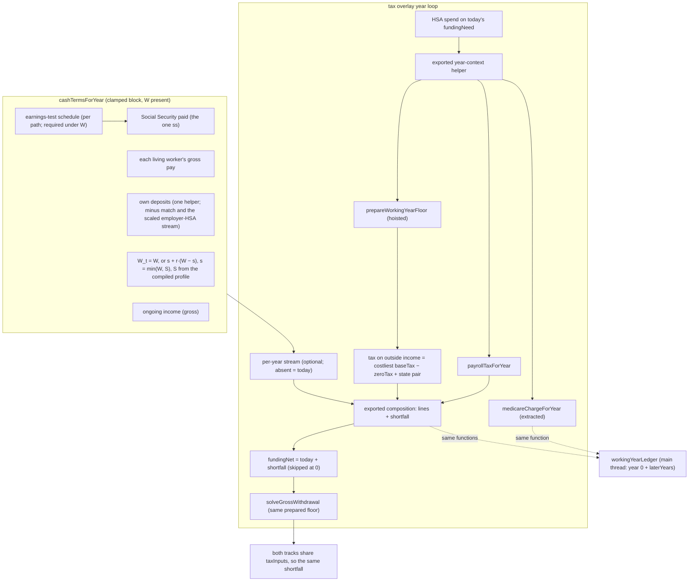
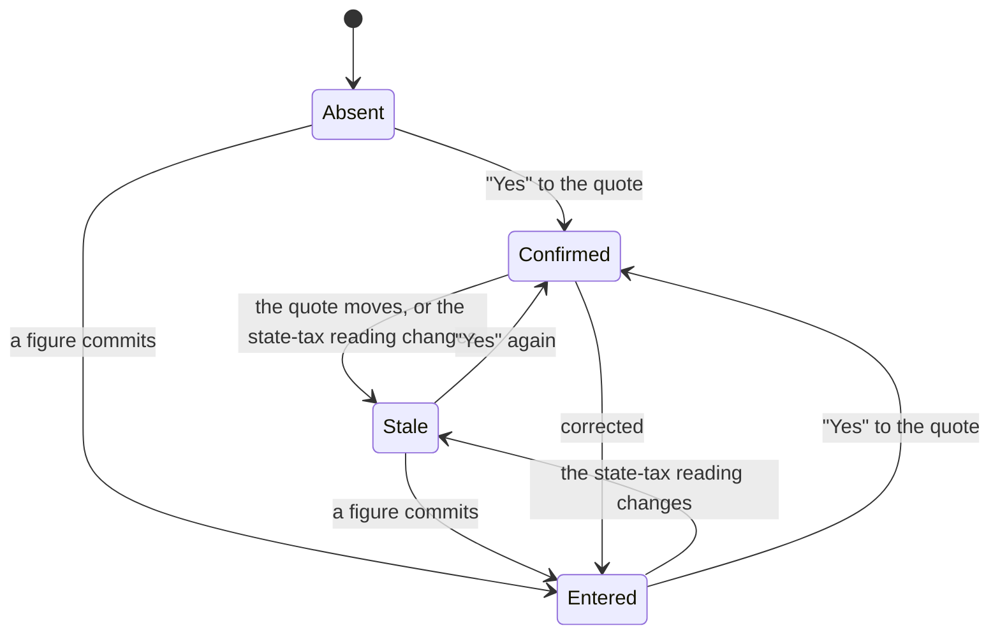

# feat: Check a working year's pay against what the household says a working year costs

## Summary

The household gives a new setup answer, W: what a year costs while someone still works. Once it does, every working year runs a real money check.
- **Money in:** gross pay, Social Security as actually paid after the earnings test, and pension or other income.
- **Money out:** federal payroll tax, the income tax the engine charges on that year's outside income, the household's own savings deposits, and W.
- **A shortfall** is drawn from savings through the household's own withdrawal order, the same on both tracks.

A run without W is byte-identical to today. Setup requires W on the date route, and nobody has used the product yet, so every real date plan will carry it from its first save (KTD22). A year-0 money picture shows the check in the household's own numbers, and names every later working year that changes or runs short. The working-year methodology row is rewritten for a household that answered W.

---

## Problem Frame

The origin is the register's Tier 0 entry *A working year never checks the household's pay against its spending…* (`docs/backlog.md`). Its ⚑ MEASURED, ⚑ RULED and ⚑ NEGATIVE bullets are binding, except where **Departures from the ruling** (below) records a reasoned refinement. The ruling is council `wf_2247c0df-73b` (7.5/10, executed; `docs/council-log.md` 2026-10-21). Briggsy's D7 (`docs/product.md` §4) is the rule it serves: use every number the household gave, ask for any number the engine needs and lacks, and say "nobody can know" only of markets, lifespans and future law.

**The gap today.** On the date route, `cashTermsForYear` (`src/engine/simulate.ts`) sets the year's draw to 0 whenever the accumulation construct is present and any living member works. This is the §7 clamp of `docs/decisions/accumulation-fuck-off-date.md`. The clamp assumes pay covers living costs, the tax on pay and every deposit, and nothing checks it. The intake holds pay and deposits, but it holds no working-year cost.

**What was measured** (b9-7, corrected by the council's red team):
- With everyone alive, no seed is short.
- One reachable short path-year exists, on `dip`, and all of it is the "Go-go years" retirement line charged at k = 0.
- The real rosy holes are households no seed models: health premiums taken from pay or bought directly, working-only costs, and a part-time earner beside a retired spouse.
- The 2026-10-21 review's probe adds working widow(er) rows before full retirement age on `date`, `atceiling`, `dateborder`, `datesplit` and `datemixed` (the earnings test reaches them; `datemixed`'s 7 such rows turn short once it does).

**Why W is a new answer.** The Honesty Hawk vetoed a check fed by the k = 0 retirement budget: it invents gaps and misses costs that end when work ends. So the check runs only on a new answer.

**Nobody has used the product yet** (Briggsy, 2026-10-21: "There is no one who has used this product yet, not even me."). No real saved plan exists. Two things follow:
- No saved plan lacks W except the dev plants, so this build has no return-path ask (KTD22; the reviewed U12 is cut). *As built (U10; recorded by U11, 2026-10-30): the dev plants carry W too. Since U10 every date seed and plant carries its own W, so no saved date plan lacks it. A run without W still happens: in the walk's provisional date, before the W step is answered and again after a household clears its W at the W step and goes back; in engine tests; and, from the first real save on, in a copy of the app built before the pay check (KTD1's As built).*
- The new saved shapes (KTD4's answer, U13's stamp) are not one-way doors until the first real plan is saved, so they do not park. That first save will be Briggsy's own: the tool is built for him, and a friend using it is a remote outside chance (his correction, 2026-10-21). They bind from that first save on.

**The primaries are read.** The council named two primaries as blockers. Both were read on 2026-10-21, and a skeptic confirmed every figure at two hosts:
- payroll: 26 U.S.C. §3101; Form 8959 instructions; IRS Topics 560 and 751; Pub 15 (2026); FR Doc 2025-19763;
- the earnings test: 42 U.S.C. §402(q)(7), §403(b) and (f); 20 CFR 404.412, .415, .428–.439; POMS RS 00615.482 / .490 and RS 02501.021 / .025 / .030 / .080 / .095; IRS Pub 915.

U3's last prerequisite was read on 2026-10-22 and confirmed by a skeptic: 42 U.S.C. §402(e)(2)(D) (widows) and §402(f)(2)(D) (widowers) with POMS RS 00615.320. A widow(er)'s RIB-LIM reads a CREDITED benefit (KTD11). The same read found that the engine applies the cap before the survivor's age reduction, where the law applies it after. That fix is its own register entry and lands before U3 (KTD10).

### Departures from the ruling

Each is a reasoned refinement of `wf_2247c0df-73b`, recorded here once. The Problem Frame, U11 and Open Questions point here.
1. **KTD1: the earnings test is keyed on W.** The ruling put the test in build 1; keying it on W keeps a W-absent run byte-identical, because no ledger family can name a retirement-year Social Security change.
2. **KTD11: the FRA calendar year runs a gloomy stopgap** until the birth month is asked.
3. **R9: survivor-year W_t = s + r·(W − s).** The ruling said only "both tracks charge W in working years". Charging the whole W to a survivor overstates; scaling the whole W by r is the ratio-on-total shape the 2026-07-02 council vetoed.
4. **KTD12: the year-0 picture is computed on the main thread** by the same engine functions the run uses, not read from the wire, because the setup step must render before any sweep. The chair's NEGATIVE "Never compute the tax on pay in the UI, or twice" is kept verbatim; this plan reads "twice" as a second formula or route for the tax on pay, or a double charge (T(0, ss) or Medicare against pay). That reading is the chair's own: "Quote the year-0 figure through the same functions the run uses" (`wf_2247c0df-73b`). U6's import allowlist enforces it.
5. **R19 / KTD16: `healthcareEnabled` joins the key.** Medicare is the engine's to price, and only under healthcare. It is inert on the date route, because `dateSearch.ts` forces `healthcareEnabled: true` on every candidate.
6. **KTD14: no pricing-ledger family this build.** The chair made "the new ledger family" Briggsy's to close; the register bullet turned it into "the ledger's words". With W as the key no saved plan's recompute moves, so no row can exist; U11 files the obligation and corrects the bullet.

**Not departures:**
- R2 / KTD3 (W required at setup). The chair said "Intake requires it; the codec keeps it optional"; the register bullet dropped that sentence, and U11 restores it.
- R6 (the floor's costliest reading).
- R16's plural change years. That is the ruling's own "naming the years where things change", restored.

---

## Requirements

Bare R-numbers are this plan's. A foreign one names its home: product R7 / R19 / R27 (`docs/product.md`); floor-plan R8 / R13 / R19 (`docs/plans/features/working-year-tax-floor-build-spec.md`).

**The answer**
- R1. W is the household's yearly cost while anyone works, in today's dollars.
  - **Included:** every health premium paid while working, whether taken from pay or bought directly (Medicare excepted); local wage and earned-income taxes; state disability and family-leave payroll deductions; and any state income tax the engine does not charge on pay.
  - **Excluded:** the engine figures these itself, so W leaves them out. They are federal Social Security and Medicare payroll tax, federal income tax, the state income tax the engine charges on pay (NC today), savings deposits, and Medicare premiums.
  - *As built (Phase B, ruling 35; recorded by U11, 2026-10-30):* "Medicare excepted" holds only for a member who has STOPPED working. The engine starts someone's Medicare at max(65, their own stop) (`medicareOnsetForPerson` in `src/engine/healthcareStreams.ts`), so a member on Medicare who still works is billed by nobody unless W holds it. The shipped help counts "the Medicare premiums of anyone on Medicare who is still working" (`copy.workingCostHelpCountMedicare`) and leaves out "Medicare premiums for anyone who has stopped working" (`copy.workingCostHelpLeaveOutMedicare`). Read R1's Medicare exception that way.
- R2. Setup requires W on the date route through a confirm-or-correct question.
  - The question quotes the household's own figure, naming its period in words.
  - The codec keeps W optional, and W never joins `missingRequiredFacts` (the chair's "Intake requires it; the codec keeps it optional").
- R3. The quote never includes a discretionary line that is windowed or starts later. Every other year-0 line counts, plus the out-of-pocket medical figure. The question names the lines it left out: at most three, then "N more".
- R4. An answer goes stale when either of two things moves:
  - the quote it confirmed (a `confirmed` answer only);
  - the state-tax reading it was given under (which state tax W must include; both kinds).

  The engine keeps using the last figure the household gave. Every surface outside the intake walk that shows a date says so (KTD21). Inside the walk, the answer strip's provisional tag covers it, and the W step's gate stops the walk completing on a stale answer.

**The check**
- R5. In a clamped year with W present, the cash and the shortfall are:
  - cash = the living workers' gross pay + Social Security paid + ongoing income (gross) − federal payroll tax − tax on outside income − own deposits − W_t;
  - shortfall = max(0, −cash), added to `fundingNet` and drawn through the withdrawal order.

  The entered investment income I is never money in: the portfolio already grows by its total return, which includes I, so counting it as cash would count it twice (rosy). Its tax is money out (R6), because in a clamped year nothing else pays it. Where I comes from money outside the entered accounts, leaving it out errs gloomy.
- R6. Tax on outside income is the working-year floor's costliest-reading `baseTax − zeroTax`, plus the charged state's `baseTax − zeroTax`. It is read from the one preparation the charge uses.
- R7. Own deposits are each living worker's credited deposits after `contributionsForYear`'s death and Medicare-onset filters. They exclude the employer match and the employer's HSA dollar. The employer HSA dollar is a per-person, per-year stream scaled by the same family factor as the HSA deposit it rides in (KTD6).
- R8. Payroll tax per worker is 6.2 % of gross wages up to the wage base, plus 1.45 % of all wages. The return adds 0.9 % of its combined wages above its filing status's line, deflated by the price index.
- R9. On a survivor path, W_t = s + r·(W − s), where s = min(W, S). S is the survivor-sticky part of a working year, derived by the engine from the run's own compiled profile and read live (never saved with the answer):
  - budget: S = `budget.sticky[0]`, every sticky line active at k = 0 (finite-ended ones included), with M already injected;
  - budgetless: S = M (`survivorOopMedicalReal`, 0 when absent), which reduces exactly to `budgetlessSurvivorSpending`.

  S > W is clamped by the min, never refused (the `budgetlessSurvivorSpending` precedent: "M > S ⇒ CLAMPED … never refused").
- R10. Both tracks charge the same shortfall in working years.
- R11. The §7 clamp line and the `net` / `netFloor` formulas are untouched, and deposits stay as entered. Under W, `cashTermsForYear`'s one `ss` IS the paid figure: withheld this year, credited later. There is no second Social Security field, so `net`, the floor's `ssBenefit`, taxable Social Security, IRMAA-MAGI and R5's cash all read one number.

**Social Security as actually paid**
- R12. In a W-present run, a living person who works while entitled to a benefit before full retirement age has benefits withheld under the earnings test:
  - in calendar years wholly before the FRA year, $1 for every $2 above the lower exempt amount;
  - in the FRA year (KTD11's rule), $1 for every $3 of pre-FRA-month earnings above the higher amount, at KTD11's stopgap until the birth month is asked;
  - a worker's excess is charged month by month against the family's total benefits on their record. The month the excess runs out is withheld only by what is left, and the rest of that month is paid in proportion to each payee's benefit before the 404.403 / 404.407 / §202(q) reductions (404.439). Each share is capped at what that payee would get with no excess charged and rounded down to the dollar (404.304(f)). A share the cap trims is not re-paid to the other payee (gloomy until a primary says otherwise);
  - a beneficiary's own excess is then charged against only their own remaining benefits;
  - every month with a full or partial deduction is a crediting month (POMS RS 00615.482 B.1).
- R13. Each withheld month is credited by recomputing that benefit's own reduction with the month removed:
  - retirement and spousal benefits at the payee's full retirement age, first paid in the calendar year after the FRA year;
  - a widow(er)'s benefit at 62 (first paid the year after 62) and at survivor FRA.

  Only in-plan months are credited. Months withheld before the plan's first year are invisible to the engine (gloomy; KTD11).
- R14. A survivor is tested on the survivor's own earnings, against the retirement full retirement age, and the deceased's earnings never WITHHOLD the survivor's benefit. They reach it only upward: months withheld from the deceased while alive raise the RIB-LIM cap from the deceased's actual or would-be FRA (POMS RS 00615.320 B.2.c, RS 00615.598; KTD11).
- R15. Withheld benefits are never taxed. The one withholding reaches cash, taxable Social Security and IRMAA-MAGI together (R11). The withheld figure the picture names is read from the schedule, never from a second `ss` on the cash return.

**The picture and the words**
- R16. A static year-0 money picture, computed by one engine producer and shown as a setup step and in the panel's W row:
  - **Year 0:** every R5 term that is nonzero, in grouped `<dl>`s, each under an `<h3>` legend: Coming in, Going out, the bottom line, and Also paid from savings (Medicare only, never netted into the sum). The Social Security line names any amount the test held back, in words inside its own row. The lines sum to the bottom line to the dollar (KTD12's rounding).
  - **Later years:** every later working year in which a discrete event changes this household's lines, or whose own bottom line is short, each with its signed bottom line (KTD12). A short year is always named. Every later year is worded conditionally ("if you're still working in 2029"), because the picture never reads a crown.
  - It is never `role=alert` and never shown by color alone: outflows carry a minus sign as well as their group, and "Short" carries the word and a minus sign.
- R17. With W answered, the working-year methodology row's two Value sentences are rewritten, and stopgap keys follow its unchanged Omissions sentence, one per open gap under U9's rule. Without W, today's sentence stays verbatim.

**Invariance and persistence**
- R18. With W absent, every run is byte-identical to today:
  - every existing assertion about a W-absent run's output passes unedited: simulate, overlay, dateSearch, golden, pricing witness, and every devSeeds engine pin on a seed that carries no W. Adding new arms to an existing test file is not an edit. The plan edits existing assertions in these named places and nowhere else:
    - the registry's derived count, the scaffold year pin and the roll tripwire's partial-roll set (U2, U3);
    - the consumed-constants WITNESS rows and family rule (U2, U3, U5);
    - the `dateVintageStamp` source-bind and the staleness call sites U13's clock read reaches (U13);
    - the copy guard's `SLOT_RENDER` row for each new slot (U8);
    - the intake-fold walk the two new steps reach (U8);
    - the disclosure test that splits by arm (U9);
    - the devSeeds and e2e pins that move because U10 gives their seed W, each with its measurement recorded in its docblock.

    An edit that changes an existing expected value about a W-absent run is a defect, never an exception;
  - every pricing-witness digest is unmoved;
  - no `ENGINE_PRICING_LEDGER` row is added, and `SOLVER_CODE_VERSION` stays 12 (11 when this plan was written; the RIB-LIM order fix, 2026-10-27, moved it to 12 one commit before A4).
- R19. W present requires the construct, `taxEnabled` and `healthcareEnabled`. W must be finite, 0 ≤ W ≤ `ENGINE_MAX_DOLLAR`. The employer-HSA stream is aligned per person and per year, and every entry is finite, ≥ 0 and ≤ that person's `hsa[t]`. A wiring fault fails loud.
- R20. A W-present plan is never re-priced silently. The `workingYears` figures carry their own vintage stamp and staleness clock (U13).

**Measurement and docs**
- R21. Every date seed and plant is measured before and after at both tiers, and two witness seeds are minted: one short (an early claimant working part-time beside a retired spouse), one stale. The pre-59½ shortfall-draw count is recorded. Every fixture is derived from outside the engine.
- R22. The product doc, architecture, the decision record, the register, the glossary and the roadmap say how a working year is modeled.

---

## Key Technical Decisions

- KTD1. **W keys everything new, the earnings test included** (Departures item 1).
  - The council ruled "W absent ⇒ byte-identical."
  - No ledger family can name a working-year cash change or a retirement-year Social Security change. The register entry *The engine-pricing ledger cannot name…* holds that a reach never supplies a phrase.
  - A W-absent run keeps today's two earnings-test errors (tax on withheld benefits, no FRA credit), and both run gloomy. Only dev plants and engine tests reach it: setup requires W, and no real saved plan predates it (KTD22). *As built (recorded by U11, 2026-10-30): false in the walk, and in an old copy of the app. The walk's provisional answer strip runs without W on every Continue until the W step is answered, and again after a household clears its W at the W step and goes back (`buildDateInput` carries W only through `carriesWorkingYearCost`; the walk's `writeClearedWorkingYearCost` strips it, and Back is never gated; W is never a missing fact, KTD3), so a household SEES a W-absent date, tagged provisional. Since U10 no dev seed or plant reaches one: every date seed and plant carries its own W. From the first real save on, a copy of the app built before the pay check runs a plan carrying W without it (Tier 2 *A copy of the app built before the pay check opens a plan carrying W without a word…*). The register holds the walk's residual: Tier 1 *Until the W step is answered, the walk's provisional date runs without the pay check…*.*
  - Rejected: an earnings test that runs whatever W is (no family can name the move).
- KTD2. **W and the employer-HSA stream ride `DateSearchInput` and land on each candidate's rebuilt construct.**
  - `buildCandidateParams` (`src/engine/dateSearch.ts`) discards `overlay.accumulation` and rebuilds it. The rebuild carries `workingYearInvestmentByPerson` from the input, which is the floor's route. The employer-HSA stream is truncated to [0, Y) the same way the contribution streams are.
  - S is not plumbed: the engine derives it (R9).
  - Rejected: the base construct, which the rebuild drops silently.
- KTD3. **Setup requires W through an advance gate on the W step, never through `missingRequiredFacts`.**
  - A missing fact would hold every working household's provisional answer until the last question (the surface-early law in `src/intake/questions.tsx`).
  - The gate is the sanity rule `working-cost-unanswered` on its own `FieldPath`, `workingYearCost.answer`, listed only in the W step's fields. It fires iff the draft is on the date route and W is absent or stale (R4). It renders through the shared `FieldError` on a blocked Continue only, the same R19 error grammar as every step.
  - It is the first sanity rule that fires on an absent input. `sanity.ts`'s doctrine says a rule never fires on absence, so its header records this exception and why: W is gated, never missing.
  - The W step's body clears `workingYearCost.answer`'s touched state on mount, so returning to the step after an upstream edit shows the stale note and no alert until Continue. The panel never touches `.answer`; its stale face is its only stale channel.
  - The zero and period rules (KTD17) stay on `workingYearCost`.
- KTD4. **The answer is a top-level ScenarioV3 key**, `workingYearCost`, discriminated over a closed vocabulary `WORKING_YEAR_COST_KINDS` = `confirmed` | `entered`.
  - `confirmed` carries `quotedReal`; `entered` carries `amountReal` plus its `entryPeriod`. Both carry the `stateTaxReading` the answer was given under, persisted as one of KTD18's four classes: `agi-derived` (NC's kind), `class-based` (PA's kind), `none` (no state income tax), `unpriced` (not priced or not answered).
  - The codec refuses a `confirmed` `quotedReal` ≤ 0 and an `entered` `amountReal` ≤ 0.
  - It follows the `MedicareExtrasEntryV3` and `heirBracket` precedents, and sits at the top level so it keeps its product-R7 seat.
  - The draft never holds a figure-less `entered`: the type-a-figure choice lives in component state until a valid figure commits. A panel clear keeps the last committed answer.
  - The vocabulary is closed. Build 2's surplus answer gets its own top-level key, never a new kind here.
  - This shape is the pilot's until the first real plan is saved (Briggsy's own); from that save on it binds like any persisted shape.
  - Rejected: a live "same as spending" token (the Hawk's veto), and a bare number (staleness undetectable).
- KTD5. **The quote is one exported pure intake function** in `src/intake/workingYearQuote.ts`. It returns the quote and the left-out line names, nothing else.
  - No budget: `annualSpendingReal`.
  - A budget: every line active at k = 0, plus M, except discretionary lines that are windowed or start later. A finite-ended essential (a mortgage ending at k = 5) stays in.
  - The question names the lines left out: at most three, then "N more". The dedupe-and-slice moves into one pure helper over plain names, which `missingFactNames` (`src/intake/AnswerStrip.tsx`) then calls. If the quote is $0, the step asks for one figure.
  - It is quoted in the household's spend entry period, and the quote line names that period in words. A budget household stays yearly, like its anchor line.
  - `dip` quotes $36,000: Home and Living, with "Go-go years" left out.
  - The same file holds the KTD18 predicate and the one stale predicate (KTD21).
- KTD6. **The check splits by what each site knows.**
  - In `cashTermsForYear`'s clamped block, when W is present, compute:
    - wages per living worker;
    - Social Security paid (the schedule's paid figure, R11);
    - ongoing gross income;
    - own deposits, through one exported helper. It calls `contributionsForYear(t, accumulation, offsets, deaths, people, params.overlay?.medicareOnsetSimYear)`, the existing parameter passed as the hot loop passes it (no new signature). Then, per living worker, it subtracts `employerMatch[t]`, and `employerHsa[i][t]` only where that person's HSA deposit was set, floored at 0 per person;
    - W_t (R9), with S derived from the run's compiled profile.
  - The employer-HSA stream is built in intake, inside `contributionStreamsFor`'s loop, with the same `familyScaleAt(…, 'runway')` scale the HSA deposit uses. An internal `contributionChannelsFor` returns `{ streams, employerHsa }`, and `contributionStreamsFor` returns `.streams` unchanged, so the existing `hsa` stream is byte-identical.
  - Carry the terms on a new optional per-year stream beside `workingYearOutsideIncome`. `spending` and `spendingReal` never change.
  - The overlay adds payroll tax and the tax on outside income (KTD7). An exported pure composition function returns the lines and the shortfall. The overlay and the money picture both call it.
  - **As built (A6, 2026-10-29).**
    - **The terms** are `WorkingYearCheckTerms` (`src/engine/taxOverlay.ts`): `wagesByPerson` (each person's gross pay, 0 for anyone not alive and working), `ongoingGross`, `ownDeposits` and `workingYearCost` (W_t). `cashTermsForYear` returns them as `workingYearCheck` in exactly the years it returns `workingYearOutside`, and only under W. `simulate` carries them on `TaxYearInputs.workingYearCheck`, beside the floor's stream. Social Security is not a term: R11's one paid figure reaches the check through the prepared floor's `ssBenefit`.
    - **Own deposits** are `ownDepositsForYear` (`src/engine/simulate.ts`), as specified. The employer's HSA dollar is subtracted only where that person's HSA deposit is non-zero after the onset filter, so the share of a zeroed deposit is never taken out.
    - **W_t** is `workingYearCostForYear(params, W, allAlive)` (`simulate.ts`). Its budgetless arm is `Object.is` `budgetlessSurvivorSpending(W, r, M)`, pinned by a 400-point sweep.
    - **The composition** is `workingYearCashLines(terms, floor)`, which returns `WorkingYearCashLines`: `pay`, `socialSecurity`, `ongoingIncome`, `payroll` (its three parts), `taxOnOutsideIncome`, `ownDeposits`, `workingYearCost`, `cash` and `shortfall`. It calls `payrollTaxForYear` on the floor's own filing status and calendar year, and reads the year's Social Security from the floor, so the money picture (A7) needs only the terms and the floor. It throws when the tax on the outside income reads negative beyond dust.
- KTD7. **The year loop's order, in `src/engine/taxOverlay.ts`.**
  - The HSA qualified spend stays sized on today's `fundingNeed`, without the shortfall: the HSA pays only qualified medical, and the out-of-pocket stream is window-gated to 0 in a clamped year.
  - Then come `stateMinLivingAge` and the floor preparation, hoisted.
  - Then the payroll tax and the composition.
  - Then `fundingNet` = today's expression + shortfall, with the addend skipped when the stream is absent or the shortfall is 0.
  - The gross-up context then carries the prepared floor into `solveGrossWithdrawal`, so the charge and the take-home read one preparation.
  - The year's Medicare charge (base, surcharge and entered extras) is extracted into an exported `medicareChargeForYear` that the loop calls, byte-identically, so the picture's Also-paid-from-savings group reads the same function.
  - The floor depends only on year-constant inputs and never on `net`, and a clamped year never takes the ACA branch, so one preparation per pass is exact.
  - `totalTaxPaidReal` keeps meaning portfolio-funded tax. Payroll and pay tax ride inside the shortfall, by design.
  - **As built (A5, 2026-10-28): the reorder and the extractions, alone.** Every dev seed's full engine output (the spine run with its band, survivor and health readouts; both date tiers) matched the pre-A5 tree bit for bit, and the existing suite passed unedited.
    - **The year-context helper** is `overlayYearContext(household, householdYears, t, medicareOnsetSimYear?)`: `ResolvedYear` (now exported) plus `calendarYear`, `pricedState` (present only for a priced state) and `minLivingAge`. The loop's per-year `regime` is that context, so the gross-up context, the bracket-fill rail's committed income and the floor all read its calendar year and living-age floor. `resolveYear` stays private behind it; the IRMAA bill year and the lagged filing still call it directly.
    - **`medicareChargeForYear(inputs)`** returns `{ cost, surcharge, extras }`: the bill (base + surcharge), its IRMAA slice, and the extras vector. It owns the enrolled-count gate (nobody enrolled: zero, and nothing else is read), the bridge-year and finite-MAGI throws, the lagged filing and the price frame. It binds the IRMAA schedule itself, and the Part B pricing too when no run schedule is passed: the binding's walk is keyed on the calendar year alone, so a one-year slice is the run schedule's slot. That is the money picture's path, since KTD12's allowlist names neither `@engine/healthOverlay` nor the constants. The loop still passes its run schedule, so its data source did not move.
    - **One tier lookup.** `healthOverlay`'s new `medicareAnnualCharge` returns the bill and its slice from one lookup, and `medicareAnnualCost` is its `cost`. The readout's surcharge had been a second lookup at the same arguments.
    - **The floor hoist.** The gross-up context carries `workingYear: { outside, floor }`, prepared once per clamped year after the HSA spend and before `fundingNet`, and `solveGrossWithdrawal` reads it. Under `simulate` the count was already one per clamped year, because the bridge mask's cross-check keeps a clamped year off the ACA branch. A direct caller with contributions but no mask can price ACA on a floored year, and that caller's floor was prepared once per ACA probe (outputs identical; the A5 review measured 40 and 73 preparations against 1 and 2). What the hoist buys is A6's composition reading the same object, so the "prepared exactly once" test lands with A6's observation hook.
    - **The order as built** is context → Medicare charge → HSA spend → floor → `fundingNet` → gross-up. The HSA spend reads the context's owner and the charge's cost, and KTD7's `stateMinLivingAge` is the context's `minLivingAge`. The order A6 needs holds: the composition goes between the floor and `fundingNet`.
  - **As built (A6, 2026-10-29): context → Medicare charge → HSA spend → the ACA-priced predicate and its two guards → floor → composition → `fundingNet` → gross-up.**
    - The ACA-priced predicate is computed once (`acaPricedThisYear`, the same conjuncts), and its contribution and wage-blind guards now run before the floor is prepared. That closes the A5 review's throw-order finding: a malformed direct call that is floored and ACA-priced in one year throws the ACA guard again, as it did before A5.
    - `fundingNet` adds the shortfall only when the year carries a check and the shortfall is positive, so every other year evaluates today's expression.
    - **The probe-only observation hook** is `WorkingYearProbe` (`taxOverlay.ts`), with four callbacks: `floorPrepared`, `checkComposed`, `checkDrawn` (the shortfall, `fundingNet`, the converged gross and the pre-tax draw, which KTD20's count reads) and `irmaaMagiRecorded`. It rides `TaxYearInputs._workingYearProbe` and `simulate`'s `_workingYearProbe` option, which reaches every pass of every path. A consumer pin keeps it out of product code.
- KTD8. **Tax on outside income is the costliest reading's `baseTax − zeroTax`, plus the state pair.**
  - It includes the extra taxable Social Security the pay drives, and the tax on the entered investment income I. I is taxed but not credited, by design (R5).
  - It never includes `zeroTax` (savings funds it) or the Medicare draw (already in `fundingNet`).
  - The closed form, recorded: at year 0 `zeroTax` is $0 at every lawful benefit. Federally, the tax on Social Security alone stays under the standard deduction (provisional income is half the benefit); the priced states exempt Social Security. U6 pins it.
  - The per-pass charge picks its own costliest reading, so for every reading r, increment_r* ≥ increment_r and baseTax_r' ≥ baseTax_r. The household's total charge is therefore never below its full tax under any reading.
  - **As built (A6): the state pair, refined for a class-based state.** For NC the floor's `baseTax − zeroTax` carries pay, the clamped ongoing taxable and I, as specified. PA's floor ignores its whole clamped base, because PA's tax on pay is the household's to put in W (R1, KTD18). So its floor pair is 0, and with it PA's tax on the NON-pay outside income: the clamped pension or rental taxable, and I. Nothing charged that tax, a rosy hole the A6 review found (`wf_fdc509f6-84c`; its skeptic reproduced it at $675.40 a year on $22,000). The check now prices it itself: `stateTaxOnOutsideIncome` in `taxOverlay.ts` runs the one state primitive on the terms' `ongoingTaxable` + `investmentIncome`, on the flat ungated ongoing-income channel. I has no tax character, and PA taxes interest, dividends and gains alike. The floor and the gross-up's charge are untouched, so a W-absent run cannot move. R6's "the charged state's `baseTax − zeroTax`" reads, for PA, "PA's tax on the outside income that is not pay".
- KTD9. **Payroll tax is one pure producer**, `payrollTaxForYear(wagesByWorker, filing, calendarYear)`, in `src/engine/payrollTax.ts`.
  - Wages are gross pay. 401(k), 403(b) and 457(b) deferrals stay in payroll-tax wages: 401(k) by §3121(v)(1)(A), 403(b) by the salary-reduction carve-out in §3121(a)(5)(D), and 457(b) by §3121(v)(2)(A) and (C) with (v)(3)(A); Pub 15 (2026) §15. §125 cafeteria-plan amounts are not FICA wages (§3121(a)(5)(G)), so gross pay over-reads them: gloomy, K11.
  - The two 0.9 % lines, $250,000 married filing jointly and $200,000 single, are frozen nominal, and are divided by the same year's price index (insight 135). The engine has no married-filing-separately status.
  - The wage base is wage-indexed and held flat in real terms. The direction is disclosed: real wages grow, so pay above $184,500 is taxed slightly low (rosy).
  - Filing status is the regime's own filing status. Payroll tax never reduces the income-tax base (§275(a)(1)(A)).
- KTD10. **The earnings test is one pure, per-path producer**, in `src/engine/earningsTest.ts`.
  - **The calendar frame.** It works in the engine's calendar frame: sim-year t is calendar year `startCalendarYear + t`, and the attained age is that year minus the birth year.
  - **Charging.** It charges month by month over the chargeable months. The family on each earner's record goes first, keyed on the earner's FRA, never the payee's. Each beneficiary's own excess comes next, against only that beneficiary's remaining benefits. The partial month follows R12: split before reductions, each share capped and rounded down to the dollar.
  - **The survivor-year composition** (the deceased's realized claim, the locked start age, eligibility at 60, and max(own, survivor) with which one wins) is first extracted from `cashTermsForYear` into one exported helper that both call. An `Object.is` arm proves the extraction before any test logic lands.
  - **Crediting.** Each benefit has its own crediting entry:
    - worker and spouse: the private `reductionFactor` with n − credits;
    - widow(er): the age reduction FIRST, on the full base (the PIA, or the deceased's DRC-adjusted benefit when they did not claim early), with `survivorBenefitAnnual`'s linear 28.5 % arithmetic at monthsEarly − credits; THEN the RIB-LIM cap at the larger of 82.5 % of the PIA and the deceased's if-alive benefit for that year (§402(e)(2)(D) / §402(f)(2)(D); POMS RS 00615.322 D), re-checked every survivor year (RS 00615.320 A.3). Credited at 62 and at survivor FRA, counting only months before survivor FRA. A credit raises the age-reduced benefit only until the cap binds (RS 00615.585 B.3). This lands only after the register's order fix (*The widow(er) benefit is capped before the survivor's age reduction…*), which moves today's W-absent survivor floors up and is its own commit.
    - `survivorYearBenefit` takes an optional per-path credits input: the survivor's own crediting months, the widow(er) crediting months, and the deceased's crediting months (while alive and before FRA) for the cap. Absent, its output is `Object.is` today's, and A2's standing sweep is the proof. Every credited survivor year is composed only through it.
  - **Fast path.** There is no separate predicate. The per-path producer returns the shared no-test schedule iff no living worker (t before their retire offset) is owed a benefit in a year R12 and KTD11 test. "Owed" is composed from the offsets' own and spousal gates and the extracted survivor-year helper (the §202 survivor stream has no claim or work gate), never by calling `cashTermsForYear`, which requires the schedule this produces. A path whose schedule withholds nothing (no tested year, or an excess of 0) is `Object.is` to W-absent when it has no shortfall as well.
  - **Every caller under W.** `cashTermsForYear` throws when W is present and no schedule is passed. The callers are:
    - the hot loop;
    - `survivorIncomeStepDownMonthlyReal`, with one schedule for the path's deaths and one for its both-alive counterfactual;
    - `survivorSpendingBasis`, with the no-death schedule (it reads only `spendingReal`, so its output cannot move);
    - the test seam `netWithdrawalForYear`, which takes a schedule;
    - the money-picture producer;
    - **not** the reach walk (`workingYearTaxReachOfRun`): under W it never calls `cashTermsForYear` (KTD15).
    - *As built (A6):* `cashTermsForYear(…, schedule?)` throws on W without a schedule, and on a schedule without W. The hot loop builds each path's schedule on that path's own deaths, for the path's horizon. `survivorIncomeStepDownMonthlyReal` keeps its signature and builds each leg's schedule itself, over the whole window. `survivorSpendingBasis(…, schedule?)` takes `simulate`'s no-death schedule, and `netWithdrawalForYear(…, schedule?)` passes one through.
- KTD11. **The discretization's edges.**
  - **The FRA calendar year** is the calendar year the person attains 67, for every birth year a plan can reach. For 1960 and later, FRA is 67. For 1959 (FRA 66 and 10 months), that year holds FRA for ten of twelve birth months; the other two reached FRA the year before, so the rule errs gloomy. Anyone born before 1959 is past FRA in every plan year and is never tested. *As built (A4):* the year is read from the sourced FRA table as the LAST calendar year the birth year's FRA can fall in (67 for every 1959+ cohort), and credits count only from years before the FIRST such year. So 1959's age-66 year, which may hold FRA for a January or February birth, is withheld at the lower amount but credits nothing (crediting all twelve months would credit up to two past FRA). U3's "the year they attain 66 is wholly before FRA" holds for the withholding only. Only a plan that starts before 2026 reaches it.
  - **What is tested.** A benefit whose entitlement starts at FRA age is never tested: no pre-FRA entitlement exists. A pre-FRA entitlement continuing into the FRA year, or a survivor entitlement starting before survivor FRA, is tested. *As built (A4, the review `wf_bb2c6dec-c1c`):* "starts at FRA age" means the engine PRICES the benefit as begun at FRA: an own claim made at 67, or a widow(er) benefit that starts in the FRA year (both unreduced). A benefit that begins in the FRA year but is priced as an EARLY claim is tested. That covers a spousal excess the other spouse's filing starts, which is reduced at the payee's own claim age; the review proved it untested, $6,792.50 rosy on its probe. In the FRA year a survivor is charged on what she was entitled to before FRA, the larger of her own benefit and her widow(er) benefit, counting only those that qualify. An own claim at 67 no longer shields a widow(er) benefit begun earlier, which the review caught paying $15,496.40 where the law pays $12,610.
  - **The FRA-year stopgap.** Without a birth month, that year's real 0–11 pre-FRA months cannot be placed. The stopgap withholds the most the year can hold back (11 pre-FRA months of earnings above the higher amount at $1 per $3) and credits none of those months: gloomy. It is pinned so the filed birth-month ask (a D7 build) sees it move. *As built (A4):* the most a year can hold is the latest birth month's pre-FRA count, (FRA in months + 11) mod 12. That is 11 for 1960+ and 9 for 1959 (66y10m, a December birth reaches FRA in October). The review caught the flat 11 withholding $5,780 where the law's most is $780. No month the stopgap withholds credits any payee, including a spouse's spousal months the worker's stopgap reached.
  - **A claim at FRA is paid the whole FRA year.** The engine pays a claim at 67 for all twelve months of the year 67 is attained, where the law pays from the birth month. Under W that benefit is money in, so up to eleven months can count too early: rosy until the birth month is asked. Disclosed (U9) and closed by the birth-month ask. *As built (A4):* the same residual covers a widow(er) benefit that starts in the survivor's FRA year: the engine prices it unreduced, as begun at FRA, pays it from January, and does not test it, where a death early in that year can entitle her before FRA (the review's rosy lane; its refuters split, and this plan's own rule decides it). U9's K5 key names both.
  - **The first-year monthly test** (404.435) cannot change an annual answer. Work stops on a year boundary, so the last working year has 12 service months and every later year has no earnings.
  - **Wage indexing.** The exempt amounts are wage-indexed and held flat in real terms, so the model withholds slightly more than the law in working years: lower cash then (gloomy). A partial month counts as a full crediting month, so the extra withholding can add a credit month that raises the benefit after FRA (rosy on long-lived paths). Mixed and small; disclosed with the wage base (U9) and filed with the wage-indexed drift.
  - **Months withheld before the plan's first year** are invisible: a member who claimed before `startCalendarYear` and kept working had months withheld the engine never sees, so they are never credited (gloomy). U11 files the D7 ask ("Has Social Security held back any of your checks because of your pay? About how many months?").
  - **A worker who dies before FRA** never receives their own credit (404.412).
  - **RIB-LIM reads a credited benefit** (read 2026-10-22, skeptic-checked; `research-riblim.json` and `verdict-riblim.json` in the pay-check research folder). The cap's deceased figure is the benefit the deceased would get "for such month if such individual were still living" (§402(e)(2)(D)(i)). It is time-varying:
    - before the deceased's actual or would-be FRA, the original reduction;
    - from then on, the reduction less the months withheld while the deceased was alive (POMS RS 00615.320 B.2.c, RS 00615.598). There is no adjustment at death: "Months beginning with the month of death up to FRA are not eliminated from the reduction factor."
    - In the annual frame, the credited figure applies from the calendar year after the deceased's FRA year: gloomy by up to 12 months until the birth month is asked.
    - The deceased's count reads the same per-path producer as their own credit, and only months alive (§403(f)(1)(A)).
    - It changes the check only when the cap binds (RS 00615.585 B.3), so pin both a no-step and a step case.
  - **The year of death.** §403(f)(3) counts the death year as twelve months ("the number of months in the taxable year in which an individual dies shall be 12"), with no proration of the exempt amount, and applies the FRA-year amount at $1 for $3 when the deceased "would have attained" FRA before the year closes.
  - **As built (A4, 2026-10-27): the producer's shape, for U5 and U6.**
    - **The frame.** `earningsTestSchedule(path)` (`src/engine/earningsTest.ts`) reads the attained age as `currentAge + t`. That is the frame every Social Security gate it composes with uses, and it equals KTD10's calendar year minus birth year under the model's documented invariant. The schedule reads no calendar year, so an aged dev plant that breaks the invariant gets its unaged base's schedule.
    - **The output.** It returns the shared `NO_EARNINGS_TEST`, or `{ paid, withheld, fraYearAtMost, creditMonths }` indexed by sim year. A year with nothing withheld pays the composed float itself, `Object.is` the run's `ss`. A year with withholding pays its remaining months in exact cents.
    - **U5's one read.** U5 reads `socialSecurityPaid(schedule, t, composedSs)` in EVERY year, worked or retired, because a credit raises the retired years too. KTD6's "Social Security paid" line sits under the clamped block, but the read is R11's one `ss`, every year. A read past the schedule's horizon throws.
    - **One more extraction.** The producer mirrors `cashTermsForYear`'s both-alive own and spousal gates, and only the seeded `Object.is` sweep pins them today. U5's byte-identical extraction commit therefore also pulls those per-person pieces into one exported helper that both call (insight 081), beside the year-context helper and `medicareChargeForYear`. *Landed in A5:* `bothAliveYearBenefit(t, offset, higherClaimOffset, ownAnnual?, spousalAnnual?)` returns `{ ownStart, spousalStart, own, spousal }`. `cashTermsForYear` sums its pieces at the run's amounts, and the producer composes them at its credited ones. A credit exists only for a piece already paid in an earlier year, so reading the amounts before the gates reads nothing new.
    - **Dual entitlement.** On a dual-entitled payee, a deduction month credits each of that payee's benefits in the charged pool. This is RS 00615.482 B.2's rule (the spouse's month counts even when the prorated partial month pays her share in full) carried to one person's two benefits; §403(b)(1) deducts from her "payment or payments". *As built (the whole-file review, 2026-10-31): the primary is direct, not only by analogy — RS 00615.482 B.3's NOTE, "grant ARFs separately on each record", read in `b9-paycheck-research\research-earnings-test.json`; the engine credits both.*
    - **The import cycle.** Once `simulate.ts` imports the producer, the two modules import each other. That is safe only while neither reads the other's bindings at module top level.
- KTD12. **The money picture is one engine producer**, `workingYearLedger(input)`, computed on the main thread (Departures item 4).
  - The setup step and the panel row must render from the draft before, or without, any sweep, and a W edit must redraw without one. Every line comes from the engine producer, and the UI computes nothing. The 'dates' outcome never carries a second picture.
  - **What it composes:** `cashTermsForYear` with the schedule; `payrollTaxForYear`; `prepareWorkingYearFloor` (exported from `src/engine/taxOverlay.ts`); the KTD6 composition; `medicareChargeForYear`; and a new exported pure year-context helper extracted from the overlay's year loop. That helper returns the filing status, count65, the enrolled count, the calendar year, the priced state and `minLivingAge` from the household, the living set and t. The year loop calls the same helper, and `resolveYear` stays private behind it.
  - **The import allowlist.** `workingYearLedger.ts` may import `@shared/*`; from `@engine/simulate`, `cashTermsForYear` and `personOffsetsFor`; `@engine/payrollTax`; `@engine/earningsTest`; and from `@engine/taxOverlay` only `prepareWorkingYearFloor`, the year-context helper, the KTD6 composition and `medicareChargeForYear`. Nothing from `@engine/taxCore` or `@engine/stateTax`. A U6 source test pins it.
    - **Ruled before A7 (the A5 review's item iv, settled by the A6 review, `wf_fdc509f6-84c`).** A6's exports compose every money line: the review's sketch rebuilt 180 line fields with 0 mismatches. Three of the later-year events need data the allowlist above cannot reach, so A7 builds them this way:
      - **the RMD-landing trigger:** add `rmdStartAgeForBirthYear` from `@engine/rmd` to the allowlist;
      - **the pinned law steps** (NC's rate-step years for a priced NC household; whether the senior bonus applied in a year): one new exported pure helper in `@engine/taxOverlay`, named in the allowlist, which reads the constants the overlay already binds. Never re-type the step years in A7: the single-source gate holds no years, so it would not catch them;
      - **the catch-up step-down year:** it arrives on the producer's input, computed by `intakeMap.workingYearLedgerForRun` through `firstStepDownYear(d, H)`, since an engine module never imports `@intake`;
      - **the household:** export `simulate`'s overlay-household builder and name it in the allowlist, so A7 can never birth-year the household differently from the run. The bridge mask is never read for year 0, because the Medicare look-back lands before the plan's first year.
  - **The timeline.** It runs on the no-death timeline with the window top as Y (year 0 is identical for every Y ≥ 1). It never reads a crown.
  - **Year 0** returns every R5 line, the Social Security line's paid and held-back amounts with `withheldBasis: 'law' | 'fraYearAtMost'`, and the Also-paid-from-savings group: Medicare only (base, surcharge, entered extras). A worded line, never a figure, says "plus any income tax on what savings pays out, which the answer counts"; it shows whenever year 0 funds Medicare, extras or a shortfall from savings, or a conversion or RMD lands. That tax's figure belongs to *The detail-door era — nowhere to see how a number was reached*, a per-year breakdown, not to this producer.
  - **Later years.** It composes every working year t = 1..9 in its own frame, and returns `laterYears`, at most nine finite entries. A year enters when a discrete event that moves this household lands there, or when its own bottom line is short. Each entry carries its year, its event codes, its signed bottom line and its `withheldBasis`. The events, each gated on this household:
    - a claim or spousal start, or an earnings-test step;
    - Medicare onset for a member whose onset falls in 1..9 (always a non-worker: a depositor's onset is never before their own stop, so a depositor's HSA never stops inside a working year);
    - a catch-up step-down, by `firstStepDownYear`'s 'band' predicate;
    - an income stream starting or ending (a stream's `endAge`);
    - a pinned law step: NC's rate steps (2027, 2030, 2033) only for an NC household with a nonzero state line; the senior-bonus sunset after 2028 only if the prior year's bonus was > 0.
    - A short year no named event can have made short — no event, or only events that raise the bottom line or sit outside it — is coded `erosion` if it is the first short year, and `stillShort` if the year before was short too, beside any events it names (the whole-file review's L-D1). Drift never names a year unless that year is short.

    On the date route every worker stops at the same household offset Y, so "one spouse stops first" never happens inside a candidate.
  - **Rounding.** The bottom line is `cash < 0 ? -Math.ceil(-cash) : Math.floor(cash) + 0`: a draw reads at least "Short $1", a surplus rounds down (gloomy), and −0 never appears. The lines are rounded by largest remainder so they sum exactly to it. The unrounded values stay on the result for the `Object.is` cross-check against the overlay's year 0. The same rule applies to each later year's bottom line.
  - It returns finite fields only (DND 009).
  - Intake reads it through `intakeMap.workingYearLedgerForRun` (the `workingYearTaxForRun` try/catch-to-`'unknown'` shape). The read is called only while the money-picture step or the panel's W row is mounted, and is memoized on the draft reference.
  - A test pins the producer's year 0 against the overlay's own recorded year 0.
  - **As built (A7, 2026-10-29).** `workingYearLedger({ params, draftEvents })` is in `src/engine/workingYearLedger.ts`. The result types (`WorkingYearLedger`, its year 0 and later years, the event and basis vocabularies) are in `src/shared/model.ts`.
    - **The input.** `params` is a built run that carries W. On the date route it is the window-top candidate (`buildCandidateParams(input, DATE_OFFSET_WINDOW_TOP, 1)`), so the working years are 0..9, and year t reads the same for every candidate still working in year t. The producer composes every year of the run's own working window on the no-death timeline, capped by the run's horizon, so it holds no window constant of its own.
    - **The draft's events.** `draftEvents` carries the later-year events the compiled run has lost. They are every year a catch-up window closes on an owner's deposit (every one, not only the first: a couple can have two), and every other-income stream's first paying year and the year after its last. The run cannot show a stream's end: a person's streams are pre-summed into one compiled leaf, so a pension that ends beside a second stream never reaches 0. U6b builds the list from the draft: the catch-up years on `firstStepDownYear`'s 'band' frame, and each stream's years from that stream compiled alone.
    - **The allowlist, as built.** It is KTD12's list plus the three ruled additions (`rmdStartAgeForBirthYear`, the law-steps helper `workingYearLawSteps`, and the household builder `overlayHouseholdFor`, which `simulate` now calls too). Two more names come from `@engine/simulate`:
      - `bothAliveYearBenefit`, the one home of the claim and spousal-start gates, so the events read who starts from the gate itself (insight 081);
      - `validateParams`, so the picture never shows numbers for a run the date search turns away.

      The source test pins the list and proves the scan catches a forbidden import.
    - **The law steps.** `workingYearLawSteps(prior, floor)` in `taxOverlay.ts` names two steps:
      - a priced state's rate step, read through `stateRateForYear`, the table the state charge reads;
      - the senior bonus's sunset: this year is past the bonus's window (`seniorBonusAvailableIn`), and the year before carried a bonus at its costliest reading's own MAGI (`seniorBonusFor`). Both are now exported from `taxCore.ts`.

      Whether a step moves the household is read off the composed lines: `WorkingYearCashLines` now carries `taxOnOutsideIncomeParts: { federal, state }`.
    - **The events, as built.** The ruled list, plus one more:
      - `turns65`: a member turns 65 where the year before or the year itself carries federal tax on the outside income (the whole-file review's L-C3: a claim that makes the year owe for the first time is lowered by the larger deduction too). The larger standard deduction (and, inside its window, the senior bonus) lowers that tax, so the bottom line moves. R16 names every discrete change; the ruled list left this one out.
      - The Social Security events are gated on the run's own paid or held-back figure moving; both are flat in real terms between discrete changes. They are named by who starts (`bothAliveYearBenefit`). A move no start explains, such as the FRA year's stopgap or the year a credit takes effect, is `earningsTestStep`.
      - A claim the test holds back in full still names its year: the held-back figure moves while the paid one stays $0.
      - A spousal-only filer's own filing is her `claim`. `spousalStart` is a spousal benefit that starts after the member's own claim, when the other spouse files.
      - Each event is gated on this household, every gate read at the cent: `turns65` on the year before OR the year itself carrying federal tax on the outside income (the larger deduction can only lower a tax, and a year that owes proves there is one to lower — the whole-file review widened it from the year before alone, which hid a claim's first taxed year); `seniorBonusSunset` on THIS year carrying it (losing a deduction can only raise a tax, so it moves the year exactly when the year owes — the A7 review's fix; the first build gated it on the year before, the ruled gate's narrowing that hid 2029 wherever the bonus had zeroed 2028); and `stateRateStep` on the state line being above 0 in either year.
      - Beside a start, `earningsTestStep` is named too when some EARNER's charged excess falls (`EarningsTestYears.chargedExcess`) or a credit takes effect: a start only widens what an excess can reach and never starts a credit, so neither is the start's (the A7 review's fix; read per earner since the whole-file review — the household's held-back figure can rise past a release when a claim is held in full, and a payee's own hold can fall with nothing released when 404.439 re-splits one excess across the family).
      - Two draft events with the same code and member in one year name it once.
      - A short year no named event can have made short is `erosion` when the year before was not short, and `stillShort` when it was — beside its events; the picture then says where the short years began ("Still short, as in 2026").
    - **Rounding, as built.** The money grain is the cent. Each line's engine value and the year's cash are snapped to the cent first, a half-cent tie (within a millionth of a cent of float dust) toward −∞, the gloomy side, and KTD12's bottom-line rule then applies to that cash. The lines are placed by largest remainder twice: to the cent against the cash, then to the dollar against the bottom line, exactly, in integer cents. Without the cent snap, float dust above a round figure ($3,060.0000000000005 of payroll) would read $3,061 on a round-number household; with ties settled by the dust's sign, a true −$12.005 (half-cent payroll on $72,570 of pay) read "Short $12" (the A7 review's fix). A shortfall under half a cent reads "Left over $0". The held-back Social Security and the Medicare figures sit outside the sum, so each rounds to its own nearest dollar.
    - **The worded tax line** (`savingsTaxLine`) shows when year 0 bills Medicare, draws a shortfall (read at the picture's own bottom line, so float dust on a hand $0.00 shows nothing), or lands a conversion or a required withdrawal. The RMD is read on the household's own birth years, per person on a split pool. The extras arm is dropped: extras ride only beside an enrolled member, whose base bill is already above $0. An HSA that pays the whole bill still shows it — the trigger is the bill, and "any" in the words carries that.
    - **The refusals.** Besides the three in KTD12, the producer refuses a run whose workers stop in different years (no event names a stop; the window-top candidate never has one) and a draft event whose year is negative.
    - **The tests** are in `src/engine/__tests__/workingYearLedger.test.ts`:
      - every year-0 line is `Object.is` the overlay's recorded year 0 (the probe hook), every named later year's cash is its own year's, and every later year the run itself finds short is named, on every W-present candidate the file builds that covers the window;
      - the Medicare group is `Object.is` the health readout's year 0 on a date65-shaped household;
      - the figures are typed by hand for the one earner, the worked-example couple and both FRA-year arms, and every event list from the household's own calendar;
      - the closed form, the rounding and the allowlist each have their own arms; the allowlist scan reads the file through the TypeScript parser (an indented import, a second import on a line, a re-export or a `require` cannot slip past), checked against TypeScript's own pre-processor.
    - **The review** (`wf_b97c0055-346`; nine lenses — byte-identity, money and law, one route, three adversaries on distinct angles, tests and mutants, comments, maintainability — and one to three refuters per finding). 0 differences pre-A7 vs A7 across 260,128 fuzzed outputs, W-absent and W-present; year 0 matched hand derivations on ten households; 52,600 later years matched the run's own composition. It caught one rosy hole six times over: the sunset gate above (a $185–$1,050 drop each year from 2029, unnamed). It also caught the half-cent tie, the worded line on float dust, the test step hidden beside a claim, and test gaps (later-year rounding, the RMD start age, the draft event's member, the tax's two parts, the horizon cap, 13 constructs never cross-checked), each confirmed by a surviving mutant and each closed. The fixes went in with 28 planted mutants, all red. The bonus's MAGI now reads `taxCore.federalMagi`, the deduction stack's own rule (insight 081), and the floor's check fails loud on a NaN or an empty floor again.
- KTD13. **The new figures go in a new constants table**, `src/engine/constants/workingYears.ts` (prefix `workingYears.`, year key `WORKING_YEARS_YEAR`).
  - It holds:
    - payroll: the OASDI rate and the wage base, the HI rate, and the two 0.9 % lines;
    - the earnings test: the two exempt amounts and its two rates.
  - Each figure is `sourced`, with its primary and a "read 2026-10-21" attestation.
  - **A key joins `ALL_CONSTANTS` only in the commit that creates the producer its WITNESS row names.** The consumed-constants straggler backstop reds any unwitnessed registry key, and its source-bind reads each witness file from disk. So the payroll keys land with U2 (witness `src/engine/payrollTax.ts`), and the earnings-test keys with U3 (witness `src/engine/earningsTest.ts`).
  - The consumed-constants walk gets a family rule in U5: the family is consumed iff `overlay.accumulation?.workingYearCostReal !== undefined` (the `medicareExtrasTypical` presence refinement). Nothing joins the excluded set. No spine run carries W, so no recommendation's walk changes. *Landed in A6* (`src/engine/validation/consumedConstants.ts`); W = 0 is still W.
  - The table has its own vintage stamp and clock (U13).
- KTD14. **No pricing-ledger row and no solver bump** (Departures item 6).
  - With W as the key, no saved plan's recompute moves (`pricingVersion.ts`: "a row that reaches no family … must not exist"). The W-absent byte-identity arms and the unmoved witness digests prove it.
  - The next change to the W-keyed path has no family that can name it. U11 files that obligation.
  - *As built (recorded by U11, 2026-10-30): narrower than written.* Payroll tax and the check's income tax on outside income are taxes. So a change to how either is figured is named "your taxes" (or "your state tax") by a `tax` / `stateTax` row under a new `PricingReach` that reads W, as row v12 named the floor under `'working-years'`. Only the rest has no family: the check's composition, own deposits, a survivor year's W, the shortfall's draw, and the earnings test's withholding and credits. The obligation is on *The engine-pricing ledger cannot name a date-route or spending-figure change…*.
- KTD15. **The reach walk over-reads, on the safe side.** For a W-present input it never calls `cashTermsForYear`: right after its unpriced early return and before the first per-year read, a construct carrying W returns `'priced'` iff some person's retire offset is above 0. This is recorded in the walk's residual paragraph. A W-absent input walks bit-identically to today. *As built (A6):* exactly so, reading `'unpriced'` when no retire offset is above 0.
- KTD16. **Validation.**
  - `validateParams`: W is finite and 0 ≤ W ≤ `ENGINE_MAX_DOLLAR`; the employer-HSA stream is aligned per person and per year, and each entry is finite, ≥ 0 and ≤ that person's `hsa[t]`. W = 0 is accepted (the engine takes the household's number; intake refuses an entered 0, KTD17).
  - W present requires `taxEnabled` and `healthcareEnabled` (Departures item 5).
  - `buildCandidateParams` throws on W over a tax-off base, mirroring its existing `taxEnabled` throw.
  - The overlay backstop mirrors the floor plan's R8 arms:
    - the stream without the marker or with tax off throws;
    - entry presence must equal the bridge mask;
    - a non-finite entry throws.
    - *As built (A6):* a supplied stream must carry an entry in exactly the floor's years, and the floor's own R8 check already ties those to the bridge mask. An entry needs tax on and the construct marker, and a non-finite or negative field throws.
- KTD17. **The steps.**
  - The W step and the money-picture step follow other-income whenever `isDateRoute` holds, with no draft gate on the picture step. So the step count never moves while the household answers.
  - The picture step's terminal Continue is the new `onComplete` trigger.
  - The quoted figure sits in a slot above a static legend.
  - **`working-cost-zero`:** an entered W ≤ 0 blocks with a calm field message (the `spend-zero` mirror); the panel refuses it through `commitRefusing`.
  - **The period rule** mirrors `spend-period-unconfirmed` with its 8,000 floor. The W figure's untapped period is month on every household (the spend step's entry default), so the floor keeps its meaning; a monthly figure typed under an untapped year would read 12× low, which is calm-but-wrong. The rule is disarmed by a tap on the W period control this session, or by `SanityProvenance.workingCostPeriodConfirmed`, captured once at `IntakeFlow` mount or the panel's open edge (true iff the draft then held an `entered` W). It never reads the spend flag. The panel runs it too.
  - **W below M:** a calm, non-blocking field-help note quoting both figures, on the step and on the panel row (a pure predicate `workingCostBelowMedical`, strictly less than; the `oopExceedsSpend` precedent). The engine uses W as given (R9 clamps).
- KTD18. **The state-tax reading.** One exported predicate built over the state's base system (the classification `includeClampedBase` uses), never over roster membership:
  - federal-AGI-derived (NC): leave the state's income tax out of W;
  - class-based (PA): keep PA's tax on pay and any local wage tax in;
  - none (FL): nothing to leave out;
  - unpriced or unanswered: keep it in.

  The reading is taken from the built read `pricedStateForRun(d)` mapped to its state's base system (undefined means unpriced), never from `d.retirementState`. *As built (Phase B, 2026-10-29; recorded by U11, 2026-10-30): the reading is draft-keyed. `workingYearStateTaxReading` (`src/intake/workingYearQuote.ts`) reads `d.retirementState`: a priced state maps through its base system, and any other answer, or none, reads `'unpriced'`. The module header and U7's As built record the departure: the W question is an input surface and must agree with the spend question, and on every buildable draft the two reads agree, so it changes no answer there, only the unbuildable case. U7's stale-predicate scenario reads the same way.* The picker offers NC, PA, FL and elsewhere, so a move between two unpriced states is invisible (both are "elsewhere"); U11 files it.
- KTD19. **Words, drafted by the pilot and shipped flagged.**
  - The pilot drafts every new string: the W question and help, the picture's labels, the row rewrite, every stopgap line, the stale lines, the W-below-M note and the vintage clock's line. The Caddie walks them, and they ship flagged (the batched-oracle law).
  - They never say "conservative", "worst case" or "only later" (the Hawk's narrowed ban). The engineering label "worst case" (KTD11) never reaches a string.
  - No standing or on-arrival line uses `role=alert`. Only a blocked Continue on the W step shows the shared `FieldError`. Nothing relies on color alone. No key starts with a verdict or control prefix.
  - The council's product-R27 reading also ships flagged: both tracks charge W in working years, and the essentials trim starts at the stop date.
- KTD20. **The pre-59½ count is a probe-only observation.** It counts the shortfall-attributable pre-tax draws by an owner under 60 in working years. 60 is the whole-year proxy for 59½, and it over-counts age 59. It is never put on the wire. *The hook landed in A6:* `WorkingYearProbe.checkDrawn` reports each checked year's shortfall, `fundingNet`, converged gross and pre-tax draw (KTD7's As built); U10 composes the count from it. *The rule U10 uses (the A6 review, `wf_fdc509f6-84c`):* a working path-year counts when the owner is under 60, the shortfall is above 0, and `pretaxDrawn > fundingNet − shortfall` (the shortfall drawn last). Its over-count band: a bracket-fill ceiling between the year's non-shortfall need and its gross, beside the age-60 over-count, both on the safe side for a disclosure count. Count the full pass only: `simulate` calls the hook for each path's full pass and then its floor pass, in that order.
- KTD21. **Stale is never silent.** The engine uses the last figure the household gave (R4).
  - **One predicate.** `workingYearCostStaleness(draft)` in `src/intake/workingYearQuote.ts` returns `null` or `{ quoteMoved, readingMoved }`, and `isWorkingYearCostStale` is `!== null`. Absent → null. Confirmed: `quoteMoved` iff the cents-rounded current quote ≠ `quotedReal`. Both kinds: `readingMoved` iff the KTD18 class moved. A period-only flip never stales. Every surface calls it.
  - **The W step.** A stale `confirmed` answer renders no option checked and offers the new quote. A stale `entered` answer opens its figure option prefilled in its own `entryPeriod`; committing it unchanged re-stamps the reading with no period re-nag. Either way a calm note (`role="note"`), present before any tap, quotes the last figure and the current quote, and names which moved: your spending figures (spending, budget lines or medical, as one cause), or your state.
  - **The result.** One standing calm line in the `.fod-note` register, `p.fod-note.cs-paycheck-note`, right after the existing staleness note in `FuckOffDate.tsx`'s lead and above the graphs. `FuckOffDate` takes `payCheckNote?: { onOpen?: () => void }`. `Result` passes `onOpen` iff the tab can save, as an open of the assumptions panel at the W seat; an absent `onOpen` gives the read-only face, which states the fact with no door (`ReEntry.tsx`'s dead-end-CTA doctrine). `readOnly` is threaded from `IntakeApp` to `Result`.
  - **The panel.** Any edit that makes W stale (a panel spend, out-of-pocket medical or retirement-state commit, or a BudgetBuilder commit) re-renders the W row's stale face from the same snapshot. In an open panel the announcer names it once. Focus and scroll never move. `AssumptionPanel` gains `initialSeat?`: on the open edge, after the h2 focus, it scrolls that row into view and focuses its name.
  - **Unlock.** `workingYearCostStale` passes into `deriveStaleness` as its own argument beside the exposure record, never as a new exposure read (`stalenessExposure.ts`'s law: built reads only), and adds a "worth a look" line to `anyStale`, never to `rulesMoved`.
- KTD22. **No return-path ask.** Nobody has used the product (Briggsy, 2026-10-21), so no real saved plan predates W, and every real date plan answers W in setup before its first save. A W-absent date run, reachable only from dev plants and engine tests, keeps today's methodology row verbatim (U9's W-absent arm), and the panel's W row shows the question (U8's absent face). It gets no ask and no extra line. The reviewed U12 is cut; its number is retired. *As built (recorded by U11, 2026-10-30): every finished and saved date plan carries W, and since U10 no dev seed or plant reaches a run without W either: every date seed and plant carries its own W. A run without W happens in engine tests; in the walk's provisional strip, before the W step is answered and again after a household clears its W at the W step and goes back (KTD1's As built), the one a household sees in a current copy; and, from the first real save on, in a copy of the app built before the pay check (its own Tier 2 entry, KTD1's As built). The register holds the walk's run, and its remedy goes to a council on a measurement.*

---

## High-Level Technical Design

One clamped year with W present:

The W answer:

The engine reads W in every state but Absent. Stale reads the last figure given, and KTD21's surfaces say so.

---

## Implementation Units

**Phase A** is engine only and inert in the app: nothing sets W until Phase B. Its commits, in order:
1. U4.
2. U3's survivor-year extraction, alone.
3. U1's payroll keys with U2.
4. U1's earnings-test keys with U3's producer and credits.
5. U5's loop reorder and extractions, alone and byte-identical.
6. U5's check.
7. U6a, the engine producer.

**Phase B** is one commit that goes live: U6b (the intake read), U7, U8, U9 and U13, plus `datesolo`'s own W, the short and stale-W witness seeds U8's verification needs, and every e2e edit the two new steps force. `verify:fit` is green at that commit. No W-answering surface ships without U9's W-present arm. It also carries U5's last test arm, moved there from A6: `intakeMap.workingYearTaxForRun` on a W-present draft returns `'priced'`, never `'unknown'` (no draft can carry W before U7's `workingYearCost`; A6 pins the engine half).

**Phase C** is U10, then U11.

**Every commit** refreshes the README and roadmap test-count claims from `vitest list`, runs `pnpm doc:reanchor` and then `pnpm verify:doc-stats` (CI runs it before the tests), and passes typecheck, lint, test, build, `verify:bundle`, and `verify:fit` / `verify:csp` where its files reach them.

### U1. The working-years constants table

- **Goal:** every payroll and earnings-test figure in one sourced, cited, roll-gated table.
- **Requirements:** R8, R12, R18, R20.
- **Dependencies:** none. U1 is not a commit of its own: its payroll keys land in U2's commit and its earnings-test keys in U3's (KTD13).
- **Files:**
  - `src/engine/constants/workingYears.ts` (new);
  - `src/engine/constants/index.ts` (registry, `ALL_CONSTANTS`);
  - `src/engine/constants/__tests__/constants.shape.test.ts` (the derived count);
  - `src/engine/validation/__tests__/consumedConstants.test.ts` (the WITNESS rows, each landing with its producer);
  - `src/engine/constants/__tests__/annualRoll.tripwire.test.ts` (`WORKING_YEARS_YEAR` in the partial-roll set);
  - `src/shared/__tests__/scaffold.smoke.test.ts` (the literal year pin).
- **Approach:** as KTD13.
  - Payroll: OASDI 6.2 %; wage base $184,500 (FR 2025-19763, Topic 751); HI 1.45 %; Additional Medicare Tax 0.9 % above $250,000 (married filing jointly) and $200,000 (single) (§3101(b)(2); the Form 8959 instructions).
  - Earnings test: $24,480 and $65,160, with rates 1/2 and 1/3 (§403(f)(3); FR 2025-19763).
  - Each frozen-nominal line says its consumer deflates it, and each wage-indexed figure states its real-flat direction.
- **Patterns to follow:** `src/engine/constants/tax.ts` (`sourced`, citations); the gate-honesty rule (a `PRIMARY_READ` attestation); the `medicareExtrasTypical` presence refinement in `consumedConstantEntries`.
- **Test scenarios:**
  - Every key has a citation, a boolean flag and a read attestation, and reads without throwing.
  - The registry count rises in each key-landing commit.
  - Each key has its WITNESS row in the commit that lands it.
  - The tax table's content digest is unmoved.
  - A roll that skips `WORKING_YEARS_YEAR` reds the tripwire.
  - (The family rule and both walk arms land in U5.)
- **Verification:** shape, consumed, vintage and tripwire tests green in each key-landing commit; typecheck and lint clean.

### U2. The payroll-tax producer

- **Goal:** one pure function prices a year's federal payroll tax.
- **Requirements:** R8.
- **Dependencies:** U1 (its payroll keys land in this commit).
- **Files:**
  - `src/engine/payrollTax.ts` (new);
  - `src/engine/__tests__/payrollTax.test.ts` (new);
  - `src/engine/__tests__/frozenNominalDeflation.test.ts` (the 0.9 % lines join the frozen-nominal roster);
  - U1's files, for the payroll keys.
- **Approach:**
  - Per worker: 6.2 % × min(wages, base) + 1.45 % × wages.
  - Per return: 0.9 % × max(0, Σ wages − line(filing) ÷ the year's price index).
  - Fail loud on a non-finite or negative wage, and on a filing status outside `'mfj' | 'single'`.
- **Execution note:** test-first. Every expected figure is typed from the IRS source.
- **Patterns to follow:** `taxableSocialSecurity`'s deflated-threshold signature (`src/engine/taxCore.ts`); the frozen-nominal test's closed-form `oracleIndex`; insight 137.
- **Test scenarios:**
  - **IRS fixtures.** Form 8959 instructions Example 5 (Erin $150,000, Frank $175,000, joint) gives 0.9 % × $75,000. The skeptic's couple ($190,000 and $90,000, joint) totals $21,349.00. A single survivor at $230,000 totals $15,044.00.
  - **Edges.** Wages exactly at the base; pay above it; one worker at $0; combined wages exactly at the line.
  - **Deflation.** In a later year the deflated line binds lower. The expected value uses `oracleIndex`, never `cumulativePriceIndex`.
  - **Errors.** A NaN wage, a negative wage, an unknown filing status.
- **Verification:** every fixture matches to the cent.

### U3. The earnings-test producer and the credits

- **Goal:** pay Social Security as the law pays it while someone works before full retirement age, and credit every withheld month on that benefit's own schedule.
- **Requirements:** R12, R13, R14, R15.
- **Dependencies:** U1 (its earnings-test keys land in the producer's commit); the register's order fix (*The widow(er) benefit is capped before the survivor's age reduction…*), landed first in its own commit.
- **Prerequisite read:** DONE 2026-10-22. RIB-LIM reads a credited benefit (KTD11); the files are `research-riblim.json` and `verdict-riblim.json` in the research folder, with local source copies in `sources\`.
- **Files:**
  - `src/engine/earningsTest.ts` (new);
  - `src/engine/socialSecurityBenefit.ts` (the credited entries for worker, spouse and widow(er));
  - `src/engine/simulate.ts` (the extracted survivor-year helper);
  - `src/engine/__tests__/earningsTest.test.ts` (new);
  - `src/engine/__tests__/socialSecurityBenefit.test.ts`;
  - `src/engine/__tests__/simulate.test.ts`;
  - U1's files, for the earnings-test keys.
- **Approach:** as KTD10 and KTD11, in two commits. First the survivor-year extraction alone, with its `Object.is` arm. Then the producer and credits, with the keys.
- **Execution note:** test-first. The skeptic-verified worked example is the oracle, re-derived under the engine's arithmetic.
- **Patterns to follow:** `reductionFactor`, `applyFactorAnnual` (dime rounding), `householdBenefits` and `survivorBenefitAnnual` in `src/engine/socialSecurityBenefit.ts`.
- **Test scenarios:**
  - **The research worked example.** The worker is $1,500 at 62 (PIA ≈ $2,142.86) and the spouse $700, with $60,000 of wages in 2026: excess $17,760; January–August fully withheld; September partial; 9 crediting months each.
    - The research's figures (September $160 withheld, split $1,360 / $680, $8,640 paid) use an unrounded $700 spouse. The engine dime-floors the spouse to $696.40, so the year pays ≈ $8,597. Every expected value is re-derived under the engine's dime rounding and R12's cap, with the difference from the research stated.
    - The research's five-year credit (about $1,964 and $959 a month) counts 2025's months. In-plan, a 2026 start sees 36 crediting months (≈ $1,857 and ≈ $893 a month), re-derived test-first.
  - **Dual-earner spouse.** She has her own benefit plus a spousal excess, and the husband's excess exceeds the family total. His excess withholds his benefit and her spousal excess only. Her own benefit is paid unless her own excess reaches it. A partial month where 404.439's cap binds pays her capped share, and the trimmed amount is not re-paid to him.
  - **Two earners.** The worker's excess takes the family first. The spouse's own excess then takes only her remaining benefits (the POMS RS 02501.095 B.4 shape).
  - **Age gap.** A spouse past FRA, on a younger worker's record, loses months to his excess and earns no credit.
  - **The FRA calendar year.**
    - A 1960+ person in the year they attain 67, entitled before FRA, is withheld at the stopgap and credited nothing for it. A year wholly before uses the lower amount at 1-for-2.
    - A 1959-born early claimant in the year they attain 67 is at the stopgap; the year they attain 66 is wholly before FRA. *(As built: that stopgap holds at most nine months, and the age-66 year is withheld at the lower amount but credits nothing, KTD11.)*
    - A claim made at 67 is never tested.
    - A credited benefit is first paid in the calendar year after the FRA year.
  - **Survivor.**
    - The worker's earnings never withhold the widow(er)'s benefit. Their months withheld while alive raise the cap from the worker's would-be FRA (KTD11): a no-step case where the cap does not bind, and a step case where it does.
    - A working survivor before FRA is tested on her own wages.
    - A survivor who started at 60 and works to 65 is credited on the linear 28.5 % schedule, with a credit landing at 62 and first paid the year after.
    - The sampled shape: deaths are drawn from 66, so the fixture's older spouse dies at 66 or later while the younger works before FRA.
  - **Death before FRA.** The worker never receives their own credit. The widow(er)'s cap uses the worker's if-alive benefit, credited from the would-be FRA year (KTD11). The death year counts as twelve months (§403(f)(3)).
  - **Forgiven excess.** Excess beyond the year's chargeable benefits is forgiven, never carried.
  - **Fast path.** A path with no tested year gives the no-test schedule. A tested worker whose pay is at or under the lower amount gives a schedule that withholds nothing.
  - **Extraction.** The survivor-year helper's extraction is `Object.is`-identical across a seeded survivor sweep.
  - **Errors.** A non-finite wage or benefit fails loud.
- **Verification:** every fixture is typed from the statute and regulation arithmetic, and the producer is pure.

### U4. W plumbing and validation

- **Goal:** W and the employer-HSA stream reach every candidate, and a bad input is refused before any run.
- **Requirements:** R18, R19.
- **Dependencies:** none.
- **Files:**
  - `src/shared/model.ts` (`AccumulationParams`: `workingYearCostReal?`, `employerHsaByPerson?`, a per-person, per-year stream);
  - `src/engine/dateSearch.ts` (`DateSearchInput`, `buildCandidateParams` landing, the [0, Y) truncation and its tax-off throw);
  - `src/engine/simulate.ts` (`validateParams`);
  - `src/engine/__tests__/simulate.test.ts`;
  - `src/engine/__tests__/dateSearch.test.ts`.
- **Approach:** as KTD2 and KTD16. Spread each field only when present.
- **Patterns to follow:** `workingYearInvestmentByPerson`'s landing, and its floor-plan-R19 `validateParams` arm.
- **Test scenarios:**
  - W and the stream land on every Y ≥ 1 candidate, truncated to [0, Y), and are absent when the input lacks them.
  - W on the base construct is dropped. This pins the landmine.
  - `validateParams` refuses:
    - NaN, a negative value, or a value above the cap, for W;
    - a misaligned stream, or an entry that is negative, non-finite or above that person's `hsa[t]`;
    - W with tax off, or with healthcare off.
  - It accepts W = 0.
  - `buildCandidateParams` throws on W over a tax-off base.
  - The Y = 0 candidate equals its construct-dropped twin with W present.
- **Verification:** with no producer reading W yet, every existing test stays green unedited.

### U5. The check: stream, shortfall, both tracks

- **Goal:** a W-present clamped year draws its real shortfall, and a W-absent run is unchanged to the bit.
- **Requirements:** R5–R11, R15, R18, R19.
- **Dependencies:** U2, U3, U4.
- **Files:**
  - `src/engine/simulate.ts`:
    - the clamped block, the required schedule, the own-deposit helper, the stream, `taxInputs`;
    - `survivorIncomeStepDownMonthlyReal`'s schedules;
    - `survivorSpendingBasis`, which passes the no-death schedule (its output reads only `spendingReal`, pinned unmoved);
    - `netWithdrawalForYear`, which takes a schedule, required under W;
  - `src/engine/taxOverlay.ts` (the year-context helper, `medicareChargeForYear`, KTD7's order, the composition, the backstop, the probe-only observation hook);
  - `src/engine/dateSearch.ts` (KTD15);
  - `src/engine/validation/consumedConstants.ts` and `src/engine/validation/__tests__/consumedConstants.test.ts` (the family rule and both walk arms);
  - `src/engine/__tests__/simulate.test.ts`, `taxOverlay.test.ts`, `dateSearch.test.ts`;
  - `src/engine/__tests__/pricingWitness.test.ts`;
  - `e2e/vaultHarness.ts` and `e2e/vault.spec.ts`: a W-present twin of `PROFILE_INPUT`. It sets W (and any employer-HSA stream) as `DateSearchInput` fields, never inside `params.overlay.accumulation`, where `buildCandidateParams` drops it. Its second member gets a positive PIA claimed at 62, below their stop at 63, so the earnings-test schedule runs. `recomputeSpike` returns a non-vacuity read (the final candidates carried W; the schedule withheld at least one month), and `vault.spec.ts` asserts it before recording the time.
- **Approach:** as KTD6–KTD10 and KTD15, in two commits.
- **Execution note:** extract the year-context helper and `medicareChargeForYear`, and reorder the loop, first; then run the full suite. That commit must be byte-identical, with `fundingNeed` pinned unchanged, before any new term lands.
- **Patterns to follow:** the floor's presence spread under accumulation ∧ `taxEnabled`; its floor-plan-R8 cross-checks; the `healthOut` observation sink.
- **Test scenarios:**
  - **W absent.** Every existing simulate, overlay, dateSearch, devSeeds and golden test passes unedited. A per-path `Object.is` holds across the new code path. The witness digests are unmoved.
  - **W present, no shortfall, nothing withheld.** Each such path is `Object.is` to W-absent.
  - **W present and short.** A one-earner household ($40,000 pay, $35,000 W, $6,000 own deposits) draws a hand-computed shortfall. Its draw's tax rides the floor's increment, and both tracks draw the same.
  - **Own deposits.**
    - An owner with $1,000 of employer HSA and $3,000 of own HSA is charged $3,000.
    - A 55+ owner at the HSA ceiling in a year whose scale is below 1 is charged own × scale.
    - A member past Medicare onset deposits no HSA.
    - The match is never charged.
  - **No double counts.** A retired, enrolled spouse's Medicare stays its own `fundingNet` term, never in the shortfall. `zeroTax` is never subtracted.
  - **Survivor W.**
    - On `dip`'s figures (Home $20,000 sticky, Living $16,000, r = 0.75), a budget survivor year charges $32,000, never $27,000.
    - A budgetless M household charges m + r(W − m).
    - An entered W below `budget.sticky[0]`, and a stale confirmed W below a live S, both run and charge W (S > W clamps, never refused).
    - A sticky mortgage ending at k = 5 stays whole in a survivor working year.
  - **Working widow(er).** Built from `datemixed`'s draft with W added in the test: Y = 8, Sam dies at d = 7, Alex is 65 on $95,000. The $20,208 widow(er) benefit is wholly withheld (excess $35,260), so the year turns short. Re-derive both figures by hand.
  - **The withholding reaches tax (R11, R15).**
    - (a) In year 0 of U3's worked-example couple (2026, $60,000), with W chosen so the year has no shortfall: `healthOut.ssBenefit[0]` equals the producer's paid figure (≈ $8,597 under the engine); `healthOut.irmaaMagi[0]` equals a hand-derived §86 taxable amount on that paid figure (Pub 915); and `irmaaMagiHistory[0]` equals the override plus that, read through the probe hook. Never the full benefit's figures.
    - (b) On the Y ≥ 4 candidate (both born 1963), calendar 2031 pays 12 × the benefit credited from the in-plan months only (36, ≈ $1,857 and ≈ $893 a month, re-derived), never $1,964 / $959. The W-absent twin pays today's figure.
  - **Survivor step-down.** In a W-present `runTwoArm` with an early claim while working, `incomeStepDownMonthlyReal` equals the step-down composed on the same per-path schedules.
  - **Every caller.** Under W, `survivorSpendingBasis` and `netWithdrawalForYear` each throw without a schedule, and with nothing withheld each equals its W-absent twin.
  - **Hoisted floor.** It is prepared exactly once per clamped year per `runTaxAwareDecumulation` pass, so a budget run sees two per path-year. The charge and the take-home read the same object.
  - **Wiring faults.** W present with no schedule throws. The stream without the marker, the stream with tax off, an entry without a masked year and a non-finite entry each throw.
  - **Reach walk.** With the throw armed, a W-present walk returns `'priced'` without throwing, and `intakeMap.workingYearTaxForRun` on a W-present draft returns `'priced'`, never `'unknown'` (its catch would mask a throw). A W-absent input stays bit-identical (the existing `dateSearch.test.ts` arm).
  - **Consumed constants.** A spine run's consumed walk includes no `workingYears.` key, and a W-present date candidate's walk includes all of them.
  - **Convergence.** The gross-up converges, with the stress sweep sampling W.
- **Verification:**
  - The W-absent suite is green unedited, and the W-present arms are green.
  - Final-tier wall time is measured on every seed the test can give W (built from its draft), and the worst (expected `dip`) stays within +10 % of today's measured figure.
  - The spike's W-present arm records its time beside the W-absent arm, which stays unchanged. The spike is opt-in (`PROFILE=1`): a local measurement, never a CI gate.
- **As built (A6, 2026-10-29).**
  - **Where the tests live.** The engine arms are in a new `src/engine/__tests__/workingYearCheck.test.ts`. The `datemixed` working widow(er) is in a new `src/ui/__tests__/workingYearCheckSeeds.test.ts`, because engine tests never import `@ui`. New arms went into `taxOverlay.test.ts` (the A5 review's three items), `dateSearch.test.ts` (KTD15) and `consumedConstants.test.ts` (the family rule). No existing assertion was edited.
  - **Moved to Phase B:** the "Reach walk" scenario's `intakeMap.workingYearTaxForRun` arm on a W-present draft. No draft can carry W before U7's `workingYearCost`, so A6 pins the engine half: a W-present walk reads `'priced'` without throwing.
  - **W absent, measured.** Every dev seed's full engine output (the spine run with its band, survivor and health readouts; both date tiers) is byte-identical to the pre-A6 tree, and the existing suite passed unedited.
  - **Final-tier wall time, measured** on every date seed given W from its own draft: W is the seed's year-0 spend, except `dip`, which quotes $36,000. One thread, the W-absent run first: `date` +2.6 %, `dateborder` +2.2 %, `datesplit` +3.4 %, `datemixed` +4.7 %, `date65` +3.5 %, `datenc` +3.9 %, `atceiling` +2.8 %. `dip`'s first run read +8.4 %; three more pairs with the order alternated read 69.4–69.8 s against 71.3–72.4 s, a median of +2.5 %. Every seed is within +10 %, and every run crowned dates both ways.
  - **The mutation pass:** 39 planted mutants across `simulate.ts`, `taxOverlay.ts`, `dateSearch.ts` and `consumedConstants.ts`, all red. Two first survived, and each closed a real test gap: entered investment income counted as money in, and the check composed from a second floor preparation. Every file was restored byte for byte. A second preparation that reproduces the first to the bit is the one plant no output can see; the code reads one object, and the probe reports it.
  - **The review** (`wf_fdc509f6-84c`; four lenses, a skeptic per finding): 0 unsanctioned differences across 104,097 W-absent records and 20,000 direct overlay calls. It caught one rosy hole, PA's tax on the non-pay outside income charged nowhere, fixed in the check (KTD8's As built). It also caught ten test gaps, each confirmed by a surviving planted mutant and each closed: `net` on the paid figure, two earners, payroll's filing and year, the onset reaching own deposits, a worker beside a retired spouse in the reach walk, a pension whose taxable part differs from its gross, a NaN term, the step-down through `simulate`, the basis under a withholding schedule, and the HSA never widened. Six false comments were corrected. 17 more plants on those fixes all went red.
  - **The spike's W twin**, in real Chromium (`PROFILE=1`): the final 16k sweep took 31.8 s with W against 32.3 s for the same household without W (−1.4 %, noise). Every candidate carried W, and the earnings test held back $84,000 on the top candidate. The W-absent arm is unchanged in shape (23.9 s).

### U6. The money picture producer

U6 is split. U6a (the engine producer) lands in Phase A. U6b (the intake read) lands in the go-live commit.

- **Goal:** one engine function returns year 0's lines, the Also-paid-from-savings group, and every later working year that changes or runs short.
- **Requirements:** R16.
- **Dependencies:** U6a: U5. U6b: U6a and U7, in the go-live commit.
- **Files:**
  - U6a: `src/engine/workingYearLedger.ts` (new); `src/shared/model.ts` (the result type, finite fields only); `src/engine/__tests__/workingYearLedger.test.ts` (new).
  - U6b: `src/intake/intakeMap.ts` (`workingYearLedgerForRun`); `src/intake/__tests__/intakeMap.test.ts`.
- **Approach:** as KTD12. The year-0 lines are pay, Social Security paid (with any amount held back), other income, federal payroll tax, tax on outside income, own deposits, W, and left over or short; then Also paid from savings (Medicare) and the worded tax line.
- **Patterns to follow:** `workingYearTaxForRun` (a main-thread engine read, try/catch to `'unknown'`).
- **Test scenarios (U6a, on test-local W-present constructs, with a non-vacuity count above 0):**
  - **Cross-check.** Year 0 equals the overlay's recorded year 0 through the observation hook, on one short construct, one not short, and one claiming Social Security while working.
  - **Social Security while working.** U3's worked-example couple (worker 63 in 2026, claimed at 62, $60,000 wages; a non-working spouse on the spousal benefit). The Social Security line carries the engine's re-derived paid and held-back figures, the lines sum exactly, and the held-back amount is not in the sum.
  - **The FRA-year flag.** A 1959-born early claimant working in 2026 carries `withheldBasis: 'fraYearAtMost'`. A 1960-born early claimant's 2027 later-year entry carries it too.
  - **Sum and rounding.** The rounded lines sum to the bottom line exactly. At an unrounded cash of −0.40 the bottom line is −1; at +0.70 it is 0; −0 never appears.
  - **No events.** A non-NC lone worker aged exactly 55, at the HSA ceiling with catch-up, 401(k) at or under the 50+ ceiling, a nominal-flat pension in pay, claim age 65 or later: `laterYears` is empty.
  - **One event.** The same household plus a retired, claimed 65+ spouse: exactly one entry, the 2029 senior-bonus sunset.
  - **NC.** An NC twin returns exactly 2027, 2030 and 2033.
  - **A later short year.** An income stream ending inside the window turns a later year short. That year carries the stream-ending event, and every short year after it carries `stillShort`.
  - **Catch-up step-down.** A 63-year-old with a 60–63 catch-up returns the year the deposit steps down, with the deposits reason.
  - **Also paid from savings.** On a `date65`-shaped construct, the Medicare group is `Object.is` to the overlay's year-0 Medicare charge.
  - **The closed form.** Year-0 federal and state `zeroTax` is 0 on every construct, and on an arm at the maximum couple benefit.
  - **The allowlist.** A source test pins `workingYearLedger.ts`'s imports to KTD12's allowlist.
  - Every field is finite.
- **Test scenarios (U6b):** a W-absent or unbuildable draft returns `'unknown'`; a W-present draft returns the producer's result; the read is memoized on the draft reference.
- **Verification:** the cross-check, sum and event arms are green. The seed sweeps run in U10.
- **As built (U6a, A7, 2026-10-29).** KTD12's *As built (A7)* bullets are the record.
  - U6b's read hands the producer two things: the window-top candidate, `buildCandidateParams(buildDateInput(d), DATE_OFFSET_WINDOW_TOP, 1)`, and the draft's events (every catch-up step-down year on the 'band' frame, and each other-income stream's first paying year and the year after its last, from that stream compiled alone).
  - The mutation pass planted 53 mutants across `workingYearLedger.ts`, `taxOverlay.ts` and `taxCore.ts`, and all 53 went red. Four test arms were written to kill a plant that had survived the first draft: a claim held back in full, a spousal-only filer, the swapped-order couple (the event sort) and the costliest reading's MAGI under investment income. Every file was restored byte for byte.
  - Every W-absent run is byte-identical: every dev seed's full engine output (25 seeds, the spine run and both date tiers) matched the pre-A7 tree bit for bit, and the existing suite passed unedited.

- **As built (U6b, Phase B, 2026-10-30).**
  - `workingYearDraftEvents` names EVERY catch-up step-down, per (year, owner) — the A7 as-built text, not KTD12's `firstStepDownYear(d, H)`, which returns one year and no owner; `firstStepDownYear` is now the enumerator's first entry (one predicate, its pins unedited). The enumerator loops `d.people.length`.
  - `workingYearLedgerForRun` is memoized on the draft reference (a `WeakMap`; an `'unknown'` read too) and returns `'unknown'` at the producer's horizon guard, mirrored so the picture never shows numbers for a run the date search refuses.

### U7. Model, codec and the quote

- **Goal:** the W answer persists and round-trips with its product-R7 seat, and the quote, the reading and the stale predicate live in one intake file.
- **Requirements:** R2, R3, R4, R18.
- **Dependencies:** U4. It lands in the go-live commit.
- **Files:**
  - `src/shared/model.ts` (`workingYearCost`, `WORKING_YEAR_COST_KINDS`, `SCENARIO_V3_FIELDS`);
  - `src/shared/scenarioCodec.ts` and `src/shared/__tests__/scenarioCodec.test.ts`;
  - `src/store/memoryModel.ts` (the optional `Pick`, no seed);
  - `src/ui/assumptionRegistry.ts` (`DRAFT_DISPOSITIONS` row-editable, the new seat);
  - `src/intake/workingYearQuote.ts` (new: the KTD5 function, the KTD18 predicate, `workingYearCostStaleness`);
  - `src/intake/__tests__/workingYearQuote.test.ts` (new);
  - `src/intake/AnswerStrip.tsx` (the shared three-then-"N more" helper);
  - `src/intake/intakeMap.ts` (`contributionChannelsFor` and the employer-HSA stream; `buildDateInput` carries W and the stream).
- **Approach:** as KTD4, KTD5, KTD6 (the intake half), KTD18 and KTD21's predicate. No schema version bump (the tolerant reader; the `heirBracket` precedent).
- **Patterns to follow:** `heirBracket` (`2816d036`); `MedicareExtrasEntryV3`; `needVocab`; `missingFactNames`.
- **Test scenarios:**
  - **Codec.** Each kind round-trips. Absent decodes as absent. The null sweep turns a null field into a corrupt result. Refused: an unknown kind; a kind missing its figure; a stray figure on the wrong kind; a negative or non-finite figure; a `confirmed` `quotedReal` ≤ 0; an `entered` `amountReal` ≤ 0; an unknown `entryPeriod` or `stateTaxReading`.
  - **The quote.** Budgetless quotes the spending figure in its period. `dip` quotes $36,000 and names "Go-go years". An essential "Mortgage" line (start 0, end 5) is in. A discretionary "Travel" line (start 0, end 3) is out. A budget with no k = 0 lines asks for a figure. Five windowed discretionary lines name three and "2 more".
  - **The help.** A PA draft says to keep PA's tax in, an NC draft says to leave it out, and an unpriced state says to keep it in. Every draft names health premiums taken from pay, health plans bought directly, local wage or earned-income taxes, and state disability or family-leave deductions (R1's included list), and says the tool figures federal Social Security and Medicare tax, federal income tax, savings deposits and Medicare premiums itself. *(As built, ruling 35: the help counts "the Medicare premiums of anyone on Medicare who is still working" and leaves out only "Medicare premiums for anyone who has stopped working", which the engine bills from savings; R1's As built.)*
  - **The stale predicate.** An exact-cent quote move on a `confirmed` answer stales it (`quoteMoved`). A period-only flip never stales. A reading flip stales both kinds (`readingMoved`). The reading comes from `pricedStateForRun`, never `retirementState`. *(As built: the reading is draft-keyed, read from `retirementState`, KTD18's As built.)*
  - **The employer-HSA stream.** At scale 1 it equals the entered employer dollar; in a trimmed year it equals the employer dollar × the same scale; `contributionStreamsFor`'s streams are byte-identical.
  - **`buildDateInput`** carries W and the stream only when W is present, and a legacy draft builds byte-identically.
  - A panel clear never deletes `workingYearCost`.
- **Verification:** codec, quote, memory-model and registry tests green.

- **As built (U7, Phase B, 2026-10-30).**
  - W's shape is a real discriminated union, `WorkingYearCostV3`; both figures are annual real dollars and `entryPeriod` is display only. The codec range-caps W at `MAX_REAL_DOLLAR` (insight 046), beyond the ≤ 0 refusal.
  - **The state-tax reading is DRAFT-keyed** (`workingYearStateTaxReading`), a recorded departure from KTD18's "from the built read": the W question is an input surface and must agree with the spend question (`spendHelpKeyFor`); the built read is `undefined` on every unbuildable draft, so an NC household that skipped a non-blocking question would have been told the opposite of the spend step, then staled when it filled the answer. On every buildable draft the two agree (an agreement sweep pins it, both routes, every roster state).
  - The quote's left-out rule: a DISCRETIONARY line that ends or starts after year 0 is left out and named; an essential that starts later is simply not a year-0 cost.
  - `workingYearCostForRun(d)` is the ONE read behind the methodology arm (U9) and the U13 clock's exposure. **One carriage rule**, `carriesWorkingYearCost` (present AND above $0): `buildDateInput` lands W only then (ruling 17 — a walk-time $0 never runs as a free working year), and the methodology arm's unbuildable fallback reads the same rule.
  - The pure W writes (`write*WorkingYearCost`) live beside the quote, so the step and the panel write the same answers.

### U8. The question, the money-picture step, the panel row and the stale line

- **Goal:** setup asks W and shows the money picture; the panel lets the household answer, correct or re-confirm W; a stale answer is said on every surface outside the walk.
- **Requirements:** R1–R4, R16.
- **Dependencies:** U6b, U7. It lands in the go-live commit.
- **Files:**
  - `src/intake/questions.tsx` (`workingCostStep` and `workingLedgerStep` after `otherIncomeStep`; the last-step comment);
  - `src/intake/sanity.ts` (`working-cost-unanswered` on `workingYearCost.answer`, `working-cost-zero`, the W period rule with its own provenance, the doctrine note);
  - `src/intake/flow.tsx` (the provenance captured at mount, if `SanityProvenance` is extended there);
  - `src/intake/WorkingYearLedger.tsx` (new);
  - `src/intake/AssumptionPanel.tsx` (the W row's four faces; `initialSeat`);
  - `src/ui/FuckOffDate.tsx` (the `cs-paycheck-note` line) and `src/ui/Result.tsx` (passing `payCheckNote`, the panel seat, `readOnly`);
  - `src/ui/IntakeApp.tsx` (threading `readOnly` to `Result`);
  - `src/ui/copy.ts`;
  - `src/intake/intake.css`;
  - `src/ui/devSeeds.ts` (`datesolo`'s own W through a `withConfirmedW` wrapper, keeping the literal W-free; the short and stale-W witness seeds);
  - tests: `src/intake/__tests__/questions.test.tsx`, `src/intake/__tests__/sanity.test.ts`, `WorkingYearLedger.test.tsx`, `assumptionPanel.test.tsx`, `src/ui/__tests__/FuckOffDate.test.tsx`;
  - `src/ui/__tests__/copyGuard.test.ts` (a `SLOT_RENDER` row for each new slot; the three-word ban swept over every new key and slot, with planted samples proving each pattern bites);
  - `e2e/intake-fold.spec.ts` (the floor raised from 11 to 13; the step-list comment gains "working-year cost · money picture"; both LAST-step rationales re-anchored on the picture step);
  - `e2e/vertical-fit.spec.ts` (the new arms below);
  - `e2e/caddie-walk.spec.ts` (a NEW date-route intake target that reaches both steps; the existing intake fork answers "Already retired" twice and never gets there).
- **Approach:** as KTD3, KTD5, KTD12, KTD17, KTD18, KTD19 and KTD21.
  - **The question.** "Yes", or one figure (a `CurrencyField` with the period control in a reserved slot, untapped period month). The quote line names its own period in words.
  - **The help.** It names what to include and what the tool figures, by the KTD18 reading.
  - **The gate.** It blocks Continue while W is unanswered or stale, through `working-cost-unanswered`.
  - **The money picture.** Grouped `<dl>`s, each under an `<h3>` legend (the `ReadbackGroup` shape in `src/ui/ReEntry.tsx`): Coming in (pay; Social Security paid, with "$X paid; $Y held back this year" inside its own `<dd>`; other income), Going out (payroll tax, tax on that income, deposits, W, each with a minus sign; the tax line is R6's: the income tax the pay, the other income and the entered investment income add on top of what Social Security alone owes, whose own tax, T(0, ss), is still paid from savings; a PA or unpriced state's tax on pay is never on it, since W holds it), the bottom line (a word and a sign), and Also paid from savings (Medicare, never netted), then the worded tax line. Every line is yearly under a heading that says "a year". A W entered monthly echoes the entry ("$7,000 a month as you gave it"). An FRA-year Social Security line carries the U9 stopgap words ("at most, until we ask your birth month"). The heading reads the plan clock through `planClockAnchor`; an aged plan says it shows the plan's first working year as entered. Every later year is worded conditionally. Consecutive short years with no event collapse into one line naming the first year's cause ("short each year from 2030 through 2033").
  - **The `'unknown'` face.** No `<dl>` and no zeros: one calm line naming the missing facts or the refusal. Continue still advances.
  - **The panel's W row.** Four faces, branched on the stored `workingYearCost` before any producer call: absent (the question only: the quote, Yes, or a figure; no picture and no `'unknown'` line); answered (the picture); stale (KTD21's face); unknown (the calm line, for an unbuildable draft). Each face has its collapsed value text.
- **Patterns to follow:**
  - `SpendStepBody`'s two faces;
  - the spend-period force-confirm and `medicare-extras-entered-blank`;
  - the `<dl>` groups in `src/ui/ReEntry.tsx`;
  - the `work-investment` panel row and its `onCommitEdit` → `recomputeBoth` path;
  - the reserved-height `.not-saved-note`;
  - the `onReconfirm` door idiom in `FuckOffDate.tsx`.
- **Test scenarios:**
  - **The steps.** Both appear on the date route only, after other-income, and the step count is unchanged when W is answered. Flipping every worker to retired removes both.
  - **The gate.** No alert before the first Continue; an alert with `aria-invalid` after a blocked Continue; the stale note stays `role="note"`. After an upstream spend edit, returning to the W step shows the note and no alert until Continue. A panel W commit followed by a spend edit renders no `FieldError` on the row. A Review walk with a stale W cannot complete.
  - **Zero and below M.** An entered 0 blocks with the calm message, on the step and in the panel. An entered W = M − 1 runs (no refusal) and shows the note quoting both figures, on the step and on the panel row. An entered W below the sticky part plus M produces an answer.
  - **The period.** For a month-period household, 9,000 under the untapped default blocks Continue; 7,000 (below the 8,000 floor) passes and stores 84,000 a year. A budget household (quote shown yearly) typing 40,000 under the untapped default is asked the period; 5,000 stores 60,000 a year. A restored revisit never nags. A hydrated W-absent plan typing 9,000 on its first W is blocked, in the walk and in the panel.
  - **Stale.**
    - Editing spending after confirming makes the step stale: no radio is checked, the note is present before the first tap, and tapping "Yes" writes the new `quotedReal`.
    - A confirmed answer goes stale when the state-tax reading changes (an NC → PA move); so does an entered one, which opens prefilled in its own period and re-stamps when committed unchanged.
    - One arm per KTD21 panel trigger: a panel spend, out-of-pocket medical or state commit, and a BudgetBuilder commit, each re-rendering the W row stale in that edit with the announcer naming it once.
    - After the reveal, raising spending shows the result's standing line, and re-confirming clears it. On a read-only tab the line has no door.
  - **The panel row.** The row renders the picture from `workingYearLedgerForRun`, and the calm line on `'unknown'`. The absent face shows the question only. An entered correction commits `workingYearCost` and reaches `recomputeBoth`. `initialSeat` scrolls the W row into view and focuses its name.
  - **The picture.** Rendered with color stripped: the groups, the minus signs, the bottom line's word and sign, the held-back words inside the Social Security row, the monthly echo, the FRA-year stopgap words, a short later year, a collapsed run of short years, and a `date65`-shaped (offset 0) and a `datemixed`-shaped (no date in the window) draft.
  - **Accessibility.** The picture is grouped `<dl>`s under `<h3>` legends, with no `role="alert"` and no live region.
  - **Copy guard.** Every new key and slot passes the universal gates, the curly apostrophe and the three-word ban.
- **Verification:**
  - green unit tests;
  - `verify:fit` arms for both steps and the panel's W row at 1536×791 and at PHONE, including the `datesolo` re-walk;
  - `verify:fit` ORDER arms at REAL and PHONE on the stale-W seed: the standing line in its seat, the doors last;
  - a Caddie walk of both steps, the panel row and the stale line, with the card filed;
  - `verify:bundle` entry bytes recorded before and after, within an 8 KiB allowance (the copy catalog ships in entry JS), with the engine modules confirmed outside the entry graph.

- **As built (U8, Phase B, 2026-10-30).**
  - **One question component**, `src/intake/WorkingCostQuestion.tsx`, for the W step and the panel row (the `MedicareExtrasFork` precedent). The two hosts differ only in where a write lands: the walk clears W when "a different figure" is chosen over a held `confirmed` answer, and when the typed figure is cleared (the draft never holds a figure-less answer; the gate then holds Continue); the panel never clears and validates first. A period tap RE-BASES the typed digits in both hosts (the spend STEP's doctrine) and never re-stamps the reading; in the panel the re-base commits open, since the tap's own touched entry is the disarm.
  - **The arrival reset is the flow's**: `StepDef.freshOnArrival` drops `.answer`'s touched state in the same batch as the step change (Continue or Back into the step). KTD3's "the body clears it on mount" would land a frame after the first paint and flash the alert.
  - **A stale `entered` answer gets a "Keep $X" door** inside its stale note (committing it unchanged, KTD21); a re-tap of the held figure option keeps it too. Focus lands on the checked radio when the door unmounts. The stale note quotes both figures yearly and names the cause: the spending figures, the state answer, or both.
  - **The yes/no fork owns its error**: `SegmentedControl` gained an opt-in `errorField` + `invalid` that make the fieldset `role="radiogroup"` with `aria-invalid` and `aria-describedby` (ARIA 1.2 supports `aria-invalid` on a radiogroup, never on a radio or a group).
  - **The money picture** (`src/intake/WorkingYearLedger.tsx`): legends take a heading level (h3 in the step, h4 in the panel); outflows carry U+2212 and their group; the bottom line is the one emphasis, with a word, a sign and a sentence; the held-back Social Security, the monthly echo and the surcharge ride as detail lines under their figure; later years stack, each reason a whole sentence naming the member. The `'unknown'` face names missing facts in the answer strip's own words, apart from a refusal.
  - **The panel row's faces**: a one-line value (ruling 12), then — answered and fresh — the picture, then the question (so an answered household can correct it); stale — the question opening on its note, no picture; unknown — the calm line, then the question; absent — the question alone. Seated after `work-investment`, below every row whose edit can stale it. `initialSeat` is typed to the one seat with a door into it.
  - **The result line** reads "This answer still uses…", never "this date": the first live walk caught it beside the no-date reading. Result owns the seat state and drops it on every close at once (a render-phase reset).
  - `copy.employerCoverageHelp` re-worded (insight 086): the tool adds no health cost of its own for the stopped spouse until her Medicare starts, then adds her Medicare, paid from savings (the b9-3 review: the first re-wording had no end, and the money picture names that year); her plan share belongs in W.
  - **A blur commits only after a keystroke since focus** (`b9-phaseb\DECISIONS.md` ruling 30, refining ruling 21): a focus that only passes through the figure — a tab to Continue — never re-stamps a stale `entered` answer. The Keep door and a re-tap of the held figure's radio are the explicit keep; a real retype re-stamps.
  - **A gated step owns what it leaves behind on every exit** (ruling 31): Back is ungated, so `StepDef.discardOnBack` clears a W the step's own Continue would refuse (a typed $0, or a figure whose period was never confirmed) before it can reach a route flip (the codec refused it at Save, and Save vanished) or a later mount's provenance (12× W, unasked). `freshOnArrival` takes a function of the draft: the W period tap's disarm is dropped on arrival wherever no `entered` W holds its unit (the pending unit remounts at month) and kept beside one.
  - **The held-back words say only what the run does** (ruling 32; the review's advisory, missed by the first fix list): "Each month Social Security holds back raises the benefit later" read on every held-back row, false in the full-retirement-age year (the stopgap credits none) and for a payee past FRA (the law credits none). The earnings-test schedule now records, per year, why each held-back month does or does not raise a benefit later (`heldBackCredit`, on the settle's own crediting rule — credited; uncredited only because the year may hold the earner's or the payee's FRA, until the birth-month ask; or held from a payee past FRA all year — read FIRST since the whole-file review's E-C1, so a month a worker's FRA-year stopgap leaves undeducted is past-FRA, never "until the birth month", for such a payee), the ledger's year 0 carries it (`heldBackRaise`), and the Social Security row words each case, then "the rest" for any months credited. K12 now says the stopgap counts no later raise either. Nothing a run already produced moves: only the ledger reads the new array, and every earnings-test arm's paid, withheld and crediting figures pass unchanged.
  - **The panel's confirmed value line names the budget** when the quote came from it ("from your budget, confirmed"): a fresh confirmed answer's figure is the current quote's, and a budget's quote is its first-year lines plus medical, never the spending figure.
  - **The panel holds a figure its period rule refused** (B3 of the review): the digits stay on screen and the prompt's own period tap commits THEM in the tapped unit, through `commitRefusing` counting that tap (the `'tapped-answer'` write), so the zero rule still guards. A keep moves focus; no other stale → fresh edge does (B5). The fork is described by the stale note, the quote and the left-out line, and is `aria-required` in the walk with a visible marker (B8); the gate message sits at the fork until "a different figure" is picked, then at the figure (B4).
  - **The seeds**: `datesolo` carries its own W (`withConfirmedW`). The short witness `dateshort` (Alex 63 part-time $30,000, claimed at 62; Sam 66 retired on Medicare; $70,000 a year) runs short in year 0 and every later working year with Social Security held back, and crowns no date in the window. The stale-W witness `datecoststale` is `date` confirmed at $84,000 with its spending then LOWERED to $78,000 (crowns about 7 years out; `date` itself crowns 9 out and a raise costs it the crown) — the one named exception to "mint W last". Both join `stalenessExposure.test.ts` as `W_KEYED`, beside U4's `MEASURED_MOVED`: they read `priced` through KTD15's W branch, which no pre-floor twin can measure.
  - **The Caddie re-walk's fixes** (b9-5, `wf_a2c8ad47-cd5`; `b9-phaseb\DECISIONS.md` rulings 34–36). A stale `confirmed` answer gets the Keep door too ("Keep $84,000 a year"): "a different figure" clears a held yes (ruling 10), unmounting the only place the old figure is named, so keeping it meant typing it from memory while the easy Yes cut W. The keep writes the old quote as an `entered` figure, yearly, and answers the period with it (`'tapped-answer'`), so the period rule never asks it back. The help is two lists, "Count everything…" and "Leave out what the tool works out itself" (five of six reading seats stalled on the 111-word paragraph); the state sentences that ask for the tax on pay say "add", never "keep … inside" (read as already counted — rosy wherever a state taxes pay); the Medicare item's reason names whose work stops. The walk's unknown face points at the answer strip instead of echoing it (`echoStrip`; the panel row keeps the echo). A second fresh panel (`wf_3e53c6be-cb8`) read those clean and found two more: the Keep door on a held yes is GATED on the quote (shown only where the old figure is at or above today's, so a one-tap keep never lands W below what the household now spends — ruling 34's amendment); and the picture's tax line says what it holds (ruling 37) — the ledger carries the run's state slice (`taxOnOutsideIncomeState`) beside the line, the label reads "Federal and state…" only where it is above $0, and an unpriced or PA household is told its state's tax on pay went into W.
  - **The bundle**: the entry grew 278,997 B → 291,570 B (+12.3 KiB, measured on a HEAD worktree build and on the go-live tree), then to 293,535 B (+14.2 KiB, 286.7 KiB) with the b9-5 re-walk’s words at the go-live commit, over the 8 KiB allowance — all of it the copy catalog (about 10.2 KB of this unit's words, 4.4 KB of U9's and U13's), every string read only by lazy chunks. The words were not cut to fit; the 300 KiB budget passes (286.7 KiB at the go-live commit), and the structural fix is filed (*The whole copy catalog ships in the entry JS…*). Briggsy accepted the departure 2026-10-30 (b9-4): "I'm not overly concerned with the download size. I'm the only user." The engine stays out of the entry (`[workingYearLedger]` appears only in the lazy `IntakeApp` chunk).

### U9. The methodology row, by arm

- **Goal:** a household with W reads the rewritten row and one stopgap key per open gap; a household without W reads today's row.
- **Requirements:** R17.
- **Dependencies:** U4, U7. It lands in the go-live commit.
- **Files:**
  - `src/ui/assumptionRegistry.ts` (`MethodologyDisclosure` gains an armed variant);
  - `src/intake/intakeMap.ts` (`workingYearCostForRun(d)`, the `workingYearTaxForRun` shape);
  - `src/intake/AssumptionPanel.tsx`;
  - `src/ui/copy.ts`;
  - `src/ui/__tests__/workingYearTaxDisclosure.test.ts`.
- **Approach:**
  - **Rewrite.** It covers the row's two Value sentences: the check now runs on their figure, and a short year is drawn from savings. The Omissions sentence is unchanged in both arms; it already names the surtax on investment income, so NIIT gets no key.
  - **The key rule.** A gap gets a key only if its register entry is open and it can move the W-present working-year check (R5's cash, or the tax and Social Security that feed it), in either direction. One key per register entry. No key for a gap the row already says. Allocation and tooling residuals (bracket-fill, an old cached build) are register-only. Keys are static, render after Omissions, and run rosy, then either way, then gloomy. Their order is pinned.
  - **The keys**, each naming its direction:
    - **Rosy:**
      - K1, the 10 % charge on a shortfall drawn before 59½;
      - K2, self-employment (only the employee's half of payroll tax is charged);
      - K3, the §219(g) IRA phase-out;
      - K4, the Roth-only catch-up;
      - K5, a claim at full retirement age paid for the whole year it is reached (and, as built in A4, a widow(er) benefit that starts in the survivor's full-retirement-age year, priced and paid the same way, KTD11).
    - **Either way:**
      - K6, pay as one steady figure (rosy when pay falls before the stop);
      - K7, the state you work in;
      - K8, two Social Security figures that grow with wages held at today's level (the pay cap first: pay above $184,500 taxed a little low; then a little more of an early benefit held back).
    - **Gloomy:**
      - K9, left-over pay not saved (build 2);
      - K10, the FRA-year stopgap ("the most that year can hold back, until the birth month is asked");
      - K11, health premiums and HSA money taken before tax;
      - K12, a job outside Social Security;
      - K13, months held back before the plan's first year, not credited;
      - (K14 retired 2026-10-22: the read settled RIB-LIM, KTD11.)
  - The build that closes a gap deletes its key.
- **Patterns to follow:** `METHODOLOGY_DISCLOSURES`; the test's `rowStrings` and census sweeps.
- **Test scenarios:**
  - The W-absent arm renders today's `assumptionWorkingYearTaxValue` verbatim, and its floor-plan-R13 COVERAGE pin holds.
  - The W-present arm renders the rewrite and every key, in the pinned order.
  - The NIIT sentence appears exactly once in the W arm's strings.
  - Both arms pass the census and the three-word sweep.
  - The arm comes from the built run, never the draft (insight 132).
- **Verification:** the disclosure test is green on both arms.

- **As built (U9, Phase B, 2026-10-30).** `MethodologyDisclosure` keeps `lineKeys` as the W-absent arm verbatim and gains an optional `workingCostLineKeys`; one selector, `methodologyLines(m, arm)`, serves the panel and the test. The arm is the built run's (`workingYearCostForRun`); where no run can be built, a date-route draft whose W rides (`carriesWorkingYearCost`) reads the pay-check arm. The W arm is ONE new paragraph (`assumptionWorkingYearCheckValue`: two rewritten sentences plus the old paragraph's last two, verbatim), then Readings and Omissions unchanged, then 14 gap keys (K1–K13, K14 retired, K15 the premium entry, measured gloomy). The three-word ban's lexicon moved to one non-test helper (`src/ui/__tests__/hawkBan.ts`) shared with the copy guard.

### U10. Seeds, measurement, pins and the walk

- **Goal:** every date seed carries W, the witnesses run short and stale, and every moved pin moves by measurement.
- **Requirements:** R18, R21.
- **Dependencies:** the go-live commit.
- **Files:**
  - `src/ui/devSeeds.ts`:
    - W on every date seed under the general rule below;
    - the stale comments at the `dateborder` and `datemixed` docblocks;
    - the `wyclock` aged plant (U13's doctor over a W-carrying date seed);
  - `src/ui/__tests__/devSeeds.test.ts`;
  - `e2e/vertical-fit.spec.ts`, `e2e/chart-text.spec.ts` and `e2e/caddie-walk.spec.ts` (re-pins by measurement; the unlock line's drive; the `wyclock` arm);
  - the pay-check probe, re-pointed off the dead scratchpad, passing schedules under W.
- **Approach:**
  - **The general rule: mint W last, on each seed's own final draft.**
    - No seed constant carries `workingYearCost` in its literal.
    - Each W-carrying `DEV_SEEDS` entry is wrapped by `withConfirmedW(draft)`, which calls the exported KTD5 function on that exact draft and stores a `confirmed` answer with its own reading. So no spread (`datenc`, `datesplit`, `datemixed`, `datesolo`, `atceiling`) inherits another draft's answer. `datesolo` keeps its wrapper.
    - Aged plants model a save made after this build ships, so they carry W. A doctor that changes a quote input or `retirementState` re-mints W on its doctored draft. `doctorStaleVault` keeps W and leaves `workingYearsVintage` at the current stamp (the clock stays silent there; `wyclock` is its plant).
    - `devSeeds.test.ts` runs the one stale predicate over every W-carrying seed and every `AGED_PLANTS` plant built through its own doctor, and requires not stale, except the stale-W witness.
  - **Every date seed and plant is accounted for:** `date`, `dateborder`, `datesplit`, `datemixed`, `dip`, `date65`, `datenc`, `datesolo`, `atceiling`, `datearrived`, `datestale`. Each is measured before and after at both tiers.
  - **The prediction**, written before the run:
    - with W equal to its quote, no seed's everyone-alive working year goes short;
    - `dip`'s quote is $36,000, so its one reachable short path-year disappears, and its crown moves at most one year earlier, through the credit and the untaxed withheld benefit;
    - `datemixed`'s seven reachable working-widow(er) rows turn short once the test withholds their benefit;
    - `date`, `atceiling`, `dateborder` and `datesplit` have tested survivor rows that stay not short; the untaxed withholding and the credits can move later years in either direction;
    - `date65` and `datenc` claim at 67 in the year they attain it, untested, and paid the whole year (K5); no seed flips short on it.
  - **`datearrived`.** Re-run its existing pins after W lands on `dip`, and re-measure its "byte-identical with and without the birth-year shift" docblock (insight 085).
  - **The unlock line.** Planting the stale-W seed as `?vault=<its key>` drives KTD21's "worth a look" line: a gate fit arm and a Caddie target.
  - **`wyclock`.** A one-note isolation arm (the `statestale` precedent) and a Caddie target.
  - **The pre-59½ count.** Through the probe hook, per seed and tier.
- **Patterns to follow:** the seed re-tune law; insight 141 (only deaths the engine draws).
- **Test scenarios:**
  - Every W-carrying seed and plant reads not stale, except the stale-W witness.
  - **U6's seed sweeps:** on every W-carrying seed, year 0 equals the overlay's recorded year 0, and the lines sum to the bottom line on every date seed and on the short seed.
  - Each crown and offset pin holds, or moves with the measurement recorded in its docblock.
  - The short seed draws on every working path-year, and its picture reads "Short" with the held-back Social Security words.
  - The stale seed shows the stale step, line and row.
  - The probe's engine-independent formula matches year 0 on every seed (DND 012).
- **Verification:**
  - the full gate: typecheck, lint, test, `verify:doc-stats`, build and `verify:bundle`;
  - `verify:fit` and `verify:fit:rv`;
  - the Caddie card filed.
- **As built (U10, Phase C, 2026-10-30, b9-6).**
  - Every date seed carries a confirmed W minted at the registry (`withConfirmedW`); `?vault=wyclock` is the light doctor over `date`. `AGED_PLANTS` is exported (a recorded departure): the sweep "every plant built through its own doctor" needs the registry itself, and a list re-typed in the test drifts the day a plant is added.
  - **Measured** at `DEV_CRN_SEED`, both tiers, both tracks: HEAD W-absent against W minted at run time by the shipped KTD5 function, then the edited tree byte-compared to the minted run (identical on all 13 seeds and plants). No crown, non-monotone set or crowned grade moved anywhere, so no devSeeds or e2e pin moved. `date65`, `datenc` and `atceiling` are byte-identical. `date`, `dateborder`, `datesplit` and `datestale` move only in band percentiles and a few uncrowned offsets' fourth decimal. `datemixed`'s offsets 8–10 fall a few hundredths (its widow(er) rows turn short: 229 / 714 / 714 short path-years at offsets 8 / 9 / 10, of 128,000 / 143,996 / 159,983 working path-years checked, across the final tier's 16,000 paths). `dip` and `datearrived` RISE at offsets 6–10: working past the 62 claim now meets the earnings test, which withholds most of the early benefit and credits it back after full retirement age.
  - **The prediction, scored:** no everyone-alive working year goes short — held (no seed but `dateshort` has a short year on any path, everyone alive or not, except `datemixed`'s widow(er) rows); `datemixed`'s widow(er) rows turn short — held; `date65` / `datenc` untested at 67 — held (byte-identical); `dip`'s crown "moves at most one year earlier" — did NOT happen: the crown is the claim year, which no offset below it reaches.
  - **DND 012:** year 0 of the money picture matches an independent hand derivation (every rate typed from its primary, every composition by hand) on all ten W-carrying buildable date seeds, every line to the cent. `datearrived` is byte-identical to its birth-year-unshifted twin under W (insight 085's claim re-measured).
  - **The pre-59½ count (KTD20) is 0** on every seed, offset and tier — silence, not evidence: no seed has a short working year whose pre-tax owner is under 60 (structural — `datemixed`'s widow(er) is 65+, `dateshort`'s owner 63), so the 10 % charge's reach on the household it is about stays unmeasured. U11 records it on the dissent.
  - The `dateborder` ("≈ 7 years out") and `datemixed` ("floor ≈ 4") docblock crowns were wrong before W too (the window's edge at 10; the floor at 7); both corrected with the measurement.
  - The pay-check probe is re-pointed to its own folder and passes each path's earnings-test schedule under W (`cashTermsForYear` requires one). The tools and every output: `C:\Users\brigg\.claude\projects\C--Users-brigg-ai-learning-journey-projects-the-back-nine\b9-u10-tools\` (its README is the index).
  - **The Caddie card (b9-7, 2026-10-30, `docs/caddie/cold-read-log.md`):** `vault:wyclock`, `vault:datecoststale`, `seed:date`, and `intake:paycheck` on the re-walks — three walks. It fixed three holds findings in Phase B's words (the out-of-pocket help's "Premiums are added on top by the tool" in working years, now a date-route twin; the wyclock line's "Social Security figures" read as the household's benefit; a stale W's rosy direction, now warned one-sided), put the W step's own stale sentence on the gate (`composeReentry`'s new argument), and fixed the walk's tall-sheet crop. It HOLDS at HARD-FLAG on two filed builds: the gate shows no pay, and the stale lines can't say whether a change moves the answer.

### U11. Docs and the register

- **Goal:** every doc says how a working year is modeled now, and every gap this build leaves is filed once.
- **Requirements:** R22.
- **Dependencies:** U10.
- **Files:**
  - `docs/product.md`;
  - `docs/architecture.md`: §4 (the stream and the schedule argument), §6 (the W arms), §7.4 (the check and both tracks), §7.7 (the earnings test, credits and survivor test), §8 (the new table and its clock);
  - `docs/decisions/accumulation-fuck-off-date.md` (amend §7);
  - `docs/glossary.md`;
  - `docs/roadmap.md` (You-Are-Here);
  - `docs/backlog.md`;
  - `README.md`;
  - `TODO.md`.
- **Approach:**
  - **Close or amend:**
    - the pay-check entry: built, with every item of Departures from the ruling recorded against its ⚑ RULED bullet; restore the chair's dropped "Intake requires it; the codec keeps it optional", and correct "the ledger's words" back to the chair's "new ledger family";
    - *The Social Security earnings test is unmodeled…*: built under W, with the W-absent residual;
    - *Money coming in beyond what the household spends is thrown away…*: the shortfall half is built;
    - the §219(g), Roth-only catch-up and NIIT entries: re-tiered by their new cash reach;
    - *The engine-pricing ledger cannot name…*: the W-keyed check is a third unnameable channel, and the first post-ship change to it must mint a family first;
    - *Ages are whole years from the birth year alone — the birth month isn't asked*: amended with the FRA-year stopgap and the whole-year FRA claim (K5, K10);
    - *The bracket-fill rails read a clamped working year's committed income without the pay…*: amended, since the pay is now checked but still not in the ceiling (gloomy allocation residual);
    - *The working-year base never subtracts an employee's own HSA contribution…*: amended with the HSA half of K11.
  - **File (new entries):**
    - jobs outside Social Security;
    - self-employment;
    - health premiums taken before tax (payroll and income tax; the premium half of K11);
    - the wage-indexed figures' real drift (K8);
    - months held back before the plan's first year (the D7 ask, K13);
    - a move between two unpriced states leaves W unstaled (KTD18);
    - an old cached build opening a W-present plan (from the first real save on);
    - (RIB-LIM × credit: not filed. The read settled it, KTD11.)
  - **Record:** the pre-59½ count on the dissent; KTD22's reason (nobody has used the product, so no return-path ask).
- **Test expectation:** none. The work is docs-only, gated by `verify:doc-stats`.
- **Verification:** `verify:doc-stats` is green, and the register's header count matches its body.
- **As built (U11, Phase C, 2026-10-30, b9-8).** Drafted by six lanes split by coupling, after a scout read the register for every "new" gap (`wf_eefd24b7-629`), then checked claim by claim against the code. Every doc in the Files list says how a working year is modeled now; the roadmap gained its first pay-check row; this spec gained the As built notes on the Problem Frame's saved-plan line, R1, KTD1, KTD18 and KTD22, and on U7's help and stale-predicate scenarios; U8's money picture now says what its tax line holds. Five calls the read forced, each recorded where it landed:
  - **A run without W is user-visible.** KTD1 and KTD22 say only dev plants and engine tests reach one. The walk's provisional strip does, before the W step is answered and again after a household clears its W at the W step and goes back. So *The Social Security earnings test is unmodeled…* did NOT close. It is re-titled *Until the W step is answered, the walk's provisional date runs without the pay check…* (Tier 1), holding both halves of that run (no test, no check) with a measure-then-council prescription. The test itself is recorded as built under W.
  - **One of the seven "new" gaps was already filed, and the scout read a second as partly covered.** Self-employment is b9-5's Tier 0 entry, amended rather than re-filed. The other six are new: the premium half of K11 (Tier 1); and K12, K8, K13, KTD18 and the old cached build (Tier 2). The cached build is the one the scout read as partly covered: the register named an old copy of the app twice, in the Tier 3 parked-doors entry (about pricing stamps) and in the Tier 1 third-goal entry's forward-compat bullet (about `chosenGoal`), but never for W, so it is filed new.
  - **The re-tiers.** §219(g) and the Roth-only catch-up move from Tier 2 to Tier 0. Under W their low B reads the check's tax line low, which is rosy one way, beside K1 and K2. NIIT is split out of the Tier 3 *Knowingly omitted costs* entry into its own Tier 0 entry, because D7 already ruled it "figure it" and W gives it the same one-way cash reach. The employee HSA stays Tier 2: gloomy and narrow.
  - **Bracket-fill's direction stays regime-conditional, not "gloomy".** Nothing in this spec or the code derives one direction for an allocation residual, so System-Wide Impact's word is recorded on the entry but not adopted.
  - **The engine-pricing ledger entry calls the W path the fourth item, not the third.** The RIB-LIM change (2026-10-27) landed between this spec's writing and U11.

### The whole-file review (Phase C, 2026-10-30/31, b9-9)

- **The run.** `wf_ea145a86-a5a`: 15 lenses over `b4bbbd3e..HEAD`, read whole-file, each finding refuted by 1–3 verifiers (29 findings: 18 confirmed, 2 hand-verified, 7 advisory, 2 rejected), then `wf_19d636e2-77c`'s three fix lanes in copied trees. The record, with every repro and mutant spec: `C:\Users\brigg\.claude\projects\C--Users-brigg-ai-learning-journey-projects-the-back-nine\b9-paycheck-whole-review\FIXES.md`. Rulings 38–42 are in `b9-phaseb\DECISIONS.md`.
- **R18 measured, whole-build.** 16 spine seeds and 11 W-stripped date seeds at both tiers are byte-identical to `99ffc746` (after the RIB-LIM fix, before the earnings test): the adv-invariant lens's `out\`.
- **The mutation pass the Risks table owes** ran on the earnings test, the check and the ledger: the adv-mutation lens planted 73 (13 survived) and the testing lens its own set (ET1–ET10); every survivor is now pinned by a hand-derived arm or proven equivalent by an aimed fuzz (E22, R14). Two survivors were rosy: R08 ($834 a year) and R01 ($7,700 on one household).
- **What changed in the code.** The held-back reason reads a payee past FRA first (E-C1); a release beside a start is read per EARNER (`chargedExcess`); `turns65` names a year that owes for the first time; a short year whose events cannot have made it short says where the short years began; the W period's disarm lives in the W face alone (ruling 38); the zero rules refuse what the field shows as $0 (ruling 39); a sub-dollar stale move prints cents (ruling 40); K7 is one sentence per state reading (ruling 41); the money picture's state-tax-on-pay line moves to the W line when no tax line shows (ruling 42).
- **h2, measured after the review (b9-10, 2026-10-31): real, on screens taller than his.** In real Chromium with coordinate taps (24 runs; `b9-paycheck-whole-review\coordinator\tapProbe2.mts` and its `h2-results-run*.jsonl`), the figure's blur-commit does move the layout between a period tap's press and its release: the walk's stale note unmounts, or the panel's money picture mounts above the question. Chromium's scroll anchoring moves the scroller by the same amount first, so the control stays put, on all 19 runs on his devices (his 1536×791 window, his whole 1536×960 screen, his 448×891 phone) and a 390×844 phone, walk and panel, stale and fresh, with the control at the middle or the bottom of the screen. It misses where anchoring cannot reach: the walk scrolled less than the note's height, or the panel's row value line on screen above the picture. A 1536×1300 window and a 1024×1366 touch screen missed in both (4 of 5 runs there): "Each month" stays unset and a monthly figure runs 12× low. Filed with its cure: register Tier 0 *On a screen taller than his laptop's, a tap on "Each month" right after typing the working-year figure can miss…*. **Cured 2026-10-31 (b9-1):** the face holds what it showed at a press until that press's click has landed (`src/intake/gestureHold.ts` — the stale note in `WorkingCostQuestion`, the value line and money picture in the panel's W row); the four witness taps land 4 of 4 (`b9-h2-cure\tapProbe3.mts`), his devices 15 of 15, pinned by four coordinate-tap `verify:fit` arms. The build found the same race losing the stale note's own Keep door on EVERY screen (typed 7000, tapped "Keep $84,000 a year", left $7,000 a year) and closed it too: the door keeps the figure it names. Both entries are CLOSED in the register with their NEGATIVEs.

### U12. (Cut 2026-10-21)

The return-path ask was cut: nobody has used the product, so no real saved plan predates W (KTD22). Its number is retired, never reused.

### U13. The working-years vintage clock

- **Goal:** a W-present plan is never re-priced silently when the `workingYears` figures change.
- **Requirements:** R4, R20.
- **Dependencies:** U1, U7. It lands in the go-live commit.
- **Files:**
  - `src/shared/model.ts` (an additive-optional `workingYearsVintage` on `DateVintageV3`);
  - `src/engine/constants/index.ts` (`dateVintageStamp()` mints it);
  - `src/shared/scenarioCodec.ts` (`checkDateVintageV3` arm: absent means not comparable);
  - `src/store/staleness.ts` (the clock and its exposure read: W present on the built date input; `deriveStaleness` takes `workingYearCostStale` as its own argument, KTD21);
  - `src/ui/stalenessExposure.ts` and `src/ui/IntakeApp.tsx` (passing the stale read beside the exposure record);
  - `src/ui/devSeeds.ts` (a light `doctorWorkingYearsStaleVault` that ages only `dateVintage.workingYearsVintage`, the `doctorStateStaleVault` shape);
  - `src/engine/constants/__tests__/vintageStamps.test.ts` (a content-digest pin binding the table to the stamp; the existing `dateVintageStamp` source-bind, edited);
  - `src/store/__tests__/staleness.test.ts`;
  - `src/ui/copy.ts` (the clock's line).
- **Approach:** follow the date and state vintage clocks.
- **Test scenarios:**
  - A W-present plan saved under an older stamp names the clock's line on unlock.
  - A W-absent plan never does.
  - A changed table value under an unchanged stamp reds the digest pin.
  - A plan saved stale on its W answer shows the "worth a look" line, never a rules-moved line.
  - The doctor ages only the working-years stamp (a unit arm).
- **Verification:** staleness and vintage tests green.

- **As built (U13, Phase B, 2026-10-30).** The vintage is a bumpable STRING, `WORKING_YEARS_VINTAGE = 'working-years-2026a'` (a year stamp cannot move on an in-year correction without tripping the annual-roll tripwire), pinned to the table by a content digest. `deriveStaleness` takes KTD21's flag as a REQUIRED fourth argument (the house law: never optional-with-a-default), reported in its own `report.workingYear` group, and silenced where the run provably never reads W (`exposure.workingYearCost === 'unpriced'`). The light doctor `doctorWorkingYearsStaleVault` ages only the stamp and `savedAt`; its clock fires in isolation and the aged vault dates (both pinned). The `wyclock` plant stays U10.

---

## System-Wide Impact

- **Cardinal rule.** The check closes the rosy channel a short working household reads today. Its remaining simplifications are named with their directions, each with a U9 key and a register entry. The rosy ones are:
  - the 10 % charge;
  - self-employment;
  - the §219(g) IRA phase-out;
  - the Roth-only catch-up;
  - a claim at FRA paid for its whole year;
  - NIIT on the entered investment income (already in the row's Omissions sentence).

  Two-sided: steady pay, the work state, the wage-indexed figures. The FRA-year stopgap and the uncredited pre-plan months run gloomy.
- **Consumers of the moved values:**

  | Consumer | Treatment |
  |---|---|
  | Hot loop, both tracks | The shared `taxInputs` |
  | IRMAA-MAGI history | Picks up the shortfall's pre-tax share automatically, through the converged components, and the paid `ss` (R11, R15) |
  | Bracket-fill ceilings | Ignore pay in working years: a gloomy allocation residual, amended in the register |
  | TwoFutures / Roth preview | Inherits W through `buildCandidateParams`; both arms carry the same shortfall, independent of conversions; the survivor step-down gets its schedules |
  | Date band and 'dates' outcome | Through the candidates |
  | Reach walk | KTD15 |
  | Staleness reads | Unchanged when W is absent; U13 and KTD21 add their own |
  | Health readout, health sheet, survivor card | Spine-only, so they never see W |
  | ACA-MAGI | Unreachable in a clamped year (the bridge-year throw) |
- **Saved plans.** None exists yet. From the first real save (Briggsy's own), U13 and KTD21 guard a W-present plan.
- **Performance.** Per path, at most 10 years × 12 months × 2 people, plus the credit recompute. The per-path fast path skips every path with no tested year; tested survivor paths are about 1.4–4.5 % of paths at Y ≥ 7, while `dip` tests every path at Y ≥ 6, so `dip` is the expected worst load. U5 sets the pass/fail bar on the worst seed.
- **The recommendation.** Untouched: the solver and the spend solve run only on the all-retired spine.

---

## Risks & Dependencies

| Risk | Mitigation |
|---|---|
| The earnings test's month charging is intricate, and a wrong split moves cash silently | Test-first on the worked example re-derived under the engine; the dual-earner cap, age-gap and survivor fixtures; a mutation pass in the whole-file review |
| The withholding reaches cash but not the tax base, or the reverse | One `ss` (R11); U5's arms (a) and (b) |
| The loop reorder perturbs W-absent runs | The reorder lands alone, with the full suite and `fundingNeed` pinned before any new term (U5) |
| The picture drifts from the overlay | Shared helper, composition and `medicareChargeForYear`; the import allowlist; year 0 pinned to the overlay's recorded year 0; the lines-sum test |
| The picture names drift as a change, or hides a later short year | Discrete events gated per household; every short year named (KTD12) |
| The quote imports a retirement-only line, or drops a running essential | KTD5's tier rule, pinned on `dip` plus the mortgage and travel fixtures |
| A 12×-low W reads "Left over" | The untapped period is month; the 8,000-floor period rule with its own provenance (KTD17) |
| A stale answer drives a date silently | One stale predicate; KTD21's surfaces; U13's clock |
| A constants key lands without its witness | Keys land only with their producer (KTD13) |
| Entry-JS growth from the copy catalog | Bytes recorded before and after; an 8 KiB allowance; engine modules kept out of the entry graph |
| RIB-LIM against a credited benefit is misread | Read 2026-10-22 and skeptic-checked (KTD11); the cap-order defect it found lands first, in its own commit |

---

## Scope Boundaries

**In scope:** the council's build-1 shape (which already includes the earnings test and payroll tax), plus the vintage clock.

### Deferred to Follow-Up Work

- Build 2, the surplus question (*Money coming in beyond what the household spends is thrown away…*).
- The 10 % early-withdrawal charge (*Money taken from retirement accounts before age 59½ is never charged the 10% early-withdrawal tax…*), informed by the pre-59½ count.
- Asking the birth month (*Ages are whole years from the birth year alone — the birth month isn't asked*), which replaces KTD11's stopgap and the whole-year FRA claim.
- Asking the state they work in (*The tool asks only where you'll live in retirement, and taxes your working years as if you already lived there*).
- Self-employment tax, and jobs outside Social Security.
- Health premiums and HSA money taken before tax.
- Pay as one steady figure (*Pay is one steady figure all the way to the stop date…*).
- Pricing PA's wage tax in the engine. W carries it until a primary read of 61 Pa. Code §101.6 settles the deferral base.
- "How we got here" (*The detail-door era — nowhere to see how a number was reached*): a per-year breakdown that carries the tax on what savings pays out.

### Not this build

- Cutting deposits to cover a shortfall.
- A setup flag in place of the draw.
- Feeding the k = 0 composition to any draw.
- A return-path ask, migration or legacy handling for plans saved before W (none exist; KTD22).

---

## Open Questions

None park. The pilot drafts every new string and the Caddie walks it; they ship flagged under the batched-oracle law, as do the product-R27 reading and the main-thread picture (Departures item 4). The saved shapes (KTD4, U13) are the pilot's until Briggsy saves his first real plan; they bind from then on.

---

## NEGATIVEs (binding)

- Never cut a deposit to cover a shortfall.
- Never let the k = 0 retirement spending feed a working-year draw.
- Never add a new market draw.
- Never compute the tax on pay in the UI, or twice. (The chair's words, verbatim. KTD12's main-thread call of the same functions is Departures item 4.)
- Never default an unanswered surplus to "spent".
- Never write "conservative", "worst case" or "only later" in a disclosure or any new string.
- Never restore the gross-pay subtraction.
- Never key the clamp on a value.
- Never quote a windowed or later-starting discretionary line as working-year cost.
- Never put W on the base construct, or in `missingRequiredFacts`.
- Never split the existing `hsa` stream (W-absent byte-identity).
- Never use `budgetlessSurvivorSpending` alone on a budget household, and never use M alone as the held-whole figure on a budget run.
- Never refuse S > W; R9's min clamps it.
- Never count pensions, investment income or Social Security as earnings under the test.
- Never charge a survivor's benefit for the deceased's earnings.
- Never quote a 2027 exempt amount or wage base before the 2027 Federal Register notice is read.
- Never let the 'dates' outcome carry a second picture.
- Never let the picture read a crown, or name a later year for drift unless that year is short.
- Never default the W figure's untapped period to year.
- Never build a return-path ask, migration or legacy-vault path for a field added before the first real plan is saved.

---

## Sources & Research

- **The council:** `docs/council-log.md` 2026-10-21 and the register's ⚑ RULED bullet; the council transcript `wf_2247c0df-73b` for the chair's words. The 2026-07-02 council's veto of ratio-on-total survivor spending grounds R9.
- **The review:** five ce-doc-review personas (`wf_ed90312b-6af`, 83 findings), verified against source and challenged by skeptics (`wf_46aab717-201`); the verdicts are in `C:\Users\brigg\.claude\projects\C--Users-brigg-ai-learning-journey-projects-the-back-nine\b9-paycheck-plan-review\verify\`.
- **Primary reads (2026-10-21)**, each confirmed by a skeptic at two hosts:
  - FR Doc 2025-19763 (90 FR 49047);
  - 26 U.S.C. §3101(a)–(b), §3121(v)(1)(A), §275(a)(1)(A); and, from the 2026-10-22 review, §3121(a)(5)(D), (a)(5)(G) and (v)(2)–(3);
  - the Form 8959 instructions (Example 5; "aren't indexed for inflation"); IRS Topics 560 and 751; Pub 15 and Pub 15-B (2026);
  - 42 U.S.C. §402(q)(7)–(9), §403(b), (f);
  - 20 CFR 404.304(f), 404.410, .412, .415, .428, .429, .430, .434, .435, .437, .439;
  - POMS RS 00615.482 / .490 and RS 02501.021 / .025 / .030 / .080 / .095 / .120;
  - Pub 915 (boxes 3–5); §86(d)(2)(A).
- **Read 2026-10-22 (U3's prerequisite), skeptic-checked:** 42 U.S.C. §402(e)(2)(D), §402(f)(2)(D), §402(q)(1) and (7), §403(f)(1)(A) and (3); 20 CFR 404.338(c), 404.412; POMS RS 00615.320, .322, .482, .585, .598 and GN 00204.045 (`research-riblim.json`, `verdict-riblim.json`).
- **Code anchors:**
  - `src/engine/simulate.ts`: `cashTermsForYear`, `contributionsForYear`, `validateParams`, `survivorIncomeStepDownMonthlyReal`, `survivorSpendingBasis`, `netWithdrawalForYear`, `budgetlessSurvivorSpending`;
  - `src/engine/taxOverlay.ts`: `prepareWorkingYearFloor`, `workingYearFederalCharge`, `fundingNet`, `resolveYear`, the Medicare charge;
  - `src/engine/dateSearch.ts`: `buildCandidateParams`, `workingYearTaxReachOfRun`;
  - `src/engine/longevity.ts`: deaths drawn from 66;
  - `src/engine/socialSecurityBenefit.ts`: `reductionFactor`, `householdBenefits`, `survivorBenefitAnnual`;
  - `src/intake/intakeMap.ts`: `buildDateInput`, `contributionStreamsFor`, `familyScaleAt`, `firstStepDownYear`, `isDateRoute`, `pricedStateForRun`, `workingYearTaxForRun`;
  - `src/intake/sanity.ts`, `src/intake/FieldError.tsx`, `src/intake/flow.tsx`, `src/intake/AssumptionPanel.tsx`, `src/ui/FuckOffDate.tsx`, `src/ui/Result.tsx`, `src/ui/IntakeApp.tsx`, `src/store/staleness.ts`;
  - the budget helpers: `isActiveAt`, `isRampedBudget`, `isSurvivorSticky`.
- **The precedent plan:** `docs/plans/features/working-year-tax-floor-build-spec.md`.
- **Insights:** 027, 029, 036, 048, 055, 076, 079, 081, 085, 110, 132, 135, 137, 141, 143.
