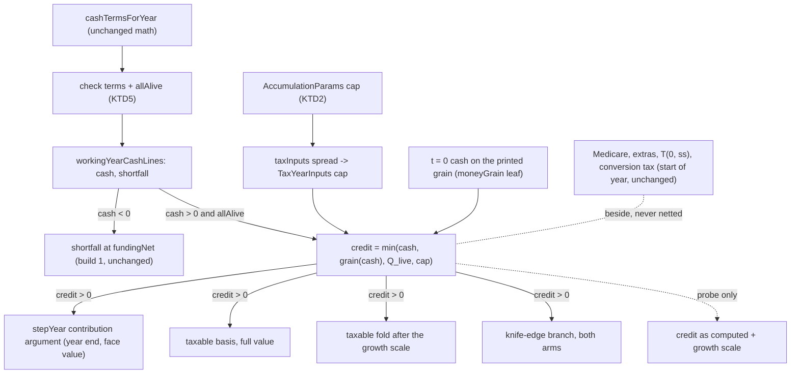
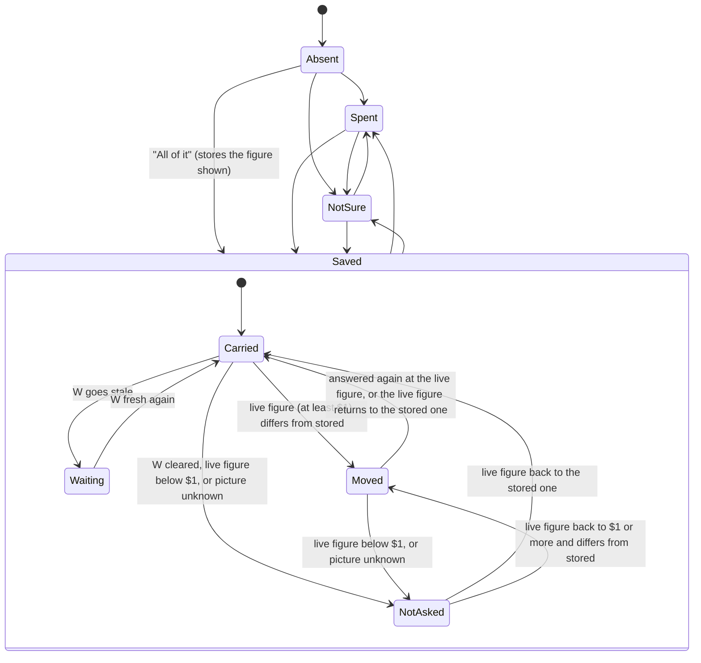
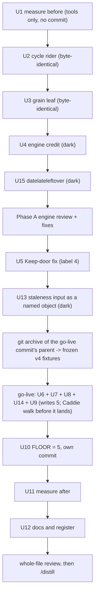

# The working-year surplus question - Plan

## Goal Capsule

- **Objective:** a still-working household whose pay leaves money over after a working year's costs, and who says all of it goes into savings, gets a quit date that counts that saving, never more than the year-0 figure it was shown and agreed to. A household the question reaches that hasn't answered, spends it, or isn't sure sees in its own dollars what the answer leaves out. A household short in year 0 is never asked; its later left over is a filed D7 item.
- **Means:** one new setup answer on the date route (R1), and a year-end credit to the taxable account capped at the stored year-0 figure (R8, R9; KTD3).
- **Authority, in order:** council `wf_2247c0df-73b` (2026-10-21, the shape) and council `wf_1b5d9962-73c` (2026-10-31, the six open calls), each with its ⚑ NEGATIVE list; `docs/architecture.md` on every invariant; then this plan. Where this plan and a ruling disagree, the ruling wins and the plan is the defect.
- **Stop conditions:** stop the line and fix before going on if:
  - an answer-absent, spent or not-sure run moves one bit from HEAD on any seed, tier or track;
  - the carried figure reaches the engine without W, or while W is stale;
  - a crown, grade or date moves on a seed that carries no "saved";
  - a commit persists the answer under schema label 4.
- **Execution profile:** ordered commits on `main` (the project ships no PRs), in three phases. Phase A is dark. Phase B opens with U5, which ships the Keep-door fix live on the W step (label 4), and the dark U13; its go-live commit writes version 5, and U10 follows as Phase B's last commit. Phase C measures and records (Implementation Units). Every commit runs the Verification Contract.
- **Who finishes:** the pilot, across sessions. Each build unit's session opens with `/brief <that unit's topic>`. The words ship flagged for Briggsy under the batched-oracle law. After Phase C, the flow still owes the whole-file review and `/distill`.

---

## Product Contract

### Summary

On the date route, once W is answered, the money-picture step asks one more question under the picture: what happens to the year's left-over pay. Only "All of it goes into savings or investments" changes the answer. That reply stores the year-0 figure it was given against. Each working year in which everyone is alive, the engine then adds the year's own left over to the taxable account at year end, capped at that stored figure and at today's year-0 figure. Every other state of the answer (unanswered, spent, not sure, or "saved" while W is stale) runs today's engine byte for byte and gets a calm line in dollars saying what isn't added. The saved shape moves to schema version 5.

### Problem Frame

The register entry *Money coming in beyond what the household spends is thrown away…* (`docs/backlog.md`) is the origin. Build 1 (the pay check, live since `c07e5758`) checks every working year's pay against what the year costs. It draws a short year from savings, but drops a year's left over: `workingYearCashLines` in `src/engine/taxOverlay.ts` returns only `shortfall: cash < 0 ? -cash : 0`, and `fundingNet` adds only the shortfall. The money picture shows year 0's bottom line as "Left over" with a stopgap note, `copy.workingLedgerLeftOverNote` ("Pay left over isn't added to savings here…"). The working-year methodology row carries the stopgap key K9. Under D7 (`docs/product.md` §4), both are notes written around a gap, and the gap is a build item: the household knows whether it saves that money, so the tool asks.

The size is not small. Recorded at `96c49857` and re-measured by U1 at `fc516f8b` (2026-11-01, unchanged; each figure re-derived from the primaries by U10's hand check), the year-0 left over under each seed's own W is:

| Seeds | Year-0 Left over |
|---|---|
| `date`, `atceiling`, `datecoststale` | $16,985 |
| `dateborder`, `datesplit` | $70,290 |
| `dip` | $48,505 |
| `datemixed` | $46,290 |
| `date65` | $5,216 |
| `datenc` | $1,644 |
| `dateshort` | short every year |

On `date`, with everyone alive, the left over is $16,985 a year in 2026–2030, $17,348 in 2031–2032 and $37,223 in 2033–2034 (about $194,000 across the nine working years of its 2035 date), and $59,986 in 2035 (U1; the register's money-picture entry had said "$16,985 → $59,986 across 2026–2034").

The 2026-10-21 council ruled the shape: saved / spent / not sure, nothing pre-checked, absent kept absent, only "saved" moves the engine, credited to the taxable account at year end and never above the quoted figure, and an unanswered or not-sure reply gets a line in dollars. Planning research found six calls those words leave open. Council `wf_1b5d9962-73c` (8/10, 15 seats, no abstentions; the Honesty Hawk's veto fired and the verdict takes its honest alternative) ruled all six. Its rulings are this plan's Key Decisions.

**Nobody has used the product yet.** No real saved plan exists (TODO: "the saved shapes are the pilot's until Briggsy saves his first real plan"). So the version-5 shape binds from his first real save, and no ask is owed to plans saved before this build (build 1's KTD22 precedent).

### Key Decisions

Each is council `wf_1b5d9962-73c`'s ruling, recorded here once; the normative text lives on the governed requirements.
- **Cap (a), on the printed grain, everyone alive only.** One answer consents to one figure. Caps that read each printed row (b) or no cap (c) would bank the rosy K5 claim year and survivor cash built on the engine-derived W_t. Governs R8.
- **"Saved" stores the figure; it rides only on a fresh W.** A bare "saved" re-binds silently to a larger left over, and a stale W leaves the stored and live figures equal on a wrong W. Governs R2, R7, R12.
- **The Keep-door fix lands before the first commit in which a household's "saved" can reach the credit.** That commit is the go-live; U4's dark engine credit, reachable only from tests, is not it. A kept stale yes becomes an entered figure that never goes stale on spending. Governs R13.
- **Ask only at a printed year-0 Left over of at least $1, after the whole picture.** Governs R5.
- **Credit beside the same-year draws, never netted.** Netting at year end charges Medicare twice, and netting through `fundingNet` is start-of-year crediting. Governs R9.
- **The per-answer dollars line sits below the radio group; nothing above the control reads the answer.** That rule is what keeps the panel's gesture hold safe (`src/intake/AssumptionPanel.tsx`'s whole-draft hold comment). Governs R6, R14.
- **Defer the newer-version door.** Nothing is deployed, and a v4 copy already refuses a v5 save under test. Governs R18.
- **Yours-to-close, shipped flagged:** the labels, the check sentence and every line's words; the question's place after the whole picture; and no standing Result line for a blank or not-sure answer (the Fiduciary's dissent, overruled by the chair).

### Requirements

Bare R-numbers are this plan's. A foreign one names its home: build 1's R4 / R9 / R16 (`docs/plans/features/working-year-pay-check-build-spec.md`); product R27 / R39 (`docs/product.md`).

**The answer and its record**
- R1. The date route carries one new optional answer about a working year's left over. It has three replies, "saved", "spent" and "not sure", and a fourth state, absent. Nothing is pre-checked, nothing defaults an absent answer to a reply (no `?? 'spent'`), and absent stays distinct from "not sure" everywhere.
- R2. "Saved" records the whole-dollar year-0 Left over it was given against: an integer, at least 1 and at most the codec's `MAX_REAL_DOLLAR`. "Spent" and "not sure" record no figure. The codec accepts the answer whether or not W is present, and its presence never withdraws the save button.
- R3. What a surface shows reads one of seven shown states, decided in this order: "not asked" (W absent, the picture unknown, or a printed year-0 Left over below $1, whatever is stored); "waiting on W" (W stale, whatever is stored); then the stored answer: absent, "saved" (carried), "saved, moved" (R12's moved predicate holds), spent, and not sure. Each surface picks words or behavior from that state through an exhaustive `Record` (insight 147), never a Set, a ternary or a default arm. The stored answer itself has four states.
- R4. The first commit that persists the answer writes schema version 5. A version-4 copy refuses a version-5 save calmly ("saved by a newer version") before it installs, claims the writer seat or writes. A version-4 save opens unchanged in a version-5 copy. A plan whose disk label is 4 and that carries the answer is refused as a writer bug that names the field.

**Asking**
- R5. The question shows only when the main-thread money picture's printed year-0 Left over is at least $1.
  - In the walk, it sits in the money-picture step's body, after the whole picture, and adds no step.
  - In the assumptions panel, it has its own seat below the W row, with its own gesture hold. While W is stale, that seat shows no radios under any answer, so no "saved" is stored against a stale W; its one line says the question waits until the yearly cost is checked and that nothing left over is added until then. The walk's question never renders with W stale, because the W step's gate stops a stale W before the money-picture step.
  - It is never required, never shows a field error, and never gates the walk.
- R6. The question's legend and labels read the same under every answer. Its year-0 figure and a check sentence sit in its described-by slot. A line in dollars, chosen by the shown state (R3), sits below the radio group:
  - "saved" says the run adds at most the year-0 figure in any working year, even where a later year above shows more;
  - "saved, moved" names the stored and the live figure, says the run counts the smaller, and says choosing "All of it" again counts the figure shown;
  - absent, spent and not sure name the year-0 figure as not added, and say later years' left over isn't added either.

  Nothing above the control in the question's own step body or seat reads the answer. The one sanctioned reader above it in the panel is the methodology line (KTD11), which changes only after the click lands.

**The credit**
- R7. The engine sees the stored figure only for a "saved" answer, and only while W is carried and fresh (build 1's R4 staleness says not stale). Every other state carries nothing.
- R8. In a clamped working year t of a run that carries the figure, the credit is 0 unless everyone in the household is alive in year t. Otherwise it is the smallest of four numbers: the year's cash, that cash on the printed grain, year 0's Left over on the printed grain from the same run, and the stored figure. A credit at or below 0 is skipped, never added.
- R9. The credit enters the taxable account at year end, at face value and full basis, through the one crediting owner, `stepYear`. It enters on both tracks and every path, and it earns no growth in its arrival year.
  - It never touches `fundingNet`, `net` or the contribution streams, and it adds no market draw.
  - It is credited beside the year's savings-funded draws (Medicare, Medicare extras, the tax on Social Security, conversion or RMD tax), never netted against them.
  - A short year has no left over, so it credits nothing (a surplus and a shortfall net, never stack), and a depleted year forfeits the credit as it forfeits a deposit.
- R10. With the figure not carried, every run is byte-identical to HEAD: absent, spent, not sure, "saved" on a stale W, every spine run, and every engine test that sets no figure. No `ENGINE_PRICING_LEDGER` row and no new pricing family are added, and `SOLVER_CODE_VERSION` stays 12.
- R11. `validateParams` returns a refusal for a carried figure without W, or one that is not an integer from 1 to `ENGINE_MAX_DOLLAR`. The overlay's backstop throws on the same faults, and on a figure that arrives with no working-year check stream.

**Staleness and the words**
- R12. Staleness speaks once per cause, with one door, and the Result shows only these stale lines; it shows no standing line for an absent or not-sure answer.
  - **The left over moved.** The answer is "moved" only when W is carried and fresh, the picture is known, the printed live year-0 figure is at least $1, and that figure differs from the stored one. The engine already credits under the smaller of the two (R8). A "worth a look" line names both figures and opens the left-over seat.
  - **W is stale.** For a "saved" answer, nothing is credited, and W's one stale line gains a clause saying in dollars that the left over isn't added until W is checked. That line's one door goes to W. Under any other answer, W's line gains no clause.
  - **A rules clock fired and the left over moved.** For a "saved" answer, when any rules clock fired (the federal tax table, the state tax, or the working-years table) and the live year-0 figure differs from the stored one, the clause rides the first fired clock line and no second line speaks (insight 101), on the re-entry gate and on the Result (where the hero's rules note carries it). The code observes both facts, never the cause, so the clause names the two figures and no cause, and it holds whether or not the clock moved the figure. Once a save clears the clock's line, the moved line carries the same two figures until the answer is given again.
  - **Quiet ("not asked", R3).** W absent, the picture unknown, or a printed live figure below $1 shows no left-over line. The credit is 0 there anyway.
- R13. The W step's Keep door stops hiding a later rise in spending.
  - A Keep that converts a `confirmed` answer records the quote its stale note showed, under a key every version-4 codec tolerates (copies before U5 ignore it as unknown, and U5's codec checks it; KTD10). The kept figure goes stale when the live quote rises above it, its stale sentence names the spending, and its row says "kept" rather than "your own figure".
  - The Keep door is withheld on a kept figure that sits below today's quote.
  - A Keep or a re-tap carries the stamp forward. A typed figure or a period change drops it.
  - A Keep or a re-tap on an `entered` figure keeps whatever stamp it has and never mints one.
  - This lands before the first commit in which a household's "saved" can reach the credit (Key Decisions).
- R14. K9 (`assumptionWorkingYearCheckLeftOver`) and `copy.workingLedgerLeftOverNote` are deleted. The methodology row's W arm carries one static line chosen by the shown state (R3), with no dollars and no direction word. Every new copy key and slot is read by the copy guard's working-year checks: named under a prefix those checks already read, or added to their lists by hand.
- R15. Every build-1 sentence, test name and register measurement premised on "pay left over is never saved" is re-derived for each answer and rewritten in this build where it no longer holds.
- R16. No surface says which way the credit moves the date. "Earlier", "later", "better", "worse" and "conservative" never describe it: the credit's reach can run either way (insight 143) and is unmeasured until U11. A test scoped to the left-over strings bans them, and planted samples prove it catches them.

**Measurement, filings and docs**
- R17. Every dev seed and plant is measured on a frozen git-archive HEAD copy before the credit (U1) and after the go-live (U11), at both tiers and on both tracks. Every move is recorded and never predicted into copy.
- R18. The register files every gap the rulings name (U12): the rosy halves inside the cap at Tier 0, the same-year-draw residual at Tier 0, four D7 build items, the retired-year surplus split out, the intake import cycle, and the newer-version door's amended trigger (amended in the plan's own commit).
- R19. The `simulate.ts` ↔ `earningsTest.ts` import cycle (Tier 4) is closed with a pin, byte-identical, in its own commit.
- R20. The product doc, architecture, the accumulation decision record, the glossary, the roadmap, the README and the register say how a working year's left over is modeled.

### Scope Boundaries

**Not this build (each filed by U12 unless already filed):**
- **The retired-year surplus.** A retired year's income above spending is still dropped at `cashTermsForYear`'s `max(0, …)` floor. It reaches the spine and the solver, so it is its own entry, split out of the origin entry.
- **A later working year's left over above the cap.** On 9 of 10 W seeds, a Social Security claim inside the window lifts later cash $7k–$46k a year above year 0's figure, and cap (a) drops the excess (gloomy). It is filed as a D7 item, with the per-row cap (b) as its lead candidate; its prerequisites are a council re-ruling that one answer consents to each printed row, plus a claim-year rule or K5's birth-month fix.
- **The left over after a death.** It is credited 0 (gloomy), and filed as a D7 item.
- **A household short in year 0 whose left over starts later.** It is never asked, so it is never credited. Filed as a D7 item; U15 mints its witness seed.
- **How much is saved.** A household that saves part of it answers "not sure". An amount answer is a D7 item.
- **The newer-version door** (Tier 2). Deferred by council; its trigger is amended in the plan's commit.
- **The intake import cycle** (`intakeMap` ↔ `sanity`). Filed, not fixed: this build's cycle pin covers `src/engine` only. U7's move takes `workingYearQuote` out of the older three-module loop and adds no new edge.

**Considered and not built:**
- A standing Result line for an absent or not-sure answer. The household sees the dollars where it answers. The Fiduciary's dissent would flip it, if a cold read shows a household reaching the date without seeing the picture.
- A cut order on deposits, a netted credit, and a credit through `fundingNet`. Each is ruled out by a ⚑ NEGATIVE.

---

## Planning Contract

### Key Technical Decisions

- KTD1. **One top-level draft key, a `kind`-discriminated object union, and no "surplus" in any name.** The key is `workingYearLeftOver`, its kinds `saved` (with `quotedReal`), `spent` and `not-sure`. `src/shared/model.ts` already rules "build 2's surplus answer gets its own top-level key, never a new kind here". "Surplus" already names the spine seed `surplus`, `surplusRegime` and the Tier-2 goal, so a new identifier avoids the collision. The object union mirrors W's (`WorkingYearCostV3`), so adding a field later is additive. The spellings bind from the first real save (R2). The codec bounds `quotedReal` by `MAX_REAL_DOLLAR`, because `src/shared` may not import the engine's `ENGINE_MAX_DOLLAR`; both are 1e12.
- KTD2. **The engine sees one number, carried the way W is carried.** The chain:
  1. Intake writes the stored figure onto `DateSearchInput` only while R7 holds, never onto `params.overlay.accumulation`, beside W in `buildDateInput` (`src/intake/intakeMap.ts`).
  2. `buildCandidateParams` (`src/engine/dateSearch.ts`) rebuilds it into each candidate's `AccumulationParams` (`src/shared/model.ts`), beside W.
  3. `simulate.ts` spreads it, presence-keyed, into the overlay's `taxInputs` beside `workingYearCheck`, so both tracks inherit it.
  4. A new optional `TaxYearInputs` field reaches the overlay.
  - With no figure carried, no credit code runs and Q_live is never computed, so R10's byte identity holds by construction, not by an `x + 0` that can turn −0 into +0.
  - `validateParams` returns a reason string for a bad figure (R11), and the overlay backstop throws (the house's "both `validateParams` and the overlay backstop" rule; the ceiling is imported from `@engine/engineDomain`, so the backstop adds no `taxOverlay` ↔ `simulate` edge).
  - The spine fingerprint never sees the figure, so no saved recommendation is touched (`src/store/savedRecommendation.ts` reads the spine only).
  - The carriage reads W's freshness without a new intake import cycle. `workingYearCostFigure` moves from `src/intake/intakeMap.ts` into `src/intake/workingYearQuote.ts` (its only reason to import `intakeMap`), and `intakeMap` imports it back and re-exports it for its other callers. `buildDateInput` then imports `isWorkingYearCostStale` from `workingYearQuote` with no loop.
- KTD3. **The credit is one year-local, applied at four sites in `runTaxAwareDecumulation`.** It is computed after the check composes the year's cash. It joins:
  - `stepYear`'s contribution argument;
  - the taxable basis at full value;
  - the taxable fold after the growth scale;
  - both arms of the knife-edge branch (the arm without contributions builds fresh buckets holding the credit).

  It never joins `contributionTotal`, which also feeds the ACA empty-overlap throw. The four sites move together or not at all: a credit added only at `stepYear` puts it in the state total, and the next year's growth scale smears it across pretax, Roth and the medical-earmarked HSA, a hidden asset location the headline never shows. A probe-only callback reports each year's credit as computed (before any depletion forfeit) and the year's growth scale, for U11.
- KTD4. **The printed grain lives in one leaf.** `workingYearBottomLine`, its cent helpers and the `finite` guard they call move unchanged from `src/engine/workingYearLedger.ts` to a new leaf, `src/engine/moneyGrain.ts`. The guard's error label is made neutral to both callers. Both the ledger and the overlay import the leaf, because the overlay cannot import the ledger, which imports the overlay. Year 0's Left over inside the run is that function applied to the run's own t = 0 cash, and a test pins it equal to the picture's bottom line on every seed (insight 146). R8's `min` with the raw cash guards the half-cent tie, which can print a cent above the float.
- KTD5. **"Everyone alive" is carried, never re-derived.** `allAlive` is a local of `cashTermsForYear` (`src/engine/simulate.ts`), the same boolean `workingYearCostForYear` reads for W_t. It becomes a required field of the check's per-year terms (`WorkingYearCheckTerms` in `src/engine/taxOverlay.ts`), set from that local and validated by the overlay's existing check-terms backstop. A survivor year then credits 0 by the same test that prices it, and a direct caller cannot credit survivor years by omission. The two typed literals of those terms in existing tests take a named edit.
- KTD6. **The version-5 bump is label-only and lands in the go-live commit.**
  - The 4→5 step relabels in place, naming its literal successor, after the 3→4 step (`src/shared/scenarioCodec.ts`). It writes no default. That is honest because the new field is optional; `docs/architecture.md` §7.3 names only the unchanged-field and required-field cases, so U6 amends it to name an added optional field.
  - Before the relabel, the codec refuses a plan whose disk label is 4 and that carries the answer (R4). No version-4 build writes one.
  - The frozen version-4 fixtures are minted from a git archive of the go-live commit's parent (checked as `<go-live>^` when the go-live lands), each through that archive's own `scenarioFromDraft` (insight 150). The four households:
    - `date`, with W confirmed and fresh, and the $16,985 left over;
    - `datecoststale`, kept through the archive's own Keep, which holds U5's stamp;
    - the rec plant's household, retired with a saved recommendation;
    - the maximal version-4 plan the Tier 4 entry asks for (now or never: no build writes 4 after the bump).
  - The mint script is committed beside the fixtures with its provenance. The archive's `package.json`, lockfile, `vite.config.ts` and `tsconfig.json` are compared with the checkout before its `node_modules` junction is trusted.
  - The suite's CURRENT fixture stays without the answer. A separate fixture carries it, used only at the current label, so the literal-4 pin, the fixed-point loop and the version-3 twins never record a plan labeled 3 or 4 carrying the answer as green.
  - A literal-5 absolute pin lands with the bump, and the literal-4 pin stays. The floor test's `FLOOR` goes to 5 in its own follow-up commit, U10, so reverting the bump cannot take the guard with it (insight 151).
  - The newer-version door is deferred (council).
- KTD7. **No pricing-ledger row, no new family; land the engine dark.** A row speaks only to vaults saved before its ship day. No vault saved before the bump can carry the answer, so every crossed vault recomputes byte-identically, and a row would be silent or false. That is build 1's KTD14 logic. It does not lean on "no real save exists".
  - The register's obligation ("the first change to the W-keyed path after ship that is not a change to how a tax is figured mints its family before it lands") rests on a saved W plan's recompute moving. Build 2 moves none, so it does not fire, and U12 records that reading.
  - The engine lands dark: nothing sets the figure until the go-live. Phase A closes with an engine review, the A7 precedent, so the credit's review fixes precede the go-live.
  - A credit fix after the go-live and before Briggsy's first real save moves no real saved plan; from that save on, the obligation applies to any later change.
  - Before the go-live commit lands, the review's lenses also run over its codec arm, the `buildDateInput` carriage and the staleness predicates, beside the Caddie walk, and their fixes land in that commit. The stored shape is a one-way door from Briggsy's first real save.
- KTD8. **The question lives in the walk's step body and in its own panel seat, never in the shared picture.**
  - `src/intake/WorkingYearLedger.tsx` is one component rendered in both the walk's money-picture step and the panel's W row. The W row's whole-draft hold is safe only because no control lives above the question in it. So the question goes in the walk's own step body (`WorkingLedgerStepBody` in `src/intake/questions.tsx`, which gains the step's update call). The picture component only loses its note.
  - The step stays the date route's terminal step, with no field gate. Build 1's KTD17 forbids a step gated on the draft (`src/intake/__tests__/workingCostStep.test.tsx` pins the count).
  - The predicate reads `workingYearLedger`'s printed year-0 bottom line, never the probe hook (its consumer pin forbids product code from reading it).
  - The reveal runs provisional then final (`revealAndSharpen`), and both runs carry the answer. U11 measures both tiers.
  - Choosing "All of it" stores the figure the face shows (in the panel, the figure its hold drew). If that differs from the live figure, the answer reads "moved" at once.
  - The panel seat joins the `AssumptionSeat` union, and the seat opener's `initialSeat` widens to it, so R12's "moved" line has a door.
- KTD9. **The left-over fact rides the staleness input as one named object.** `deriveStaleness`'s working-year input becomes `{ costStale, leftOverStale }`, a required named object rather than a second adjacent positional boolean across its ~130 calls (the `GrossUpContext` no-transposition precedent in `src/engine/taxOverlay.ts`).
  - `leftOverStale` is R12's "moved" predicate, silenced by the same exposure conjunct `costStale` uses.
  - `composeReentry` (`src/ui/reentryChrome.ts`) gains a required left-over text input. When any rules clock line fired, it appends the clause to the first of them in its existing push order (tax, state tax, working years) and pushes no separate left-over line.
  - Callers that cannot see the answer pass `false` by proof: the saved-recommendation call site always, and every product caller until the go-live.
  - R12's one-cause rule decides which line carries the clause.
- KTD10. **The Keep fix is a stamp on the `entered` kind, under a new key, in a version-4 commit.** The stamp is `keptOverQuoteReal`.
  - Its name must never be `quotedReal`, `amountReal` or `entryPeriod`. The version-4 codec already refuses `quotedReal` on an entered W, and a pre-U5 copy would then call an intact kept plan damaged: §7.3 rule (b) firing inside label 4.
  - Under a new name, every version-4 codec tolerates it. That tolerance is pinned by the existing test that decodes an entered W carrying an unknown key, and the codec's header says "An UNKNOWN extra key still passes".
  - §7.3 rule (a) does not fire: a version-4 staleness never reaches the engine ("A stale W still rides", `src/intake/intakeMap.ts`), and every copy that credits reads the stamp. Rule (c) fires only on a Keep made before U5, a group that is empty.
  - `heldYesBelowQuote` reads a stamped entered figure like a confirmed one, so the Keep door is withheld below today's quote and the rosy-lean sentence appends.
  - `workingYearCostStaleness` stales a stamped figure when the live quote rises above it. `workingYearCostStaleText` gains a quote-moved arm for it, so the sentence names the spending, never the state. A typed figure is never staled on a quote the household never saw (the entry's ⚑ NEGATIVE).
  - Each writer states the stamp's fate: only a Keep that converts a `confirmed` answer mints it, from the quote its stale note showed; a Keep or re-tap on an `entered` figure carries any stamp forward and never mints one; a typed figure drops it; a period change drops it, because the stamp was taken over a different figure.
- KTD11. **The methodology line copies `WORK_STATE_KEY`, keyed on the shown state.** The one `methodologyLines` selector (`src/ui/assumptionRegistry.ts`) takes a required argument: R3's shown state, read off the built date input crossed with the answer. A seven-member `Record<LeftOverShownState, CopyKey>` replaces K9. "Saved" states the at-most-year-0 frame, with no dollars. "Not asked" says a working year's left over isn't added when the first working year has none. Its caller, `ArmedMethodologyLines` (`src/intake/AssumptionPanel.tsx`), passes it, following the arm law that the row reads the built run (insight 132). It sits above the seat and changes only after a click lands, so it is R6's one sanctioned reader. The per-answer dollars line under the question is a separate seven-member `Record` in the question component, mapping "not asked" to no line because the question is hidden.
- KTD12. **The AFTER for "saved" is derived from HEAD, so the edited tree must reproduce it.**
  - U1 records each seed's per-path, per-year cash through HEAD's probe hook (`_workingYearProbe.checkComposed`). The hook does not pass `allAlive`. Its source is `floor.filing === 'mfj'`, which is two-alive exactly for a couple (every household is a couple), checked against an independent re-sample of each path's death offsets through the exported `sampleCouplePath`.
  - U1 applies R8 by hand to that record, giving the expected credit stream.
  - U11 requires the edited tree's probe-only credit stream, taken before any depletion forfeit, to equal that stream over every path-year HEAD composed. Extra path-years in the tree are allowed only on paths HEAD depleted before the stop, where the credit kept the path alive (insight 148).
  - The externally-derived fixture (DND 012) is year 0. The end-of-year total with "saved", minus the total without it, equals the hand-derived year-0 Left over to the cent on every path. That holds because the credit earns nothing in its arrival year and nothing else moves in year 0.
- KTD13. **The cycle fix moves the benefit-year pieces to a leaf and the dollar caps to their own module.**
  - `PersonOffsets`, `SurvivorYearCredits`, `survivorYearBenefit`, `bothAliveYearBenefit` and their types move from `simulate.ts` to a new `src/engine/benefitYear.ts`, which imports only `socialSecurityBenefit` and shared types.
  - `ENGINE_MAX_DOLLAR` moves with its two sibling caps and their shared rationale comment to `src/engine/engineDomain.ts`.
  - `simulate.ts` re-exports every moved name (the `taxOverlay.ts` re-export precedent), so only `earningsTest.ts` changes an import, and `workingYearLedger`'s pinned allowlist holds.
  - A TypeScript-parser test over `src/engine` (the scanner `workingYearLedger.test.ts` already uses) pins every runtime import cycle closed, type imports included.
- KTD14. **Four new dev seeds, one witness per face; no existing seed's answer changes.**
  - `datesaved` is `date`'s household with W confirmed and "saved" at its year-0 figure. It is the presence witness: its later years run above the cap, so the cap binds there.
  - `datesavedmoved` is `datesaved` with its pay raised after the answer. It is the "moved" face's witness.
  - `datesavedstale` is `datecoststale`'s household with "saved" minted before its spending moved. It is the stale-W face's witness.
  - `datelateleftover` is short in year 0 and has a left over after a claim later in the window, the case R5 excludes. It carries no answer, so it lands dark (U15). Its numbers are tuned and measured at build.
  - Every existing seed keeps its pins, which is R10's witness set. Each new seed mints its answer through the shipped producer (`withConfirmedW`'s pattern).

### High-Level Technical Design

One clamped working year of a run that carries the figure:

The answer, and what reaches the engine:

Only `Saved.Carried` and `Saved.Moved` always reach the engine; `Saved.NotAsked` reaches it only while W is carried and fresh, and then credits 0 through the cap; `Waiting` never does (R7). `Moved` credits under the smaller figure and shows the "worth a look" line. `NotAsked` shows the "not asked" line. Every other state is byte-identical to HEAD.

The commit sequence:

### Assumptions

These are the pilot's bets, made without a confirmation step; each is cheap to change before its unit lands.
- The key, kind and seed names in KTD1 and KTD14, and the stamp's name in KTD10.
- The Keep fix's shape is a stamp on `entered` (KTD10), not a re-stamped `confirmed` kind. The entry offers both.
- U4 adds a probe-only credit callback to `_workingYearProbe` for measurement (KTD3, KTD12).
- Phase A closes with an engine review before the go-live (KTD7), on top of the whole-file review the flow owes after Phase C.
- `datelateleftover` is minted now (U15), because it is the witness for the case R5 excludes, not deferred with its D7 item.
- The panel seat's stale-W face shows a waiting line and no radios (R5). The deepen pass proposed it, and no ruling names that face.
- The council's draft labels are the starting words: "All of it goes into savings or investments" / "Spent, or kept as cash" / "Some of it, or not sure". The check sentence starts from the Craftsman's "Pick the first only if your savings grow by about this much a year beyond the deposits you entered."

---

## Implementation Units

**Phase A** is engine and tools only, and inert in the app: nothing sets the figure until the go-live. U1 runs first and commits nothing to `src`. Its commits, in order: U2, U3, U4, U15, then the engine review's fixes.

**Phase B** opens with U5 (label 4, live on the W step) and the dark U13. Then the frozen version-4 fixtures are minted from a git archive of the go-live commit's parent. The single go-live commit carries U6, U7, U8, U14 and U9.
- The four design skills load before any UI file is touched: `back-nine-design`, `emil-design-eng`, `frontend-design:frontend-design` and `web-design-guidelines`.
- The Caddie walk runs on the built tree before the commit lands, at 1536×791 @ 2.5× and on the phone.
- U10 follows as its own commit.

**Phase C** is U11, then U12.

### U1. Measure before, on a frozen HEAD copy

- **Goal:** fix every seed's engine output and per-path-year cash at HEAD, before any credit code exists, and write the predictions down.
- **Requirements:** R10, R17.
- **Dependencies:** none.
- **Files:** none in the repo. The record lives in the durable folder `b9-build2-surplus\` beside the brief: a `head\` git archive of `src`, `tsconfig.json` and `package.json`, with a `node_modules` junction, plus `README.md` and `PREDICTIONS.md`.
- **Approach:**
  1. Archive HEAD's `src` (`git archive HEAD:projects/the-back-nine src tsconfig.json package.json`).
  2. Run the b9-a6 `seeds.mts` from the archive for every dev seed and plant at both tiers: the full engine output, digested, as the byte-identity baseline.
  3. Run a probe through HEAD's `_workingYearProbe.checkComposed` for every W seed: each path-year's cash, the run's year-0 Left over on the printed grain, and `allAlive` per path-year, read as KTD12 says.
  4. Apply R8 by hand to that record, giving each seed's expected credit stream for a "saved" answer at its own year-0 figure.
  5. Record each working year's savings-funded draws on every W seed: the `fundingNet` items (Medicare and extras), T(0, ss) (`floor.zeroTax`) and the gross draw (`checkDrawn`). These are U11's residual inputs.
  6. Write `PREDICTIONS.md` before U4 runs: which seeds credit, in which years the cap binds, the expected totals, and where a rosy half of the same-year-draw residual is possible.
- **Patterns to follow:** `b9-a6-tools\seeds.mts` (cwd-rooted HEAD-vs-tree), `b9-u10-tools\probe.mts` and `year0check.mts`, insight 148.
- **Test expectation:** none (measurement tooling, no repo code). Each probe is re-run once and its output byte-compared to its first run.
- **Verification:** the baseline digests and the expected credit streams exist for every seed. The year-0 figures re-measured at HEAD replace the `96c49857` record wherever they differ, and the difference is noted.

### U2. Close the `simulate.ts` ↔ `earningsTest.ts` cycle

- **Goal:** no runtime import cycle in `src/engine`, with a pin that reds on a new one.
- **Requirements:** R19.
- **Dependencies:** U1 (its baseline proves byte identity).
- **Files:**
  - `src/engine/benefitYear.ts` (new);
  - `src/engine/engineDomain.ts` (new);
  - `src/engine/simulate.ts` (removes the moved code, imports it back, re-exports it, drops the imports the move leaves unused);
  - `src/engine/earningsTest.ts` (its one import);
  - `src/engine/__tests__/importCycles.test.ts` (new).
- **Approach:** as KTD13. The move is code-identical: `git diff --color-moved` shows only moved lines and the import edits. The eight live-doc citations into the moved code are re-pointed by hand. The commit's one `pnpm doc:reanchor HEAD --apply` shifts the rest, with the frozen-file restore landmine minded.
- **Execution note:** move first, prove byte identity, then write the pin and confirm it reds on a planted cycle.
- **Patterns to follow:** the re-export in `src/engine/taxOverlay.ts`; the TypeScript-parser import scanner in `src/engine/__tests__/workingYearLedger.test.ts`.
- **Test scenarios:**
  - The pin finds no runtime cycle in `src/engine`, counting type imports.
  - A planted `earningsTest.ts` → `simulate.ts` import reds the pin, naming the cycle.
  - Every existing importer of the moved names resolves through `@engine/simulate`, and the ledger's allowlist test passes unedited.
- **Verification:** typecheck, lint and the full suite are green. U1's baseline digests are byte-equal from the edited tree on every seed and tier.

### U3. The printed grain in one leaf

- **Goal:** one home for the money picture's rounding, readable by the overlay.
- **Requirements:** R8, R10.
- **Dependencies:** U2.
- **Files:**
  - `src/engine/moneyGrain.ts` (new);
  - `src/engine/workingYearLedger.ts` (imports it, including `finite` for its own remaining calls);
  - `src/engine/__tests__/moneyGrain.test.ts` (new);
  - `src/engine/__tests__/workingYearLedger.test.ts` (the allowlist gains the leaf; a named edit).
- **Approach:** as KTD4. `toCents`, `bottomLineFromCents`, `HALF_CENT_DUST`, `workingYearBottomLine` and `finite` move verbatim, and their comments travel with them. Only `finite`'s error label changes, to one neutral to both callers.
- **Patterns to follow:** insight 146; the ledger's existing rounding tests.
- **Test scenarios:**
  - The rounding tests move with the code and pass unedited: a half-cent tie goes toward −∞, $3,060.0000000000005 reads $3,060, −$12.005 reads "Short $13", and −0 never appears.
  - `workingYearBottomLine(1644.95)` is 1644, and `workingYearBottomLine(1644.996)` is 1645, which is above its float. That is the case R8's `min` with the raw cash exists for.
  - A non-finite cash throws through the leaf with the neutral label.
- **Verification:** U1's digests are byte-equal, and the ledger tests pass with only the allowlist edit.

### U4. The credit, dark

- **Goal:** a run that carries the figure credits each eligible working year's left over at year end, and every other run is unmoved.
- **Requirements:** R8, R9, R10, R11.
- **Dependencies:** U3.
- **Files:**
  - `src/shared/model.ts` (`AccumulationParams`'s optional figure);
  - `src/engine/simulate.ts` (the `validateParams` rule; the `taxInputs` spread; `allAlive` set on the check terms);
  - `src/engine/dateSearch.ts` (`DateSearchInput`, `buildCandidateParams`);
  - `src/engine/taxOverlay.ts` (the `TaxYearInputs` field and its docblock; `allAlive` on `WorkingYearCheckTerms` and its backstop; the figure's backstop arm; Q_live at t = 0; the year-local credit at the four sites; the probe-only callback);
  - `src/engine/__tests__/workingYearCredit.test.ts` (new);
  - `src/engine/__tests__/workingYearCheck.test.ts` (new arms; a named edit to its typed check-terms literal);
  - `src/engine/__tests__/workingYearLedger.test.ts` (a named edit to its typed check-terms literal);
  - `src/engine/__tests__/dateSearch.test.ts` (new arms);
  - `src/ui/__tests__/devSeeds.test.ts` (KTD4's year-0 sweep arm).
- **Approach:** as KTD2, KTD3, KTD5 and KTD12. A path whose t = 0 is not a composed working year credits nothing for the whole path: offset 0, or a wiring fault the backstop names.
- **Execution note:** test-first. Every expected figure is typed from U1's hand derivation or a hand calculation, never read from the engine.
- **Patterns to follow:** C2's contribution path in `runTaxAwareDecumulation` (the `cTaxable` fold, basis and knife-edge comments) and its discriminating goldens in `src/engine/__tests__/taxOverlay.test.ts`; W's `validateParams` rule, its backstop and its `buildCandidateParams` carriage; the probe hook's consumer pin.
- **Test scenarios:**
  - **Year 0, externally derived.** On a W household with a year-0 Left over (`date`'s inputs), the end-of-year-0 total with the figure carried, minus the total without it, equals U1's hand-derived year-0 Left over to the cent, on every path.
  - **Destination.** A direct overlay call with a one-year horizon, with and without the figure:
    - the taxable bucket's delta equals the credit;
    - pretax, Roth and HSA deltas are exactly 0;
    - the taxable basis delta equals the credit;
    - the sum of the final buckets equals the terminal total within dust.

    A credit folded before the growth scale, or a scale that includes it, each fail by a typed figure.
  - **Basis through a draw.** A two-year variant whose year 1 draws from taxable carries the credited basis through the pro-rata reduction to a hand-computed figure.
  - **Taxable projection.** On a path that never draws from taxable, the terminal taxable balance and basis move by exactly the credit stream.
  - **The cap binds.** In a year whose cash exceeds the stored figure, the credit equals the stored figure. In a year whose cash is below it, the credit equals that cash on the printed grain.
  - **Live below stored.** With a stored figure above the run's own year-0 figure, every credit is capped at the run's own figure.
  - **The grain.** A cash of 1644.996 credits 1644.996, never 1645. A cash of 0.4 credits 0, and the year is unchanged from the no-figure run.
  - **Survivor.** On a path where a member dies, every year with `allAlive` false credits 0, and that year's buckets and basis equal the no-figure run's for the same opening state.
  - **Short year.** A year with cash below 0 draws its shortfall exactly as HEAD does and credits nothing.
  - **Depleted year.** A year that depletes credits nothing.
  - **Knife-edge.** A planted ledger lineage at or below 0 with the state positive puts the credit into fresh buckets, with and without a contribution that year, and the taxable basis equals the taxable inflow.
  - **Both tracks.** The floor and the full track credit the same nonzero dollars on the same path, equal to U1's expected stream.
  - **Every seed's year 0 (KTD4).** In the devSeeds year-0 sweep, each W seed run with a figure of `ENGINE_MAX_DOLLAR` credits a year-0 amount `Object.is` the smaller of that year's raw cash and its picture's printed bottom line, wherever the printed figure is at least $1, and nothing on `dateshort`.
  - **Absent.** A W-present run without the figure is `Object.is` equal to HEAD's; the existing byte-identity describe in `workingYearCheck.test.ts` passes unedited. Its presence companion is the year-0 scenario above (insight 029).
  - **Offset 0.** A carried figure on an offset-0 candidate, whose check stream is present and empty (`simulate` spreads it whenever W is present), is `Object.is` the run without it. R11's "no working-year check stream" means the stream ABSENT, never a stream with no entry; read the other way, every offset-0 candidate of a carried run throws and the date search fails (U1's `PREDICTIONS.md` A2).
  - **Refusals.** The figure without W, a figure of 0, of 1.5, of NaN and above `ENGINE_MAX_DOLLAR` each return a `validateParams` reason naming the figure. A figure passed to the overlay with no check stream, and check terms with a non-boolean `allAlive`, each throw at the backstop.
  - **Spine.** Spine runs, the pricing witness digests and the solve identity fixtures pass unedited.
- **Verification:** U1's digests are byte-equal for every seed (none carries the figure). A mutant pass reds the named tests, each prediction written before its run. It plants each of the four sites dropped, the `allAlive` gate inverted, each `min` term dropped, and the fold moved before the scale.

### U15. The later-left-over witness, dark

- **Goal:** the household R5 never asks, short in year 0 with a left over later, exists as a seed before the go-live.
- **Requirements:** R5, R17.
- **Dependencies:** U4.
- **Files:**
  - `src/ui/devSeeds.ts` (`datelateleftover`);
  - `src/ui/__tests__/devSeeds.test.ts` (the named W set, the swept count);
  - `src/ui/__tests__/stalenessExposure.test.ts` (`W_KEYED`);
  - `src/engine/__tests__/workingYearCredit.test.ts` (one arm).
- **Approach:** as KTD14. Its inputs are tuned so year 0 prints short or $0 and a claim inside the window makes a later working year's cash positive. It carries W but no answer.
- **Test scenarios:**
  - Its year 0 prints short or $0, and the probe finds a left over in a later working year.
  - Its inputs run with a carried figure of `ENGINE_MAX_DOLLAR` credit nothing, and the run is `Object.is` the uncarried run, because year 0's figure caps every year.
- **Verification:** its own digest joins U1's record as its baseline. Every other seed's digest is unmoved.

**The Phase A engine review** runs here, with ultramode's lenses over U2–U4 and U15's whole files and an adversary. Its fixes land before U5.

### U5. The Keep door's kept figure goes stale on a risen quote

- **Goal:** a stale yes kept through the Keep door can no longer hide a later rise in spending.
- **Requirements:** R13.
- **Dependencies:** U4's review fixes (ordering only).
- **Files:**
  - `src/shared/model.ts` (the optional `keptOverQuoteReal` on `entered`);
  - `src/shared/scenarioCodec.ts` (its check);
  - `src/intake/workingYearQuote.ts` (`writeKeptWorkingYearCost`, `writeWorkingYearCostPeriod`, `heldYesBelowQuote`, `workingYearCostStaleness`, `workingYearCostStaleText`);
  - `src/intake/WorkingCostQuestion.tsx` (`keepable`, the re-tap, the "kept" row words) and the panel's W row;
  - `src/ui/copy.ts`;
  - `src/intake/__tests__/workingYearQuote.test.ts`, `src/shared/__tests__/scenarioCodec.test.ts`, `src/intake/__tests__/workingCostStep.test.tsx`.
- **Approach:** as KTD10. The commit is labeled 4.
- **Patterns to follow:** the register entry's Prescription and ⚑ NEGATIVE; the codec's existing unknown-key tolerance test, which stays unedited, as does its test refusing `quotedReal` on an entered W.
- **Test scenarios:**
  - Keeping $84,000 over a quote of $80,000 stores the stamp. When the quote rises to $85,000, the answer is stale, its sentence names the spending, and no Keep door is offered.
  - That stale kept figure appends the rosy-lean sentence.
  - A kept figure with the quote unmoved, or fallen, is fresh.
  - After a state-reading move, a Keep on a stamped figure keeps the stamp, and a later quote rise still stales it. A re-tap of the held answer keeps the stamp too.
  - A typed figure drops the stamp and is never staled by any quote.
  - A typed $70,000 figure, stale on a state move with the quote at $84,000, is kept: it carries no stamp, stays fresh through a later quote rise, and reads "your own figure".
  - A period change drops the stamp, and the row reads "your own figure".
  - The row reads "kept" for a stamped figure.
  - The codec refuses a stamp that is not finite, not positive or above `MAX_REAL_DOLLAR`, and a stamp on a `confirmed` kind.
- **Verification:** the W step's existing tests pass, with named edits only for the kept row's words. A save minted by U5's tree decodes in U1's HEAD archive with `droppedAtoms` empty. The words are drafted and flagged for the Caddie walk.

### U13. The staleness input becomes a named object, dark

- **Goal:** the store can carry the left-over fact before anything can produce it.
- **Requirements:** R12.
- **Dependencies:** U5.
- **Files:**
  - `src/store/staleness.ts` (the `{ costStale, leftOverStale }` input; the report field; `anyStale`);
  - `src/ui/reentryChrome.ts` (`composeReentry`'s required left-over text input);
  - `src/store/savedRecommendation.ts`, `src/ui/IntakeApp.tsx` (pass `leftOverStale: false` by proof);
  - every test call of `deriveStaleness` and `composeReentry`: `src/store/__tests__/staleness.test.ts`, `src/ui/__tests__/reentry.test.tsx`, `src/store/__tests__/savedRecommendation.test.ts`, `src/ui/__tests__/devSeeds.test.ts`.
- **Approach:** as KTD9. Before U6 no draft can hold the answer, so `false` is provably true at every product caller.
- **Test scenarios:**
  - `leftOverStale: true` with `costStale: false` reports the left-over fact and sets `anyStale`.
  - Under the exposure conjunct that silences `costStale`, `leftOverStale: true` is silent too.
  - `composeReentry` renders the left-over text when the fact is set and nothing when it is not.
- **Verification:** U1's digests are unmoved (no engine change), and the suite is green with only the call-shape edits.

### U6. Model, codec and the version-5 bump (go-live commit)

- **Goal:** the answer persists, and only under version 5.
- **Requirements:** R1, R2, R3, R4.
- **Dependencies:** U13, and the version-4 archive of the go-live commit's parent.
- **Files:**
  - `src/shared/model.ts` (`CURRENT_SCHEMA_VERSION` = 5, the vocabulary, the answer type, `SCENARIO_V3_FIELDS`);
  - `src/shared/scenarioCodec.ts` (the label-4 refusal, the 4→5 step, the field check);
  - `src/store/memoryModel.ts` (the draft's optional block);
  - `src/ui/assumptionRegistry.ts` (`DRAFT_DISPOSITIONS`);
  - `src/ui/scenarioFromDraft.ts`, `src/ui/draftFromScenario.ts`;
  - `src/ui/IntakeApp.tsx` (the hydrate gate's version arm);
  - `src/shared/__tests__/scenarioCodec.test.ts` (FROZEN_V4 raw-byte fixtures, the literal-5 pin, the ladder and fixed-point pins, the schema-surface vocabulary record, the answer-carrying fixture);
  - `src/store/__tests__/session.test.ts`, `src/store/__tests__/backup.test.ts` (the version-4 arms);
  - `src/ui/__tests__/IntakeApp.test.tsx` (the "labeled 4" arm);
  - the fixtures and their mint script, beside the existing frozen version-3 fixtures in `src/shared/__tests__/fixtures/`;
  - `docs/architecture.md` §7.3 (the optional-field case and the ladder diagram).
- **Approach:** as KTD1 and KTD6. The codec checks the answer with `needVocab` on `kind`, and checks `quotedReal` as an integer from 1 to `MAX_REAL_DOLLAR`, present if and only if `kind` is `saved`. An absent key is written as absent, never as a token.
- **Patterns to follow:** the version-4 bump `c2864eb9` and its floor commit `9b0ef9db`; the `FROZEN_V3` raw-bytes arms; the `chosenGoal` vocabulary arm; the session and backup suites' version-3 arms.
- **Test scenarios:**
  - Each frozen version-4 household opens in this build, relabeled 5, with no answer key. Its engine output equals U1's digest for that seed.
  - Unlock and recovery unlock leave a version-4 vault's disk label at 4 and its record byte-identical. A restore of a version-4 backup lands the file's own IV and ciphertext and unlocks at the current version.
  - **The unanswered bytes.** Through the real hydrate path (unlock, `draftFromScenario`, `scenarioFromDraft`, save), the frozen version-4 date plan's raw decrypted bytes read `schemaVersion` 5, and `workingYearLeftOver` is not a key in them. The new staleness predicate is false on that draft.
  - A version-5 save with each reply round-trips byte for byte.
  - The codec refuses each of these as corrupt, with a field-naming detail: `saved` without `quotedReal`, `spent` with one, a non-integer, 0, and an unknown kind.
  - The codec accepts each reply on a plan without W.
  - A plan whose disk label is 4 and that carries the answer is refused as a writer bug naming the field.
  - The literal-5 absolute pin reads 5 from the raw bytes a mint writes.
  - The hydrate gate refuses a current plan relabeled 4 as the ladder dictates.
  - In the go-live parent's archive, its own codec, backup, session and UnlockScreen suites refuse a version-5 save before install, claim or write (insight 150).
- **Verification:** the bump's guards read raw bytes or the type, never the codec's own output (insight 151). Every version-4 pin derived from the constant moves with it; the literal-4 pin stays. A planted `?? 'spent'` on the hydrate path reds the unanswered-bytes arm, with its prediction written first.

### U7. The question, its seat and the carriage (go-live commit)

- **Goal:** the household answers under its own year-0 figure, and the engine hears "saved" only while it is honest to.
- **Requirements:** R5, R6, R7, R16.
- **Dependencies:** U4, U6.
- **Files:**
  - `src/intake/questions.tsx` (`WorkingLedgerStepBody` hosts the question below the picture and gains the step's update call; `fields` stays `[]`; its docblock is rewritten);
  - `src/intake/WorkingYearLedger.tsx` (only the left-over note goes);
  - `src/intake/WorkingYearLeftOverQuestion.tsx` (new: the radio group, its described-by slot and the per-answer line);
  - `src/intake/AssumptionPanel.tsx` (the new seat below the W row, its hold, its stale-W face);
  - `src/ui/assumptionRegistry.ts` (the seat in `AssumptionSeat`);
  - `src/ui/Result.tsx` (`initialSeat` widened to the new seat);
  - `src/intake/intakeMap.ts` (`buildDateInput`'s carriage);
  - `src/intake/workingYearLeftOver.ts` (new: the write helpers, the live figure read from the producer, the shown state);
  - `src/intake/workingYearQuote.ts` (receives `workingYearCostFigure`; KTD2);
  - `src/ui/copy.ts`;
  - tests: `src/intake/__tests__/workingYearLeftOver.test.ts` (new), `src/intake/__tests__/WorkingYearLedger.test.tsx`, `src/intake/__tests__/intakeMap.test.ts`, `src/intake/__tests__/assumptionPanel.test.tsx`, `src/intake/__tests__/workingCostStep.test.tsx`, `src/intake/__tests__/gestureHold.test.tsx`.
- **Approach:** as KTD2 and KTD8.
  1. The question renders when the producer's printed year-0 bottom line is at least $1.
  2. Its labels and legend are static. The figure and the check sentence are its described-by text. The per-answer line is a seven-state `Record` (R3), rendered below the group.
  3. Choosing "All of it" stores the figure the face shows. The write stores nothing when the live draft no longer passes R5's gate (W fresh and a printed year-0 figure of at least $1). A press inside the seat also holds the W row, so a commit that stales W from above cannot move the face under the press.
  4. `buildDateInput` carries the figure only while `carriesWorkingYearCost` holds and W is fresh.
  5. A held answer survives a W clear, a typed $0 and a route change, and stays inert until W is fresh again.
- **Execution note:** the four design skills load before this unit, and every face is Caddie-walked before the go-live commit lands.
- **Patterns to follow:** `MedicareExtrasFork` (nothing pre-checked, strip-on-unanswered); the W row's gesture hold; `back-nine-design`'s color-blind law.
- **Test scenarios:**
  - On a draft with a year-0 Left over of $16,985, the question shows in the walk's step body and in the panel seat, and no reply is checked.
  - At a printed $0, or with year 0 short, the question does not show. On `datelateleftover`, whose later years have a left over, it still does not show.
  - The step count is the same with and without the question shown (beside `workingCostStep.test.tsx`'s count arm).
  - The panel's W row holds no left-over radio.
  - Choosing "All of it" in the walk stores `{ kind: 'saved', quotedReal: 16985 }`, and `buildDateInput` carries 16985.
  - In the panel, a press that blurs a typed W stores the figure its hold drew at the press.
  - With W stale, the same draft carries nothing. The panel seat shows no radios and the waiting line.
  - With W stale and the answer absent, the panel seat shows no radios and the same waiting line.
  - The walk cannot reach the money-picture step with W stale: the W step's gate stops it.
  - On `date65`, the "saved" line carries the at-most-year-0 frame beside later rows that print more.
  - On `datesavedmoved`, in both homes, the moved variant renders below the group, the text above is unchanged, and a tap on the already-checked "All of it" stores the live figure and clears the moved state.
  - A press on "All of it" right after a spending edit that stales W stores nothing; with focus in W's figure, a press elsewhere in the panel leaves the seat as drawn until the click lands.
  - "Spent", "not sure" and absent each carry nothing, and each renders its own per-answer line in dollars. Absent's line differs from not sure's.
  - The text above the radio group is identical under all seven shown states, tested by a render diff.
  - The panel seat keeps its position while W blur-commits (the hold).
  - A "saved" answer over a stamped W made stale by a risen quote carries nothing.
- **Verification:** the unit suites are green. `verify:fit` holds on the money-picture step and the panel at every size, by fixing the layout, never by cutting words.

### U14. The stale lines (go-live commit)

- **Goal:** a household whose "saved" answer drifted or waits on W reads it in dollars, once, with one door.
- **Requirements:** R12, R16.
- **Dependencies:** U7, U13.
- **Files:**
  - `src/intake/workingYearLeftOver.ts` (the "moved" predicate in R12's arms);
  - `src/ui/IntakeApp.tsx` (the real `leftOverStale` input and the re-entry gate's sentence);
  - `src/ui/FuckOffDate.tsx` (the Result's stale line, sharing the pay-check note slot);
  - `src/intake/workingYearQuote.ts` (W's stale sentence gains the dollars clause; `workingYearCostStaleText`);
  - the rules-clock line that carries the clause when a table change moves the figure (build 1's working-years vintage clock, its U13, in `src/store/staleness.ts`);
  - `src/ui/copy.ts`;
  - `src/ui/reentryChrome.ts` (the clause on the first fired clock line);
  - the federal tax and state-tax clock sentences in `src/store/staleness.ts`, beside the working-years clock;
  - tests: `src/intake/__tests__/workingYearLeftOver.test.ts`, `src/ui/__tests__/reentry.test.tsx`, `src/ui/__tests__/resultPayCheckLine.test.tsx`, `src/ui/__tests__/devSeeds.test.ts` (a vault arm on the "moved" witness).
- **Approach:** as KTD9 and R12. The "moved" line's door opens the left-over seat; W's clause rides W's line and door.
- **Test scenarios:**
  - On `datesavedmoved`, the Result and the re-entry gate name both figures, the live one and the stored $16,985, and the line's door opens the left-over seat. The vault arm reds if `IntakeApp` still passes `false`.
  - On `datesavedstale`, W's line carries a clause naming the $16,985 left over as not added, and only W's line speaks.
  - With W absent, the picture unknown, or a live figure below $1, no left-over line shows.
  - A working-years table change that moves the live figure fires the clock's line with the clause, and no second line.
  - The Result shows no left-over line or clause for an absent, spent or not-sure answer, whether everything is fresh or W is stale.
  - A federal tax-table change and a state-tax change that move a saved plan's live figure each carry the clause on that clock's line, with no "moved" line.
  - The Result's shared note slot picks its lead and door label per cause through an exhaustive `Record` (W stale, left over moved). On `datesavedmoved`, the note does not contain W's stale lead (`copy.stalenessPayCheckNote`).
  - A "saved" witness whose quote rose past its W pins both W's rosy-lean sentence and the left-over clause on its one stale line.
- **Verification:** the stale-line suites are green, and the Caddie card records both stale faces.

### U8. The methodology row, the copy guard and the re-derived premises (go-live commit)

- **Goal:** every sentence that described the dropped left over is gone or true, and the guard reads every new one.
- **Requirements:** R14, R15, R16.
- **Dependencies:** U7, U14.
- **Files:**
  - `src/ui/assumptionRegistry.ts` (K9 out, the seven-state `Record` in);
  - `src/intake/AssumptionPanel.tsx` (`ArmedMethodologyLines` passes the shown state);
  - `src/ui/copy.ts` (K9, `workingLedgerLeftOverNote` and every premise sentence);
  - `src/intake/workingYearQuote.ts` (the `heldYesBelowQuote` comment);
  - `src/ui/__tests__/copyGuard.test.ts`, with three named edits:
    - a `SLOT_RENDER` row per new slot;
    - the numeral sentinel list;
    - `PAY_CHECK_KEYS` / `PAY_CHECK_SLOTS` and the stale-key list extended to every new key;
  - `src/ui/__tests__/workingYearTaxDisclosure.test.ts` (the hand-typed `W_ARM`, the sweep count, the gloomy group read by position; named edits);
  - `src/intake/__tests__/WorkingYearLedger.test.tsx` (the note pin goes);
  - `src/engine/__tests__/workingYearCheck.test.ts` (the byte-identity describe's title and docblock say "with no figure carried").
- **Approach:** as KTD11. Each premise sentence is re-derived for each answer.
  - The stale-W rosy-lean line (`copy.ts`'s "pay left over is never saved … ONE-SIDED BY DESIGN") is re-derived per answer. For absent, spent and not sure, today's one-sided reason stays. For "saved", a stale W also leaves the credit out, so the reach is two-sided. The sentence then stays only as a possibility claim beside R12's dollars clause, and its comment says why.
  - Under "saved", an entered W set too low credits a left over that isn't real. The row's W sentence names that, in words and with no direction.
- **Patterns to follow:** `WORK_STATE_KEY` and its required selector argument; build 1's U9; `src/ui/__tests__/hawkBan.ts` for the ban list's home.
- **Test scenarios:**
  - The W arm lists no K9. Each of the seven shown states selects its own static line, and the selector without an argument fails to compile.
  - `dateshort`, `datelateleftover` and a "saved" answer whose live figure fell below $1 each read the "not asked" line, never the "added" line.
  - `datesavedstale` reads the waiting line, not the "added" line.
  - No methodology line carries a dollar slot.
  - The disclosure sweep counts the new strings, and the gloomy group is read by key, not position.
  - A direction-word ban scoped to the left-over strings rejects planted samples ("comes earlier", "a little better", "conservative") and passes every shipped string.
  - The copy guard's working-year checks read every new key and slot.
- **Verification:** the disclosure and copy-guard suites are green with only the named edits. A grep finds no live "isn't added to savings yet" outside the per-answer and stale lines.

### U9. Seeds and pins (go-live commit)

- **Goal:** the dev seeds witness the credit and each face, and the walk and fit gates capture them.
- **Requirements:** R5, R10, R12, R17.
- **Dependencies:** U6, U7, U14.
- **Files:**
  - `src/ui/devSeeds.ts` (`datesaved`, `datesavedmoved`, `datesavedstale`);
  - `src/ui/__tests__/devSeeds.test.ts` (the named W set, the year-0 sweep's count);
  - `src/ui/__tests__/stalenessExposure.test.ts` (`W_KEYED`);
  - `e2e/vertical-fit.spec.ts` (the money-picture step's figures; a panel-seat arm; a Result arm on `datesavedmoved`, at both sizes);
  - `e2e/caddie-walk.spec.ts` (regions for the question, the per-answer line, the panel seat with `cvd: true`, and both stale lines; states for all four answers and the two stale witnesses);
  - the U1 and U11 probe lists.
- **Approach:** as KTD14. Each seed is reachable as `?seed=` and `?vault=`. The fit arms count the three radios and the figure line, so an empty pass reds.
- **Test scenarios:**
  - `datesaved` carries the figure through `buildDateInput`, and its year-0 Left over equals its stored figure.
  - `datesavedmoved`'s live figure differs from its stored one, and `datesavedstale`'s W is stale.
  - Every existing seed's crown, grade and pin is unchanged.
  - The vertical-fit arms hold on `datesaved`'s step, its panel seat, and `datesavedmoved`'s Result at the laptop and phone sizes.
- **Verification:** the devSeeds suite and `verify:fit` are green. U1's digests are byte-equal for every existing seed from the go-live tree. The Caddie harness captures every new region and state.

### U10. The floor test reads 5 (its own commit)

- **Goal:** a revert of the bump cannot take its guard with it.
- **Requirements:** R4.
- **Dependencies:** the go-live commit.
- **Files:** `src/shared/__tests__/schemaVersionFloor.test.ts`.
- **Approach:** `FLOOR` = 5 (KTD6, insight 151).
- **Test scenarios:**
  - The floor test passes at 5.
  - Planting `CURRENT_SCHEMA_VERSION` = 4 reds it.
- **Verification:** green at this commit; the planted mutant is recorded.

### U11. Measure after, and the Caddie record

- **Goal:** every move the credit makes is measured and recorded, never predicted.
- **Requirements:** R10, R16, R17, R18.
- **Dependencies:** U10.
- **Files:** none in `src`. The record goes in `b9-build2-surplus\` and its numbers into U12's docs. The walk is recorded in `docs/caddie/tape.md` and `docs/caddie/cold-read-log.md`.
- **Approach:**
  1. **Identity.** Run U1's seed sweep from the go-live tree. Every seed without "saved" must match U1's digests byte for byte.
  2. **The stream.** Run the probe on every W seed with "saved" minted through the shipped producer at its own figure. The probe-only credit stream must equal U1's expected stream, under KTD12's rules.
  3. **The moves.** Record each seed's two dates, their grades and curves, and the date-route preview's two arms, per offset, tier and track, for "saved" against absent (the deepdiff).
  4. **The same-year-draw residual**, on a probe copy of the go-live `src`, never the shipped tree.
     - **Counterfactual:** in each year with a credit, the year's `fundingNet` items are paid from cash first, and only the part above that year's cash is drawn. The credit becomes R8's minimum with the year's cash replaced by cash less min(those items, cash): that figure, its printed grain, the run's own year-0 figure (never netted) and the stored figure (the deepen's wording; U1's `PREDICTIONS.md` C4 derives the rosy thresholds from it). T(0, ss) and conversion tax stay in the gross-up, and their size is reported.
     - **Seeds:** every W seed with "saved", at least `date65`, `datenc`, `datesaved` at offsets 6 and up, and `dip`, chosen from U1's record; offsets 0–10, both tiers, both tracks.
     - **Output:** per path-year, the residual = (credit − draw × (1 + r_t)) − (counterfactual credit − counterfactual draw × (1 + r_t)), with r_t the path's blended return. It is split into rosy and gloomy parts, with counts, per-path mean, p10 and p90, the worst path-year, and the cap-binding years marked. Where the cap does not bind, the closed form M(1 − g(1 + r_t)) must match to first order.
  5. **K5's share.** Measure the K5 share of the year-0 figure on each seed whose year 0 is a full-retirement-age claim year.
  6. **Misses.** Check every result against `PREDICTIONS.md`, and record the misses as misses.
- **Test expectation:** none (measurement). The probe scripts are re-run once and byte-compared.
- **Verification:** both identities hold, and every recorded figure carries its seed, offset, tier and track.

### U12. Docs and the register

- **Goal:** every live document says how a working year's left over is modeled, and every gap the rulings name is filed.
- **Requirements:** R15, R18, R20.
- **Dependencies:** U11.
- **Files:**
  - `docs/product.md` (R30, R34, R35 and R39 additions);
  - `docs/architecture.md` (the invariants table's "never contributes surplus back" row, §5's W row, §7.4, §7.7's fast path);
  - `docs/decisions/accumulation-fuck-off-date.md` (§7, a dated amendment in its own style);
  - `docs/glossary.md` (the Pay check entry, plus a left-over entry that disambiguates "surplus");
  - `docs/roadmap.md` (You-Are-Here and the trace);
  - `README.md`;
  - `docs/backlog.md`;
  - `docs/insights/` (only where a cited path moved).
- **Approach:**
  1. The origin entry closes on its working-year half, with the record in its ✅ block. Its retired-year half becomes a new entry, which carries the binding ⚑ NEGATIVE.
  2. The CLOSED Tier 0 pay-check entry's "Still open beside it" becomes a built record.
  3. Every open entry whose measurement rested on "never saved" has its premise rewritten answer by answer, in words: the re-entry gate, the gate's working-year lines, the birth-month entry, and the money picture's later years. Each figure that no longer holds under "saved" is marked unmeasured, and its re-measure goes into that entry's own Prescription. U12 takes no new measurement.
  4. The rosy halves inside the cap are filed or amended at Tier 0: K5 in a year-0 claim year, and K2, K3, K4 and K7 inside the figure. Each carries U11's measure.
  5. The same-year-draw residual is filed at Tier 0 as either-way, with U11's split.
  6. The four D7 items are filed:
     - the later-year left over above the cap, with cap (b) as its lead candidate and its prerequisites rewritten;
     - the left over after a death;
     - short in year 0 with a later left over, witnessed by `datelateleftover`;
     - how much is saved.
  7. The stale-yes entry closes for new Keeps and stays open, named, for any figure kept before U5. That group is empty: no real save exists.
  8. The intake import cycle (`intakeMap` ↔ `sanity`) is filed, and the Tier 4 cycle entry closes. So does the version-4 half of the Tier 4 frozen-fixture entry.
  9. The pricing-ledger obligation's bullet is widened to name the left-over credit, with KTD7's reading.
  10. The earnings-test entry's "cash half is moot" bullet is updated.
- **Test expectation:** none (docs). `verify:doc-stats` and the stale-tier scan (`b9-tier-sweep\tierrefs.mjs`) are green.
- **Verification:** a grep for "never contributes surplus back", "isn't added to savings yet" and "never saved" finds only the retired-year statements, historical records and the per-answer and stale lines.

---

## Verification Contract

| Gate | When | Proves |
|---|---|---|
| `pnpm typecheck`, `pnpm lint` | every commit | types, layer boundaries, engine purity |
| `pnpm test` | every commit (re-run a red heavy file alone before diagnosing) | units and pins |
| `pnpm build`, `pnpm verify:bundle` | every `src` commit | the bundle builds within budget |
| `pnpm verify:fit` | U5, the go-live commit | the money-picture step, the panel seat, the W step and the Result hold one frame |
| `pnpm verify:csp` | the go-live commit | no new style or script violates the CSP |
| `pnpm doc:reanchor HEAD --apply`, exactly once, then `pnpm verify:doc-stats` | every commit | citations and counts current |
| U1's HEAD-vs-tree digest sweep | every `src` commit: U2, U3, U4, U15, each Phase A review-fix commit, U5, U13, the go-live, then U11 | R10's byte identity |
| the mutant harness (`mutants-spec.cjs`), predictions written first | U4, U6 (incl. a planted `?? 'spent'` on hydrate), U10 | the new tests discriminate |
| CI, each run read by id (`gh run view <id>`) | after every push | Linux and the clean clone agree |

---

## Definition of Done

- Every requirement has a unit, and every unit's verification passed in the real environment.
- R10 is proven by digests, not by green tests.
- The go-live commit writes 5, and U10's commit raises the floor after it.
- The Caddie card for the question, the per-answer lines, the panel seat, the stale lines and the kept row is filed, and the words ship flagged.
- U11's measurements are recorded and U12's filings exist.
- No probe, scratch or abandoned code is left in the diff. Tools live in `b9-build2-surplus\`.
- START HERE names the whole-file review, then `/distill`, until both have run.

---

## System-Wide Impact

- **The answer a saving household sees.** Its two dates, their grades, the date-route preview's arms and the band all move. Reach is every later balance, the taxable basis, later realized gains, RMD-year MAGI under taxable-first orders, the ACA price gate, IRMAA three or more years on, and the survivor paths, through the larger balances they inherit (insight 143). The direction is measured per seed, never assumed.
- **Saved plans, by which copy reads which save.** The vault's scenario moves to version 5. Each pairing below is empty today, because no real save exists and nothing is deployed:
  - A version-4 copy built before U5, opening a plan saved between U5 and the go-live, tolerates the stamp, ignores it, and drops it on its own Keep.
  - A version-5 copy opening a plan whose figure was kept before U5 sees no stamp and reads it as typed, so a later "saved" can credit on it. U12 names this on the stale-yes entry.
  - Every version-4 copy meets every plan a version-5 build saved, an unanswered one included, with the doorless newer-version face (the door is deferred).
- **The spine and the solver.** Untouched: the solver never runs on the date route (`src/intake/solveDispatch.ts` returns `spine-unready` there).
- **Staleness.** The working-year input to `deriveStaleness` becomes a named object at every call site (U13).
- **Vertical fit.** The money-picture step and the panel grow. The fit gate holds by layout, never by cut words.

---

## Risks & Dependencies

| Risk | Mitigation |
|---|---|
| A W set too low becomes a credited left over that isn't real | W-fresh carriage (R7); the Keep fix first, with its withheld door and stamp fates (R13; U5's tests); a check sentence that asks for a fact the household can check; the row names it (U8) |
| One of the four credit sites is missed | KTD3's all-or-nothing rule; U4's destination golden, taxable projection and Σbuckets-on-a-crediting-path tests; the mutant pass |
| A refactor moves an absent-answer run | U1's digest sweep at every `src` commit |
| A `?? 'spent'` default hides on the hydrate path, invisible to every engine digest | U6's unanswered-bytes arm and its planted mutant |
| The stamp's name collides with a field a version-4 codec refuses | KTD10's bound name; U5's decode of a U5-minted save in U1's HEAD archive |
| K5, K2–K4 and K7 inflate the year-0 figure and so the credit | filed at Tier 0 with U11's measure; the cap keeps them to year 0's size |
| The same-year-draw residual has a rosy half in down years | filed at Tier 0 as either-way and measured by U11's counterfactual |
| A post-go-live fix to the credit | landed dark and reviewed in Phase A (KTD7) |
| A later pricing family's method line and the "moved" line speak twice for one engine change | R12's one-cause rule is widened in the commit that mints that family (the register's pricing-ledger obligation, KTD7) |
| The cycle move shifts about 86 doc citations | one `doc:reanchor` run; hand re-pointing for the eight in-hunk ones |

---

## Sources & Research

- Councils: `wf_2247c0df-73b` (2026-10-21, the shape) and `wf_1b5d9962-73c` (2026-10-31, the six calls; recorded in `docs/council-log.md`).
- The build-2 brief, the seven research dossiers and the three deepen artifacts, cited `path:line` at HEAD `a3cd0b16`: `b9-build2-surplus\brief.md`, `b9-build2-surplus\research\` (`repo-patterns.md`, `credit-trace.md`, `quoted-figure.md`, `schema-v5.md`, `ledger-and-cycle.md`, `spec-flow.md`, `docs-sweep.md`) and `b9-build2-surplus\deepen\` (`architecture.md`, `data-integrity.md`, `units.md`).
- Build 1: `docs/plans/features/working-year-pay-check-build-spec.md` (R4, R9, R16, KTD12, KTD14, KTD17, KTD21, KTD22, U9). The version-4 bump: `docs/plans/features/schema-v4-old-copy-refusal-build-spec.md` and the `b9-schema-v4-proof` record.
- Insights: 029, 101, 102, 132, 139, 142, 143, 145, 146, 147, 148, 150, 151.
- Register entries are named by title throughout. Never cite a backlog line.
