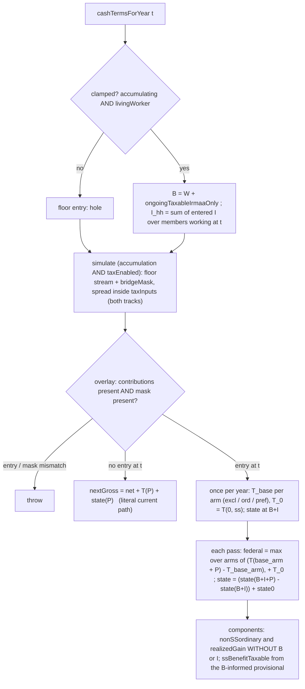
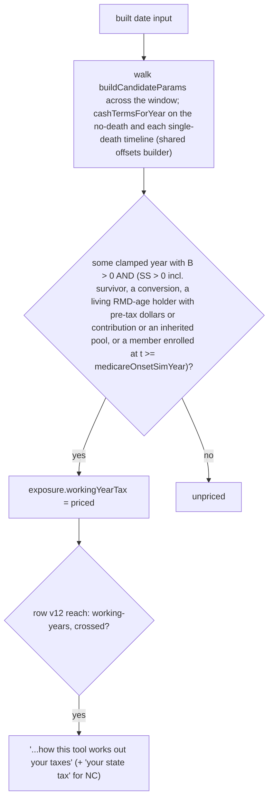

# fix: Price a working-year conversion, RMD or Medicare draw on top of the household's pay

## Summary

In a §7-clamped working year on the date route, the tax overlay prices everything the portfolio supplies as if the household had no other income. That covers a forced RMD, the household's own Roth conversion, and the draw that pays a retired spouse's Medicare. The result is an optimistic charge. This build makes the portfolio pay the year's tax less only the part the household's outside income adds by itself. At zero outside income every year prices exactly as today, and every construct-absent run stays byte-identical.

---

## Problem Frame

The origin is the register's Tier 0 entry *A working-year Roth conversion or RMD on the date route is taxed as if the household had no pay…* (`docs/backlog.md`, filed 2026-10-20 b9-3). Its ⚑ NEGATIVE bullets are binding. Its Prescription, tax(W + X) − tax(W), is the starting form. This plan refines it with KTD1 (the T(0, ss) term), KTD2 (the clamped pension in the base) and KTD11 (the entered investment income, council `wf_ef6cf7c5-a2b`).

Every date-route candidate carries the accumulation construct (`buildCandidateParams`, `src/engine/dateSearch.ts`). Its presence keys `cashTermsForYear`'s §7 clamp (`src/engine/simulate.ts`). The clamp sets the household's net to zero while any living person works: pay covers living, and the wages fund their own tax outside the portfolio.

The overlay still runs those years, and the portfolio still supplies money in them:
- the forced RMD of any living holder, a retired spouse included;
- the household's absolute-year conversion plan;
- the Medicare and extras premiums of a member already enrolled (`fundingNet`, `src/engine/taxOverlay.ts`).

`solveGrossWithdrawal` prices all of this with no outside-income term.

The measured instance is `dip`'s shipped lifestyle crown, Y = 5 at both tiers. Its year-4 $34,000 conversion is charged $180 federal, where the same table charges $4,380 on top of $102,000 of taxable wages, and more with its entered $10,000 of investment income. The register's reach measurement covered conversions and RMDs only. The Medicare-draw channel is derived to reach `date` and `atceiling` (Y = 6–10) and `date65` and `datenc` (every Y ≥ 1), and is unmeasured. The direction is optimistic: a date can crown earlier than the honest one.

---

## Requirements

**Pricing**
- R1. In a clamped year, the portfolio funds the year's federal tax as KTD1 and KTD11 price it, plus priced-state tax by KTD7. P is everything the portfolio supplies that year: the RMD, the conversion, the Medicare/extras funding draw, and the tax-funding draw with its realized gain.
- R2. W = Σ over living workers of max(0, `earnedIncomeReal_i` − that person's `pretax` channel in year t). B = W + the year's clamped ongoing taxable (R40's KTD-9 IRMAA-only feed, `docs/decisions/other-income-r40.md`). The entered investment income I enters per KTD11.
- R3. The tax the outside income adds by itself is never funded from the portfolio. At B = 0 and I = 0 the year's charge equals today's figure, bit for bit (the register's ⚑ NEGATIVE).
- R4. B enters every channel the tax reads: the ordinary base, the §86 provisional, the senior-bonus MAGI, the cap-gains stacking base and the NC base. Neither B nor I ever enters the returned `MagiComponents.nonSSordinary` or `realizedGain`.

**Invariance**
- R5. Construct-absent runs, tax-off runs, the all-retired route, Y = 0 candidates and every golden case stay byte-identical. An unclamped year takes the literal current expression.
- R6. A clamped year applies the formula even at B = 0. The key is the clamp, never `earnedIncomeReal > 0` or I > 0.
- R7. The gross-up converges within `GROSS_UP_MAX_PASSES`, and the stress sweep samples B and I.
- R8. A wiring fault fails loud. Under the construct, a clamped year has a floor entry, and only a clamped year does.

**Measurement and pins**
- R9. `dip`'s year-4 tax at Y = 5 matches figures derived by hand from the primary IRS table, with I and without.
- R10. Every date-route dev seed is measured before and after at both tiers, per channel and two-sided. `dip`'s pins move only by its own re-tune law, never by loosening.

**Disclosure**
- R11. A saved date-route vault the change can reach reads "your taxes", and "your state tax" when it is in NC. A household it cannot reach reads nothing new.
- R12. `SOLVER_CODE_VERSION` stays 11. The ledger row carries the proof that no scored figure can move.
- R13. One methodology disclosure row says, in plain words, how the working-year investment income is priced and what is left out. It ships in the same commit.

**Docs**
- R14. `docs/product.md`, `docs/architecture.md`, the decision records and the stale code comments say how the working-year tax is modeled.

---

## Key Technical Decisions

- KTD1. **For one base, charge (T(base + P, ss) − T(base, ss)) + T(0, ss).**
  - The baseline taxes are computed once per clamped year through the same pure helper, with every portfolio channel at zero. They're constant inside the fixed point.
  - The order of operations returns exactly T(0, ss), today's figure, when the pass carries no portfolio income.
  - The increment is ≥ 0 by monotonicity: every channel in `taxCore.ts` is non-decreasing in portfolio income. The helper fails loud only below a sub-cent tolerance (−1e-6), never on rounding dust.
  - Rejected:
    - adding the base with no subtraction (it funds the wages' tax from the portfolio, against the §7 NEGATIVE);
    - the register's prescribed T(base + P) − T(base) with no T(0, ss) term, which charges $0 where SS alone is taxable and so falsifies the NEGATIVE's own premise;
    - a baseline without SS, T(base, 0), which charges the portfolio SS's tax on cash it never receives.
- KTD2. **B includes the clamped ongoing taxable.** R40's KTD-9 already rules that its tax is paid outside the portfolio. Leaving it out would keep the wage-blind shape for a working household with a pension.
- KTD3. **The convergence bound.**
  - In the ordinary arms, B, and I treated as ordinary, sit in `nonSSordinary`'s tax-side base exactly where `conversion` and `ongoingTaxable` sit. So each is algebraically a year-constant conversion, and k_sup ≈ 0.78 stands.
  - The preferential arm puts I in the gain argument and in §86's other income, as a year-constant realized-gain block. Its k is derived in writing against the cap-gains straddle corner in the `GROSS_UP_MAX_PASSES` comment.
  - A max of k-Lipschitz maps is k-Lipschitz.
  - Float cancellation bounds B: at T_base of about 4.5e8 the subtraction's ulp approaches `GROSS_UP_EPSILON`. The sweep stays at or below $1e8, and an absurd B fails loud, never silently.
- KTD4. **W subtracts each person's own `pretax` channel, read before the employer-match merge.**
  - Read `pc.pretax[t]` from `params.overlay.accumulation`, behind the alive∧working filter, before `cPretaxByPerson` adds `employerMatch`.
  - The rule source: §402(e)(3), the 2026 W-2 instructions (Box 1 excludes 401(k)/403(b) elective deferrals), §62(a)(7) for a deductible IRA, and §86(b)(2) (provisional income is AGI-based).
  - Rationale: the engine taxes every pre-tax withdrawal as ordinary income, so it already treats these contributions as never taxed.
  - Disclosed simplifications, each filed by U6:
    - HSA is not subtracted. The employee and employer dollars are separate at intake (`annualContribution` / `hsaEmployerAnnual`), so this is a choice; a per-person employee-HSA channel is filed.
    - The §219(g) phase-out is unmodeled ($129,000–$149,000 MFJ active participant, 2026; up to $8,600 per person).
    - The 2026 Roth-only catch-up (Notice 2025-67) relies on the entered account kind: up to $8,000, or $11,250 at ages 60–63.
    - The per-person floor at 0 drops a non-earner's spousal-IRA deduction.
  - The direction of each W error is regime-conditional. Overstating W charges more only where the year's marginal rate is non-decreasing in W. The sign inverts past the §86 85 %-of-benefit cap and past the senior-bonus phase-out end. No doc calls these simplifications "conservative".
- KTD5. **Single-source B where the clamp lives; carry it under the construct.**
  - `cashTermsForYear` returns the year's B when clamped and `undefined` otherwise, beside the KTD-9 split.
  - `simulate` builds the stream only when `overlay.accumulation` is present and `taxEnabled` is true.
  - The stream is spread inside `taxInputs`, so the essentials-floor pass inherits it.
  - `bridgeMask` is pushed and `bridgeYearMask` spread whenever the construct is present, not only under `healthcareEnabled`. Both mask arms read it only inside healthcare-gated blocks, so no value changes.
  - The overlay's construct marker is `contributions !== undefined`. With the marker and the mask present, an entry without a masked year, or a masked year without an entry, throws.
  - A present entry is finite and ≥ 0, and an absent entry is a hole, never a NaN.
- KTD6. **`MagiComponents` exclude B and I; taxable SS rides the B-informed provisional.**
  - The IRMAA override already carries gross pay plus investment income, and feed (3) carries the clamped pension, so including them would double-count (R40's KTD-9 tripwire).
  - The higher taxable SS is new and true. The lag-read guard's "computed MAGI is about $0" premise is untouched (insight 049).
  - ACA can't be reached: the window gate and the bridge price gate.
  - Docblocks to record:
    - a clamped year's `healthOut` anchors are a mixed figure (unread: the readout is spine-only);
    - a clamped year's `taxPaidThisYear` is the portfolio-funded tax, not the household's.
- KTD7. **State tax: one presence-keyed channel on `StateTaxYearContext` carrying the year's ordinary base, B plus I.** The state takes I once, as ordinary (council).
  - **NC** adds it to the AGI-derived base, where it absorbs the $25,500 MFJ / $12,750 single deduction. The source: G.S. 105-153.3(1) and 105-153.4(a), with no 401(k) add-back; the 2030 rate is 3.24 % (S.L. 2026-41 §44.1(a)). NC's child deduction (105-153.5(a1)) is unmodeled, which is pre-existing; it is filed.
  - **PA** ignores the channel structurally (FL's idiom), which keeps PA exact. PA law taxes gross compensation (61 Pa. Code §101.6(c)(7)–(8)), but under a flat rate with no deduction the increment is W-invariant. That holds only because Schedule SP Tax Forgiveness is OUT: over a small wage floor the omission can understate by up to about $470 a year (MFJ, no dependents). That's disclosed and filed, and the constants note's "conservative-direction" label gets the clamped-year caveat.
  - U2 reads the PA primary on whether a still-working 59½+ member's employer-plan conversion keeps the exemption. If it doesn't, U6 files a Tier 0 entry; this build doesn't change PA's age gate.
  - **FL** stays a structural 0.
- KTD8. **Ledger row v12: `families: ['tax', 'stateTax'], states: ['NC']`, with a row-level `reach: 'working-years'` qualifier gating every family on the row.**
  - Combine `reach` with each family's read: `'unpriced'` beats `'unknown'`, which beats `'priced'`. `PRICING_FAMILY_READS` is unchanged, so rows 1–11 read exactly as before.
  - The phrases "your taxes" and "your state tax" are already shipped and are true for every household reached.
  - Rejected:
    - a new family (a new phrase is a words call, and it names the same noun);
    - an unqualified row (it tells every retired household something false);
    - a qualifier inside `tax`'s read only (the `stateTax` read would still name retired NC vaults).
  - The register's ⚑ against folding date-route changes into `tax` was written about a date-BAND change, where "your taxes" is false.
  - Row v12's `what` records three residuals:
    - an NC vault reached only through SS is named for a state tax that didn't move, since NC exempts SS;
    - the second-order Medicare move from B-informed taxable SS rides `tax` alone (row v5's precedent);
    - the stale-PWA residual (1).
- KTD9. **No `SOLVER_CODE_VERSION` bump.**
  - The solver and the spend solve run only on the all-retired spine (`buildSolveRequest` returns `'spine-unready'` off it), and a spine has no living worker.
  - The one date-route consumer is the Roth/TwoFutures preview: `buildControlPreviewParams` runs the crowned candidate through `runTwoArm`. Its delta moves in a direction that is unmeasured; both arms' working-year taxes rise. It isn't persisted.
  - A saved recommendation carried across a route flip already reads `'inputs-unavailable'`.
  - A bump would demote every retired household's saved recommendation, because the compare is `!==`.
- KTD10. **Every red-first figure comes from the IRS PDF.** It uses Rev. Proc. 2025-32 Tables 1 and 3 and §4.14(1), re-typed from the PDF (read 2026-10-20), never from `src/engine/constants/tax.ts`.
  - At B = $102,000, taxable income is $69,800, taxed $7,880.
  - Adding the $34,000 conversion gives $103,800, taxed $12,260. The increment is **$4,380**, and the conversion alone is $180.
  - With I = $10,000 as ordinary: $79,800 → $9,080 and $113,800 → $14,460, an increment of **$5,380**. The preferential arm is derived by hand from §4.03's 0 / 15 % edges.
  - Every fixture walks its rule boundaries first (insight 023): count65 (the §63(f) addition, the senior-bonus window), the §86 thresholds, the RMD start age, the ACA window and the state.
- KTD11. **Working-year investment income joins the base at the costliest of three readings** (council `wf_ef6cf7c5-a2b`, 7/10, 0 abstentions).
  - The federal charge is the max over three arms of KTD1's increment, plus T(0, ss) once:
    - I excluded (base B);
    - I as ordinary (base B + I);
    - I as preferential (I in `ordinaryPlusCapitalGainsTax`'s gain argument and in §86's other income).
  - It is never max-of-totals minus max-of-baselines. The excluded arm closes the red team's hit: in the concave §86 regime, including I lowers the charge.
  - I_hh is the household sum of the entered slots of members working at t, in every clamped path-year. It is never per owner and never keyed on I > 0. Persistence after a death is UNSOURCED; no widow claim.
  - I reaches the engine as a raw per-person vector on `DateSearchInput`, derived beside `workingYearIrmaaMagiByPerson` under the same completeness gate. It is presence-keyed, with an R19 validation arm and the identity override − earned === I.
  - At I = 0 the three arms coincide, bit for bit, with the excluded floor.
  - The council's dissent: (A) + disclose, since the I-blindness comes from yield subsumption in every year. It flips if the two-sided I-on/I-off measurement reorders candidates in a way the disclosure can't explain, if the preferential k exceeds about 0.78, or if an all-years yield model with a tax character is built.

---

## High-Level Technical Design

The per-year solve. The unclamped, tax-off and construct-absent branch is unchanged.

The disclosure path (U5):

---

## Implementation Units

**Every unit lands in ONE commit:**
- the U4 pin settlement, which the register's binding re-tune-in-the-same-commit rule requires;
- U5's ledger row, so a saved vault never recomputes silently;
- U6's test counts, re-anchor and register edits, because `verify:doc-stats` is a CI gate;
- U7's disclosure row, by council ruling.

`shippedOn` is that commit's local date, and it is pushed the same day. U4's measurement runs on the working tree first.

### U1. The federal formula and its arms in the gross-up

- **Goal:** `solveGrossWithdrawal` prices a clamped year by KTD1 and KTD11, with a pure helper the witness probes.
- **Requirements:** R1, R3, R4, R6, R7, R8, R9.
- **Dependencies:** none.
- **Files:**
  - `src/engine/taxOverlay.ts`: `GrossUpContext`'s optional floor (B and I); `solveGrossWithdrawal`; the per-year `grossUpCtx` build; the `TaxYearInputs` docblock and entry checks, including the marker-and-mask cross-check; the KTD-9 field docblocks ("never touches… the §86 base"); the file-header "disclosed" note on yield; the `GROSS_UP_MAX_PASSES` comment, carrying the preferential arm's k.
  - `src/engine/__tests__/taxOverlay.test.ts`, in a block beside R40 seam 2 / KTD-9. It reuses `mkHousehold`, `STOCK_W`/`OFF`, `CUSTOM_TEST_ORDER`, `line35Mfj` and `closedFormIndex`.
- **Approach:**
  - With the floor field absent, the function evaluates the exact current expression.
  - With it present, compute the three arm baselines and T_0 once, then apply KTD11's max each pass.
  - Return components excluding B and I.
  - The helper's witness probe lands in the same commit (U5).
- **Execution note:** red-first. Every fixture fails on today's code first.
- **Test scenarios:**
  - **Happy path:** MFJ, nobody 65, calendar 2030, B = 102,000, I = 0, conversion 34,000. The pool has pre-tax ≥ 34,000 plus Roth, and a custom roth-first order makes the funding draw tax-neutral. The charge is **4,380**; floor-absent it is **180**.
  - **Fixed point:** the same inputs, drawn from pre-tax: g = 4,380 + 0.22·g, so **5,615.384615…**.
  - **Arms:**
    - an ordinary-wins witness (`dip`'s I = 10,000: 5,380 against the hand-derived preferential and excluded arms);
    - a preferential-wins witness (W = 100,000, I = 20,000 of gains, X = 34,000: the conversion lifts the gains past the $98,900 edge, by hand);
    - an excluded-wins witness under §86 saturation (by hand).
  - **Mutants:** always-ordinary, always-preferential, max-of-totals and no-excluded-arm each turn a witness red (recorded as planted-and-reverted).
  - **RMD:** calendar 2032, one holder at RMD age (walk the §63(f) addition), B chosen so the increment stays inside one bracket, an RMD of 40,000, a pre-tax-heavy pool. A draw below the RMD is absorbed by `max(alloc.pretax, rmd)`, so g = the increment, by hand.
  - **Medicare draw only:** calendar 2030, a retired 65+ spouse enrolled, B chosen so the draw stays inside one bracket, a funding draw as the only portfolio income. Derive by hand; floor-absent it is sheltered.
  - **Edge, B = I = 0, no SS:** equals the floor-absent figure bit for bit (the control arm, insight 029).
  - **Edge, B > 0, SS alone taxable, no portfolio income, roth-first order:** the charge is T(0, ss), equal to the floor-absent figure.
  - **Edge, §86 with wages:** B = 60,000, SS 30,000, a 20,000 conversion. Derive taxable SS by hand on the deflated thresholds. The returned `ssBenefitTaxable` reflects B; `nonSSordinary` excludes it.
  - **Edge, §86 cap:** SS 40,000, W 45,000, an 8,750 B overstatement, a 10,000 conversion. Pin the inverted sign: overstating B lowers the increment past the 85 % cap (KTD4's regime-conditional label).
  - **Edge, single filer:** a working survivor; T from Rev. Proc. 2025-32 Table 3 and the single §86 thresholds.
  - **Edge, cap gains:** B lifts the base past the 0 % gain edge, and the funding draw's gain is taxed at 15 %, by hand.
  - **Edge, senior bonus:** a 65+ worker in calendar 2027, B in the $150k–$250k band, the bonus phased per person (Schedule 1-A Part V).
  - **Error:**
    - a non-finite, negative or NaN entry throws;
    - a marker-and-mask mismatch throws either way;
    - an increment below −1e-6 throws.
  - **Convergence:** the state-on (NC) sweep gains B and I axes, with B ≤ $1e8 and I under both readings, at the federal-worst corner, and converges within 192 passes.
- **Verification:** the block is green, the mutants are recorded red, and today's figures appear only in the floor-absent arms.

### U2. The state half

- **Goal:** priced-state tax in a clamped year follows KTD1 by each state's rule (KTD7).
- **Requirements:** R1, R3, R4.
- **Dependencies:** U1.
- **Files:**
  - `src/engine/stateTax.ts`, where the channel is optional;
  - `src/engine/taxOverlay.ts`;
  - `src/engine/constants/stateTax.ts` (the PA SP caveat);
  - `src/engine/__tests__/stateTax.test.ts`;
  - `src/engine/__tests__/taxOverlay.test.ts`, for an NC overlay arm.
  - The other `StateTaxYearContext` literals compile unchanged: `src/ui/healthSheetChrome.ts`, `src/engine/__tests__/frozenNominalDeflation.test.ts` and `src/engine/__tests__/pricingWitness.test.ts`.
- **Approach:** NC adds the channel; PA and FL ignore it structurally. With the channel absent, the call is the literal current one. Read the PA in-service conversion question from the PA primary.
- **Test scenarios:**
  - **Happy path, NC:** with B + I above the deflated deduction in 2030, the increment is 3.24 % × the conversion. Floor-absent it is 3.24 % × max(0, X − D), by hand.
  - **Edge, NC below the deduction**, and NC single at $12,750.
  - **Invariant, PA:** the increment with the channel is exactly equal to the increment without it, under and over 59½.
  - **Invariant, FL:** exactly 0 either way.
- **Verification:** the state arms are green; PA and FL are pinned exact.

### U3. Wire B, I and the mask through `simulate`

- **Goal:** B and I are computed where the clamp lives and reach both decumulation passes (KTD2, KTD4, KTD5, KTD11).
- **Requirements:** R2, R5, R6, R8, R9.
- **Dependencies:** U1, U2.
- **Files:**
  - `src/engine/simulate.ts`: `cashTermsForYear`; the stream and the mask under accumulation and tax; the spread inside `taxInputs`; the KTD-9 comment; and an exported pure offsets / `higherClaimOffset` builder that `simulate` and U5 share;
  - `src/shared/model.ts` (the per-person I on `DateSearchInput`; the field contract's "IRMAA only" corrected);
  - `src/intake/intakeMap.ts` (`buildDateInput` derives I beside the override);
  - `src/engine/dateSearch.ts` (`buildCandidateParams` passes I through);
  - `validateParams` (an R19 arm for I);
  - `src/engine/healthcareStreams.ts` (the false "disclosed" docblock);
  - `src/engine/__tests__/simulate.test.ts` (the R40 seam-1 block's pattern);
  - `src/ui/__tests__/devSeeds.test.ts`, for the `dip` integration, since engine tests never import `@ui`.
- **Approach:** read `pc.pretax[t]` behind the alive∧working filter, before the match merge. Add `sel.taxable` where KTD-9 routes it IRMAA-only. Sum I over the members working at t.
- **Test scenarios:**
  - **Happy path:** a two-worker clamped year gives W = (75,000 − 8,000) + (35,000 − 0) = 102,000 and I_hh = 10,000, with the match and HSA excluded (`dip`).
  - **Edge, a worker dead earlier in the path:** contributes 0 to W and its I slot drops out.
  - **Edge, contributions above pay:** floors at 0.
  - **Edge, unclamped:** a hole. A clamped zero-pay year gives 0.
  - **Edge, a working-year pension:** in B and still IRMAA-only.
  - **Edge, a tax-off construct run:** no stream, and its output is byte-identical.
  - **Identity:** override − earned === I for every working member; the R19 arm rejects a non-finite or negative I.
  - **Invariance:** the construct-absent, all-retired and Y = 0 goldens and the historical Trinity/Bengen counts stay green unmodified.
  - **Integration:** `buildCandidateParams(buildDateInput(DEV_SEEDS.dip), 5, 1)` on a zero market (`{ mean: 0, stdDev: 0 }`), fixed-horizon, `maxHorizonYears: 5`.
    - Year 4 opens at 748,000 / 299,000, the conversion leaves 714,000 / 333,000, and s = 238/349.
    - The year-4 `lifetimeTaxPaidReal` is the max arm's increment / (1 − m·s), derived by hand with I = 10,000. The I = 0 rebuild gives 4,380 / (1 − 0.22·s) = **5,153.1149**, and floor-absent 180 / (1 − 0.10·s) = **193.1734**.
    - `terminalValuesReal` is 1,059,000 − g.
  - **Moved witnesses:** a zero-valued stream (it passes R8) returns 193.1734; I-on against I-off differ.
  - **Floor track:** the essentials pass's year-4 tax equals the full pass's.
  - **Preview:** `runTwoArm` on `dip`'s crowned candidate carries the same B in both arms. Its with-arm is compared to U4's recorded pre-change figure.
- **Verification:** the integration figures match the hand derivation, and every byte-identity guard passes untouched.

### U4. Measure and settle the date-route seeds

- **Goal:** know what moved, per channel and in both directions, and settle every pin by its own law (insight 135).
- **Requirements:** R9, R10.
- **Dependencies:** U3.
- **Files:**
  - `src/ui/devSeeds.ts` (the `dip` docblock records the move or its absence; a re-tune only if it moved; the `datearrived` plant's decision);
  - `src/ui/__tests__/devSeeds.test.ts`;
  - a scratchpad `.mts` probe under `tsx` from the project directory, not committed;
  - `e2e/vertical-fit.spec.ts`, run and edited only if an arm reds.
- **Approach:**
  - Run `buildDateInput` → `runDateSearch` at `DEV_CRN_SEED`, both tiers, on the pre-change tree and after. Cover every date seed: `dip`, `date`, `date65`, `datenc`, `dateborder`, `datesplit`, `datemixed`, `atceiling`, `datestale` and `datearrived`. Record each track's crown kind, offset and per-offset odds and grade.
  - Treat moves as two-sided: an earlier or later crown, a Y = 10 date appearing or vanishing, a grade move.
  - Count the reached clamped path-years per channel: conversion, RMD (a retired spouse's included), Medicare draw, SS (survivor included), pension and I. Run `dip` I-on and I-off.
  - Record `dip`'s crowned-candidate preview before and after, and grep for any test pinning a date-route preview figure.
  - Record whether any date seed runs `bracket-fill`.
  - If `dip` moves, apply its law: the smallest portfolio bump that re-lifts offsets 0, 1 and 2 at both tiers with offset 3 under, the before figures and the grid recorded first. Settle `datearrived` (`ARRIVED_PLAN_YEARS`), clamping its plant to `FIRST_UNAMBIGUOUS_SAVE_DAY` or recording the 30-day line.
  - If a preview's headline flips direction, put that face on the U7 Caddie walk.
- **Test scenarios:** `dip`'s provisional pin; `datearrived`'s crown and split pins; the `verify:fit` arms on `dip`, `date65`, `datenc`, `datestale` and `datearrived` at final tier.
- **Verification:** the before/after table is in the `dip` docblock and the commit message; every date-route pin and fit arm is green.

### U5. Disclose to saved date-route vaults

- **Goal:** a vault the change can reach reads the right lines on re-entry; nothing else changes (KTD8, KTD9).
- **Requirements:** R11, R12.
- **Dependencies:** U1–U4.
- **Files:**
  - `src/engine/pricingVersion.ts` (`reach?`, row v12, the header);
  - `src/store/staleness.ts` (`StalenessExposure.workingYearTax` and the row-level reach combine);
  - `src/engine/dateSearch.ts` (the predicate, beside `buildCandidateParams`, through U3's offsets builder);
  - `src/intake/intakeMap.ts` (a `…ForRun` wrapper beside `survivorMedicalLeanForRun`);
  - `src/ui/stalenessExposure.ts` (the unknown, route and spine arms);
  - the tests:
    - `src/engine/__tests__/dateSearch.test.ts` (the predicate's channel arms);
    - `src/engine/__tests__/pricingVersion.test.ts`;
    - `src/engine/__tests__/pricingWitness.test.ts` (`PINNED.tax` and `PINNED.stateTax` at v12; a wage axis on the `STATE_TAX` grid; the helper probe with a floor-absent control and a recorded "floor ignored" mutant);
    - `src/store/__tests__/staleness.test.ts` (the five fixtures, `reaches`, the priced sets, and the two premises v12 breaks);
    - `src/ui/__tests__/stalenessExposure.test.ts`;
    - `src/ui/__tests__/devSeeds.test.ts`;
    - `src/ui/__tests__/reentry.test.tsx`.
- **Approach:**
  - The predicate walks `buildCandidateParams(Y)` across the window and calls `cashTermsForYear` on the no-death timeline and on each single-death timeline. That puts a still-working survivor's §202 benefit and an inherited pre-tax pool inside the clamp's domain (insight 027).
  - It reads `'priced'` when some clamped year has B > 0 and any of: SS > 0; a conversion; a living holder at or past `rmdStartAgeForBirthYear` with pre-tax dollars, a pre-tax contribution or an inherited pool; or a member enrolled at t ≥ that candidate's `medicareOnsetSimYear`. Otherwise it reads `'unpriced'`, and `'unknown'` when the draft is unbuildable.
  - There are no standalone age, pension or I triggers, because with P = 0 the charge is T(0, ss), today's figure.
- **Test scenarios:**
  - **Happy path:** a `dip` vault saved before the ship day renders "Since your save, we've changed how this tool works out your taxes. This reading uses the current method."
  - **Happy path, NC:** a `datenc` vault adds "your state tax".
  - **Edge, retired vaults:** a retired vault and a retired NC vault, both crossing v12, get no v12 line.
  - **Edge, unreachable date-route vault:** no line.
  - **Edge, ship day:** an unreached vault saved on the ship day is silent; a reached one is spoken namelessly.
  - **Edge, survivor SS:** a couple both working at 55, claiming at 67, no conversion, reads `'priced'`.
  - **Proof arms:** every seed reading `'unpriced'` is byte-identical in U4's run, and every seed reading `'priced'` moves. A Medicare-only clamped fixture reads `'priced'` and moves, and an unpriced fixture with a moved control stays unmoved.
  - **Guard:** a retired vault saved before v1 still names "your taxes".
  - **Shape:**
    - `reach` is absent on v1–v11;
    - versions are strictly increasing;
    - `solverCodeVersion` is 11 and non-decreasing;
    - `'row-unpinned'` reds until v12 is pinned.
- **Verification:** the staleness, exposure and re-entry tests are green, and the retired fixtures are unchanged.

### U6. Make the docs true and file the residuals

- **Goal:** every document and comment describes the working-year tax as modeled, and every residual is on the register (R14).
- **Requirements:** R14.
- **Dependencies:** U1–U5.
- **Files:**
  - `docs/product.md` (R34 and the "No accumulation-phase income-tax engine" lines);
  - `docs/architecture.md` (§7.4 and the same sentence);
  - `docs/decisions/accumulation-fuck-off-date.md`;
  - `docs/decisions/other-income-r40.md` (KTD-9 (3));
  - `docs/plans/1-engine.md`;
  - `docs/backlog.md`:
    - CLOSE the Tier 0 entry with U4's measurement;
    - update the Tier 1 NC/PA clause entry and *The engine-pricing ledger cannot name a date-route…*;
    - FILE, each with its direction stated as regime-conditional where it is: the SS earnings test (and its interaction with the SS this build now taxes); the bracket-fill rails; PA Tax Forgiveness over a wage floor; NC's child deduction; NIIT reachable once wages are in the base (the constants' OUT note says no conversion moves it, which is false for a working household); the still-working 401(k) RMD deferral; the §219(g) phase-out; the Roth-only catch-up; the employee-HSA channel; the chapter-two all-years yield model with a tax character asked; the council's (B) / (C) NEGATIVEs; and the PA in-service conversion question if U2 finds it optimistic;
    - adjust the header count;
  - `README.md` and `docs/roadmap.md` (the test counts);
  - `TODO.md`.
- **Approach:**
  - Say how the base is assembled and what T(0, ss) preserves, never "fixed" and never "conservative".
  - Run `pnpm doc:reanchor` against the code diff, minding its landmines (frozen-file restore, first-token-only), then `verify:doc-stats`.
- **Test expectation:** none (docs). `verify:doc-stats` is the gate.
- **Verification:** `verify:doc-stats` is green, and no live doc says the working years carry no income-tax engine.

### U7. The methodology disclosure row

- **Goal:** the household can read how its working-year investment income is priced (R13, council `wf_ef6cf7c5-a2b`).
- **Requirements:** R13.
- **Dependencies:** U1, U3.
- **Files:**
  - `src/ui/assumptionRegistry.ts` (one static `METHODOLOGY_DISCLOSURES` row);
  - `src/ui/copy.ts`;
  - the census test that covers the registry;
  - a Caddie walk of the assumptions panel's methodology list.
- **Approach:**
  - Draft one row in plain words covering: the costliest of the three readings is used; a different mix can cost more; this applies to working years only; the yield's own tax is never taxed; a retired spouse's investment income is never collected; NIIT is out.
  - No "conservative", "worst case" or "only later" (the Hawk's narrowed ban).
  - The words are yours-to-close: pilot-drafted and Caddie-walked, they ship by default under the batched-oracle grant.
  - The "Income Medicare looks at" heading stays as written. It is flagged in `docs/council-log.md` for you.
- **Test scenarios:** the census test counts the new row. A copy guard rejects the three banned words in it.
- **Verification:** a chaired Caddie card on the panel, and the census green.

---

## Scope Boundaries

- **Not changed:**
  - the conversion plan's years;
  - the wages' own tax and I's own tax, which no modeled cash pays;
  - the IRMAA override's composition;
  - ACA, which is unpriced in working years;
  - whether pay should fund a retired spouse's Medicare in a working year (pre-existing; this build prices that draw's tax);
  - a bridge year without the construct, which stays wage-blind and is unreachable on both v1 routes;
  - the "Income Medicare looks at" heading (flagged for you).
- **Deferred:** every item U6 files.
- **Yours:** the Tier 1 NC/PA clause words, the U7 row's words (which ship by default), and the heading.

---

## Risks & Dependencies

| Risk | Mitigation |
|---|---|
| A float-lineage leak breaks byte-identity on the retired route | The absent branch is the literal current expression; the guards run unmodified |
| A wiring slip silently drops B or I | KTD5's marker-and-mask cross-check; U3's integration and moved witnesses; the I identity test |
| The preferential arm opens a contraction corner | KTD3's written derivation; the I axis at the federal-worst corner with state on; a throw on non-convergence |
| An absurd B defeats `GROSS_UP_EPSILON` | The sweep stays at or below $1e8; a non-converged year throws loud (KTD3) |
| The Medicare-draw channel moves crowns the register never measured | U4 measures per channel, two-sided, at both tiers; re-tune by each seed's own law |
| `dip`'s knife-edge re-tune cascades into the aged seeds | U4 settles `datestale` / `datearrived` in the same pass |
| A saved vault recomputes with no note, or a false one | One commit for everything; U5's two-sided proof arms |
| A stale PWA re-saves after the ship day | Accepted, named in row v12's `what` |
| Local test load | No full local suite (the memory-reaper landmine): touched files in the foreground, CI runs the whole gate |

---

## Sources & Research

- **The origin:** the register entry above, plus the Tier 1 NC/PA clause entry. **The council:** `docs/council-log.md` 2026-10-20 (`wf_ef6cf7c5-a2b`).
- **Federal:** Rev. Proc. 2025-32 (`irs.gov/pub/irs-drop/rp-25-32.pdf`, read 2026-10-20: §4.01 Tables 1 and 3, §4.03, §4.14(1)); 26 U.S.C. §402(e)(3), §402(g), §62(a)(7) and §86(b) (via LII); Notice 2025-67; the 2026 General Instructions for Forms W-2 and W-3 (Box 1).
- **NC:** G.S. 105-153.3(1), 105-153.4(a) and 105-153.5(a), (a1) and (c); S.L. 2026-41 §44.1(a).
- **PA:** 61 Pa. Code §101.6(c)(7)–(8); the 2025 PA-40 instructions (Schedule SP Table 2); the PIT Guide's Tax Forgiveness chapter.
- **The code:** `solveGrossWithdrawal` / `GrossUpContext` (`src/engine/taxOverlay.ts`); `cashTermsForYear` (`src/engine/simulate.ts`); the proportional rule (`src/engine/sequencing.ts`); `buildCandidateParams` (`src/engine/dateSearch.ts`); `buildHealthcareStreams` (`src/engine/healthcareStreams.ts`); `stateIncomeTax` (`src/engine/stateTax.ts`); `ENGINE_PRICING_LEDGER` (`src/engine/pricingVersion.ts`); `PRICING_FAMILY_READS` (`src/store/staleness.ts`); `buildSolveRequest` (`src/intake/solveDispatch.ts`); `METHODOLOGY_DISCLOSURES` (`src/ui/assumptionRegistry.ts`); `dateDipSeed` (`src/ui/devSeeds.ts`).
- **The insights:** 027, 007, 135, 137, 023, 049, 029, 011.

---

## As built (2026-10-20)

Built in one working tree (b9-5) and landed as one commit. This section records where the build departed from the plan text above, and what U4 measured. The sections above stay as planned.

### The five decisions the build made

1. **Exactness (KTD1).** Where a reading's base adds no tax of its own (T(base) === T(0, ss)), the charge is evaluated as T(base + P) directly. Elsewhere it is (T(base + P) − T(base)) + T(0, ss). The two forms are the same quantity. The first is bit-exact at base = 0, even when SS alone is taxable; the second is bit-exact at P = 0. Both corners return the pre-floor figure exactly (`taxOverlay.ts`, the EXACTNESS note above `WorkingYearOutsideIncome`).
2. **I = 0 is a shortcut (KTD11).** At I = 0 only the excluded reading is evaluated, since the three readings coincide bit for bit there.
3. **KTD6, refined.** The returned `ssBenefitTaxable` rides the provisional that carries B + I + P, which is the ordinary reading's. I is in AGI under either character (§86(b)(2)). `nonSSordinary` and `realizedGain` exclude both B and I.
4. **The plan's ordinary-wins witness was wrong.** `dip`'s I = $10,000 prices the PREFERENTIAL reading at $5,880, not the ordinary reading's $5,380. The conversion lifts the $10,000 gain block past the $98,900 0 % edge, so the charge is 4,380 + 15 % × 10,000. U1's and U3's "ordinary-wins" expectations are therefore false as written. The ordinary-wins witness is B = 150,000, I = 80,000, X = 34,000 → **$7,888**. `dip`'s U3 integration figure is 5,880 / (1 − 0.22·s) = 6,917.88, with s = 238/349; the I = 0 rebuild stays 5,153.1149, and the zero-valued stream stays 193.1734.
5. **A floor entry without the construct marker throws.** This is stricter than KTD5: the floor describes a §7-clamped year, and there is no clamp without the construct.

### U4 — the measurement

Run at `DEV_CRN_SEED` (0xbada55) on the pre-change tree and after, at both tiers and on both tracks.

- **No crown moved.** No crown offset or kind, and no non-monotone set, moved on any date seed at either tier. Every point that moved, moved DOWN.
- **`dip`.** The floor track is confirmed at 0 with no non-monotone offsets. The lifestyle track is confirmed at 5, nm [0,1,2] provisional and [0,1] final. The final tier was already [0,1] at HEAD: the docblock's "both tiers [0,1,2]" was stale and is corrected. The lifestyle grade fell one cell, 0.89 → 0.88, at both tiers (final p 0.8892 → 0.8866; provisional 0.8965 → 0.894). Offsets 0–4 are byte-identical.
- **The other seeds.**
  - `date`: confirmed at 9 on both tracks; p at Y9 0.8712 → 0.8699 (final), grade holds at 0.87.
  - `date65` / `datenc` / `atceiling`: confirmed at 0; later offsets a few tenths of a point lower.
  - `dateborder`: window-edge at 10; Y10 p 0.85356 → 0.8535; grade holds at 0.85.
  - `datesplit` (floor at 2; lifestyle at 9 final, window-edge at 10 provisional) and `datemixed` (floor at 7; lifestyle no-date): moved under 0.0003, at the final tier only.
- **Reach**, counted as clamped path-years at the provisional tier (2,000 paths), summed over Y = 0..10:

| Seed | Channels reached |
|---|---|
| `dip` | conversion 36,000 (Y ≥ 5) · SS 30,000 (Y ≥ 6) |
| `date` / `atceiling` | Medicare draw 29,330 · SS 12,051 (Y 6–10) |
| `date65` / `datenc` | Medicare draw 101,451 (Y 1–10) · SS 84,448 (Y 2–10) · RMD 1,668 (Y = 10 only — Alex reaches 75 at t = 9) |
| `dateborder` / `datesplit` / `datemixed` | SS only, 6,085 (Y 8–10) — they move through Medicare, not an income-tax draw: T(0, ss) is $0 in every one of those clamped years (benefits up to $48,000), so no draw funds it; the clamped year's taxable SS, now read on the provisional that carries the pay (KTD6), enters IRMAA-MAGI and is billed two years on (row v12's residual (b)). With healthcare off, the floor moves nothing on them, bit for bit |

  Pension reach is 0 everywhere. I > 0 on `dip`, `date`, `date65`, `datenc` and `atceiling`. **Every date seed is reached.** The register's "no reach" for `date`, `dateborder`, `datesplit`, `datemixed` and `atceiling` came from a measurement of conversions and RMDs only.
- **The preview.** `dip`'s crowned-candidate (Y = 5) conversion preview: the with-arm 0.8965 → 0.894, the without-arm unmoved at 0.955. Both read 9 of 10 on track, so no headline flipped and no Caddie walk is owed for the preview. No test pins a date-route preview figure; U3's "Preview" scenario is recorded in `dip`'s docblock, not as a test.
- **Policies.** No date seed runs `bracket-fill`; all are `proportional`. Date-search wall time in a single-threaded probe rose about 5–19 %, measured with two probes and tests running concurrently, so the figure is noisy.
- **No re-tune.** `dip`'s re-tune law did not fire (no lost dip, no lost crown), so no seed was re-tuned. `datearrived` and `datestale` need no settlement, since their base seeds' crowns did not move. Their pins were still to be confirmed by the fit gate when this was written.

### Other as-built deltas

- **U5's predicate keys outside income as B > 0 OR I > 0**, not B > 0 alone. With B = 0 and I > 0 the ordinary and preferential readings still sit on a non-zero base, so the charge can move. B = I = 0 stays exactly `'unpriced'`. The spine route walks its own built params through the same per-run code, instead of being declared unpriced because it is the spine. A throw while building candidates reads `'unknown'`. Single-death timelines are walked only under sampled longevity with at least two people, matching `simulate`. `'priced'` can over-read (a conversion clamped to an empty pre-tax pool, a premium the HSA pays), which is the direction the staleness module may err in; `'unpriced'` is exact.
- **KTD7's PA bound was wrong as stated.** The "~$470" is 3.07 % × $15,250, the REAL increment at the worst corner. The engine already charges 3.07 % × that corner's $2,250, so the understatement is at most 3.07 % × $13,000 = **$399.10** a year, MFJ with no dependent children. That is $690.75 with one child, per the 2025 PA-40 instruction booklet p. 39, Eligibility Income Table 2. The constants note carries the verified figure.
- **The PA in-service conversion question (KTD7) is unsettled.** It is filed in the register as a research item; the engine's PA age gate is unchanged.
- **U7's row** renders as three short paragraphs: the premise and its one-way cost, the costliest-of-a-few-ways rule, and what is left out. No existing census counted the registry's rows, so the census, the banned-word guard and three engine-claim arms live in a new `src/ui/__tests__/workingYearTaxDisclosure.test.ts`. Two Caddie walks shaped it.
  - The first (`wf_48998b24-de1`) walked the pilot's draft. It surfaced the §7 clamp's one-way cost, which the accumulation decision record required disclosed and which no string had ever said. It also surfaced a closing sentence that told an all-retired couple about an entry they never made, and that cold readers took for "our retirement dividends go untaxed".
  - Briggsy then ruled the words PLAIN ("I feel like I need a PHD or lawyer with me to read our own verbiage") and chose a sentence for the yield gap himself. The NIIT clause stays his 2026-10-05 words verbatim.
  - The second walk (`wf_78c8c7fe-9e0`) read the plain row. It moved three points:
    - pay also funds the yearly contributions, so the shortfall test names the whole load;
    - a conversion moves money inside savings, so it isn't "money out";
    - the costliest reading sits above OR below the real tax.
    It also read the yield sentence as a tax rule. A row of its own explaining that shortcut was, in his words, "another example of we are way off course", so the sentence was pulled and the gap stays filed. The third walk (`wf_9868160a-2c4`) read the shipped words, and its two surviving referent findings were re-worded inside their lines before land (the card in `docs/caddie/cold-read-log.md`).
  - Filed the same day: the clamp's missing pay check, a new Tier 0 (*A working year never checks the household's pay against its spending…*). On the disclosure he said: "why the fuck not? what are we building???"
  - Both gaps are examples for his OFF-COURSE discussion: "I really think we're off course here. A discussion for another day". It is owed before the queue resumes.
- **Tax-off non-forwarding cannot be observed.** KTD5's "only when `taxEnabled`" gate on the stream cannot be seen through any output: with tax off nothing reads the stream. A planted mutant that forwards it anyway survives. The test pins that a tax-off run's output does not depend on I, not the gate itself.
- **KTD3's and the Risks table's "an absurd B fails loud" is wrong.** Above B ≈ $1e8 the T(base + P) − T(base) cancellation quantizes the increment at about ulp(T(base)), roughly $1e-4 at B = $1e12. The iteration is monotone on that staircase, so it still lands on an exact fixed point: measured converging up to B = $2e12 and I = $1e12, with a sub-cent error and no throw. The written k derivation KTD3 asked for is in the `GROSS_UP_MAX_PASSES` comment; k_sup ≈ 0.78 stands under all three readings, so the council's flip condition does not fire.
- **KTD8's residual (a) gave the wrong reason.** An NC vault reached only through SS is named for a state tax whose working-year charge did not move. The reason is that no draw funds SS's tax there: T(0, ss) is $0 at realistic benefits, so P = 0 and NC's base gains nothing. "NC exempts SS" is not the reason. Those vaults move only through IRMAA, residual (b). Row v12's `what` carries the corrected reason.
- **Row v12's `shippedOn`** is the literal `'2026-10-20'`. If the commit lands after midnight, re-date it and the v12 literal in `pricingVersion.test.ts`.
